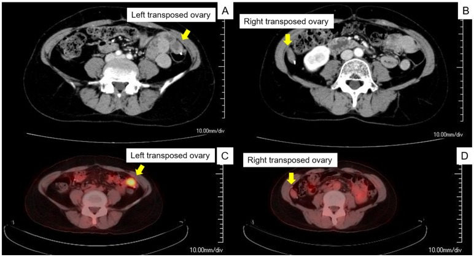
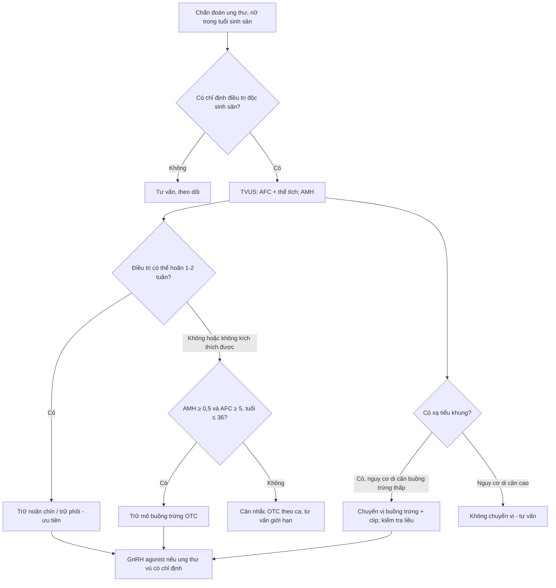
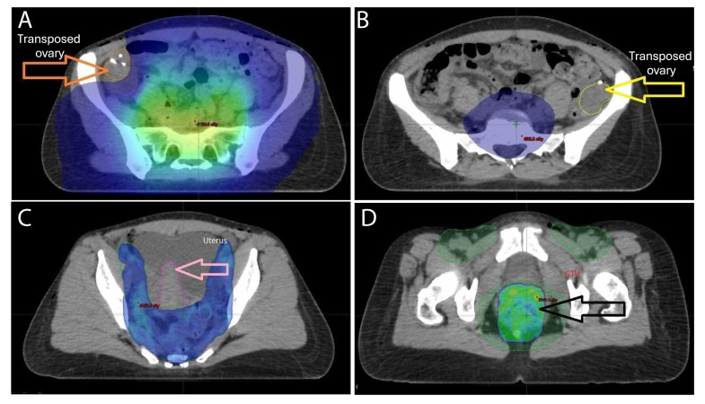

# 1607 — Bảo tồn sinh sản trước hóa–xạ trị: dự trữ buồng trứng, ngưỡng liều xạ & buồng trứng chuyển vị trên CT / Fertility preservation before gonadotoxic therapy

**Tags:** `pattern:buong-trung-chuyen-vi-tri` `pattern:giam-du-tru-buong-trung` `vung:buong-trung` `vung:tieu-khung` `score:AMH-AFC` `protocol:TVUS` `protocol:MRI-chau` `protocol:CT-xa-tri` `protocol:bao-ton-sinh-san`
**Mức chắc chắn (certainty):** tổng hợp y văn (literature synthesis) — ESHRE 2020 (PMC7666361), tổng quan chuyển vị buồng trứng 2026 (PMC13103583), ca nguyên văn tái phát tại buồng trứng chuyển vị (PMC9600108).

> **Câu chốt:** bảo tồn sinh sản là **quyết định trước khi bắt đầu thuốc/xạ** — không phải việc làm sau. Với bác sĩ CĐHA, hai câu hỏi thực hành là: **(1) buồng trứng còn bao nhiêu dự trữ (AFC/thể tích)?** và **(2) buồng trứng đã được chuyển vị nằm ở đâu, có ra khỏi trường xạ không, và khối ở vị trí đó là buồng trứng — hay tái phát?**

## 1. Tổng quan bệnh học – cơ chế hình ảnh

- **Vì sao phải quyết định sớm:** noãn (oocyte) là tế bào **không tái sinh**; hóa chất alkyl hóa và tia xạ phá **nang nguyên thủy (primordial follicle)** theo liều tích lũy. Mất dự trữ → **suy buồng trứng sớm (premature ovarian insufficiency — POI)**: vô sinh, giảm mật độ xương, tăng nguy cơ tim mạch, rối loạn tình dục. Cửa sổ can thiệp là **1–2 tuần trước khi bắt đầu điều trị** (kích thích buồng trứng khởi đầu bất kỳ pha nào — "random-start").
- **Ngưỡng liều xạ (định lượng, theo Wallace 2005 qua PMC13103583):** ở phụ nữ **< 40 tuổi**, liều **< 2 Gy** có thể làm thoái hóa **50% noãn**; **14 Gy** gây **suy buồng trứng hoàn toàn**. Đây là cơ sở để đặt buồng trứng **ra ngoài trường xạ**, không phải "xa vừa đủ".
- **Ngưỡng vị trí chuyển vị (bắt buộc nhớ):** buồng trứng phải cách **≥ 4 cm** mép trường xạ **hoặc ≥ 1,5 cm trên mào chậu (iliac crest)**. Vị trí thường dùng: **rãnh cạnh đại tràng (paracolic gutter)**, thành bụng trước **3–4 cm trên rốn**, hoặc cao tới góc gan/lách.
- **Hiệu quả chuyển vị (định lượng):** tỷ lệ giữ chức năng buồng trứng dao động **15–100%**; ung thư cổ tử cung **50–65%**; xạ ngoài ± brachy **65%** (KTC 95% 56–74); **hóa–xạ đồng thời 51,1%**; chỉ brachy **~90%** (PMC13103583).
- **Nguy cơ ung thư buồng trứng tại chỗ chuyển vị:** **0,36%** chung; **1,46%** với ung thư biểu mô vảy, **3,61%** với **adenocarcinoma** cổ tử cung; ung thư trực tràng/hậu môn **1–8%** → **không chuyển vị** khi nguy cơ di căn buồng trứng cao (PMC13103583).
- **Ngưỡng dự trữ để chọn kỹ thuật:** **không đề nghị trữ mô buồng trứng (OTC)** khi **AMH < 0,5 ng/mL và AFC < 5**, hoặc **> 36 tuổi** (hiệu quả thấp) (ESHRE 2020, PMC7666361).
- **TẠI SAO hình ảnh quan trọng — vật lý:**
  - **Siêu âm đầu dò âm đạo (TVUS):** đếm **nang noãn thứ cấp (antral follicle count — AFC)** là nang **2–10 mm** ở cả hai buồng trứng; AFC và **AMH** là hai test dự trữ được ESHRE khuyến cáo **hơn các test khác**. Thể tích buồng trứng (dài × rộng × cao × 0,523) là số đo phụ.
  - **CT:** sau chuyển vị, buồng trứng là **nốt mô mềm 20–40 HU** ở vị trí bất thường; **clip phẫu thuật ở bờ dưới** là dấu định vị (được đặt đúng vì mục đích này). Dao động theo chu kỳ (nang noãn) làm kích thước thay đổi giữa các lần chụp.
  - **MRI:** vỏ/stroma buồng trứng **T2 trung gian–sáng**, nang noãn **T2 rất sáng**; mô đặc của buồng trứng **hạn chế khuếch tán nhẹ** (stroma giàu tế bào) — **đừng nhầm với u ác**; u ác thường ADC thấp hơn rõ và có thành phần đặc.
  - **PET/CT:** buồng trứng bình thường có thể **ngấm FDG sinh lý** (hoạt động nang/noãn) → **dương tính giả**; ngược lại **tái phát tại buồng trứng chuyển vị có thật** và được chẩn đoán chính bằng PET/CT trong ca nguyên văn.

## 2. Mẫu hình + chẩn đoán phân biệt theo vị trí (Gamut)

- **Khuôn 1 — nốt mô mềm ở rãnh cạnh đại tràng/mào chậu ở người đã mổ ung thư phụ khoa:** **buồng trứng chuyển vị** (có clip, hình thay đổi theo chu kỳ) vs **hạch** (bầu dục, rốn mỡ, dọc mạch) vs **mảng phúc mạc/tái phát** (không clip, bờ không đều, ngấm mạnh) vs **u buồng trứng tại chỗ chuyển vị** (to nhanh, thành phần đặc).
- **Khuôn 2 — buồng trứng to, đau bụng cấp sau chuyển vị:** **xoắn buồng trứng (ovarian torsion)** — buồng trứng to, phù, nang noãn **xếp ngoại vi**, cuống xoắn ("whirl sign"), **không ngấm/ngấm kém**; chẩn đoán sớm để giữ buồng trứng.
- **Khuôn 3 — nang đơn thuần sau chuyển vị:** nang chức năng; đa số theo dõi, chỉ **21,6% nang có triệu chứng phải mổ**, phần còn lại điều trị nội khoa (OCP/giảm đau) (PMC13103583).
- **Khuôn 4 — buồng trứng nhỏ, không thấy nang:** **giảm dự trữ/POI sau điều trị**; đối chiếu AMH/FSH, không dùng hình ảnh đơn thuần để kết luận khả năng sinh sản.
- **Gamut theo vị trí chuyển vị:** **rãnh cạnh đại tràng** (phổ biến), **thành bụng trước trên rốn**, **góc gan/lách** (xa trường xạ nhất nhưng nguy cơ xoắn/di chuyển cao hơn), **sau phúc mạc** (kỹ thuật bóc tách rộng).
- **Gamut theo thời điểm:** **trước xạ** — đánh giá dự trữ + lập kế hoạch; **trong 6 tháng đầu** — nang chức năng, xoắn; **sau nhiều năm** — tái phát tại buồng trứng chuyển vị (9 ca trong y văn, **4/9 tử vong trong 2 năm** sau mổ lần hai — PMC9600108).

## 3. Bảng so sánh phân biệt (ma trận đối chiếu)

| Thực thể (entity) | Hình ảnh điển hình | Chốt vào (rule-in) | Chốt loại (rule-out) | Gợi ý xác nhận |
|---|---|---|---|---|
| **Buồng trứng chuyển vị (bình thường)** | Nốt mô mềm **20–40 HU** ở rãnh cạnh đại tràng/thành bụng, **clip ở bờ dưới**, kích thước đổi theo chu kỳ; T2 có nang sáng | **Clip + vị trí điển hình + thay đổi theo chu kỳ** | Bờ không đều, không clip, to nhanh → nghi tái phát | So phim cũ, TVUS xác nhận nang noãn |
| **Tái phát tại buồng trứng chuyển vị** | Khối **to ra**, thành phần **đặc**, ngấm mạnh, **FDG dương**; có thể đơn độc không di căn khác | **To nhanh + đặc + FDG dương ở đúng vị trí chuyển vị** | Ổn định nhiều năm, chỉ nang → lành | PET/CT + sinh thiết/cắt buồng trứng |
| **Hạch chậu/paraaortic** | Bầu dục, **rốn mỡ**, dọc chuỗi mạch, ngấm đồng nhất | **Rốn mỡ + dọc mạch + bờ đều** | Có clip + vị trí ngoài chuỗi hạch → buồng trứng | So chuỗi hạch, theo dõi kích thước |
| **Xoắn buồng trứng** | Buồng trứng **to, phù**, nang **xếp ngoại vi**, cuống xoắn, **ngấm kém** | **Whirl sign + nang ngoại vi + ngấm kém** | Ngấm bình thường, không cuống xoắn → không xoắn | Doppler (không nhạy), mổ nội soi khi nghi |
| **Nang chức năng sau chuyển vị** | Nang **đơn thuần**, thành mỏng, dịch đồng nhất, không thành phần đặc | **Thành mỏng + dịch đồng nhất + có nang noãn bên cạnh** | Thành dày/nhú/đặc → nghi u | Theo dõi 6–8 tuần, TVUS |
| **Giảm dự trữ/POI** | Buồng trứng nhỏ, **ít/không nang 2–10 mm**, AMH thấp | **AFC thấp + AMH thấp + FSH cao** | AFC bình thường → dự trữ còn | AMH/AFC trước và sau điều trị |

*(A,B) CT có cản quang: buồng trứng chuyển vị nằm ở rãnh cạnh đại tràng hai bên (mũi tên vàng) — **vị trí "giả hạch"**. (C,D) PET/CT cùng ca: **ngấm FDG tại buồng trứng chuyển vị** = tái phát, đã xác nhận bằng mổ nội soi. Nguồn: Maeda M et al., Curr Oncol 2022, PMC9600108, CC BY 4.0.*

### Dấu hiệu chốt cần nhớ
- **Clip ở bờ dưới buồng trứng** là "chữ ký" của chuyển vị — tìm clip trước khi gọi hạch.
- **Vị trí ≥ 4 cm ngoài trường xạ hoặc ≥ 1,5 cm trên mào chậu** — dùng để đọc kế hoạch xạ, không ước lượng bằng mắt.
- **FDG ở buồng trứng = sinh lý hoặc tái phát** — không kết luận nếu không có hình thái (đặc/to nhanh) và mô học.
- **AFC đếm nang 2–10 mm**, không đếm nang lớn/cyst.

## 4. Protocol chụp + hệ phân độ/điểm chuẩn hóa

- **Trước điều trị (trong 1–2 tuần):**
  - **TVUS ngày 2–5 chu kỳ (hoặc bất kỳ ngày nếu cấp):** đếm **AFC hai bên** (nang 2–10 mm), đo **thể tích buồng trứng**, loại trừ u/nang bất thường; **AMH** cùng ngày.
  - **Đánh dấu clip** ở bờ dưới buồng trứng khi mổ chuyển vị (giúp định vị trên CT về sau).
  - **CT lập kế hoạch xạ (RT planning CT):** vẽ contour buồng trứng, tính **liều trung bình/thể tích nhận liều (V2 Gy, V5 Gy)**; mục tiêu đưa buồng trứng ra **≥ 4 cm** khỏi mép trường hoặc **≥ 1,5 cm** trên mào chậu.
- **Sau điều trị:** TVUS + AMH theo lịch (3–6 tháng/lần trong 2 năm đầu nếu muốn theo dõi dự trữ); **CT/MRI chậu** khi nghi tái phát/triệu chứng; **PET/CT** chỉ khi có tổn thương nghi ngờ trên CT/MRI hoặc triệu chứng — không tầm soát bằng PET.
- **Ngưỡng kỹ thuật:** dự đoán liều buồng trứng bằng mô hình **kém tin cậy khi buồng trứng cách trường < 17 mm** → phải lập kế hoạch thủ công, không dựa mô hình (PMC13612307).
- **Chọn phương án (theo ESHRE 2020):**

- **GnRH agonist:** ESHRE khuyến cáo **dùng trong ung thư vú tiền mãn kinh có hóa trị** như một lựa chọn bảo vệ buồng trứng, nhưng **bằng chứng về dự trữ buồng trứng và khả năng có thai còn hạn chế** — **không thay thế** trữ noãn/phôi (PMC7666361).

## 5. Biến thể bình thường và cạm bẫy

- **Cạm bẫy 1 — "khối mô mềm cạnh đại tràng = hạch/tái phát":** đó có thể là **buồng trứng chuyển vị**; tìm **clip**, so phim cũ, xác nhận bằng TVUS. Gọi nhầm → sinh thiết/hóa trị oan.
- **Cạm bẫy 2 — FDG sinh lý:** buồng trứng ngấm FDG theo hoạt động nang; **không** chẩn đoán tái phát chỉ vì PET dương. Ngược lại, **tái phát tại buồng trứng chuyển vị có thể đơn độc** và bỏ sót nếu chỉ đọc CT (PMC9600108).
- **Cạm bẫy 3 — xoắn buồng trứng sau chuyển vị:** đau bụng cấp, buồng trứng to; **Doppler bình thường không loại trừ**; mổ nội soi khi nghi.
- **Cạm bẫy 4 — buồng trứng "di chuyển ngược" về tiểu khung:** vẫn nằm trong trường xạ → mất tác dụng bảo vệ; kiểm tra vị trí trên **CT lập kế hoạch** trước khi xạ.
- **Cạm bẫy 5 — trữ mô buồng trứng ở nhóm nguy cơ cao:** nguy cơ **tái nhập tế bào ác tính** khi ghép lại; cần đánh giá **bệnh tồn dư tối thiểu (MRD)**/làm sạch mô, và tư vấn rõ (PMC13459637).
- **Cạm bẫy 6 — dùng AMH đơn thuần để hứa hẹn sinh sản:** ESHRE nêu rõ **AMH trước điều trị không dùng làm chỉ số dự báo khả năng sinh sản sau điều trị**; phải tư vấn theo tuổi + phác đồ + liều.

## 6. Tự lượng giá — Blind Quiz

**Ca 1 — Nữ 32 tuổi, ung thư cổ tử cung IB1, đã mổ + chuyển vị buồng trứng, đang lập kế hoạch xạ. Ảnh CT lập kế hoạch có isodose:**

- Câu hỏi: Buồng trứng nào nằm trong vùng liều? Có đạt khoảng cách an toàn không? Nếu không, xử trí?

<b>Bấm để hiện đáp án (findings + chẩn đoán)</b>

- **Dấu hiệu:** (A) isodose **500 cGy** (xanh) **áp sát buồng trứng chuyển vị bên phải**; (B) buồng trứng trái **nằm ngoài** isodose. (C) tử cung; (D) isodose **4.200 cGy** phủ vùng hạch nguy cơ.
- **Kết luận:** buồng trứng phải **không đạt** khoảng cách an toàn — cần **chỉnh kế hoạch/chuyển vị cao hơn** (mục tiêu **≥ 4 cm** ngoài trường hoặc **≥ 1,5 cm** trên mào chậu, theo PMC13103583), trước khi bắt đầu xạ.
- Nguồn ảnh: Dillard V et al., F&S Reports 2025, **PMC12223560**, CC BY-NC-ND 4.0 (nguyên bản, không chỉnh sửa).

**Ca 2 — Nữ 45 tuổi, 3 năm sau mổ + hóa–xạ ung thư cổ tử cung có chuyển vị buồng trứng; đau bụng nhẹ, CA-125 tăng nhẹ. CT và PET/CT:**

- Câu hỏi: Hai "khối" ở rãnh cạnh đại tràng là gì? PET dương có đủ chẩn đoán tái phát? Bước tiếp theo?

<b>Bấm để hiện đáp án (findings + chẩn đoán)</b>

- **Dấu hiệu:** (A,B) buồng trứng chuyển vị hai bên ở rãnh cạnh đại tràng, bên trái **hơi to**; (C,D) **ngấm FDG** tại hai buồng trứng.
- **Chẩn đoán:** **tái phát tại buồng trứng chuyển vị** — được xác nhận bằng **mổ nội soi cắt hai buồng trứng**; trong y văn chỉ 9 ca tương tự, **4/9 tử vong trong 2 năm**.
- **Phản biện:** FDG ở buồng trứng có thể **sinh lý**; ở ca này chốt nhờ **hình thái (to, đặc) + bối cảnh + mô học**, không chỉ PET.
- Nguồn ảnh: Maeda M et al., Curr Oncol 2022, **PMC9600108**, CC BY 4.0.

**Ca 3 — Nữ 28 tuổi, ung thư vú giai đoạn sớm, cần hóa trị trong 10 ngày; AMH 1,8 ng/mL, AFC 14:**

- Câu hỏi: Chọn trữ noãn, trữ phôi, trữ mô buồng trứng hay GnRH agonist? Vì sao?

<b>Bấm để hiện đáp án (findings + chẩn đoán)</b>

- **Chọn:** **trữ noãn chín (hoặc trữ phôi nếu có bạn tình)** — khởi động ngay bằng phác đồ **đối kháng GnRH, random-start**, có thể hoàn tất trong **~2 tuần**; **GnRH agonist** dùng **song song** trong hóa trị như lựa chọn bảo vệ thêm nhưng **không thay thế** trữ noãn/phôi (ESHRE 2020).
- **Không chọn OTC làm đầu tay:** AMH 1,8 và AFC 14 là dự trữ tốt, nhưng OTC chỉ ưu tiên khi **không thể trì hoãn/kích thích**; hiệu quả OTC **đặt dấu hỏi > 36 tuổi** và **không đề nghị khi AMH < 0,5 + AFC < 5**.
- **Lưu ý hình ảnh:** TVUS đếm AFC **ngày 2–5**; không dùng AMH đơn thuần để dự báo khả năng sinh sản sau điều trị.

## Bài liên quan chéo
- [533 – Theo dõi & bảo tồn sinh sản sau u tế bào mầm buồng trứng](../533-theo-doi-va-bao-ton-sinh-san-sau-u-buong-trung/lesson.md)
- [530 – Buồng trứng O-RADS trên siêu âm & MRI](../530-buong-trung-ORADS-sieu-am-MRI/lesson.md)
- [544 – Đảo ngược tử cung không do sinh](../544-dao-nguoc-tu-cung-khong-do-sinh/lesson.md)
- [582 – Biến chứng tiêu hóa–niệu sau xạ trị phụ khoa](../582-bien-chung-tieu-hoa-nieu-sau-xa-tri-phu-khoa/lesson.md)

## Ảnh
- `images/1607_buong-trung-chuyen-vi-tri_CT-PET_PMC9600108.jpg` (CC BY 4.0), `images/1607_OVD-ke-hoach-xa_CT_PMC12223560.jpg` (CC BY-NC-ND 4.0, nguyên bản).
- Nguồn + giấy phép từng ảnh: `images/CREDITS.md`.

> Không dùng để chẩn đoán độc lập khi chưa có người hướng dẫn.
