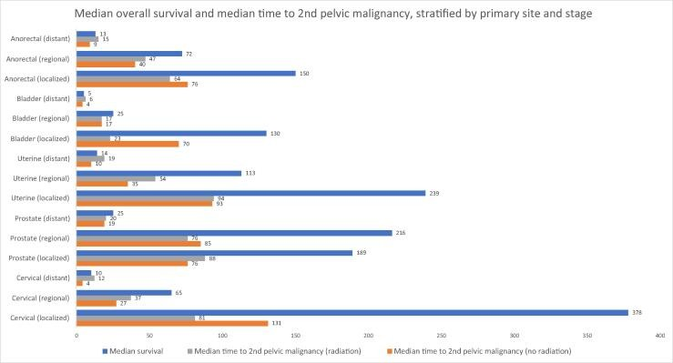
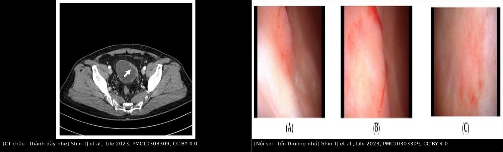
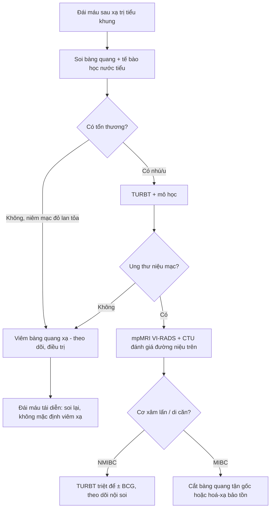
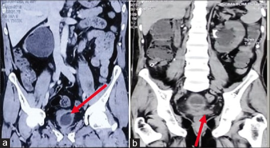
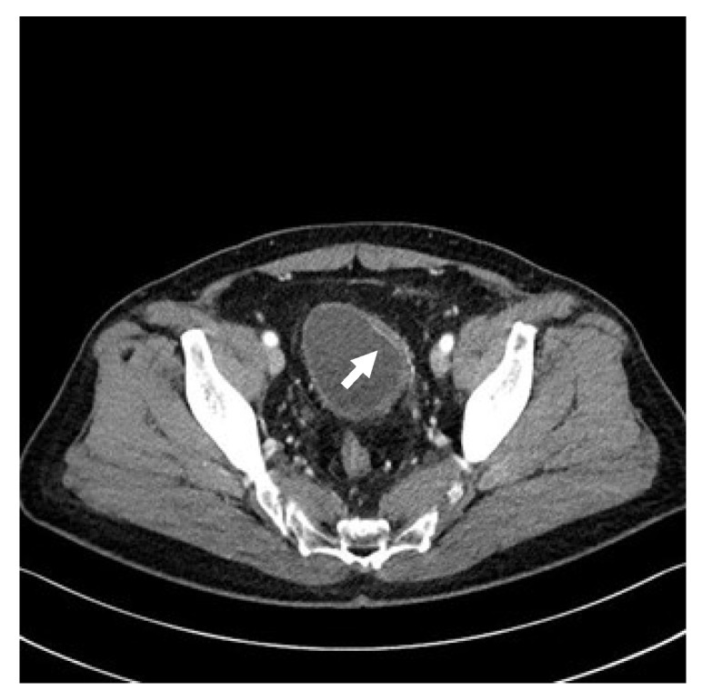

# 1608 — Ung thư niệu mạc thứ phát sau xạ trị tiểu khung / Secondary urothelial malignancy after pelvic radiotherapy

**Tags:** `pattern:day-thanh-bang-quang` `pattern:u-bang-quang` `pattern:hep-nieu-quan` `vung:tieu-khung` `vung:bang-quang` `score:VI-RADS` `score:RTOG` `protocol:CTU` `protocol:mpMRI-bang-quang` `protocol:soi-bang-quang`
**Mức chắc chắn (certainty):** tổng hợp y văn (literature synthesis) — số liệu đoàn hệ SEER (Europe PMC) + một ca nguyên văn minh họa (PMC10303309); không tự suy diễn ngưỡng ngoài nguồn.

> **Câu chốt:** sau xạ trị tiểu khung, **đái máu đại thể không bao giờ được mặc định là "viêm bàng quang xạ"**. Viêm xạ là chẩn đoán **loại trừ**; ung thư niệu mạc thứ phát là chẩn đoán **phải loại trừ bằng nội soi**. Thời gian tiềm tàng trung bình tính bằng **năm–chục năm**, nhưng ca thực tế có thể xuất hiện **6 tháng** sau xạ — nên "mới xạ xong" không loại trừ ung thư.

## 1. Tổng quan bệnh học – cơ chế hình ảnh

- **Sinh bệnh học:** bức xạ gây **đứt gãy chuỗi kép DNA** trực tiếp + gián tiếp qua gốc tự do; biểu mô niệu (urothelium) có tốc độ tái tạo cao nên dễ tích lũy đột biến. Tổn thương mạch máu nhỏ kiểu **viêm tắc động mạch tận (obliterative endarteritis)** → thiếu máu mạn, xơ hóa, **giãn mạch (telangiectasia)**, giảm đàn hồi thành bàng quang. Hai hậu quả song song: **viêm bàng quang xạ** (lành tính) và **ung thư niệu mạc thứ phát** (ác tính) — cùng một bối cảnh, cùng triệu chứng đái máu.
- **Ngưỡng định lượng — nguy cơ (SEER):**
  - Đoàn hệ ung thư phụ khoa **123.476 ca** (25,8% có xạ): tỷ lệ mắc tích lũy ung thư bàng quang thứ phát **1,59% (có xạ) vs 0,73% (không xạ)**; **SIR 2,49** (KTC 95% 2,17–2,86) với xạ ngoài, **1,96** (1,60–2,38) với brachy, **2,73** (2,24–3,28) khi phối hợp; **HR 2,83** (2,34–3,43) / **2,17** / **2,97** (PMC9162740).
  - Ung thư trực tràng **74.646 ca**: bàng quang thứ phát **1,85% vs 1,24%**, **SIR 1,35** (1,19–1,53) (PMC7868538).
  - Toàn bộ ung thư tiểu khung **2.102.192 ca**: cổ tử cung **IRR 1,72** (1,59–1,86) cho ung thư tiểu khung thứ phát; thân tử cung 1,15; tuyến tiền liệt 1,42 — **nguy cơ tuyệt đối vẫn thấp**, nhưng cao nhất ở người sống lâu (ung thư cổ tử cung) (PMC10979055).
- **Ngưỡng định lượng — thời gian:** nghiên cứu SEER loại các ca sống < 5 năm vì coi **5 năm là thời gian tiềm tàng tối thiểu** của u đặc; nguy cơ tăng rõ **sau 10 năm** và **cao nhất sau 20 năm** (PMC9162740). **Ca nguyên văn (PMC10303309)** lại phát hiện ung thư bàng quang **6 tháng** sau xạ cứu vãn 66 Gy — **phản biện bắt buộc**: con số 5–20 năm là **phân bố quần thể**, không phải điều kiện chẩn đoán.
- **Ngưỡng định lượng — viêm xạ (đối chứng lành tính):** viêm bàng quang xạ muộn gặp **~18%**, khởi phát **6 tháng – 20 năm**; bàng quang co nhỏ, dung tích còn **60–80 mL** trong loạt ca có hình (PMC10303309 dẫn Dautruche 2018; PMC9254857).

*Đọc hình: thanh **xanh** = sống trung vị; thanh **cam/xám** = thời gian trung vị tới ung thư tiểu khung thứ hai, có/không xạ. Ở ung thư cổ tử cung khu trú, thời gian tới u thứ hai **dài hơn** sống trung vị — nghĩa là nguy cơ chỉ hiện thực hóa ở người sống đủ lâu. Đây là lý do **theo dõi sau 5 năm vẫn phải nghĩ tới u thứ phát**. Nguồn: McPartland C et al., Eur Urol Open Sci 2024, PMC10979055, CC BY 4.0.*
- **TẠI SAO hình ảnh khó — vật lý:**
  - **CT:** ung thư niệu mạc là mô **giàu tế bào, ít mỡ**, tỷ trọng mô mềm **30–50 HU**, ngấm thuốc; nhưng **thành bàng quang sau xạ cũng dày và ngấm mạnh** do viêm/tái tạo mạch → **độ dày thành một mình không phân biệt được**. Thứ phân biệt là **hình thái khu trú + nhú trong lòng + bất đối xứng lệch khỏi vùng xạ**.
  - **MRI T2W:** cơ detrusor là **dải giảm tín hiệu**; u là tín hiệu trung gian. Xơ xạ cũng giảm tín hiệu → **mất dải cơ do xơ ≠ xâm lấn cơ** (cạm bẫy).
  - **DWI/ADC:** u tế bào đặc → **DWI sáng, ADC thấp**; nước tiểu ADC rất cao. Nhưng **xơ hóa sau xạ cũng hạn chế khuếch tán** → **dương tính giả VI-RADS**; phải đọc kèm T2W + DCE và vùng **ngoài trường xạ**.
  - **DCE:** u tân mạch ngấm sớm; niêm mạc xạ viêm cũng ngấm → không đặc hiệu nếu chỉ có viêm lan tỏa.

## 2. Mẫu hình + chẩn đoán phân biệt theo vị trí (Gamut)

- **Khuôn 1 — thành bàng quang dày LAN TỎA, đối xứng, bàng quang nhỏ, không khối trong lòng:** **viêm bàng quang xạ** là hàng đầu; phân biệt viêm bàng quang do BCG/hoá trị trong bàng quang, tắc cổ bàng quang, thâm nhiễm (lymphoma, di căn).
- **Khuôn 2 — dày thành KHU TRÚ hoặc nhú trong lòng, bờ không đều:** **ung thư niệu mạc thứ phát**; phân biệt **tái phát ung thư tiền liệt tuyến/cổ tử cung** xâm lấn thành, **cục máu** (di động, không ngấm), **sỏi** (tăng tỷ trọng), **nấm** (hiếm, bối cảnh giảm miễn dịch).
- **Khuôn 3 — hẹp niệu quản ± ứ nước:** **hẹp do xạ** (đoạn dài, nhẵn, hình nón, không khối) vs **ung thư niệu mạc niệu quản** (khuyết thuốc ngấm, bờ không đều) vs **sỏi** (tăng tỷ trọng) — tam chứng kinh điển của "niệu quản sau xạ".
- **Khuôn 4 — đái máu đại thể, CT sạch:** **CIS (carcinoma in situ) phẳng** — **không thấy trên CT**, chỉ thấy khi soi + tế bào học; đây là lý do **không bao giờ dùng CT để loại trừ**.
- **Gamut theo vị trí trong bàng quang:** **thành bên** (ca nguyên văn — tổn thương nhú), **tam giác/lỗ niệu quản** (dễ giả u do VI-RADS khó đọc — PMC12800710), **thành sau** (CIS phẳng, đỏ lan tỏa), **cổ bàng quang** (dày do tắc, không phải u).
- **Gamut theo thời gian:** **< 3 tháng** = viêm cấp (hiếm khi ung thư nhưng ca 6 tháng đã có); **6 tháng – 5 năm** = viêm xạ muộn là chính, nhưng ung thư vẫn có; **> 10 năm** = **ưu tiên loại trừ ung thư thứ phát**.

## 3. Bảng so sánh phân biệt (ma trận đối chiếu)

| Thực thể (entity) | Hình ảnh điển hình | Chốt vào (rule-in) | Chốt loại (rule-out) | Gợi ý xác nhận |
|---|---|---|---|---|
| **Viêm bàng quang xạ (muộn)** | Thành dày **lan tỏa, đối xứng**, bờ ngoài nhẵn, **không khối trong lòng**; bàng quang co nhỏ (**60–80 mL**); giãn mạch niêm mạc | **Dày lan tỏa + dung tích nhỏ + không nhú + đúng trường xạ** | Có **nhú/khu trú** trong lòng → phải soi loại u | Soi bàng quang: niêm mạc đỏ, telangiectasia, không u |
| **Ung thư niệu mạc thứ phát** | **Dày khu trú/nhú** trong lòng, ngấm mạnh, **DWI sáng/ADC thấp**; có thể chỉ là **dày nhẹ + ngấm niêm mạc mạnh** (ca 1608) | **Tổn thương khu trú + ngấm + DWI sáng** ở người đã xạ | Dày lan tỏa đối xứng, không nhú → viêm xạ | **Soi + TURBT sinh thiết** (chuẩn vàng) |
| **Tái phát ung thư tiền liệt tuyến/cổ tử cung** | Khối **liên tục với ổ nguyên phát**, xâm lấn đáy bàng quang, **ngấm đồng thì với u nguyên phát** | **Liên tục giải phẫu + cùng mô học** | Tổn thương **rời**, trong lòng bàng quang → u niệu mạc | MRI chậu + PSA/histology |
| **Cục máu** | Khuyết thuốc/khối **không ngấm**, **di động**, thay đổi giữa các lần chụp | **Không ngấm + đổi hình** | Ngấm + cố định → u | CT lại sau rửa bàng quang |
| **Hẹp niệu quản do xạ** | Hẹp **dài, nhẵn, hình nón**, thành đều, không khối, ứ nước nhẹ–vừa | **Nhẵn + dài + không khối + đúng trường xạ** | Khuyết thuốc ngấm/bờ nham nhở → UTUC | CTU + tế bào học; soi niệu quản nếu nghi |
| **UTUC (niệu mạc trên)** | **Khuyết thuốc ngấm**, bờ không đều, **stipple sign**, ứ nước | **Ngấm + stipple + tắc** | Nhẵn, không ngấm, đổi hình → máu cục/viêm | CTU + tế bào học + ureteroscopy |

*Trái: CT chậu có cản quang — thành bàng quang dày nhẹ, **ngấm mạnh niêm mạc** (mũi tên), không có khối lớn. Phải: nội soi cùng ca — (A,B) tổn thương nhú thành bên phải, (C) mảng đỏ lan tỏa thành sau. Ung thư niệu mạc thứ phát 6 tháng sau xạ 66 Gy. Nguồn: Shin TJ et al., Life (Basel) 2023, PMC10303309, CC BY 4.0. Ảnh ghép letterbox.*

### Dấu hiệu chốt cần nhớ
- **"Dày nhẹ + ngấm mạnh niêm mạc" vẫn có thể là ung thư** — ca nguyên văn chứng minh; **ngưỡng hành động là soi, không phải mm**.
- **Bàng quang nhỏ + dày lan tỏa** = viêm xạ; **bàng quang nhỏ làm giả dày thành** nếu chụp khi chưa căng → luôn ghi dung tích ước lượng.
- **Vị trí so với trường xạ:** tổn thương **trong trường xạ** nghiêng về biến chứng xạ; tổn thương **ngoài trường** hoặc **mới sau nhiều năm** nghiêng về u thứ phát — nhưng không thay thế mô học.
- **CIS phẳng = điểm mù của mọi modality mặt cắt.**

## 4. Protocol chụp + hệ phân độ/điểm chuẩn hóa

- **Bước 1 (bắt buộc) — soi bàng quang + tế bào học nước tiểu:** chuẩn vàng; **không có ngưỡng kích thước nào cho phép bỏ soi** ở người đã xạ có đái máu đại thể. Tế bào học **độ nhạy thấp với u độ thấp**, nhưng **cao với CIS/độ cao** — âm tính không loại trừ.
- **Bước 2 — CT urography (CTU):** cắt **≤ 1–2 mm**, bàng quang căng vừa, **pha vỏ-tủy (corticomedullary)** cho thành bàng quang + **pha bài tiết (7–10 phút)** cho đường niệu trên; kỹ thuật low-dose có thể giảm liều **80,2%** (**1,5 ± 0,3 mSv vs 7,6 ± 1,2 mSv**) mà vẫn đọc được u bàng quang (PMC13017341). CTU **đánh giá đường niệu trên + hạch + xương**, không thay soi.
- **Bước 3 — mpMRI bàng quang (VI-RADS) khi đã có chẩn đoán mô học và cần phân biệt cơ xâm lấn:** T2W độ phân giải cao + **DWI/ADC** + **DCE**. Gộp 20 nghiên cứu / 2.477 ca: ngưỡng **≥ 3** cho **Sn 0,87 / Sp 0,86**; ngưỡng **≥ 4** cho **Sn 0,78 / Sp 0,94** (PMC9237003). VI-RADS **không dùng để phát hiện** u ở người chưa soi.
- **Cạm bẫy kỹ thuật VI-RADS sau xạ:** thay đổi sau **TURBT/BCG/xạ** giả u trên DWI và DCE; **lỗ niệu quản, tam giác, cổ bàng quang** dễ chấm sai; **tổn thương phẳng/nhỏ** dễ bỏ (PMC12800710).
- **Theo dõi:** không có lịch tầm soát ung thư bàng quang thứ phát được chứng minh bằng thử nghiệm; dữ liệu SEER chỉ ra **nguy cơ tăng sau 10 năm và cao nhất sau 20 năm** → người sống sót sau xạ tiểu khung cần **ngưỡng soi thấp với bất kỳ đái máu nào**, kể cả vi thể tái diễn.

## 5. Biến thể bình thường và cạm bẫy

- **Cạm bẫy 1 — "viêm xạ dày thành bất đối xứng":** viêm xạ **có thể dày lệch** và gây **ứ nước do hẹp lỗ niệu quản** — hình giống u xâm lấn (ảnh quiz ca 2). Chốt: **thiếu khối trong lòng + bờ ngoài nhẵn + đúng trường xạ**, và vẫn phải soi.
- **Cạm bẫy 2 — chụp khi bàng quang chưa căng:** thành giả dày, niêm mạc giả ngấm; luôn đánh giá **dung tích** trước khi kết luận dày thành.
- **Cạm bẫy 3 — xơ xạ hạn chế khuếch tán:** DWI sáng/ADC thấp ở mô xơ → **VI-RADS dương tính giả**; đọc DCE + T2W và so với **vùng thành đối diện**.
- **Cạm bẫy 4 — "mới xạ 6 tháng nên chưa thể ung thư":** ca PMC10303309 phản bác trực tiếp; **thời gian không phải tiêu chuẩn loại trừ**.
- **Cạm bẫy 5 — nhầm tái phát u nguyên phát với u thứ phát:** tái phát **liên tục với ổ cũ**, cùng mô học; u thứ phát **rời, trong lòng**, mô học niệu mạc. Điều trị khác hẳn → **bắt buộc mô học**.
- **Cạm bẫy 6 — bỏ sót đường niệu trên:** sau xạ, **hẹp niệu quản do xạ** che lấp UTUC đồng thời; CTU pha bài tiết + tế bào học, soi niệu quản khi nghi.

## 6. Tự lượng giá — Blind Quiz

**Ca 1 — Nam 72 tuổi, đái máu đại thể không đau, 4 năm sau xạ trị ung thư tuyến tiền liệt. CT chậu có cản quang:**

- Câu hỏi: Mô tả thành bàng quang? Có khối trong lòng không? Có ứ nước không? Ba chẩn đoán phân biệt và bước tiếp theo?

<b>Bấm để hiện đáp án (findings + chẩn đoán)</b>

- **Dấu hiệu:** (a) thành bàng quang **dày bất đối xứng**, bờ ngoài nhẵn, **không có khối trong lòng**; (b) **ứ nước** đường niệu trên do hẹp lỗ niệu quản.
- **Chẩn đoán:** **viêm bàng quang xạ co nhỏ** (dung tích 60–80 mL trong loạt ca) — nhưng đây là **chẩn đoán loại trừ**, phải soi bàng quang + tế bào học để loại ung thư niệu mạc.
- **Vì sao dễ nhầm:** dày lệch + ứ nước là hình ảnh của u xâm lấn; khác biệt nằm ở **không có khối trong lòng** và **bờ ngoài nhẵn**.
- Nguồn ảnh: Panwar VK et al., J Family Med Prim Care 2022, **PMC9254857**, CC BY-NC-SA 4.0 (nguyên bản, không chỉnh sửa).

**Ca 2 — Nam 65 tuổi, đái máu đại thể không đau **6 tháng** sau xạ cứu vãn 66 Gy/30 phân liều sau cắt tiền liệt tuyến; PSA < 0,01 ng/mL. CT chỉ thấy dày thành nhẹ:**

- Câu hỏi: Có bất thường không? Nếu chỉ đọc CT này, bạn có thể kết luận "viêm xạ" không? Vì sao?

<b>Bấm để hiện đáp án (findings + chẩn đoán)</b>

- **Dấu hiệu:** thành bàng quang **dày nhẹ**, **ngấm mạnh niêm mạc** (mũi tên), không có khối lớn.
- **Chẩn đoán:** **ung thư niệu mạc thứ phát** — soi thấy **tổn thương nhú thành bên phải** + **mảng đỏ lan tỏa thành sau**; TURBT: **CIS + ung thư nhú độ cao không xâm lấn**. Sau đó phát hiện **di căn xương lan tỏa**.
- **Phản biện (bắt buộc):** đây là ca **không điển hình về thời gian** — ung thư xuất hiện **6 tháng** sau xạ, trong khi SEER dùng mốc **5 năm** làm tiềm tàng tối thiểu. Bài học: **thời gian ngắn không loại trừ**, và **CT dày nhẹ không loại trừ**.
- Nguồn ảnh: Shin TJ et al., Life (Basel) 2023, **PMC10303309**, CC BY 4.0.

**Ca 3 — Nữ 68 tuổi, 12 năm sau xạ trị ung thư cổ tử cung, đái máu tái diễn 3 đợt/6 tháng. CTU: hẹp niệu quản trái đoạn 3 cm, nhẵn, ứ nước độ 2, không thấy khuyết thuốc:**

- Câu hỏi: Hẹp do xạ hay UTUC? Cần gì để chốt? Khi nào phải soi niệu quản?

<b>Bấm để hiện đáp án (findings + chẩn đoán)</b>

- **Hình ảnh:** hẹp **dài, nhẵn, hình nón, thành đều, không khuyết thuốc** + đúng trường xạ → nghiêng **hẹp do xạ**.
- **Nhưng:** hẹp do xạ **che lấp UTUC**; cần **tế bào học nước tiểu** và **soi niệu quản + sinh thiết** nếu tế bào học dương/không giải thích được, hoặc hẹp tiến triển.
- **Chốt:** không có dấu hiệu ngấm/khuyết thuốc **không loại trừ** UTUC phẳng — nguyên tắc giống CIS bàng quang.
- Nguồn số liệu: PMC9162740, PMC10979055 (nguy cơ theo thời gian); hình thái hẹp xạ theo PMC582.

## Bài liên quan chéo
- [159 – Bàng quang & đường niệu trên: VI-RADS, xâm lấn cơ & UTUC](../159-bang-quang-virads-u-duong-nieu-tren/lesson.md)
- [582 – Biến chứng tiêu hóa–niệu sau xạ trị phụ khoa](../582-bien-chung-tieu-hoa-nieu-sau-xa-tri-phu-khoa/lesson.md)
- [146 – Huyết khối tĩnh mạch lách & nhồi máu lách](../146-huyet-khoi-tm-lach-va-nhoi-mau-lach/lesson.md)
- [152 – Sỏi niệu](../152-soi-nieu/lesson.md)

## Ảnh
- `images/1608_CT-day-thanh-bang-quang_PMC10303309.jpg`, `images/1608_soi-bang-quang-nhu_PMC10303309.jpg`, `images/1608_viem-bang-quang-xa_CT_PMC9254857.jpg`, `images/1608_thoi-gian-ung-thu-thu-phat_PMC10979055.jpg`, `images/composite_bang-quang-day-thanh-vs-nhu.jpg`.
- Nguồn + giấy phép từng ảnh: `images/CREDITS.md`. Không tải Radiopaedia/AuntMinnie.

> Không dùng để chẩn đoán độc lập khi chưa có người hướng dẫn.
