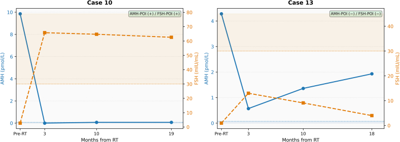
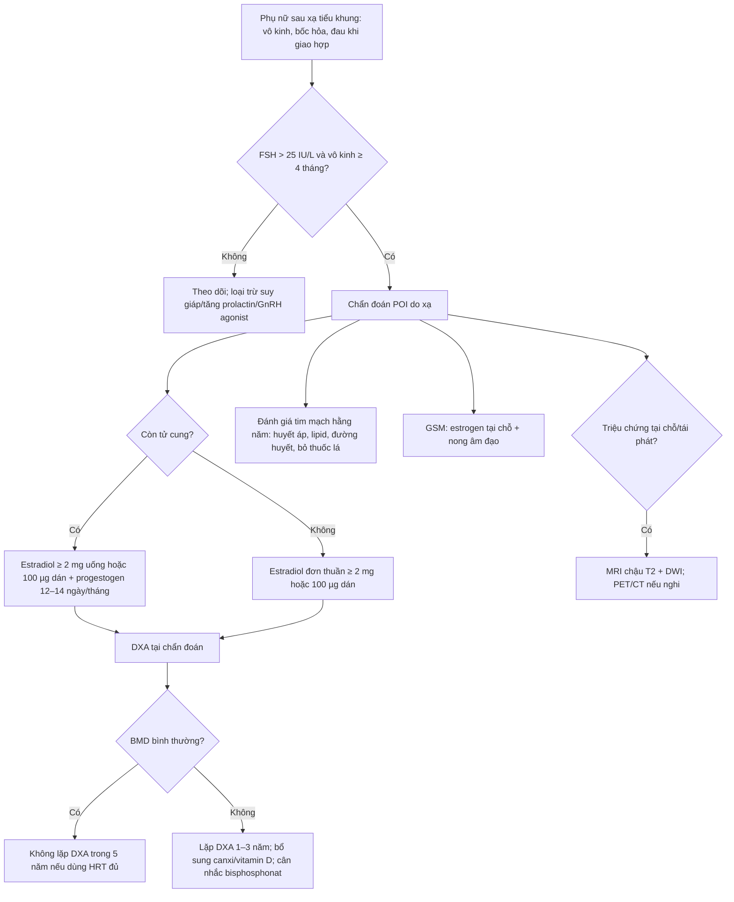
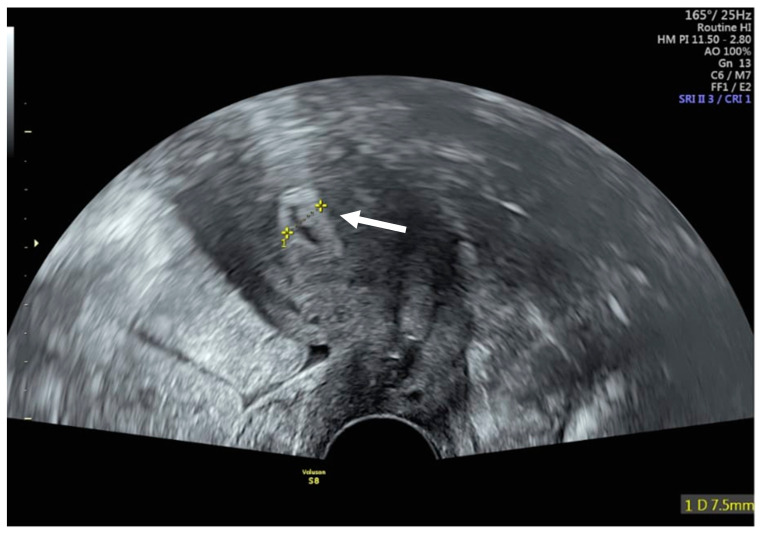
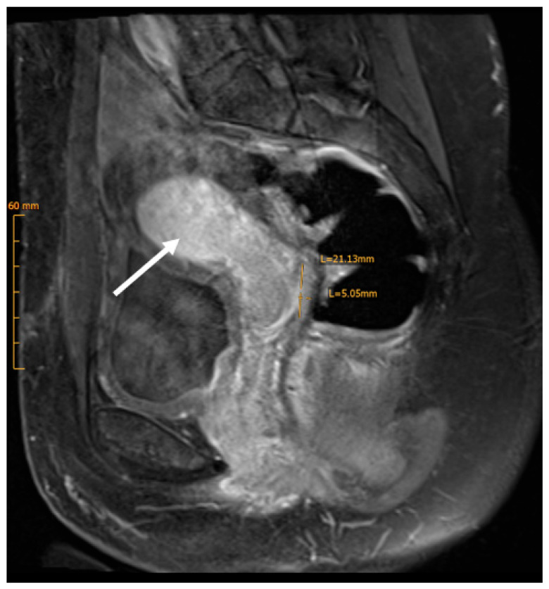

# 1609 — Suy buồng trứng & thiếu hụt hormone sau xạ trị phụ khoa: AMH/FSH, HRT, xương–tim / Radiation-induced ovarian insufficiency and hormone deficiency after pelvic radiotherapy

**Tags:** `pattern:suy-buong-trung` `pattern:buong-trung-teo` `pattern:mat-xuong` `pattern:thieu-hut-hormone` `vung:buong-trung` `vung:tu-cung` `vung:tieu-khung` `score:AMH` `score:FRAX` `protocol:TVUS` `protocol:MRI-chau` `protocol:DXA`
**Mức chắc chắn (certainty):** tổng hợp y văn (literature synthesis) — ESHRE 2024 (PMC11631070), tổng quan mãn kinh sau điều trị ung thư 2026 (PMC13663626), đoàn hệ AMH sau xạ 2026 (PMC13320243) + 1 ca nguyên văn minh họa (PMC12941671).

> **Câu chốt của bài:** sau xạ tiểu khung, **buồng trứng teo nhỏ – không nang – tín hiệu T2 thấp là hậu quả mong đợi, KHÔNG phải tái phát**. Chẩn đoán suy buồng trứng sớm (premature ovarian insufficiency — POI) là **chẩn đoán nội tiết** (FSH > 25 IU/L + vô kinh ≥ 4 tháng, hoặc AMH không phát hiện được), không phải chẩn đoán hình ảnh. Hình ảnh có 3 việc: **(1) đếm/đo dự trữ trước và sau xạ, (2) loại trừ khối tái phát/di căn buồng trứng, (3) đánh giá tử cung trước khi dùng hormone và mật độ xương bằng DXA.** Điều trị thiếu hụt hormone phải đủ liều (**≥ 2 mg estradiol uống hoặc 100 µg dán/ngày**), không phải "liều thấp cho nhẹ".

## 1. Tổng quan bệnh học – cơ chế hình ảnh

- **Vì sao buồng trứng nhạy xạ nhất:** noãn nằm trong nang nguyên thủy (primordial follicle), **không tái sinh**. Xạ gây **apoptosis tế bào hạt và noãn + tổn thương mạch máu stroma → xơ hóa**. Ngưỡng kinh điển (Wallace 2005, dẫn qua PMC13103583): ở nữ **< 40 tuổi**, liều **< 2 Gy** đã làm mất **50% noãn (LD50 < 2 Gy)**; **14 Gy** gây **suy buồng trứng hoàn toàn**. Ở tuổi lớn hơn, ngưỡng gây suy buồng trứng **thấp hơn nhiều** vì dự trữ đã ít.
- **Thời gian:** xạ tiểu khung có thể gây **mãn kinh trong 6 tháng đầu** (Viswanathan 2014, dẫn qua PMC13663626); xạ toàn thân (TBI) → suy buồng trứng **90%** trong theo dõi dài. Đây là lý do **không được trấn an "chờ vài năm xem sao"** ở người muốn sinh con.
- **AMH rơi trước, FSH tăng sau:** AMH do **tế bào hạt của nang tiền hốc và nang hốc nhỏ** tiết ra, phản ánh **số nang còn lại**; FSH tăng do mất **feedback** buồng trứng. Trong đoàn hệ 23 bệnh nhân ≤ 45 tuổi sau xạ tiểu khung: POI theo AMH **39,1%**, theo FSH **34,8%**; AMH giảm sớm, **có thể hồi phục giữa 6–10 tháng** và thường hồi phục **trước** FSH (PMC13320243). Vì vậy **một AMH thấp ngay sau xạ chưa phải kết luận vĩnh viễn** — nhưng cũng **không được chờ** nếu bệnh nhân còn nhu cầu sinh sản (trữ noãn/phôi phải làm trước).
- **Định nghĩa POI (thay đổi qua các phiên bản):**
  - **ESHRE 2016:** vô kinh/thiểu kinh **≥ 4 tháng** + **FSH > 25 IU/L** ở **2 lần** cách nhau **> 4 tuần**, tuổi **< 40**.
  - **ESHRE 2024 (PMC11631070):** chỉ cần **một lần FSH > 25 IU/L** để chẩn đoán; khi không chắc chắn thì lặp FSH và/hoặc **làm AMH**. Đây là thay đổi thực hành quan trọng — đừng chờ lần xét nghiệm thứ hai mới bắt đầu tư vấn.
- **TẠI SAO hình ảnh thay đổi (vật lý):**
  - **Siêu âm đầu dò âm đạo (transvaginal ultrasound — TVUS):** buồng trứng sau xạ **nhỏ, không thấy nang 2–10 mm**, stroma **giảm âm**; đếm **nang hốc (antral follicle count — AFC)** là số đo dự trữ. Nội mạc tử cung **mỏng** (thường **≤ 4–5 mm** khi không dùng hormone) do thiếu estrogen; tử cung có thể **teo, cổ tử cung hẹp** sau xạ.
  - **MRI:** mô xơ sau xạ **giàu collagen, ít nước → T2 thấp**; tử cung mất **vùng chuyển tiếp (junctional zone)** rõ, cơ tử cung **T2 thấp lan tỏa**, nội mạc mỏng. Buồng trứng teo **T2 trung–thấp**, không nang. Đây là **hình thái xơ hóa**, không phải mô u.
  - **DWI/ADC:** mô xơ xạ có thể **hạn chế khuếch tán nhẹ**, còn u sống **ADC thấp hơn rõ**; nhưng **viêm/tái tạo mô trong 6–12 tháng đầu cũng làm ADC thấp** → không đọc DWI đơn độc (xem bài 582, 577).
  - **DXA:** đo **mật độ xương (bone mineral density — BMD)** tại cột sống thắt lưng và cổ xương đùi; mất estrogen → **mất xương nhanh** trong 1–2 năm đầu, sau đó chậm lại.
- **Gánh nặng lâu dài (định lượng):** sau mãn kinh sớm/ngoại khoa, **loãng xương 8–14%**, **thiếu xương 23–57%**; mãn kinh **< 40 tuổi** tăng nguy cơ gãy xương **HR 1,21** (KTC 95% 1,02–1,44); người sống sót ung thư có **nguy cơ gãy xương dư 10–30%**. POI tăng **nguy cơ tim mạch HR 1,55**, tăng **đột quỵ HR 1,22** và **biến cố tim mạch HR 1,37** (PMC13663626). Đây là lý do HRT ở POI là **điều trị bệnh**, không chỉ "giảm bốc hỏa".

## 2. Mẫu hình + chẩn đoán phân biệt theo bối cảnh (Gamut)

- **Khuôn 1 — vô kinh + bốc hỏa sau xạ tiểu khung:** **POI do xạ** (FSH cao, AMH thấp, buồng trứng teo) vs **suy buồng trứng do hóa chất alkyl hóa** (bệnh sử, có thể hồi phục) vs **mãn kinh tự nhiên sớm** (tuổi, FSH tăng từ từ) vs **GnRH agonist** (thuốc ức chế, FSH **thấp**, hồi phục sau ngừng 1–3 tháng) vs **suy giáp/tăng prolactin** (TSH, prolactin).
- **Khuôn 2 — buồng trứng nhỏ/không thấy trên hình ảnh:** **teo sinh lý sau xạ/mãn kinh** vs **buồng trứng đã cắt** (bệnh sử) vs **buồng trứng chuyển vị ra ngoài tiểu khung** (vị trí bất thường + clip — xem bài 1607) vs **dải sinh dục (streak gonad)** bẩm sinh (Turner) vs **buồng trứng bị u/di căn thay thế** (to ra, thành phần đặc — **dấu hiệu báo động**).
- **Khuôn 3 — đau/ra máu sau xạ:** **teo niêm mạc + viêm xạ** vs **tái phát tại chỗ** (khối, DWI sáng, ngấm thuốc) vs **ứ máu trong buồng tử cung do hẹp cổ tử cung (hematometra)** vs **viêm bàng quang/trực tràng xạ** (bài 582) vs **ung thư niệu mạc thứ phát** (bài 1608).
- **Khuôn 4 — đau xương sau xạ:** **loãng xương do thiếu estrogen** (mất xương lan tỏa, không khối) vs **gãy xương suy yếu sau xạ** (đường gãy, phù tủy, không phá vỡ vỏ) vs **di căn xương** (phá vỡ vỏ, khối mô mềm — bài 581).
- **Gamut theo thời điểm sau xạ:** **< 3 tháng** — thay đổi cấp (phù, viêm), **không kết luận POI vĩnh viễn**; **3–12 tháng** — AMH/FSH biến động, có thể hồi phục; **> 12 tháng** — teo/xơ ổn định, nguy cơ mất xương và tim mạch tích lũy.

## 3. Bảng so sánh phân biệt (ma trận đối chiếu)

| Thực thể (entity) | Hình ảnh / xét nghiệm điển hình | Chốt vào (rule-in) | Chốt loại (rule-out) | Gợi ý xác nhận |
|---|---|---|---|---|
| **POI do xạ** | Buồng trứng **nhỏ, không nang**; nội mạc **≤ 4–5 mm**; **FSH > 25 IU/L**, AMH thấp/không phát hiện; vô kinh ≥ 4 tháng | **FSH > 25 IU/L + vô kinh ≥ 4 tháng + tiền sử xạ tiểu khung** | **FSH thấp + đang dùng GnRH agonist** → do thuốc, không phải POI | FSH lặp lại (nếu chưa chắc), AMH, TVUS |
| **Suy buồng trứng do hóa chất** | Buồng trứng nhỏ, AMH thấp; **có thể hồi phục** sau 6–12 tháng, nhất là tuổi trẻ | **Tiền sử alkyl hóa (cyclophosphamide) + AMH/FSH thay đổi theo đợt** | Xạ tiểu khung là nguyên nhân trội → nghĩ xạ | Hỏi phác đồ, AMH chuỗi |
| **Mãn kinh tự nhiên sớm** | Buồng trứng nhỏ dần theo tuổi; FSH tăng từ từ; không tiền sử xạ/hóa | **Tuổi gần 45–55 + FSH tăng dần + không can thiệp** | Xạ tiểu khung trong 5 năm → nghĩ do xạ | Bệnh sử, FSH chuỗi |
| **GnRH agonist (ức chế buồng trứng)** | **FSH thấp**, LH thấp, estradiol thấp; buồng trứng không nang; hồi phục sau ngừng thuốc | **Đang tiêm GnRH agonist + FSH thấp** | FSH cao > 25 → không phải do thuốc | Ngừng thuốc 1–3 tháng, xét nghiệm lại |
| **Buồng trứng chuyển vị (bình thường)** | Nốt mô mềm ở **rãnh cạnh đại tràng/thành bụng**, **clip**, kích thước đổi theo chu kỳ | **Clip + vị trí ngoài tiểu khung + thay đổi theo chu kỳ** | Không clip, bờ không đều, to nhanh → nghi tái phát | So phim, TVUS (bài 1607) |
| **Di căn/tái phát buồng trứng** | Buồng trứng **to ra**, thành phần **đặc**, ngấm mạnh, **DWI sáng/ADC thấp**, có thể có hạch/dịch | **Khối đặc mới/to nhanh + ADC thấp + FDG dương** | Buồng trứng nhỏ, không nang, ổn định nhiều năm → teo | MRI chậu + PET/CT khi nghi, sinh thiết/cắt |
| **Loãng xương do thiếu estrogen** | DXA: **T-score ≤ −2,5** (hoặc **Z ≤ −2,0** ở người tiền mãn kinh); mất xương lan tỏa, không khối | **DXA thấp + không khối/không phá vỡ vỏ** | **Phá vỡ vỏ + khối mô mềm** → di căn | DXA, CT/MRI xương khi đau khu trú |
| **Gãy xương suy yếu sau xạ** | Đường gãy **ngang**, phù tủy **đối xứng**, không khối mô mềm; vùng xương cùng/khung chậu | **Đường gãy + phù tủy đối xứng + đúng vùng xạ** | **Phá vỡ vỏ + khối** → di căn | CT xương, MRI; xem bài 581 |

*Trái (ca 10): AMH rơi về 0 và FSH tăng > 50 mIU/mL → **POI đồng thuận**. Phải (ca 13): AMH rơi còn ~0,5 pmol/L rồi **hồi phục lên ~2 pmol/L**, FSH tăng thoáng qua rồi về bình thường → **AMH và FSH không đồng thuận**; không được kết luận vĩnh viễn chỉ từ một điểm. Đường chấm: ngưỡng AMH không phát hiện được và FSH 30 mIU/mL. Nguồn: Song Y et al., Gynecol Oncol Rep 2026 (PMC13320243), CC BY-NC-ND 4.0 (giữ nguyên bản).*

## 4. Protocol chụp + hệ phân độ/điểm chuẩn hóa

- **Trước xạ (baseline, trong 1–2 tuần):**
  - **TVUS:** đếm **AFC hai bên** (nang **2–10 mm**), đo **thể tích buồng trứng**; ghi nhận u/nang bất thường; đánh giá tử cung (nội mạc, nhân xơ) trước khi tính chuyện mang thai.
  - **Xét nghiệm:** **AMH**, **FSH**, **estradiol** (nếu còn chu kỳ); TSH/prolactin nếu vô kinh không rõ.
  - **Tư vấn sinh sản:** trữ noãn/phôi **trước** xạ nếu có thể; chuyển vị buồng trứng khi có chỉ định (bài 1607).
  - **DXA** nếu có yếu tố nguy cơ (tuổi, gãy xương trước đó, thuốc, cân nặng thấp) — không chờ đến khi có POI.
- **Sau xạ — theo dõi nội tiết:** **AMH lúc 3, 6, 10–12 tháng** (vì có thể hồi phục 6–10 tháng); **FSH** khi có vô kinh ≥ 4 tháng, lặp lại nếu chưa chắc; **estradiol** để đánh giá mức thiếu hụt. Không chẩn đoán POI vĩnh viễn trong **3 tháng đầu** nếu bệnh nhân còn chu kỳ.
- **Sau xạ — hình ảnh:** TVUS khi có triệu chứng/ra máu/đau; **MRI chậu T2 + DWI + T1 sau tiêm** khi nghi khối tái phát hoặc biến chứng (bài 577, 582); **PET/CT** chỉ khi có tổn thương nghi ngờ, không tầm soát.
- **DXA (theo ESHRE 2024, PMC11631070):** làm **tại chẩn đoán POI** cho mọi bệnh nhân; nếu **BMD bình thường và dùng HRT đầy đủ** thì **không cần lặp trong 5 năm**; nếu **loãng xương/thiếu xương** → lặp **mỗi 1–3 năm** tùy nguy cơ; đánh giá lại HRT và yếu tố mất xương.
- **Ngưỡng DXA:** **T-score ≥ −1,0** bình thường; **−1,0 đến −2,5** thiếu xương (osteopenia); **≤ −2,5** loãng xương. Ở **phụ nữ tiền mãn kinh**, dùng **Z-score**: **Z ≤ −2,0** = "thấp hơn kỳ vọng theo tuổi", **không dán nhãn "loãng xương" chỉ bằng T-score** (ISCD).
- **Điều trị thiếu hụt hormone (HRT) — định lượng:**
  - **Estradiol ≥ 2 mg/ngày uống hoặc 100 µg/ngày dán** (hoặc tương đương) để **bảo vệ xương**; đây là liều ESHRE khuyến cáo, **không dùng liều "thấp nhất có thể"** ở POI trẻ.
  - **Có tử cung → bắt buộc progestogen** đủ liều bảo vệ nội mạc (ví dụ micronized progesterone **200 mg** × **12–14 ngày/tháng** hoặc progestogen tương đương); **tăng liều progestogen khi tăng liều estrogen**.
  - **Thời gian:** tiếp tục **đến tuổi mãn kinh trung bình (~51 tuổi)**, sau đó đánh giá lại lợi ích/nguy cơ; **HRT không phải biện pháp tránh thai** — cần tư vấn tránh thai nếu không muốn mang thai.
  - **Đường dùng:** **dán qua da** ưu tiên khi có nguy cơ huyết khối, đang điều trị ung thư, hoặc **tiêu chảy/kém hấp thu sau xạ** (uống không ổn định); uống phù hợp khi không có các yếu tố trên.
  - **Chống chỉ định/tình huống đặc biệt:** tiền sử **ung thư vú** — HRT hệ thống **không khuyến cáo** (ESHRE 2024, mức mạnh); ung thư nội mạc nguy cơ cao — cá thể hóa, tránh estrogen đơn thuần; **ung thư buồng trứng** — thảo luận đa chuyên khoa.
  - **Triệu chứng sinh dục–tiết niệu (GSM) & hẹp âm đạo sau xạ:** **estrogen tại chỗ** (kem/viên đặt) + **nong âm đạo**/dilator; đây là điều trị bổ sung, không thay HRT hệ thống khi còn tử cung.
  - **Không dùng HRT được:** SSRI/SNRI, gabapentin, **đối kháng thụ thể neurokinin-3 (fezolinetant)** cho bốc hỏa; **bisphosphonat** khi loãng xương và không dùng được HRT (cân nhắc sinh sản).
- **Sơ đồ quyết định:**

## 5. Biến thể bình thường và cạm bẫy

- **"Buồng trứng teo" không phải tái phát:** sau xạ, buồng trứng **nhỏ, T2 thấp, không nang** là **hậu quả điều trị**. Chỉ nghi tái phát khi **to ra, thành phần đặc, ADC thấp, FDG dương** — và luôn so phim cũ.
- **AMH thấp có thể hồi phục:** trong đoàn hệ PMC13320243, AMH hồi phục **6–10 tháng** ở một số bệnh nhân; **không tuyên bố vô sinh vĩnh viễn** ngay, nhưng **không trì hoãn trữ noãn/phôi** nếu còn chỉ định.
- **FSH dao động:** FSH có thể tăng thoáng qua rồi giảm; **GnRH agonist làm FSH thấp giả tạo**; **không chẩn đoán POI khi đang dùng GnRH agonist**.
- **Nội mạc dày khi dùng HRT:** HRT làm nội mạc dày hơn; **ra máu bất thường khi dùng HRT phải soi/sinh thiết** — không mặc định là "do xạ". Ngưỡng **≤ 4–5 mm** chỉ dùng cho phụ nữ **không dùng hormone**; ở người dùng HRT, ngưỡng cao hơn và **triệu chứng ra máu** mới là chỉ định.
- **Hẹp cổ tử cung sau xạ → ứ máu trong buồng tử cung (hematometra):** tử cung to, dịch **T1 sáng/T2 sáng** trong lòng, cổ tử cung hẹp; phân biệt với **khối u hoại tử** (thành dày, ngấm thuốc) — cần nong/dẫn lưu.
- **Đau xương sau xạ không phải luôn di căn:** gãy xương suy yếu (bài 581) có **đường gãy ngang + phù tủy đối xứng**; **di căn** phá vỡ vỏ + khối mô mềm. Đừng sinh thiết mù.
- **DXA ở người trẻ:** dùng **Z-score**, không dùng T-score để dán nhãn loãng xương; **mất xương do thiếu estrogen có thể hồi phục** sau 12 tháng HRT (Popat 2014, dẫn qua PMC13663626).
- **Sai lầm hay gặp trên PET/CT:** buồng trứng bình thường có thể **ngấm FDG sinh lý**; ngược lại **buồng trứng teo sau xạ thường không ngấm** — đừng gọi "âm tính giả" là tái phát, và đừng bỏ sót khối đặc nhỏ.

## 6. Tự lượng giá — Blind Quiz (ảnh trơn ngoài, đáp án giấu trong thẻ bấm-mở)

**Ca 1 — Nữ 34 tuổi, ung thư cổ tử cung giai đoạn IB2, hóa–xạ đồng thời + chuyển vị buồng trứng; 6 tháng sau điều trị vẫn có kinh, đi khám vì đau bụng nhẹ:**

- Câu hỏi: Cấu trúc được đo là gì, dày bao nhiêu? Điều này chứng minh buồng trứng còn hoạt động không? Cần xét nghiệm gì để trả lời?

<b>Bấm để hiện đáp án (findings + chẩn đoán)</b>

- **Dấu hiệu:** TVUS pha nang noãn: **nội mạc tử cung dày 7,5 mm** (thước đo vàng), đường viền rõ — **chức năng nội mạc còn đáp ứng estrogen**.
- **Chẩn đoán:** nội mạc còn đáp ứng hormone sau hóa–xạ; **không đồng nghĩa buồng trứng còn dự trữ**. Nội mạc có thể dày nhờ estrogen ngoại sinh/HRT hoặc buồng trứng chuyển vị còn hoạt động.
- **Chốt:** muốn biết dự trữ phải đo **AMH + AFC**; muốn biết có rụng trứng phải theo dõi chu kỳ/nang noãn. **Không dùng độ dày nội mạc để kết luận khả năng sinh sản.**
- **Lưu ý trung thực:** ca minh họa là bệnh nhân **ung thư cổ tử cung được chuyển vị buồng trứng, còn kinh** — dùng để minh họa **cách đo và ý nghĩa**, không đại diện cho nhóm POI.
- Nguồn: Ilia G et al., J Clin Med 2026 (PMC12941671), CC BY 4.0.

**Ca 2 — Cùng bệnh nhân, MRI tiểu khung 6 tháng sau hóa–xạ:**

- Câu hỏi: Mô tả tín hiệu cơ tử cung và vùng chuyển tiếp. Đây là thay đổi sau xạ hay tái phát? Có cần sinh thiết không?

<b>Bấm để hiện đáp án</b>

- **Dấu hiệu:** tử cung còn đường viền; **cơ tử cung tín hiệu T2 thấp lan tỏa**, **vùng chuyển tiếp (junctional zone) mờ**, **nội mạc mỏng** (mũi tên trắng); không khối lệch tâm, không hạch.
- **Chẩn đoán:** **thay đổi xơ hóa sau xạ** — mô xơ giàu collagen, ít nước nên T2 thấp; mất ranh giới nội mạc–cơ do xơ hóa. **Không phải tái phát** khi không có khối/ADC thấp/hạch.
- **Chốt:** đối chiếu **trường xạ + thời điểm + hình thái lan tỏa đối xứng**; nếu có **khối lệch tâm, bờ không đều, DWI sáng** → sinh thiết/PET.
- **Xử trí:** không sinh thiết mù mô xơ; tiếp tục theo dõi lâm sàng và nội tiết.
- Nguồn: Ilia G et al., J Clin Med 2026 (PMC12941671), CC BY 4.0.

**Ca 3 — Nữ 41 tuổi, xạ tiểu khung vì ung thư trực tràng 1 năm trước, vô kinh 8 tháng, bốc hỏa:**

- Câu hỏi: Đọc hai biểu đồ. Ca nào đồng thuận, ca nào không? Ngưỡng FSH/AMH dùng để làm gì? Có nên khẳng định bệnh nhân vô sinh vĩnh viễn?

<b>Bấm để hiện đáp án</b>

- **Ca 10 (trái):** AMH **10 → 0 pmol/L** ngay sau xạ, FSH **tăng > 50 mIU/mL** và duy trì → **POI đồng thuận** (AMH và FSH cùng bất thường).
- **Ca 13 (phải):** AMH **4,3 → 0,5 pmol/L** rồi **hồi phục ~2 pmol/L**; FSH tăng thoáng qua rồi giảm → **không đồng thuận**; AMH thấp sớm không đồng nghĩa suy vĩnh viễn.
- **Ngưỡng:** FSH **> 25 IU/L** (ESHRE 2024, một lần là đủ khi điển hình) hoặc FSH **> 30 mIU/mL** trong nghiên cứu; **AMH không phát hiện được** (bài gốc ghi **< 0,0714 pmol/L** — đơn vị/threshold của phòng xét nghiệm cần kiểm tra lại, nên đọc là "dưới ngưỡng phát hiện").
- **Kết luận:** chẩn đoán **POI do xạ** dựa vào **vô kinh ≥ 4 tháng + FSH > 25 IU/L**; AMH giúp phát hiện sớm và theo dõi hồi phục. **Không khẳng định vô sinh vĩnh viễn** — tư vấn trữ noãn/phôi trước xạ, theo dõi AMH 6–10 tháng, và bắt đầu HRT nếu POI.
- **Xử trí:** estradiol **≥ 2 mg/ngày** (hoặc **100 µg dán**) + progestogen nếu còn tử cung; **DXA**; đánh giá tim mạch; tư vấn sinh sản.
- Nguồn: Song Y et al., Gynecol Oncol Rep 2026 (PMC13320243), CC BY-NC-ND 4.0.

## Bài liên quan chéo
- [500 – Tổng quan Vú & Sản Phụ khoa](../500-tong-quan-vu-san-phu-khoa/lesson.md)
- [1607 – Bảo tồn sinh sản trước hóa–xạ trị: dự trữ buồng trứng & chuyển vị](../1607-bao-ton-sinh-san-truoc-hoa-xa-tri/lesson.md)
- [585 – Nang lạc nội mạc buồng trứng & dự trữ buồng trứng (AMH)](../585-nang-lac-noi-mac-va-du-tru-buong-trung/lesson.md)
- [582 – Biến chứng tiêu hóa–niệu sau xạ trị phụ khoa](../582-bien-chung-tieu-hoa-nieu-sau-xa-tri-phu-khoa/lesson.md)
- [577 – Theo dõi & phát hiện tái phát ung thư phụ khoa](../577-theo-doi-tai-phat-ung-thu-phu-khoa/lesson.md)
- [581 – Di căn não & xương trong ung thư phụ khoa](../581-di-can-nao-xuong-ung-thu-phu-khoa/lesson.md)
- [562 – Hẹp âm đạo sau xạ trị ung thư cổ tử cung](../562-hep-am-dao-sau-xa-tri/lesson.md)
- [1608 – Ung thư niệu mạc thứ phát sau xạ trị tiểu khung](../1608-ung-thu-nieu-mac-thu-phat-sau-xa-tri-tieu-khung/lesson.md)

## Ảnh
- `1609_AMH-FSH-sau-xa_PMC13320243.jpg` — Song Y et al., Gynecol Oncol Rep 2026, Fig. 2, **CC BY-NC-ND 4.0** (giữ nguyên bản, không cắt/ghép).
- `1609_sieu-am-noi-mac_PMC12941671.jpg`, `1609_MRI-tu-cung-sau-xa_PMC12941671.jpg` — Ilia G et al., J Clin Med 2026, Fig. 4–5, **CC BY 4.0**.
- Nguồn + giấy phép từng ảnh: `images/CREDITS.md`.

> **Disclaimer y tế:** Không dùng để chẩn đoán độc lập khi chưa có người hướng dẫn.
