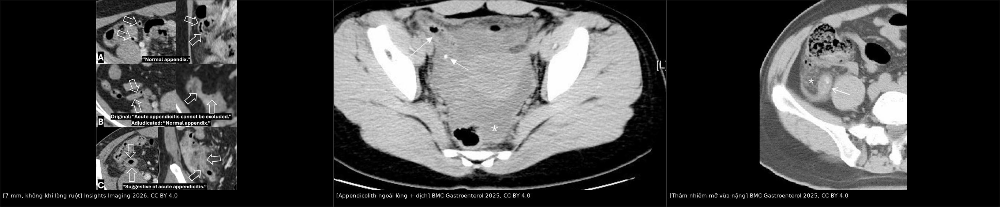
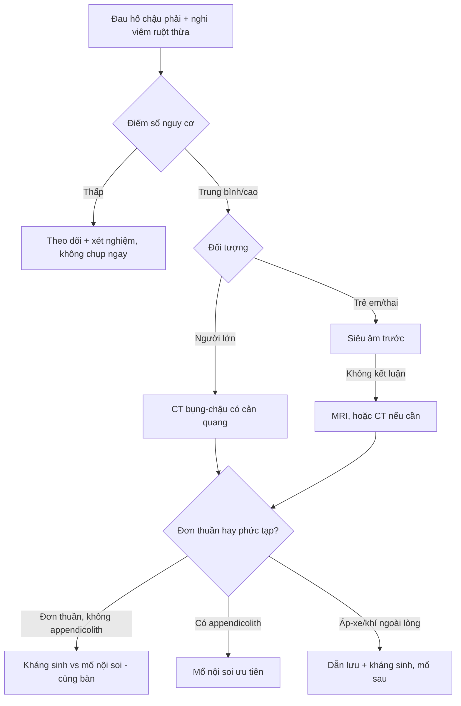
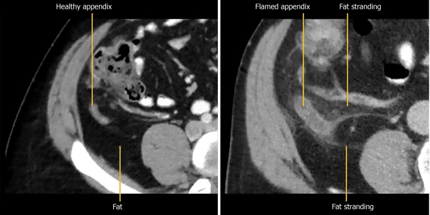
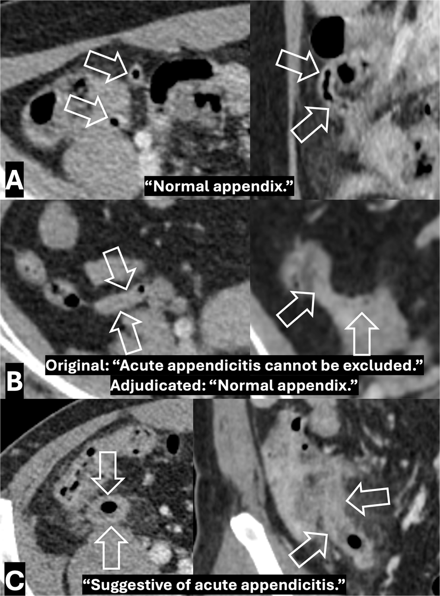
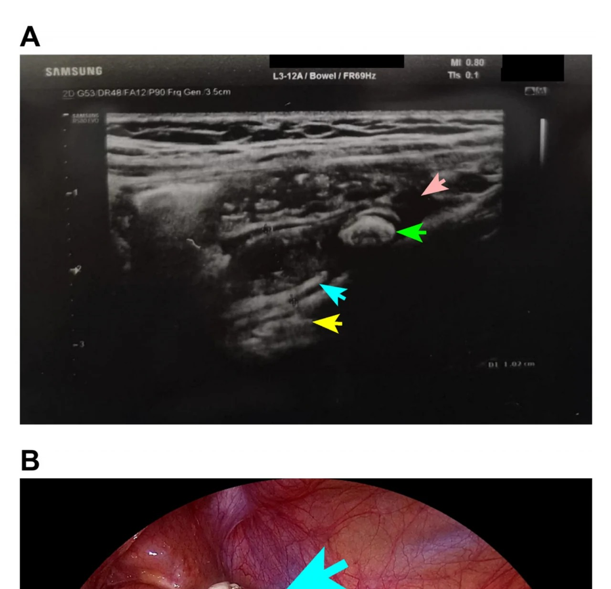

# 161 — Viêm ruột thừa cấp: tiếp cận CT/siêu âm, ngưỡng 6 mm và các dấu hiệu phức tạp / Acute appendicitis — CT and ultrasound approach, the 6-mm threshold and complicated disease

**Tags:** `pattern:quai-ruot-gian` `pattern:tham-nhiem-mo` `vung:ho-chau-phai` `protocol:CT-bung-co-can-quang` `protocol:sieu-am-chen-ep` `score:Alvarado`
**Mức chắc chắn (certainty):** tổng hợp y văn (literature synthesis) — tổng hợp từ tổng quan hình ảnh có full-text (World J Gastrointest Pathophysiol 2025, PMC12754330), đoàn hệ CT 983 ca về mức độ chắc chắn của báo cáo (Insights Imaging 2026, PMC13391980), đoàn hệ 331 ca về appendicolith và viêm ruột thừa phức tạp (BMC Gastroenterol 2025, PMC12817488), đoàn hệ nhi 142 ca (Children 2026, PMC13604985), tổng quan điều trị không mổ (Cureus 2026, PMC13124642) và tổng quan điểm số nhi (Pediatr Rep 2026, PMC13516179).

## 1. Tổng quan bệnh học – cơ chế hình ảnh và ngưỡng định lượng

- **Bệnh học:** lòng ruột thừa bị tắc (appendicolith, phì đại mô lympho, phân, dị vật) → **tăng áp lực trong lòng** → ứ dịch, căng thành → **ứ máu tĩnh mạch, thiếu máu thành** → vi khuẩn xuyên thành → **hoại tử và thủng**. Đau khởi phát quanh rốn rồi khu trú hố chậu phải khi phúc mạc thành bị kích thích.
- **TẠI SAO CT thấy được viêm (vật lý HU + mô bệnh):**
  - **Đường kính ngoài–ngoài (outer-to-outer) > 6 mm** là dấu trực tiếp nhất; nhưng **tới 40% ruột thừa bình thường vượt 6 mm** khi lòng chứa khí/dịch — nên **không đọc đường kính đơn độc**.
  - **Dày thành > 3 mm** và **ngấm thuốc mạnh (hyperenhancement)** sau tiêm: phù thành + giãn mạch viêm.
  - **Dịch trong lòng không có khí (airless low-attenuation fluid)**: ngưỡng **2,6 mm** dịch trong lòng có giá trị chẩn đoán cao, hữu ích ở giai đoạn sớm.
  - **Thâm nhiễm mỡ quanh ruột thừa (periappendiceal fat stranding)**: mỡ bình thường **−100 đến −80 HU**; phù/dịch làm tăng đậm độ lên khoảng **−40 đến −20 HU** — đây là dấu **nhạy và quan trọng nhất để phân biệt viêm với "ruột thừa to đơn thuần"**.
  - **Mất ngấm thành (loss of wall enhancement)** = hoại tử; **khí ngoài lòng, áp-xe, appendicolith nằm ngoài lòng** = thủng.
- **Ngưỡng và con số phải nhớ:**
  - **Đường kính > 6 mm**: CT người lớn **Se 85,7–100%, Sp 94,8–100%** (tổng quan PMC12754330). **7 mm** là ngưỡng thay thế hay dùng để giảm dương tính giả ở ca "borderline".
  - **Không có dấu hiệu phụ** (không thâm nhiễm mỡ, không liệt ruột khu trú) → xác suất viêm ruột thừa chỉ khoảng **2%**.
  - **Khí trong lòng ruột thừa** gặp ở **tới 31%** ca viêm ruột thừa đã xác nhận — **khí trong lòng KHÔNG loại trừ**.
  - **Appendicolith** (đoàn hệ 331 ca mổ): **OR 1,88** (1,04–3,40) cho viêm ruột thừa **phức tạp**; trong nhóm có appendicolith, **đường kính tăng mỗi 1 mm: OR 1,20**; **thâm nhiễm mỡ vừa–nặng: OR 17,61** (3,19–97,33); **khí quanh ruột thừa: OR 9,78** (1,17–81,46).
  - **Tính không xác định của báo cáo CT:** **15,5%** báo cáo gốc là "không xác định"; sau hội chẩn còn **12%**; các sơ đồ từ vựng cứng cho **27,9–46,1%** không xác định. Sau hội chẩn: **Se 85,2–98,7%, Sp 85,9–97,1%, độ chính xác 91,0–92,4%, kappa 0,819–0,838** (PMC13391980).
  - **Trẻ em:** tỷ lệ thủng **19,0%** (27/142) trong đoàn hệ mổ; siêu âm phát hiện thủng **Sp ~93% nhưng Se chỉ ~44%**; **ruột thừa không thấy được** ở **50% ca phức tạp** so với **10% ca đơn thuần** — không thấy ruột thừa trên siêu âm ở trẻ **không** đồng nghĩa bình thường.
  - **MRI ở trẻ/người trẻ:** **Se/Sp 85,9%/93,8%** (không cản quang), **93,6%/94,3%** (có cản quang) — tương đương CT **93,6%/94,3%** (tổng quan PMC12754330).
  - **Điểm số:** Alvarado **≥ 7: Se 72–88%, Sp 57–76%**; PAS **≥ 7: Se 80–95%, Sp 60–70%**; AIR **≥ 5: Sp 78–90%** (tổng quan nhi PMC13516179). **Không dùng điểm số đơn độc** và **không dùng ngưỡng 6 mm đơn độc ở trẻ**.
- **Điều trị không mổ (khi nào được phép):** APPAC (530 bệnh nhân) — **73% tránh được mổ trong năm đầu**, nhưng **tái phát tích lũy ~39% ở 5 năm**; **appendicolith** là yếu tố dự báo thất bại rõ rệt (tổng quan PMC13124642). Đây là nền tảng để phân tầng "đơn thuần vs phức tạp" trên CT.

## 2. Mẫu hình + chẩn đoán phân biệt theo vị trí và hình thái (gamut)

- **Bốn câu hỏi khi thấy "quai giãn + thâm nhiễm mỡ" ở hố chậu phải:**
  1. **Có phải ruột thừa không?** (theo dõi liên tục từ đáy manh tràng; ruột thừa **tịt một đầu**, không thấy van ruột non).
  2. **Có viêm quanh nó không?** (thâm nhiễm mỡ, dịch, hạch) — không có thì nghĩ **ruột thừa to không viêm/mucocele**.
  3. **Đơn thuần hay phức tạp?** (áp-xe, khí ngoài lòng, mất ngấm thành, appendicolith ngoài lòng).
  4. **Có bệnh khác giải thích tốt hơn?** (viêm túi thừa phải, viêm mào mỡ, sỏi niệu quản, PID, Crohn).
- **Gamut theo vị trí ruột thừa (vì sao dễ bỏ sót):**
  - **Chậu (pelvic) — hay gặp nhất:** sát trực tràng/tử cung, dễ nhầm viêm phần phụ.
  - **Sau manh tràng (retrocecal):** không có quai ruột che trước, thâm nhiễm mỡ lan ra sau; đau có thể khu trú thấp.
  - **Dưới gan (subhepatic):** đau hạ sườn phải — nhầm viêm túi mật.
  - **Bên trái (left-sided):** đảo tạng (situs inversus) hoặc manh tràng di động — dễ bỏ sót hoàn toàn.
  - **Đầu ruột thừa (tip appendicitis):** chỉ viêm ở đầu, thân bình thường; **phải xem hết chiều dài**, đây là lý do hay đọc âm tính giả.
  - **Trong túi thoát vị (Amyand hernia):** ruột thừa viêm trong túi bẹn.
- **Gamut theo hình thái:** ruột thừa giãn có thâm nhiễm mỡ (viêm cấp); giãn **không** thâm nhiễm + vôi hóa/vỏ mỏng (mucocele — bài [134](../134-u-nhay-ruot-thua-chua-vo/lesson.md)); thành dày + hẹp lòng + nang quanh (viêm túi thừa ruột thừa); nốt mỡ có viền viêm, **không có quai ruột** (viêm mào mỡ); thành ruột non dày đoạn dài + skip lesion (Crohn — bài [165](../165-day-thanh-ruot/lesson.md)).

## 3. Bảng so sánh phân biệt (ma trận đối chiếu)

| Thực thể | Hình ảnh điển hình | Chốt vào (rule-in) | Chốt loại (rule-out) | Gợi ý xác nhận |
|---|---|---|---|---|
| **Viêm ruột thừa cấp** | Ruột thừa **> 6 mm**, thành **> 3 mm**, ngấm mạnh, thâm nhiễm mỡ quanh | **Giãn + thâm nhiễm mỡ + ngấm thành**; dịch lòng **2,6 mm** | **Có dấu hiệu phụ đầy đủ mà ruột thừa ≤ 6 mm, thành mỏng, không ngấm** → ít khả năng | CT có cản quang, lát 1–3 mm, dựng coronal; theo dõi từ đáy manh tràng |
| **Viêm ruột thừa phức tạp (thủng/áp-xe)** | **Khí ngoài lòng**, áp-xe, appendicolith **ngoài lòng**, mất ngấm thành, thâm nhiễm mỡ vừa–nặng | **Khí ngoài lòng/áp-xe**; appendicolith ngoài lòng; thâm nhiễm mỡ vừa–nặng (OR 17,61) | Không có các dấu trên + lâm sàng nhẹ → có thể điều trị không mổ | CT bụng–chậu toàn bộ; đánh giá khả năng dẫn lưu áp-xe |
| **Viêm túi thừa ruột thừa** | Túi thừa thành ruột thừa, **viêm khu trú**, thường không giãn toàn bộ | **Túi thừa + thâm nhiễm mỡ khu trú**, phần còn lại của ruột thừa bình thường | Giãn toàn bộ + appendicolith trong lòng → viêm ruột thừa | CT; tỷ lệ thủng cao hơn, cân nhắc mổ sớm |
| **Viêm mào mỡ (epiploic appendagitis)** | **Nốt mỡ hình bầu dục < 5 cm** có **viền viêm mảnh**, **dấu vòng nhẫn** (hyperattenuating ring), không có quai ruột giãn | **Tổn thương mỡ khu trú + viền + KHÔNG thấy ruột thừa giãn** | Có quai ruột giãn/tịt đầu → viêm ruột thừa | CT; điều trị bảo tồn |
| **Viêm túi thừa đại tràng phải** | Dày thành đại tràng **có túi thừa**, thâm nhiễm mỡ quanh đại tràng, **không tách rời khỏi đại tràng** | **Túi thừa + dày thành đại tràng**; ruột thừa bình thường | Ruột thừa giãn riêng biệt → viêm ruột thừa | CT; nội soi sau đợt cấp nếu nghi ung thư |
| **Sỏi niệu quản phải** | **Nốt vôi hóa trong đường đi niệu quản**, **dấu "vành khăn" (rim sign)**, ứ nước thận | **Sỏi + ứ nước + máu trong nước tiểu** | Không có ứ nước, có thâm nhiễm mỡ quanh ruột thừa → viêm ruột thừa | CT không cản quang (sỏi) + siêu âm thận |
| **PID/áp-xe phần phụ** | Ống dẫn trứng dày, nang/áp-xe buồng trứng, dịch túi cùng | **Cấu trúc phần phụ + dịch vùng chậu** ở nữ tuổi sinh sản | Ruột thừa giãn + thâm nhiễm mỡ hố chậu phải | Siêu âm đầu dò âm đạo/MRI; PCR lậu–chlamydia |
| **Mucocele ruột thừa** | Ruột thừa giãn **> 15 mm**, vỏ mỏng, **vôi hóa thành**, **không thâm nhiễm mỡ** | **Giãn lớn + vôi hóa + không viêm quanh** | Thâm nhiễm mỡ rõ + ngấm thành → viêm cấp | CT/MRI; **không chọc/dẫn lưu** (nguy cơ LAMN — bài 134) |
| **U manh tràng/viêm hồi tràng** | Khối đặc/dày thành không đều, hạch, lồng ruột | **Khối + hạch + không thấy ruột thừa riêng** | Ruột thừa giãn tịt đầu độc lập → viêm ruột thừa | CT + nội soi/sinh thiết |

*Trái: ruột thừa **7 mm** — báo cáo gốc "không loại trừ viêm", hội chẩn lại là bình thường (bẫy đường kính). Giữa: **appendicolith ngoài lòng + dịch quanh ruột thừa** (dấu phức tạp). Phải: **thâm nhiễm mỡ vừa–nặng** quanh ruột thừa. Nguồn: Insights Imaging 2026 (PMC13391980, CC BY 4.0) và BMC Gastroenterol 2025 (PMC12817488, CC BY 4.0); ảnh ghép letterbox, giữ nguyên tỷ lệ.*

## 4. Protocol chụp + hệ phân độ/điểm chuẩn hóa

- **Người lớn:** **CT bụng–chậu có cản quang tĩnh mạch** (portal venous), **lát 1–3 mm**, **dựng coronal + sagittal**; đọc từ **đáy manh tràng** theo toàn bộ chiều dài tới đầu ruột thừa. CT là **tiêu chuẩn vàng** ở người lớn (Se 85,7–100%, Sp 94,8–100%).
- **Trẻ em:** **siêu âm là bước 1** (đầu dò tuyến tính, **ép dần — graded compression**): ruột thừa **> 6 mm**, **không xẹp được**, không nhu động, thành ngấm mạnh trên Doppler, **mỡ quanh tăng âm**, appendicolith (bóng lưng). Nếu siêu âm không kết luận → **MRI** (không bức xạ) hoặc CT theo mức độ khẩn.
- **Thai kỳ:** **siêu âm trước**, nếu không kết luận → **MRI** (HASTE/SSFSE, T1, T2 fat-sat); tránh CT trừ khi lợi ích lớn hơn nguy cơ.
- **Điểm số lâm sàng:** Alvarado (0–10), **PAS** (trẻ), **AIR** (có CRP). Ngưỡng tham khảo: Alvarado/PAS **≥ 7**, AIR **≥ 5**; nhưng **không thay thế hình ảnh**.
- **Phân tầng trên CT:** **đơn thuần** (giãn + thâm nhiễm mỡ, không khí ngoài lòng/áp-xe) vs **phức tạp** (áp-xe, khí ngoài lòng, mất ngấm thành, appendicolith ngoài lòng). Đây là **biến số quyết định điều trị**, không chỉ để mô tả.
- **Quy trình quyết định (flowchart):**

- **Sau điều trị không mổ:** tái phát tích lũy **~39% ở 5 năm** (APPAC); hẹn theo dõi và tư vấn rằng **appendicolith** làm tăng thất bại.

## 5. Biến thể bình thường và cạm bẫy

- **"6 mm" không phải chân lý:** tới **40%** ruột thừa bình thường > 6 mm khi lòng có khí/dịch; ngược lại, **viêm đầu ruột thừa** có thể có đường kính thân bình thường. Luôn đọc **thâm nhiễm mỡ + ngấm thành + hình thái tịt đầu**.
- **Khí trong lòng ruột thừa** có ở **31%** ca viêm đã xác nhận — **không** dùng để loại trừ.
- **Appendicolith đơn thuần** có thể gặp ở người không viêm; chỉ có giá trị khi kèm dấu viêm — nhưng khi đã viêm thì **appendicolith làm tăng nguy cơ phức tạp** (OR 1,88) và **thất bại điều trị kháng sinh**.
- **Không thấy ruột thừa** trên siêu âm ở trẻ: gặp ở **50% ca phức tạp** — phải chuyển MRI/CT, không kết luận "bình thường".
- **Mucocele** giãn rất to nhưng **không thâm nhiễm mỡ**: đừng chọc/dẫn lưu (nguy cơ phát tán LAMN) — bài 134.
- **Viêm mào mỡ** là "kẻ bắt chước" kinh điển: đau khu trú, **không sốt cao**, CT có nốt mỡ viền mảnh; mổ nhầm là tai biến.
- **Thai kỳ:** ruột thừa bị đẩy lên cao do tử cung to → đau không điển hình; **siêu âm có thể âm tính giả**, cần MRI.
- **Cạm bẫy "thỏa mãn tìm kiếm":** thấy sỏi niệu quản hoặc nang buồng trứng rồi dừng, bỏ sót ruột thừa viêm đồng thời.

## 6. Tự lượng giá — Blind Quiz

**Ca 1 — Nam 24 tuổi, đau hố chậu phải 18 giờ, sốt 38,2°C. Hai ảnh CT cùng mức: bên trái là ruột thừa bình thường, bên phải là ruột thừa viêm.**

- Câu hỏi: Khác biệt chính giữa hai bên là gì? Dấu hiệu nào quyết định? Có cần đo đường kính không?

<b>Bấm để hiện đáp án (findings + chẩn đoán)</b>

- Bên trái: ruột thừa **mảnh, chứa khí, mỡ quanh trong (màu mỡ điển hình)**. Bên phải: ruột thừa **giãn, thành dày, ngấm thuốc** và **mỡ quanh tăng đậm độ (fat stranding)** — dấu quyết định.
- Chẩn đoán: **viêm ruột thừa cấp**. Đường kính **> 6 mm** hỗ trợ nhưng **không đơn độc**; thâm nhiễm mỡ + ngấm thành mới là chốt.
- Nguồn ảnh: Perera Molligoda Arachchige AS et al., World J Gastrointest Pathophysiol 2025 (PMC12754330), **CC BY-NC 4.0** — giữ nguyên bản, không ghép/cắt.

**Ca 2 — Nữ 31 tuổi, đau hố chậu phải nhẹ, không sốt. CT: ruột thừa 7 mm, không thấy khí trong lòng. Báo cáo gốc ghi "không loại trừ viêm ruột thừa".**

- Câu hỏi: Vì sao 7 mm là vùng xám? Cần tìm thêm dấu gì để quyết định? Tỷ lệ báo cáo "không xác định" trên CT là bao nhiêu?

<b>Bấm để hiện đáp án</b>

- **A:** ruột thừa bình thường, báo cáo rõ "normal appendix". **B:** ruột thừa **7 mm, không có khí trong lòng**, báo cáo gốc "không loại trừ viêm" — **hội chẩn lại là bình thường**. **C:** viêm ruột thừa rõ với thâm nhiễm mỡ và thành dày.
- 7 mm nằm trong vùng chồng lấp: tới **40%** ruột thừa bình thường > 6 mm khi có khí/dịch. Cần tìm **thâm nhiễm mỡ, ngấm thành, dịch lòng, dấu tịt đầu**; nếu tất cả âm tính và lâm sàng nhẹ → **theo dõi, không mổ ngay**.
- Tỷ lệ báo cáo **không xác định 15,5%** (báo cáo gốc), **12%** sau hội chẩn; các sơ đồ từ vựng cứng lên tới **27,9–46,1%** (PMC13391980).
- Nguồn ảnh: Siriphiphatcharoen P et al., Insights Imaging 2026 (PMC13391980), CC BY 4.0.

**Ca 3 — Bé trai 9 tuổi, đau bụng 2 ngày, sốt, bạch cầu tăng. Siêu âm hố chậu phải.**

- Câu hỏi: Mô tả các dấu hiệu trên ảnh. Siêu âm có loại trừ được thủng không? Bước tiếp theo nếu siêu âm không kết luận?

<b>Bấm để hiện đáp án</b>

- Dấu hiệu: ruột thừa **đường kính 1,02 cm**, **appendicolith trong lòng** (bóng lưng), **dịch tự do quanh ruột thừa**, **mỡ quanh tăng âm** — phù hợp **viêm ruột thừa có nguy cơ thủng**.
- Siêu âm **không loại trừ được thủng**: phát hiện thủng có **Sp ~93% nhưng Se chỉ ~44%**; ruột thừa **không thấy được ở 50% ca phức tạp** (so với 10% ca đơn thuần).
- Bước tiếp theo: **MRI bụng–chậu** (ưu tiên ở trẻ) hoặc **CT** nếu cần mổ cấp; không dùng ngưỡng **6 mm đơn độc** ở trẻ.
- Nguồn ảnh: Tchouala Tchakoute P et al., Children 2026 (PMC13604985), CC BY 4.0 — ảnh được cắt lấy phần siêu âm (panel A) từ hình gốc.

## Bài liên quan chéo
- [100 – Tổng quan hệ Bụng](../100-tong-quan-he-bung/lesson.md)
- [134 – U nhầy ruột thừa chưa vỡ (LAMN/HAMN)](../134-u-nhay-ruot-thua-chua-vo/lesson.md)
- [160 – Bụng cấp GI: tiếp cận và phân biệt](../160-bung-cap-GI/lesson.md)
- [162 – Tắc ruột](../162-tac-ruot/lesson.md)
- [165 – Dày thành ruột: Crohn vs K](../165-day-thanh-ruot/lesson.md)

> Không dùng để chẩn đoán độc lập khi chưa có người hướng dẫn. Quyết định mổ hay kháng sinh phải dựa trên toàn bộ lâm sàng, xét nghiệm và hình ảnh.
