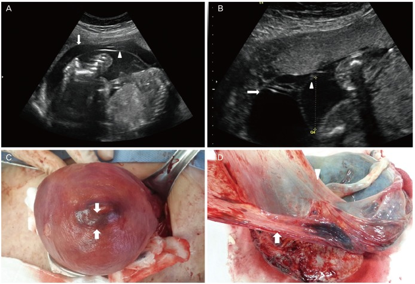
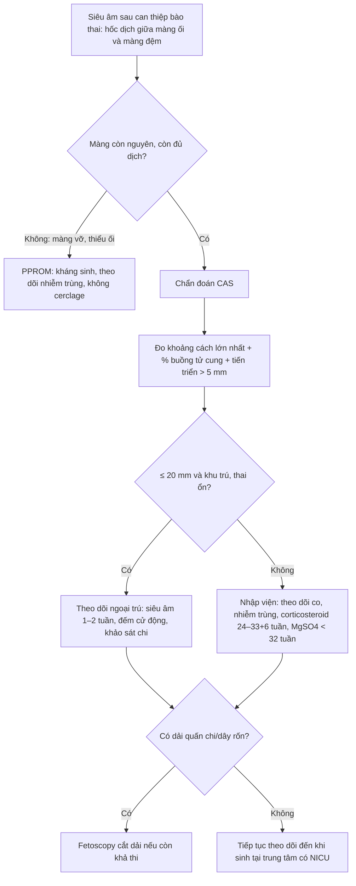
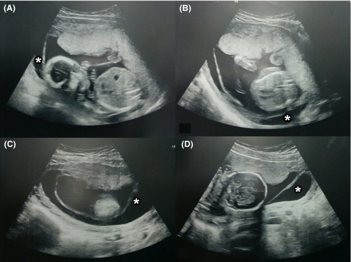
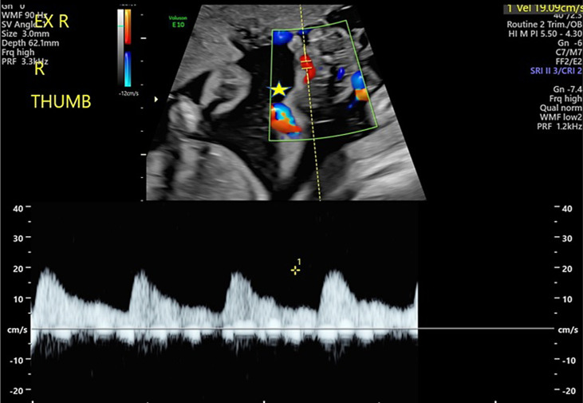
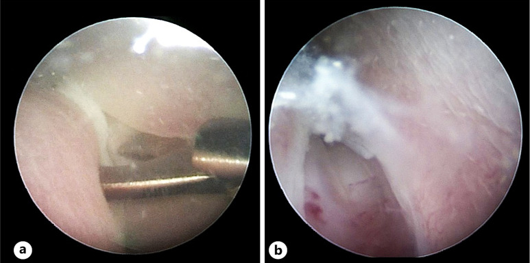

# 1610 — Tách màng ối sau can thiệp bào thai: chẩn đoán, phân độ & xử trí / Chorioamniotic membrane separation after fetal intervention

**Tags:** `pattern:tach-mang-oi` `pattern:day-oi` `pattern:roi-oi-non` `pattern:sinh-non` `vung:buong-tu-cung` `vung:banh-nhau` `protocol:sieu-am-thai` `protocol:Doppler` `protocol:MRI-thai`
**Mức chắc chắn (certainty):** tổng hợp y văn (literature synthesis) — thử nghiệm ngẫu nhiên 2025 (PMC12639666), đoàn hệ sau mổ thai 2024 (PMC11633867), đoàn hệ CAS 2016 (PMC5039039), đoàn hệ dải ối giả sau laser 2026 (PMC13002228) + 2 ca nguyên văn minh họa (PMC4796085, PMC6452456).

> **Câu chốt của bài:** sau 16 tuần, **màng ối và màng đệm đã dính nhau** — thấy **khoảng dịch giữa hai màng** là bất thường. Sau can thiệp bào thai, tách màng ối (chorioamniotic separation — CAS) **bắt đầu từ chỗ chọc trocar**, màng ối **không có mạch máu nên không tự liền**, và **không có thuốc/mẹo nào chứng minh gắn lại được**. Việc phải làm là **đo – phân độ – theo dõi sát biến chứng** (rỉ ối, sinh non, nhiễm trùng, **dải ối giả** chèn/hoại tử chi), chứ không phải "chờ màng dính lại". **CAS ≥ 20 mm hoặc lan > 1/2 buồng tử cung = nhóm nguy cơ cao**, cần theo dõi như thai nguy cơ cao.

## 1. Tổng quan bệnh học – cơ chế hình ảnh

- **Giải phẫu – mốc thời gian:** màng ối (amnion) và màng đệm (chorion) **dính nhau sinh lý từ 14–16 tuần**; trước 14 tuần thấy hai màng tách nhau là **bình thường**. Sau 16 tuần, CAS **hiếm và bất thường** (PMC5039039).
- **Cơ chế sau can thiệp (quan trọng nhất):** trocar/ống soi **xuyên qua màng đã dính**, tạo khiếm khuyết; dịch ối **chen vào giữa hai lớp** và bóc tách dần. Màng ối **không có mạch máu → không có quá trình lành**, nên tách thường **kéo dài/tiến triển** (PMC12639666). Ở tuổi thai sớm, **màng chưa dính hoàn toàn** nên càng dễ bong.
- **Tần suất (định lượng):**
  - Sau **laser TTTS (fetoscopic laser photocoagulation — FLP): 7,5–20,7%** (PMC12639666).
  - Sau **mổ thoát vị tủy–màng não (fetal spina bifida repair) mở tử cung: 11,9%** (23/194; PMC11633867).
  - Sau **amniocentesis/chọc ối**: là nguyên nhân iatrogenic hay gặp trong các loạt CAS (40% ca CAS có tiền sử chọc ối trong PMC5039039) — **không có tỷ lệ chung đáng tin** vì phụ thuộc kỹ thuật và tuổi thai.
- **Hậu quả (định lượng):**
  - **CAS sau 17 tuần (mọi nguyên nhân):** sinh non **57,5% vs 17,1%**; sinh non tự nhiên **39,4% vs 9,5%**; sinh **< 28 tuần 25,8% vs 3,2%** nếu chẩn đoán **< 24 tuần**; **thai lưu 9,7% vs 0%** khi chẩn đoán **< 24 tuần** (PMC5039039).
  - **Sau FLP (phân tích gộp 1.881 ca):** CAS làm tăng **PPROM < 34 tuần OR 3,98** (1,76–9,03), **sinh < 32 tuần OR 1,80** (1,16–2,80), **giảm sống sót sơ sinh OR 0,41** (0,24–0,70); can thiệp sớm hơn **1,07 tuần**, sinh sớm hơn **1,74 tuần** (PMC12639666).
  - **Sau mổ thai mở (fSB):** PPROM **69,6% vs 24,1%**, nhiễm trùng ối **22,7% vs 7,1%**, viêm màng đệm–ối mô học **40% vs 14,7%**, tuổi thai sinh **35,3 vs 36,7 tuần**, nằm viện sau mổ **35 vs 17 ngày** (PMC11633867).
  - **Dải ối giả (pseudoamniotic band sequence — PABS):** **1,3%** (11/816) sau FLP; **chỉ 27,3% được phát hiện trước sinh**; **3 ca hoại tử/cụt ngón** vì chẩn đoán muộn (PMC13002228). Đây là biến chứng **nặng nhất nhưng bỏ sót nhiều nhất**.
- **TẠI SAO siêu âm thấy được (vật lý):**
  - **Dịch ối là môi trường lỏng, đồng nhất → hốc âm (anechoic)**; hai màng là **cấu trúc mỏng, hồi âm cao**, nhìn rõ khi có lớp dịch ngăn cách.
  - **Màng ối mỏng, di động theo sóng dịch; màng đệm dày hơn, dính thành tử cung** — phân biệt bằng **độ dày, độ di động và Doppler** (màng đệm có mạch máu thai, màng ối không).
  - **MRI** ít dùng cấp cứu; T2 thấy dịch giữa hai màng nhưng **không thay thế siêu âm real-time** — chỉ dùng khi siêu âm khó (béo phì, thai lớn, vị trí sau).

## 2. Mẫu hình + chẩn đoán phân biệt theo bối cảnh (Gamut)

- **Theo nguyên nhân:** **iatrogenic sau FLP/fetoscopy** (hay gặp nhất, khởi phát ở chỗ chọc), **sau chọc ối/chọc máu cuống rốn**, **sau đặt shunt/đốt nhiệt**, **tự phát** (hiếm; có ca kèm **sẹo cơ tử cung** — PMC4796085), **sau PPROM** (màng tách do rỉ ối — PMC6452456), **bất thường nhiễm sắc thể/dính màng muộn** (dịch ối giữa hai màng, không có can thiệp).
- **Theo hình thái:** **khu trú (focal)** — một vùng tách nhỏ; **lan rộng (extensive/complete)** — tách gần toàn bộ, chỉ còn dính ở **chỗ cắm dây rốn**; **có dải/màng lơ lửng**; **có phần thai nằm ngoài khoang ối** (dấu hiệu nguy cơ PABS); **kèm đa/thiểu ối**.
- **Theo biến chứng:** **rỉ ối/PPROM** (màng yếu, dễ vỡ), **sinh non**, **nhiễm trùng ối** (màng mất hàng rào), **dải ối giả** quấn chi/dây rốn, **thai lưu** (thắt dây rốn), **suy thai**.
- **Gamut chẩn đoán phân biệt hình ảnh:**
  - **PPROM** — màng vỡ, **thiểu ối**, màng **lơ lửng tự do**, có thể thấy "tram sign"; CAS có thể **còn đủ dịch** và màng **còn nguyên**.
  - **Thông vách (iatrogenic septostomy)** — **lỗ thủng ở vách giữa hai thai**, dịch thông giữa hai buồng ối, thường **giải quyết đa ối/thiểu ối**; CAS là **tách màng ối–đệm trong cùng một buồng ối**, không phải vách giữa hai thai.
  - **Dải ối bẩm sinh (amniotic band sequence — ABS)** — **dải xơ mảnh, hồi âm cao**, bám vào chi/dây rốn, gây **thắt nghẹt**; ABS **không có khoảng dịch rộng giữa hai màng** như CAS; PABS là **biến chứng của CAS**.
  - **Máu tụ dưới màng đệm (subchorionic hematoma)** — khối **hồi âm cao/hỗn hợp**, không phải hốc âm di động; có thể đẩy màng nhưng **bản chất là máu**.
  - **Vách ối/dính tử cung (amniotic sheet/synechia)** — dải **dày, cố định**, không thay đổi theo tư thế; thường có tiền sử mổ/nhiễm trùng tử cung.
  - **Tách màng sinh lý < 14 tuần** — hai màng chưa dính; **không chẩn đoán CAS** ở tuổi thai này.

## 3. Bảng so sánh phân biệt (ma trận đối chiếu)

| Thực thể (entity) | Hình ảnh điển hình | Chốt vào (rule-in) | Chốt loại (rule-out) | Gợi ý xác nhận |
|---|---|---|---|---|
| **CAS sau can thiệp (iatrogenic)** | **Hốc âm giữa màng ối và màng đệm**, màng ối mỏng di động, **bắt đầu từ vị trí trocar**; đo được khoảng cách lớn nhất | **Tiền sử can thiệp trong 48 giờ–2 tuần + hốc dịch giữa hai màng + màng ối còn nguyên** | **Màng đã vỡ, thiểu ối, màng lơ lửng tự do** → PPROM, không chỉ CAS | Siêu âm real-time + Doppler; đo mm và % buồng tử cung |
| **CAS tự phát** | Giống CAS nhưng **không tiền sử can thiệp**; có thể kèm **sẹo cơ tử cung**, bất thường NST | **Không can thiệp + hốc dịch giữa hai màng sau 16 tuần** | Có can thiệp trong 2 tuần → iatrogenic | Hỏi bệnh sử, siêu âm hình thái, karyotype nếu có chỉ định |
| **PPROM** | **Thiểu ối**, màng **lơ lửng**, bể ối nhỏ; dịch âm đạo; ferning/IGFBP-1 dương | **Rỉ ối + thiểu ối + màng vỡ** | **Còn đủ dịch, màng nguyên, không rỉ** → CAS đơn thuần | Khám mỏ vịt, test dịch ối, siêu âm AFI |
| **Thông vách iatrogenic** | **Lỗ ở vách giữa hai thai**, dịch thông giữa hai buồng ối; bể ối hai thai thay đổi | **Lỗ vách + thay đổi cấp dịch hai buồng** | Tách nằm **trong một buồng ối** → CAS | Doppler màu, quan sát vách liên tục |
| **Dải ối bẩm sinh (ABS)** | **Dải xơ mảnh hồi âm cao** bám chi/dây rốn, thắt nghẹt, có thể cụt chi | **Dải bám + thắt chi/dây rốn** | Chỉ có hốc dịch giữa hai màng, không dải → CAS | Siêu âm 3D, khảo sát toàn bộ chi và dây rốn |
| **Dải ối giả (PABS) sau CAS** | Sau FLP: **dải/màng lơ lửng quấn chi**, chi **phù**, Doppler còn mạch; có thể cụt ngón | **CAS + dải quấn chi/dây rốn sau can thiệp** | Không dải, chỉ tách màng → CAS đơn thuần | Siêu âm chi/dây rốn mỗi lần; nội soi bào thai cắt dải |
| **Máu tụ dưới màng đệm** | Khối **hồi âm cao/hỗn hợp**, không di động, không phải hốc âm | **Khối hồi âm cao + không có hốc dịch di động** | Hốc âm di động giữa hai màng → CAS | Siêu âm lặp, Doppler |
| **Vách ối/dính tử cung** | Dải **dày, cố định**, bám thành tử cung, không đổi theo tư thế | **Dải dày cố định + tiền sử mổ/nhiễm trùng** | Hốc dịch mới xuất hiện sau can thiệp → CAS | So phim trước can thiệp |

*(A,B) Siêu âm: **màng ối (đầu mũi tên) tách khỏi màng đệm (mũi tên)**, dịch ối giữa hai lớp; thai trong khoang ối. (C,D) Đại thể: màng ối bong khỏi bánh nhau, còn dính ở vùng dây rốn. Đây là ca **tách màng ối hoàn toàn tự phát** (không can thiệp) — dùng để nhận diện hình thái, không đại diện CAS sau can thiệp. Nguồn: Joung EJ et al., Obstet Gynecol Sci 2016 (PMC4796085), CC BY-NC 3.0 (giữ nguyên bản).*

## 4. Protocol chụp + hệ phân độ/điểm chuẩn hóa

- **Siêu âm (chuẩn vàng, không cần MRI):**
  - **Đường bụng + đường âm đạo**; khảo sát **màng ối/màng đệm ở nhiều mặt cắt**, đặc biệt **vị trí trocar** sau can thiệp.
  - Đo **khoảng cách lớn nhất giữa màng ối và màng đệm (mm)**, **phần trăm buồng tử cung bị tách**, và **tiến triển** (tăng thêm **> 5 mm** so với lần trước) — theo định nghĩa PMC11633867.
  - Đánh giá **lượng ối (AFI/DVP)**, **cổ tử cung**, **sinh trắc thai**, **Doppler dây rốn**, và **khảo sát toàn bộ chi** tìm dải quấn (PABS).
  - **Sau FLP:** siêu âm **trong 48 giờ** (đây là tiêu chí chính của thử nghiệm PMC12639666), sau đó **mỗi 1–2 tuần** tùy mức độ.
- **Phân độ (hai hệ đang dùng, chưa thống nhất):**
  - **Theo khoảng cách (Wawrla-Zepf 2024, PMC11633867):** **nhỏ ≤ 20 mm**, **lớn > 20 mm**; tiến triển nếu **tăng > 5 mm**.
  - **Theo thể tích buồng tử cung (Bibbo 2016, PMC5039039):** **nhẹ ≤ 1/4**, **trung bình 1/4–1/2**, **nặng > 1/2** buồng tử cung.
  - **Lưu ý:** **không có ngưỡng mm nào được chứng minh là "an toàn"**; phân độ để **theo dõi và tư vấn**, không để quyết định mổ.
- **Theo dõi & xử trí (khung thực hành):**
  - **CAS khu trú, không rỉ ối, thai ổn:** theo dõi **ngoại trú** với siêu âm định kỳ; **nhập viện dự phòng không bắt buộc** — trong đoàn hệ 194 ca, kết cục thai **không khác** giữa nhóm nhập viện và không nhập viện (PMC11633867).
  - **CAS lan rộng/toàn bộ, có cơn co, ra máu, rỉ ối, hoặc thai ngoài khoang ối:** **nhập viện**, theo dõi nhiễm trùng (CRP/bạch cầu, cấy), **corticosteroid 24+0–33+6 tuần** nếu nguy cơ sinh trong 7 ngày, **magnesium sulfate < 32 tuần** để bảo vệ não thai (phối hợp bài 587).
  - **PPROM:** kháng sinh theo phác đồ (thường **ampicillin + macrolide** trong 10 ngày, tùy đơn vị), theo dõi viêm màng đệm–ối, **không đặt cerclage** khi đã rỉ ối/nhiễm trùng.
  - **PABS:** **cắt dải bằng fetoscopy** nếu phát hiện trước sinh và còn khả thi; nếu bỏ sót → nguy cơ **cụt chi/hoại tử** (PMC13002228, PMC11763431).
  - **Vá màng/amniopatch:** là can thiệp **thử nghiệm** cho PPROM iatrogenic; **chưa có bằng chứng** cho CAS đơn thuần — không tư vấn như điều trị chuẩn.
  - **Sinh:** cá thể hóa; **không có tuổi thai sinh tối ưu riêng cho CAS**; sau mổ thai thường sinh **34–37 tuần** theo phác đồ trung tâm. Ưu tiên **sinh tại trung tâm có hồi sức sơ sinh**.
- **Sơ đồ quyết định:**

## 5. Biến thể bình thường và cạm bẫy

- **Trước 14 tuần: tách màng là sinh lý** — đừng chẩn đoán CAS khi màng chưa dính; mốc dính **14–16 tuần**.
- **CAS không đồng nghĩa PPROM:** CAS có thể **còn đủ ối, màng nguyên**; PPROM là **màng đã vỡ**. Hai tình trạng có thể **cùng tồn tại** — đừng loại trừ PPROM chỉ vì thấy hốc dịch.
- **Đừng nhầm thông vách với CAS:** thông vách là **lỗ ở vách giữa hai thai**; CAS là **tách màng ối–đệm trong một buồng ối**. Điều trị và tiên lượng khác nhau.
- **Màng "lơ lửng" sau 20 tuần có thể chỉ là nếp gấp:** màng mỏng gấp nếp tạo hình ảnh giả tách; **đổi đầu dò/tư thế, dùng Doppler** và so sánh nhiều mặt cắt.
- **PABS bị bỏ sót vì không khảo sát chi:** chỉ **27,3%** ca PABS được phát hiện trước sinh; **mỗi lần siêu âm sau can thiệp phải xem đủ 4 chi + dây rốn**, tìm dải, phù, giảm vận động.
- **"CAS nhỏ thì lành" — không hoàn toàn:** CAS nhỏ có thể tiến triển nhanh; **đo lại và so sánh** quan trọng hơn con số tuyệt đối một lần.
- **Nhập viện dự phòng không cải thiện kết cục trong nghiên cứu quan sát** — nhưng đây là **bằng chứng yếu**; quyết định theo triệu chứng, khoảng cách đến viện, khả năng theo dõi.
- **Corticosteroid không điều trị CAS:** chỉ để **trưởng thành phổi** khi nguy cơ sinh non; **không làm màng dính lại**.

## 6. Tự lượng giá — Blind Quiz (ảnh trơn ngoài, đáp án giấu trong thẻ bấm-mở)

**Ca 1 — Thai 17 tuần 1 ngày, ra dịch âm đạo nhiều, không tiền sử can thiệp:**

- Câu hỏi: Mô tả dấu hoa thị. Đây là tách màng ối hay màng đã vỡ? Cần tìm thêm dấu hiệu gì?

<b>Bấm để hiện đáp án (findings + chẩn đoán)</b>

- **Dấu hiệu:** các mặt cắt (A–D) cho thấy **khoảng dịch (dấu *) giữa màng ối và màng đệm**, màng ối mỏng tách khỏi màng đệm; thai còn trong khoang ối; lượng dịch thay đổi tùy mặt cắt.
- **Chẩn đoán:** **tách màng ối một phần (partial CAS)**, trong bối cảnh **rỉ ối/PPROM** — ca gốc được chẩn đoán CAS sau khi rỉ ối ở 17 tuần.
- **Chốt:** **hốc dịch giữa hai màng + màng còn nguyên** = CAS; nếu **thiểu ối + màng lơ lửng tự do + test dịch ối dương** = PPROM. Hai tình trạng có thể cùng có.
- **Việc cần làm:** khám mỏ vịt/test dịch ối, siêu âm AFI, theo dõi nhiễm trùng, tư vấn tiên lượng sinh non; **không đặt cerclage** nếu đã rỉ ối.
- **Lưu ý trung thực:** ca minh họa là **CAS tự phát sau PPROM**, không phải sau can thiệp bào thai — dùng để nhận diện hình thái.
- Nguồn: Govaerts J et al., Clin Case Rep 2019 (PMC6452456), CC BY-NC-ND 4.0.

**Ca 2 — Thai 21 tuần 5 ngày, không chọc ối, siêu âm thấy màng ối bong gần toàn bộ:**

- Câu hỏi: Màng nào bong, còn dính ở đâu? Tách hoàn toàn có nghĩa là phải chấm dứt thai kỳ? Theo dõi gì?

<b>Bấm để hiện đáp án</b>

- **Dấu hiệu:** (A,B) **màng ối (đầu mũi tên) tách khỏi màng đệm (mũi tên)**, dịch ối giữa hai lớp; (C,D) đại thể: màng ối bong khỏi bánh nhau, **còn dính ở chỗ cắm dây rốn** — tách **hoàn toàn**.
- **Chẩn đoán:** **tách màng ối hoàn toàn tự phát**; ca gốc phát hiện ở **21 tuần 5 ngày**, không can thiệp trước đó; mổ lấy thai cấp ở **27 tuần** vì suy thai, phát hiện **khiếm khuyết cơ tử cung ở đáy**; trẻ sống, phát triển bình thường.
- **Chốt:** tách hoàn toàn **không bắt buộc chấm dứt thai kỳ** nếu thai không dị tật và không nhiễm trùng; theo dõi sát, sinh đúng lúc tại trung tâm có NICU.
- **Việc cần làm:** siêu âm hình thái, tìm bất thường NST/dị tật, theo dõi ối–nhiễm trùng–tim thai, tư vấn tiên lượng sinh non.
- Nguồn: Joung EJ et al., Obstet Gynecol Sci 2016 (PMC4796085), CC BY-NC 3.0.

**Ca 3 — Sau laser TTTS 3 tuần, siêu âm thấy chi thai phù, có dải mảnh quấn:**

- Câu hỏi: Dấu sao đánh dấu gì? Vì sao chi phù mà Doppler còn mạch? Chẩn đoán và xử trí?

<b>Bấm để hiện đáp án</b>

- **Dấu hiệu:** siêu âm Doppler chi trên: **dải/màng quấn quanh chi (ngôi sao vàng)**, phần ngoại vi **phù** nhưng **Doppler vẫn có phổ động mạch** — chưa tắc hoàn toàn.
- **Chẩn đoán:** **dải ối giả (pseudoamniotic band sequence — PABS)** sau laser TTTS, biến chứng của CAS; dải xơ hình thành từ màng ối bong.
- **Xử trí:** **fetoscopy cắt dải** nếu phát hiện trước sinh và còn khả thi; nếu bỏ sót → **hoại tử/cụt chi** (3 ca trong đoàn hệ 816 ca) hoặc thắt dây rốn → thai lưu.
- **Chốt:** sau mọi can thiệp bào thai, **phải khảo sát đủ chi và dây rốn**; PABS chỉ được phát hiện trước sinh **27,3%**.
- Nguồn: Lemoine FV et al., Fetal Diagn Ther 2026 (PMC13002228), CC BY-NC 4.0.

**Ca 4 — Cùng ca PABS, hình ảnh nội soi bào thai:**

- Câu hỏi: (a) mô tả tổn thương; (b) sau cắt còn gì? Biến chứng cần theo dõi sau thủ thuật?

<b>Bấm để hiện đáp án</b>

- **Dấu hiệu:** (a) **dải ối quấn quanh chi**, nằm ở đầu kéo nội soi; (b) sau **cắt dải**, chi có **vết rách/trợt da** nhưng còn tưới máu.
- **Chẩn đoán:** PABS — điều trị bằng **cắt dải qua nội soi bào thai**.
- **Theo dõi:** phù/hoại tử chi, cử động, Doppler; sinh tại trung tâm có phẫu thuật nhi; tư vấn di chứng thần kinh–cơ nếu tổn thương kéo dài.
- **Bài học:** **chẩn đoán sớm = còn cứu được chi**; chẩn đoán muộn = cụt ngón/chi.
- Nguồn: Lemoine FV et al., Fetal Diagn Ther 2026 (PMC13002228), CC BY-NC 4.0.

## Bài liên quan chéo
- [500 – Tổng quan Vú & Sản Phụ khoa](../500-tong-quan-vu-san-phu-khoa/lesson.md)
- [566 – Song thai: xác định màng đệm–màng ối & TTTS/TAPS](../566-song-thai-chorionicity-TTTS-TAPS/lesson.md)
- [587 – Dự phòng sinh non sau laser TTTS](../587-du-phong-sinh-non-sau-laser-TTTS/lesson.md)
- [588 – Song thai MCDA một thai chết](../588-song-thai-MCMA-mot-thai-chet/lesson.md)
- [1603 – Vasa previa: laser nội soi thai](../1603-vasa-previa-laser-noi-soi-thai/lesson.md)
- [1604 – Thai kỳ sau chửa ở sẹo mổ lấy thai](../1604-thai-ky-sau-chua-seo-mo-lay-thai/lesson.md)

## Ảnh
- `1610_tach-mang-oi-sieu-am_PMC4796085.jpg` — Joung EJ et al., Obstet Gynecol Sci 2016, Fig. 1, **CC BY-NC 3.0** (giữ nguyên bản, không cắt/ghép).
- `1610_tach-mang-oi-khoang-dich_PMC6452456.jpg` — Govaerts J et al., Clin Case Rep 2019, Fig. 1, **CC BY-NC-ND 4.0** (giữ nguyên bản).
- `1610_dai-oi-gia-sau-laser_PMC13002228.jpg`, `1610_cat-dai-oi-noi-soi_PMC13002228.jpg` — Lemoine FV et al., Fetal Diagn Ther 2026, Fig. 1 & 3, **CC BY-NC 4.0** (giữ nguyên bản).
- Nguồn + giấy phép từng ảnh: `images/CREDITS.md`.

> **Disclaimer y tế:** Không dùng để chẩn đoán độc lập khi chưa có người hướng dẫn.
