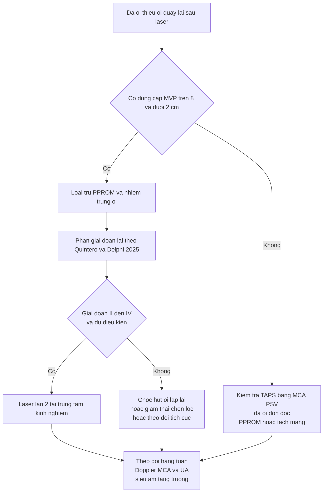
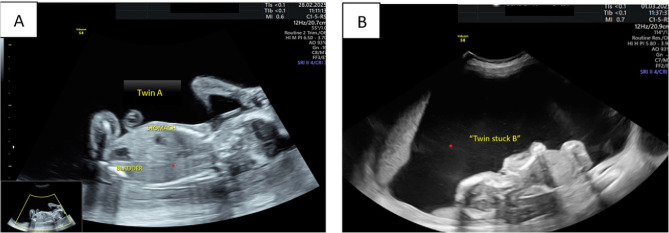

# 1611 — TTTS tái phát sau laser: chẩn đoán lại, chỉ định laser lần 2 và kết cục / Recurrent TTTS after fetoscopic laser

**Tags:** `pattern:ttts-tai-phat` `pattern:da-oi-thieu-oi` `vung:thai-nhi` `vung:banh-nhau` `score:Quintero-Delphi-2025` `score:TAPS` `protocol:SA-Doppler-MCA` `protocol:laser-lan-2`
**Mức chắc chắn (certainty):** tổng hợp y văn (literature synthesis) — số liệu từ hướng dẫn ISUOG 2025 (PMC11788470), phân tích gộp 26 nghiên cứu/4.013 bánh nhau về anastomosis tồn dư (PMC11502458), đoàn hệ 485 thai TTTS sớm (PMC13040126), đoàn hệ 666 thai của Hecher và cộng sự (PMID 28925589), tổng quan hệ thống 2.447 thai (PMID 22378622) và đoàn hệ ghép cặp 334 thai laser Solomon (PMID 39947882); ca nguyên văn dùng cho quiz: PMC12720975 (Sanjaya MEJ và cộng sự, 2025).

## 1. Tổng quan bệnh học – cơ chế hình ảnh

### 1.1. Vì sao laser "thành công" vẫn tái phát

- TTTS gặp ở **~15%** thai song thai một bánh nhau (monochorionic — MC) (PMC13344756). Cơ chế: các miệng nối mạch máu bánh nhau (placental anastomoses) mất cân bằng — chủ yếu **động mạch–tĩnh mạch (arterio–venous, AV)** đi một chiều từ thai cho sang thai nhận.
- Thai nhận (recipient): tăng thể tích tuần hoàn → tăng lợi niệu → **đa ối**; thai cho (donor): giảm thể tích → giảm lợi niệu → **thiểu ối**, dính vào thành tử cung ("stuck twin").
- Laser nội soi ống soi thai (fetoscopic laser) đốt các miệng nối dọc **đường xích đạo bánh nhau (vascular equator)**. Kỹ thuật **Solomon** đốt thành đường liên tục (dichorionization) thay vì chỉ đốt từng miệng nối (selective), nhằm phá hết các nhánh nhỏ mà mắt thường bỏ sót.
- **Tái phát (recurrence) xảy ra vì còn miệng nối hoạt động:** miệng nối bị bỏ sót, miệng nối nằm sâu dưới bề mặt không nhìn thấy, hoặc **tái thông (recanalization)** sau đốt. Hệ quả là cân bằng thể tích bị phá lại, đa ối–thiểu ối quay về.
- **Vì sao hình ảnh thay đổi theo giờ–tuần:** đa ối không phải "nước ứ lại" mà là **sản phẩm của thận thai**; khi cân bằng huyết động đảo, nước tiểu thai nhận tăng thì màng ối căng lại trong vài ngày. Vì vậy siêu âm sau laser phải đọc **động học (kinetics)** chứ không chỉ một lần đo.

### 1.2. Ngưỡng định lượng phải nhớ

- **TTTS ở thai MC:** **~15%** (PMC13344756).
- **Anastomosis tồn dư sau laser (gộp):** **24%** (KTC 95% **12–41%**), trung bình **4,03 ± 2,95** miệng nối/bánh nhau; làm tăng **OR 24,33** (KTC 95% **6,64–89,12**) nguy cơ TTTS tái phát và **OR 13,54** (KTC 95% **6,36–28,85**) nguy cơ TAPS sau laser (PMC11502458).
- **Tỷ lệ TTTS tái phát sau laser:** **0–16%** (tổng quan 2.447 thai, PMID 22378622); **"tới 14%"** theo ISUOG (PMC11788470).
- **Trong đoàn hệ TTTS sớm:** tái phát **4,3%** (21/485); laser lần 2 **1,2%** (6/485); TAPS sau laser **6,4%** (31/485) (PMC13040126).
- **TAPS sau laser nói chung:** **"tới 13%"** (ISUOG, PMC11788470); **8%** trong đoàn hệ 666 thai (PMID 28925589).
- **Solomon so với selective:** **4,2%** so với **18,1%** (tái phát và/hoặc TAPS); cannula 8/9/10/12 Fr có tỷ lệ **24% / 13% / 2% / 0,8%** (PMID 28925589).
- **Sống sót nguyên vẹn thần kinh khi đã tái phát (dữ liệu cũ):** **44%** (23/52) (PMID 22378622).

- **Mốc thời gian:** thực hành chung lấy **2 tuần sau laser** làm mốc phân định — còn đa ối (MVP ≥ 8 cm) kèm thiểu ối (MVP ≤ 2 cm) ở mốc này được gọi là **không hồi phục/tái phát**, khác với đa ối đơn độc kéo dài (PMC13344751). Đa số tái phát được phát hiện trong những tuần đầu sau laser, nên lịch siêu âm **hàng tuần trong 2 tuần đầu** là bắt buộc (PMC11788470).

## 2. Mẫu hình + chẩn đoán phân biệt theo vị trí (gamut)

### 2.1. Gamut "đa ối–thiểu ối quay lại sau laser" — theo thứ tự phải loại trừ

1. **TTTS tái phát thật (true recurrence):** đa ối thai nhận + thiểu ối thai cho tái xuất sau một giai đoạn đã hết; thường kèm bàng quang thai cho không thấy. Nguyên nhân: miệng nối tồn dư.
2. **Đảo vai (reversal):** thai từng là cho trở thành nhận và ngược lại — vẫn là bệnh lý miệng nối, nhưng **nhãn thai (label) phải giữ nguyên** để không đọc sai bên.
3. **TAPS sau laser (post-laser twin anemia–polycythemia sequence):** **không có** đa ối–thiểu ối; chẩn đoán bằng **MCA-PSV** (thai cho ≥ 1,5 MoM, thai nhận ≤ 0,8 MoM, hoặc chênh MCA-PSV ≥ 1,0 MoM) (PMC11788470).
4. **Đa ối đơn độc kéo dài:** MVP ≥ 8 cm ở thai nhận **> 14 ngày** sau laser nhưng **không có** thiểu ối ≤ 2 cm — chiếm **5,7%** (19/336) (PMC13344751); **không** gọi là tái phát.
5. **sFGR (selective fetal growth restriction) + bất tương xứng ối:** chênh cân nặng, Doppler động mạch rốn bất thường, nhưng ối có thể chỉ lệch nhẹ.
6. **Biến chứng thủ thuật:** **PPROM** (13,8% trong 7 ngày đầu), tách màng ối (chorioamniotic separation), viêm màng ối (chorioamnionitis), rò ối — gây **thiểu ối một bên** giả tái phát.
7. **Nguyên nhân ngoài TTTS:** đái tháo đường mẹ, dị tật thai (tắc ruột, bất thường thần kinh), nhiễm trùng bào thai, hội chứng truyền máu do truyền chéo ở thai không cùng bánh nhau (loại trừ bằng chorionicity).

### 2.2. Mẫu hình "đọc đúng sau laser"

- **Đúng bệnh:** một thai đa ối **kèm** một thai thiểu ối, **kèm** bàng quang thai thiểu ối không thấy/bé, **kèm** Doppler bất thường tùy giai đoạn.
- **Sai bệnh:** chỉ đa ối một bên; hoặc chỉ thiểu ối một bên sau PPROM; hoặc MCA bất tương xứng đơn thuần (TAPS).
- **Mẹo nhớ 4 nhóm:** **TÁI** (tái phát thật) – **TAPS** – **TÁCH** (tách màng/PPROM) – **TỒN** (đa ối tồn dư đơn độc).

*Hình minh họa mẫu hình gốc của TTTS (trước laser), không phải ca tái phát của nhóm: (A) thai nhận đa ối, bàng quang thấy được; (B) thai cho thiểu ối nặng, "stuck twin" sát thành tử cung sau. Nguồn: Sanjaya MEJ và cộng sự, Int Med Case Rep J 2025, PMC12720975, CC BY-NC 4.0 — ảnh nguyên bản, không crop.*

## 3. Bảng so sánh phân biệt (ma trận đối chiếu)

| Thực thể (entity) | Hình ảnh điển hình (siêu âm/Doppler) | Chốt vào (rule-in) | Chốt loại (rule-out) | Gợi ý xác nhận |
|---|---|---|---|---|
| TTTS tái phát | Đa ối **MVP ≥ 8 cm** + thiểu ối **MVP ≤ 2 cm** tái xuất sau giai đoạn hết; bàng quang thai cho không thấy | **Cặp đa ối–thiểu ối đúng ngưỡng, cùng một bánh nhau, sau khi đã hết ối lệch** | Không có thiểu ối ≤ 2 cm, hoặc ối lệch do PPROM/tách màng | Siêu âm hàng tuần; đo lại sau 3–7 ngày; đối chiếu nhãn thai |
| Đảo vai TTTS | Cùng mẫu hình nhưng **thai từng cho nay đa ối** | **Đảo chiều vai trò trên nhãn thai cố định** | Không đảo vai nếu nhãn bị đổi — kiểm tra lại ảnh cũ | Ghi nhãn thai theo tĩnh mạch rốn/tim, không theo "nhận/cho" |
| TAPS sau laser | **Không** đa ối–thiểu ối; MCA-PSV lệch; bánh nhau sáng/dày một bên | **MCA-PSV thai cho ≥ 1,5 MoM và thai nhận ≤ 0,8 MoM**, hoặc chênh ≥ 1,0 MoM | Đa ối ≥ 8 cm **kèm** thiểu ối ≤ 2 cm → không phải TAPS đơn thuần | MCA-PSV hai thai; sau sinh: chênh Hb > 8 g/dL + reticulocyte ratio > 1,7 |
| Đa ối tồn dư đơn độc | MVP ≥ 8 cm ở thai nhận **> 14 ngày**, không thiểu ối | **Đa ối đơn độc, thai cho vẫn có bàng quang và ối bình thường** | Có thiểu ối ≤ 2 cm → nghĩ tái phát | Theo dõi MVP hàng tuần; không đốt lại chỉ vì đa ối |
| PPROM/tách màng sau laser | Thiểu ối một bên, bàng quang **vẫn thấy**, màng ối tách, có thể thấy túi ối xẹp | **Tiền sử rỉ ối, màng tách, dịch âm đạo** | Bàng quang không thấy + đa ối bên kia → nghĩ TTTS | Khám mỏ vịt, IGFBP-1/ferning, siêu âm màng ối |
| sFGR | Chênh EFW ≥ 25%, Doppler rốn bất thường, ối lệch nhẹ | **Chênh cân nặng + Doppler, không đủ tiêu chuẩn ối của TTTS** | Đa ối ≥ 8 cm + thiểu ối ≤ 2 cm → TTTS | EFW, UA Doppler, theo dõi tăng trưởng |

### 3.1. Ba câu hỏi chốt trong 30 giây

1. **Có đúng cặp ≥ 8 cm / ≤ 2 cm không?** Không → không gọi TTTS tái phát.
2. **Bàng quang thai thiểu ối có thấy không?** Không thấy → giai đoạn II trở lên (sau khi loại trừ PPROM).
3. **MCA-PSV hai thai thế nào?** Lệch kiểu TAPS → TAPS; bình thường + ối lệch → TTTS.

## 4. Protocol chụp + hệ phân độ/điểm chuẩn hóa

### 4.1. Theo dõi sau laser (theo ISUOG 2025)

- **Tuần 1–2 sau laser:** siêu âm **hàng tuần** (hoặc sớm hơn nếu có triệu chứng); mỗi lần đo: **MVP hai buồng ối, bàng quang thai cho, Doppler động mạch rốn (UA), ống tĩnh mạch (DV), tĩnh mạch rốn (UV), hở van ba lá (TR), MCA-PSV hai thai, chiều dài cổ tử cung**.
- **Sau khi ối đã hết lệch:** giãn cách **2 tuần/lần** (khuyến cáo thực hành tốt, PMC11788470).
- **Sau 24 tuần:** thêm đánh giá tăng trưởng, cổ tử cung, dấu hiệu sinh non.
- **Khi nghi tái phát:** lặp siêu âm **3–7 ngày** để xác nhận xu hướng (không dựa một lần đo), kèm MCA-PSV và đánh giá màng ối.

### 4.2. Phân giai đoạn lại — Quintero và cập nhật Delphi 2025

- **Quintero kinh điển:** I = MVP ≥ 8 cm/≤ 2 cm; II = không thấy bàng quang thai cho; III = Doppler bất thường (UA mất/thu đảo cuối tâm trương, DV đảo a-wave, UV đập theo nhịp tim); IV = tràn dịch; V = chết một/hai thai.
- **Delphi 2025 (PMC13344756)** bổ sung: **"pre-TTTS"** (ối lệch chưa đủ ngưỡng: MVP ≥ 8 hoặc ≤ 2, hoặc ≥ 7 và ≤ 3 cm, Doppler bình thường); tách **giai đoạn III thai cho (IIID) / thai nhận (IIIR) / cả hai (IIID+R)**; thêm **hở van ba lá nặng** và **mất a-wave DV** vào tiêu chuẩn III; công nhận **"thai nhận bệnh nặng không có thiểu ối"** (atypical stage III–IV recipient).
- **MCA không nằm trong phân giai đoạn TTTS** (Delphi 2025 bỏ phiếu 94%) — MCA dùng để phát hiện TAPS, không dùng để tăng giai đoạn.

### 4.3. Chỉ định và kỹ thuật laser lần 2

- **Chỉ định:** TTTS tái phát **giai đoạn II–IV** (đặc biệt III–IV), không có PPROM/nhiễm trùng ối, tuổi thai còn trong giới hạn trung tâm (thường **< 26 tuần**, nhưng **chưa có ngưỡng thống nhất** — ghi rõ "chưa rõ"), bánh nhau tiếp cận được, ekip có kinh nghiệm.
- **Kỹ thuật trong đoàn hệ 2025 (11 ca laser lần 2):** vào **trocar phía đối diện** 8/11; **mở thông vách ối có chủ ý (intentional septostomy)** 4/11; vào buồng ối đối diện 2/11; **bơm CO₂** 2/11; **thay ối (amnioexchange)** 2/11 (PMID 39947882).
- **Kết cục ghép cặp (laser lần 2 so với laser 1 lần):** tuổi thai sinh **31 so với 32,5 tuần** (p = 0,228); sống cả hai **72,7% so với 87,9%** (p = 0,34); sống chu sinh chung **86% so với 91%** (p = 0,89) — tức **không khác biệt có ý nghĩa** ở trung tâm có kinh nghiệm (PMID 39947882).
- **Nếu không đủ điều kiện laser lần 2:** chọc hút ối (amnioreduction) lặp lại để giảm căng; **giảm thai chọn lọc** (RFA/bipolar) khi một thai đe dọa thai kia; theo dõi tích cực + corticosteroid + lên kế hoạch sinh. Tỷ lệ sống nguyên vẹn thần kinh trong các ca tái phát được báo cáo cũ là **44%** — dùng để tư vấn, không dùng để tiên lượng cá nhân (PMID 22378622).

## 5. Biến thể bình thường và cạm bẫy

- **Đa ối đơn độc kéo dài không phải tái phát:** 5,7% thai sau laser còn MVP ≥ 8 cm ở thai nhận > 14 ngày mà **không** thiểu ối; nhóm này có MVP trước laser cao hơn (12,5 so với 10,0 cm, p = 0,003) và lượng hút ối nhiều hơn (2.000 so với 1.500 mL, p = 0,030) (PMC13344751). Đốt lại chỉ vì đa ối = can thiệp thừa.
- **Cạm bẫy "một lần đo":** đa ối sau laser có thể dao động trong vài ngày; phải lặp lại sau 3–7 ngày trước khi kết luận tái phát.
- **Cạm bẫy nhãn thai:** sau laser, vai trò cho/nhận có thể đảo; nếu đổi nhãn theo "nhận/cho" sẽ đọc ngược bên, mô tả sai vị trí bánh nhau và sai kế hoạch trocar. Luôn theo **nhãn thai cố định** (tim, tĩnh mạch rốn).
- **Cạm bẫy màng ối:** septostomy tự phát hoặc do thủ thuật làm ối "cân bằng giả" — mất dấu hiệu đa ối–thiểu ối dù bệnh vẫn tiến triển; đồng thời tăng nguy cơ dây rốn quấn và PPROM.
- **Cạm bẫy TAPS "ẩn":** MCA-PSV có thể bình thường ở thai nhận còn đa hồng cầu; chẩn đoán sau sinh mới rõ (chênh Hb > 8 g/dL). Không loại TAPS chỉ vì MCA bình thường một lần.
- **Cạm bẫy phân giai đoạn:** thai nhận có bệnh tim nặng nhưng **không có thiểu ối** vẫn là bệnh nặng (atypical stage III–IV recipient, Delphi 2025); đừng hạ giai đoạn chỉ vì thiếu tiêu chuẩn ối.
- **Biến thể bình thường:** ối lệch nhẹ (chênh < 4 cm) với Doppler bình thường sau laser thường tự hết; không can thiệp.

## 6. Tự lượng giá — Blind Quiz

**Ca 1 — đa ối–thiểu ối ở thai một bánh nhau**

- Gợi ý lâm sàng: thai 20 tuần, song thai một bánh nhau, bụng căng nhanh, khó thở.
- Câu hỏi: (1) Mô tả dấu hiệu chính ở hai buồng ối. (2) Ba chẩn đoán phân biệt? (3) Dấu hiệu nào chốt chẩn đoán TTTS và giai đoạn?

<b>Bấm để hiện đáp án (findings + chẩn đoán)</b>

- Dấu hiệu: (A) thai nhận — đa ối, bàng quang thấy rõ; (B) thai cho — thiểu ối nặng, thai dính sát thành tử cung sau ("stuck twin").
- Chẩn đoán: TTTS giai đoạn II (đa ối ≥ 8 cm + thiểu ối ≤ 2 cm + **không thấy bàng quang thai cho**). Vì sao: miệng nối AV một chiều làm thai cho mất thể tích → vô niệu → không thấy bàng quang.
- Phản biện: ảnh gốc là ca TTTS **trước** laser (PMC12720975), không phải ca tái phát; dùng để nhận diện mẫu hình. Khi mẫu hình này **quay lại sau khi đã hết** thì mới gọi là tái phát.
- Nguồn ảnh: Sanjaya MEJ và cộng sự, *Int Med Case Rep J* 2025, PMC12720975, CC BY-NC 4.0.

**Ca 2 — "đốm trắng" trên bánh nhau trong buổi laser**

- Gợi ý lâm sàng: đang nội soi ống soi thai để đốt miệng nối.
- Câu hỏi: (1) Đường đứt nét và các đốm trắng là gì? (2) Vì sao đốt sót lại gây tái phát? (3) Làm gì để giảm nguy cơ?

<b>Bấm để hiện đáp án (findings + chẩn đoán)</b>

- Dấu hiệu: đường đứt nét = **đường xích đạo mạch máu (vascular equator)**; đốm trắng = điểm **đông đặc bằng laser** tại các miệng nối AV.
- Cơ chế tái phát: miệng nối sâu/bỏ sót/tái thông vẫn cho máu đi một chiều → tái lập đa ối–thiểu ối. Anastomosis tồn dư gặp ở **24%** bánh nhau và làm tăng **24 lần** nguy cơ tái phát (PMC11502458).
- Giảm nguy cơ: kỹ thuật **Solomon** (đốt cả đường xích đạo) giảm tái phát/TAPS còn **4,2%** so với **18,1%** khi đốt chọn lọc; ống soi lớn hơn (10–12 Fr) giúp nhìn rõ hơn (PMID 28925589).
- Nguồn ảnh: Sanjaya MEJ và cộng sự, *Int Med Case Rep J* 2025, PMC12720975, CC BY-NC 4.0.

**Ca 3 — tình huống quyết định**

- Gợi ý lâm sàng: laser lần 1 lúc 19 tuần; tuần 22 siêu âm lại thấy MVP 10 cm/1,5 cm, bàng quang thai thiểu ối không thấy; màng ối nguyên, không rỉ ối; MCA-PSV hai thai bình thường.
- Câu hỏi: Chẩn đoán? Có chỉ định laser lần 2 không? Yếu tố nào phải kiểm tra trước?

<b>Bấm để hiện đáp án (findings + chẩn đoán)</b>

- Chẩn đoán: **TTTS tái phát giai đoạn II** (đa ối ≥ 8 cm + thiểu ối ≤ 2 cm + không thấy bàng quang), đúng 3 tuần sau laser.
- Chỉ định: **có cân nhắc laser lần 2** nếu không PPROM/nhiễm trùng, tuổi thai trong giới hạn trung tâm và ekip kinh nghiệm; kết cục ghép cặp cho thấy không khác biệt có ý nghĩa so với laser một lần (sinh 31 so với 32,5 tuần; sống chu sinh 86% so với 91%) (PMID 39947882).
- Phải kiểm tra: màng ối/PPROM, dấu hiệu nhiễm trùng, MCA-PSV (loại TAPS), vị trí bánh nhau và đường vào, cổ tử cung; tư vấn nguy cơ sinh non và di chứng thần kinh.
- Nguồn số liệu: PMC11788470, PMC11502458, PMID 39947882, PMC13040126.

## Bài liên quan chéo
- [566 – Song thai: xác định màng đệm–màng ối & TTTS/TAPS](../566-song-thai-chorionicity-TTTS-TAPS/lesson.md)
- [587 – Dự phòng sinh non sau laser TTTS](../587-du-phong-sinh-non-sau-laser-TTTS/lesson.md)
- [1636 – Theo dõi thần kinh dài hạn sau một thai chết trong song thai một bánh nhau](../1636-theo-doi-than-kinh-sau-mot-thai-chet/lesson.md)

## Ảnh
- `images/1611_ttts-tai-phat_US_PMC12720975-Fig1.jpg` — siêu âm TTTS trước laser (PMC12720975, CC BY-NC 4.0).
- `images/1611_ttts-tai-phat_Fetoscopy_PMC12720975-Fig2.jpg` — đường xích đạo và điểm đốt laser (PMC12720975, CC BY-NC 4.0).
- Nguồn và giấy phép chi tiết: `images/CREDITS.md`; nguồn học thuật: `sources.md`.

> Không dùng để chẩn đoán độc lập khi chưa có người hướng dẫn.
