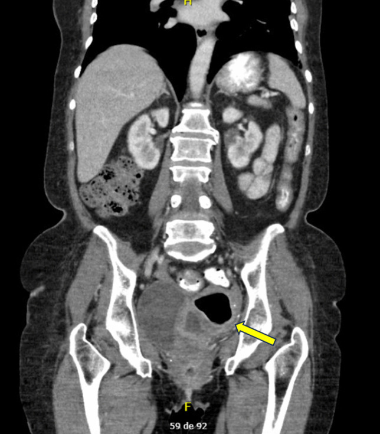
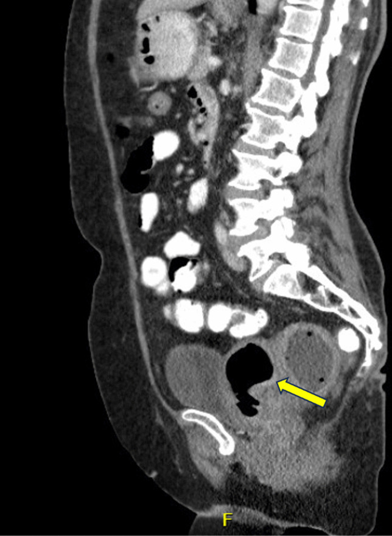
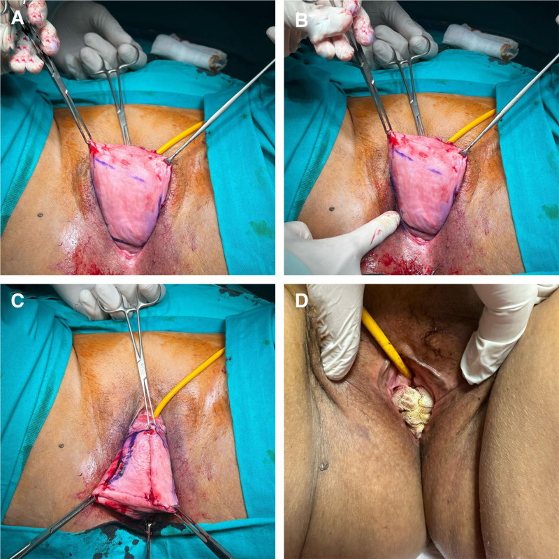
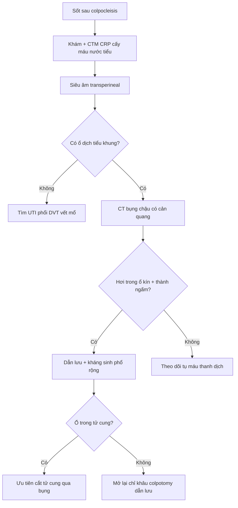
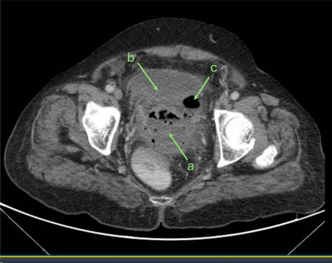

# 1612 — Colpocleisis: chọn ca, kỹ thuật bịt âm đạo & biến chứng ứ mủ (pyocolpos/pyometra) / Colpocleisis: patient selection, obliterative technique and post-obliteration fluid collections

**Tags:** `pattern:sa-tang-chau` `pattern:pyocolpos` `pattern:pyometra` `vung:chau` `score:POP-Q` `protocol:CT-chau-co-can-quang` `protocol:SA-transperineal` `incidentaloma:pyocolpos`
**Mức chắc chắn (certainty):** tổng hợp y văn (literature synthesis) — số liệu từ đoàn hệ 58 ca colpocleisis (PMC12851770), loạt 3 ca pyocolpos sau colpocleisis (PMC12925871), tổng quan 7 ca pyometra sau LeFort (PMC12872722), 9 ca bí tiểu được colpocleisis (PMC12776221) và so sánh colpocleisis với vòng nâng (pessary) (PMC13450978); chưa có ca nguyên văn riêng của nhóm.

## 1. Tổng quan bệnh học – cơ chế hình ảnh

### 1.1. Colpocleisis là gì và vì sao hình ảnh hậu phẫu lại khó

- **Colpocleisis (phẫu thuật bịt âm đạo)** là phẫu thuật **triệt tiêu (obliterative)** khoang âm đạo: bóc biểu mô âm đạo trước–sau rồi khâu hai lớp cơ–niêm mạc vào nhau, kèm **tạo hình tầng sinh môn (perineorrhaphy)** để thu nhỏ lỗ sinh dục (PMC12872722, PMC12851770). Mục đích không phải "treo" tạng sa mà **chặn đường sa ra ngoài**.
- Ba biến thể cần phân biệt vì **sinh lý dẫn lưu khác nhau**:
  1. **LeFort (bịt một phần, giữ tử cung)**: để lại **hai đường hầm (lateral tunnels)** hai bên — vừa để theo dõi chảy máu sau mãn kinh, vừa để **dẫn lưu dịch tử cung** ra ngoài (PMC12872722).
  2. **Bịt toàn bộ kèm cắt tử cung (colpocleisis with hysterectomy)**: không còn tử cung, mỏm cắt âm đạo bị đóng kín.
  3. **Bịt toàn bộ không cắt tử cung / bịt mỏm cắt sau cắt tử cung (vaginal vault)**: khoang âm đạo bịt kín nhưng còn tử cung → nguy cơ **ứ mủ trong tử cung (pyometra)**.
- **TẠI SAO ứ dịch lại thành mủ:** sau bóc biểu mô rộng, khoang mổ là **một ổ kín, không có đường dẫn lưu tự nhiên**. Máu tụ/thanh dịch (seroma) là **môi trường nuôi cấy**; vi khuẩn âm đạo đi lên hoặc nhiễm từ mỏm cắt âm đạo sau cắt tử cung → **áp-xe hóa**. Vì khoang kín, triệu chứng đến **muộn 10–15 ngày** (không có dịch chảy ra báo hiệu) và khi vỡ/ứ đầy mới sốt cao (PMC12925871).
- **TẠI SAO hình ảnh nhìn thấy:** dịch–mủ có **đậm độ nước 0–20 HU**, không ngấm cản quang; **thành viêm ngấm cản quang** (tăng sinh mạch + phù); **hơi (gas)** trong ổ kín sau 10 ngày là dấu hiệu **áp-xe do vi khuẩn sinh hơi/vi khuẩn đường tiêu hóa**, gần như không gặp ở thanh dịch vô khuẩn; mỡ quanh thâm nhiễm (**fat stranding**) là phản ứng viêm lan. Trong tử cung, mủ + hơi làm **lòng tử cung căng, thành mỏng, mức khí–dịch ngang** — hình ảnh "ổ áp-xe có vỏ" giữa tiểu khung (PMC12872722 Fig 1–2).

### 1.2. Ngưỡng định lượng phải nhớ

- **Hiệu quả:** thành công giải phẫu **91–100%**; biến chứng chung **6–15%** (PMC12925871). Tổng quan khác: **tái phát 0–9,3%**, biến chứng chu phẫu **4,6–15,2%** (PMC12872722).
- **Đoàn hệ 58 ca** (tuổi trung bình **75,6 ± 8,2**; theo dõi **2,88 ± 1,89 năm**): thành công giải phẫu (POP-Q ≤ 2) **94,8%**, thành công chủ quan **77,5%**, **hối tiếc 6,8%** (không ai hối tiếc vì mất chức năng giao hợp), **nhiễm khuẩn tiết niệu 20,7%**, mổ **56,3 ± 13,7 phút**, nằm viện **3,16 ± 1,62 ngày**, chỉ **1,7%** vào ICU (PMC12851770).
- **Cắt tử cung cùng thì** làm tăng biến chứng: **11,4% so với 9,5%**, **aOR 1,93** (PMC12925871 dẫn Raina và cộng sự).
- **Bí tiểu do sa (urinary retention):** 9/75 ca colpocleisis có bí tiểu trước mổ; **8/9 (89%)** tự tiểu lại được sau mổ, **Qmax 15,9 mL/s**, **PVR 20 mL**, không biến chứng chu phẫu trong theo dõi trung vị 3 tháng (PMC12776221).
- **So với vòng nâng (pessary):** hài lòng **97,8% so với 90%**; cải thiện triệu chứng lớn hơn (VAS **8,9 so với 7,7**); **23,3%** bỏ vòng nâng, **20%** sau đó phải mổ; biến chứng **17,3% so với 26,6%** (PMC13450978).
- **Pyocolpos sau colpocleisis:** xuất hiện **10–15 ngày** sau mổ; **CRP 112–250 mg/L**, **WBC 14.200–23.400/mm³**, **ESR 91–106 mm/h**; ổ áp-xe **8 × 6 cm** và **11 × 8 × 8 cm** trên CT (PMC12925871).
- **Pyometra sau LeFort:** 7 ca, tuổi trung vị **78** (72–92); **6/7 phải cắt tử cung qua đường bụng** (3 ca mổ ngay, 3 ca thất bại điều trị bảo tồn); chỉ **1/7** thành công với dẫn lưu xuyên bụng + nong đường hầm; không ca nào có ung thư nền (PMC12872722).

## 2. Mẫu hình + chẩn đoán phân biệt theo vị trí (gamut)

### 2.1. Mẫu hình "khối/dịch tiểu khung sau bịt âm đạo"

- **Mẫu hình đúng bệnh:** bệnh nhân nữ lớn tuổi, **sốt + đau bụng dưới ± chảy dịch âm đạo hôi** sau colpocleisis 3 ngày–10 tuần; CT có **ổ dịch thành dày, có hơi, thâm nhiễm mỡ quanh**, nằm **giữa bàng quang và trực tràng** (pyocolpos/áp-xe tiểu khung) hoặc **trong lòng tử cung** (pyometra).
- **Ba tầng giải phẫu quyết định tên gọi** (đọc theo trục dọc trên CT sagittal):
  1. **Trong lòng tử cung** → pyometra (còn tử cung).
  2. **Trong khoang âm đạo đã bịt** → pyocolpos (âm đạo là túi kín).
  3. **Ngoài âm đạo, trong phúc mạc/tiểu khung** → áp-xe tiểu khung (rectovesical pouch, túi cùng sau).
- **Mẹo nhớ 5 nhóm:** **Ứ** (pyocolpos/pyometra) – **MÁU** (tụ máu mỏm cắt) – **RÒ** (rò niệu–âm đạo/trực tràng–âm đạo) – **NGOÀI** (nhiễm khuẩn tiết niệu/hô hấp) – **U** (ác tính hiếm).

### 2.2. Gamut theo vị trí

- **Trong tử cung:** pyometra (ứ mủ), ứ dịch do hẹp cổ tử cung, hoại tử u (rất hiếm), tụ máu trong buồng tử cung.
- **Trong âm đạo:** pyocolpos, tụ máu âm đạo, ứ dịch do bịt kín, sa tái phát có loét/hoại tử.
- **Quanh âm đạo – tiểu khung:** áp-xe tiểu khung sau mổ, tụ máu mỏm cắt âm đạo bội nhiễm, rò tiết niệu (urineoma), rò tiêu hóa (áp-xe do xì miệng nối).
- **Ngoài tiểu khung (nguyên nhân sốt "che lấp"):** nhiễm khuẩn tiết niệu (hay nhất, **20,7%**), viêm phổi, nhiễm khuẩn vết mổ, huyết khối tĩnh mạch sâu chi dưới.

## 3. Bảng so sánh phân biệt (ma trận đối chiếu)

| Thực thể (entity) | Hình ảnh điển hình (US/CT) | Chốt vào (rule-in) | Chốt loại (rule-out) | Gợi ý xác nhận |
|---|---|---|---|---|
| **Pyocolpos / áp-xe tiểu khung** | Ổ dịch **thành dày ngấm cản quang**, **có hơi**, thâm nhiễm mỡ, giữa bàng quang và trực tràng; US transperineal: khối hỗn hợp âm | **Sốt 10–15 ngày sau bịt âm đạo + ổ dịch có hơi + CRP > 100 mg/L** | Không hơi, không ngấm thành, không thâm nhiễm mỡ → nghĩ thanh dịch/tụ máu đơn thuần | CT bụng–chậu có cản quang; cấy mủ khi dẫn lưu |
| **Pyometra (LeFort, còn tử cung)** | Tử cung **to, lòng căng dịch ± hơi**, mức khí–dịch; thành cơ ngấm đều | **Còn tử cung + sốt + lòng tử cung căng dịch/hơi trên CT** | Tử cung teo, không dịch → loại trừ | CT sagittal + coronal; cấy dịch tử cung |
| **Tụ máu mỏm cắt âm đạo** | Khối **tăng đậm độ 40–80 HU** (máu), **không hơi**, không ngấm; có thể có viền ngấm | **Mổ mới < 1 tuần + không sốt/hay sốt nhẹ + khối tăng đậm độ** | **Hơi trong ổ kín + thành ngấm + sốt cao → áp-xe hóa**, không gọi là tụ máu đơn thuần | CT không cản quang + so đậm độ cơ; theo dõi CRP |
| **Nhiễm khuẩn tiết niệu** | Thận/bàng quang bình thường hoặc dày thành bàng quang; **không có ổ dịch tiểu khung** | **Cấy nước tiểu dương + ổ nhiễm khuẩn niệu điển hình** | **Không loại trừ áp-xe**: 1/3 ca pyocolpos có đồng thời UTI (ESBL) | Cấy máu + nước tiểu; vẫn phải loại trừ ổ tiểu khung nếu sốt cao |
| **Rò niệu–âm đạo / trực tràng–âm đạo** | **Hơi/dịch trong âm đạo** đã bịt, đường hầm chứa khí; CT cystography thấy thuốc sang âm đạo | **Tiểu không tự chủ liên tục hoặc dịch âm đạo + hơi trong khoang bịt** | Không hơi, không thoát thuốc → loại trừ | CT cystography / methylene blue; MRI nếu cần |
| **Tổn thương tiêu hóa (xì miệng nối/thủng)** | Khí tự do ngoài lòng ruột, dịch tự do, thâm nhiễm mỡ lan; có thể ổ dịch cạnh ruột | **Khí ngoài lòng ruột + dịch tự do + bệnh cảnh bụng cấp** | Khí khu trú trong ổ áp-xe, không tự do → áp-xe đơn thuần | CT có cản quang uống/trực tràng; hội chẩn ngoại |

*CT coronal: tử cung còn lại sau LeFort bị căng bởi **hơi + dịch** (mũi tên vàng) — mức khí–dịch ngang trong lòng tử cung, thành cơ mỏng. Nguồn: Saad EC và cộng sự, Int Urogynecol J 2026, PMC12872722, CC BY 4.0.*

*CT sagittal cùng ca: tử cung **gập sau (retroflexed)**, thân tử cung căng hơi và dịch (mũi tên vàng), không thấy mức dịch tự do trong phúc mạc. Nguồn: Saad EC và cộng sự, Int Urogynecol J 2026, PMC12872722, CC BY 4.0.*

### 3.1. Dấu hiệu "chốt" trên CT — đọc theo thứ tự

1. **Có hơi trong ổ dịch kín?** Hơi trong khoang đã bịt sau 10 ngày là **áp-xe cho đến khi chứng minh ngược lại**; hơi đơn thuần vài giờ sau mổ có thể do không khí vào trong lúc mổ — **bối cảnh thời gian quyết định** (ca pyocolpos: 10–15 ngày).
2. **Thành có ngấm cản quang?** Thành dày, ngấm đều = viêm cấp; thành mỏng, không ngấm = thanh dịch/tụ máu cũ.
3. **Vị trí so với bàng quang và trực tràng:** ổ giữa hai tạng = khoang âm đạo/phúc mạc; ổ trong tử cung = pyometra. Luôn ghi **kích thước 3 bình diện** (ví dụ 8 × 6 cm; 11 × 8 × 8 cm) và **có/không chèn ép niệu quản, có thận ứ nước**.
4. **Có khí tự do ngoài lòng ruột?** Nếu có → nghĩ thủng/xì miệng nối, không phải biến chứng nhiễm khuẩn đơn thuần.

## 4. Protocol chụp + kỹ thuật + theo dõi

### 4.1. Trước mổ — chọn ca và loại trừ ung thư

- **Chỉ định colpocleisis:** sa tạng chậu (POP) độ cao **POP-Q III–IV**, người **lớn tuổi, nhiều bệnh nền, không còn/không muốn giao hợp**; hoặc **thất bại/không dung nạp vòng nâng** (PMC12872722, PMC13450978).
- **Loại trừ:** còn nhu cầu giao hợp, không đủ sức mổ, **nghi ung thư cổ tử cung/nội mạc tử cung chưa loại trừ**.
- **Hình ảnh trước mổ:** **siêu âm transvaginal** để loại trừ bệnh lý tử cung (PMC12851770); **không làm nội mạc tử cung thường quy** ở người nguy cơ thấp — chỉ làm khi có **yếu tố nguy cơ ung thư nội mạc hoặc chảy máu sau mãn kinh** (PMC12872722).
- **POP-Q** là hệ phân độ chuẩn (điểm Aa, Ba, C, D, Bp, Ap; âm đạo dài bao nhiêu) — quyết định độ sa và theo dõi tái phát; colpocleisis thường cho **POP-Q điểm C/Ba ≥ +3 cm** (stage III–IV).

### 4.2. Kỹ thuật (đọc ảnh mổ để hiểu vì sao tái phát thấp)

*Bốn thì: (A) đánh dấu và bóc biểu mô âm đạo trước–sau; (B–C) khâu gấp (imbricate) hai lớp cơ–niêm mạc vào nhau, để lại đường hầm dẫn lưu; (D) tạo hình tầng sinh môn thu nhỏ lỗ sinh dục. Nguồn: Yildiz Ç và cộng sự, Medicine 2026, PMC12851770, CC BY 4.0.*

- **LeFort:** bóc hai "cửa sổ" biểu mô trước–sau, khâu gấp nhiều lớp, **giữ hai đường hầm bên**; kèm perineorrhaphy.
- **Bịt toàn bộ:** bóc toàn bộ biểu mô âm đạo (colpectomy) rồi khâu kín — **không còn đường dẫn lưu**, do đó nguy cơ ứ dịch cao hơn; nhiều tác giả đề nghị **để lại một kênh nhỏ như LeFort** để phòng pyocolpos (PMC12925871).
- **Cắt tử cung cùng thì:** chỉ khi có chỉ định (bệnh lý tử cung, nguy cơ ung thư); **không thường quy** vì tăng biến chứng (**aOR 1,93**) và lợi ích phòng ung thư chỉ rõ ở phụ nữ **< 40 tuổi** trong mô hình quyết định (PMC12925871, PMC12872722).

### 4.3. Khi bệnh nhân sốt sau mổ — protocol hình ảnh

- **Bước 1:** khám + **CTM, CRP, ESR, cấy máu, cấy nước tiểu**; luôn khám âm đạo/trực tràng tìm khối căng, dịch hôi.
- **Bước 2:** **siêu âm transperineal** (không chỉ transabdominal — ca 1 cho thấy siêu âm bụng thường **bỏ sót** ổ dịch tiểu khung) (PMC12925871). Đo 3 bình diện, mô tả hơi, vách, thành.
- **Bước 3:** **CT bụng–chậu có cản quang tĩnh mạch** (lát 1–2 mm, thì 60–70 giây) — xác định ổ, liên quan bàng quang/trực tràng/niệu quản, khí tự do, thận ứ nước; đây là **chuẩn để quyết định dẫn lưu** (PMC12925871, PMC12872722).
- **Bước 4:** nếu CT chưa rõ hoặc cần phân biệt rò → **MRI tiểu khung T2 + T1 fat-sat sau tiêm**, hoặc **CT cystography** khi nghi rò niệu–âm đạo.
- **Bước 5:** dẫn lưu + kháng sinh phổ rộng. Với **pyocolpos**: **mở lại chỉ khâu colpocleisis (colpotomy)**, hút mủ, rửa khoang, để dẫn lưu; âm đạo **tự dính lại trong ~2 tuần**, không cần khâu lại và **không tái phát sa** trong 6 tháng (PMC12925871). Với **pyometra**: đa số cần **cắt tử cung qua bụng**; ở người rất yếu có thể **dẫn lưu xuyên bụng qua cơ tử cung dưới hướng dẫn hình ảnh** (1/7 ca thành công) (PMC12872722).

### 4.4. Theo dõi sau dẫn lưu

- **Lâm sàng:** hết sốt trong **3 ngày** (2 ca đầu), CRP về bình thường; khám âm đạo **hàng ngày** giữ đường dẫn lưu thông (PMC12925871).
- **Hình ảnh:** siêu âm transperineal kiểm tra **ổ dịch đã sạch** trước khi rút dẫn lưu; không cần CT lặp nếu lâm sàng cải thiện.
- **Dài hạn:** **6 tháng** không tái phát sa/không nhiễm trùng trong loạt ca; tư vấn **hối tiếc 6,8%** và mất chức năng giao hợp trước mổ (PMC12851770).

## 5. Biến thể bình thường và cạm bẫy

- **"Bơm hơi" vài giờ sau mổ:** khí vào trong lúc bóc tách có thể thấy trong 24–48 giờ đầu; **khí + thành ngấm + sốt sau 1 tuần** mới là áp-xe. Đừng chọc dẫn lưu chỉ vì thấy một bóng khí sớm.
- **Tụ máu mỏm cắt âm đạo (40–80 HU) ≠ áp-xe (0–20 HU + hơi):** đậm độ và hơi là hai chốt; nhưng tụ máu **bội nhiễm** sẽ chuyển dần thành ổ hỗn hợp — theo dõi CRP/CT nếu sốt kéo dài.
- **UTI "che lấp" áp-xe:** UTI là biến chứng hay gặp nhất (**20,7%**) và 1 ca pyocolpos có đồng thời UTI ESBL; **đừng dừng chẩn đoán ở UTI** khi bệnh nhân sốc/nhiễm trùng huyết (PMC12925871).
- **Người già giảm đáp ứng viêm:** không phải ca nào cũng sốt/BC tăng; **CRP** và hình ảnh quan trọng hơn sốt (PMC12872722).
- **Nhầm ổ dịch với "sa tái phát":** khối căng ở âm đạo sau bịt có thể là pyocolpos, không phải prolapse; đừng đặt vòng nâng hay mổ lại trước khi loại trừ ổ nhiễm.
- **Đóng kín hoàn toàn vs để đường hầm:** bịt toàn bộ làm tăng ứ dịch; khi có thể, giữ **kênh dẫn lưu nhỏ** (LeFort) để phòng pyocolpos (PMC12925871).
- **Hysterectomy cùng thì không miễn phí:** tăng biến chứng **aOR 1,93**; quyết định theo bệnh nền và nguy cơ ung thư nội mạc, không theo thói quen (PMC12925871, PMC12872722).

## 6. Tự lượng giá — Blind Quiz

**Ca 1 — Nữ 69 tuổi, sốt 3 ngày sau LeFort colpocleisis + perineorrhaphy, đau bụng dưới. Nhìn CT, mô tả trước.**

- Gợi ý: mổ 3 ngày trước, còn tử cung; WBC 15.950/µL, CRP 28,82 mg/dL.
- Câu hỏi: ổ bất thường nằm ở đâu? Dấu hiệu nào nói ổ **nhiễm khuẩn** chứ không phải ứ dịch đơn thuần? 3 chẩn đoán phân biệt?

<b>Bấm để hiện đáp án (findings + chẩn đoán)</b>

- **Findings:** lòng tử cung căng, **mức khí–dịch ngang** (mũi tên vàng), thành cơ mỏng, không có hơi tự do ngoài lòng tử cung.
- **Chẩn đoán:** **pyometra sau LeFort** — ổ kín + hơi + phản ứng viêm; cần dẫn lưu/nguồn kiểm soát, phần lớn phải **cắt tử cung qua bụng** (6/7 ca trong tổng quan).
- Phân biệt: ứ dịch cổ tử cung đơn thuần, tụ máu trong buồng tử cung, hoại tử u.
- Nguồn: Saad EC và cộng sự, Int Urogynecol J 2026, PMC12872722, CC BY 4.0.

**Ca 2 — Nữ 73 tuổi, 12 ngày sau cắt tử cung + colpocleisis toàn bộ, sốt 38,8 °C, tụt huyết áp.**

- Câu hỏi: mô tả ổ dịch (a, b, c)? Vì sao **không được** chỉ điều trị UTI? Xử trí nguồn kiểm soát?

<b>Bấm để hiện đáp án (findings + chẩn đoán)</b>

- **Findings:** ổ dịch **có hơi, thành ngấm cản quang**, thâm nhiễm mỡ quanh (a) nằm giữa **bàng quang (b)** và **quai ruột (c)** — áp-xe tiểu khung/pyocolpos; kích thước 8 × 6 cm.
- **Chẩn đoán:** **pyocolpos sau colpocleisis toàn bộ** — khoang âm đạo bịt kín nên không dẫn lưu; UTI đồng thời chỉ là "bệnh cảnh phụ", không giải thích được sốc nhiễm trùng.
- **Xử trí:** mở lại chỉ khâu (colpotomy), hút mủ (~80 mL), rửa khoang, kháng sinh theo cấy; âm đạo tự dính lại, không tái phát sa.
- Nguồn: Akbari K, Yaraghi M. Case Rep Womens Health 2025, PMC12925871, CC BY-NC-ND 4.0 (ảnh nguyên bản).

**Ca 3 — Nữ 75 tuổi, sa độ IV, không còn giao hợp, suy tim NYHA III. Chọn colpocleisis hay vòng nâng?**

- Câu hỏi: 3 yếu tố quyết định lựa chọn? Nếu chọn colpocleisis, cần tư vấn gì trước mổ? Nguy cơ nhiễm trùng hậu phẫu?

<b>Bấm để hiện đáp án (findings + chẩn đoán)</b>

- **Chọn:** (1) **không còn nhu cầu giao hợp**; (2) **POP-Q III–IV** + thất bại/không dung nạp pessary; (3) đủ sức mổ ngắn (**~56 phút**) nhưng không đủ cho mổ lớn.
- **Tư vấn:** mất chức năng giao hợp vĩnh viễn, **hối tiếc ~6,8%**, không thể theo dõi cổ tử cung/nội mạc sau bịt; nguy cơ **UTI 20,7%**, áp-xe/pyocolpos hiếm nhưng nặng.
- **So sánh:** pessary hài lòng 90%, nhưng **23,3% bỏ vòng**, **20% phải mổ** sau đó; colpocleisis hài lòng 97,8%, biến chứng 17,3%.
- Nguồn: PMC12851770, PMC13450978, PMC12872722.

## Bài liên quan chéo
- [561 – Sa tạng chậu tái phát sau cắt lưới](../561-sa-tang-chau-tai-phat-sau-cat-luoi/lesson.md)
- [564 – Rò bàng quang–âm đạo & niệu quản–âm đạo](../564-ro-bang-quang-am-dao-sau-mo-phu-khoa/lesson.md)
- [542 – U xơ dưới niêm mạc (FIGO 0–2) & can thiệp bảo tồn](../542-u-xo-duoi-niem-mac-can-thiep-bao-ton/lesson.md)
- [104 – Nhiễm trùng nang gan (ADPKD/PLD)](../104-nhiem-trung-nang-gan-pld-adpkd/lesson.md)

> Không dùng để chẩn đoán độc lập khi chưa có người hướng dẫn.
