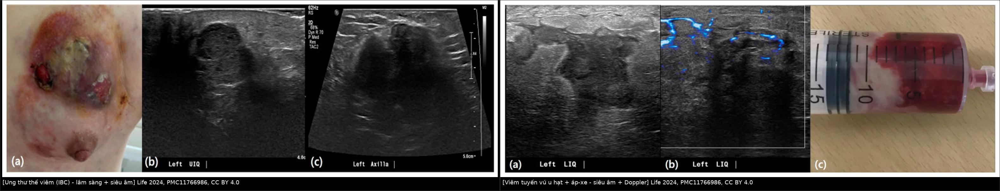
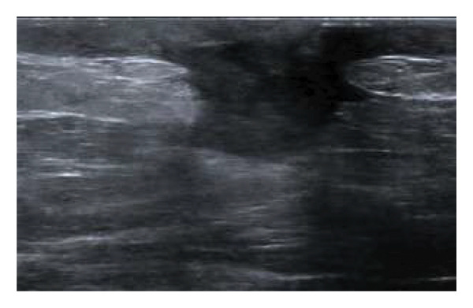
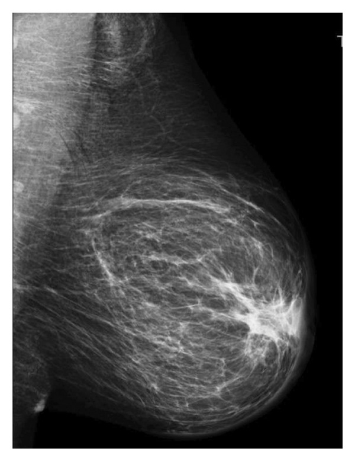
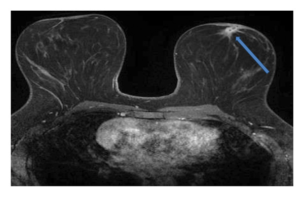
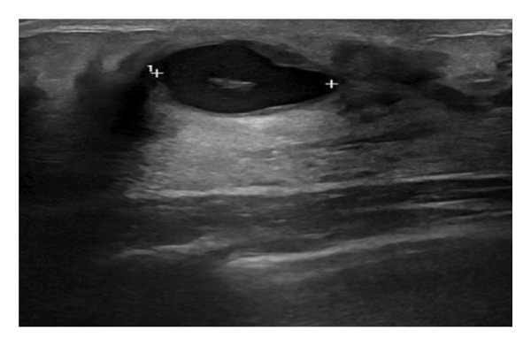
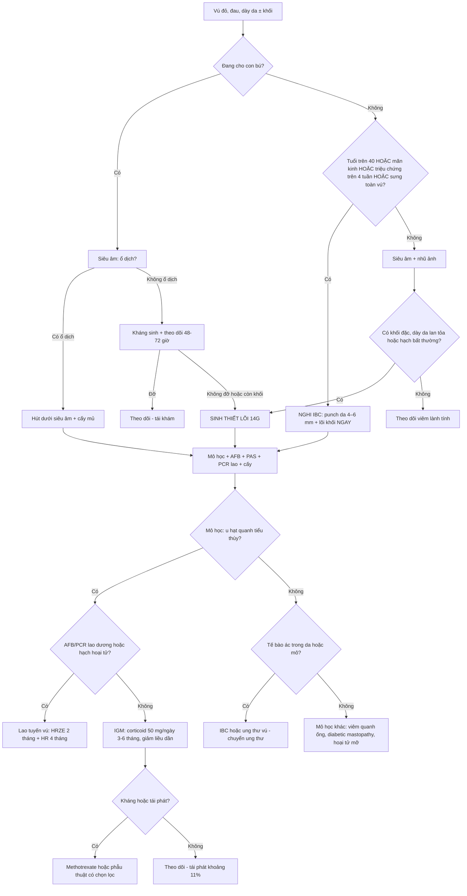
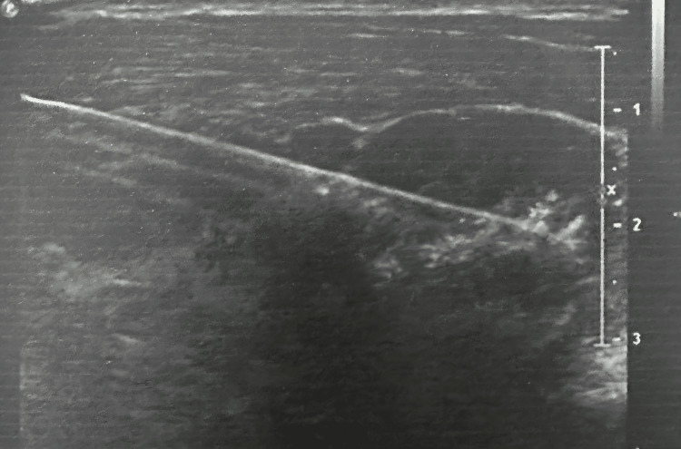
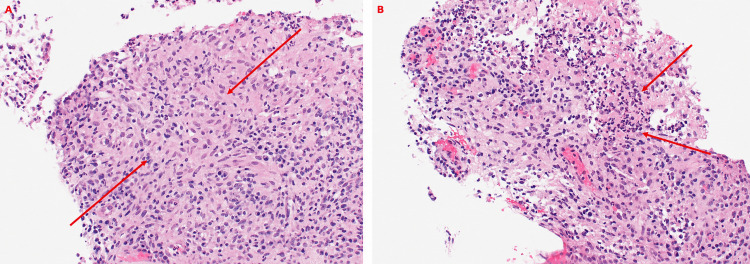

# 1613 — Viêm tuyến vú u hạt & áp-xe vú: phân biệt ung thư thể viêm / Granulomatous mastitis and breast abscess vs inflammatory breast cancer

**Tags:** `pattern:viem-tuyen-vu` `pattern:ap-xe` `pattern:day-da` `pattern:khoi-vu` `vung:vu` `score:BI-RADS` `protocol:sinh-thiet-loi` `protocol:MRI-vu`
**Mức chắc chắn (certainty):** tổng hợp y văn (literature synthesis) — review toàn diện IGM (Eur J Breast Health 2026, PMC13011148, CC BY-NC-ND — chỉ trích số), loạt 68 ca GM/TB tuyến vú (Turk J Med Sci 2023, PMC10387850), atlas "bệnh vú viêm" có hình ảnh (Radiol Res Pract 2026, PMC13425464, CC BY 4.0), nghiên cứu phân biệt IBC – viêm vú ở nữ châu Á (Life 2024, PMC11766986, CC BY 4.0), thử nghiệm hút/dẫn lưu áp-xe (Cureus 2026, PMC12973116, CC BY 4.0), ca IGM có mô học (Cureus 2026, PMC13401810, CC BY 4.0). Số liệu lấy nguyên từ bài gốc; chỗ chưa kiểm chứng ghi rõ.

> **Câu hỏi gốc của bài:** nữ đến khám với **vú đỏ, đau, dày da, có khối** — khi nào là **áp-xe/viêm lành tính**, khi nào là **ung thư thể viêm (inflammatory breast cancer, IBC)**? Sinh thiết cái gì, gửi xét nghiệm gì, và **vì sao không được cho corticoid trước khi loại lao**?

## 1. Tổng quan bệnh học – cơ chế hình ảnh (TẠI SAO ảnh trông như vậy)

- **Ba bệnh cảnh nằm chung một mẫu hình "vú viêm":**
  1. **Viêm tuyến vú u hạt vô căn (idiopathic granulomatous mastitis, IGM):** viêm hạt **quanh tiểu thùy (lobulocentric)**, **không hoại tử bã**, thường kèm **vi áp-xe** trong tiểu thùy. Cơ chế được ủng hộ nhiều nhất là **phản ứng với vi khuẩn ưa lipid** — *Corynebacterium kroppenstedtii* cấy dương **54,8% (34/62)** trong một loạt (PMC13011148).
  2. **Áp-xe vú (breast abscess):** ổ mủ **khu trú** trong nhu mô, thường sau viêm tuyến vú do *Staphylococcus aureus* ở người cho con bú, hoặc **áp-xe trong IGM**.
  3. **Ung thư thể viêm (IBC):** tế bào ung thư **bít kín bạch mạch ở trung bì (dermal lymphatic emboli)** → phù bạch mạch → **dày da + da cam**, **không nhất thiết có khối rõ**.
- **Tần suất – ngưỡng định lượng bắt buộc:**
  - **IGM chiếm 0,44–1,6%** các mẫu sinh thiết vú (PMC13011148); tuổi trung bình **35** trong loạt 68 ca (PMC10387850).
  - **IBC chiếm 2–4%** ung thư vú mới mắc nhưng gây **7–10%** tử vong do ung thư vú; trong nhóm phụ nữ có **vú viêm**, IBC chiếm **5–50%** tùy loạt (PMC11766986) → **không được mặc định "viêm" là lành**.
  - Trong loạt 101 phụ nữ châu Á có triệu chứng viêm vú: **13,9% (14/101) là IBC**; IBC lớn tuổi hơn (**46,4 vs 38,4**, p = 0,020), **mãn kinh 57,1% vs 12,6%**, **thời gian triệu chứng 37,7 vs 12,7 ngày** (p = 0,002), **sưng toàn vú 21,4% vs 1,1%** (p = 0,001) (PMC11766986).
  - **Yếu tố dự báo IBC độc lập:** thời gian triệu chứng **aOR 1,07 mỗi ngày** (p = 0,014); **sưng vú aOR 15,24** (p = 0,016) (PMC11766986).
- **TẠI SAO hình ảnh trông như vậy (vật lý + mô bệnh):**
  - **Dày da:** da bình thường **≤ 2 mm** (ngưỡng thực hành phổ biến; bài gốc không nêu số); khi có **phù bạch mạch** (viêm hoặc ung thư bít bạch mạch), nước tự do trong trung bì làm da dày **> 2–3 mm** và tăng hồi âm lớp dưới da; **cùng một hình ảnh, hai cơ chế hoàn toàn khác nhau** → da dày **không phân biệt được lành/ác**.
  - **Khối giảm hồi âm bờ không rõ:** phù + thâm nhiễm tế bào viêm (hoặc tế bào u) làm mất siêu cấu trúc mô mỡ–tuyến → giảm hồi âm, **bóng lưng không đều**. Trong IGM, **> 80% khối trên siêu âm là hỗn hợp, giảm hồi âm** (PMC13011148).
  - **Ổ dịch (áp-xe):** mủ là **dịch nhớt giàu tế bào** → **T1 thấp, T2 cao, DWI hạn chế mạnh (ADC thấp)**, **không ngấm trung tâm**, **viền ngấm dày** (mô hạt viêm). Vì vậy "vòng ngấm + lõi không ngấm" **không đồng nghĩa áp-xe lành** — ung thư hoại tử cũng cho hình ảnh này.
  - **Ngấm không tạo khối (non-mass enhancement, NME):** viêm quanh ống/tiểu thùy làm tăng tính thấm mao mạch → ngấm dọc ống tuyến, **không thành khối**. MRI: **NME 77% (28/36)** và **dạng khối 66% (24/36)** có thể **cùng tồn tại** (PMC13011148); **25%** ca IGM có **đường cong động học giống ung thư** → **động học không loại trừ IGM**.
  - **Xơ hóa sau viêm:** collagen tăng → **T2 giảm tín hiệu, ngấm chậm kéo dài**; mô xơ co kéo gây **rút núm, biến dạng** giống ung thư.
- **Vì sao IGM hay bị điều trị sai:** biểu hiện **đỏ, đau, sốt, dày da** giống viêm nhiễm; **kháng sinh đơn thuần chỉ hiệu quả 3%** (PMC13011148) nhưng vẫn được dùng lặp lại nhiều đợt, làm **chậm chẩn đoán** và tăng nguy cơ **mổ cắt tuyến oan**.

## 2. Mẫu hình (pattern) + chẩn đoán phân biệt theo bối cảnh (gamut)

- **Khuôn 1 — Dày da lan tỏa ≥ 1/3 vú + phù nhu mô, KHÔNG có khối rõ.** Gamut: **IBC** vs viêm tuyến vú cấp vs IGM lan tỏa vs lao tuyến vú vs viêm mô tế bào thành ngực. Chốt: **tuổi > 40 + đã mãn kinh + triệu chứng > 4 tuần + sưng toàn vú** → **sinh thiết da (punch) + lõi khối**, không chờ kháng sinh.
- **Khuôn 2 — Khối giảm hồi âm sau núm, bờ không rõ, dính ống tuyến, có thể rút núm.** Gamut: **IGM** vs **viêm quanh ống tuyến (periductal mastitis/Zuska)** vs ung thư ống tuyến trung tâm vs **bệnh tuyến vú do đái tháo đường (diabetic mastopathy)**. Chốt: **mô học hạt quanh tiểu thùy + cấy/loại trừ lao**.
- **Khuôn 3 — Ổ dịch có vách/viền ngấm, đau, sốt, có thể rò mủ ra da.** Gamut: **áp-xe (sinh/không sinh)** vs **áp-xe trong IGM** vs **lao tuyến vú thể áp-xe** vs **galactocele bội nhiễm** vs **ung thư hoại tử**. Chốt: **hút ra mủ + cấy + tế bào học/mô học thành ổ**, không chỉ hút rồi thôi.
- **Khuôn 4 — Nhiều ổ, rò nhiều lỗ, loét da, hạch nách to, tái phát nhiều đợt.** Gamut: **IGM nặng** vs **lao tuyến vú** vs **actinomycosis** vs **ung thư tiến triển xâm lấn da**. Chốt: **sinh thiết đủ sâu + nhuộm AFB/PAS + PCR lao**, không điều trị mù bằng corticoid.
- **Khuôn 5 — Vú toàn vú cứng, da đỏ tím, hạch nách, người > 50 tuổi, tiến triển nhanh trong vài tuần.** Gamut: **IBC** vs lymphoma vú vs viêm mô tế bào. Chốt: **sinh thiết da + IHC**, không chờ đáp ứng kháng sinh.
- **Khuôn 6 — Khối vú ở người ĐÁI THÁO ĐƯỜNG týp 1, không đau, không sốt.** Gamut: **diabetic mastopathy** vs ung thư vs IGM. Chốt: hình ảnh **NME ngấm yếu, muộn** (ca PMC13425464: ngấm vùng yếu/muộn) + mô học xơ–viêm lympho quanh tiểu thùy; **không có vi khuẩn**.
- **Mẹo nhớ 4 câu hỏi trước khi gọi "viêm vú":** (1) **Đang cho con bú không?** (2) **Bao nhiêu tuần rồi?** (3) **Có khối/dày da một phần hay toàn vú?** (4) **Đã loại lao và ung thư chưa?**

## 3. Bảng so sánh phân biệt (ma trận đối chiếu)

| Thực thể (entity) | Hình ảnh điển hình (siêu âm / nhũ ảnh / MRI) | Chốt vào (rule-in) | Chốt loại (rule-out) | Gợi ý xác nhận |
|---|---|---|---|---|
| **IGM (viêm tuyến vú u hạt vô căn)** | Khối giảm hồi âm **bờ không rõ**, sau núm/ngoại vi; **> 80%** hỗn hợp; dày da **20%** ca; nhũ ảnh có thể chỉ là **bất đối xứng/đậm độ khu trú**; MRI **NME 77%** ± khối, **25%** động học giống ung thư; vi áp-xe T2 sáng trong khối | **Nữ 30–40 tuổi, sau sinh vài năm + khối viêm tái phát + mô học hạt quanh tiểu thùy KHÔNG hoại tử bã + cấy *Corynebacterium*** | **Có hoại tử bã lan rộng + AFB dương** → không phải IGM vô căn; **da dày toàn vú + hạch cứng** → phải loại IBC | Sinh thiết lõi 14G ≥ 3 mảnh; cấy kỵ khí/môi trường giàu lipid; **AFB + PAS + PCR lao** |
| **Ung thư thể viêm (IBC)** | **Dày da ≥ 1/3 vú**, da cam, phù nhu mô, **đậm độ lan tỏa** trên nhũ ảnh; siêu âm: da dày, mô đệm phù, hạch nách mất rốn mỡ; MRI: **NME lan rộng + dày da** | **> 40 tuổi + mãn kinh + triệu chứng > 4 tuần + sưng toàn vú** (aOR 15,24) **+ sinh thiết da có emboli bạch mạch trung bì** | **Không có tế bào ác trong da VÀ trong khối** (cần cả hai) — nhưng **một lần sinh thiết âm không loại trừ** nếu hình ảnh tiếp tục xấu đi | **Punch da 4–6 mm lấy cả trung bì** + lõi khối; IHC E-cadherin/ER/PR/HER2; **không chẩn đoán bằng FNA** |
| **Viêm tuyến vú cấp/áp-xe do sinh** | Vùng đỏ đau, **giảm hồi âm lan tỏa** hoặc **ổ dịch có vách**; tăng mạch viền; hạch phản ứng; nhũ ảnh ít giá trị trong ối sữa | **Đang cho con bú + sốt + đáp ứng kháng sinh ± hút mủ**; cấy ra *S. aureus* | **Không đáp ứng 48–72 giờ kháng sinh, hoặc khối đặc còn lại** → không còn là "viêm đơn thuần" | Siêu âm + hút chẩn đoán; **cấy mủ**; nếu còn khối sau điều trị → sinh thiết |
| **Lao tuyến vú (TB mastitis)** | Khối giảm hồi âm, **có thể giống IGM từng chi tiết**; hạch nách hoại tử; dò mủ kéo dài; **16,1% (11/68) ca được chẩn đoán "GM" hóa ra là lao** (PMC10387850) | **Vùng dịch tễ lao + dò kéo dài + hạch hoại tử + mô học u hạt có/không hoại tử bã + đáp ứng kháng lao** | **AFB nhuộm và cấy âm KHÔNG loại trừ** — trong loạt trên **toàn bộ 11 ca đều âm AFB và cấy Lowenstein** | **PCR Xpert MTB/RIF trên mô**, nhuộm AFB, cấy lao, **hội chẩn lao**; thử điều trị 6 tháng HRZE/HR |
| **Viêm quanh ống tuyến (periductal mastitis/Zuska)** | **Giãn ống tuyến sau núm**, thành dày, dịch trong ống; rút núm; áp-xe tái phát quanh quầng | **Hút thuốc + rút núm + tiết dịch quầng + giãn ống sau núm** | **Tổn thương lan ra ngoài vùng sau núm + mô học hạt** → nghiêng IGM/lao | Siêu âm độ phân giải cao; cấy; sinh thiết nếu loét/khối |
| **Diabetic mastopathy** | Khối **giảm hồi âm, bờ không rõ, bóng lưng**; nhũ ảnh khó thấy; MRI **ngấm yếu, muộn, không tạo khối rõ** (ca PMC13425464) | **ĐTĐ týp 1 lâu năm + khối rắn, không đau + hình ảnh ngấm yếu/muộn + mô học xơ–lympho quanh tiểu thùy** | **Ngấm mạnh + washout + hạch nghi** → không phải diabetic mastopathy | Sinh thiết lõi; hội chẩn mô bệnh; theo dõi định kỳ |
| **Galactocele (nang sữa)** | **Nang có mức dịch–mỡ (fat–fluid level)**, không ngấm, thành mỏng; người đang cho con bú | **Đang cho con bú + nang + mức mỡ–dịch trên siêu âm/MRI** | **Thành dày ngấm + mủ + sốt** → đã bội nhiễm/áp-xe | Siêu âm; hút chẩn đoán (dịch sữa) |
| **Hoại tử mỡ/nang dầu** | Nang **có mỡ**, **vôi hóa vỏ**, lõi không ngấm; tiền sử chấn thương/mổ/xạ | **Có mỡ trong tổn thương + vôi hóa vỏ + lõi không ngấm** | **Ngấm đặc lõi + lớn lên** → không phải hoại tử mỡ | So phim cũ; sinh thiết nếu không điển hình |

- **Ảnh ghép đối chiếu IBC vs IGM + áp-xe:**

*Trái: **IBC** — loét da + dày da lan tỏa, siêu âm khối giảm hồi âm bờ không rõ, hạch nách mất rốn mỡ. Phải: **IGM + áp-xe** — khối giảm hồi âm dày da, Doppler tăng mạch viền, hút ra **mủ đỏ** (ống tiêm). Hai bên **không phân biệt được chỉ bằng lâm sàng**; chốt là **sinh thiết da/mô + loại lao**. Ảnh ghép letterbox, CC BY 4.0 (Mun HS & Oh HY, Life 2024; PMC11766986).*

**Cùng một ca IGM, ba phương tiện** (Boldrini C et al., Radiol Res Pract 2026, CC BY 4.0):

*Siêu âm: khối **giảm hồi âm, bờ không rõ** vùng sau núm, **dính khối quầng–núm**, quầng–núm dày.*

*Nhũ ảnh MLO: **đậm độ lan tỏa bờ không rõ** sau núm, **vi vôi hóa mờ**, **núm rút**, dày da — dễ bị đọc thành ung thư.*

*MRI T1 sau tiêm: vùng ngấm **dạng khối** méo mó, **lõi giảm tín hiệu (dịch/mủ)**, **viền dày ngấm** — hình ảnh "giống áp-xe"; sinh thiết dưới siêu âm xác nhận **IGM**.*

*Trẻ 12 tuổi: ổ **kín (anechoic)** sau núm, **thành dày**, tăng hồi âm sau — **áp-xe hóa**, khỏi sau kháng sinh. Áp-xe vú **không chỉ ở người cho con bú**.*

## 4. Protocol chẩn đoán – xử trí + lưu đồ

- **Bước 1 — Siêu âm tuyến vú (đầu tay, 12–18 MHz):** đo **độ dày da** (so bên đối diện, ngưỡng bất thường **> 2 mm**), mô tả khối (bờ, hồi âm, bóng lưng), tìm **ổ dịch/vách**, **hạch nách**, và **đường rò**. Đánh dấu vị trí **ổ dịch** để hút.
- **Bước 2 — Nhũ ảnh 2D ± DBT:** bắt buộc ở nữ **≥ 40 tuổi** (hoặc nghi ngờ ác tính ở tuổi trẻ hơn); tìm **đậm độ lan tỏa, co kéo, vi vôi hóa, hạch**. Nhũ ảnh **có thể âm** trong IGM/áp-xe → **âm không loại trừ**.
- **Bước 3 — MRI vú khi:** không kết luận được trên siêu âm + nhũ ảnh, cần **bản đồ ổ áp-xe/rò trước mổ**, hoặc **phân biệt NME lành–ác**. Protocol: **T2FS, DWI/ADC, DCE** + ảnh trừ; đọc **da, nhu mô, hạch, thành ổ**.
- **Bước 4 — Lấy mô (không chỉ hút):**
  - **Sinh thiết lõi 14G, ≥ 3 mảnh**, lấy **thành ổ/viền đặc**, không lấy toàn mủ.
  - **Nghi IBC/da dày:** **punch sinh thiết da 4–6 mm (thực hành) lấy cả trung bì** (emboli bạch mạch nằm ở trung bì, FNA hút dịch sẽ bỏ sót) — làm **cả punch da và lõi khối**.
  - **Gửi kèm:** mô học thường quy, **AFB + PAS/Grocott**, **PCR lao (Xpert MTB/RIF)**, **cấy vi khuẩn hiếu khí + kỵ khí** (đặc biệt *Corynebacterium*, môi trường giàu lipid, ủ dài).
- **Bước 5 — Điều trị theo chẩn đoán (ngưỡng định lượng):**
  - **IGM:** **quan sát** nếu nhẹ (tự khỏi **50% trong 2 năm** — PMC13011148); **corticoid toàn thân** là trục: liều cao **50 mg/ngày** cho đáp ứng **93,3% vs 53,3%** và tái phát **0% vs 37,5%** so với **5 mg/ngày**; **thời gian 3–6 tháng** (liệu trình **4 tuần, 60 mg/ngày** có **50% tái phát**) (PMC13011148). Tỉ lệ khỏi chung của corticoid **~75%**; tái phát chung **~11%**. **Methotrexate** khi kháng/ngừng corticoid (có RCT cho thấy cải thiện triệu chứng tốt hơn — PMC13011148).
  - **Áp-xe:** **hút dưới siêu âm** là lựa chọn đầu (ít sẹo, vẫn cho con bú); so với **rạch dẫn lưu**: tái phát **12% vs 5%** nhưng **thời gian bệnh 8,06 vs 10,36 ngày**, **sẹo xấu/rò ít hơn** (PMC12973116) → hút ± hút lại là hợp lý, **rạch dẫn lưu khi da hoại tử/nhiều ổ/không hút được** (thực hành — suy luận, chưa có ngưỡng từ nguồn đã đọc).
  - **Lao tuyến vú:** **HRZE 2 tháng + HR 4 tháng** (6 tháng); **8/11 ca khỏi hoàn toàn** trong loạt trên (PMC10387850). **Tuyệt đối không cho corticoid trước khi loại lao** — corticoid đơn thuần trong lao có thể làm bệnh lan rộng.
  - **IBC:** **không mổ trước**, chuyển ung thư; điều trị **hóa trị tân bổ trợ + HER2 nếu dương**, xạ sau mổ (theo bài 514/515).
- **BI-RADS (5th ed., 2013):** khối viêm/áp-xe điển hình có thể **BI-RADS 3** sau khi hút sạch và hết viêm, nhưng **mọi dày da lan tỏa, khối đặc tồn tại, hạch bất thường = BI-RADS 4–5 → sinh thiết**. Ca IGM trong y văn thường được phân **BI-RADS 4** trước khi có mô học.

## 5. Biến thể bình thường và cạm bẫy

- **Cạm bẫy 1 — "Đáp ứng kháng sinh = lành tính":** IBC có thể **giảm đỏ tạm thời** khi dùng kháng sinh/kháng viêm; **không dùng đáp ứng điều trị để loại ung thư**. Ngược lại, IGM **không đáp ứng kháng sinh** (hiệu quả **3%**) nhưng vẫn bị điều trị lặp lại nhiều đợt.
- **Cạm bẫy 2 — Chẩn đoán IGM rồi cho corticoid mà chưa loại lao:** **16,1%** ca "GM" trong loạt 68 ca hóa ra là **lao**; **AFB và cấy lao âm ở cả 11 ca** (PMC10387850) → **âm không loại trừ**. Ở vùng lao lưu hành (Việt Nam), **bắt buộc** nhuộm AFB + PCR lao trên mô trước corticoid dài ngày.
- **Cạm bẫy 3 — Hút áp-xe rồi bỏ mẫu:** mủ **không thay thế mô học**; nếu chỉ hút và cho kháng sinh, **ung thư hoại tử** hoặc **lao** có thể bị bỏ sót. Luôn gửi **tế bào học/mô học thành ổ + cấy + AFB**.
- **Cạm bẫy 4 — Dày da do nguyên nhân ngoài vú:** **phù thành ngực, suy tim, xơ gan, béo phì, tia xạ cũ, viêm mô tế bào** đều gây dày da **hai bên/ngoài vùng tuyến**; so sánh **bên đối diện** và đọc **hạch + nhu mô**.
- **Cạm bẫy 5 — "Không thấy khối = không ung thư":** IBC đặc trưng bởi **không có khối rõ**; hình ảnh chính là **dày da + phù + NME + hạch**. Nếu chỉ tìm khối sẽ bỏ sót.
- **Cạm bẫy 6 — MRI sau sinh/sau hút:** tăng ngấm sinh lý khi cho con bú và **viêm sau hút** làm NME giả; đọc MRI **sau khi đã xử lý viêm cấp** nếu có thể, và luôn đối chiếu siêu âm.
- **Cạm bẫy 7 — Vôi hóa sau viêm:** vôi hóa **thô, không đều, dạng que/thanh** sau IGM/áp-xe có thể bị đọc thành **vôi hóa ác**; so phim cũ và đối chiếu vùng viêm đã biết.
- **Biến thể bình thường:** **quầng vú/núm** dày hơn da nơi khác; **tuyến Montgomery** nổi quanh quầng; **giãn ống tuyến nhẹ khi cho con bú** — đừng gọi là bệnh lý nếu đối xứng, không có khối/ổ dịch.

## 6. Tự lượng giá — Blind Quiz

**Ca 1 — Hai phụ nữ cùng "vú đỏ, đau, dày da". Bên nào là ung thư?**

- Gợi ý: một bên có loét da và hạch nách mất rốn mỡ; một bên hút ra mủ.
- Hỏi: (1) dấu hiệu nào trên ảnh nghiêng IBC? (2) xét nghiệm nào **bắt buộc** ở cả hai? (3) có được cho corticoid ngay không?

<b>Bấm để hiện đáp án (findings + chẩn đoán)</b>

- **Findings:** trái — loét da + **dày da lan tỏa**, khối giảm hồi âm bờ không rõ, **hạch nách mất rốn mỡ**; phải — khối giảm hồi âm dày da, **Doppler tăng mạch viền**, **hút ra mủ**.
- **Chẩn đoán:** trái = **IBC** (cần **punch da 4–6 mm + lõi khối**); phải = **IGM + áp-xe** (hút + cấy + mô học + **loại lao**).
- **Vì sao:** cả hai đều gây phù bạch mạch → dày da; chỉ **mô học da** mới phân biệt **emboli tế bào ung thư** với **viêm hạt**.
- **Phản biện:** IBC có thể **giảm đỏ tạm thời** sau kháng sinh — đáp ứng không loại trừ ung thư.
- Nguồn ảnh: Mun HS & Oh HY, Life 2024, Fig. 2 và Fig. 4, CC BY 4.0 (ảnh ghép letterbox).

**Ca 2 — Nữ 32 tuổi, đang cho con bú, sốt 39 °C, vú phải đau, siêu âm có ổ dịch 3 cm.**

- Hỏi: (1) bước tiếp theo? (2) ưu/nhược của hút so với rạch dẫn lưu? (3) khi nào phải rạch?

<b>Bấm để hiện đáp án (findings + chẩn đoán)</b>

- **Findings:** ổ dịch giảm hồi âm, viền dày, có vách; kim vào trong ổ dưới hướng dẫn siêu âm.
- **Chẩn đoán:** **áp-xe vú** — hút dưới siêu âm + **cấy mủ** + kháng sinh; vẫn cho con bú.
- **Số liệu:** hút vs rạch: tái phát **12% vs 5%**, thời gian bệnh **8,06 vs 10,36 ngày**, sẹo/rò ít hơn (PMC12973116).
- **Khi nào rạch:** da hoại tử, nhiều ổ không hút được, hút lại 2–3 lần không sạch (**thực hành — suy luận**).
- Nguồn ảnh: Bhat OM et al., Cureus 2026, Fig. 2, CC BY 4.0.

**Ca 3 — Mô học từ lõi vú: viêm hạt không hoại tử bã. Có thể kết luận IGM và cho corticoid?**

- Gợi ý: bệnh nhân ở vùng lao lưu hành, dò mủ kéo dài 4 tháng.
- Hỏi: (1) mô học này gồm những gì? (2) hai xét nghiệm phải làm trước corticoid? (3) nếu AFB âm thì sao?

<b>Bấm để hiện đáp án (findings + chẩn đoán)</b>

- **Findings:** **u hạt biểu mô (epithelioid histiocytes)** và **tế bào khổng lồ đa nhân**, **không hoại tử bã**, trong mô tuyến vú lành xung quanh.
- **Chẩn đoán:** **viêm tuyến vú u hạt** — nhưng **phải loại lao** trước khi cho corticoid.
- **Bắt buộc:** **nhuộm AFB (Ziehl–Neelsen)** + **PCR Xpert MTB/RIF** trên mô + cấy lao.
- **Cạm bẫy:** trong loạt 68 ca, **16,1%** "GM" là lao và **AFB/cấy âm ở 100%** ca lao → **âm không loại trừ**, cần hội chẩn và theo dõi đáp ứng.
- Nguồn ảnh: Zhao C et al., Cureus 2026, Fig. 1, CC BY 4.0.

## Bài liên quan chéo
- [1601 – Ung thư vú trong thai kỳ & cho con bú](../1601-ung-thu-vu-trong-thai-ky/lesson.md)
- [510 – Vú & BI-RADS: nhũ ảnh, siêu âm & MRI](../510-vu-BIRADS-nhu-anh-sieu-am-MRI/lesson.md)
- [517 – Sinh thiết định vị vú và quản lý clip](../517-sinh-thiet-dinh-vi-vu-va-quan-ly-clip/lesson.md)
- [522 – Theo dõi sau điều trị ung thư vú](../522-theo-doi-sau-dieu-tri-ung-thu-vu/lesson.md)
- [1614 – PASH: giả u mô đệm dạng mạch của vú](../1614-pash-gia-u-mo-dem-dang-mach-vu/lesson.md)

## Ảnh
- Tên file: `1613_<slug>_<Modality>_<SourceID>.jpg`. Nguồn + giấy phép từng ảnh trong `images/CREDITS.md`.
- Ảnh **CC BY-NC-ND** (nếu dùng) giữ nguyên bản, không crop/ghép. Ảnh ghép chỉ từ nguồn **CC BY**.

> **Disclaimer y tế:** bài học dành cho đào tạo và tra cứu, **không dùng để chẩn đoán độc lập** khi chưa có bác sĩ chuyên khoa và mô học. Mọi trường hợp vú viêm kéo dài cần **loại lao và ung thư** trước khi điều trị dài ngày bằng corticoid.
