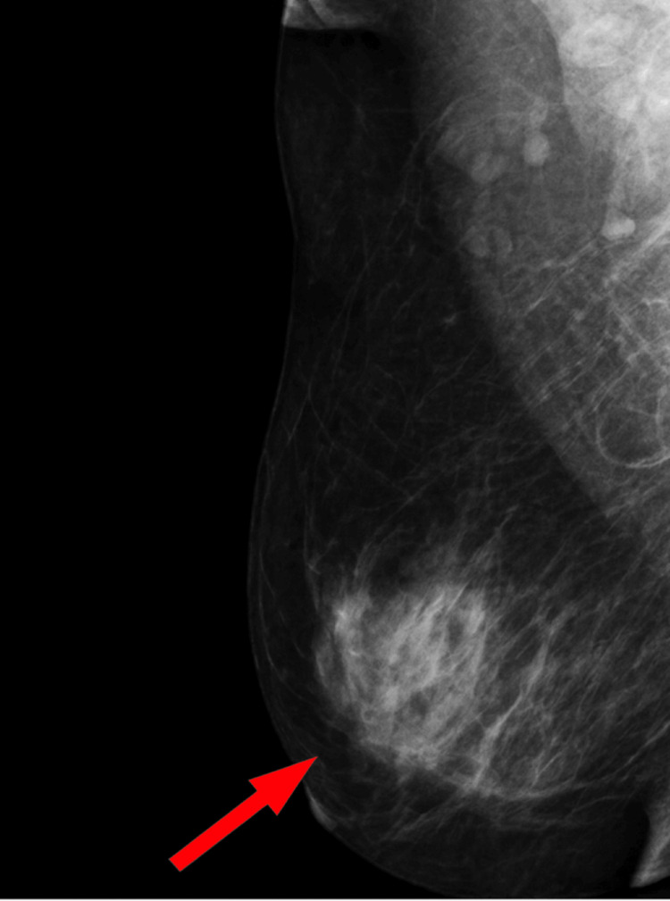
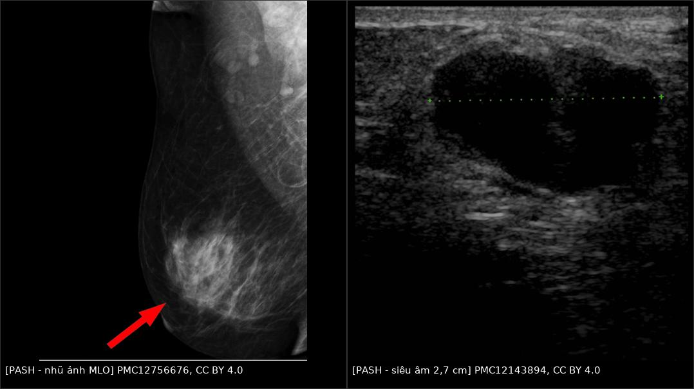
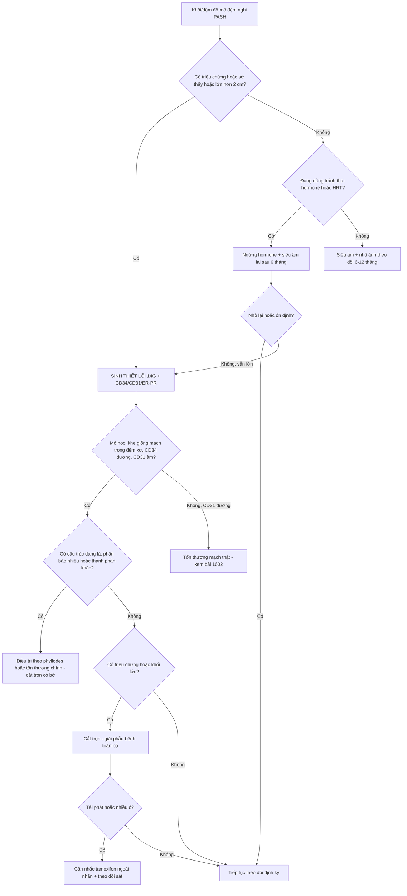
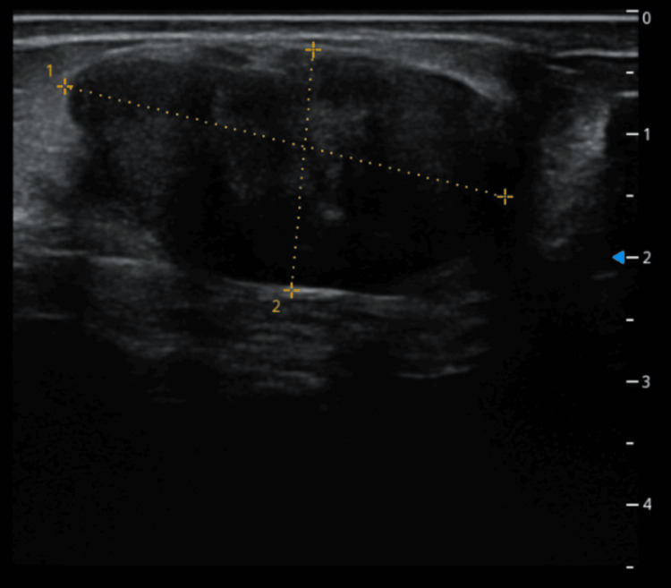
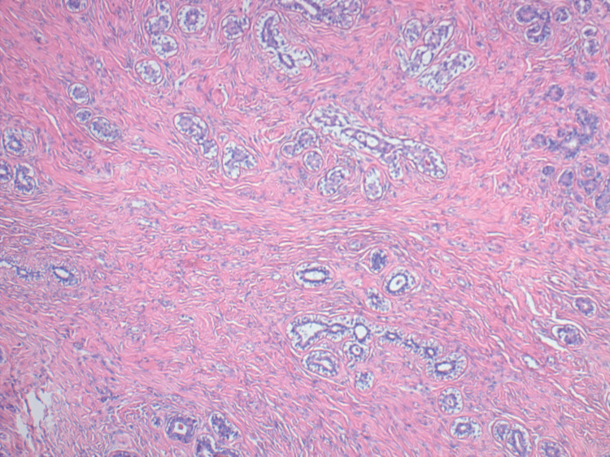

# 1614 — PASH: giả u mô đệm dạng mạch của vú / Pseudoangiomatous stromal hyperplasia (PASH)

**Tags:** `pattern:khoi-vu` `pattern:mo-dem-xo` `pattern:gia-u-mach` `pattern:to-nhanh-khi-hormone` `vung:vu` `score:BI-RADS` `protocol:sinh-thiet-loi` `protocol:MRI-vu`
**Mức chắc chắn (certainty):** tổng hợp y văn (literature synthesis) — 2 ca + thuật toán xử trí (Eur J Breast Health 2025, PMC12462723, CC BY-NC-ND — chỉ trích số/không dùng ảnh), ca PASH thể nốt có **tăng kích thước theo thời gian** (Cureus 2025, PMC12143894, CC BY 4.0), ca PASH + giãn ống tuyến có nhũ ảnh và mô học (Cureus 2025, PMC12756676, CC BY 4.0). Số liệu lấy nguyên từ bài gốc; phần suy luận vật lý được ghi rõ là **suy luận**.

> **Câu hỏi gốc của bài:** một **khối vú lành tính trên sinh thiết lõi** nhưng **to lên khi dùng hormone** — PASH là gì, vì sao tên có chữ "mạch" mà **không phải tổn thương mạch**, khi nào **theo dõi**, khi nào **mổ**, và làm sao không bỏ sót **phyllodes/ung thư** nằm cùng?

## 1. Tổng quan bệnh học – cơ chế hình ảnh (TẠI SAO ảnh trông như vậy)

- **Bản chất:** PASH là **tăng sinh lành tính của nguyên bào sợi cơ (myofibroblasts)** xếp thành **khe hở giống lòng mạch** trong mô đệm gian tiểu thùy/quanh tiểu thùy — **khe này KHÔNG có nội mô thật**, chỉ là khoảng tách giữa các bó collagen. Vì vậy tên gọi "giả u mạch" (pseudo-angiomatous) mô tả **hình thái giống mạch**, không phải bệnh mạch máu.
- **Hóa mô miễn dịch chốt bản chất:** **CD34 dương** (nguyên bào sợi cơ), **CD31 âm** (không phải nội mô) (PMC12462723); **thụ thể estrogen/progesterone dương ~95%** → giải thích vì sao tổn thương **phụ thuộc hormone**.
- **Dịch tễ – ngưỡng định lượng:**
  - PASH gặp ở **~6%** các sinh thiết vú vì tổn thương lành tính khác; **tới 23%** trong loạt 200 mẫu sinh thiết liên tiếp (PMC12462723). Tức **phần lớn PASH là phát hiện vi thể, không có khối**.
  - **PASH thể nốt (mass-forming)** chỉ **1–2%** (PMC12143894, PMC12756676).
  - PASH hay **đi kèm tổn thương khác**: **60,4%** kèm tổn thương biểu mô lành, **25,6%** kèm tăng sản không điển hình (loạt 70 ca, trích trong PMC12462723); PASH có mặt trong **70% của 335 u phyllodes** và khi đó gắn với **độ mô học thấp hơn, nguy cơ ác tính và tái phát thấp hơn** (PMC12462723).
  - **Tiến triển:** **16,6%** ca tăng thể tích sau theo dõi trung vị **26 tháng** (loạt 66 ca, trích trong PMC12462723).
  - **Tái phát sau cắt:** **5–22%** (tới **21%**), cao hơn khi **cắt không trọn** (PMC12143894, PMC12756676).
  - **Yếu tố hormone:** ca 26 tuổi và 37 tuổi đều **đang dùng tránh thai hormone**; ở người chuyển giới dùng **testosterone kéo dài (trung vị 17 tháng)** tỉ lệ PASH **giảm có ý nghĩa (p < 0,001)**; ở nam thường gắn với **gynecomastia** (PMC12462723).
- **TẠI SAO hình ảnh trông như vậy (vật lý + mô bệnh):**
  - **Nhũ ảnh: đậm độ khu trú, bờ có thể rõ hoặc không rõ.** PASH là **mô đệm xơ đặc** thay mỡ → hấp thụ tia X nhiều hơn mỡ → **đậm độ**. Vì không phải khối có vỏ, bờ thường **hòa với mô tuyến xung quanh**; ca PMC12756676 mô tả **"vùng đậm độ mô đệm khu trú"**, không phải khối tròn điển hình.
  - **Siêu âm: giảm hồi âm, đồng nhất, đa thùy.** Mô đệm xơ đặc phản âm kém hơn mỡ; **không có vôi hóa/không có hoại tử** nên **không có bóng lưng mạnh**. Ca PMC12143894: khối **2,7 cm, bờ đa thùy, giảm hồi âm**, ban đầu bị đọc là **fibroadenoma** — vì **không có dấu hiệu nào riêng của PASH trên siêu âm**.
  - **T2 giảm tín hiệu/dải tối:** collagen có **thời gian T2 ngắn** → các **dải xơ** nổi bật **tối** trên nền mỡ sáng và mô tuyến trung gian. Đây là dấu hiệu **gợi ý mô đệm xơ**, nhưng **không đặc hiệu** (fibromatosis, sẹo, hoại tử mỡ cũng tối). *(Suy luận vật lý từ mô học; nguồn đã đọc không đưa số T2 cụ thể.)*
  - **Ngấm thuốc:** mô đệm xơ ngấm **chậm và dai dẳng**, thường **không washout mạnh** *(suy luận từ thành phần xơ; nguồn đã đọc không đưa số động học riêng của PASH)*; nhưng vì PASH **thường nằm cùng fibroadenoma/phyllodes**, động học có thể **lai** giữa hai thành phần → **động học không dùng để chốt**.
  - **Vì sao "to nhanh" mà vẫn lành:** PASH **tăng sinh theo hormone** (thai, tránh thai, HRT) → thể tích tăng **thật** nhưng **không xâm lấn**. Ca PMC12143894: **2,7 cm (2022) → 3,67 × 1,95 cm (2024)** trong 2 năm, mô học vẫn lành. Vì vậy **"to lên" là lý do để đánh giá lại và cắt nếu có triệu chứng, không tự động là ác tính** — nhưng cũng **không được bỏ qua** vì phyllodes/ung thư có thể nằm cùng.

## 2. Mẫu hình (pattern) + chẩn đoán phân biệt theo bối cảnh (gamut)

- **Khuôn 1 — Khối oval/đa thùy, bờ rõ, giảm hồi âm đồng nhất, không vôi hóa, nữ tiền mãn kinh.** Gamut: **PASH thể nốt** vs **fibroadenoma** vs **phyllodes lành** vs **hamartoma**. Chốt: **mô học + CD34/CD31**; hình ảnh **không phân biệt được PASH với fibroadenoma** (2 ca PMC12462723 đều được chẩn đoán PASH trên lõi nhưng sau cắt là **fibroadenoma có PASH**).
- **Khuôn 2 — Vùng đậm độ/mô đệm khu trú, bờ không rõ, không có khối trên siêu âm.** Gamut: **PASH lan tỏa** vs **sẹo/mô xơ sau mổ** vs **fibromatosis** vs **ung thư thể không đặc (NST)** vs **diabetic mastopathy**. Chốt: **so phim cũ + mô học**; nếu mới xuất hiện và lớn dần → **sinh thiết**.

*Nhũ ảnh MLO: **vùng đậm độ mô đệm khu trú** bờ hòa lẫn (đánh dấu), tương ứng vị trí sinh thiết xác nhận **PASH**; nhu mô xung quanh có giãn ống tuyến. Tổn thương **không có vỏ**, nên bờ **không rõ** — đây là lý do hình ảnh hay bị đọc thành bất đối xứng không đặc hiệu. Nguồn: Swarnkar A et al., Cureus 2025, Fig. 3, CC BY 4.0.*
- **Khuôn 3 — Khối to nhanh khi mang thai/cho con bú/dùng tránh thai/HRT.** Gamut: **PASH phụ thuộc hormone** vs **fibroadenoma thai kỳ** vs **phyllodes** vs **ung thư (hiếm nhưng phải loại)** vs **áp-xe/viêm**. Chốt: **siêu âm + sinh thiết lõi**; **ngừng hormone rồi đánh giá lại sau 6 tháng** với tổn thương nhỏ, không triệu chứng (PMC12462723).
- **Khuôn 4 — PASH "tình cờ" trên lõi sinh thiết vì lý do khác, không thấy tổn thương trên hình ảnh.** Gamut: **PASH vi thể** (tới 23% mẫu) vs **PASH là thành phần của tổn thương chính**. Chốt: **không điều trị PASH vi thể**; điều trị theo tổn thương chính.
- **Khuôn 5 — PASH trong u phyllodes hoặc fibroadenoma (không phải khối PASH thuần).** Gamut: **phyllodes + PASH** vs **fibroadenoma bị PASH xâm lấn mô đệm** vs **PASH thuần**. Chốt: **tìm cấu trúc dạng lá (leaf-like), mật độ tế bào đệm, phân bào** — PASH có mặt ở **70% u phyllodes** nên **đừng dừng ở chữ PASH**.
- **Khuôn 6 — Khối vú ở NAM to lên / người chuyển giới dùng hormone.** Gamut: **PASH trong gynecomastia** vs ung thư vú nam vs lipoma. Chốt: **sinh thiết**; PASH ở nam thường gắn gynecomastia (PMC12462723).

## 3. Bảng so sánh phân biệt (ma trận đối chiếu)

| Thực thể (entity) | Hình ảnh điển hình (nhũ ảnh / siêu âm / MRI) | Chốt vào (rule-in) | Chốt loại (rule-out) | Gợi ý xác nhận |
|---|---|---|---|---|
| **PASH thể nốt** | Nhũ ảnh: **đậm độ khu trú**, bờ rõ hoặc hòa lẫn; siêu âm: **khối giảm hồi âm, đa thùy, đồng nhất**, không vôi hóa; MRI: **dải T2 tối** trong khối, ngấm chậm–dai dẳng | **Mô học: khe giống mạch trong mô đệm xơ + CD34(+)/CD31(−) + ER/PR(+)** | **CD31(+) hoặc có lòng mạch thật có hồng cầu** → tổn thương mạch (bài 1602), không phải PASH | Lõi 14G + IHC **CD34, CD31, ER/PR**; cắt trọn nếu triệu chứng |
| **Fibroadenoma** | Oval, bờ rõ, **đồng nhất**, có vách; nhũ ảnh khối đậm độ bờ rõ; **không xâm lấn** | **Mô học: thành phần biểu mô + đệm, không có khe PASH lan rộng**; tuổi trẻ | **Có khe PASH lan rộng trong đệm + CD34(+) mạnh** → PASH (hoặc FA có PASH) | Lõi; theo dõi nếu < 2 cm, không triệu chứng |
| **Phyllodes (u diệp thể)** | Khối **lớn, lớn nhanh**, đa thùy, **khe (clefts)**; MRI dải T2 sáng trong khối; có thể **da căng, tĩnh mạch nổi** | **Cấu trúc dạng lá + tăng sinh đệm + phân bào; PASH có mặt 70% ca** | **Khối nhỏ, đồng nhất, không có lá** không loại trừ hoàn toàn — cần mô học | Cắt trọn có bờ; **không** sinh thiết rồi theo dõi khối lớn |
| **Hamartoma vú** | Khối **bờ rõ**, chứa **mỡ + tuyến + xơ**; nhũ ảnh có thể thấy **mỡ** trong khối; siêu âm hỗn hợp hồi âm | **Có thành phần MỠ trong khối** (nhũ ảnh/MRI) | **Khối hoàn toàn đặc, không mỡ** → không phải hamartoma | MRI/so phim; cắt nếu to |
| **Ung thư biểu mô thể nhầy (mucinous)** | Bờ **đẩy**, T2 **rất sáng** (nhầy), ngấm **chậm tăng dần**; có thể giống khối lành | **T2 rất sáng + ngấm chậm + tuổi lớn** | **T2 tối/dải xơ + CD34(+) đệm** → nghiêng PASH | Lõi + ER/PR/HER2; **không theo dõi** khối mới ở nữ > 40 tuổi |
| **Fibromatosis (desmoid) vú** | Khối **cứng, bờ xâm lấn (spiculated)**, có thể **co kéo da/núm**; T2 tối, ngấm mạnh | **Xâm lấn cơ ngực + bờ spiculated + tế bào cơ trơn** | **Bờ rõ, không xâm lấn, CD34(+) khe** → PASH | Lõi + **beta-catenin**; cắt/ theo dõi theo ngoại |
| **Diabetic mastopathy** | Khối giảm hồi âm bờ không rõ, **bóng lưng**; MRI ngấm **yếu, muộn, không tạo khối** (PMC13425464) | **ĐTĐ týp 1 lâu năm + xơ–lympho quanh tiểu thùy, không vi khuẩn** | **Ngấm mạnh + washout + hạch bất thường** → không phải diabetic mastopathy | Lõi; hội chẩn mô bệnh |
| **Sẹo/mô xơ sau mổ–xạ** | Đậm độ/co kéo **đúng vị trí mổ**, thay đổi theo thời gian; MRI ngấm **giảm dần** | **Vị trí khớp sẹo + ổn định/giảm theo thời gian** | **Ngấm tăng dần hoặc khối mới ngoài vùng sẹo** → sinh thiết | So phim cũ; MRI |

- **Ảnh ghép đối chiếu (nhũ ảnh + siêu âm):**

*Trái: nhũ ảnh MLO — **vùng đậm độ mô đệm khu trú** (mũi tên), bờ hòa lẫn, sinh thiết xác nhận **PASH**. Phải: siêu âm — **khối giảm hồi âm đa thùy 2,7 cm**, ban đầu bị đọc là **fibroadenoma**, sau đó **to lên 3,67 cm trong 2 năm**, cắt trọn xác nhận **PASH thể nốt**. Ảnh ghép letterbox, CC BY 4.0 (PMC12756676 + PMC12143894).*

## 4. Protocol chẩn đoán – xử trí + lưu đồ

- **Bước 1 — Siêu âm tuyến vú:** đo 3 chiều, mô tả **bờ, đa thùy, hồi âm, vôi hóa, mạch Doppler**. Ghi nhận **vị trí đối chiếu với nhũ ảnh**. Siêu âm **không phân biệt được PASH với fibroadenoma** → **không chốt bằng siêu âm**.
- **Bước 2 — Nhũ ảnh 2D ± DBT:** tìm **đậm độ khu trú/bất đối xứng**, **vi vôi hóa** (PASH có thể kèm giãn ống tuyến/viêm quanh ống — ca PMC12756676 có giãn ống và viêm quanh ống). Phân **BI-RADS** theo tổn thương **thấy được**, không theo chẩn đoán mô học.
- **Bước 3 — MRI vú (khi không kết luận hoặc cần bản đồ trước mổ):** T2FS, DWI/ADC, DCE. Đọc **dải T2 tối** (gợi ý xơ), **kiểu ngấm** (chậm–dai dẳng nghiêng lành), **có thành phần khác không** (nhú trong nang, khe phyllodes).
- **Bước 4 — Sinh thiết lõi 14G:** **bắt buộc** với khối ≥ 2 cm, khối mới, khối lớn nhanh, hoặc tổn thương không điển hình. **Bắt buộc IHC: CD34, CD31, ER/PR** để (1) xác nhận bản chất đệm, (2) **loại tổn thương mạch thật** (bài 1602), (3) đánh giá thành phần đi kèm. **FNA không đủ** (không thấy cấu trúc khe/đệm).
- **Bước 5 — Xử trí theo thuật toán đã công bố (PMC12462723):**
  - **Có triệu chứng / sờ thấy / khối lớn** → **cắt trọn** (giải phẫu bệnh toàn bộ để loại phyllodes).
  - **Khối nhỏ, không triệu chứng** → **ngừng tránh thai hormone**, **đánh giá lại sau 6 tháng** (siêu âm); nếu **nhỏ lại/ổn định** → tiếp tục theo dõi; nếu **vẫn lớn** → sinh thiết/cắt.
  - **PASH vi thể tình cờ, không có tổn thương trên hình ảnh** → **không điều trị**, không cần cắt.
  - **Tái phát/nhiều ổ/không mổ được** → **tamoxifen ngoài nhãn (off-label)**; lưu ý tác dụng giảm dần sau ~3 tháng ở một ca và tác dụng phụ kháng estrogen (PMC12462723).
  - **PASH trong phyllodes** → điều trị theo **phyllodes** (cắt trọn có bờ), không theo PASH.
- **Ngưỡng hành động (tóm tắt):** **có triệu chứng/sờ thấy = cắt**; **< 2 cm, không triệu chứng = ngừng hormone + siêu âm lại 6 tháng**; **lớn lên dù đã ngừng hormone = sinh thiết/cắt**; **tái phát sau cắt = cân nhắc tamoxifen**.
- **BI-RADS (5th ed., 2013):** PASH điển hình trên hình ảnh thường **BI-RADS 3** (nếu khối bờ rõ, mới, chưa có mô học) nhưng **khối lớn nhanh/không điển hình = BI-RADS 4** → sinh thiết. **Không có hệ điểm riêng cho PASH** — dùng BI-RADS của tổn thương.

## 5. Biến thể bình thường và cạm bẫy

- **Cạm bẫy 1 — Cái tên đánh lừa:** "pseudo**angiomatous**" khiến người đọc nghĩ đến **u mạch** và xếp vào gamut tổn thương mạch. PASH **CD31 âm**, **không có lòng mạch thật** → nếu IHC ra **CD31 dương/ERG dương** thì **không phải PASH** (bài 1602).
- **Cạm bẫy 2 — Sinh thiết lõi đọc "PASH" nhưng khối thật là fibroadenoma:** cả **2 ca** trong PMC12462723 được chẩn đoán **PASH trên lõi**, sau cắt mới là **fibroadenoma có PASH** (5,2 cm và 5,6 cm). Vì vậy **khối sờ thấy/có triệu chứng phải cắt trọn**, đừng dừng ở kết quả lõi.
- **Cạm bẫy 3 — Bỏ sót phyllodes:** PASH có mặt trong **70% của 335 u phyllodes** và **gắn với độ mô học thấp hơn và tái phát thấp hơn** — nghĩa là **thấy PASH không loại trừ phyllodes**. Phải tìm **cấu trúc lá, mật độ đệm, phân bào**, và **cắt trọn khối lớn**.
- **Cạm bẫy 4 — "PASH vi thể = bệnh":** tới **23%** mẫu sinh thiết có PASH vi thể; **không có khối trên hình ảnh thì không có gì để mổ**. Điều trị theo tổn thương chính.
- **Cạm bẫy 5 — Thai kỳ/cho con bú/HRT:** PASH **tăng theo hormone**; khối to trong thai **không đồng nghĩa ác**, nhưng **vẫn phải siêu âm + sinh thiết nếu không điển hình**. Sau sinh/ngừng hormone, **đánh giá lại** trước khi quyết định mổ.
- **Cạm bẫy 6 — Tái phát do cắt không trọn:** tái phát **5–22%**, cao hơn khi bờ không sạch → **cắt trọn** và **theo dõi 6–12 tháng** sau mổ.
- **Cạm bẫy 7 — Nam giới:** PASH ở nam thường nằm trong **gynecomastia**; đừng gọi "ung thư vú nam" chỉ vì khối dưới quầng vú, nhưng **phải sinh thiết** nếu khối cứng, lệch trục, có da co kéo.
- **Biến thể bình thường:** **mô đệm xơ quanh tiểu thùy tăng nhẹ theo tuổi** và **PASH vi thể** là phát hiện mô học, không phải bệnh; **tuyến vú nam** có mô đệm quanh ống — đừng nhầm với khối.

## 6. Tự lượng giá — Blind Quiz

**Ca 1 — Nữ 34 tuổi, khối vú trái 3 cm, không đau, đang dùng tránh thai. Nhũ ảnh + siêu âm:**

- Hỏi: (1) mô tả tổn thương trên hai phương tiện; (2) ba chẩn đoán phân biệt; (3) bước tiếp theo và vì sao **không** theo dõi đơn thuần?

<b>Bấm để hiện đáp án (findings + chẩn đoán)</b>

- **Findings:** nhũ ảnh MLO — **vùng đậm độ mô đệm khu trú**, bờ hòa lẫn; siêu âm — **khối giảm hồi âm, đa thùy, đồng nhất**, không vôi hóa, không bóng lưng.
- **Chẩn đoán phân biệt:** **PASH thể nốt**, **fibroadenoma**, **phyllodes**, (ít hơn) ung thư thể nhầy.
- **Bước tiếp theo:** **sinh thiết lõi 14G + CD34/CD31/ER-PR**; khối **3 cm, sờ thấy** → **cắt trọn** theo thuật toán (triệu chứng/sờ thấy = mổ), vì lõi có thể đọc PASH trong khi khối thật là fibroadenoma hoặc phyllodes.
- Nguồn ảnh: PMC12756676 (nhũ ảnh, CC BY 4.0) + PMC12143894 (siêu âm, CC BY 4.0), ảnh ghép letterbox.

**Ca 2 — Cùng bệnh nhân sau 2 năm: khối từ 2,7 cm thành 3,67 cm.**

- Hỏi: (1) tốc độ tăng có buộc phải nghĩ ác tính? (2) yếu tố nào giải thích tăng? (3) xử trí?

<b>Bấm để hiện đáp án (findings + chẩn đoán)</b>

- **Findings:** khối **36,7 × 19,5 mm**, bờ rõ, **đồng nhất, giảm hồi âm**, có mạch trong khối; so với **2,7 cm** hai năm trước.
- **Chẩn đoán:** **PASH thể nốt** (cắt trọn xác nhận) — tăng do **hormone**, không phải chuyển dạng.
- **Số liệu:** **16,6%** PASH tăng thể tích sau trung vị **26 tháng**; tái phát sau cắt **5–22%** (PMC12462723, PMC12143894).
- **Xử trí:** cắt trọn (khối > 2 cm, lớn lên) + theo dõi; nếu tái phát/nhiều ổ → cân nhắc **tamoxifen ngoài nhãn**.
- Nguồn ảnh: Abdelrazzak A et al., Cureus 2025, Fig. 2, CC BY 4.0.

**Ca 3 — Mô học: các khoảng trống hình khe, lót bởi tế bào dẹt, trong mô đệm xơ; không có atypia.**

- Hỏi: (1) đây có phải u mạch không? (2) hai dấu IHC chốt? (3) nếu CD31 dương thì nghĩ gì?

<b>Bấm để hiện đáp án (findings + chẩn đoán)</b>

- **Findings:** mô đệm xơ với **khoảng trống hình khe nối tiếp nhau**, lót bởi **tế bào thoi lành**, **không atypia, không phân bào**; xen lẫn thành phần biểu mô.
- **Chẩn đoán:** **PASH** — khe là **khoảng tách giữa các bó collagen**, **không có nội mô thật**.
- **IHC chốt:** **CD34 dương** (nguyên bào sợi cơ), **CD31 âm** (không nội mô); **ER/PR dương ~95%** (PMC12462723).
- **Nếu CD31/ERG dương:** nghĩ **tổn thương mạch thật** (hemangioma/angiosarcoma) → đọc bài **1602**.
- Nguồn ảnh: Abdelrazzak A et al., Cureus 2025, Fig. 4, CC BY 4.0.

## Bài liên quan chéo
- [1602 – Hemangioma & tổn thương mạch lành tính của vú vs angiosarcoma](../1602-hemangioma-ton-thuong-mach-lanh-vu/lesson.md)
- [510 – Vú & BI-RADS: nhũ ảnh, siêu âm & MRI](../510-vu-BIRADS-nhu-anh-sieu-am-MRI/lesson.md)
- [517 – Sinh thiết định vị vú và quản lý clip](../517-sinh-thiet-dinh-vi-vu-va-quan-ly-clip/lesson.md)
- [513 – Tổn thương vú nguy cơ cao: ADH, ALH, FEA, LCIS, papilloma có atypia](../513-ton-thuong-vu-nguy-co-cao/lesson.md)
- [514 – Ung thư vú: TNM, MRI lan rộng](../514-ung-thu-vu-TNM-MRI-lan-rong/lesson.md)
- [1613 – Viêm tuyến vú u hạt & áp-xe vú](../1613-viem-tuyen-vu-u-hat-va-ap-xe-vu/lesson.md)

## Ảnh
- Tên file: `1614_<slug>_<Modality>_<SourceID>.jpg`. Nguồn + giấy phép từng ảnh trong `images/CREDITS.md`.
- Các ảnh dùng trong bài đều **CC BY 4.0** → được phép ghép letterbox. Ảnh **CC BY-NC-ND** không dùng để ghép.

> **Disclaimer y tế:** bài học dành cho đào tạo và tra cứu, **không dùng để chẩn đoán độc lập**. Khối vú lớn nhanh, cứng, hoặc không điển hình **luôn cần mô học**, kể cả khi sinh thiết trước đó trả về "tổn thương lành tính".
