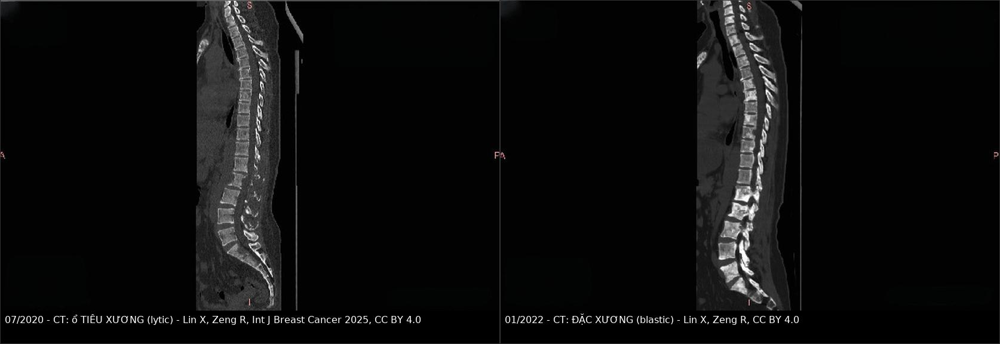
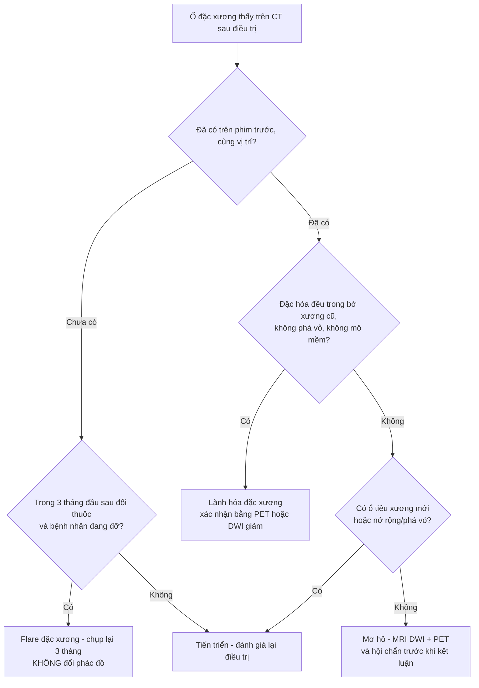
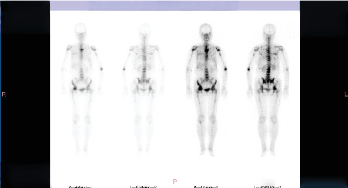
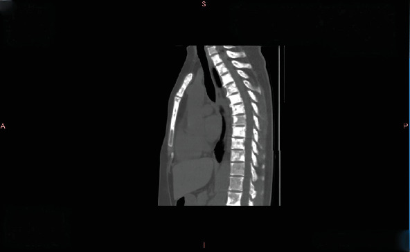

# 1615 — Di căn xương ở ung thư vú: đặc xương lành hóa hay tiến triển? / Breast cancer bone metastases: blastic healing versus progression

**Tags:** `pattern:dac-xuong` `pattern:tieu-xuong` `pattern:gia-tien-trien` `pattern:gia-lanh-hoa` `vung:co-xuong` `vung:cot-song` `score:RECIST-1.1` `score:MDA` `score:Mirels` `protocol:CT-xuong` `protocol:MRI-tuy-xuong` `protocol:xac-hinh-xuong` `incidentaloma:not-dac-xuong`
**Mức chắc chắn (certainty):** tổng hợp y văn (literature synthesis) — đọc trực tiếp toàn văn các bài mở qua Europe PMC/PMC (J Cancer 2010; Cancers 2025; J Bone Oncol 2026; BMC Musculoskelet Disord 2025; Int J Breast Cancer 2025; Front Oncol 2026), **có ca nguyên văn** dùng cho quiz (ảnh CC BY 4.0). Mọi con số dưới đây lấy từ chính các bài đó; chỗ nào là quy ước đọc phim chứ không phải số từ nghiên cứu đều ghi rõ.

## 1. Tổng quan — vì sao "xương đặc thêm" lại là câu hỏi khó nhất sau điều trị

- **Tần suất:** xương là nơi di căn hay gặp nhất của ung thư vú; **65–75%** bệnh nhân ung thư vú giai đoạn muộn có di căn xương (Bader G và cs., *Front Oncol* 2026; Lin X, Zeng R., *Int J Breast Cancer* 2025). Di căn xương gây **biến cố xương (skeletal-related event — SRE)**: gãy bệnh lý, chèn ép tủy, xạ trị vào xương, phẫu thuật xương.
- **Vòng luẩn quẩn tế bào – xương (vicious cycle)** quyết định *vì sao tổn thương đổi hình thái theo thời gian*:
  - Tế bào u tiết **PTHrP, IL-6, IL-11** → kích thích **RANKL** trên tạo cốt bào → **hủy xương kiểu tiêu xương (osteolytic)**. Đây là kiểu hay gặp và "ồn ào" nhất trên phim.
  - Đồng thời u tiết **endothelin-1, DKK-1** và ức chế Wnt → **tạo xương phản ứng** = **đặc xương (osteoblastic/sclerotic)**.
  - Hai quá trình **xảy ra đồng thời** trong cùng một đốt sống: phần lớn ổ di căn vú là **hỗn hợp tiêu xương – đặc xương**, không phải một thể thuần nhất.
- **TẠI SAO hình ảnh trông như vậy (vật lý + mô bệnh):**
  - **CT:** tín hiệu = **hệ số suy giảm tia X của mô khoáng hóa**. Xương xốp bình thường đã có bè xương; khi **tạo cốt bào lấp bè xương bằng xương mới dày đặc** → HU tăng, đốt sống "trắng lên". Khi **hủy cốt bào ăn mất bè xương** → HU giảm, vùng tối đi. Vì vậy **"trắng thêm" không đồng nghĩa nặng thêm** — nó có thể là *xương lành đang lấp lại ổ tiêu xương*.
  - **MRI T1W:** tủy vàng trưởng thành chứa **~80% mỡ** nên **sáng hơn cơ và đĩa đệm**. Tế bào u thay tủy → **T1 tối** (thay mỡ bằng nước/tế bào). Khi điều trị thành công, mỡ **tái lập** trong tủy → **T1 sáng trở lại** = dấu lành hóa, xuất hiện **trước** khi CT đổi mật độ nhiều tháng.
  - **DWI/ADC:** tế bào u dày đặc → **ADC thấp**; mô xơ – xương lành hóa → ADC tăng. Đây là lý do **DWI phân biệt mô u còn sống với sẹo xơ** tốt hơn T1/T2.
  - **Xạ hình xương (bone scan, Tc-99m MDP):** phóng xạ gắn vào **hoạt tính tạo xương**. Cả **u đang phá xương** *và* **xương đang lành lại** đều làm tăng tạo xương → **tăng uptake không định hướng được lành/tiến triển**. Đây chính là nguồn gốc của **flare**.
- **Vì sao phải phân biệt cho đúng:** gọi sai "tiến triển" → **đổi phác đồ oan** (bỏ một thuốc đang hiệu quả); gọi sai "lành hóa" → **bỏ sót tiến triển thật** ở một bệnh nhân còn nhiều lựa chọn điều trị. Cả hai đều là lỗi ở **bước đọc phim**, không phải ở bước chọn thuốc.

## 2. Mẫu hình (pattern) + chẩn đoán phân biệt theo bối cảnh điều trị (Gamut)

- **Khuôn 1 — Đốt sống/xương chậu "trắng lên" trong 0–6 tháng đầu điều trị, bệnh nhân ĐANG đỡ đau, không có tổn thương mới ở nơi khác.** Gamut: **lành hóa đặc xương (blastic healing)** vs **flare đặc xương (osteoblastic flare)** vs **tiến triển đặc xương thật**. Chốt: **bệnh cảnh + so đúng vị trí từng ổ + PET/DWI**, không dựa vào một phim.
- **Khuôn 2 — Xạ hình xương tăng uptake ở ổ CŨ trong 3 tháng đầu sau đổi thuốc.** Gamut: **scintigraphic flare** vs **tiến triển thật** vs **giả tăng do kỹ thuật (khác liều, khác thời gian lưu, mất nước)**. Chốt: **đối chiếu CT/MRI cùng thời điểm** — flare thì CT *không* xấu đi.
- **Khuôn 3 — Ổ TIÊU XƯƠNG mới hoặc rộng ra, bờ không đặc xương.** Gamut: **tiến triển tiêu xương** (gần như luôn là tiến triển) vs **hoại tử xương do bisphosphonate/denosumab (MRONJ)** nếu ở xương hàm vs **gãy xẹp cấp tính** làm biến dạng đốt sống. Chốt: **tiêu xương mới = tiến triển cho đến khi chứng minh ngược**.
- **Khuôn 4 — Đau xương khu trú + nguy cơ gãy xương dài.** Gamut: **di căn xương nguy cơ gãy tới hạn** vs **gãy do loãng xương/steroid** vs **bệnh Paget** vs **nhồi máu xương**. Chốt: **Mirels + vùng chuyển tiếp + có/không phá vỏ**.
- **Khuôn 5 — Một ổ đặc xương đơn độc, không đau, không tiền sử ung thư.** Gamut: **đảo xương (bone island/enostosis)** vs **di căn đặc xương** vs **xơ hóa đầu xương do thoái hóa**. Chốt: **bờ tua gai/nhánh (brush border) + ổn định nhiều năm = đảo xương**.
- **Gợi nhớ "ĐẶC – KHÔNG CHẮC LÀ XẤU":** **Đ**úng vị trí cũ · **Ặ**c (đang đỡ đau, marker giảm) · **C**ó đối chiếu CT **và** PET/DWI · **K**hông có ổ tiêu xương mới · **H**ỏi đúng mốc thời gian so với lần đổi thuốc · **Ô**n định ≥ 2 lần chụp cách ≥ 3 tháng · **N**ếu còn nghi → sinh thiết ổ mới, không đổi phác đồ mù.

## 3. Bảng so sánh phân biệt (ma trận đối chiếu)

| Thực thể (entity) | Hình ảnh điển hình | Chốt vào (rule-in) | Chốt loại (rule-out) | Gợi ý xác nhận |
|---|---|---|---|---|
| **Lành hóa đặc xương (blastic healing)** | Ổ tiêu xương cũ **lấp dần bằng xương đặc**, bờ đặc hóa dày lên, kích thước **không tăng**; MRI: mỡ tủy tái lập (T1 sáng lại); PET: giảm FDG | **Cùng vị trí ổ CŨ + đặc hóa tiến triển + có ≥ 1 dấu hiệu đáp ứng khác (đau giảm, marker giảm, PET giảm)** | **Xuất hiện ổ ở vị trí MỚI, hoặc ổ cũ nở rộng ra ngoài bờ xương** → không phải lành hóa | CT xương + MRI T1/DWI + PET 3–6 tháng |
| **Flare đặc xương (osteoblastic flare)** | Ổ đặc xương **mới thấy** trong **3 tháng đầu** sau bắt đầu/đổi điều trị, kèm dấu hiệu đáp ứng ở nơi khác | **Trong 3 tháng đầu + tổn thương cũ KHÔNG tiến triển + lâm sàng đỡ** | **Có bất kỳ ổ cũ nào tiến triển, hoặc đau tăng, hoặc marker tăng** → không được gọi flare | Chụp lại 3 tháng; PET nếu còn nghi |
| **Tiến triển đặc xương** | Ổ đặc xương **to ra, đặc thêm không đều, phá vỏ, chèn ép**, thường kèm ổ tiêu xương mới | **Nở rộng/thêm ổ mới ngoài vùng cũ + có thành phần tiêu xương hoặc mô mềm** | **Đặc hóa đều, giới hạn trong bờ xương cũ, không mô mềm** → nghiêng lành hóa | CT + MRI (mô mềm, DWI) + PET |
| **Tiến triển tiêu xương** | Ổ **giảm HU**, mất bè xương, bờ không đặc hóa, có thể phá vỏ/sụp đốt | **Ổ tiêu xương MỚI hoặc rộng ra ≥ 25% (MDA)** | **Ổ tiêu xương cũ đặc hóa dần, không rộng thêm** → lành hóa | CT xương; MRI nếu nghi chèn ép tủy |
| **Flare xạ hình (scintigraphic flare)** | Uptake **tăng** ở ổ cũ, **trong 3 tháng đầu** sau điều trị, sau đó **giảm dần** | **Tăng trong ≤ 3 tháng + CT/MRI cùng lúc KHÔNG xấu đi** | **Uptake tăng kèm ổ mới trên CT, hoặc tăng sau 6 tháng** → tiến triển | Luôn đối chiếu CT/MRI; không đọc xạ hình đơn độc |
| **Gãy xẹp đốt sống do loãng xương/steroid** | Xẹp **đồng đều**, bè xương thưa, **khí trong đốt sống (intravertebral vacuum)**, không phá cuống | **Bảo tồn cuống sống + khí trong đốt + xẹp đều** | **Phá cuống sống, phá vỏ sau, mô mềm cạnh sống** → di căn | MRI (phù tủy, không có khối); CT cuống sống |
| **Đảo xương (bone island)** | Nốt đặc xương **bờ tua gai/nhánh**, đậm độ đồng nhất, **< 2 cm**, không đau | **Bờ tua gai + ổn định trên phim cũ + không tăng trên xạ hình** | **Bờ tròn nhẵn, lớn dần, đau, uptake tăng mạnh** → di căn/Paget | So phim cũ; CT; xạ hình |
| **Bệnh Paget xương** | Xương **to ra**, vỏ dày, bè xương thô, có thể đặc xương lan rộng | **Xương TO RA + vỏ dày + bè xương thô** | **Kích thước xương bình thường, chỉ đổi mật độ** → di căn | X-quang/CT; ALP; so phim cũ |

*Cùng một bệnh nhân, cùng chuỗi CT xương dọc cột sống. **Trái (07/2020):** nhiều ổ **tiêu xương** thân đốt sống ngực–thắt lưng. **Phải (01/2022):** sau 18 tháng exemestane–capecitabine + denosumab, các thân đốt **đặc xương lan tỏa** — đây là **lành hóa**, không phải "di căn đặc xương mới". Nguồn: Lin X, Zeng R., *Int J Breast Cancer* 2025, CC BY 4.0. Ảnh ghép letterbox, giữ nguyên tỷ lệ.*

### Ba câu hỏi bắt buộc trước khi gọi "tiến triển"
1. **Vị trí:** ổ này **đã có từ phim trước** chưa? (Ổ cũ đặc thêm ≠ ổ mới.)
2. **Hình thái:** đặc hóa **đều trong bờ xương cũ** hay **nở ra/phá vỏ/có mô mềm**?
3. **Bằng chứng ngoài hình ảnh:** đau, ALP, CEA/CA 15-3, PET — **cùng chiều** hay **ngược chiều**?

## 4. Protocol chụp + hệ phân độ/điểm chuẩn hóa

- **CT là chuẩn để ĐO và theo dõi di căn xương** (RECIST 1.1 gọi CT là "phương pháp tốt nhất hiện có và tái lập được" để đo tổn thương đích).
  - Cửa sổ xương **W 1500–2000 / L 300–500**, lát **≤ 2 mm** qua vùng tổn thương; luôn kèm cửa sổ mô mềm để tìm **thành phần mô mềm ≥ 10 mm** — chỉ khi có thành phần này tổn thương xương mới **đo được** theo RECIST 1.1.
  - Chụp **cùng máy, cùng kVp, cùng tái tạo** ở các lần theo dõi: đậm độ xương phụ thuộc kVp, đổi kVp làm sai lệch so sánh "trắng hơn".
- **MRI cột sống:** T1W dọc + T2W fat-sat/STIR + **DWI (b=0/800–1000) và ADC**; so sánh **tín hiệu tủy với đĩa đệm cùng đốt** (mốc nội tại, không phụ thuộc cửa sổ).
- **Xạ hình xương Tc-99m MDP:** dùng để **sàng lọc toàn thân**, **không** dùng đơn độc để kết luận đáp ứng — luôn đối chiếu CT/MRI cùng thời điểm.
- **PET/CT FDG:** hữu ích khi CT mơ hồ; lưu ý ổ **đặc xương đặc hoàn toàn có thể FDG âm** dù còn tế bào u.
- **Ba hệ tiêu chuẩn và ngưỡng số học:**

| Hệ | Đối tượng | Ngưỡng đáp ứng / tiến triển |
|---|---|---|
| **RECIST 1.1** | Tổn thương **đo được** (di căn xương chỉ đo được khi có **thành phần mô mềm ≥ 10 mm**) | **PR:** giảm ≥ 30% tổng đường kính. **PD:** tăng ≥ 20% **và** ≥ 5 mm tuyệt đối. Di căn xương **thuần** = **không đo được**; **ổ FDG mới** không tương ứng bất thường có sẵn = **PD** |
| **MDA (MD Anderson)** | Di căn xương **thuần**, đánh giá trên X-quang/CT/MRI + xạ hình | **CR:** đặc hóa **hoàn toàn** ổ tiêu xương + mật độ xương bình thường + tín hiệu MRI bình thường + xạ hình bình thường. **PR:** vành đặc hóa/đặc hóa **một phần**, hoặc **giảm ≥ 50%** tổng đường kính vuông góc của tổn thương không đo được. **PD:** tăng **≥ 25%** hoặc ổ mới |
| **PERCIST** | Đáp ứng **chuyển hóa** bằng FDG PET | Dùng khi hình thái học không đổi nhưng chuyển hóa đổi — "đáp ứng mà không có đáp ứng giải phẫu" |

- **Mirels — nguy cơ gãy xương dài (4 biến: vị trí, đau, thể tổn thương, kích thước; tối đa 12 điểm):**
  - **≤ 7 điểm:** nguy cơ gãy **4%**, dương tính giả **22%** → **không** cố định dự phòng.
  - **8 điểm:** nguy cơ gãy **15%**, dương tính giả **6%** → vùng xám, quyết định theo lâm sàng.
  - **≥ 9 điểm:** nguy cơ gãy **33%**, **không** dương tính giả → **chỉ định cố định dự phòng**.
  - **Độ chính xác:** Mirels **Se 66,7–88% / Sp 38–47,9%**; CTRA **Se 100% / Sp 60,6%**; FEA **Se 80–100% / Sp 67–86%**. Mirels **nhạy nhưng kém đặc hiệu** → dùng để **sàng lọc**, không để một mình quyết định mổ.
  - **Cạm bẫy đo:** cùng một tổn thương, **điểm kích thước trên X-quang cao hơn trên CT** (trung bình **2,35 vs 2,02** điểm) — X-quang phóng đại và chỉ thấy một mặt phẳng; đọc Mirels trên CT mà không nói rõ nguồn ảnh sẽ cho điểm khác nhau.

## 5. Biến thể bình thường và cạm bẫy

- **Đảo xương (bone island) 1–2 cm ở xương chậu** — có thể dương tính giả trên xạ hình; bờ **tua gai**, ổn định nhiều năm. So phim cũ là bước rẻ nhất và hiệu quả nhất.
- **Xơ hóa đầu đốt sống do thoái hóa (degenerative endplate sclerosis)** nằm **ngay sát đĩa đệm**, đối xứng, có mỏ xương; di căn **nằm trong thân sống**, lệch tâm, không đối xứng.
- **"Trắng hơn" do khác kVp/tái tạo** — cùng một ổ di căn có thể trông đậm hơn chỉ vì lần chụp sau dùng kVp thấp hơn. Luôn so trên **cùng cửa sổ, cùng mức, cùng máy**.
- **Satisfaction of search:** thấy một ổ đặc xương "đẹp" rồi dừng, bỏ sót **ổ tiêu xương mới** ở đốt khác — đọc **toàn bộ khung xương** trước, rồi mới kết luận từng ổ.
- **Xạ hình tăng đơn độc:** trong 3 tháng đầu sau đổi thuốc, tăng uptake **không** đủ để gọi tiến triển. Ca nguyên văn của bài này: 03/2024 xạ hình cho thấy "tăng cường độ và vùng tập trung rộng hơn", nhưng **CT ngực cùng thời điểm không đổi** → kết luận **ổn định** và bệnh nhân tiếp tục được hưởng lợi từ phác đồ hiện tại.
- **Ổ đặc xương "đặc hoàn toàn" có thể FDG âm** — PET âm không loại trừ mô u còn sống trong xương đặc; ngược lại, **ổ FDG dương mới** theo RECIST 1.1 là PD.
- **MRONJ (hoại tử xương hàm do thuốc) ở bệnh nhân đang dùng denosumab/bisphosphonate:** đau răng, lộ xương, ổ tiêu xương **khu trú xương hàm** — khác di căn; đừng gộp vào "tiến triển xương" rồi đổi phác đồ ung thư.

## 6. Tự lượng giá — Blind Quiz

**Ca 1 — Nữ 46 tuổi, ung thư vú, đang điều trị; hai phim CT cách nhau 18 tháng. Nhìn phim, mô tả trước khi mở đáp án.**

- Gợi ý lâm sàng: đau lưng giảm dần, không có triệu chứng thần kinh mới.
- Câu hỏi: (1) Hình thái tổn thương **thay đổi theo hướng nào**? (2) Ba chẩn đoán phân biệt? (3) Dấu hiệu nào chốt?

<b>Bấm để hiện đáp án (findings + chẩn đoán)</b>

- **Dấu hiệu:** 07/2020 — nhiều thân đốt ngực–thắt lưng có **vùng giảm đậm độ, mất bè xương** (tiêu xương). 01/2022 — các thân đốt **đặc xương lan tỏa**, giới hạn trong bờ xương cũ, **không có ổ mới ngoài bờ, không mô mềm cạnh sống**.
- **Chẩn đoán:** **lành hóa đặc xương (blastic healing)** sau exemestane–capecitabine + denosumab.
- **Vì sao:** xương mới lấp ổ tiêu xương làm tăng HU — "trắng thêm" ở **đúng vị trí cũ** là dấu **đáp ứng**, không phải tiến triển.
- **Chốt loại tiến triển:** không có ổ tiêu xương mới, không nở rộng ngoài bờ xương, không mô mềm; lâm sàng đỡ đau.
- **Nguồn ảnh:** Lin X, Zeng R., *Int J Breast Cancer* 2025, Fig. 2 và Fig. 4, CC BY 4.0.

**Ca 2 — Cùng bệnh nhân, 03/2024: xạ hình xương báo "nặng hơn". CT ngực cùng ngày ở dưới. Kết luận thế nào?**

- Câu hỏi: Có gọi **tiến triển xương** không? Vì sao có/không? Cần làm gì tiếp?

<b>Bấm để hiện đáp án</b>

- **Dấu hiệu:** xạ hình — một số ổ **tăng cường độ và vùng tập trung rộng hơn** so với lần trước. CT cùng thời điểm — **các ổ đặc xương không thay đổi** so với 2022.
- **Kết luận của nhóm điều trị:** **ổn định xương (stable bone lesions)**; bệnh nhân tiếp tục phác đồ.
- **Vì sao:** xạ hình phản ánh **hoạt tính tạo xương**, không phản ánh khối u; tăng uptake đơn độc — nhất là khi CT **không xấu đi** — không đủ tiêu chuẩn tiến triển.
- **Cạm bẫy:** xạ hình là phương tiện **sàng lọc**, không phải phương tiện **kết luận đáp ứng**. Muốn gọi tiến triển phải có **ổ mới trên CT/MRI** hoặc **tổn thương đo được tăng ≥ 20% và ≥ 5 mm**.
- **Nguồn ảnh:** Lin X, Zeng R., *Int J Breast Cancer* 2025, Fig. 5 và Fig. 6, CC BY 4.0.

**Ca 3 — Nữ 58 tuổi, đau đùi phải 3 tuần, tiền sử ung thư vú di căn xương. X-quang: ổ tiêu xương 3,5 cm ở thân xương đùi, chiếm > 2/3 đường kính, đau khi đi lại.**

<b>Bấm để hiện đáp án</b>

- **Tính Mirels:** vị trí **thân xương đùi** (3) + **đau khi đi lại** (2–3) + **thể tiêu xương** (2) + **kích thước > 2/3 đường kính** (3) = **10–11 điểm**.
- **Ngưỡng:** **≥ 9 điểm → nguy cơ gãy 33%**, không dương tính giả → **chỉ định cố định dự phòng**.
- **Phản biện:** Mirels **Sp chỉ 38–47,9%** nên **dương tính** thì đáng tin, **âm tính** thì không loại trừ; nếu điểm 8 (vùng xám) → cân nhắc **CTRA/FEA** hoặc hội chẩn cơ xương khớp.
- **Cạm bẫy:** nếu chỉ có CT mà không có X-quang, **điểm kích thước sẽ thấp hơn** (trung bình 2,02 vs 2,35) → dễ đánh giá **thấp nguy cơ** hơn thực tế.

## Bài liên quan chéo
- [511 – Đau cơ–khớp do thuốc ức chế aromatase (AIMSS) & sức khỏe xương](../511-aimss-dau-co-khop-do-uc-che-aromatase/lesson.md) (phân biệt đau do thuốc với đau do di căn)
- [522 – Theo dõi sau điều trị ung thư vú & tái phát muộn](../522-theo-doi-sau-dieu-tri-ung-thu-vu/lesson.md)
- [178 – Di căn xương RCC: biến chứng cơ học & can thiệp](../178-di-can-xuong-RCC-bien-chung-co-hoc/lesson.md)
- [306 – Đọc phim sau SBRT di căn xương: lành hóa vs tái phát](../306-theo-doi-sau-sbrt-di-can-xuong-rcc/lesson.md)
- [581 – Di căn não–xương trong ung thư phụ khoa](../581-di-can-nao-xuong-ung-thu-phu-khoa/lesson.md)
- [1618 – Di căn da & thành ngực của ung thư vú](../1618-di-can-da-thanh-nguc-ung-thu-vu/lesson.md)

> **Không dùng để chẩn đoán độc lập khi chưa có người hướng dẫn.** Mọi ngưỡng số học ở trên là ngưỡng **nghiên cứu/thử nghiệm**; quyết định đổi hay giữ phác đồ thuộc về hội chẩn ung thư, không thuộc về một lần đọc phim.
