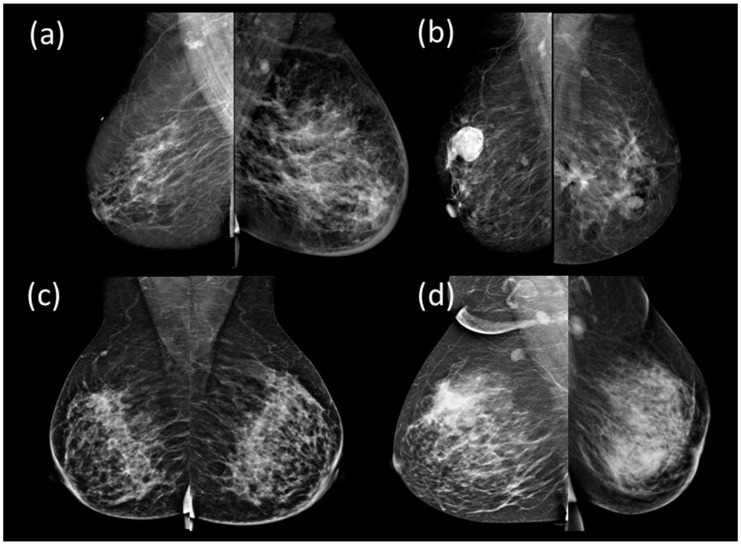
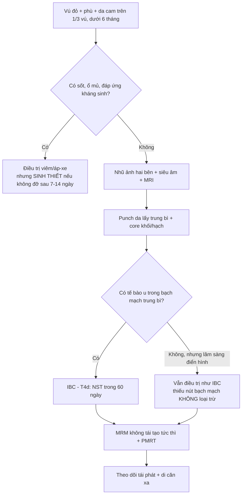
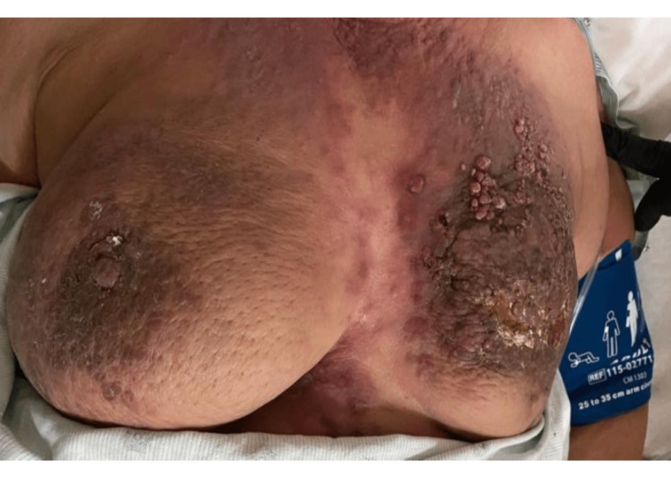
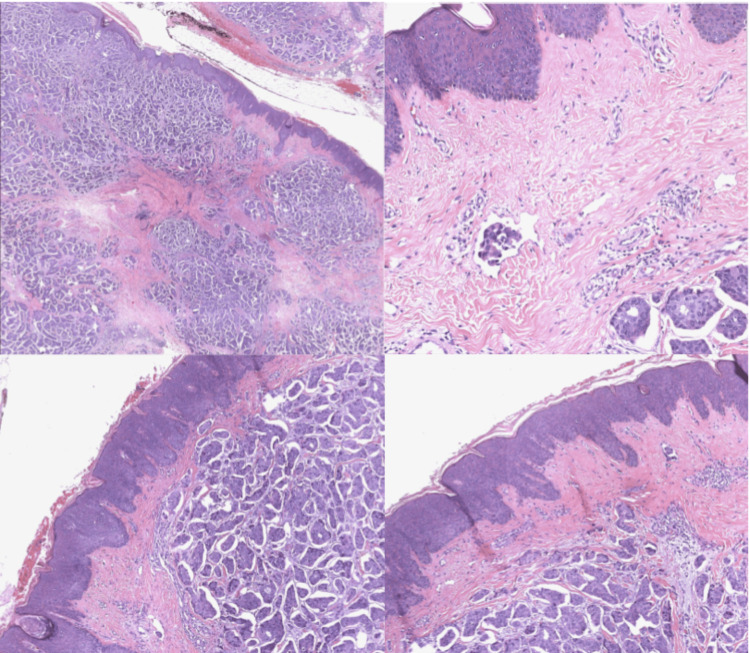
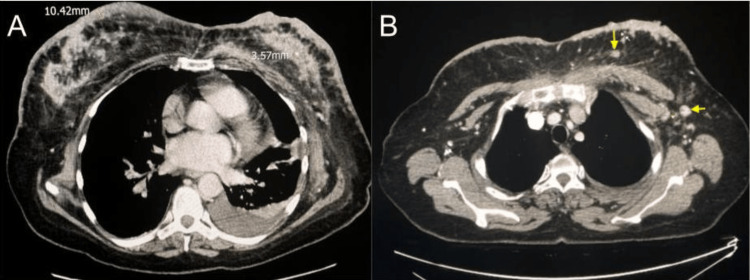
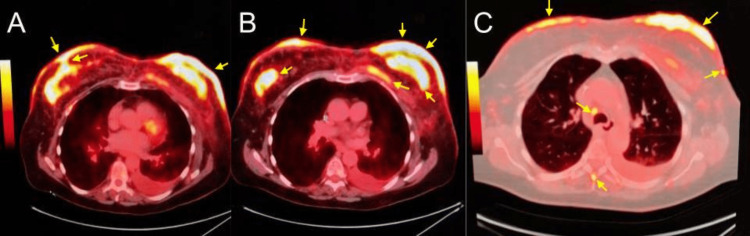
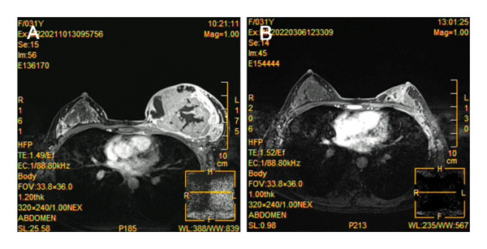
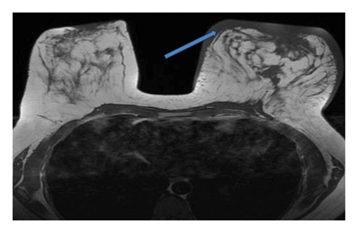

# 1616 — Ung thư vú thể viêm (inflammatory breast cancer, IBC): "viêm" mà không phải viêm / Inflammatory breast cancer

**Tags:** `pattern:day-da-lan-toa` `pattern:phu-vu` `pattern:khong-khoi` `pattern:viem-gia` `vung:vu` `vung:thanh-nguc` `score:TNM-AJCC8` `score:BI-RADS` `protocol:MRI-vu` `protocol:sinh-thiet-da` `protocol:PET-CT` `incidentaloma:day-da`
**Mức chắc chắn (certainty):** tổng hợp y văn (literature synthesis) — đọc trực tiếp toàn văn các bài mở qua Europe PMC/PMC (*Cureus* 2023; *Sensors* (Basel) 2022;23:64; *Case Rep Med* 2026; *JAMA Netw Open* 2025; *Front Oncol* 2026; *Gland Surg* 2025; *Radiol Res Pract* 2026), **có 2 ca nguyên văn** dùng cho Blind Quiz (ảnh CC BY 4.0). Số liệu dịch tễ lấy từ phần Introduction/Discussion của các bài gốc.

## 1. Tổng quan — vì sao da đỏ mà mô bệnh là ung thư, và vì sao "không thấy khối" lại nguy hiểm hơn

- **Định nghĩa (AJCC):** IBC là **thể lâm sàng** — **đỏ da (erythema) + phù (edema) + da cam (peau d'orange) trên ≥ 1/3 vú**, khởi phát **< 6 tháng** tính từ triệu chứng đầu tiên, **thường KHÔNG có khối rõ** bên dưới. IBC được xếp **T4d** và **luôn là giai đoạn III khi chưa di căn xa** (M0). Đây là điểm khác biệt cốt lõi: **chẩn đoán IBC là chẩn đoán LÂM SÀNG**, không phải chẩn đoán mô bệnh học.
- **Tần suất và tiên lượng (định lượng):**
  - IBC chiếm **1–5%** ung thư vú mỗi năm nhưng tới **~10%** số ca tử vong do ung thư vú (*JAMA Netw Open* 2025, 6.945 bệnh nhân IBC không di căn xa).
  - Tại Hoa Kỳ: **2%** các ung thư vú xâm lấn; **2–4%** tuỳ nguồn; **7–10%** tử vong do ung thư vú ở các nước phương Tây (*Gland Surg* 2025).
  - **Sống trung bình (median OS): 4,75 năm** với IBC so với **13,40 năm** với ung thư vú không-IBC (*Gland Surg* 2025).
  - Với **điều trị ba chân (trimodality)**: sống 5 năm **55%**, sống 10 năm **37%** (*JAMA Netw Open* 2025).
  - **Tổn thương vú đối bên: 1–5%** các ca IBC nguyên phát (*Cureus* 2023).
  - Chỉ **25,1%** bệnh nhân IBC không di căn nhận **đủ** cả ba chân điều trị theo hướng dẫn; **91,3%** bắt đầu hóa trị tân bổ trợ **< 60 ngày** sau chẩn đoán (*JAMA Netw Open* 2025).
- **TẠI SAO hình ảnh trông như một "vú viêm" (cơ chế + vật lý):**
  - **Cơ chế then chốt:** tế bào u **xâm nhập bạch mạch trung bì (dermal lymphatic invasion)** và tạo **bít tắc dạng nút (tumor emboli)**. Bạch mạch tắc → dịch + protein ứ trong trung bì → **phù** → lỗ chân lông bị đẩy lồi → **da cam**. Đỏ da là do **giãn mạch phản ứng + viêm quanh u**, không phải nhiễm khuẩn.
  - **Vì sao tế bào IBC dính thành nút:** khác với ung thư thể tiểu thùy (mất E-cadherin → tế bào rời), IBC **tăng biểu hiện E-cadherin** cùng lúc với chuyển dạng trung mô – biểu mô do TNF-α/IL-6/TGF-β → tạo **đám tế bào dính nhau** di chuyển theo bạch mạch. Đây là lý do IBC **không giống** ung thư thể tiểu thùy ở cả hình ảnh lẫn đường lan.
  - **Trên CT:** phù + tế bào u + xơ làm **tăng tỷ trọng mô mềm** và **dày da**. Da thành ngực bình thường dày **1–2 mm** (quy ước đọc phim ở người lớn); ca nguyên văn của bài này đo được **10,42 mm** — tức **gấp ~5–10 lần**. Ngoài ra thấy **dày vách liên tiểu thùy (trabecular thickening)** và **dày tuyến lan tỏa**.
  - **Trên nhũ ảnh:** hình chính là **dày da**, **dày vách/trabecular thickening** và **tăng mật độ nhu mô lan tỏa**. Báo cáo tổng hợp của Gunhan-Bilgen (trích trong *Sensors* (Basel) 2022;23:64): **khối trong vú chỉ 16%**, **ổ đậm độ khu trú không đối xứng 61%**, vi vôi hóa **ít gặp**. Vì vậy **nhũ ảnh âm không loại trừ IBC**.
  - **Trên siêu âm:** dày da, **phù mô mỡ dưới da (tăng hồi âm)**, **bạch mạch giãn**, có thể thấy khối — siêu âm **thấy tổn thương trong vú thường xuyên hơn nhũ ảnh** (*Sensors* (Basel) 2022;23:64).
  - **Trên MRI:** nhạy nhất cho **dày da, phù, và tổn thương nhu mô**; là phương tiện **dẫn đường sinh thiết da** và **đánh giá đáp ứng** sau hóa trị tân bổ trợ. Ca nguyên văn (*Case Rep Med* 2026): MRI trước điều trị — vú trái **to hơn, ngấm thuốc không đều, dày da lan tỏa, núm vú hơi co kéo**; sau 8 chu kỳ — khối **nhỏ đi rõ**.
  - **Vì sao sinh thiết da là bắt buộc:** hình ảnh chỉ nói "có phù/dày da"; **chỉ mô bệnh mới chứng minh tế bào u trong trung bì**. Sinh thiết **punch lấy được trung bì** (không phải chỉ chọc hút) mới thấy **nút tế bào trong bạch mạch trung bì**.
- **"Viêm" là tên gọi sai:** IBC **không sốt**, **không tăng bạch cầu**, **không đáp ứng kháng sinh**. Mọi mảng đỏ vú **kéo dài > 2 tuần, bờ không rõ, không đáp ứng kháng sinh** phải **sinh thiết**, không theo dõi kháng sinh dài.

## 2. Mẫu hình (pattern) + chẩn đoán phân biệt theo hình thái da (Gamut)

- **Khuôn 1 — Đỏ + phù + da cam ≥ 1/3 vú, khởi phát < 6 tháng, không sốt.** Gamut: **IBC** vs **viêm vú/áp-xe** vs **viêm tuyến vú do u hạt (granulomatous mastitis — GM/CGM)** vs **viêm mô tế bào thành ngực**. Chốt: **bờ đỏ không rõ + không sốt + không đáp ứng kháng sinh + sinh thiết da**.
- **Khuôn 2 — Đỏ da lan thành "tấm giáp", dai, lan xuống bụng, KHÔNG liên tục với khối vú.** Gamut: **carcinoma en cuirasse** vs IBC. Chốt: **có/không liên tục với khối nguyên phát** + **tế bào u rời trong trung bì ngoài vùng vú**. Xem [1618](../1618-di-can-da-thanh-nguc-ung-thu-vu/lesson.md).
- **Khuôn 3 — Vú to nhanh, đau, đỏ, có ổ mềm, sốt.** Gamut: **áp-xe vú** vs **IBC có hoại tử trung tâm** vs **ung thư dạng nhú/loét** vs **CGM thể áp-xe**. Chốt: **có ổ dịch + sốt + tụt CRP sau dẫn lưu** → áp-xe; **không ổ dịch, không sốt** → nghi IBC, sinh thiết.
- **Khuôn 4 — Đỏ da đúng hình trường chiếu, teo mạch, xơ cứng, xuất hiện trong 6 tháng đầu sau xạ.** Gamut: **viêm da xạ** vs **tái phát/IBC trong trường xạ**. Chốt: **ranh giới trùng trường xạ + không có tế bào u** → xạ; **lan ra ngoài trường xạ hoặc có nốt mới** → sinh thiết.
- **Khuôn 5 — Phù tay + phù vú cùng bên sau mổ/xạ hạch.** Gamut: **phù bạch mạch sau điều trị** vs **tái phát dạng viêm**. Chốt: **phù không đỏ, không đau, đáp ứng điều trị phù** → bạch mạch; **đỏ mới + da cam** → sinh thiết.
- **Khuôn 6 — Vú to nhanh, da căng bóng, tĩnh mạch nổi, không đỏ nhiều.** Gamut: **u lá (phyllodes) lớn** vs **sarcoma vú** vs **IBC thể không đỏ**. Chốt: **khối đặc lớn có vùng mỡ/hoại tử + không có nút bạch mạch trung bì** → u lá/sarcoma.
- **Gợi nhớ "ĐỎ – KHÔNG SỐT – SINH THIẾT":** **Đ**ỏ ≥ 1/3 vú · **Ỏ** (ổ) **không** rõ khối · **K**hông sốt, bạch cầu bình thường · **H**ỏi mốc thời gian < 6 tháng · **Ô**n định sau kháng sinh = **loại** nhiễm · **N**hũ ảnh âm **không** loại trừ · **G**iữ bệnh phẩm **trung bì** (punch, không chỉ FNA) · **S**inh thiết da là chốt.
- **Nhớ nhanh 4 nhóm da vú đỏ:** **IBC** (u trong bạch mạch trung bì) · **viêm/áp-xe** (ủ mủ, sốt) · **CGM** (u hạt, không hoại tử, thường không sốt) · **xạ/bạch mạch** (bối cảnh điều trị, ranh giới theo trường chiếu).

## 3. Bảng so sánh phân biệt (ma trận đối chiếu)

| Thực thể (entity) | Hình ảnh điển hình | Chốt vào (rule-in) | Chốt loại (rule-out) | Gợi ý xác nhận |
|---|---|---|---|---|
| **Ung thư vú thể viêm (IBC, T4d)** | Đỏ + phù + **da cam ≥ 1/3 vú**, khởi phát **< 6 tháng**; CT: **dày da lan tỏa** (ca mẫu **10,42 mm**), dày vách, tăng mật độ tuyến; MRI: dày da + ngấm thuốc không đều | **Đỏ lan ≥ 1/3 vú + không sốt + tế bào u trong bạch mạch trung bì (punch da)** | **Không có tế bào u trong trung bì + có ổ mủ + sốt + đáp ứng kháng sinh** → viêm/áp-xe | **Punch da 4–6 mm lấy trung bì** + core khối/không khối + MRI + PET/CT phân giai đoạn |
| **Viêm vú / áp-xe vú** | Đỏ khu trú hoặc lan, nóng, đau; siêu âm có **ổ dịch/ổ mủ**, tăng sinh mạch viền | **Sốt + bạch cầu/CRP tăng + có ổ dịch trên siêu âm + đỡ sau dẫn lưu/kháng sinh** | **Đỏ lan ≥ 1/3 vú không ổ dịch, không sốt, kháng sinh 7–14 ngày không đỡ** → nghi IBC | Siêu âm + chọc hút; **nếu không đỡ → sinh thiết da + core** |
| **Viêm tuyến vú do u hạt (GM/CGM)** | Vú to, đỏ, đau, **có thể giống IBC**; siêu âm: ổ giảm âm dạng ống/tổn thương không đều; MRI: viêm lan | **Sinh thiết: u hạt không hoại tử + không có tế bào ác tính; thường không sốt** | **Có tế bào ác tính trong trung bì/bạch mạch** → IBC | Core biopsy + **nhuộm lao/nấm**; theo dõi đáp ứng corticoid |
| **Carcinoma en cuirasse** | Da dày thành "tấm giáp", dai, đỏ–nâu, **lan xuống bụng**; **không liên tục với khối vú** | **Dày da lan ngoài vùng vú + tế bào u rời trong trung bì + IHC khớp nguồn vú** | **Đỏ + phù + da cam khu trú ≥ 1/3 vú, khởi phát nhanh** → IBC | Punch da + IHC (GATA-3, ER); xem [1618](../1618-di-can-da-thanh-nguc-ung-thu-vu/lesson.md) |
| **Viêm da xạ** | Đỏ–nâu, **ranh giới đúng hình trường chiếu**, teo mạch, xơ cứng; trong **6 tháng đầu** sau xạ | **Ranh giới trùng trường xạ + không có tế bào u** | **Lan ra ngoài trường xạ + có nốt/tím mới ≥ 3 năm** → sinh thiết (RAAS/tái phát) | Đối chiếu bản đồ xạ; sinh thiết nếu ra ngoài trường |
| **Phù bạch mạch sau mổ/xạ** | Vú và/hoặc tay cùng bên **phù**, da căng, **không đỏ nhiều**, không đau | **Bối cảnh ALND/xạ + phù tăng dần + không tế bào u** | **Đỏ da cam mới + đau + không đáp ứng điều trị phù** | Đo vòng chi; sinh thiết nếu hình thái đổi |
| **U lá (phyllodes) lớn / sarcoma vú** | Vú **to nhanh**, da căng bóng, tĩnh mạch nổi, **khối đặc lớn** có vùng mỡ/hoại tử | **Khối đặc lớn, bờ rõ, không nút bạch mạch trung bì** | **Dày da lan tỏa + tế bào u trong bạch mạch trung bì** → IBC | Core biopsy (u lá cần mô học đủ); MRI |

*Nhũ ảnh MLO hai bên. **(a) IBC:** dày da + tăng mật độ lan tỏa, **không thấy khối rõ** — lý do nhũ ảnh âm không loại trừ IBC. **(b)** Ung thư vú không-IBC: **khối rõ**, không dày da. **(c)** Tuyến vú lành. **(d)** Viêm tuyến vú do u hạt — bắt chước IBC về lâm sàng. Nguồn: Barkana BD, *Sensors* (Basel) 2022;23:64, Fig. 1, CC BY 4.0.*

### Vì sao "không có khối" lại là dấu hiệu nặng, không phải dấu hiệu nhẹ
- **Trong IBC, đường lan chính là bạch mạch da** — u đã **ra khỏi nhu mô vú** trước khi tạo khối lớn. Vì vậy **vú không có khối rõ nhưng da đã đỏ ≥ 1/3** = bệnh **đã lan theo đường bạch mạch**, tức đúng nghĩa **T4d**.
- Hệ quả thực hành: **siêu âm/MRI tìm tổn thương nhu mô để sinh thiết**, còn **chẩn đoán** dựa vào **da**. Nếu chỉ đi tìm khối và không sinh thiết da → **bỏ sót chẩn đoán**, đó là lý do nhiều ca IBC được điều trị như "viêm vú" vài tháng.

## 4. Protocol chụp + hệ phân độ/điểm chuẩn hóa

- **Thứ tự hình ảnh khi nghi IBC:**
  1. **Nhũ ảnh hai bên (CC + MLO)** — tìm dày da, dày vách, mật độ lan tỏa, vôi hóa, so với bên đối diện.
  2. **Siêu âm vú hai bên + hố nách + hạch trên đòn** — thấy tổn thương nhu mô thường xuyên hơn nhũ ảnh; đo **độ dày da** và ghi mm; đánh giá hạch.
  3. **MRI vú có cản quang** — **bắt buộc** khi nghi IBC: xác định phạm vi trong vú, tổn thương đối bên, dày da, và **dẫn đường sinh thiết da**; là chuỗi xung tốt nhất để **đánh giá đáp ứng** sau hóa trị tân bổ trợ (ca nguyên văn: MRI trước/sau 8 chu kỳ).
  4. **PET/CT hoặc CT ngực–bụng–xương** để **phân giai đoạn xa** — IBC có nguy cơ di căn xa cao ngay từ lúc chẩn đoán.
- **Mô bệnh (bắt buộc cả hai):**
  - **Punch da 4–6 mm lấy được trung bì** ở vùng da đỏ/dày — tìm **nút tế bào trong bạch mạch trung bì**.
  - **Core biopsy tổn thương nhu mô** (nếu thấy trên siêu âm/MRI) + **FNA/core hạch** để có thụ thể (ER/PR/HER2) và độ mô học.
- **Điều trị chuẩn (trimodality) — mốc thời gian là một phần của "protocol":**
  1. **Hóa trị tân bổ trợ (NST)** — khởi đầu **< 60 ngày** sau chẩn đoán (91,3% bệnh nhân trong loạt 6.945 ca đạt mốc này).
  2. **Cắt toàn bộ tuyến vú cải biên (MRM), KHÔNG tái tạo tức thì**, lấy **> 6 hạch**.
  3. **Xạ trị sau mổ (PMRT)**.
  - Chỉ **25,1%** bệnh nhân nhận **đủ** cả ba; thiếu bất kỳ chân nào đều gắn với sống sót kém hơn.
- **Phân giai đoạn:** IBC = **T4d**; **M0 → giai đoạn III**; có di căn xa → **giai đoạn IV**. (AJCC 8.)
- **Đáp ứng:** đo theo **RECIST 1.1** trên MRI/CT; ghi rõ **không dùng "hết đỏ da" làm tiêu chí đáp ứng** — da có thể đỏ lại do xạ/phù bạch mạch.

## 5. Biến thể bình thường và cạm bẫy

- **Không thấy nút bạch mạch trên sinh thiết KHÔNG loại trừ IBC.** Ca nguyên văn 31 tuổi (*Case Rep Med* 2026): core biopsy = ung thư biểu mô xâm lấn kém biệt hóa **grade III**, **"nút bạch mạch trung bì không thấy rõ ràng"** — vẫn được chẩn đoán và điều trị như IBC vì **tiêu chuẩn là lâm sàng**. Lấy **punch da đúng vùng đỏ** làm tăng khả năng thấy nút.
- **Da đỏ ở người da sẫm màu / vú to** dễ bị đánh giá thấp — chẩn đoán dựa vào **phù, da cam, dày da đo được**, không chỉ "đỏ".
- **Nhũ ảnh âm:** khối trong vú chỉ **16%** — đừng yên tâm vì nhũ ảnh "sạch".
- **CGM (viêm tuyến vú do u hạt) bắt chước IBC rất sát** — cả lâm sàng và MRI đều giống. Chốt duy nhất là **mô học**: u hạt không hoại tử, **không có tế bào ác tính**. Đừng điều trị corticoid dài hạn trước khi có core biopsy.
- **Sau xạ trị, dày da và phù có thể tồn tại nhiều tháng** — so với **bản đồ trường xạ** và so phim cũ; chỉ sinh thiết khi **lan ra ngoài trường** hoặc **có nốt mới**.
- **"Đỏ da hết sau kháng sinh" không chứng minh không phải ung thư:** IBC có thể **giảm đỏ tạm thời** do giảm viêm quanh u. Tiêu chí loại trừ là **mô học**, không phải đáp ứng lâm sàng một phần.
- **Không tái tạo tức thì** là yêu cầu **điều trị** (cần PMRT lên thành ngực, da tổn thương rộng), không phải sở thích phẫu thuật — đừng đề nghị tái tạo trong tư vấn ban đầu.

## 6. Tự lượng giá — Blind Quiz

**Ca 1 — Nữ 60 tuổi, vào viện vì đau háng phải; khám vú thấy hai bên to, đỏ, da cam, loét. Nhìn ảnh lâm sàng trước.**

- Câu hỏi: (1) Mô tả 3 dấu hiệu da? (2) Ba chẩn đoán phân biệt? (3) Xét nghiệm nào **chốt chẩn đoán**?

<b>Bấm để hiện đáp án (findings + chẩn đoán)</b>

- **Dấu hiệu:** đỏ da lan tỏa hai vú, **phù + da cam (peau d'orange)**, da tăng sắc tố dạng nốt, **co kéo núm vú**, và **loét da** bên trái; vú trái tổn thương nhiều hơn.
- **Chẩn đoán:** **ung thư vú thể viêm hai bên (bilateral IBC)** — tổn thương vú đối bên gặp ở **1–5%** ca IBC nguyên phát.
- **Chốt:** **sinh thiết da/CT-guided core** — H&E thấy **ung thư biểu mô ống xâm lấn trong trung bì kèm nút bạch mạch** (ảnh mô học dưới).
- **Vì sao đỏ:** tắc bạch mạch trung bì → phù + giãn mạch phản ứng, **không phải nhiễm khuẩn** (bệnh nhân không sốt).
- **Nguồn ảnh:** Salmanzadeh R, Aghemo K, Thatiparthi B và cs., *Cureus* 2023, Fig. 1, CC BY 4.0.

**Ca 1 (tiếp) — CT và PET/CT của cùng bệnh nhân. Đo được gì và để làm gì?**

<b>Bấm để hiện đáp án</b>

- **CT (A):** **dày da lan tỏa hai vú** — đo được **10,42 mm** và **3,57 mm** (bình thường **1–2 mm**); **tràn dịch màng phổi trái**. **(B):** **hạch nách hai bên + hạch trên đòn trái** to, còn cấu trúc mỡ rốn hạch một phần.
- **PET/CT:** khối **ngấm FDG lan tỏa gần hết tuyến vú trái**, **dày da ngấm FDG toàn bộ vú trái**, và tổn thương lan tỏa mức độ ít hơn ở vú phải → xác nhận **bệnh hai bên** và cho **bản đồ phân giai đoạn**.
- **Vì sao quan trọng:** CT **đo được độ dày da bằng mm** (một ngưỡng khách quan để theo dõi), PET/CT phát hiện **di căn xa** — ở ca này có **ổ tiêu xương xương chậu, xương đùi, cột sống** → **giai đoạn IV**.
- **Nguồn ảnh:** Salmanzadeh R và cs., *Cureus* 2023, Fig. 2 và Fig. 4, CC BY 4.0.

**Ca 2 — Nữ 31 tuổi, khối vú trái 4 tháng, 3 tháng nay to gần hết vú + đỏ, phù. Core biopsy: ung thư biểu mô xâm lấn kém biệt hóa, grade III, KHÔNG thấy rõ nút bạch mạch trung bì. Có được chẩn đoán IBC không?**

<b>Bấm để hiện đáp án</b>

- **Có.** IBC là **chẩn đoán lâm sàng** theo AJCC: đỏ + phù + da cam ≥ 1/3 vú, khởi phát < 6 tháng. **Không thấy nút bạch mạch trên một mẫu core không loại trừ IBC** — mẫu core không lấy trung bì da.
- **Bước đúng nếu cần bằng chứng mô học:** **punch da 4–6 mm** ở vùng da đỏ.
- **Diễn tiến ca này:** hóa trị tân bổ trợ theo hội chẩn đa chuyên khoa → **MRI sau 8 chu kỳ khối nhỏ đi rõ** → **MRM + ghép da mỏng** → mô bệnh sau mổ **đạt đáp ứng hoàn toàn bệnh học (pCR)**; theo dõi 2 năm không tái phát.
- **Ảnh MRI trước/sau (A → B):**

- **Nguồn ảnh:** Qin Q, Jia W., *Case Rep Med* 2026, Fig. 7, CC BY 4.0.

**Ca 3 — Nữ 28 tuổi, đau vú trái 1 tháng, đã uống kháng sinh không đỡ, vú to + đỏ + đau. MRI T2 ở dưới. Chẩn đoán và bước tiếp theo?**

<b>Bấm để hiện đáp án</b>

- **Dấu hiệu:** vú trái **to hơn**, **phù dưới da lan tỏa**, **dày da** (mũi tên); trên chuỗi sau tiêm có **ổ giống áp-xe nối với ống tuyến sữa + co kéo núm vú**.
- **Chẩn đoán trong bài nguồn:** **áp-xe/viêm vú quanh núm** — tức **bắt chước IBC**.
- **Bài học:** hình ảnh **không phân biệt được** áp-xe/viêm với IBC ở mức chắc chắn. **Kháng sinh 7–14 ngày không đỡ + không có ổ dịch rõ** → **core biopsy + punch da**, không tiếp tục kháng sinh.
- **Nguồn ảnh:** *Radiol Res Pract* 2026 (bài review minh họa viêm vú), Fig. 18, CC BY 4.0.

## Bài liên quan chéo
- [1618 – Di căn da & thành ngực của ung thư vú](../1618-di-can-da-thanh-nguc-ung-thu-vu/lesson.md) (phân biệt IBC với carcinoma en cuirasse)
- [1613 – Viêm tuyến vú do u hạt & áp-xe vú](../1613-viem-tuyen-vu-u-hat-va-ap-xe-vu/lesson.md) (bắt chước IBC)
- [523 – Sarcoma mạch do xạ của vú (RAAS)](../523-sarcoma-mach-do-xa-vu/lesson.md)
- [522 – Theo dõi sau điều trị ung thư vú & tái phát muộn](../522-theo-doi-sau-dieu-tri-ung-thu-vu/lesson.md)
- [1615 – Di căn xương ở ung thư vú: lành hóa vs tiến triển](../1615-di-can-xuong-ung-thu-vu-lanh-hoa-vs-tien-trien/lesson.md)

> **Không dùng để chẩn đoán độc lập khi chưa có người hướng dẫn.** IBC là chẩn đoán **lâm sàng + mô học**; một phim "bình thường" hoặc một mẫu core không có nút bạch mạch **không** đủ để loại trừ.
