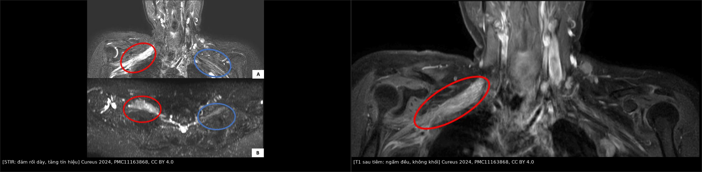
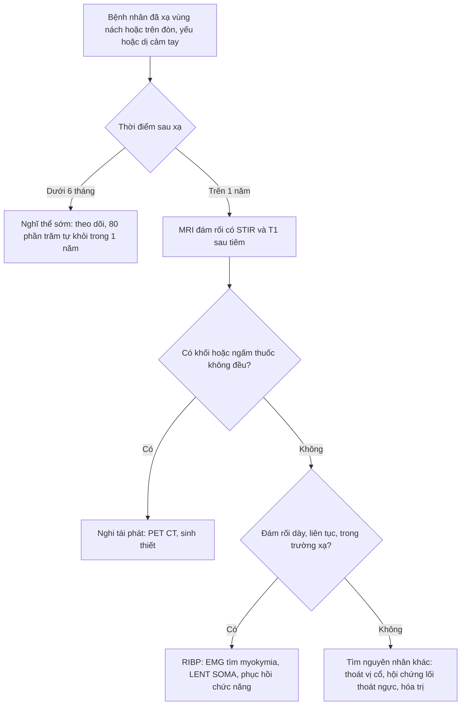
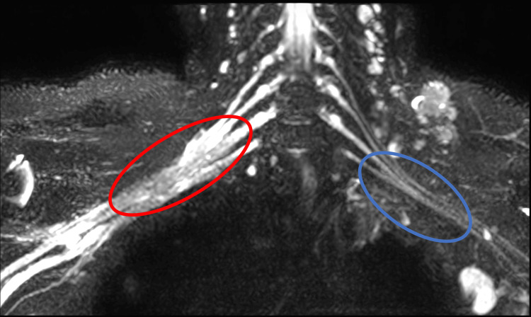
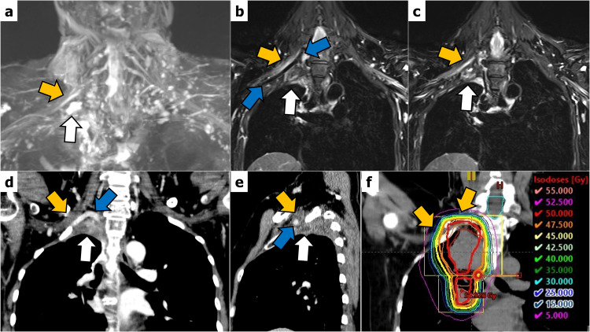

# 1617 — Bệnh đám rối cánh tay do xạ / Radiation-induced brachial plexopathy (RIBP)

**Tags:** `pattern:dam-roi-day` `pattern:day-than-kinh` `vung:dam-roi-canh-tay` `score:LENT-SOMA` `protocol:MR-neurography` `protocol:STIR`
**Mức chắc chắn (certainty):** tổng hợp y văn (literature synthesis) — biên từ toàn văn: tổng quan chẩn đoán–điều trị RIBP (PMC12723156, CC BY 4.0), ca MRI đám rối do xạ 8 năm sau xạ (PMC11163868, CC BY 4.0) và ca RIBP dưới ngưỡng liều dung nạp (PMC10865071, CC BY 4.0). Có **phản biện chỗ mâu thuẫn giữa hai nguồn** về tín hiệu MRI (mục 3).

## 1. Tổng quan — xạ làm hỏng đám rối theo hai thì, và TẠI SAO hình ảnh lại khác nhau ở hai thì đó

- **Bệnh học:** đám rối cánh tay (C5–T1) nằm sát hạch nách và hạch trên đòn — đúng vùng liều cao của xạ vùng ngực/hạch sau mổ ung thư vú, xạ đầu–cổ, xạ đỉnh phổi, lymphoma. Xạ gây **viêm mạn + xơ hóa do xạ (radiation-induced fibrosis — RIF)**: TGF-β1 và CTGF kích thích nguyên bào sợi → nguyên bào cơ sợi → lắng đọng collagen, **liên kết chéo ma trận ngoại bào** làm mô "cứng" và rất khó phân hủy. Hệ quả: sợi trục bị **chèn ép trong bao xơ**, vi mạch nuôi thần kinh tổn thương → **hủy myelin + mất sợi trục** (PMC12723156).
- **Hai thì lâm sàng — và đây là chìa khóa để hiểu hình ảnh:**
  - **Khởi phát sớm (3–6 tháng):** rối loạn dẫn truyền thoáng qua, **80% tự khỏi trong vòng 1 năm** (PMC12723156).
  - **Khởi phát muộn (kinh điển):** trung bình **40 tháng** sau xạ, dao động **3–4 năm** đến **hơn 10 năm**; đây là thể **không hồi phục** (PMC12723156).
- **TẠI SAO MRI có lúc "sáng" có lúc "tối" trên T2:** giai đoạn **còn viêm/phù** → nước tự do trong nội mô thần kinh kéo dài T2 (và STIR ức chế mỡ nên càng nổi bật) + hàng rào máu–thần kinh còn rò → **ngấm thuốc đều**. Giai đoạn **xơ hóa muộn** → collagen liên kết chéo, ít nước → tín hiệu **gần như cơ vân, không ngấm thuốc** (PMC12723156). Vì vậy "T2 sáng + ngấm đều" **không loại trừ** RIBP, và "T2 tối" cũng **không loại trừ** RIBP — phải đặt cạnh **thời điểm xạ** và **tốc độ tiến triển**.
- **Số liệu nằm lòng (ngưỡng liều):**
  - Nguy cơ **< 1%** khi phân liều **2,2–2,5 Gy** và tổng liều **≤ 40 Gy** (PMC11163868 dẫn y văn).
  - Liều tối đa vào đám rối **60–66 Gy** thường được coi là an toàn, nhưng **đã có ca RIBP ở 41–60 Gy** (meta-analysis, PMC10865071); ca báo cáo: đám rối nhận **47–48 Gy** vẫn bị RIBP.
  - Ung thư phổi không tế bào nhỏ thể đỉnh: tỉ lệ RIBP **3 năm là 12%**, và **chỉ ở nhóm liều tối đa ≥ 78 Gy** (PMC10865071).
- **Dịch tễ:** ung thư vú có tỉ lệ năm cao nhất, khoảng **2,9%**, hằng định suốt đời; y văn cũ ghi tới **15–66%** ở kỹ thuật cũ; kỹ thuật hiện đại còn **1,0–1,2%**, trong đó **80% là thể sớm tự khỏi** (PMC12723156). Đầu–cổ: **7%** chung, **0,3%** ở ung thư vòm (PMC12723156).
- **Diễn tiến tự nhiên:** dị cảm/đau → yếu cơ (khởi đầu ngón cái rồi lan gần) → teo cơ, giảm/thay đổi phản xạ; **phù bạch mạch và da teo xơ** đi kèm **20%** ca muộn. Khi đã liệt chi, thường trong **vài tháng đến 5 năm** sau dấu hiệu bàn tay đầu tiên (PMC12723156).

## 2. Mẫu hình + chẩn đoán phân biệt theo vị trí và theo thì (Gamut)

- **Mẫu hình cốt lõi:** **dày đám rối lan tỏa, liên tục, không có khối**, đối xứng bên đối diện để so sánh, kèm **teo cơ** vùng vai–cánh tay cùng bên.
- **Gamut theo vị trí tổn thương (định khu bằng MRI):**
  - **Rễ/thân (C5–T1, trên đòn):** xạ hạch trên đòn, xạ vùng cổ — tổn thương thân trên (C5–C6) → yếu cơ delta, nhị đầu, dị cảm mặt ngoài cẳng tay.
  - **Bó/dây (dưới đòn, hạch nách):** xạ hạch nách sau mổ vú — tổn thương bó ngoài/sau → yếu cơ gian cốt, duỗi cổ tay; đây là vị trí **hay bị bỏ sót nhất** vì nằm ngoài FOV nếu chỉ chụp cột sống cổ.
  - **Nhánh tận:** hiếm khi là tổn thương do xạ đơn thuần; nếu chỉ một dây bị ảnh hưởng, nghĩ **nguyên nhân khác** (chèn ép, chấn thương mổ, khối u).
- **Gamut chẩn đoán phân biệt (theo thứ tự phải loại trừ):**
  - **Tái phát hạch/xâm lấn đám rối** — bắt buộc loại trừ đầu tiên ở mọi bệnh nhân ung thư; khối + ngấm thuốc + FDG dương.
  - **U thần kinh ngoại biên thứ phát sau xạ (radiation-induced neoplasm)** — xuất hiện **muộn hơn nhiều** so với RIBP, dạng khối, có thể đau dữ dội.
  - **Chèn ép cơ học khác:** hạch xơ, dải xơ sau mổ, hội chứng lối thoát ngực, thoát vị đĩa đệm cổ (C5–C6).
  - **Bệnh thần kinh do hóa trị** (taxane, platinum) — đối xứng hai bên, không có dày đám rối một bên.
  - **Phù bạch mạch đơn thuần** — nặng lên khi gắng sức, không có dấu hiệu thần kinh khu trú.

## 3. Bảng so sánh phân biệt (ma trận đối chiếu)

| Thực thể (entity) | Hình ảnh điển hình (MRI đám rối) | Chốt vào (rule-in) | Chốt loại (rule-out) | Gợi ý xác nhận |
|---|---|---|---|---|
| **RIBP thể viêm/phù (sớm hoặc còn hoạt tính)** | Đám rối **dày, phù, tăng tín hiệu STIR/T2**, **ngấm thuốc đều**, mất mỡ quanh thần kinh, không khối | **Dày + phù lan tỏa theo trường xạ + ngấm đều + không khối** | Có **khối khu trú** hoặc ngấm **không đều dạng nốt** → nghi tái phát | Đối chiếu **bên đối diện**, so phim trước xạ, EMG (myokymia) |
| **RIBP thể xơ hóa muộn** | Đám rối dày, kiến trúc méo, **tín hiệu gần cơ vân trên T1 và T2**, **không ngấm thuốc** | **Dày + méo + không ngấm + không khối**, bệnh sử xạ cách nhiều năm | Ngấm thuốc rõ hoặc tăng T2 mạnh → không phải thể xơ thuần | EMG; theo dõi 3–6 tháng; PET/CT nếu vẫn nghi |
| **Tái phát hạch/xâm lấn đám rối** | **Khối** cạnh đám rối, tăng T2 không đều, **ngấm thuốc dạng nốt/viền**, xóa mỡ, có thể xâm lấn liên tục | **Khối + ngấm thuốc không đều + FDG dương tính** | Chỉ dày đám rối lan tỏa, không khối, FDG âm → nghiêng RIBP | PET/CT, sinh thiết nếu đổi hướng điều trị |
| **U thần kinh thứ phát sau xạ (MPNST)** | Khối lớn dọc dây thần kinh, hoại tử, bắt thuốc mạnh | **Khối > 5 cm, hoại tử, tiền sử xạ > 10 năm** | Không có khối → loại | Sinh thiết/mổ |
| **Bệnh thần kinh do hóa trị** | Đám rối **bình thường** hoặc dày nhẹ **hai bên đối xứng** | **Đối xứng + tiền sử taxane/platinum + không liên quan trường xạ** | Dày một bên trong trường xạ → nghiêng RIBP | EMG/NCS, ngừng thuốc thử |

*Bệnh nhân 37 tuổi, 8 năm sau xạ 50 Gy thành ngực + 45 Gy hạch vùng: đám rối phải (vòng đỏ) dày, phù, tăng tín hiệu STIR so với bên trái (vòng xanh), và **ngấm thuốc đều** trên T1 sau tiêm — **không có khối**, đám rối còn liên tục nên loại trừ đứt do mổ. Nguồn: Shetty ND et al., Cureus 2024 (PMC11163868), CC BY 4.0. Ảnh ghép letterbox.*

### Phản biện nguồn (bắt buộc đọc)
- **Mâu thuẫn thật:** tổng quan PMC12723156 mô tả RIBP điển hình là **không ngấm thuốc, tín hiệu như cơ vân**; ca PMC11163868 (8 năm sau xạ) lại có **phù + ngấm đều**. Hai nguồn không sai — chúng mô tả **hai thì khác nhau của cùng quá trình** (viêm/hoạt tính vs xơ hóa). Vì vậy **không được** lấy "ngấm thuốc" làm tiêu chuẩn loại trừ RIBP, và **cũng không được** lấy "T2 tối" để khẳng định lành.
- **Cỡ mẫu:** PMC11163868 và PMC10865071 là **ca đơn lẻ** — chỉ dùng để minh họa hình ảnh/ngưỡng liều, không suy ra quy luật.
- **Điểm chốt phân biệt không nằm ở MRI một mình:** **myokymia trên EMG gặp ở 60% RIBP so với 4% plexopathy do u** (PMC12723156) — đây là dấu hiệu phân biệt mạnh nhất trong y văn; còn **90%** cả hai nhóm đều có bất thường dẫn truyền, nên NCS **không** phân biệt được.

## 4. Protocol chụp + thang phân độ

**MRI đám rối cánh tay (protocol tối thiểu):**
1. **FOV từ C4 đến nách**, gồm **cả hố trên đòn và hạch nách** hai bên — đây là yêu cầu số 1; FOV hẹp là lý do hay nhất khiến "MRI âm tính" mà bệnh nhân vẫn yếu tay.
2. **Chuỗi xung:** STIR/T2 fat-sat **coronal** (phù/thâm nhiễm), **3D MR neurography** (MIP để lần theo thân–bó–dây), T1 **trước và sau gadolinium** có ức chế mỡ (khối vs ngấm đều), axial T1/T2 qua đám rối.
3. **Luôn so sánh bên đối diện** trên cùng mặt phẳng; ghi rõ **bên, đoạn (rễ/thân/bó/dây)** và **có/không có khối**.
4. **Không dùng MRI đơn thuần để loại trừ tái phát:** nếu lâm sàng xấu đi nhanh hoặc có khối nghi ngờ → **PET/CT** và/hoặc sinh thiết (PMC12723156).

**Thang phân độ (dùng để theo dõi, không để chẩn đoán):**
- **LENT-SOMA** cho đám rối: chấm **S** (chủ quan: đau, dị cảm), **O** (khách quan: yếu cơ, phản xạ), **M** (quản lý: can thiệp nội khoa/phẫu thuật); điểm **SOM cộng lại chia 11** để ra điểm LENT (PMC12723156, bảng phân độ).
- **CTCAE** cho độc tính thần kinh ngoại biên khi theo dõi sau hóa–xạ (dùng chung ngôn ngữ với ung thư).
- **Mốc theo dõi thực hành:** khám lâm sàng mỗi **3–6 tháng** trong 2 năm đầu sau xạ hạch trên đòn/nách; MRI **khi có triệu chứng mới**, không chụp sàng lọc định kỳ.

## 5. Biến thể bình thường và cạm bẫy

- **Đám rối "dày" ở người không triệu chứng sau xạ:** thay đổi xơ hóa do xạ có thể **im lặng**; chỉ chẩn đoán RIBP khi có **triệu chứng tương ứng**. Đừng "điều trị hình ảnh".
- **Dày nhẹ hai bên** ở người trẻ/thành mảnh là biến thể; **dày một bên trong trường xạ** mới có nghĩa.
- **Bó dây bình thường có thể trông "ngấm thuốc" nhẹ** do đám rối tĩnh mạch quanh thần kinh — so sánh bên đối diện và dùng fat-sat.
- **Cạm bẫy FOV:** chụp cột sống cổ "bình thường" không loại trừ RIBP — tổn thương ở hạch nách/dưới đòn nằm **ngoài** FOV.
- **Cạm bẫy PET/CT sau xạ:** viêm do xạ có thể tăng FDG → **dương tính giả**; ngược lại khối nhỏ có thể FDG âm. Không quyết định mổ chỉ dựa trên PET.
- **Satisfaction of search:** thấy teo cơ vai là dừng lại — bỏ sót **khối tái phát nhỏ** ở đỉnh nách.
- **Nhầm với phù bạch mạch:** phù tay nặng lên khi gắng sức, không teo cơ, không mất cảm giác theo dải thần kinh.

## 6. Tự lượng giá — Blind Quiz

**Ca 1 — Nữ 37 tuổi, 8 năm sau mổ + xạ ung thư vú phải, dị cảm và yếu tay phải 1 năm nay.**

- Gợi ý: xạ 50 Gy thành ngực + 45 Gy hạch vùng, 25 phân liều; khám: giảm cảm giác mặt ngoài cẳng tay phải, không sờ thấy hạch.
- Câu hỏi: Dấu hiệu chính trên ảnh? Hai chẩn đoán phải loại trừ? Xét nghiệm nào phân biệt mạnh nhất?

<b>Bấm để hiện đáp án (findings + chẩn đoán)</b>

- **Dấu hiệu:** đám rối phải (vòng đỏ) **dày và phù** so với bên trái (vòng xanh), thân/bó liên tục, **không có khối**.
- **Chẩn đoán:** **RIBP thể muộn còn hoạt tính viêm** — khởi phát trung bình **40 tháng**, có thể tới **hơn 10 năm** sau xạ.
- **Loại trừ:** (1) **tái phát hạch/xâm lấn đám rối** — cần không có khối + ngấm thuốc đều; (2) **u thần kinh thứ phát sau xạ** — thường muộn hơn nhiều và dạng khối.
- **Xét nghiệm phân biệt mạnh nhất:** **EMG tìm myokymia** — gặp ở **60%** RIBP so với **4%** plexopathy do u; NCS chỉ cho thấy bất thường dẫn truyền ở **90%** cả hai nhóm nên không phân biệt được.
- Nguồn: Shetty ND et al., Cureus 2024 (PMC11163868); Lambi AG et al., *J Hand Surg Glob Online* 2025 (PMC12723156), CC BY 4.0.

**Ca 2 — Cùng bệnh nhân: STIR và T1 sau tiêm.**

- Câu hỏi: Tín hiệu STIR và kiểu ngấm thuốc nói lên điều gì về giai đoạn bệnh? Nếu đám rối **không ngấm thuốc và tối trên T2** thì chẩn đoán thay đổi thế nào?

<b>Bấm để hiện đáp án (findings + chẩn đoán)</b>

- **STIR:** đám rối phải **tăng tín hiệu, dày** (phù nội mô thần kinh) — nước tự do kéo dài T2, STIR ức chế mỡ nên càng rõ.
- **T1 sau tiêm:** **ngấm đều toàn bộ** thân–bó, **không có ổ ngấm dạng nốt**, không khối → phù hợp **viêm/hoạt tính**, không phải u.
- **Nếu T2 tối + không ngấm:** đó là **thể xơ hóa muộn** (collagen liên kết chéo, ít nước) — vẫn là RIBP, **không** phải "bình thường"; tổng quan PMC12723156 mô tả đúng thể này.
- **Bài học:** hai kiểu tín hiệu là **hai thì** của cùng bệnh, không phải hai bệnh.
- Nguồn: Shetty ND et al., Cureus 2024 (PMC11163868); Lambi AG et al., 2025 (PMC12723156), CC BY 4.0.

**Ca 3 — Nam 55 tuổi, ung thư phổi đỉnh phải, xạ 50 Gy/25 phân liều, đám rối nhận 47–48 Gy; 6 tháng sau yếu tay phải.**

- Câu hỏi: Liều 47–48 Gy có "an toàn" không? Vì sao vẫn phải loại trừ tái phát dù liều dưới ngưỡng?

<b>Bấm để hiện đáp án (findings + chẩn đoán)</b>

- **Không có ngưỡng "an toàn tuyệt đối":** liều tối đa **60–66 Gy** thường được coi là an toàn, nhưng **đã có RIBP ở 41–60 Gy**; nguy cơ **< 1%** chỉ khi phân liều **2,2–2,5 Gy** và tổng liều **≤ 40 Gy**.
- **Ở ung thư phổi đỉnh:** tỉ lệ RIBP **3 năm là 12%**, và **chỉ ở nhóm liều tối đa ≥ 78 Gy** — nên ca này là **ngoại lệ đáng báo cáo**.
- **Vẫn phải loại trừ tái phát** vì hình ảnh RIBP (dày, phù, ngấm thuốc) **trùng lặp** với xâm lấn đám rối; khác biệt nằm ở **khối + ngấm không đều + FDG**.
- Nguồn: Masumoto A et al., Cureus 2024 (PMC10865071), CC BY 4.0.

## Bài liên quan chéo
- [598 – Xạ trị vùng hạch sau ung thư vú](../598-xa-tri-vung-hach-sau-ung-thu-vu/lesson.md) (nguồn liều vào đám rối)
- [593 – Phù bạch mạch chi trên sau điều trị ung thư vú](../593-phu-bach-mach-chi-tren-sau-dieu-tri-ung-thu-vu/lesson.md) (chẩn đoán phân biệt phù tay)
- [599 – Hội chứng dây nách & phù bạch mạch](../599-day-nach-axillary-web-syndrome/lesson.md)
- [522 – Theo dõi sau điều trị ung thư vú & tái phát muộn](../522-theo-doi-sau-dieu-tri-ung-thu-vu/lesson.md) (bối cảnh "đau tay sau điều trị")
- [931 – Takayasu: can thiệp & theo dõi](../931-takayasu-can-thiep-noi-mach-va-phau-thuat/lesson.md) (đối chiếu tổn thương mạch–thần kinh vùng cổ vai)

## Ảnh
- 4 ảnh gốc + 1 ảnh ghép, tất cả **CC BY 4.0**; chi tiết trong `images/CREDITS.md`.
- Ảnh ghép `composite_1617_STIR-sang-vs-T1-ngam-deu.jpg` tạo bằng `tools/make_composite.py` (letterbox, giữ tỷ lệ, dải attribution).
- Ca PMC10865071 dùng **nguyên bản** (không crop) để giữ đúng bố cục 2 bảng a–c.

> Không dùng để chẩn đoán độc lập khi chưa có người hướng dẫn.
