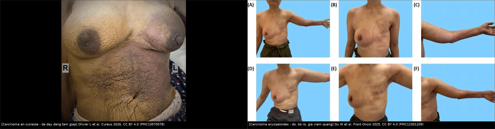
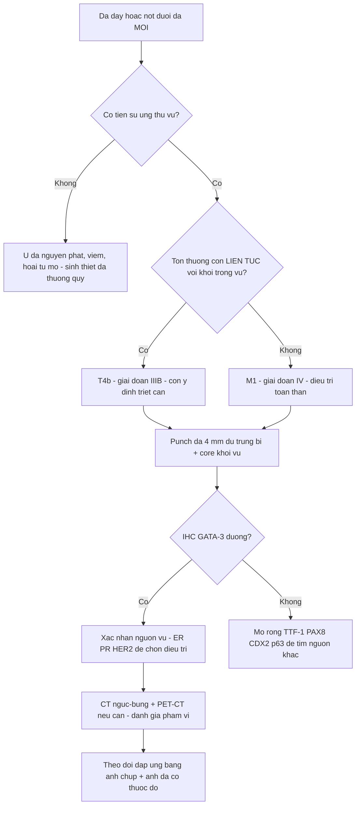
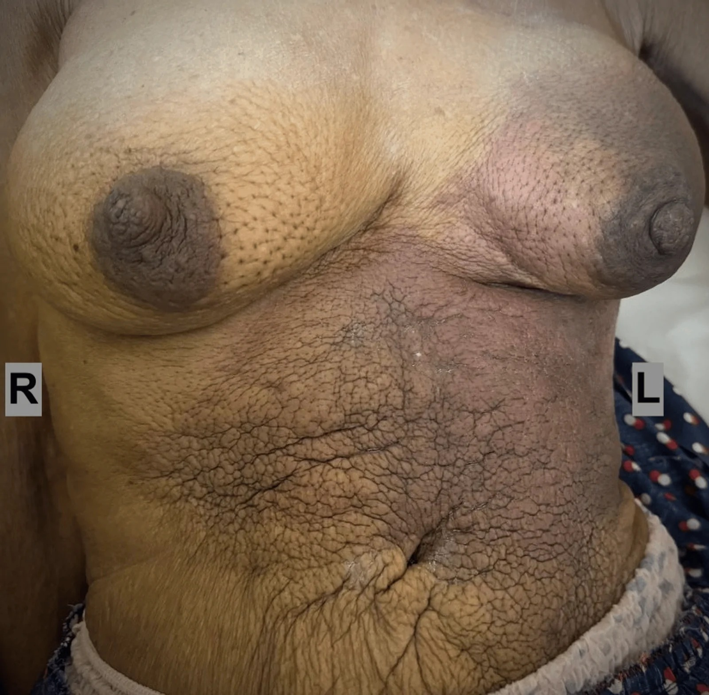
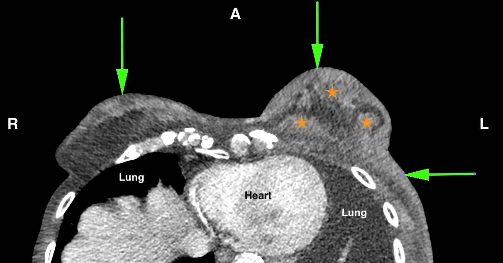
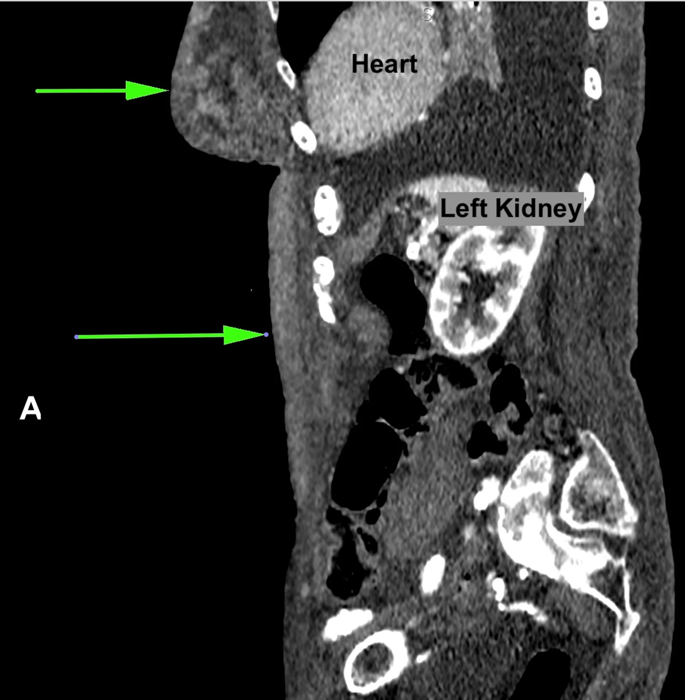
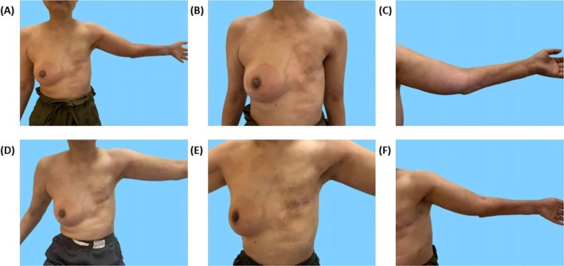
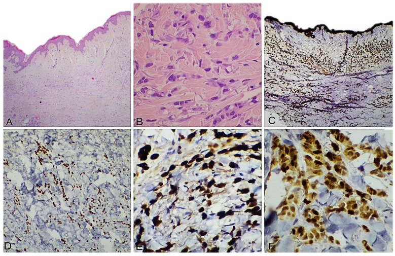

# 1618 — Di căn da & thành ngực của ung thư vú / Cutaneous and chest wall metastases of breast cancer

**Tags:** `pattern:day-da` `pattern:not-da` `pattern:di-can-da` `pattern:man-do` `vung:vu` `vung:thanh-nguc` `score:BI-RADS` `score:TNM-AJCC8` `protocol:MRI-vu` `protocol:sinh-thiet-da` `incidentaloma:not-da`
**Mức chắc chắn (certainty):** tổng hợp y văn (literature synthesis) — nhóm tự biên từ y văn mở đọc trực tiếp qua Europe PMC (*Cureus* 2026, *Frontiers in Oncology* 2025, *Dermatopathology* 2025), có **ca nguyên văn** dùng cho quiz (ảnh CC BY 4.0). Số liệu dịch tễ lấy từ phần Discussion của các bài gốc (trích dẫn nội bộ Brownstein & Helwig; Mordenti và cs.).

## 1. Tổng quan — vì sao da là "cửa ngõ" của ung thư vú + cơ chế hình ảnh

- **Định nghĩa tách bạch (điểm hay bị gộp):** **di căn da (cutaneous metastasis)** = tế bào ung thư vú nằm trong **trung bì/mô dưới da mà KHÔNG liên tục với khối nguyên phát** — đây là bệnh **toàn thân, giai đoạn IV**. Ngược lại **xâm lấn da trực tiếp (T4b)** = khối vú lan liên tục ra da (loét, nốt vệ tinh cùng bên, phù da kể cả **peau d'orange**) — vẫn là **giai đoạn IIIB, còn ý định chữa khỏi**. Câu hỏi "có liên tục hay không" quyết định **điều trị triệu chứng hay triệt căn**, không phải độ dày da.
- **Tần suất (định lượng):**
  - Di căn da nói chung chỉ chiếm **~0,2%** các mẫu sinh thiết da (Tinca AC et al., *Dermatopathology* 2025; 25 ca/loạt của họ, 7 ca là dấu hiệu ĐẦU TIÊN của ung thư nội tạng).
  - **Ung thư vú là nguồn di căn da hay gặp nhất ở nữ: 24%** các ca di căn da ở nữ; khoảng **70%** các ca di căn da là thứ phát từ ung thư vú nguyên phát (Brownstein & Helwig, trích trong Olivier L et al., *Cureus* 2026).
  - **Mordenti và cs.: 164 ca** di căn da do ung thư vú — **145 ca ở thân mình (88,4%)**, chỉ **3%** mang hình thái "en cuirasse".
  - **Carcinoma en cuirasse (CeC): < 10%** các di căn da do vú, thường xuất hiện **SAU** điều trị ban đầu; **sống 1–2 năm** sau khi da đổi (Olivier L et al. 2026).
  - **Carcinoma erysipeloides (CE): chỉ 3%** di căn da của ung thư vú (Gu W et al., *Front Oncol* 2025).
- **TẠI SAO hình ảnh trông như vậy (cơ chế + vật lý):**
  - **Ba đường lan:** **bạch mạch** (hay gặp nhất → emboli tế bào trong bạch mạch trung bì), **máu**, và **trực tiếp**. Bạch mạch bị tắc → dịch + protein ứ trong trung bì → **da dày, phù, lỗ chân lông giãn** = **peau d'orange** (da cam). Vì vậy **dày da lan tỏa mà KHÔNG có khối trong vú** là hình thái kinh điển của di căn da.
  - **Trên CT:** phù + tế bào u + xơ làm **tăng tỷ trọng mô mềm** và **dày da**. Da thành ngực bình thường mỏng **1–2 mm** ở người lớn; trong thực hành, **> 2 mm** hoặc **dày không đối xứng** được coi là bất thường — đây là **quy ước đọc phim**, chưa có nghiên cứu tiền cứu xác lập ngưỡng (ghi rõ để không "bịa" con số).
  - **Trên MRI:** nước tự do trong trung bì → **T2FS tăng tín hiệu**; mô u đặc → **ngấm thuốc** và **hạn chế khuếch tán** (ADC thấp). Do đó **MRI T2FS là chuỗi xung nhạy nhất để thấy phù da lan ra ngoài vú** — điều mà nhũ ảnh bỏ sót.
  - **Trên siêu âm:** da dày, **tăng hồi âm** ở lớp trung bì, mất phân lớp; có thể thấy **ống bạch mạch giãn** ("cobblestone") và **hạch nách**.
  - **Vì sao carcinoma THỂ TIỂU THÙY (ILC) hay di căn da:** mất **E-cadherin** → tế bào rời nhau, không tạo đám dính, lan theo mô mềm/trung bì và cho di căn "bất thường" (da, phúc mạc, buồng trứng, màng não). Ca CeC của Olivier L et al. đúng mô hình này: **ILC, ER/PR dương, HER2 âm, E-cadherin ÂM** trên sinh thiết da.
  - **Hệ quả thực hành:** hình thái "viêm" của da **không** đồng nghĩa viêm — mọi mảng đỏ **bờ rõ, không sốt, không đáp ứng kháng sinh** ở người có tiền sử ung thư vú phải **sinh thiết da**, không theo dõi kháng sinh dài.

## 2. Mẫu hình (pattern) + chẩn đoán phân biệt theo hình thái da (Gamut)

- **Khuôn 1 — Dày da LAN TỎA thành "tấm giáp", da dai như da thuộc, không khối rõ.** Gamut: **CeC** vs **ung thư thể viêm (IBC, T4d)** vs viêm da xạ vs phù bạch mạch sau mổ/xạ vs viêm mô tế bào lan. Chốt: **punch da có carcinoma trong trung bì + IHC khớp nguồn vú**.
- **Khuôn 2 — Mảng đỏ, nóng, bờ rõ, lan nhanh, giống viêm quầng.** Gamut: **carcinoma erysipeloides** vs **viêm quầng/viêm mô tế bào** vs viêm da xạ vs huyết khối tĩnh mạch nông. Chốt: **không sốt/bạch cầu bình thường + không đáp ứng kháng sinh + bờ rõ kiểu "đường viền"** → sinh thiết.
- **Khuôn 3 — Nốt da/dưới da đơn độc, chắc, không đau, trên nền sẹo mổ hoặc gần núm.** Gamut: **di căn da** vs u da nguyên phát (BCC/SCC/u gai) vs nang thượng bì vs hoại tử mỡ vs u mô bào sợi. Chốt: **tiền sử ung thư vú + vị trí trong vùng dẫn lưu bạch mạch + IHC GATA-3 dương**.
- **Khuôn 4 — Nốt/tím nhiều ổ ở vùng ĐÃ XẠ, xuất hiện ≥ 3 năm sau xạ.** Gamut: **RAAS (sarcoma mạch do xạ)** vs AVL/BLAP lành vs viêm da xạ muộn vs tái phát carcinoma da. Chuyển bài [523](../523-sarcoma-mach-do-xa-vu/lesson.md); chốt bằng **MYC**.
- **Khuôn 5 — Tổn thương SÂU trong thành ngực (dưới cơ ngực, sát xương sườn).** Gamut: **tái phát/di căn thành ngực** vs hoại tử mỡ thành ngực vs áp-xe/viêm sụn sườn sau xạ vs di căn xương sườn vs sarcoma thành ngực do xạ. Chốt: **CT/MRI thấy tổn thương xuyên cơ hoặc phá xương = không phải hoại tử mỡ**.
- **Khuôn 6 — Nốt ở RỐN (Sister Mary Joseph nodule).** Gamut: di căn từ **dạ dày–đại tràng–buồng trứng–tụy** nhiều hơn vú; vú vẫn có thể. Chốt: IHC (CK7/CK20, CDX2, PAX8, GATA-3).
- **Gợi nhớ nhanh "DA – KHÔNG PHẢI VIÊM":** **D**ày da không đối xứng · **A**nh ( imaging ) thấy phù lan ngoài vú · **K**hông sốt, bạch cầu bình thường · **P**unch biopsy trung bì là chốt · **H**ỏi tiền sử ung thư vú · **Ô**n định sau kháng sinh = **loại** viêm nhiễm · **N**hiều ổ/tái phát đúng vùng chiếu xạ = nghĩ mạch máu.

## 3. Bảng so sánh phân biệt (ma trận đối chiếu)

| Thực thể (entity) | Hình ảnh điển hình (lâm sàng / nhũ ảnh–DBT / siêu âm / CT–MRI) | Chốt vào (rule-in) | Chốt loại (rule-out) | Gợi ý xác nhận |
|---|---|---|---|---|
| **Carcinoma en cuirasse (CeC)** | Da dày lan thành **"tấm giáp"**, dai, đỏ/nâu, có thể lan **xuống bụng**; nhũ ảnh: dày da lan tỏa + co kéo; CT: dày da **không liên tục với khối vú**; có thể có nhiều khối trong vú | **"Breastplate" + dày da lan ngoài phạm vi tuyến + carcinoma trong trung bì có IHC khớp vú** | **Khối vú lan trực tiếp ra da có liên tục = T4b, không phải CeC** | **Punch da 4 mm** đủ trung bì + IHC; chụp CT ngực–bụng định mức lan |
| **Carcinoma erysipeloides (CE)** | Mảng đỏ **bờ rõ như vẽ**, nóng, lan nhanh, giống viêm quầng; hay ở **thành ngực và chi trên cùng bên** | **Đỏ bờ rõ + KHÔNG sốt + không đáp ứng kháng sinh + tiền sử ung thư vú** | **Sốt cao + tăng bạch cầu + đáp ứng kháng sinh trong 5–7 ngày → viêm quầng** | Sinh thiết da vùng bờ; cấy da âm không loại trừ |
| **Ung thư thể viêm (IBC, T4d)** | **1/3 vú trở lên** đỏ, phù, peau d'orange, khởi phát **< 3 tháng**; thường có khối/nhu mô dày | **Khởi phát nhanh + ≥ 1/3 vú + không có carcinoma rời trong trung bì ngoài vú** | **Tồn tại > 3–6 tháng, không khối, dày da lan ra bụng → nghĩ CeC** | Punch da + core khối; MRI đánh giá phạm vi |
| **Di căn da dạng nốt** | Nốt chắc 0,5–2 cm, da trên bình thường hoặc đỏ, thường **gần sẹo mổ/núm** | **Tiền sử ung thư vú + nốt mới trong vùng dẫn lưu + GATA-3 dương** | **Nốt có mỡ/vôi hóa vỏ + ổn định nhiều năm → hoại tử mỡ** | Sinh thiết cắt trọn/punch sâu + IHC |
| **Viêm da xạ (radiodermatitis)** | Đỏ–nâu, **ranh giới đúng hình trường chiếu**, có teo mạch, giãn mạch, xơ cứng; xuất hiện **trong 6 tháng đầu** | **Ranh giới trùng trường xạ + tiến triển chậm + không carcinoma trong trung bì** | **Tổn thương lan RA NGOÀI trường xạ, hoặc có nốt/tím mới ≥ 3 năm → sinh thiết** | So phim/ảnh cũ, đối chiếu bản đồ xạ |
| **Viêm mô tế bào / áp-xe thành ngực** | Đỏ, nóng, đau, có ổ mềm; CT: phù mô mỡ dạng lưới, có ổ dịch | **Sốt + CRP/bạch cầu tăng + có ổ dịch trên siêu âm** | **Đỏ bờ rõ không sốt, bạch cầu bình thường, kháng sinh không đỡ sau 7 ngày** | Siêu âm + chọc hút; nếu không đỡ → sinh thiết da |
| **RAAS (sarcoma mạch do xạ)** | Sẩn/mảng **tím–bầm không tan**, nhiều ổ, trong vùng xạ | **≥ 3 năm sau xạ + không tan + MYC dương** | **MYC âm + mô học không atypia → AVL lành** | Sinh thiết sâu + MYC; xem bài [523](../523-sarcoma-mach-do-xa-vu/lesson.md) |
| **Hoại tử mỡ / seroma thành ngực** | Nang dầu có **mỡ**, vôi hóa vỏ, lõi không ngấm; seroma: dịch, co nhỏ dần | **Có mỡ trong tổn thương + lõi không ngấm + bờ vôi hóa** | **Ngấm đặc lõi + lớn dần + xuyên cơ → không phải hoại tử mỡ** | So phim cũ; MRI T1 không trừ mỡ |
| **Di căn da từ ung thư KHÁC** | Nốt rốn, nốt nhiều ổ; tiền sử dạ dày/đại tràng/buồng trứng/phổi | **IHC khớp nguồn khác: CDX2, TTF-1, PAX8** | **GATA-3 dương mạnh + ER dương → nguồn vú** | Panel IHC mở rộng ngay từ lần đầu |

*Trái: carcinoma en cuirasse — da dày, dai, đỏ–nâu thành "tấm giáp" lan xuống bụng. Phải: carcinoma erysipeloides — đỏ bờ rõ, giả viêm quầng, ở thành ngực và chi trên cùng bên. Nguồn: Olivier L et al., Cureus 2026 (PMC13570578), CC BY 4.0; Gu W et al., Front Oncol 2025 (PMC12301209), CC BY 4.0. Ảnh ghép letterbox.*

### Dấu hiệu "da dày" đọc đúng trên từng phương thức

- **Nhũ ảnh/DBT:** dày da **đo ở vùng quanh núm và so hai bên**; tìm **co kéo**, **vôi hóa trong da** (gợi ý ác), **dày da + khối**. Nhũ ảnh **có thể bình thường** khi tổn thương chỉ ở da ngoài phạm vi chụp — đây là lý do CeC hay bị chẩn đoán muộn.
- **Siêu âm:** dùng đầu dò **12–18 MHz**, đo độ dày da **hai bên cùng vị trí**, tìm mất phân lớp trung bì, ống bạch mạch giãn, khối dưới da.
- **CT:** **dày da không đối xứng**, **nốt dưới da**, **xâm lấn cơ ngực/xương sườn**, **tràn dịch màng phổi**; cửa sổ mô mềm, **luôn so sánh hai bên**.
- **MRI vú:** **T2FS** thấy phù trung bì lan rộng (sáng), **T1 sau tiêm** thấy nốt ngấm, **DWI/ADC** phân biệt mô u với phù đơn thuần.
- **PET/CT:** hữu ích định giai đoạn, nhưng **tổn thương da mỏng có thể âm giả** — không dùng PET âm để loại trừ di căn da.

## 4. Protocol chụp + phân giai đoạn (chuỗi quyết định)

- **Bước 1 — Nhìn và đo:** chụp ảnh vùng da tổn thương có **thước/tham chiếu**, đo diện dày da, so hai bên; ghi thời điểm khởi phát (**< 3 tháng = nghi IBC**; **> 6 tháng, lan ra ngoài vú = nghi CeC**).
- **Bước 2 — Hình ảnh:** **nhũ ảnh/DBT + siêu âm vú–nách hai bên** (tìm khối nguyên phát, hạch); **CT ngực–bụng có cản quang** để đánh giá phạm vi da/thành ngực và tạng; **MRI vú** khi cần phân biệt phù da với tổn thương nhu mô hoặc khi nhũ ảnh không kết luận.
- **Bước 3 — Mô học là CHỐT:** **punch biopsy 4 mm lấy đủ trung bì** (không dùng FNA, không cạo nông); lấy **ở bờ tổn thương** và **thêm một điểm da lành cách 2–3 cm** khi nghi lan dưới lâm sàng.
- **Bước 4 — IHC tối thiểu:** **GATA-3, ER, PR, HER2, Ki-67, CK7/CK20, E-cadherin**; nếu **GATA-3 âm** → mở rộng **TTF-1 (phổi), PAX8 (Müllerian/thận), CDX2 (đại tràng), p63/p40 (SCC da)**. E-cadherin âm + hình thái tế bào rời = **thể tiểu thùy**.
- **Bước 5 — Phân giai đoạn AJCC 8 (điểm quyết định điều trị):**
  - Di căn da **ra ngoài phạm vi tuyến vú** (thành ngực, bụng, chi) = **M1 → giai đoạn IV → điều trị toàn thân, mục tiêu triệu chứng**.
  - Xâm lấn/nốt vệ tinh **trong cùng vú** = **T4b → giai đoạn IIIB → còn ý định triệt căn**.
- **Tiêu chuẩn chẩn đoán CeC đề xuất (Olivier L et al. 2026) — "OG Triple Assessment", cần ĐỦ cả 3:** (1) lâm sàng **"tấm giáp"**; (2) hình ảnh **KHÔNG có lan trực tiếp từ khối vú ra da**; (3) **mô bệnh: carcinoma trong trung bì, khớp hình thái/IHC với ung thư vú**.

## 5. Biến thể bình thường và cạm bẫy

- **Da dày "bình thường" sau xạ/mổ:** phù và xơ hậu phẫu/hậu xạ làm da dày **trong 6–12 tháng đầu**; chỉ sinh thiết khi **lan ra ngoài trường xạ**, **có nốt**, hoặc **tiến triển sau 12 tháng**. Luôn so **ảnh da có cùng góc chụp, cùng ánh sáng**.
- **Sẹo mổ + nốt mới:** nốt cạnh sẹo ở người đã mổ vú là **di căn da cho tới khi chứng minh ngược lại** — đừng gọi là "sẹo lồi" mà không sinh thiết.
- **Bẫy "viêm quầng":** ca CE thật đã được chẩn đoán **viêm quầng**, dùng kháng sinh cephalosporin 1 tuần, đỡ rồi **tái phát và lan sang thành ngực đối bên** sau 2 tháng → lúc đó mới sinh thiết (Gu W et al. 2025). **Tiêu chuẩn vàng để tránh bẫy: đỏ da không sốt + bạch cầu bình thường ở người có tiền sử vú → sinh thiết ngay lần khám đầu.**
- **Sinh thiết quá nông:** chỉ lấy thượng bì → **âm giả**; CeC nằm ở **trung bì sâu**, phải **punch 4 mm tới mô dưới da**.
- **Nhầm CeC với IBC:** IBC điều trị **triệt căn (III)**, CeC điều trị **triệu chứng (IV)** — nhầm hướng làm mất cơ hội hoặc gây độc trị liệu không cần thiết.
- **Satisfaction of search:** thấy nốt da rồi **bỏ khối vú/hạch nách** — luôn khám và chụp **toàn bộ vú + nách hai bên**.
- **Cạm bẫy mặt cắt:** trên CT ngang, **dày da thành ngực trước** dễ bị đọc là "phù do nằm" ở bệnh nhân nằm lâu — kiểm tra bằng **so sánh hai bên + có nốt trong da + đối chiếu MRI T2FS**.
- **Punch da ở vùng đã xạ:** da mỏng, mạch máu nuôi kém → **chảy máu chậm và lâu lành**; cầm máu kỹ, tránh sinh thiết nhiều điểm cùng lúc.

## 6. Tự lượng giá — Blind Quiz

**Ca 1 — Nữ 93 tuổi, vú trái to dần 1 năm, da thành ngực–bụng dai và "cứng như tấm giáp". Nhìn ảnh, mô tả trước khi đọc đáp án.**

- Gợi ý: không sờ thấy khối rõ vì da quá dày; chưa từng điều trị ung thư vú.
- Hỏi: hình thái da gợi ý gì? Cần làm gì ĐẦU TIÊN để có chẩn đoán (và làm ở đâu)? Chẩn đoán này xếp giai đoạn nào?

<b>Bấm để hiện đáp án</b>

- **Dấu hiệu:** da dày, dai, đỏ–nâu, lan từ vùng vú trái xuống **thành ngực và bụng** — hình "tấm giáp" (breastplate).
- **Chẩn đoán:** **carcinoma en cuirasse** do ung thư vú thể tiểu thùy. Mô bệnh: carcinoma xâm lấn trong **trung bì**, ER/PR dương, HER2 âm, **E-cadherin âm** (khớp thể tiểu thùy).
- **Việc đầu tiên:** **punch biopsy da 4 mm** (vú + thành bụng) ngay lần khám đầu — không chờ đủ bộ hình ảnh.
- **Giai đoạn:** da ngoài phạm vi tuyến vú = **M1, giai đoạn IV** → điều trị toàn thân, triệu chứng; **chống chỉ định mổ**.
- Đối chiếu CT cùng ca:

- Nguồn: Olivier L, Gopeesingh KS et al., *Cureus* 2026 (PMC13570578), CC BY 4.0.

**Ca 2 — Nữ 51 tuổi, ung thư vú trái HER2 dương đã mổ + hóa–đích 3 năm trước. Nay đỏ, nóng, bờ rõ ở mu bàn tay và cẳng tay trái; không sốt, bạch cầu 9,6 × 10⁹/L.**

- Hỏi: hai chẩn đoán khả dĩ nhất? Dấu hiệu nào nghiêng về chẩn đoán ác tính? Bước tiếp theo?
- (Ảnh A–C: trước điều trị; D–F: sau hơn 1 tháng điều trị toàn thân.)

<b>Bấm để hiện đáp án</b>

- **Chẩn đoán:** **carcinoma erysipeloides** (di căn da giả viêm quầng) — chỉ chiếm **3%** di căn da của ung thư vú.
- **Nghiêng ác:** đỏ **bờ rõ** nhưng **không sốt, bạch cầu bình thường**, và ban đầu **đỡ khi dùng kháng sinh rồi tái phát**, sau đó **lan sang thành ngực đối bên** — viêm quầng thật không diễn tiến như vậy.
- **Bước tiếp theo:** **sinh thiết da thành ngực** → carcinoma trong trung bì, ER(−)/PR(−)/HER2(3+), GATA-3 dương từng phần, **E-cadherin âm**, Ki-67 70%.
- **Ý nghĩa:** đây là **di căn da (M1)** — không phải nhiễm trùng; điều trị theo HER2. Sau 1 chu kỳ phác đồ đích + capecitabine, tổn thương da **thoái triển** và di căn não giảm 46%.
- Nguồn: Gu W et al., *Front Oncol* 2025 (PMC12301209), CC BY 4.0.

**Ca 3 — Bệnh phẩm punch da vùng dày: nhìn 6 bảng, mô tả lớp nào chứa tế bào u và cách chứng minh nguồn gốc vú.**

- Hỏi: tế bào u nằm ở lớp nào? Bảng nào là H&E, bảng nào là IHC? IHC nào chứng minh nguồn vú và thể tiểu thùy?

<b>Bấm để hiện đáp án</b>

- **Vị trí:** tế bào u nằm **trong trung bì (dermis)**, dưới thượng bì nguyên vẹn — gọi là "**crowded dermis**"; đây là điểm phân biệt với xâm lấn trực tiếp (thường phá thượng bì, loét).
- **H&E (A–B):** tế bào xếp **dải/đơn lẻ**, không tạo đám dính — hình thái của **carcinoma thể tiểu thùy**.
- **IHC:** **CK AE1/AE3** dương (chứng minh biểu mô), **GATA-3** dương nhân (nguồn vú), **ER** và **PR** dương nhân.
- **Vì sao thể tiểu thùy lan vào trung bì:** **mất E-cadherin** → tế bào rời, di chuyển theo mô mềm.
- Nguồn: Tinca AC et al., *Dermatopathology* 2025 (PMC12101375), CC BY 4.0.

## Bài liên quan chéo
- [500 – Tổng quan hệ Vú & Sản Phụ khoa](../500-tong-quan-vu-san-phu-khoa/lesson.md)
- [1613 – Viêm tuyến vú u hạt & áp-xe vú: phân biệt ung thư thể viêm](../1613-viem-tuyen-vu-u-hat-va-ap-xe-vu/lesson.md) (bảng so sánh dày da lành–ác)
- [516 – Hình ảnh vú sau điều trị (sẹo, hoại tử mỡ, phù da)](../516-hinh-anh-vu-sau-dieu-tri/lesson.md)
- [523 – Sarcoma mạch do xạ ở vú (RAAS)](../523-sarcoma-mach-do-xa-vu/lesson.md) (nốt tím trong vùng xạ)
- [597 – Tái phát nách đơn độc](../597-tai-phat-nach-don-doc-sau-dieu-tri/lesson.md) (tổn thương mô mềm thành ngực)
- [593 – Phù bạch mạch chi trên sau điều trị ung thư vú](../593-phu-bach-mach-chi-tren-sau-dieu-tri-ung-thu-vu/lesson.md) (da dày ở chi phù)
- [1602 – Hemangioma & tổn thương mạch lành tính của vú vs angiosarcoma](../1602-hemangioma-ton-thuong-mach-lanh-vu/lesson.md)

## Ảnh
- Tên file: `1618_di-can-da_<Modality>_<PMCID>.jpg`, ảnh ghép `composite_*.jpg` tạo bằng `tools/make_composite.py` (letterbox, không crop/kéo giãn).
- Nguồn + giấy phép từng ảnh: `images/CREDITS.md`. Toàn bộ ảnh dùng ở đây là **CC BY 4.0** (được phép tạo tác phẩm phái sinh).

> Không dùng để chẩn đoán độc lập khi chưa có người hướng dẫn.
