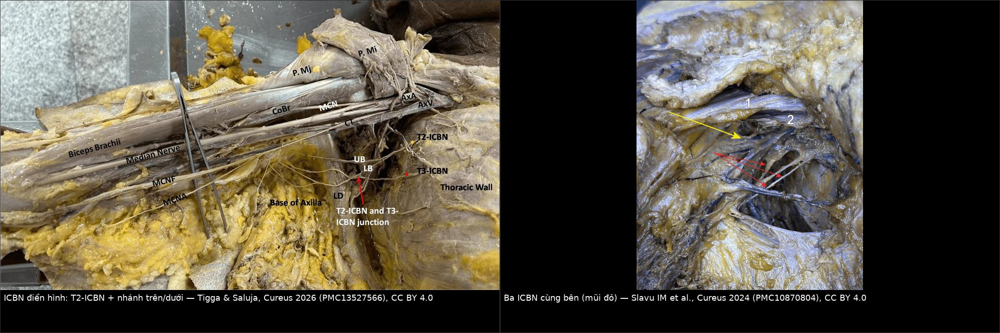
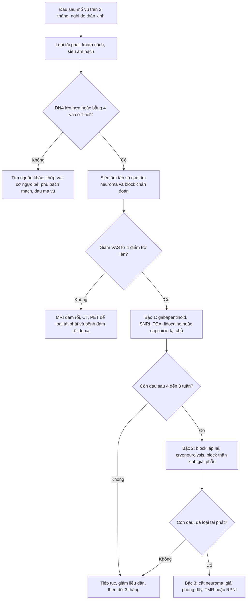
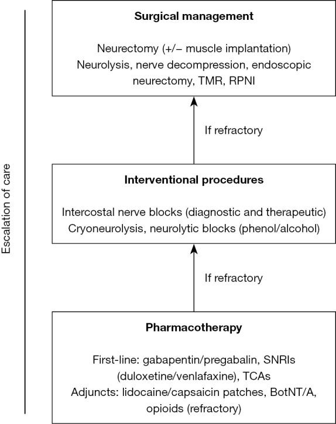
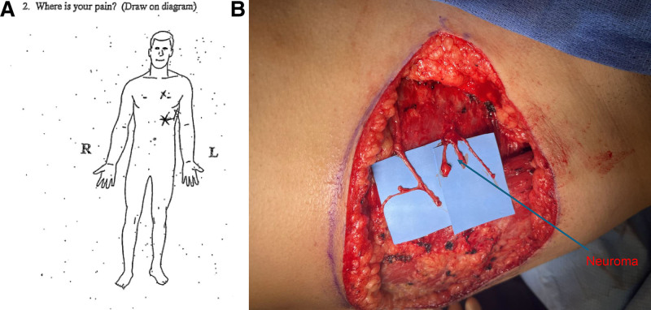
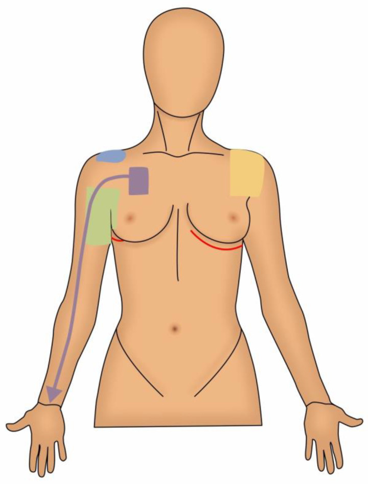
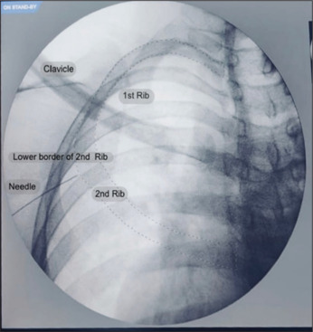

# 1619 — Đau thần kinh sau điều trị ung thư vú / Intercostobrachial neuralgia & post-mastectomy pain syndrome (PMPS)

**Tags:** `pattern:dau-than-kinh` `pattern:neuroma` `pattern:ton-thuong-day-than-kinh` `vung:vu` `vung:ho-nach` `score:DN4` `protocol:sieu-am-than-kinh` `protocol:block-than-kinh`
**Mức chắc chắn (certainty):** tổng hợp y văn (literature synthesis) — biên từ 6 nguồn toàn văn mở: tổng quan định khu nguồn đau sau điều trị ung thư vú (PMC8534110, CC BY 4.0), tổng quan chẩn đoán–điều trị đau thần kinh sau mổ vú (PMC11666212, CC BY-NC-ND), thuật toán bậc thang đau thần kinh liên sườn (PMC13459936, CC BY-NC-ND), cohort đau hỗn hợp (PMC13124505, CC BY 4.0), meta-analysis bảo tồn ICBN (PMC10849353, CC BY-NC-ND) và 2 nghiên cứu giải phẫu ICBN (PMC13527566, PMC10870804, CC BY 4.0). Không có ca nguyên văn duy nhất; các ca trong quiz là ca của nguồn, ghi rõ PMCID.

## 1. Tổng quan — dây thần kinh nào bị cắt, và TẠI SAO cắt nó lại gây đau

- **Giải phẫu:** dây thần kinh liên sườn–cánh tay (intercostobrachial nerve — ICBN) là **nhánh da bên của dây liên sườn 2 (T2)**, chui qua cơ răng trước, băng ngang hố nách rồi cấp cảm giác cho **da hố nách và mặt sau–trong cánh tay trên** (PMC8534110). Biến thể thường gặp: nhánh T3 góp vào, **nhiều nhánh ICBN cùng bên** (đã ghi nhận 3 nhánh — PMC10870804), và nhánh bắt chéo tới tận **mặt duỗi cẳng tay** — giải thích vì sao đau có thể lan **dưới khuỷu** (PMC8534110).
- **Tần suất tổn thương:** trong vét hạch nách (axillary lymph node dissection — ALND), ICBN bị cắt/rách **80–100%** ca (PMC8534110, PMC10849353) vì nó nằm ngay trong bó mỡ–hạch cần lấy. Đây là lý do **ALND là yếu tố nguy cơ mạnh nhất** của hội chứng đau sau mổ vú (post-mastectomy pain syndrome — PMPS).
- **Bệnh học — hai cơ chế, hai hình thái đau:**
  1. **U thần kinh (neuroma) do cắt ngang:** đầu dây bị cắt không được nối → sợi trục mọc lộn xộn thành **khối neuroma đầu tận (terminal neuroma)**, mô đệm và bao dây thần kinh bị phá vỡ.
  2. **Neuroma tại chỗ (neuroma-in-continuity) do dây còn nguyên nhưng bị sẹo/vật liệu mổ chèn:** dây liên tục nhưng bị ép trong mô xơ → thiếu máu cục bộ + viêm mạn.
- **TẠI SAO neuroma lại đau (cơ chế vật lý – điện sinh lý):** sợi trục tái sinh tập trung **kênh natri Nav1.7/Nav1.8** và thụ thể cơ học ở chỗ mọc → màng trở nên **dễ bị kích thích cơ học và hóa học**, tự phát xung (ectopic firing). Vì vậy **gõ nhẹ lên neuroma là đủ gây cơn đau điện giật** = dấu hiệu Tinel; và **ấn đầu dò siêu âm** lên đúng vị trí cũng tái tạo triệu chứng ("ultrasound trigger sign" — PMC8534110). Đau kéo dài làm thay đổi dẫn truyền ở sừng sau và vỏ não → **cảm ứng trung ương (central sensitization)**, nên bệnh nhân đau cả khi tổn thương ngoại vi đã "ổn định".
- **TẠI SAO hình ảnh khó:** neuroma chỉ vài mm, nằm trong mô xơ–mỡ sau mổ; **MRI và nhũ ảnh từng bỏ sót tổn thương**, **siêu âm tần số cao là phương thức tốt nhất nhưng vẫn hạn chế** (PMC8534110). Vì thế chẩn đoán là **lâm sàng + block chẩn đoán**, hình ảnh dùng để **loại trừ tái phát**, không phải để "thấy neuroma rồi mới chẩn đoán".
- **Số liệu nằm lòng:**
  - PMPS gặp ở **20–40%** người mổ vú (PMC11666212); các tổng quan khác ghi **25–60%** (PMC10849353) và **12–72%** tùy định nghĩa (PMC8534110); cohort lớn nhất theo định nghĩa đau ≥ 3 tháng: **28,2%** (PMC11032178 dẫn).
  - Đau mạn sau mổ lồng ngực/vú nói chung: **~38% ở 12 tháng**, trong đó **29–33% có thành phần thần kinh** (PMC13459936).
  - Trong nhóm **khó trị** ở phòng khám đau chuyên khoa (n = 120): **đau cảm thụ 40,8% – đau thần kinh thuần 25,0% – đau HỖN HỢP 34,2%**; đau hỗn hợp liên quan **≥ 2 nguồn đau cùng lúc (aOR 49,96; KTC 11,69–213,41)** và **đau do xạ (aOR 5,75; KTC 1,15–28,82)** (PMC13124505).
  - **Đau ma vú (phantom breast pain): 11,8–13,6% ở 1 năm**, có báo cáo tới **40–50%**; thể không đau (phantom sensation) còn thường gặp hơn (PMC8534110).
  - Bệnh nhân đau thần kinh liên sườn trung bình **gặp 5 bác sĩ** trước khi được chẩn đoán đúng (PMC13459936).
- **Định nghĩa dùng trong thực hành:** IASP — đau bắt đầu ngay hoặc sớm sau mổ, khu trú **ngực trước, hố nách và/hoặc mặt trong cánh tay trên**, kéo dài **≥ 3 tháng**. Waltho & Rockwell chặt hơn: **≥ 6 tháng, xuất hiện ≥ 50% thời gian, mức độ ≥ trung bình, có tính chất thần kinh**, tăng khi vận động đai vai (PMC8534110). Vì định nghĩa khác nhau, **con số dịch tễ chỉ dùng để ước lượng, không dùng để chốt ca**.

## 2. Mẫu hình + chẩn đoán phân biệt theo vị trí (Gamut)

- **Mẫu hình cốt lõi (pattern):** đau **bỏng rát/điện giật** theo **dải khoanh da** ở hố nách → mặt trong cánh tay, kèm **dị cảm, tăng cảm đau (allodynia)**, **Tinel dương tính**, và **đau tăng khi giơ tay qua đầu** (dấu hiệu gợi ý neuroma ICBN — PMC11666212). Đau **không theo động tác khớp**, không sốt, không khối.
- **Gamut theo vị trí (định khu bằng bản đồ đau — xem sơ đồ ở quiz Ca 2):**
  - **Hố nách + mặt trong cánh tay trên:** tổn thương ICBN (cắt trong ALND, neuroma, sẹo chèn).
  - **Dọc sẹo ngực/đường mổ, nhiều điểm đau khu trú:** neuroma nhánh da trước/bên của các dây liên sườn **T3–T6** — đây là nguồn hay bị bỏ sót vì đau **không** ở nách.
  - **Ngực trước – vai trước, đau tăng khi đẩy vai ra trước:** hội chứng cơ ngực bé (pectoralis minor syndrome) / lối thoát ngực thần kinh.
  - **Vai ngoài, đau khi giơ tay ngang vai:** chạm mỏm cùng vai (shoulder impingement).
  - **Vai lan tỏa, đau đêm, hạn chế mọi hướng:** viêm bao khớp dính (adhesive capsulitis / frozen shoulder).
  - **Vùng cổ – vai – mặt sau:** rễ cổ (cervical radiculopathy), đau cân cơ (myofascial).
  - **Vú đã cắt, đau "trong vú không còn":** đau ma vú (phantom breast pain).
  - **Cánh tay nặng, phù, không đau theo dải:** phù bạch mạch (bài 593); **dải xơ căng dưới nách:** hội chứng dây nách (bài 599); **yếu + dị cảm lan, nhiều năm sau xạ:** bệnh đám rối do xạ (bài 1617).
- **Mnemonic 5N cho đau sau mổ vú:** **N**euroma (ICBN/T3–T6), **N**erve entrapment (sẹo, pectoralis minor), **N**eoplasm (tái phát hạch/xâm lấn), **N**europathy do xạ/hóa trị, **N**on-neuropathic (khớp vai, cân cơ, phù bạch mạch, đau ma).
- **Phải loại trừ trước tiên — tái phát:** mọi đau nách mới/khác tính chất ở người đã mổ ung thư vú đều phải **khám hố nách + siêu âm**, vì "đau do sẹo" và "hạch tái phát" có thể cùng tồn tại.

## 3. Bảng so sánh phân biệt (ma trận đối chiếu)

| Thực thể (entity) | Hình ảnh / lâm sàng điển hình | Chốt vào (rule-in) | Chốt loại (rule-out) | Gợi ý xác nhận |
|---|---|---|---|---|
| **Đau ICBN do cắt/neuroma** | Đau bỏng–điện giật **hố nách → mặt trong cánh tay**, dị cảm, **Tinel ở phần gần–trong cánh tay**, đau tăng khi giơ tay qua đầu; US: dây **dày, giảm âm**, có thể thấy **khối neuroma nhỏ**, ấn đầu dò tái tạo đau | **Phân bố đúng khoanh da T2 + Tinel + giảm đau ≥ 4/10 sau block ICBN** | Đau lan ra ngoài khoanh da, không đổi sau block, có khối hạch → không phải ICBN đơn thuần | Block chẩn đoán (bupivacaine ± corticoid); US tần số cao |
| **Neuroma nhánh da liên sườn T3–T6** | Đau khu trú **dọc sẹo**, điểm đau nhói khi ấn; Tinel tại sẹo; US có thể thấy **nốt giảm âm nhỏ trong mô dưới da** | **Điểm đau khu trú + Tinel tại sẹo + giảm ≥ 4/10 sau tiêm tại điểm đau** | Đau lan tỏa toàn ngực, không điểm khu trú → nghĩ cơ–khớp/xạ | Tiêm điểm đau (trigger point) 2 mL bupivacaine 0,5% + dexamethasone 4 mg/mL |
| **Tái phát hạch / xâm lấn thành ngực** | **Khối** hạch nách, dày da, có thể đau; US: hạch **mất rốn mỡ, vỏ dày, tăng sinh mạch**; CT/MRI: khối ngấm thuốc; PET: FDG dương | **Khối + đặc điểm ác tính trên US/CT + FDG dương** | Chỉ dày dây thần kinh lan tỏa, không khối, không ngấm bất thường → nghiêng nguyên nhân thần kinh | US + sinh thiết lõi; PET/CT khi cần |
| **Bệnh đám rối cánh tay do xạ** | Nhiều năm sau xạ hạch; yếu cơ + dị cảm lan, **myokymia** trên EMG; MRI: đám rối dày, **không khối** | **Yếu cơ khách quan + myokymia (60% so với 4% do u)** | Chỉ đau da nông, cơ lực bình thường, Tinel khu trú → không phải plexopathy | MRI đám rối STIR + T1 sau tiêm; EMG (bài 1617) |
| **Hội chứng cơ ngực bé / lối thoát ngực** | Đau **vai trước – ngực trên**, tê ngón 4–5, đau tăng khi đẩy vai ra trước; nghiệm pháp căng cơ ngực bé dương | **Đau tái tạo bằng tư thế căng cơ ngực bé + đổi màu/tê tay** | Đau khu trú hố nách theo T2, không liên quan tư thế vai → loại | Khám tư thế, US động mạch dưới đòn khi giơ tay |
| **Viêm bao khớp dính (frozen shoulder)** | Đau vai **đêm**, hạn chế **cả động tác chủ động và thụ động**, đặc biệt xoay ngoài | **Mất vận động THỤ ĐỘNG + hạn chế xoay ngoài nổi bật** | Tầm vận động thụ động bình thường → không phải | Khám lâm sàng; MRI chỉ khi nghi tổn thương khác |
| **Phù bạch mạch** | Phù tay nặng lên khi gắng sức/nóng, **không đau theo dải**, không teo cơ | **Phù ≥ 2 cm chu vi so với tay đối diện + tiền sử ALND/xạ** | Không phù, đau theo khoanh da → loại | Đo chu vi, siêu âm mô mềm (bài 593) |

*Trái: ICBN điển hình sinh từ **T2-ICBN**, tách nhánh trên (UB) và dưới (LB), có nhánh T3 góp vào; phía trên là dây bì cánh tay trong (MCN) và bó bên (CoBr). Phải: **ba ICBN riêng biệt** cùng một hố nách (mũi đỏ) — vì sao "cắt một nhánh" không đồng nghĩa hết đau. Nguồn: Tigga & Saluja, Cureus 2026 (PMC13527566), CC BY 4.0; Slavu IM et al., Cureus 2024 (PMC10870804), CC BY 4.0. Ảnh ghép letterbox, không crop.*

### Ba dấu hiệu chốt đọc đúng (đừng bỏ qua)

- **Tinel:** gõ dọc đường đi của dây từ **nách xuống mặt trong cánh tay**; dương tính = dị cảm/đau điện giật lan theo khoanh da. Đây là dấu hiệu **rẻ nhất và mạnh nhất** cho neuroma, nhưng **không đặc hiệu** — sẹo đang viêm cũng có thể dương.
- **"Ultrasound trigger sign":** ấn đầu dò đúng vị trí neuroma tái tạo đúng cơn đau quen thuộc của bệnh nhân — có giá trị định vị trước tiêm/mổ (PMC8534110).
- **Block chẩn đoán:** giảm **≥ 4/10 điểm VAS** sau block ICBN được coi là **đáp ứng dương**, là tiêu chuẩn để cân nhắc can thiệp phẫu thuật (PMC11666212).

## 4. Protocol chụp – khám – can thiệp + thang điểm

**Bước 1 — lâm sàng có cấu trúc (không thay bằng hình ảnh):**
1. Vẽ **bản đồ đau** (pain diagram) và hỏi 3 câu phân biệt: đau **bỏng/điện giật** hay **đau âm ỉ do tư thế**? đau **hố nách + mặt trong tay** hay **vai**? **tăng khi giơ tay qua đầu**?
2. **DN4** (douleur neuropathique 4): **≥ 4/10** = có thành phần đau thần kinh; hoặc **painDETECT ≥ 19** = khả năng đau thần kinh cao. Ghi điểm vào hồ sơ để so sánh trước–sau điều trị.
3. Khám cảm giác (châm, lạnh, chải) theo khoanh da, **Tinel**, tầm vận động **thụ động** vai (loại frozen shoulder), đo chu vi tay (loại phù bạch mạch), sờ hố nách (loại hạch).

**Bước 2 — siêu âm tần số cao (phương thức tốt nhất cho neuroma):**
- Đầu dò **tuyến tính 12–18 MHz** (mô mềm nông); quét **hố nách → mặt trong cánh tay trên**, cả **hai bên** để so sánh.
- Định vị ICBN: từ **bờ dưới xương sườn 2** đi ra ngoài vào hố nách (đường vào block kinh điển — Hình quiz Ca 3); dây nằm **nông, giữa mô mỡ dưới da và cân cơ răng trước**.
- Dấu hiệu dương: dây **dày, giảm âm**, mất cấu trúc ống sợi; **khối giảm âm dạng nốt** ở đầu dây cắt = neuroma; **ấn đầu dò tái tạo đau**.
- Đo **diện tích cắt ngang (CSA)** và so với bên đối diện; **chưa có ngưỡng CSA chuẩn hóa cho ICBN** — ghi nhận "chưa rõ, cần tra" thay vì bịa số.
- **Luôn khảo sát hạch nách cùng lúc**: hạch mất rốn mỡ, vỏ dày, tăng sinh mạch → phải loại tái phát trước khi quy mọi đau cho "neuroma".

**Bước 3 — block chẩn đoán/điều trị (dưới siêu âm):**
- ICBN: đường vào **dưới cơ ngực – khoang liên sườn 2** (subpectoral intercostal plane), kim in-plane tới **bờ dưới xương sườn 2, ngay phía trong tĩnh mạch nách** (không nhắm vào một mặt phẳng); thể tích dùng trong nghiên cứu là **15 mL** — thể tích thấp có tỷ lệ thành công thấp, và **60 ca không ghi nhận độc tính thuốc tê** (PMC12377550).
- Điểm đau dọc sẹo (T3–T6): **2 mL hỗn hợp 1:1 bupivacaine 0,5% + dexamethasone 4 mg/mL**, sau tiêm xoa 1–2 phút (PMC8534110).
- Đánh giá đáp ứng **sau 30–60 phút** bằng VAS: **giảm ≥ 4/10 = dương**; ghi thời gian giảm đau (≥ 4 tuần có ý nghĩa tiên lượng).

**Bước 4 — hình ảnh loại trừ (chỉ khi block không đáp ứng hoặc lâm sàng đổi):**
- **MRI vùng nách/đám rối**: STIR + T1 sau gadolinium — tìm khối tái phát, dày đám rối do xạ (bài 1617).
- **CT ngực–nách có cản quang** khi cần đánh giá thành ngực/xương; **PET/CT** khi nghi tái phát mà CT chưa rõ.
- **Không** dùng MRI để "tìm neuroma": độ phân giải không đủ, đã bỏ sót tổn thương (PMC8534110).

**Thang bậc điều trị (theo PMC13459936 + PMC11666212):**

*Bậc 1 (thuốc): gabapentin/pregabalin, SNRI (duloxetine/venlafaxine), TCA; bổ trợ lidocaine/capsaicin tại chỗ, BotNT/A, opioid khi kháng trị. Bậc 2 (can thiệp): block liên sườn chẩn đoán–điều trị, cryoneurolysis, block tiêu hủy thần kinh (phenol/cồn). Bậc 3 (phẫu thuật): cắt neuroma ± chôn vào cơ, giải phóng dây, cắt neuroma nội soi, TMR, RPNI. Nguồn: Shamoun V et al., J Thorac Dis 2026 (PMC13459936), CC BY-NC-ND — nguyên bản.*

**Số liệu hiệu quả để tư vấn (không hứa trước kết quả):**
- Block ICBN: cải thiện đau **33–100%**, kéo dài **≥ 4 tuần đến 6 tháng** trong các loạt ca nhỏ (PMC8534110).
- Tiêm điểm đau: **72,3%** điểm đau giảm **> 3 tháng** sau một mũi; một loạt khác **92%** đạt giảm đau bền vững ≥ 3 tháng, **72%** chỉ cần một mũi (theo dõi trung bình **44 tháng**) (PMC8534110, PMC11032178).
- **Cắt neuroma (neurectomy): thành công > 80%** trong nhiều loạt ca; TMR/RPNI là kỹ thuật mới, dữ liệu còn nhỏ (PMC13459936).
- **Bảo tồn ICBN khi mổ:** giảm **tê/dị cảm** (OR 0,33; KTC 0,16–0,68) và **mất cảm giác** (OR 0,50; KTC 0,31–0,82), **nhưng KHÔNG giảm đau** (OR 0,68; KTC 0,28–1,61; p = 0,38) và làm **tăng cảm giác quá mức** (OR 4,34; KTC 1,43–13,15) — meta-analysis 11 nghiên cứu, **1.021 bệnh nhân** (PMC10849353). Đây là điểm phản biện quan trọng: **giữ dây không đồng nghĩa hết đau**.

## 5. Biến thể bình thường và cạm bẫy

- **Biến thể giải phẫu — nguyên nhân "đã cắt dây mà vẫn đau":** ICBN có thể **nhiều nhánh** (3 nhánh — PMC10870804), có **nhánh T3 góp**, hoặc nhánh bì cánh tay trong (MCN) thay thế một phần vùng cảm giác. Vì vậy phẫu thuật viên có thể bảo tồn "một ICBN" mà vẫn còn nhánh khác bị cắt.
- **Tê sau mổ là bình thường, đau mới là bệnh:** giảm cảm giác vùng nách/mặt trong tay gặp ở **37,5%** ca bảo tồn dây và **71,7%** ca cắt dây (PMC10849353) — **tê đơn thuần không được chẩn đoán PMPS**; cần đau có tính chất thần kinh + ảnh hưởng chức năng.
- **Đau lan dưới khuỷu không loại trừ ICBN:** do nhánh nối với dây bì cánh tay trong và biến thể tới mặt duỗi cẳng tay (PMC8534110) — đừng vội đổi sang chẩn đoán "bệnh đám rối".
- **Cạm bẫy hình ảnh:** hạch nách nhỏ cạnh sẹo **không được** gọi là "neuroma" khi chưa khảo sát rốn mỡ/vỏ hạch; ngược lại, **neuroma giảm âm** dễ bị đọc thành "hạch nghi ngờ" và dẫn tới sinh thiết không cần. Luôn đặt câu hỏi: tổn thương **có rốn mỡ không**, **có ngấm thuốc bất thường không**, **ấn có tái tạo đau không**.
- **Cạm bẫy "thỏa mãn tìm kiếm":** tìm thấy một neuroma ở sẹo rồi dừng → bỏ sót **hạch tái phát** hoặc **hội chứng cơ ngực bé** cùng tồn tại. Cohort khó trị cho thấy **34,2%** là đau **hỗn hợp**, với **≥ 2 nguồn đau** làm tăng khả năng này **~50 lần** (aOR 49,96) (PMC13124505).
- **Cạm bẫy xạ:** đau do xạ là yếu tố liên quan độc lập của đau hỗn hợp (aOR 5,75); xơ hóa do xạ có thể **chèn dây** hoặc gây **bệnh đám rối** — đừng quy tất cả cho "sẹo mổ".
- **Cạm bẫy opioid:** **10,4%** người chưa dùng opioid trước mổ vẫn dùng opioid mới kéo dài sau mổ; tăng **15–21%** nếu có hóa trị bổ trợ (PMC8534110) — cần kế hoạch giảm liều, không chỉ tăng liều.
- **Cạm bẫy phẫu thuật:** cắt neuroma mà **không xử lý đầu dây tận** (không chôn vào cơ/TMR/RPNI) → **tái phát neuroma**; đây là lý do TIM đơn thuần có tỷ lệ tái phát cao hơn TMR (PMC11666212).

## 6. Tự lượng giá — Blind Quiz

**Ca 1 — Nữ 48 tuổi, 6 tháng sau cắt toàn bộ tuyến vú + vét hạch nách trái, đau bỏng mặt trong cánh tay, giơ tay qua đầu thì đau tăng.**

- Gợi ý: không sờ thấy hạch, không phù tay; gõ dọc nách → dị cảm lan xuống mặt trong cánh tay.
- Câu hỏi: (1) Dấu hiệu nào trên hình A gợi ý nguồn đau? (2) Ba chẩn đoán phân biệt cần loại trừ? (3) Bước tiếp theo rẻ nhất mà có giá trị chốt?

<b>Bấm để hiện đáp án (findings + chẩn đoán)</b>

- **Findings:** hình A — bệnh nhân tự đánh dấu **X ở hố nách và dọc sẹo ngực**, đúng phân bố ICBN và các nhánh da liên sườn; hình B — **neuroma thực sự** (mũi xanh) ở đầu dây thần kinh trong mô mỡ dưới da, phải cắt bỏ và chôn đầu dây.
- **Chẩn đoán:** **đau thần kinh sau mổ vú do tổn thương ICBN ± neuroma nhánh da liên sườn** — cơ chế: sợi trục tái sinh tập trung kênh natri → tự phát xung, gõ/ấn là đủ gây đau.
- **Loại trừ:** (1) **tái phát hạch nách** — siêu âm hạch; (2) **bệnh đám rối do xạ** — yếu cơ + myokymia; (3) **hội chứng cơ ngực bé / frozen shoulder** — khám tư thế và tầm vận động thụ động.
- **Bước chốt rẻ nhất:** **Tinel + DN4**, rồi **block ICBN dưới siêu âm**; giảm **≥ 4/10 VAS** = dương, chỉ khi đó mới cân nhắc can thiệp.
- Nguồn: Bejar-Chapa M et al., *Plast Reconstr Surg Glob Open* 2024 (PMC11666212), CC BY-NC-ND — ảnh dùng nguyên bản.

**Ca 2 — Nữ 61 tuổi, 2 năm sau mổ vú phải, đau vai phải lan lên cổ, không đau ở nách. Bản đồ đau dưới đây do bệnh nhân vẽ.**

- Gợi ý: đau tăng khi đẩy vai ra trước, tê ngón 4–5 khi giơ tay cao; không có Tinel ở nách.
- Câu hỏi: Vùng màu nào trên sơ đồ phù hợp nhất với bệnh cảnh? Vì sao "đau sau mổ vú" không đồng nghĩa "PMPS do ICBN"?

<b>Bấm để hiện đáp án (findings + chẩn đoán)</b>

- **Findings:** đau thuộc vùng **tím (cơ ngực bé / lối thoát ngực thần kinh)** và **xanh dương (chạm mỏm cùng vai)**; **không** thuộc vùng **xanh lá (ICBN)** — vùng xanh lá là hố nách và mặt trong cánh tay, đúng khoanh da T2.
- **Chẩn đoán:** **hội chứng cơ ngực bé ± chạm mỏm cùng vai**, không phải đau ICBN. Cơ chế: cơ ngực bé chèn ép đám rối dưới đòn → đau vai trước, tê ngón 4–5; khác hoàn toàn đau da nông theo dải T2.
- **Vì sao quan trọng:** điều trị ngược nhau — ICBN cần block/neuroma; cơ ngực bé cần **giãn cơ, sửa tư thế, block cơ ngực bé**. Nhầm hướng → tiêm/mổ vô ích.
- **Số liệu:** hội chứng cơ ngực bé chiếm **22,6%** ca được giới thiệu vì lối thoát ngực và là **nguyên nhân chèn ép duy nhất ở 6,1%** (PMC8534110 dẫn).
- Nguồn: Chang PJ, Asher A, Smith SR, *Cancers* 2021 (PMC8534110), CC BY 4.0.

**Ca 3 — Bệnh nhân đau nách kéo dài, được chỉ định block chẩn đoán. Ảnh huỳnh quang dưới đây cho thấy đầu kim.**

- Gợi ý: xương đòn và xương sườn 1–2 được đánh dấu; kim đi từ trước ra sau.
- Câu hỏi: Vì sao chọn **bờ dưới xương sườn 2**? Sau block, con số nào xác nhận "dương tính"? Nếu block âm tính thì làm gì?

<b>Bấm để hiện đáp án (findings + chẩn đoán)</b>

- **Vì sao bờ dưới xương sườn 2:** ICBN là **nhánh da bên của dây liên sườn T2**, nằm ngay dưới bờ xương sườn 2 khi vào hố nách; block tại đây chặn ICBN **trước khi nó phân nhánh** vào da nách/cánh tay. Cùng mốc này dùng được cho **block mặt phẳng răng trước nông** thay thế (PMC8534110).
- **Ngưỡng dương tính:** **giảm ≥ 4/10 điểm VAS** so với trước block (PMC11666212); ghi cả **thời gian kéo dài** — giảm ≥ 4 tuần là dấu hiệu tiên lượng tốt cho can thiệp.
- **Nếu âm tính:** không mổ — chuyển hướng **MRI đám rối/CT/PET loại tái phát**, khám lại khớp vai và cơ ngực bé, đánh giá lại DN4. Block âm tính là thông tin **loại trừ**, không phải thất bại.
- **Cảnh báo:** block chỉ chẩn đoán/giảm đau tạm; **không thay thế việc loại trừ tái phát** ở người đã mổ ung thư vú.
- Nguồn: Kingslin S, Bini SV, Cyriac M, *Indian J Anaesth* 2025 (PMC12377550), CC BY-NC-SA — ảnh nguyên bản.

## Bài liên quan chéo
- [1617 – Bệnh đám rối cánh tay do xạ](../1617-benh-dam-roi-can-tay-do-xa/lesson.md) (yếu cơ + myokymia, phân biệt với đau da nông)
- [599 – Hội chứng dây nách & phù bạch mạch](../599-day-nach-axillary-web-syndrome/lesson.md) (dải xơ cơ học, không theo khoanh da)
- [593 – Phù bạch mạch chi trên sau điều trị ung thư vú](../593-phu-bach-mach-chi-tren-sau-dieu-tri-ung-thu-vu/lesson.md) (phù tay, chẩn đoán phân biệt)
- [598 – Xạ trị vùng hạch sau ung thư vú](../598-xa-tri-vung-hach-sau-ung-thu-vu/lesson.md) (nguồn xạ vào nách/đám rối)
- [522 – Theo dõi sau điều trị ung thư vú & tái phát muộn](../522-theo-doi-sau-dieu-tri-ung-thu-vu/lesson.md) (bối cảnh "đau mới sau mổ")
- [589 – Sinh thiết hạch gác nách (TAD)](../589-sinh-thiet-hach-gac-nach-targeted-axillary-dissection/lesson.md) (nguồn tổn thương ICBN trong mổ)

## Ảnh
- 6 ảnh gốc + 1 ảnh ghép; giấy phép từng ảnh trong `images/CREDITS.md` (3 ảnh CC BY 4.0, 1 CC BY-NC-SA, 2 CC BY-NC-ND dùng **nguyên bản không chỉnh sửa**).
- Ảnh ghép `composite_1619_giai-phau-ICBN-thuong-vs-bien-the.jpg` tạo bằng `tools/make_composite.py` (letterbox, giữ tỷ lệ, dải attribution), chỉ ghép 2 ảnh **CC BY 4.0**.
- Ảnh `1619_phau-thuat-neuroma_...` và `1619_thuat-toan-bac-thang_...` là **CC BY-NC-ND** → không crop, không ghép, giữ nguyên bố cục gốc.

> Không dùng để chẩn đoán độc lập khi chưa có người hướng dẫn.
