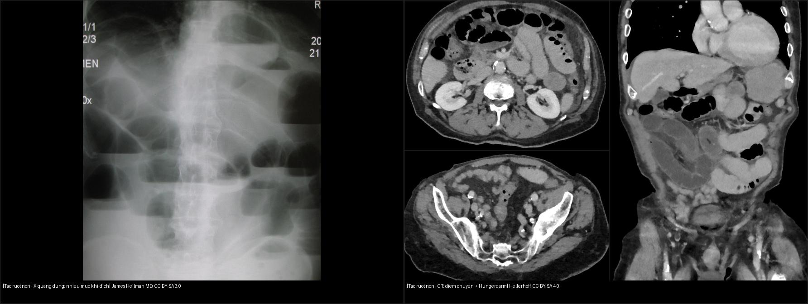
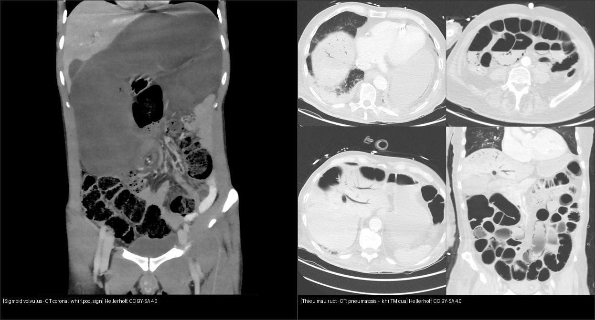
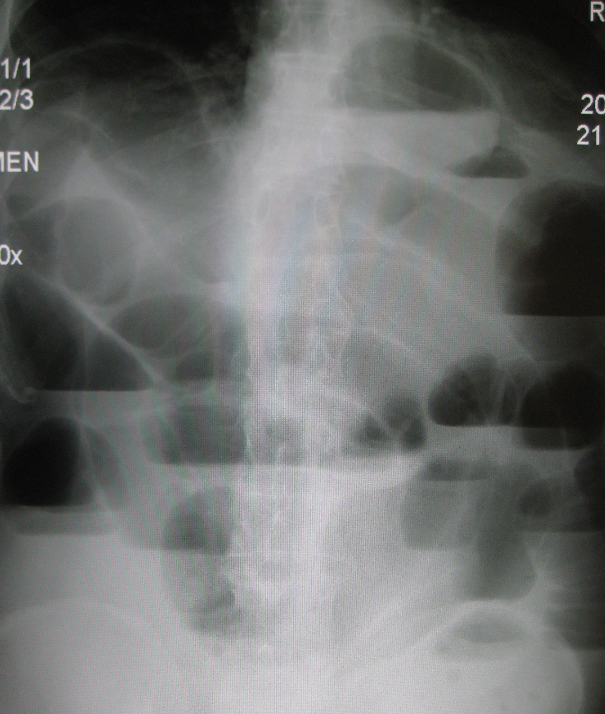
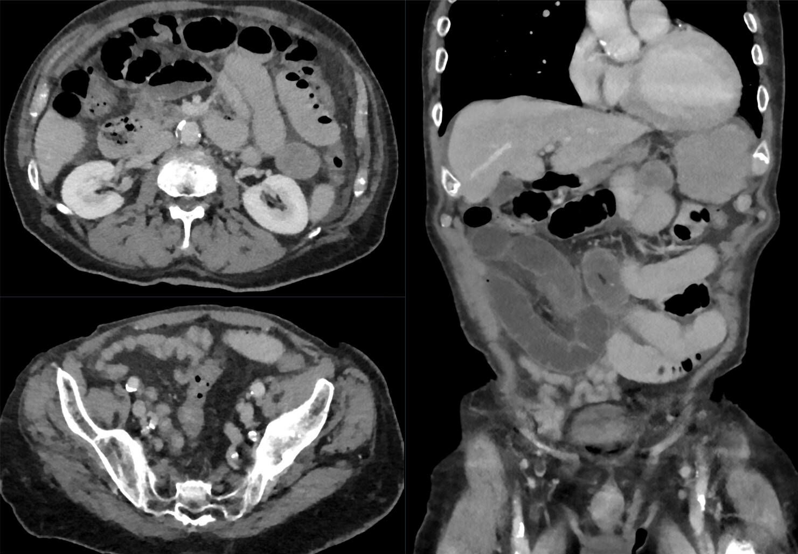
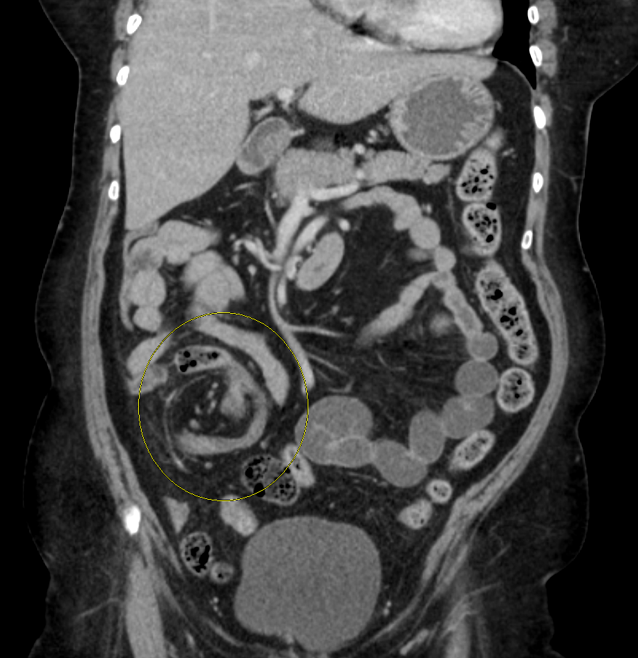
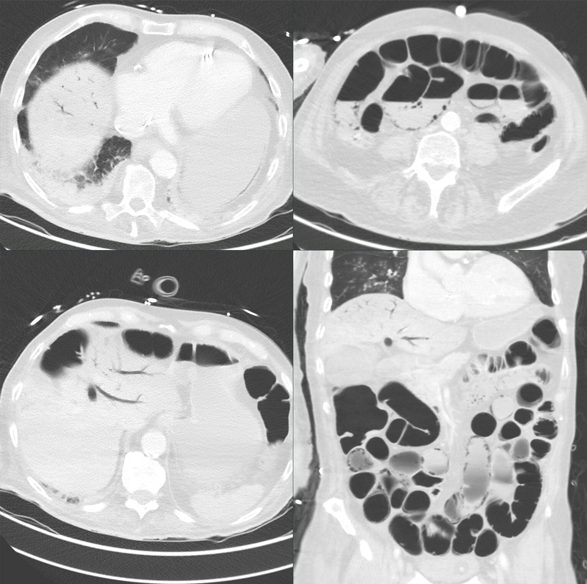

# 162 — Tắc ruột non/già, quai kín & thiếu máu mạc treo / SBO & Ischemia

**Tags:** `pattern:tac-ruot` `vung:ruot` `protocol:CT-bung-cap`
**Mức chắc chắn (certainty):** tổng hợp y văn (literature synthesis) — nhóm tự biên từ y văn mở, chưa gắn ca nguyên văn đơn lẻ.

## 1. Tổng quan — điểm chuyển tiếp + quai kín + mất ngấm

- Tắc ruột non: quai giãn **> 2,5–3,0 cm** (đại tràng > 6 cm, manh tràng > 9 cm là báo động vỡ!) + xẹp hạ lưu + **điểm chuyển tiếp** + dấu phân ruột non (small bowel feces) ngay trước điểm chuyển. TẠI SAO tìm điểm chuyển + Laplace (áp lực thành ∝ áp suất × bán kính): quai càng to càng dễ vỡ, nguyên nhân quyết định mổ hay không.
- Chuỗi thiếu máu thành ruột: niêm mạc → xuyên thành (transmural) — TẠI SAO mất ngấm + pneumatosis + khí cửa là muộn: niêm mạc chết trước, vỏ gan khí < 2 cm là máu tĩnh mạch chết dội về.
- **Quai kín:** đoạn ruột tắc 2 đầu (U/C) + **xoắn mạch (whirl)** + 2 mỏ chim — nguy cơ hoại tử cao gấp bội.
- **Thiếu máu:** **mất ngấm thành** + phù mạc treo + khí thành (pneumatosis) + khí TM cửa (sát vỏ gan < 2 cm) = mổ tối khẩn.

## 2. Gamut chướng + nôn + bí trung đại tiện

- **Dính sau mổ:** điểm chuyển + không khối — thử bảo tồn (sonde + nhịn ăn) nếu không thiếu máu.
- **Quai kín/xoắn:** whirl + chữ C + mất ngấm — mổ ngay.
- **Tắc ruột già (u):** đại tràng giãn + hẹp đột ngột (apple-core) — stent/mổ.
- **Liệt ruột:** giãn lan tỏa không điểm chuyển + sau mổ/nhiễm trùng — nội khoa.

## 3. Bảng mổ-theo dõi

| Thực thể (entity) | Hình ảnh | Chốt vào (rule-in) | Chốt loại (rule-out) | Gợi ý xác nhận |
|---|---|---|---|---|
| SBO dính đơn thuần | **> 2,5 cm + điểm chuyển + phân ruột + còn ngấm** | **Điểm chuyển + ngấm còn** | Mất ngấm/whirl → quai kín | Bảo tồn + sonde + theo dõi |
| Quai kín | **U/C + whirl + 2 mỏ chim (beak)** | **Xoắn mạch = hoại tử cao** | Còn ngấm + không whirl → đơn thuần | **Mổ ngay** |
| Thiếu máu mạc treo | **Mất ngấm + pneumatosis + khí TM cửa** | **Mất ngấm là chốt (xuyên thành!)** | Còn ngấm → chưa hoại tử | **Mổ tối khẩn** |
| Tắc ruột già do u | **Apple-core + đại tràng > 6 cm** | **Hẹp ác tính + manh tràng > 9 cm = vỡ!** | Không điểm chuyển → liệt | Stent/mổ |

*Trái: X-quang đứng — nhiều quai giãn với mức khí-dịch ngang (air-fluid levels). Nguồn: James Heilman MD, CC BY-SA 3.0. Phải: CT (axial + coronal) tắc non do dính — **quai trên giãn "đói" (Hungerdarm) rồi đổi cỡ đột ngột tại điểm chuyển**. Nguồn: Hellerhoff, CC BY-SA 4.0. Ảnh ghép letterbox.*

*Trái: sigmoid volvulus — CT coronal có **dấu whirlpool** (mạc treo xoáy). Nguồn: Hellerhoff, CC BY-SA 4.0. Phải: thiếu máu mạc treo — CT cửa sổ phổi thấy **pneumatosis** (khí trong thành ruột) + **khí tĩnh mạch cửa** (nhánh khí hình cành cây trong gan). Nguồn: Hellerhoff, CC BY-SA 4.0. Ảnh ghép letterbox.*

### Dấu hiệu chốt cần nhớ
- **Điểm chuyển tiếp (transition point):** nơi quai giãn chuyển đột ngột sang quai xẹp — mấu chốt chẩn đoán tắc **cơ học** (khác liệt ruột giãn lan tỏa, không điểm chuyển).
- **Dấu phân ruột non (small bowel feces sign):** bã phân trộn bọt khí ngay trên điểm chuyển — xác nhận tắc mạn/dính.
- **Quai kín (closed loop):** đoạn ruột **tắc cả hai đầu** → hình **U/C**, **whirlpool**, **2 mỏ chim (beak)** — nguy cơ xoắn mạch/hoại tử cao, **mổ ngay**.
- **Xoắn đại tràng:** sigmoid → "coffee bean/coffee cup" (whirlpool); manh tràng → quai lớn di lệch sang trái trên, có whirlpool.
- **Thiếu máu xuyên thành:** **mất ngấm thành ruột** (tăng HU sau tiêm **< 20 HU** so với trước) + **pneumatosis** + **khí TM cửa** (nhánh khí trong gan) = mổ tối khẩn.

## 4. Protocol CT bụng cấp

- Cản quang TM thì cửa + MPR (điểm chuyển, whirl, mạch mạc treo).
- Không uống cản quang thường quy; theo dõi quai + dịch tự do tăng dần.

## 5. Cạm bẫy

- **Thoát vị bịt (obturator)** ở cụ bà gầy — tìm lỗ bịt khi SBO không rõ nguyên nhân.
- **Khí TM cửa lành tính** sau nội soi/bóng — bối cảnh + mất ngấm mới mổ.
- **Liệt ruột sau mổ sớm** tưởng tắc cơ học — không điểm chuyển = nội khoa.
- **Thành ruột tăng tỷ trọng sẵn thì không tiêm giả còn ngấm** — xuất huyết nội thành làm HU nền cao nên thì tĩnh mạch vẫn sáng! Luôn so tăng HU 2 thì (tăng < 20 HU = không ngấm thật = hoại tử!).

## 6. Tự lượng giá — Blind Quiz

**Ca 1 — Bà cụ đau quặn bụng, nôn, bí trung đại tiện, có sẹo mổ cũ. X-quang đứng dưới đây.**

- Gợi ý lâm sàng (clinical context): đau cơn, nôn, chướng, tiền sử mổ bụng.
- Câu hỏi: Mô tả dấu hiệu chính? Đây là tắc cao hay thấp? Chẩn đoán hàng đầu + bước tiếp theo?

<b>Bấm để hiện đáp án (findings + chẩn đoán)</b>

- Dấu hiệu (findings): nhiều quai ruột giãn với **mức khí-dịch ngang (air-fluid levels)** trên phim đứng.
- Chẩn đoán (diagnosis): **tắc ruột non** — nghĩ **dính sau mổ**; X-quang chỉ gợi ý, **CT bụng cấp** để tìm điểm chuyển/quai kín/mất ngấm.
- Nguồn ảnh: James Heilman MD, Wikimedia Commons, CC BY-SA 3.0.

**Ca 2 — CT tắc non do dính (chưa mất ngấm). Mổ hay theo dõi?**

- Câu hỏi: Tìm điểm chuyển? Có dấu hiệu mất ngấm/quai kín không? Xử trí?

<b>Bấm để hiện đáp án (findings + chẩn đoán)</b>

- Dấu hiệu (findings): **quai non giãn "đói" (Hungerdarm)** phía trên + **điểm chuyển đổi cỡ đột ngột** do dải dính; thành ruột **còn ngấm**, không whirlpool, không pneumatosis.
- Chẩn đoán (diagnosis): **tắc ruột non dính đơn thuần** → **bảo tồn** (sonde mũi-dạ dày + nhịn ăn + bù dịch) và theo dõi sát; mổ khi xuất hiện dấu hiệu "gắt" (mất ngấm, quai kín, dịch tăng).
- Nguồn ảnh: Hellerhoff, Wikimedia Commons, CC BY-SA 4.0.

**Ca 3 — CT coronal: khối ruột xoáy kèm manh tràng di lệch. Đây là gì?**

- Câu hỏi: Nhận diện dấu hiệu? Tắc ruột non hay đại tràng? Cấp cứu hay không?

<b>Bấm để hiện đáp án (findings + chẩn đoán)</b>

- Dấu hiệu (findings): quai ruột xoáy (**whirlpool** — vòng vàng) + **manh tràng/đại tràng phải di lệch** bất thường; quai giãn lớn.
- Chẩn đoán (diagnosis): **xoắn manh tràng (cecal volvulus)** — tắc ruột già, nguy cơ thiếu máu; xử trí tùy hoại tử (**nội soi hạ quai** hay **mổ cắt**).
- Nguồn ảnh: James Heilman MD, Wikimedia Commons, CC BY-SA 4.0.

**Ca 4 — CT bụng đau dữ dội, nhiễm trùng nặng. Đọc cửa sổ phổi.**

<b>Bấm để hiện đáp án (findings + chẩn đoán)</b>

- Dấu hiệu (findings): **pneumatosis intestinalis** (khí trong thành ruột, thấy rõ ở cửa sổ phổi) + **khí tĩnh mạch cửa** (nhánh khí hình cành cây trong gan) + quai giãn.
- Chẩn đoán (diagnosis): **thiếu máu ruột mạc treo (bowel ischemia/infarction)** — cộng mất ngấm thành → **mổ tối khẩn**. Lưu ý: khí TM cửa đơn độc lành tính sau nội soi/bóng; **mất ngấm + bối cảnh** mới quyết định.
- Nguồn ảnh: Hellerhoff, Wikimedia Commons, CC BY-SA 4.0.

## Bài liên quan chéo
- [100 – Tổng quan hệ Bụng](../100-tong-quan-he-bung/lesson.md)
- [160 – Bụng cấp GI](../160-bung-cap-GI/lesson.md) (ruột thừa/túi thừa)
- [110 – Giải phẫu bụng](../110-giai-phau-bung/lesson.md) (mạc treo, điểm chuyển)

> Không dùng để chẩn đoán độc lập khi chưa có người hướng dẫn.
