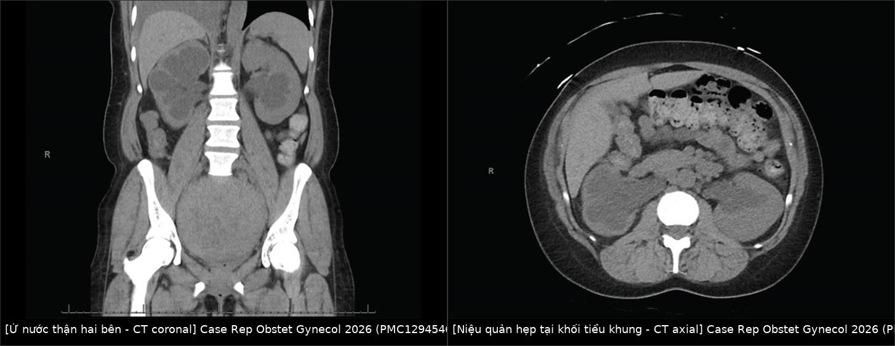
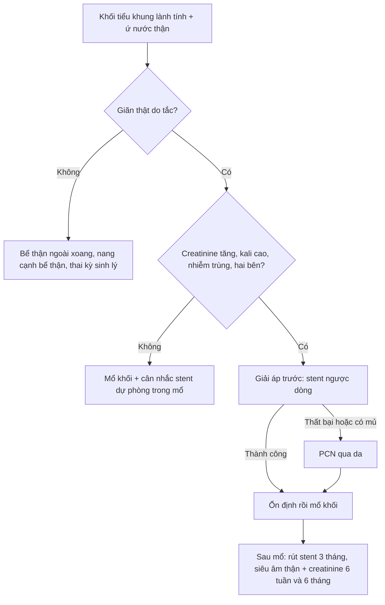
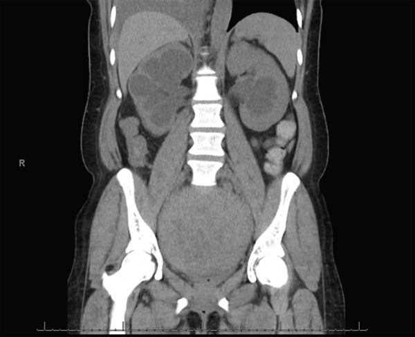
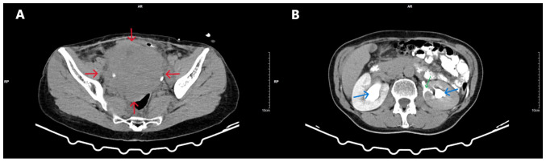
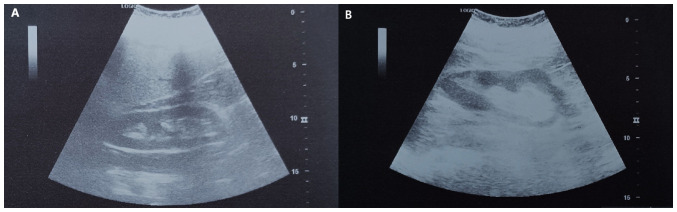

# 1620 — Ứ nước thận & urinoma do khối tiểu khung lành tính ở nữ / Hydronephrosis and urinoma caused by benign pelvic masses

**Tags:** `pattern:u-nuoc-than` `pattern:urinoma` `vung:than-nieu-quan` `vung:tieu-khung` `protocol:CT-tinh-mach` `protocol:MRI-chau` `protocol:stent-nieu-quan` `incidentaloma:u-nuoc-than`
**Mức chắc chắn (certainty):** tổng hợp y văn (literature synthesis) — không có thử nghiệm lâm sàng nào về "khối tiểu khung lành tính gây ứ nước thận"; số liệu lấy từ 2 ca nguyên văn có ảnh (PMC12329397, PMC12945467), 1 loạt 5 ca về bảo vệ niệu quản (PMC13222505) và các nghiên cứu hồi cứu về tần suất (dẫn trong PMC12945467). Câu nào là suy luận từ bằng chứng gián tiếp được ghi **[suy luận]**.

## 1. Tổng quan bệnh học – cơ chế hình ảnh

- **Giải phẫu quyết định vị trí tắc:** niệu quản dài **25–30 cm**, có **3 chỗ hẹp sinh lý** — khúc nối bể thận–niệu quản (ureteropelvic junction, UPJ), **chỗ bắt chéo động mạch chậu ở bờ tiểu khung** (pelvic brim) và khúc nối niệu quản–bàng quang (ureterovesical junction, UVJ). Một khối lành tính kẹt trong tiểu khung (u xơ cổ tử cung, u xơ dây chằng rộng, u buồng trứng, tử cung sa) thường chèn ép niệu quản **đúng ở bờ tiểu khung**, nên ứ nước xuất hiện **hai bên** dù khối chỉ một bên.
- **TẠI SAO ứ nước lại "im lặng":** tắc từ từ → áp lực trong lòng niệu quản tăng dần, nhưng thành niệu quản và bể thận **giãn ra trước** (theo Laplace, sức căng thành = áp lực × bán kính), nên áp lực truyền lên nhu mô thận bị "đệm" bớt. Hệ quả: **không đau quặn** (đau chỉ xuất hiện khi tắc cấp, áp lực tăng nhanh) và **creatinine có thể còn bình thường** dù ứ nước nặng. Vì vậy creatinine mới là "chuông báo" chứ không phải triệu chứng.
- **TẠI SAO thành urinoma:** khi áp lực bể thận vượt sức chịu của **các đài thận (fornix — nơi thành mỏng nhất)**, nước tiểu thoát ra khoang quanh thận → **urinoma quanh thận (perinephric urinoma)**. Trên CT có cản quang thì bài tiết, dấu hiệu chốt là **thoát thuốc cản quang ra ngoài đài thận** + **biến dạng hình "chén" (cup-shaped) của đài trên/dưới** — đúng mô tả ca PMC12329397.
- **TẠI SAO phân biệt được bằng HU:** urinoma là nước tiểu → **0–20 HU**, không vách tăng ngấm, không có mạch máu trong tổn thương; máu tụ bán cấp **40–70 HU**; áp-xe có vách dày **tăng ngấm viền** + khí bên trong. Đây là lý do không cần chọc hút để "xem dịch gì" ở ca điển hình.
- **Ngưỡng định lượng về tần suất (đọc kỹ vì hay bị bỏ qua):**
  - Hồi cứu **216 phụ nữ có u xơ** (Jamaica, 5 năm): **14,35%** có ứ nước thận; trong số đó **61,9% có chức năng thận bình thường**; chỉ **1 ca** suy thận giai đoạn cuối (dẫn trong PMC12945467).
  - Nghiên cứu Nigeria **114 phụ nữ có u xơ có triệu chứng**: bệnh niệu quản tắc nghẽn **22,8%**, bệnh thận do tắc **10,5%**, ứ nước **hai bên 4,4%** (dẫn trong PMC12945467).
  - **U xơ cổ tử cung chỉ chiếm 0,6%** tổng số u xơ tử cung; loại "khổng lồ" được định nghĩa **đường kính > 15 cm** (PMC12329397).
- **Số liệu từ 2 ca nguyên văn:**
  - Ca 1 (PMC12329397): nữ **51 tuổi**, bí tiểu phải đặt sonde, u xơ cổ tử cung **16 × 12 × 10 cm** trên CT (**16,5 × 12,5 × 11 cm** trên MRI), ứ nước **hai bên**, **urinoma quanh thận trái**; creatinine lúc vào **0,75 mg/dL** (bình thường 0,40–1,10) — tức **ứ nước nặng mà xét nghiệm thận vẫn bình thường**.
  - Ca 2 (PMC12945467): nữ **33 tuổi**, u xơ hồi cứng **19,5 cm**, creatinine **4,0 mg/dL** (nền cũ **0,6 mg/dL**), tăng huyết áp mới **164/110 mmHg**; đặt **PCN hai bên** → creatinine **2,9 mg/dL**; mổ bóc u xơ; **6 tuần sau còn 1,7 mg/dL** — tức **đã có phần tổn thương thận không hồi phục**.

## 2. Mẫu hình + chẩn đoán phân biệt theo VỊ TRÍ TẮC (Gamut)

Mẫu hình là **"bể thận – niệu quản giãn + một khối tiểu khung"**. Việc đầu tiên không phải đo độ giãn mà là **tìm mức tắc**: tắc càng thấp thì niệu quản giãn càng dài.

- **Tắc ở bờ tiểu khung, do chèn ép từ ngoài (extrinsic) — nhóm của bài này:**
  - **U xơ cổ tử cung** (thể trong cổ/ngoài cổ), **u xơ dây chằng rộng**, u xơ ký sinh sau morcellation.
  - **Khối buồng trứng lành**: u sợi (fibroma), u nhầy lớn, endometrioma lớn, nang cạnh phần phụ xoắn.
  - **Sa tạng chậu nặng** (sa tử cung độ III–IV kéo niệu quản xuống dưới bờ tiểu khung).
  - **Xơ hóa sau phúc mạc**, hạch chậu, lạc nội mạc tiểu khung.
- **Tắc trong lòng niệu quản (intrinsic):** sỏi, ung thư biểu mô niệu mạc (transitional cell carcinoma), hẹp sau xạ, cục máu sau chảy máu.
- **Tắc ở UVJ/bàng quang:** u bàng quang, phì đại tuyến tiền liệt (bệnh nhân nam), bàng quang thần kinh, sa sinh dục làm gập niệu quản.
- **"Giãn" KHÔNG do tắc (bẫy hay gặp nhất):** **bể thận ngoài xoang (extrarenal pelvis)** — bể thận toàn bộ nằm ngoài xoang thận; **nang cạnh bể thận (parapelvic cyst)**; **thai kỳ** (giãn sinh lý, **phải > trái**, do progesterone + tử cung chèn); **trào ngược bàng quang–niệu quản**; giãn sau thuốc lợi niệu.
- **Gamut của urinoma:** (1) **tắc** (bài này — vỡ đài do áp lực); (2) chấn thương thận; (3) sau can thiệp (PCN, tán sỏi, mổ); (4) vỡ đài do sỏi (forniceal rupture) — hay gặp ở bệnh nhân đau quặn thận đột ngột hết đau.
- **Gợi nhớ theo tầng:** *trên bờ tiểu khung → nghĩ khối tiểu khung; dưới bờ tiểu khung → nghĩ UVJ/bàng quang; giãn cả niệu quản đến bàng quang mà không thấy khối → nghĩ bàng quang thần kinh/trào ngược.*

## 3. Bảng so sánh phân biệt (ma trận đối chiếu)

### 3A. Nguyên nhân ứ nước thận ở nữ có khối tiểu khung

| Thực thể (entity) | Hình ảnh điển hình | Chốt vào (rule-in) | Chốt loại (rule-out) | Gợi ý xác nhận |
|---|---|---|---|---|
| **U xơ cổ tử cung khổng lồ** | Khối đặc, bờ rõ, **giãn mạch nuôi bao quanh**, đẩy cổ tử cung lệch; ứ nước hai bên | **Khối tâm điểm ở cổ tử cung + cổ tử cung bị xoá/đẩy + ứ nước hai bên** | Cổ tử cung còn nguyên và khối tách rời khỏi cổ → nghĩ khối khác | MRI chậu T2: khối giảm tín hiệu, vỏ giả; đo 3 chiều |
| **U xơ dây chằng rộng** | Khối đẩy tử cung sang bên, **niệu quản bị đẩy ra ngoài/ra trước**, tách khỏi buồng tử cung | **Mất dấu hiệu "liên tục với cơ tử cung"** + đẩy niệu quản | Còn cầu mô cơ nối với thân tử cung → u xơ trong tử cung | MRI + CT có thì bài tiết để vẽ đường niệu quản |
| **Khối buồng trứng lành lớn** | Nang/u đặc–hỗn hợp xuất phát từ phần phụ, **tách khỏi tử cung**; u sợi T2 rất tối | **Tách khỏi tử cung + không có "vỏ giả" mạch nuôi kiểu u xơ** | Có cầu nối cơ tử cung → u xơ | Siêu âm đầu dò âm đạo + MRI; CA-125 bình thường không loại trừ |
| **Sa sinh dục nặng** | Cổ tử cung/thành âm đạo sa tới hoặc qua môn âm đạo; niệu quản gập ở bờ tiểu khung | **Khám thấy sa + ứ nước giảm khi đỡ sa** | Khối đặc trong tiểu khung → không phải sa | Khám phụ khoa; MRI động học sàn chậu |
| **Sỏi niệu quản** | Nốt **cản quang > 200 HU**, ± dấu hiệu viền mô mềm (tissue rim sign); không thấy khối tiểu khung | **Sỏi cản quang dọc đường niệu quản + ứ nước cùng bên** | Có khối tiểu khung giải thích đủ mức tắc → **vẫn phải loại sỏi phối hợp** | CT không cản quang lát mỏng 1–3 mm |
| **Ung thư niệu mạc / hẹp do xạ** | Dày thành niệu quản, **khối trong lòng**, đoạn hẹp dài, bờ không đều | **Tổn thương trong lòng + bờ không đều + tiền sử xạ** | Bờ nhẵn, hẹp ngắn, có khối chèn ngoài → lành tính | CT niệu đồ (CT urography) thì bài tiết; nội soi + tế bào học |
| **Ứ nước sinh lý thai kỳ** | Giãn bể thận **phải > trái**, giảm dần sau sinh, không có khối chèn | **Có thai + giãn phải > trái + hết sau sinh** | Giãn không đối xứng bất thường, có sỏi/khối → không phải sinh lý | Siêu âm thận; theo dõi sau sinh 6–12 tuần |

### 3B. Dịch quanh thận: urinoma và các "bản sao"

| Thực thể (entity) | Hình ảnh điển hình | Chốt vào (rule-in) | Chốt loại (rule-out) | Gợi ý xác nhận |
|---|---|---|---|---|
| **Urinoma do tắc** | Túi dịch quanh thận **0–20 HU**, không vách, **thoát cản quang ở thì bài tiết** | **Thuốc cản quang ra ngoài đài thận + biến dạng đài hình chén** | Dịch có vách tăng ngấm, có khí, bệnh nhân sốt → áp-xe | CT có thì bài tiết 5–10 phút; theo dõi siêu âm |
| **Máu tụ quanh thận** | **40–70 HU** (bán cấp), không ngấm, có thể có viền giảm tín hiệu | **HU cao + tiền sử chấn thương/mổ** | HU 0–20 và có thoát cản quang → urinoma | CT không cản quang so với thì muộn |
| **Nang cạnh bể thận** | Dịch **0–10 HU**, bờ mỏng nhẵn, **tách khỏi đài thận**, không thay đổi theo thì | **Bờ mỏng + không thông với hệ thống đài bể thận** | Thấy đường thông hoặc thoát cản quang → urinoma | CT thì bài tiết; MRI T2 |
| **Áp-xe quanh thận** | Dịch **10–25 HU** + **vách/viền dày tăng ngấm** + khí, dày mỡ quanh thận | **Sốt + CRP tăng + viền tăng ngấm** | Không sốt, không viền, dịch thuần nhất → urinoma vô khuẩn | Cấy dịch nếu chọc; kháng sinh + dẫn lưu |

*Trái: CT coronal — hai bể thận giãn, đài thận tù, nhu mô vỏ mỏng dần (phải > trái). Phải: CT axial — niệu quản hẹp dần tại mức khối u xơ trong tiểu khung. Nguồn: Case Rep Obstet Gynecol 2026 (PMC12945467), CC BY 4.0. Ảnh ghép letterbox, giữ nguyên tỷ lệ.*

## 4. Protocol chụp + ngưỡng xử trí

### 4.1 Chụp gì, theo thứ tự nào

1. **Siêu âm thận – đường tiết niệu + siêu âm đầu dò âm đạo**: đo **đường kính trước–sau bể thận (AP renal pelvis)**, độ dày nhu mô vỏ, và tìm khối tiểu khung. Lưu ý: với khối **> 15 cm**, siêu âm đầu dò âm đạo và siêu âm bụng **có thể không đánh giá được** (đúng như ca PMC12329397) — đừng coi "siêu âm không rõ" là "không có bệnh".
2. **CT bụng–tiểu khung**: không cản quang để tìm **sỏi + mức tắc**; có cản quang (thì tĩnh mạch + **thì bài tiết 5–10 phút**) để xác nhận **urinoma** và đánh giá khối. Lát **1–3 mm**.
3. **MRI tiểu khung** (T2, T1, ± tiêm): "bản đồ u xơ" trước mổ — số u, vị trí, liên quan cổ tử cung, **đường đi niệu quản**, và phân biệt u xơ với u buồng trứng.
4. **Xét nghiệm bắt buộc**: creatinine + eGFR, kali, CRP/bạch cầu, cấy nước tiểu. **Creatinine bình thường KHÔNG loại trừ ứ nước nặng** (61,9% ca trong loạt 216 có chức năng thận bình thường).

### 4.2 Ngưỡng quyết định

- **Giải áp trước mổ** khi: **tắc hai bên**, creatinine **tăng so với nền**, **kali cao**, **nhiễm trùng đường tiết niệu/viêm thận–bể thận**, hoặc **đau/urinoma to lên**.
- **Thứ tự: stent niệu quản ngược dòng trước, PCN khi stent thất bại.** Stent vừa giải áp vừa **bảo vệ niệu quản trong mổ**. Nếu **đặt stent thất bại**, đó không phải "thủ thuật hỏng" mà là **dấu hiệu niệu quản bị biến dạng nặng** → tăng cảnh giác trong mổ, cân nhắc PCN (loạt 5 ca PMC13222505).
- **Urinoma nhỏ, không nhiễm trùng, không chèn ép** → **theo dõi, không dẫn lưu**; ca PMC12329397 không cần can thiệp niệu khoa nào cho urinoma, chỉ đặt stent và theo dõi.
- **Mổ khối** (bóc u xơ / cắt tử cung) là điều trị triệt để: gần như mọi ca trong y văn **hết ứ nước và cải thiện chức năng thận sau mổ**; tổn thương thận chỉ tồn tại khi **mổ muộn** hoặc có **bệnh thận nền** (PMC12945467).
- **Theo dõi sau mổ**: rút stent **3 tháng** sau khi siêu âm thận bình thường (PMC12329397); đo lại **creatinine lúc 6 tuần và 6 tháng** — ca PMC12945467 còn **1,7 mg/dL** (so nền 0,6) dù đã giải áp.

### 4.3 Sơ đồ quyết định

## 5. Biến thể bình thường và cạm bẫy

- **Bể thận ngoài xoang (extrarenal pelvis)** là biến thể hay bị đọc thành "ứ nước độ I" — bể thận to nhưng **đài thận không giãn**, nhu mô không mỏng, không có khối chèn. Chốt bằng thì bài tiết: thuốc xuống bể thận ngoài xoang bình thường, **không ứ đọng**.
- **"Creatinine bình thường = thận ổn"** là cạm bẫy chết người: 61,9% ca ứ nước trong loạt 216 ca có chức năng thận bình thường; ca 51 tuổi có urinoma mà creatinine vẫn **0,75 mg/dL**.
- **Satisfaction of search:** thấy khối tiểu khung là dừng lại — bỏ sót **sỏi niệu quản phối hợp**, **ung thư niệu mạc**, hoặc **urinoma** (chỉ thấy ở thì bài tiết).
- **Urinoma vô khuẩn không triệu chứng:** chọc hút "cho chắc" có thể đưa nhiễm trùng vào khoang sau phúc mạc → chỉ chọc khi nghi áp-xe, cần chẩn đoán mô học, hoặc urinoma chèn ép.
- **Thai kỳ:** ứ nước sinh lý **phải > trái**, xuất hiện từ tam cá nguyệt 2 và hết sau sinh; đừng can thiệp chỉ vì "thấy giãn".
- **Sau mổ:** ứ nước hết nhưng **creatinine có thể không về nền** — phải theo dõi dài hạn, đừng tuyên bố "khỏi" chỉ vì siêu âm đẹp.
- **Cạm bẫy mặt cắt:** trên CT axial, niệu quản đi **trước động mạch chậu** ở bờ tiểu khung; muốn chứng minh mức tắc phải **lần theo niệu quản từ thận xuống** trên chuỗi lát, không đoán theo một lát.

## 6. Tự lượng giá — Blind Quiz

**Ca 1 — Nữ 33 tuổi, rong kinh nặng + tiểu nhiều lần, huyết áp 164/110 mmHg, creatinine 4,0 mg/dL.**

- Câu hỏi: (1) Dấu hiệu chính? (2) Mức tắc ở đâu? (3) Ba chẩn đoán phân biệt? (4) Bước tiếp theo trước khi mổ?

<b>Bấm để hiện đáp án (findings + chẩn đoán)</b>

- **Dấu hiệu:** hai bể thận – đài thận giãn nặng, **phải > trái**, nhu mô vỏ phải mỏng (tắc mạn); niệu quản giãn xuống tới mức khối u xơ trong tiểu khung.
- **Mức tắc:** bờ tiểu khung, do u xơ **19,5 cm** chèn ép hai niệu quản.
- **Chẩn đoán:** **ứ nước–niệu quản hai bên do u xơ tử cung lớn**, biến chứng suy thận cấp–mạn (creatinine **4,0** so nền **0,6 mg/dL**).
- **Bước tiếp theo:** **PCN hai bên** giải áp → creatinine **2,9 mg/dL**, rồi mổ bóc u xơ. Sáu tuần sau creatinine **1,7 mg/dL** (còn tổn thương không hồi phục).
- Nguồn: Case Rep Obstet Gynecol 2026 (PMC12945467), CC BY 4.0.

**Ca 2 — Nữ 51 tuổi, bí tiểu, đau lưng hai bên; CT có cản quang.**

- Câu hỏi: Mũi tên xanh và mũi tên xanh lá chỉ gì? Vì sao creatinine vẫn bình thường? Có cần dẫn lưu urinoma không?

<b>Bấm để hiện đáp án (findings + chẩn đoán)</b>

- **A:** khối đặc lớn **16 × 12 × 10 cm** chiếm toàn tiểu khung, bờ rõ, có vùng thoái hóa nang, nguồn gốc cổ tử cung (mũi tên đỏ).
- **B:** mũi tên xanh = **giãn đài–bể thận hai bên**; mũi tên xanh lá = **thoát cản quang ra khoảng quanh thận trái = urinoma**, kèm biến dạng đài thận hình chén.
- **Vì sao creatinine bình thường (0,75 mg/dL):** tắc mạn từ từ, thận còn bù; đây là lý do **không được dựa vào creatinine để loại trừ**.
- **Urinoma:** nhỏ, không sốt, không chèn ép → **theo dõi, không dẫn lưu**; đặt **stent niệu quản trước mổ**, cắt tử cung toàn bộ + phần phụ; rút stent sau **3 tháng** khi siêu âm thận bình thường.
- Nguồn: Med Int (Lond) 2025 (PMC12329397), CC BY 4.0.

**Ca 3 — Cùng bệnh nhân ca 2, ba tháng sau rút stent.**

- Câu hỏi: Hình ảnh nói gì về kết quả điều trị? Còn cần theo dõi gì?

<b>Bấm để hiện đáp án</b>

- Hai thận **trở về hình thái bình thường**, **không còn giãn đài–bể thận**, **không còn urinoma quanh thận**.
- Vẫn cần **creatinine** (6 tuần – 6 tháng) và siêu âm kiểm tra vì có thể còn tổn thương thận không hồi phục (xem ca 1).
- Nguồn: Med Int (Lond) 2025 (PMC12329397), CC BY 4.0.

## Bài liên quan chéo
- [531 – U xơ cổ tử cung, u xơ ký sinh & u xơ dây chằng rộng](../531-u-xo-co-tu-cung-ky-sinh-va-day-chang-rong/lesson.md)
- [582 – Biến chứng tiêu hóa–niệu sau xạ trị phụ khoa: viêm trực tràng xạ, rò, hẹp niệu quản](../582-bien-chung-tieu-hoa-nieu-sau-xa-tri-phu-khoa/lesson.md)
- [189 – Đánh giá trước ghép thận ở bàng quang thần kinh](../189-danh-gia-truoc-ghep-than-bang-quang-than-kinh/lesson.md)
- [691 – Sỏi bàng quang & sỏi quanh catheter ở trẻ bàng quang thần kinh](../691-soi-bang-quang-va-soi-quanh-catheter-o-tre/lesson.md)
- [164 – Nang thận ADPKD & biến chứng](../164-nang-than-adpkd-bien-chung/lesson.md)
- [500 – Tổng quan hệ Vú & Sản Phụ khoa](../500-tong-quan-vu-san-phu-khoa/lesson.md)

> Không dùng để chẩn đoán độc lập khi chưa có người hướng dẫn.
