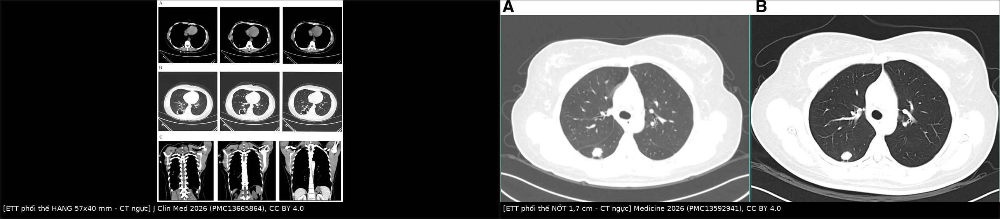
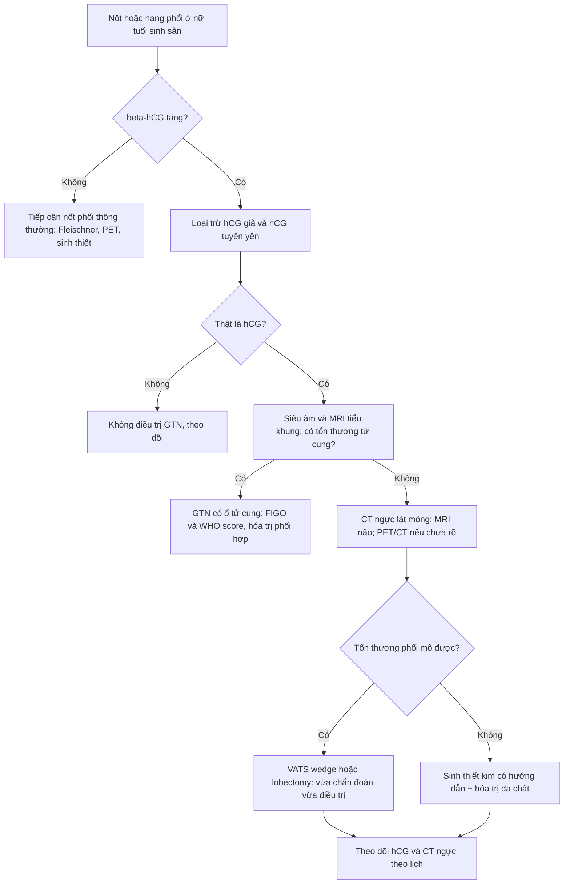
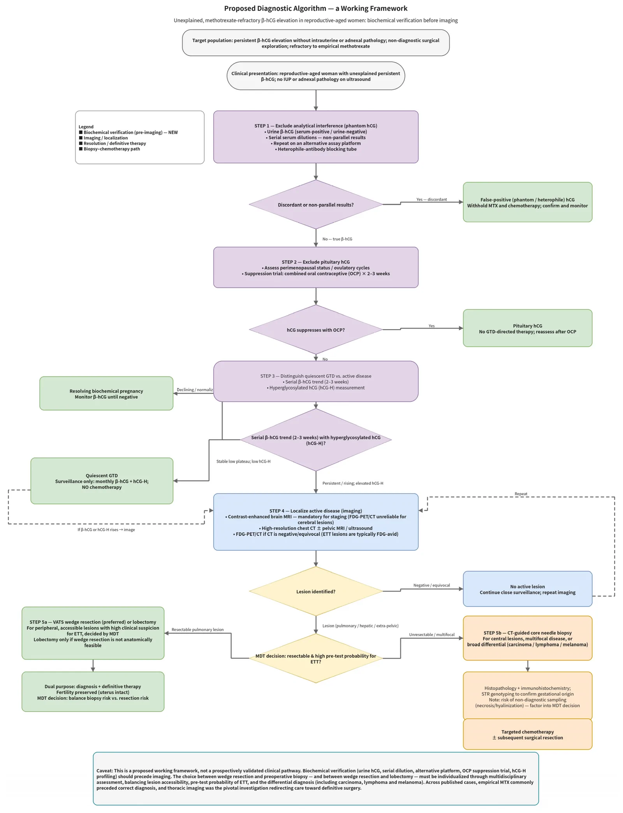
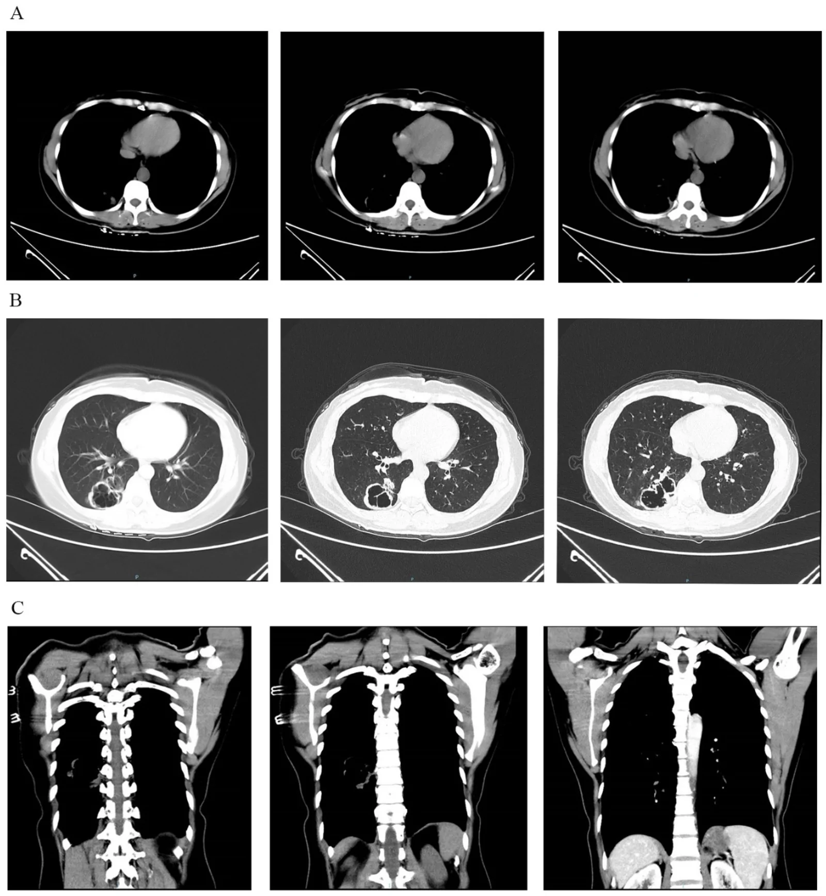
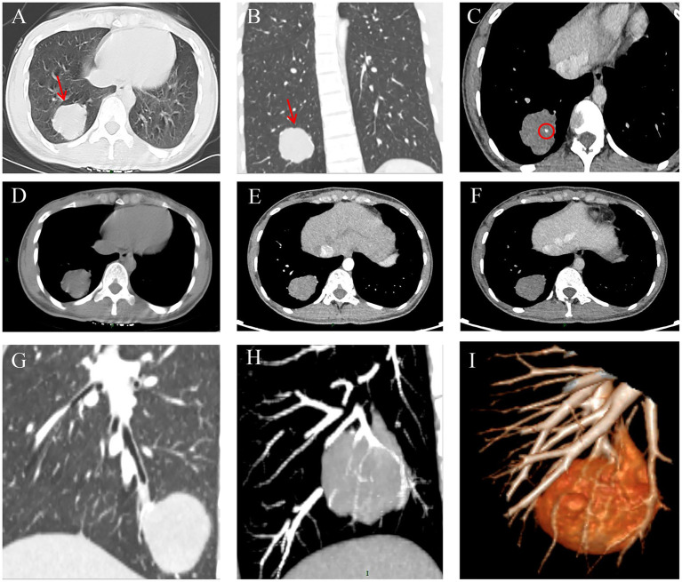

# 1621 — Nốt/hang phổi đơn độc ở nữ tuổi sinh sản: ETT di căn phổi / Solitary lung nodule or cavity in a reproductive-aged woman — pulmonary epithelioid trophoblastic tumor

**Tags:** `pattern:hang` `pattern:not-phoi` `vung:phoi` `score:FIGO-2000-WHO` `protocol:CT-nguc` `protocol:MRI-chau` `incidentaloma:not-phoi`
**Mức chắc chắn (certainty):** tổng hợp y văn (literature synthesis) — chủ đề **không có RCT**; số liệu chính lấy từ tổng hợp 30 ca ETT phổi không có tổn thương tử cung (PMC13665864), 2 ca nguyên văn có ảnh (PMC13070938, PMC13592941) và 1 bảng so sánh ETT với choriocarcinoma trong PMC13665864. Câu suy luận từ bằng chứng gián tiếp được ghi **[suy luận]**.

## 1. Tổng quan bệnh học – cơ chế hình ảnh

- **ETT là gì:** u nguyên bào nuôi dạng biểu mô (epithelioid trophoblastic tumor, ETT) phát sinh từ **nguyên bào nuôi trung gian loại màng nuôi (chorionic-type intermediate trophoblast)**; là thể **hiếm nhất** trong 4 thể bệnh nguyên bào nuôi thai kỳ (GTN), chiếm **1,4–2,0%** (có nguồn ghi **< 1–2%**). Đặc điểm: **phát triển chậm, kháng hóa trị đơn chất, mô học giống carcinoma** (tế bào epithelioid, chất hyaline quanh nốt).
- **TẠI SAO phổi là nơi di căn đầu tiên:** tế bào nuôi bong vào **xoang tĩnh mạch tử cung** → về tim phải → **giường mao mạch phổi là "bộ lọc" đầu tiên**. Vì vậy phổi là **vị trí di căn xa chính** của GTN; ETT có thể **chỉ biểu hiện ở phổi mà không thấy tổn thương tử cung** — y văn ghi nhận **29–30 ca** như vậy (PMC13665864, PMC13592941).
- **TẠI SAO β-hCG thấp — điểm bẫy quan trọng nhất:** ETT có ít nguyên bào hợp bào (syncytiotrophoblast) — nguồn tiết hCG chính — nên **β-hCG chỉ tăng nhẹ**. Trong 30 ca ETT phổi: **0,7–2.204 mIU/mL, trung vị 304**, và **73,3% dưới 1.000 mIU/mL**; trong khi choriocarcinoma thường **> 10.000 mIU/mL** (PMC13665864). Hệ quả: bệnh nhân bị chẩn đoán nhầm là **thai ngoài tử cung** và điều trị methotrexate lặp lại.
- **Giải thích hình ảnh bằng mô bệnh:**
  - ETT phổi điển hình là **nốt/khối đặc, hoại tử trung tâm → hang thành dày không đều**; ca PMC13665864: hang **57 × 40 mm** ở phân thùy đáy sau dưới phải, thành dày không đều, ngấm thuốc nhẹ, kèm **nhiều nốt vệ tinh, nốt lớn nhất 23 × 15 mm**.
  - Một số ca là **nốt đặc tròn, có vôi hóa**, ngấm thuốc **45 HU thì động mạch → 56 HU thì tĩnh mạch** (PMC13070938) — tức **ngấm ít–trung bình**, khác ung thư phổi thường ngấm mạnh hơn.
  - Ca khác lại là **nốt 1,7 × 1,5 cm có gai và thùy (burr and lobulation), kéo dây chằng màng phổi** (PMC13592941) — **không phân biệt được với ung thư phổi ngoại vi trên CT**.
  - Vì sao **không có dấu hiệu đặc trưng**: tổn thương là mô nuôi "lành tính về hình thái" nhưng phá hủy — không có vôi hóa đặc hiệu, không có hình dạng đặc hiệu; **chẩn đoán là mô bệnh học + hóa mô miễn dịch**, không phải hình ảnh.
- **Hóa mô miễn dịch chốt chẩn đoán (dùng để phân biệt với ung thư phổi):** **p63 dương nhân lan tỏa** (đặc trưng), CK7 (+), GATA-3 (+), β-catenin (+), **hPL và β-hCG dương ổ/focal ở tế bào đa nhân**; **Ki-67 10–25%** (có thể tới **30%** ở vùng hotspot); **âm với TTF-1, p40/CK5/6, p16, MUC4** (PMC13665864). Choriocarcinoma thì **Ki-67 > 50%**, β-hCG mạnh và lan tỏa.
- **Số liệu tổng hợp 30 ca (dùng để tư vấn):** tuổi trung vị **33** (23–49); **46,7%** ra máu âm đạo bất thường; **26,7%** phát hiện tình cờ trên hình ảnh; tiền sử **sinh đủ tháng 50%**, khoảng cách trung vị **36 tháng** (3–96); **73,3%** mổ nội soi lồng ngực (VATS); **60%** hóa trị bổ trợ (EMA/CO n = 8, EMA/EP n = 7); theo dõi trung vị **24 tháng** (3–90); **93,3% sống không bệnh**; 2 ca kết cục xấu đều do **mổ không triệt để hoặc điều trị chưa đủ** (PMC13665864).

## 2. Mẫu hình + chẩn đoán phân biệt theo hình thái (Gamut)

- **Hang đơn độc thành dày ở nữ tuổi sinh sản:** **ETT di căn** · ung thư phổi tế bào vảy (SCC) · lao hang · áp-xe phổi · aspergilloma trong hang cũ · u hạt do GPA · nhồi máu phổi có hang · di căn từ nơi khác.
- **Nốt đơn độc:** **ETT** · ung thư phổi nguyên phát · di căn (vú, đại tràng, sarcoma) · hamartoma · lao/u hạt · nấm.
- **Đa nốt hai phổi:** **choriocarcinoma di căn phổi** · thuyên tắc nhiễm khuẩn (septic emboli) · di căn nhiều nguồn · lao lan tỏa.
- **Hang + nốt vệ tinh:** lao (thùy trên, tree-in-bud) · **ETT** (ca 57 mm có nốt vệ tinh 23 × 15 mm) · SCC hoại tử.
- **Nang mỏng thành/khí trong phổi:** kén khí, bulla, lymphangioleiomyomatosis — **không phải** nhóm này nhưng dễ bị gộp khi đọc nhanh.
- **Nguyên tắc gamut:** ở nữ **15–49 tuổi** có **bất kỳ tổn thương phổi nào + β-hCG tăng không giải thích được**, phải đưa **GTN/ETT vào chẩn đoán phân biệt** — kể cả khi tử cung trống trên siêu âm và MRI (30 ca đã báo).

## 3. Bảng so sánh phân biệt (ma trận đối chiếu)

| Thực thể (entity) | Hình ảnh điển hình (CT ngực) | Chốt vào (rule-in) | Chốt loại (rule-out) | Gợi ý xác nhận |
|---|---|---|---|---|
| **ETT phổi (di căn/nguyên phát tại phổi)** | Nốt/hang đơn độc, thành dày không đều, **ngấm nhẹ–trung bình**, ± vôi hóa, ± nốt vệ tinh; có thể có gai giả ung thư | **β-hCG tăng nhẹ (trung vị ~304, 73% < 1.000) + nốt/hang phổi + tử cung trống trên MRI** | β-hCG âm hoàn toàn và không có tiền sử thai kỳ → ít nghĩ ETT (nhưng ETT có thể hCG trong "bình thường") | Mô bệnh: **p63 dương nhân lan tỏa**, Ki-67 10–30%, TTF-1 âm |
| **Choriocarcinoma di căn phổi** | Đa nốt hai phổi, nốt lớn nhanh, ± hang, ± tràn máu màng phổi | **β-hCG rất cao (> 10.000 mIU/mL) + đa nốt + tiền sử thai trứng** | hCG thấp < 1.000 + nốt đơn độc → nghĩ ETT/PSTT hơn | hCG serial; mô bệnh: Ki-67 > 50%, hCG mạnh lan tỏa |
| **Ung thư phổi nguyên phát (SCC)** | Nốt có **gai, thùy, co kéo màng phổi**, hang thành dày lệch tâm, ± hạch rốn phổi | **Tuổi > 50, hút thuốc, hạch rốn phổi, không có hCG** | **Nữ sinh sản + hCG tăng + không hạch** → không chốt ung thư phổi | Sinh thiết/EBUS; TTF-1, p40, CK5/6 dương |
| **Lao hang** | Thùy trên/đỉnh sau, thành mỏng đều, **tree-in-bud + nốt vệ tinh**, ± vôi hóa | **Tree-in-bud + nốt vệ tinh + vị trí đỉnh sau** | Hang đơn độc thành dày + hCG tăng → không phải lao đơn thuần | AFB/PCR dịch rửa; IGRA (âm không loại trừ) |
| **Áp-xe phổi** | Hang **có mức khí–dịch**, đông đặc quanh, góc nhọn với màng phổi | **Sốt cao + đờm hôi + mức khí–dịch ngang** | Không sốt, không mức dịch, hCG tăng → nghĩ ETT | Cấy máu/đờm; đáp ứng kháng sinh |
| **Hamartoma** | Nốt bờ nhẵn, **mỡ −40 đến −120 HU**, vôi hóa "popcorn" | **Có mỡ trong nốt + vôi hóa popcorn** | Không mỡ, ngấm thuốc, hCG tăng → không phải hamartoma | CT lát mỏng; theo dõi ổn định nhiều năm |

*Trái: hang 57 × 40 mm thành dày không đều ở phân thùy đáy sau dưới phải, kèm nốt vệ tinh (J Clin Med 2026, PMC13665864). Phải: nốt 1,7 × 1,5 cm có gai và thùy, giả ung thư phổi ngoại vi (Medicine 2026, PMC13592941). Cả hai đều CC BY 4.0; ảnh ghép letterbox, giữ nguyên tỷ lệ.*

## 4. Protocol chẩn đoán + phân giai đoạn + theo dõi

### 4.1 Trình tự bắt buộc khi gặp "nốt/hang phổi + β-hCG tăng"

1. **Loại trừ hCG giả (phantom hCG) và hCG tuyến yên** trước khi điều trị: xét nghiệm **hCG nước tiểu** (âm mà huyết thanh dương = nghi kháng thể dị loài), **pha loãng huyết thanh** (không tuyến tính = nghi giả), **ức chế bằng thuốc tránh thai 2–3 tuần** (hCG giảm = nguồn tuyến yên, không phải GTN).
2. **Loại trừ thai/GTN trong tử cung:** siêu âm đầu dò âm đạo + **MRI tiểu khung có cản quang** (đánh giá cơ tử cung, cổ tử cung, phần phụ). Nội mạc dày **10–12 mm** có thể chỉ do hCG cao kéo dài, không đồng nghĩa có u.
3. **Chụp phổi:** **CT ngực lát mỏng ≤ 1 mm, có cản quang** (đánh giá hang/nốt, hạch, màng phổi). **PET/CT** khi CT âm hoặc không kết luận — tổn thương ETT thường **ngấm FDG**, nhưng PET **không thay thế mô bệnh học**.
4. **MRI não** khi đã xác định di căn phổi (giai đoạn III trở lên) để tìm di căn não (giai đoạn IV).
5. **Lấy mô:** ưu tiên **cắt bỏ tổn thương phổi có chẩn đoán** (VATS wedge/lobectomy) vì **vừa chẩn đoán vừa điều trị**; **sinh thiết kim chỉ khi tổn thương không mổ được/đa ổ** — tổn thương nuôi mạch máu, nguy cơ chảy máu và gieo tế bào.

### 4.2 Phân giai đoạn và điểm nguy cơ

- **FIGO 2000 (giải phẫu):** I = tử cung; II = tiểu khung/âm đạo; **III = di căn phổi**; IV = di căn xa khác (não, gan, thận).
- **Thang điểm tiên lượng WHO (modified):** **≤ 6 = nguy cơ thấp** (hóa trị đơn chất); **≥ 7 = nguy cơ cao** (đa chất). Điểm gồm tuổi, thai kỳ trước, khoảng cách, hCG trước điều trị, kích thước u, vị trí/số di căn, số hóa trị thất bại trước đó.
- **Ca PMC13665864:** 39 tuổi, thai đủ tháng trước đó (2 điểm), khoảng cách 36 tháng (4 điểm), hCG 978–1.100 (1 điểm), u 57 mm (2 điểm), di căn phổi (0 điểm), 1 di căn (1 điểm), đã thất bại methotrexate (2 điểm) → **tổng 12 điểm, FIGO III:12 — nhóm nguy cơ rất cao**.
- **Điều trị:** **phẫu thuật cắt trọn tổn thương là nền tảng** (ETT kháng hóa trị đơn chất); hóa trị đa chất **EMA/CO** (etoposide, methotrexate, actinomycin D + cyclophosphamide, vincristine) là lựa chọn đầu tay khi di căn/nguy cơ cao; **EMA/EP** khi kháng EMA/CO. Bảo tồn tử cung khi không có tổn thương tử cung (cả 3 ca đều không cắt tử cung).

### 4.3 Sơ đồ tiếp cận

*Sơ đồ gốc (tiếng Anh) của bài PMC13665864: 5 bước từ xác nhận sinh hóa → loại trừ hCG tuyến yên → phân biệt GTN tồn dư → định vị tổn thương bằng hình ảnh → mổ hay sinh thiết. Nguồn: J Clin Med 2026 (PMC13665864), CC BY 4.0.*

### 4.4 Lịch theo dõi (theo ca PMC13665864 và đồng thuận GTN)

- **β-hCG:** hàng tuần trong hóa trị và **3 tháng đầu** sau kết thúc; **2 tuần/lần trong 3 tháng tiếp**; **hàng tháng trong năm thứ 2**; **3 tháng/lần** từ năm thứ 3.
- **Hình ảnh:** **CT ngực + siêu âm tiểu khung mỗi 3 tháng trong năm đầu**, **6 tháng/lần năm thứ 2**, **hàng năm từ năm thứ 3**. Cả 3 ca đều không tái phát sau **3 năm**.
- **Tư vấn:** hCG về bình thường và ổn định mới được coi là lui bệnh; **tránh có thai** trong thời gian theo dõi (vì hCG thai kỳ sẽ che lấp tái phát) — khuyến cáo chung của GTN, không riêng ETT.

## 5. Biến thể bình thường và cạm bẫy

- **Điều trị methotrexate theo "thai ngoài tử cung"** là bẫy lớn nhất: cả 3 ca đều bị chẩn đoán nhầm; một ca **giữ hCG 349–561 mIU/mL hơn 3 năm** trước khi tìm ra ETT phổi (PMC13665864 dẫn Slattery). **Quy tắc:** hCG không giảm về 0 sau methotrexate + không thấy thai trong tử cung/phần phụ → **chụp phổi**.
- **hCG "bình thường" vẫn có thể là ETT:** dải 0,7–2.204 mIU/mL, trung vị 304; **73,3% dưới 1.000** — đừng chờ hCG "thật cao".
- **Phantom hCG (kháng thể dị loài)**: hCG huyết thanh dương nhưng **hCG nước tiểu âm**, pha loãng không tuyến tính → **không hóa trị**, không mổ.
- **hCG tuyến yên ở quanh mãn kinh**: giảm khi dùng thuốc tránh thai 2–3 tuần → không phải GTN.
- **Bệnh nguyên bào nuôi "im lặng" (quiescent GTD)**: hCG thấp, ổn định, **hCG-H cao** → theo dõi, không hóa trị; phân biệt bằng xu hướng hCG nhiều tuần.
- **Sinh thiết kim tổn thương nuôi mạch máu** → chảy máu, gieo mầm; chỉ làm khi không mổ được.
- **Đọc hang là lao** vì có nốt vệ tinh: ca 57 mm có nhiều nốt quanh hang — nếu bỏ qua hCG sẽ điều trị lao và mất thời gian.
- **"Tử cung trống trên siêu âm = không phải GTN"** là kết luận sai: 30 ca ETT phổi **không có tổn thương tử cung**; vẫn có thể có ổ vi thể trong tử cung.

## 6. Tự lượng giá — Blind Quiz

**Ca 1 — Nữ 39 tuổi, ra máu âm đạo, β-hCG 978 → 1.100 mIU/mL sau methotrexate; tử cung và phần phụ trống trên MRI.**

- Câu hỏi: (1) Mô tả tổn thương. (2) Vì sao hCG chỉ ~1.000 mà vẫn là ung thư? (3) Ba chẩn đoán phân biệt và bước xác nhận?

<b>Bấm để hiện đáp án (findings + chẩn đoán)</b>

- **Findings:** hang **57 × 40 mm** ở phân thùy đáy sau dưới phổi phải, **thành dày không đều, ngấm thuốc nhẹ**; nhiều nốt vệ tinh, lớn nhất **23 × 15 mm**; không hạch trung thất.
- **Vì sao hCG thấp:** ETT xuất phát từ nguyên bào nuôi trung gian → ít nguyên bào hợp bào tiết hCG; hCG **không tương xứng với khối u**.
- **Chẩn đoán:** **ETT phổi không có tổn thương tử cung**, FIGO **III:12**; mổ nội soi cắt thùy dưới phải + 3 chu kỳ **EMA/CO** → hCG về **< 5 mIU/mL**, không tái phát sau **3 năm**.
- **Phân biệt:** SCC phổi (thường có hạch, hCG âm), lao hang (tree-in-bud, hCG âm), áp-xe (mức khí–dịch, sốt).
- Nguồn: J Clin Med 2026 (PMC13665864), CC BY 4.0.

**Ca 2 — Hai bệnh nhân nữ 29 và 31 tuổi, đều có hCG tăng nhẹ và một tổn thương phổi đơn độc.**

- Câu hỏi: Hình nào giả ung thư phổi hơn? Vì sao không thể chốt bằng hình ảnh?

<b>Bấm để hiện đáp án</b>

- **Trái:** hang thành dày không đều 57 × 40 mm + nốt vệ tinh → giống **SCC hoại tử/lao hang**.
- **Phải:** nốt **1,7 × 1,5 cm có gai, thùy, kéo màng phổi** → giống **ung thư phổi ngoại vi** nhất.
- **Không chốt được bằng hình ảnh:** ETT không có dấu hiệu CT đặc hiệu; chẩn đoán bằng **mô bệnh + hóa mô miễn dịch** (p63 dương nhân lan tỏa, Ki-67 10–30%, TTF-1 âm). Cả hai ca đều được chẩn đoán **sau khi cắt tổn thương bằng VATS**.
- Nguồn: J Clin Med 2026 (PMC13665864) và Medicine 2026 (PMC13592941), CC BY 4.0.

**Ca 3 — Nữ 29 tuổi, khám sức khỏe phát hiện tổn thương phổi, không triệu chứng; β-hCG 659,44 mIU/mL.**

- Câu hỏi: Dấu hiệu nào giúp nghĩ tổn thương không phải ung thư phổi thông thường? Bước tiếp theo?

<b>Bấm để hiện đáp án</b>

- Khối **tròn, bờ nhẵn, có vôi hóa trong u**, ngấm thuốc **45 HU (động mạch) → 56 HU (tĩnh mạch)** — ngấm **ít–trung bình**; không hạch trung thất.
- **Bước tiếp theo:** xác nhận hCG thật (nước tiểu, pha loãng), MRI tiểu khung (không thấy ổ tử cung), rồi **VATS cắt thùy dưới phải** — vừa chẩn đoán vừa điều trị; kết quả mô bệnh: **ETT phổi**.
- Nguồn: Front Med 2026 (PMC13070938), CC BY 4.0.

## Bài liên quan chéo
- [559 – PSTT & ETT: khối xâm lấn cơ tử cung, hCG thấp & FIGO](../559-u-nguyen-bao-nuoi-tai-vi-tri-nhau-va-dang-bieu-mo/lesson.md)
- [551 – Bệnh nguyên bào nuôi thai kỳ: thai trứng & choriocarcinoma](../551-benh-nguyen-bao-nuoi-thai-ky/lesson.md)
- [550 – Thai sớm, sảy thai & thai ngoài tử cung](../550-thai-som-say-thai-thai-ngoai-tu-cung/lesson.md)
- [020 – Nốt phổi](../020-not-phoi/lesson.md)
- [025 – Tổn thương phổi tạo hang & dấu liềm khí](../025-ton-thuong-phoi-tao-hang/lesson.md)
- [577 – Theo dõi & phát hiện tái phát ung thư phụ khoa: RECIST, CA-125, PET/CT](../577-theo-doi-tai-phat-ung-thu-phu-khoa/lesson.md)
- [500 – Tổng quan hệ Vú & Sản Phụ khoa](../500-tong-quan-vu-san-phu-khoa/lesson.md)

> Không dùng để chẩn đoán độc lập khi chưa có người hướng dẫn.
