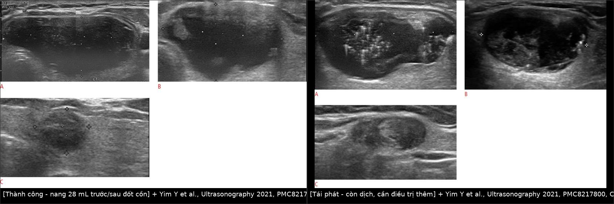
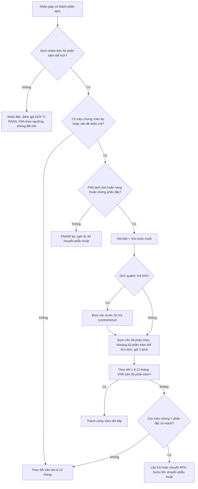
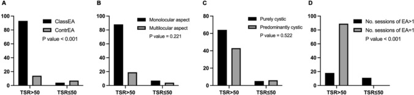
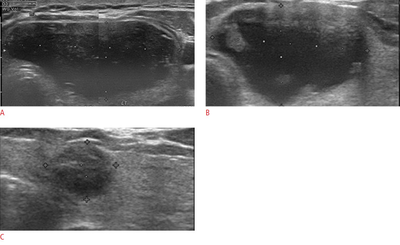
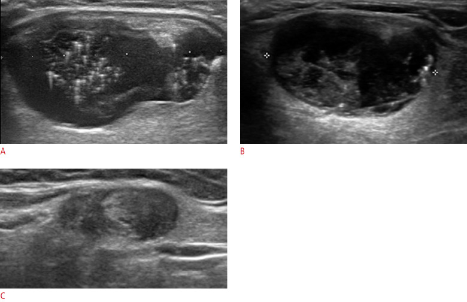
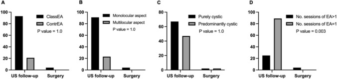

# 1622 — Đốt cồn nang giáp lành tính (PEI/EA) / Percutaneous ethanol ablation of benign thyroid cysts

**Tags:** `pattern:nang` `vung:tuyen-giap` `protocol:dot-con-giap` `incidentaloma:nang-giap`
**Mức chắc chắn (certainty):** tổng hợp y văn (literature synthesis) — biên từ toàn văn các bài mở: phân tích gộp 19 nghiên cứu/1.514 người (PMC7937837, CC BY-NC 4.0), nghiên cứu 154 nang về tiêu chuẩn tái phát (PMC8217800, CC BY-NC 4.0), đoàn hệ 118 nang theo dõi 1 năm (PMC13369035, CC BY 4.0), loạt 65 ca PEI (PMC13229250, CC BY-NC-ND 4.0), so sánh RFA–EA 1 tháng (PMC9884003, CC BY-NC 4.0) và so sánh EA–MWA theo kích thước (PMC9641769, CC BY-NC 4.0). Số liệu lấy từ toàn văn, không lấy từ abstract gián tiếp.

## 1. Tổng quan — vì sao hút dịch thất bại và vì sao cồn lại hiệu quả

- **Bệnh học:** đa số "nang giáp" là **nhân giáp thoái triển** — một nhân keo (colloid nodule) bị **hoại tử/xuất huyết trung tâm**, tạo khoang dịch có thành xơ, **không có biểu mô bài tiết thật** (pseudocyst). Vì thành nang không phải biểu mô tuyến, dịch **tái tích tụ từ mạch máu và mô xơ quanh nang** sau khi hút.
- **TẠI SAO hút đơn thuần tái phát 60–90%:** hút chỉ lấy dịch, **không phá thành mạch nuôi và không làm dính thành nang** → khoang còn nguyên, dịch quay lại (PMC13229250). Đây là lý do **không được coi "hút ra là điều trị"**.
- **TẠI SAO cồn (ethanol) hiệu quả:** ethanol **95–100%** gây **đông vón protein và biến tính tế bào nội mạc** trong vài phút, **gây xơ hóa thành nang**, **huyết khối các mạch nhỏ nuôi thành** → khoang xẹp và dính lại. Ethanol **không cần "đốt nóng"** và **không phụ thuộc năng lượng** như RFA/MWA; hiệu quả đến từ **nồng độ cồn tiếp xúc đủ lâu với toàn bộ mặt trong nang** — vì vậy phải **hút kiệt, bơm đủ thể tích, xoay/ép cho cồn tiếp xúc đều**.
- **TẠI SAO nang keo đặc lại khó:** dịch quá quánh **không hút được** → cồn không tiếp xúc được toàn bộ mặt trong nang. Giải pháp thực hành: **bơm cồn trước rồi mới hút** (kỹ thuật "contrariwise" — cồn làm loãng/liquefy chất keo, được gọi vui là hiệu ứng "Saint Januarius"), hoặc dùng **kim to/hút lặp kèm rửa nước muối** (PMC13369035).
- **Ngưỡng định lượng nằm lòng:**
  - **Định nghĩa loại nang:** **nang thuần (purely cystic)** = thành phần dịch **> 90%**; **nang ưu thế dịch (predominantly cystic)** = **> 50%** dịch (PMC13369035). Nang < 50% dịch là **nhân đặc có thành phần nang** — không phải đối tượng của bài này.
  - **Hiệu quả gộp:** tỷ lệ giảm thể tích (volume reduction ratio — VRR) **83,9%** (KTC 95%: 79,4–88,5%) trên **19 nghiên cứu, 1.514 người** (PMC7937837); nang thuần **80–100%**, nang ưu thế dịch **65–85,4%** (PMC13369035).
  - **Thành công:** **VRR > 50%** kèm cải thiện triệu chứng/cosmetic (PMC8217800, PMC13369035).
  - **Thể tích cồn:** y văn **không thống nhất** — một trung tâm dùng **~50% thể tích dịch hút ra** (trung bình **8,3 mL**, 1–20 mL, giữ ~2 phút — PMC8217800); trung tâm khác dùng **2,2 mL** (trung vị) cho nang 16,2 mL (PMC13369035). Bảng gộp các nghiên cứu cũ cho khoảng **25–70% thể tích nang**, nồng độ **95–100%**, thời gian lưu **2 phút đến không hút ra** (PMC7937837). **Chưa có ngưỡng chuẩn** — không được suy từ một nghiên cứu ra quy luật.

## 2. Mẫu hình + chẩn đoán phân biệt theo hình thái (gamut)

- **Mẫu hình đích:** khối **giảm âm đồng nhất, bờ đều, không vách/tăng sinh**, **không có thành phần đặc ngấm thuốc**, dịch **trong hoặc vàng**, trên siêu âm **không có vi vôi hóa, không có bờ tua gai, không có hướng không song song**.
- **Gamut theo hình thái:**
  - **Nang thuần (> 90% dịch)** — đáp ứng tốt nhất với cồn; có thể chỉ một lần.
  - **Nang ưu thế dịch (> 50% dịch)** — đáp ứng khá hơn, **tái phát 26–33%** (dẫn trong PMC9884003); thường cần **nhiều lần** hoặc phối hợp RFA.
  - **Nang keo đặc/quánh** — hút khó; **bơm cồn trước** hoặc kim to + rửa; kết quả kém hơn.
  - **Nang xuất huyết** — dịch nâu sẫm, có cặn; có thể đốt cồn sau khi loại trừ ung thư; **tái phát cao hơn**.
  - **Nang nhiều vách (multilocular)** — cồn khó tiếp xúc toàn bộ; **yếu tố tiên lượng âm** (đa thùy: OR thấp hơn cho thành công; chỉ nang **một thùy** là yếu tố tiên lượng VAS = 0 và cosmetic = 1, OR = 5,72 — PMC13369035).
  - **Không phải nang giáp:** **nang giáp lưỡi (thyroglossal duct cyst)** — đường giữa, trên sụn giáp, di động khi nuốt/lè lưỡi; **lymphangioma** — đa khoang; **nang cạnh giáp (parathyroid cyst)** — thường góc dưới tuyến, dịch trong, PTH cao.
  - **Nang "giả" do ung thư:** **ung thư thể nang (follicular) hoặc nhú (papillary) có thành phần nang** — thành dày, nốt đặc thành bên trong, **có mạch trong phần đặc**; **tuyệt đối không đốt cồn** trước khi có tế bào học.
- **Mnemonic 4 câu hỏi trước khi đốt:** **(1) Có tế bào học lành tính chưa? (2) Dịch chiếm > 50% thể tích? (3) Có phần đặc ngấm mạch không? (4) Có triệu chứng chèn ép/thẩm mỹ đáng điều trị không?**

## 3. Bảng so sánh phân biệt (ma trận đối chiếu)

| Thực thể (entity) | Hình ảnh điển hình | Chốt vào (rule-in) | Chốt loại (rule-out) | Gợi ý xác nhận |
|---|---|---|---|---|
| **Nang thuần — đích của đốt cồn** | Giảm âm **đồng nhất**, bờ đều, **> 90% dịch**, không vách, không phần đặc | **Đồng nhất + không phần đặc + FNA lành tính** | Có nốt đặc/thành dày/mạch trong vách → không phải nang thuần | Siêu âm + FNA; VRR > 50% sau 1–6 tháng |
| **Nang ưu thế dịch** | Dịch **> 50%**, phần đặc còn lại **không có mạch** | **Dịch > 50% + phần đặc không mạch** | Phần đặc **có mạch trong** → nghi tân sinh, cần FNA/lõi | Siêu âm Doppler; theo dõi 1–6–12 tháng |
| **Nang keo đặc/quánh** | Hồi âm hỗn hợp "kính mờ", hút ra ít, kim hay tắc | **Hút không ra dịch lỏng dù kim đúng vị trí** | Dịch lỏng hút dễ → nang thường | Thử bơm cồn trước (contrariwise) hoặc kim 16G |
| **Nang xuất huyết** | Dịch **nâu sẫm**, cặn lơ lửng, có thể vách mảnh | **Dịch nâu sẫm + không có mạch trong phần đặc** | Phần đặc ngấm thuốc/bờ tua gai → nghi ác | Tế bào học dịch; theo dõi sát |
| **Ung thư có thành phần nang** | **Thành dày không đều, nốt đặc thành trong, vi vôi hóa**, mạch trong phần đặc | **Phần đặc có mạch + vi vôi hóa/bờ tua gai** | Nang thuần không vách, không đặc → loại | ACR TI-RADS (bài 230) + FNA; **không đốt cồn** |
| **Nang giáp lưỡi / lymphangioma** | **Đường giữa trên sụn giáp**, hoặc **đa khoang** cổ | **Vị trí đường giữa + di động khi lè lưỡi**; đa khoang | Nằm trong tuyến giáp, một khoang → nang giáp | Siêu âm + MRI khi cần; **không đốt cồn như nang giáp** |

*Trái: nang ưu thế dịch 28 mL — (A) trước, (B) sau đốt cồn, (C) lần theo dõi cuối: thể tích giảm còn rất nhỏ, không còn dịch. Phải: nang tái phát — (A) trước, (B) sau lần đốt đầu còn dịch, (C) phần đặc còn lại có mạch → đánh giá lại và cân nhắc RFA. Nguồn: Yim Y et al., Ultrasonography 2021, Fig. 2–3, CC BY-NC 4.0. Ảnh ghép letterbox.*

### Ba tiêu chuẩn "tái phát" và giá trị thực dụng
- **≥ 1 mL dịch còn lại** ở siêu âm 1 tháng: **81,3%** bệnh nhân **không cần điều trị thêm** (PMC8217800).
- **VRR < 50%** ở 1 tháng: **70,0%** không cần điều trị thêm.
- **Còn phần đặc có mạch** trong nang đã đốt: **77,8%** không cần điều trị thêm.
- **Kết luận thực hành:** **không quyết định điều trị thêm chỉ dựa vào một tiêu chuẩn hình ảnh** — phải kết hợp **triệu chứng + hình ảnh + xu hướng theo thời gian**. Đây là điểm khác biệt lớn so với "u đặc sau RFA".

## 4. Protocol can thiệp + ngưỡng xử trí

**Chỉ định (theo KSThR, dẫn trong PMC8217800):** nang thuần hoặc nang ưu thế dịch **có triệu chứng chèn ép hoặc vấn đề thẩm mỹ**, **tế bào học lành tính** (Bethesda II) — hoặc FNA **không chẩn đoán được** nhưng là **nang thuần không có phần đặc**; hormone giáp bình thường; **không có dấu hiệu nghi ác trên siêu âm** (vi vôi hóa, hướng không song song, bờ tua gai/vi thùy).

**Kỹ thuật (bậc thang):**
1. **Đánh giá trước:** siêu âm đo **3 đường kính**, thể tích **V = πabc/6**; Doppler phân độ mạch; FNA (có thể lặp 1–5 lần nếu toàn dịch) — trong loạt 154 nang, **29,9% FNA không chẩn đoán được** vì nang thuần (PMC8217800).
2. **Gây tê tại chỗ** (lidocaine 1–2%); **kim 16–18G** vào phần dịch dưới hướng dẫn siêu âm.
3. **Hút kiệt + rửa:** hút tối đa; **rửa nước muối sinh lý** để làm sạch chất keo/dịch cặn ("internal debridement").
4. **Bơm cồn 99%:** thể tích **~50% thể tích dịch hút** (trung bình 8,3 mL; 1–20 mL), bơm chậm; **giữ ~2 phút** rồi **hút ra cùng kim** (PMC8217800). Một số trung tâm **không hút ra**; bằng chứng không cho thấy khác biệt rõ — **chưa có chuẩn**.
5. **Nang quánh/keo đặc:** **bơm cồn trước khi hút** (contrariwise) để làm loãng, sau đó hút và bơm lần hai nếu cần (PMC13369035).
6. **Theo dõi tại chỗ 30 phút** (đau, chóng mặt, đỏ bừng, tim đập nhanh do hấp thu cồn) rồi cho về (PMC8217800).
7. **Lặp lại:** nếu còn dịch/triệu chứng, lặp **cùng kỹ thuật** — trong đoàn hệ 118 nang, **75,4% chỉ cần 1 lần**, 16,1% cần 2 lần, 7,6% cần 3 lần, 0,9% cần 4 lần (PMC13369035).

**Theo dõi:** siêu âm **1 – 6 – 12 tháng**, sau đó **mỗi 6–12 tháng** (PMC8217800); đo VRR, đánh giá triệu chứng (VAS 0–10) và cosmetic (1–4).

**Ngưỡng chuyển hướng:**
- **Nang ưu thế dịch tái phát nhiều lần / còn phần đặc có mạch** → **RFA** (KSThR khuyến cáo RFA khi triệu chứng không hết hoặc tái phát sau EA — dẫn trong PMC8217800); RFA giảm thể tích nhanh hơn ở 1 tháng trong một nghiên cứu nhỏ (PMC9884003), nhưng **phân tích gộp không thấy khác biệt về VRR/thành công giữa EA và RFA** (PMC7937837).
- **Nghi ác / chèn ép nặng / bướu giáp đa nhân có triệu chứng** → **phẫu thuật**.
- **Sau EA vẫn còn nang lớn, nhiều lần, không dung nạp** → hội chẩn ngoại.

*Thử Fisher giữa tỷ lệ thành công (VRR > 50%) với: (A) kiểu kỹ thuật (classical vs contrariwise), (B) hình thái, (C) thành phần nang, (D) số lần đốt. Nang **một thùy** và kỹ thuật **classical** (hút được dịch trước) là yếu tố thuận; thể tích nang ban đầu, thành phần, số lần và tổng lượng cồn **không** phải yếu tố tiên lượng độc lập. Nguồn: Scappaticcio L et al., Radiol Med 2026, Fig. 2, CC BY 4.0.*

**Kết quả tham chiếu (để tư vấn bệnh nhân):** VRR trung vị **81,4%** ở 6 tháng và **88,9%** ở 12 tháng; thành công **88,1%** (6 tháng) và **90,7%** (12 tháng); biến chứng nhẹ **22,9%**, biến chứng nặng **0,85%** (1 ca khàn tiếng thoáng qua); **3,4%** phải mổ (PMC13369035). Loạt 65 ca khác: **92,3%** đáp ứng ở 3 tháng, **100%** ở 6 tháng, VRR **86,5%** (PMC13229250). Phân tích gộp: VRR **83,9%** (PMC7937837).

## 5. Biến thể bình thường và cạm bẫy

- **Biến thể bình thường:** **nang nhỏ < 1–2 cm, không triệu chứng** — không can thiệp; **nang thoái triển sau xuất huyết** có thể tự xẹp; **nang cạnh giáp** (parathyroid) trông giống hệt nang giáp nhưng **không đốt cồn** vì có thể là nang tuyến cận giáp.
- **Cạm bẫy 1 — chỉ hút dịch:** tái phát **60–90%** (PMC13229250). "Hút ra xẹp" không phải điều trị.
- **Cạm bẫy 2 — bỏ FNA vì "rõ ràng là nang":** ung thư thể nhú/thể nang **có thể biểu hiện như nang**; trong loạt 154 nang, **29,9% FNA không chẩn đoán được** (PMC8217800) — với nang thuần không phần đặc có thể chấp nhận, nhưng **có phần đặc thì bắt buộc lấy tế bào**.
- **Cạm bẫy 3 — đốt cồn nang keo đặc mà không xử lý độ quánh:** cồn không tiếp xúc hết thành nang → thất bại; dùng **contrariwise** hoặc kim 16G + rửa (PMC13369035).
- **Cạm bẫy 4 — gọi "tái phát" quá sớm:** còn **≥ 1 mL dịch ở 1 tháng** nhưng **81,3%** không cần điều trị thêm; **VRR < 50%** nhưng **70,0%** không cần thêm; **phần đặc có mạch** nhưng **77,8%** không cần thêm (PMC8217800). Quyết định dựa trên **triệu chứng + xu hướng**, không chỉ một lần đo.
- **Cạm bẫy 5 — khàn tiếng:** biến chứng nặng **hiếm** — **0,53%** (6/1.136) trong phân tích gộp, **thoáng qua**, chưa có ca liệt dây thanh **vĩnh viễn** do EA được báo cáo (PMC7937837); so sánh: RFA **1,0%** (15/1.459). Khàn tiếng sau thủ thuật vẫn phải **soi thanh quản** nếu kéo dài.
- **Cạm bẫy 6 — triệu chứng toàn thân do hấp thu cồn:** chóng mặt, đỏ bừng, tim đập nhanh, buồn nôn — gặp **2/118** ca; theo dõi **30 phút** sau thủ thuật, không cho về ngay (PMC13369035).
- **Cạm bẫy 7 — dùng một con số thể tích cồn cho mọi nang:** **2,2 mL** (trung vị) và **8,3 mL** (trung bình) đến từ hai trung tâm khác nhau; **chưa có ngưỡng chuẩn**, chỉ nên theo protocol của cơ sở và không vượt quá nhu cầu tiếp xúc thành nang.

## 6. Tự lượng giá — Blind Quiz

**Ca 1 — Nang giáp 28 mL, nuốt vướng. Nhìn 3 ảnh siêu âm, mô tả trước khi kết luận.**

- Gợi ý: nữ 64 tuổi, FNA lành tính, nang ưu thế dịch.
- Câu hỏi: (A) mô tả gì? (B), (C) chứng minh điều gì? Định nghĩa "thành công" trong bài này?

<b>Bấm để hiện đáp án</b>

- Dấu hiệu: (A) nang lớn **giảm âm đồng nhất**, không vách, không phần đặc; (B) sau đốt cồn còn **dịch ít, vách xẹp**; (C) lần cuối **gần như không còn dịch**, mô tuyến bình thường.
- Chẩn đoán: **nang giáp lành tính** đã đốt cồn 99%; thành công = **VRR > 50%** kèm hết triệu chứng.
- Nguồn ảnh: Yim Y et al., Ultrasonography 2021, Fig. 2, **CC BY-NC 4.0** (nguyên bản, không chỉnh sửa).

**Ca 2 — Đốt cồn 1 lần, 6 tuần sau vẫn vướng. Nhìn ảnh, quyết định bước tiếp.**

- Gợi ý: cùng bệnh nhân bị nang ưu thế dịch; lần đốt đầu không hết triệu chứng.
- Câu hỏi: (B) có gì khác nang thuần? Có nên đốt cồn lần 2 ngay không? Tiêu chí nào dùng để quyết định?

<b>Bấm để hiện đáp án</b>

- Dấu hiệu: (B) còn **dịch** và xuất hiện **phần đặc bên trong có mạch**; (C) phần đặc rõ hơn, bờ không đều.
- Chẩn đoán: **nang tái phát có thành phần đặc có mạch** — nhóm **VRR thấp, tái phát 26–33%**; theo KSThR cân nhắc **RFA** thay vì lặp cồn nhiều lần (dẫn trong PMC8217800, PMC9884003).
- Quyết định: kết hợp **triệu chứng + kích thước + mạch trong phần đặc**; nếu phần đặc tăng hoặc có nét nghi ác → **FNA/lõi lại trước khi đốt**.
- Nguồn ảnh: Yim Y et al., Ultrasonography 2021, Fig. 3, **CC BY-NC 4.0** (nguyên bản).

**Ca 3 — Đọc biểu đồ kết cục: bệnh nhân nào nên được tư vấn kỹ trước khi đốt?**

- Gợi ý: biểu đồ so sánh kết cục cuối (theo dõi bằng siêu âm vs phải mổ) theo kiểu kỹ thuật, hình thái, thành phần nang và số lần đốt.
- Câu hỏi: Nhóm nào có nguy cơ phải mổ cao hơn? Điều này có làm thay đổi cách bạn chọn bệnh nhân không?

<b>Bấm để hiện đáp án</b>

- Dấu hiệu: tỷ lệ **phải mổ** cao hơn ở nhóm **nang nhiều thùy** và ở kỹ thuật **không hút được dịch trước (contrariwise)**; nhóm **một thùy** và **classical** có kết cục tốt hơn.
- Chẩn đoán/thực hành: **hình thái một thùy** là yếu tố tiên lượng thuận (OR = 5,72 cho VAS = 0 và cosmetic = 1); **thể tích ban đầu, thành phần nang, số lần đốt và tổng lượng cồn không phải yếu tố tiên lượng độc lập** (PMC13369035) → tư vấn kỳ vọng thực tế cho nang nhiều thùy, cân nhắc RFA/phẫu thuật sớm hơn.
- Nguồn ảnh: Scappaticcio L et al., Radiol Med 2026, Fig. 3, **CC BY 4.0**.

## Bài liên quan chéo
- [230 – Tuyến giáp ACR TI-RADS & hạch cổ](../230-tuyen-giap-hach-co/lesson.md) (phân tầng nhân giáp trước can thiệp)
- [929 – Gây xơ hóa nang qua da](../929-xo-hoa-nang-qua-da/lesson.md) (nguyên lý cồn/chất xơ hóa, khác biệt nang giáp)
- [901 – Tổng quan Điện quang Can thiệp](../901-ir-overview/lesson.md) (an toàn thủ thuật, đáp ứng)
- [932 – An toàn bức xạ trong can thiệp](../932-an-toan-buc-xa-ct-dsa/lesson.md) (thủ thuật dưới siêu âm: không liều)
- [750 – Hạch cổ & NI-RADS](../750-cervical-lymph-nodes-nirads/lesson.md) (phân biệt nang/hạch vùng cổ)
- [689 – Suy giáp tiêu thụ do u mạch máu ở trẻ](../689-suy-giap-tieu-thu-do-u-mach-mau-o-tre/lesson.md) (bệnh giáp khác có can thiệp)

## Ảnh
- Ảnh tải từ bài full-text mở (Europe PMC); nguồn + giấy phép từng file ở `images/CREDITS.md`. Ảnh **CC BY-NC** (PMC8217800) dùng **nguyên bản**, không ghép riêng lẻ; composite ghép hai ảnh CC BY-NC (cho phép tạo tác phẩm phái sinh, không ND).

> Không dùng để chẩn đoán độc lập khi chưa có người hướng dẫn.
