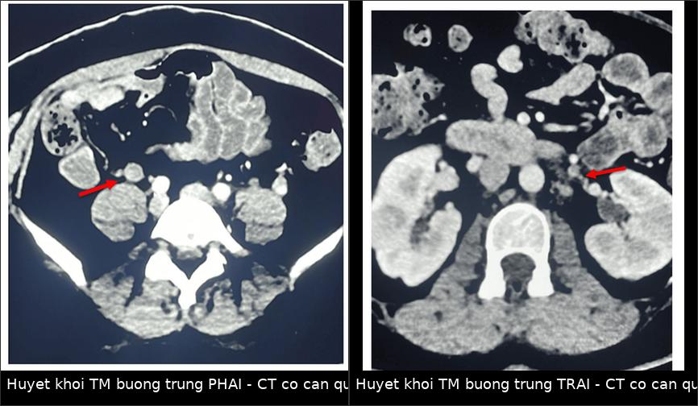
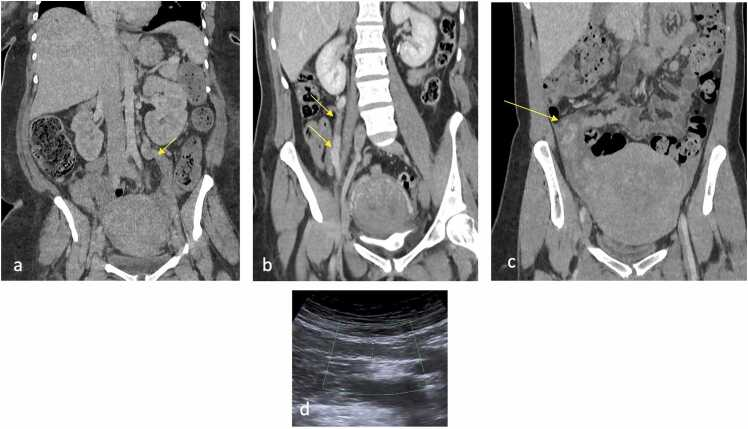
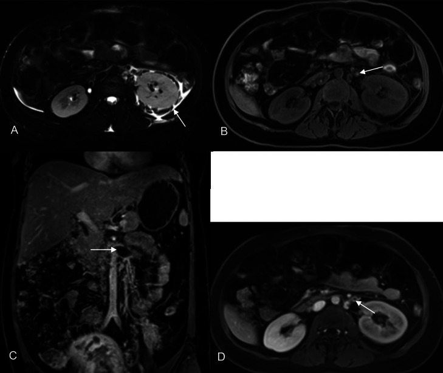
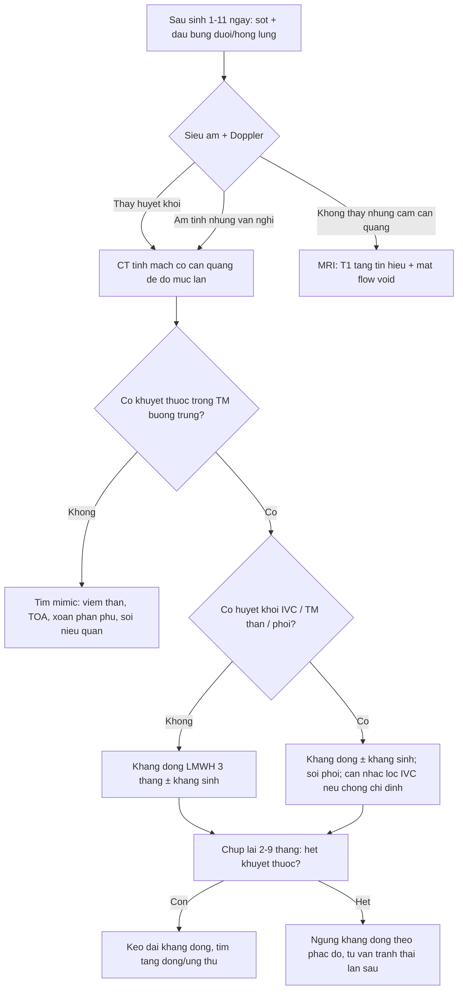
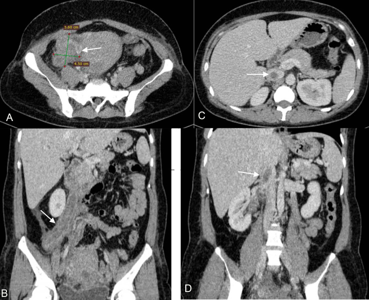

# 1623 — Huyết khối tĩnh mạch buồng trứng sau sinh / Postpartum ovarian vein thrombosis (POVT)

**Tags:** `pattern:huyet-khoi-mach` `pattern:khuyet-thuoc-long-mach` `vung:phan-phu` `vung:tieu-khung` `vung:than` `protocol:CT-bung-co-can-quang` `protocol:MRI-bung` `score:HU-nguong-36`
**Mức chắc chắn (certainty):** tổng hợp y văn (literature synthesis) — gồm 1 nghiên cứu đo HU trên CT không cản quang (Zeng W et al., *BMC Pregnancy Childbirth* 2026, PMC13471637, n = 52), 1 phân tích gộp về kháng đông (Riva N et al., *Res Pract Thromb Haemost* 2024, PMC11339252, 17 nghiên cứu / 997 bệnh nhân), 1 bài tổng quan hình ảnh sau sinh (Agarwal G et al., *Eur J Radiol Open* 2026, PMC13351678) và 2 báo ca có bàn luận chẩn đoán (Huynh QH et al., *Radiol Case Rep* 2025, PMC12084400; Alghamdi KM et al., *Cureus* 2026, PMC13430492). Chỗ hai nguồn mâu thuẫn (tỷ lệ mắc) được ghi rõ là **mâu thuẫn nguồn**, không chọn bừa.

## 1. Tổng quan bệnh học – cơ chế hình ảnh

- **Bệnh học:** huyết khối (thrombus) trong tĩnh mạch buồng trứng (ovarian vein — OV), thường kèm **viêm tắc tĩnh mạch nhiễm khuẩn (septic pelvic thrombophlebitis)** sau sinh. Tam chứng Virchow đủ cả ba vế trong ổ bụng sau sinh: **ứ trệ** (tử cung to chèn ép, tư thế xoay phải của tử cung khi mang thai), **tăng đông** (thai kỳ – hậu sản), **tổn thương nội mạc** (nhau bong, mổ lấy thai, nhiễm trùng tử cung) (Huynh QH et al. 2025).
- **TẠI SAO bên phải chiếm đa số (~90%):** tĩnh mạch buồng trứng phải **dài hơn, ngoằn ngoèo hơn, đổ vào tĩnh mạch chủ dưới (IVC) theo góc nhọn** → tốc độ dòng chảy giảm; **van yếu hơn**; trong thai kỳ **tử cung xoay phải chèn ép** tĩnh mạch phải. Tĩnh mạch trái đổ vào **tĩnh mạch thận trái** nên ít bị hơn (Huynh QH et al. 2025). Vì vậy khi thấy huyết khối **bên trái**, luôn phải tìm nguyên nhân khác (ung thư, tăng đông, sau mổ) — chi tiết ở mục 5.
- **Dịch tễ — hai nguồn lệch nhau, ghi nguyên vẹn:** (a) **0,02%** sau sinh đường âm đạo và **0,1%** sau mổ lấy thai (Zeng W et al. 2026); (b) **0,05–0,18%** sau sinh đường âm đạo và **1–2%** sau mổ lấy thai (Huynh QH et al. 2025). Con số thực có thể nằm giữa hai khoảng; **không dùng một con số duy nhất để tư vấn nguy cơ**. Điểm thống nhất: **mổ lấy thai làm tăng nguy cơ rõ rệt** (trong đoàn hệ 25 ca POVT có 15 ca mổ lấy thai).
- **TẠI SAO nguy hiểm:** huyết khối lan **liên tục** vào tĩnh mạch thận hoặc IVC và có thể **bắn lên phổi**. Trong đoàn hệ 25 ca, **40% (10/25)** có huyết khối đồng thời nơi khác: 4 ca lan trực tiếp (IVC/tĩnh mạch thận/tĩnh mạch chậu ngoài), 4 ca trong đám rối tĩnh mạch chậu – tĩnh mạch tử cung, 2 ca thuyên tắc xa (động mạch phổi, tĩnh mạch cảnh trong) (Zeng W et al. 2026). Y văn dẫn: **thuyên tắc phổi 25%** ở ca không điều trị, **tử vong tới 4%** (dẫn trong Zeng W et al. 2026).
- **Thời điểm:** khảo sát trong **1–11 ngày** sau sinh, trung bình **4,48 ± 3,14 ngày** (Zeng W et al. 2026) — khớp với mô tả "tuần đầu hậu sản" (Huynh QH et al. 2025). Sốt + đau hông lưng/bụng dưới **vẫn sốt sau khi đã dùng kháng sinh đúng** là bối cảnh kinh điển.
- **TẠI SAO máu cục sáng hơn trên CT không cản quang (cơ chế vật lý):** cục máu đông co lại, **cô đặc hemoglobin và protein**, không còn dòng chảy pha loãng → **tăng tỷ trọng so với máu lưu thông**. Đo được: **P-CT 45,52 ± 15,88 HU** ở ca bệnh vs **30,07 ± 4,92 HU** ở chứng (P < 0,001); **ngưỡng 36 HU** cho **độ nhạy 72%, độ đặc hiệu 92,6%** (AUC 0,773) (Zeng W et al. 2026). Tỷ lệ P-CT/IVC ≥ **1,105** cũng là ngưỡng có ý nghĩa (Se 64%, Sp 92,6%).
- **TẠI SAO khuyết thuốc là dấu chốt trên CT có cản quang:** thành tĩnh mạch **ngấm thuốc** trong khi lòng mạch bị cục máu lấm tấm **không ngấm** → **"target sign"**: vòng sáng + lòng tối. Giá trị đo: **E-CT 57,36 ± 17,62 HU** (bệnh) vs **113,33 ± 29,18 HU** (chứng), AUC **0,963** — cao hơn mọi chỉ số khác (Zeng W et al. 2026). CT có cản quang được báo cáo **Se 100%, Sp 99%** cho POVT (dẫn trong Huynh QH et al. 2025) — con số này lấy từ y văn tham khảo, **chưa phải thử nghiệm tiền cứu**.
- **TẠI SAO MRI hữu ích khi không dùng được cản quang:** huyết khối bán cấp chứa **methemoglobin** → **T1W tăng tín hiệu**, T2W giảm; mất **flow void**. Ca 2 của Huynh QH et al. (2025) cho thấy đúng chuỗi này: T2 fat-sat có **thận trái to + dịch quanh thận** (ứ trệ do tắc tĩnh mạch thận), T1W **tăng tín hiệu trong lòng tĩnh mạch**, sau gadolinium thấy khuyết thuốc ở tĩnh mạch thận và tĩnh mạch buồng trứng trái.
- **Siêu âm (first-line tại giường):** cấu trúc **dạng ống, không xẹp được, echo kém**, Doppler **mất hoặc giảm dòng**. Độ chính xác phụ thuộc người làm: **Se 55,6–63%, Sp 41,6–78%** (dẫn trong Huynh QH et al. 2025) — **siêu âm âm không loại trừ**.
- **D-dimer:** tăng sinh lý trong thai kỳ/hậu sản nên giá trị hạn chế; tuy nhiên **D-dimer 5.398 ± 7.265 vs 2.145 ± 2.393 ng/mL** (P < 0,05) và **ngưỡng 2.780,5 ng/mL** dự báo **huyết khối đồng thời nơi khác** với AUC **0,813** (Se 90%, Sp 66,7%) (Zeng W et al. 2026). Dùng để **phân tầng ca lan rộng**, không để chẩn đoán POVT đơn thuần.

## 2. Mẫu hình + chẩn đoán phân biệt theo vị trí (gamut)

**Trục A — theo bên và mức lan (quyết định kháng đông bao lâu, có cần lọc IVC):**

1. **Phải đơn thuần (~90% y văn; 52% trong đoàn hệ 25 ca):** ống tĩnh mạch giãn, khuyết thuốc, thâm nhiễm mỡ quanh mạch; bờ dưới tới ngã ba IVC.
2. **Trái (6% y văn; 20% đoàn hệ):** lan lên **tĩnh mạch thận trái** → thận to, ứ nước quanh thận; **bắt buộc tìm nguyên nhân nền** vì hiếm.
3. **Hai bên (14% y văn; 28% đoàn hệ):** thường nặng hơn, huyết khối lan IVC nhiều hơn; đo bên **lan dài nhất** khi tính chỉ số (Zeng W et al. 2026).
4. **Lan IVC/tĩnh mạch thận/tĩnh mạch chậu** (40% ca có huyết khối nơi khác) — đây là nhóm quyết định **lọc IVC** và **theo dõi thuyên tắc phổi**.
5. **Viêm tắc tĩnh mạch nhiễm khuẩn + thuyên tắc phổi nhiễm khuẩn:** sốt cao, cấy máu dương, **nốt mờ ngoại vi phổi có hang** — bệnh cảnh "sốt sau sinh kéo dài dù kháng sinh".

**Trục B — gamut "khuyết thuốc/dày quanh tĩnh mạch buồng trứng" (theo mimic):**

- **Giãn tĩnh mạch buồng trứng sinh lý hậu sản** — ống to nhưng **ngấm thuốc đều**, không khuyết thuốc, không thâm nhiễm mỡ (xem ảnh mục 3).
- **Huyết khối do khối u chèn ép** (ung thư buồng trứng/thận/tử cung, di căn) — huyết khối **bên trái**, kèm khối, không có bối cảnh hậu sản.
- **Viêm mô tế bào chậu/áp-xe phần phụ (TOA)** — khối có vỏ ngấm thuốc, khí trong ổ, nhưng tĩnh mạch vẫn ngấm thuốc.
- **Viêm thận – bể thận cấp** — thận to, giảm ngấm thuốc dạng hình nêm, dày cân quanh thận; **thường đi cùng** POVT nên đừng dừng khi thấy viêm thận.
- **Xoắn phần phụ** — buồng trứng to, cuống xoắn "whirlpool", **không có khuyết thuốc trong tĩnh mạch**.
- **Sỏi niệu quản** — đau quặn, ứ nước; đừng nhầm **niệu quản giãn** với tĩnh mạch giãn (mục 5).
- **Viêm nội mạc tử cung** — nội mạc dày, dịch/khí trong buồng tử cung, tĩnh mạch bình thường.

## 3. Bảng so sánh phân biệt (ma trận đối chiếu)

| Thực thể (entity) | Hình ảnh điển hình | Chốt vào (rule-in) | Chốt loại (rule-out) | Gợi ý xác nhận |
|---|---|---|---|---|
| **POVT** | Ống tĩnh mạch **giãn, thành ngấm thuốc, lòng có khuyết thuốc**, mỡ quanh mạch thâm nhiễm; phải > trái | **Khuyết thuốc trong tĩnh mạch buồng trứng + thành mạch ngấm thuốc** | Lòng mạch **ngấm thuốc đều hết** trên thì tĩnh mạch → không phải huyết khối | CT tĩnh mạch; MRI nếu cấm cản quang; siêu âm Doppler |
| **Giãn tĩnh mạch sinh lý hậu sản** | Ống to (**đường kính tăng**), bờ nhẵn, **không thâm nhiễm mỡ**, ngấm thuốc đều | **Ngấm thuốc đầy lòng + không viêm quanh mạch** | Có khuyết thuốc + dày thành + thâm nhiễm → POVT | So sánh hai bên; Doppler thấy dòng |
| **Huyết khối do ung thư chèn ép** | Huyết khối + **khối nguyên phát** (buồng trứng/thận/tử cung), thường **bên trái**, không hậu sản | **Có khối đặc + huyết khối cùng vùng** | Không khối, bối cảnh hậu sản điển hình → POVT đơn thuần | CT bụng–chậu có cản quang; CA-125 theo lâm sàng |
| **Viêm tắc tĩnh mạch nhiễm khuẩn** | POVT + **sốt cao, cấy máu (+), nốt phổi ngoại vi/hang** | **POVT + thuyên tắc phổi nhiễm khuẩn** | Không sốt, không ổ nhiễm → huyết khối "lạnh" | Cấy máu, X-quang/CT ngực |
| **Áp-xe phần phụ (TOA)** | Khối **có vỏ ngấm thuốc**, dịch, **khí trong ổ**, dính quai ruột | **Khối dạng ổ + khí, tách khỏi tĩnh mạch** | Tĩnh mạch ngấm thuốc bình thường | Siêu âm đầu dò âm đạo; theo dõi kháng sinh |
| **Xoắn phần phụ** | Buồng trứng to, **cuống xoắn**, giảm/không ngấm thuốc | **Dấu "whirlpool" ở cuống + buồng trứng to** | Không có khuyết thuốc tĩnh mạch | Siêu âm Doppler; mổ cấp cứu |
| **Viêm thận – bể thận** | Thận to, **giảm ngấm thuốc hình nêm**, dày cân quanh thận | **Tổn thương nhu mô thận + ứ nước** | Chỉ dày cân quanh thận do ứ trệ → nghĩ tắc tĩnh mạch thận | CT có cản quang; **luôn đọc kèm tĩnh mạch buồng trứng** |
| **Sỏi niệu quản** | **Nốt cản quang trong đường đi niệu quản**, ứ nước trên chỗ tắc | **Sỏi trong lòng niệu quản + ứ nước** | Cấu trúc dạng ống mềm, không cản quang → tĩnh mạch | CT không cản quang (sỏi); đối chiếu thì tĩnh mạch |

*Hai ca POVT sau sinh trên CT có cản quang: **trái — huyết khối tĩnh mạch buồng trứng phải**; **phải — huyết khối tĩnh mạch buồng trứng trái**. Nguồn: Alghamdi KM et al., *Cureus* 2026;18(7):e112028, PMC13430492 Fig. 1–2, CC BY 4.0 — ảnh ghép letterbox bằng `tools/make_composite.py`, không crop/kéo giãn.*

*(a,b) Tĩnh mạch buồng trứng **giãn sinh lý** hậu sản: bờ nhẵn, **không thâm nhiễm mỡ**. (c) **POVT phải**: tĩnh mạch giãn, viêm, có dịch quanh. (d) Doppler: **mất dòng** trong tĩnh mạch buồng trứng phải. Nguồn: Agarwal G et al., *Eur J Radiol Open* 2026;17:100789, PMC13351678 Fig. 13, CC BY 4.0.*

### Ba dấu hiệu đọc theo thứ tự (dùng như checklist)
1. **Có khuyết thuốc trong lòng tĩnh mạch không?** — nếu có, đo đường kính ống và mức lan (IVC? tĩnh mạch thận?).
2. **Thành mạch có ngấm thuốc và mỡ quanh mạch có thâm nhiễm không?** — phân biệt huyết khối "cũ, xơ" với viêm tắc cấp.
3. **Có huyết khối nơi khác không?** — IVC, tĩnh mạch thận, đám rối chậu, **và phổi** (thuyên tắc nhiễm khuẩn).

*Ca POVT trái lan tĩnh mạch thận: (A) T2 fat-sat — **thận trái to + dịch quanh thận**; (B) T1W — **huyết khối tăng tín hiệu** (methemoglobin); (C,D) sau gadolinium — khuyết thuốc ở tĩnh mạch thận và tĩnh mạch buồng trứng trái. Nguồn: Huynh QH et al., *Radiol Case Rep* 2025;20(7):3447–3453, PMC12084400 Fig. 5, CC BY-NC-ND 4.0 — dùng **nguyên bản**, không chỉnh sửa.*

## 4. Protocol chụp + cách xử trí theo mức lan

**Chọn modality theo bối cảnh:**

| Bối cảnh | Chọn | Lý do / ngưỡng |
|---|---|---|
| Đau bụng + sốt hậu sản, chưa rõ | **Siêu âm bụng–chậu + Doppler** trước | Không xạ, tại giường; nhưng **Se 55,6–63%** → âm không loại trừ |
| Nghi POVT, không chống chỉ định cản quang | **CT bụng–chậu có cản quang, thì tĩnh mạch cửa, lát ≤ 1 mm** | Se ~100% theo y văn; thấy mức lan IVC/thận và ổ nhiễm kèm |
| Đang cho con bú / dị ứng cản quang / cần tránh xạ | **MRI bụng: T1W, T2W fat-sat, T1 sau gadolinium ± DWI** | Huyết khối **T1 tăng**, T2 giảm, mất flow void; thấy toàn bộ chiều dài tĩnh mạch |
| Đã có POVT, tìm nguyên nhân khi **bên trái** hoặc không hậu sản | CT/MRI toàn ổ bụng + tầm soát ung thư | Bên trái hiếm (6%) → phải loại khối chèn ép |

**Đo và ghi vào phiếu (theo Zeng W et al. 2026):**
- **HU cục máu trên ảnh không cản quang (P-CT)** và **tỷ lệ P-CT/IVC** — ngưỡng gợi ý **36 HU** và **1,105**.
- **HU cục máu trên thì tĩnh mạch (E-CT)** và tỷ lệ E-CT/IVC — càng **thấp** càng chắc huyết khối.
- **Đường kính lớn nhất của huyết khối / đường kính IVC (D-ratio)** — ngưỡng **0,51** phân biệt với chứng; **12,1 mm** và D-ratio **0,61** ở nhóm có huyết khối nơi khác.
- **Mức lan:** tĩnh mạch thận, IVC, đám rối chậu; **đo bên lan dài nhất** nếu hai bên.

**Điều trị (số liệu để tư vấn):**

| Vấn đề | Số liệu / ngưỡng | Nguồn |
|---|---|---|
| Kháng đông: thời gian thực tế trong y văn | **≤ 3 tháng: 47,1%** nghiên cứu; **> 3–6 tháng: 35,3%**; **> 6 tháng: 17,6%** | Riva N et al. 2024 (17 nghiên cứu) |
| Thuốc hay dùng | **heparin đơn thuần 45,7%**, chuyển **kháng vitamin K 39,2%** | Riva N et al. 2024 |
| Tái phát huyết khối khi **có** kháng đông | **3,49%** (95% CI 1,12–6,95; 22/482) | Riva N et al. 2024 |
| Tái phát khi **không** kháng đông | **8,65%** (95% CI 2,61–17,35); **RR 0,70 (0,36–1,37)** — **khác biệt không có ý nghĩa** | Riva N et al. 2024 |
| Chảy máu nặng | **1,27%** (95% CI 0,48–2,38) | Riva N et al. 2024 |
| Tử vong ở nhóm điều trị | **2,43%** (95% CI 0,54–5,41) | Riva N et al. 2024 |
| Tái thông mạch | **89,4%** (95% CI 74,6–98,6; 163/184) | Riva N et al. 2024 |
| Thuyên tắc phổi nếu không điều trị | **25%**, tử vong **4%** | dẫn trong Zeng W et al. 2026 |

- **Kháng sinh:** dùng **cùng kháng đông** khi có sốt/nhiễm khuẩn hậu sản (clindamycin, gentamicin, quinolone, cephalosporin thế hệ 3) (Huynh QH et al. 2025). **Không** có bằng chứng kháng sinh đơn thuần thay được kháng đông khi đã có huyết khối lan.
- **Lọc IVC:** **không** là điều trị chuẩn; cân nhắc khi **chống chỉ định kháng đông** hoặc **huyết khối trôi nổi trong IVC**. Ca 1 của Huynh QH et al. (2025) đặt lọc vì đã mổ (appendectomy) ngay trước đó, và **rút lọc sau 9 tháng** khi CT sạch.
- **Lấy huyết khối bằng mổ:** rất hiếm, khi chống chỉ định kháng đông hoặc huyết khối trôi nổi trong IVC.
- **Theo dõi:** khám + siêu âm/CT lại **2–9 tháng** tùy ca (2 tháng ở ca 2, 9 tháng ở ca 1 của Huynh QH et al. 2025); mục tiêu là **hết khuyết thuốc** và **hết ứ trệ tĩnh mạch thận**. Tái thông gộp ~89% nhưng **không đồng nghĩa hết triệu chứng** — đánh giá lâm sàng song song.

## 5. Biến thể bình thường và cạm bẫy

- **Biến thể sinh lý hay bị gọi nhầm nhất:** hậu sản, **tĩnh mạch buồng trứng giãn tới ~10 mm** và tăng dòng là bình thường (ảnh a,b mục 3). Tiêu chuẩn phân biệt **không phải đường kính** mà là **khuyết thuốc + thâm nhiễm mỡ quanh mạch**. Đo đường kính đơn thuần sẽ dương tính giả hàng loạt.
- **Cạm bẫy 1 — chụp thì động mạch:** tĩnh mạch chưa ngấm thuốc → **giả khuyết thuốc**. Luôn đọc **thì tĩnh mạch cửa**, hoặc đối chiếu HU với IVC (tỷ lệ P-CT/IVC).
- **Cạm bẫy 2 — nhầm niệu quản với tĩnh mạch:** hậu sản hay có **ứ nước thận sinh lý**; niệu quản giãn là cấu trúc **dạng ống, thành mỏng, không ngấm thuốc**, đi sau phúc mạc và **đổ vào bàng quang**. Tĩnh mạch buồng trứng **đi lên** tới IVC (phải) hoặc tĩnh mạch thận (trái). Bám theo **hai đầu** của ống là cách phân biệt chắc nhất.
- **Cạm bẫy 3 — dừng lại ở "viêm thận":** viêm thận – bể thận và POVT **thường đi cùng** (ứ trệ + nhiễm khuẩn). Thấy thận to/giảm ngấm thuốc thì **vẫn phải lên tới IVC** xem tĩnh mạch buồng trứng.
- **Cạm bẫy 4 — bỏ sót bên trái và lan tĩnh mạch thận:** huyết khối trái lan lên tĩnh mạch thận gây **thận to, dịch quanh thận** — đọc như "viêm thận" mà bỏ qua huyết khối. Ca 2 của Huynh QH et al. (2025) chính là bẫy này, và MRI đã chốt.
- **Cạm bẫy 5 — khí trong buồng tử cung ngày 2–3 hậu sản là bình thường:** trên CT sau sinh, khí trong buồng tử cung có thể tồn tại vài ngày (trong bài tổng quan hình ảnh hậu sản, khí buồng tử cung ngày 2 **hết ngày 12**) — **không** đồng nghĩa viêm nội mạc/nhiễm trùng nếu không có sốt và dịch mủ. Đừng "thấy khí là gọi nhiễm trùng tử cung" rồi bỏ qua huyết khối.
- **Cạm bẫy 6 — "hết đau là ngừng kháng đông":** tái thông chỉ ~89% và tái phát vẫn xảy ra (3,49%); thời gian kháng đông phải theo **mức lan + yếu tố nguy cơ**, không theo triệu chứng.

## 6. Tự lượng giá — Blind Quiz

**Ca 1 — Nữ 27 tuổi, ngày 10 sau mổ lấy thai, sốt 38 °C, đau hông lưng trái, D-dimer tăng. Nhìn CT, mô tả trước khi mở đáp án.**

- Gợi ý lâm sàng: đã dùng kháng sinh, vẫn sốt; không có khối vùng chậu sờ thấy.
- Câu hỏi: Tổn thương nằm ở tĩnh mạch nào? Có lan không? Hai chẩn đoán phân biệt cần loại trừ và một dấu hiệu chốt?

<b>Bấm để hiện đáp án (findings + chẩn đoán)</b>

- Dấu hiệu: (A) buồng trứng phải to **56 × 45 mm**; (B) tái tạo sagittal: tĩnh mạch buồng trứng **dạng ống, thành ngấm thuốc, lòng đầy khuyết thuốc**; (C,D) huyết khối **lan vào IVC**. (Ca gốc: buồng trứng phải 65 × 50 mm trên siêu âm, tĩnh mạch 22 mm, mất dòng Doppler.)
- Chẩn đoán: **POVT phải lan IVC** — tam chứng Virchow hậu sản; khuyết thuốc + thành ngấm thuốc là chốt.
- Phân biệt cần loại trừ: **viêm ruột thừa** (ca gốc đã bị mổ ruột thừa oan trước khi chẩn đoán!) và **viêm thận – bể thận**; dấu chốt là **khuyết thuốc trong tĩnh mạch**, không phải đau khu trú.
- Xử trí: kháng đông + kháng sinh; ca gốc đặt **lọc IVC** (vì vừa mổ) và rút sau **9 tháng** khi CT sạch.
- Nguồn ảnh: Huynh QH et al., *Radiol Case Rep* 2025, PMC12084400 Fig. 2, CC BY-NC-ND 4.0 (nguyên bản).

**Ca 2 — Cùng bệnh nhân, MRI vì lý do khác. Hãy chỉ ra vì sao T1W lại là chuỗi xung "ăn tiền" ở đây.**

- Câu hỏi: Tín hiệu của huyết khối trên T1W tăng hay giảm, và tại sao? Thận trái có bất thường gì?

<b>Bấm để hiện đáp án</b>

- Dấu hiệu: (A) T2 fat-sat — **thận trái to, dịch quanh thận**; (B) T1W — **tăng tín hiệu trong lòng tĩnh mạch**; (C,D) sau gadolinium — **khuyết thuốc** ở tĩnh mạch thận trái và tĩnh mạch buồng trứng trái.
- Vì sao T1 tăng: huyết khối bán cấp có **methemoglobin nội bào** (Fe³⁺) → rút ngắn T1; kèm **mất flow void**.
- Hệ quả thận: tắc tĩnh mạch thận → **ứ trệ, thận to, dịch quanh thận** — đừng đọc là "viêm thận" đơn thuần.
- Nguồn ảnh: Huynh QH et al., *Radiol Case Rep* 2025, PMC12084400 Fig. 5, CC BY-NC-ND 4.0 (nguyên bản).

**Ca 3 — Bệnh nhân hậu sản đau bụng, CT có cản quang. Hai ảnh dưới là hai bên của cùng bệnh cảnh: bên nào và vì sao phải khác nhau về cách xử trí?**

- Câu hỏi: Dấu hiệu chính trên mỗi ảnh? Bên nào "điển hình" hơn, và bên còn lại buộc phải làm gì thêm?

<b>Bấm để hiện đáp án</b>

- Dấu hiệu: cả hai ảnh đều có **ống tĩnh mạch giãn với khuyết thuốc trung tâm** (mũi tên đỏ) — trái: tĩnh mạch buồng trứng **phải**; phải: tĩnh mạch buồng trứng **trái**.
- Vì sao khác nhau: bên phải là vị trí **~90%** ca (giải phẫu: dài, góc nhọn đổ vào IVC, van yếu, tử cung xoay phải chèn ép). Huyết khối **bên trái chỉ ~6%** → **bắt buộc tìm nguyên nhân nền** (khối chèn ép, ung thư, tăng đông) chứ không được coi là "POVT thông thường".
- Lưu ý phản biện: đoàn hệ 25 ca của Zeng W et al. (2026) lại có **20% bên trái** và **28% hai bên** — cao hơn y văn kinh điển, có thể do chọn bệnh và cỡ mẫu nhỏ; **không** dùng tỷ lệ này để hạ thấp cảnh giác với bên trái.
- Nguồn ảnh: Alghamdi KM et al., *Cureus* 2026, PMC13430492 Fig. 1–2, CC BY 4.0 (ảnh ghép letterbox).

## Bài liên quan chéo
- [532 – U xơ trong thai kỳ & thoái triển đỏ](../532-u-xo-trong-thai-ky-thoai-trien-do/lesson.md) (đau bụng cấp hậu sản — phân biệt)
- [553 – Đảo ngược tử cung do sinh](../553-dao-nguoc-tu-cung-do-sinh/lesson.md) (cấp cứu sản khoa, chảy máu)
- [554 – Polyp/u xơ sa qua cổ tử cung](../554-polyp-noi-mac-va-u-xo-sa-qua-co-tu-cung/lesson.md) (khối sa, chảy máu — không phải huyết khối)
- [070 – Thuyên tắc phổi & ĐMC cấp](../070-thuyen-tac-phoi-dmc-cap/lesson.md) (biến chứng thuyên tắc phổi)
- [146 – Huyết khối tĩnh mạch lách & nhồi máu lách](../146-huyet-khoi-tm-lach-va-nhoi-mau-lach/lesson.md) (huyết khối tạng ổ bụng — cùng nguyên lý khuyết thuốc)

## Ảnh
- Tên file theo quy ước `1623_<slug>_<Modality>_<SourceID>.jpg`; nguồn + giấy phép từng ảnh ở `images/CREDITS.md`.
- **CC BY 4.0** (PMC13351678, PMC13430492): dùng được, **cho phép tạo phái sinh** → có `composite_ovt-phai-trai.jpg`.
- **CC BY-NC-ND 4.0** (PMC12084400): **nguyên bản**, không crop/ghép/chú thích lên ảnh.

> Không dùng để chẩn đoán độc lập khi chưa có người hướng dẫn.
