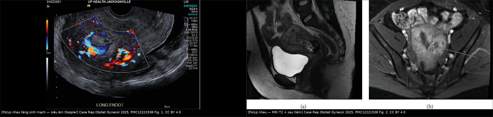
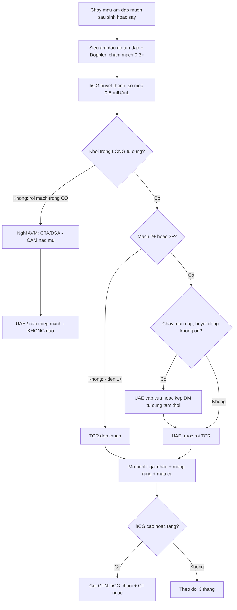
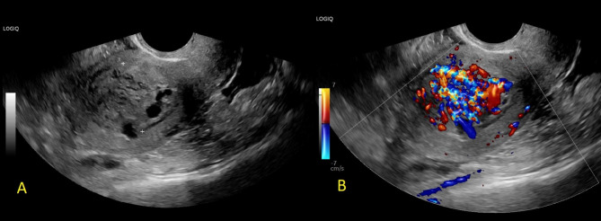
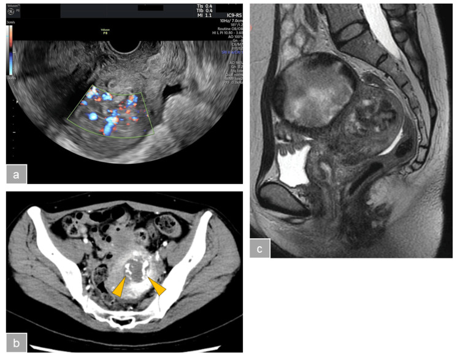

# 1624 — Polyp nhau & khối trong buồng tử cung sau sinh/sảy / Placental polyp

**Tags:** `pattern:khoi-long-tu-cung` `pattern:tang-sinh-mach` `pattern:chay-mau-au-dao` `vung:tu-cung` `vung:noi-mac` `protocol:sieu-am-dau-do` `protocol:CT-mach` `protocol:MRI-chau` `score:hCG`
**Mức chắc chắn (certainty):** tổng hợp y văn (literature synthesis) — gồm 1 đoàn hệ hồi cứu 17 ca có phân độ mạch máu (Sorano S et al., *Ann Med Surg* 2017, PMC5635338), 1 bài tổng quan + thuật toán chẩn đoán (Ishihara T et al., *Womens Health (Lond)* 2016, PMC5373263), và 5 báo ca có hình ảnh/hậu quả rõ (PMC12221538, PMC12374803, PMC10566062, PMC8142775, PMC8438750). **Không có RCT**; con số "tần suất" dưới đây là ước lượng từ y văn, không phải số đo dân số.

## 1. Tổng quan bệnh học – cơ chế hình ảnh

- **Bệnh học (pathology):** polyp nhau (placental polyp) là **mô nhau tồn dư** sau sảy/sinh/mổ lấy thai, **không được tống ra**, tổ chức hóa và **bám chắc vào thành tử cung**, tạo khối có cuống trong lòng tử cung. Mô học: **gai nhau (villi) đã tổ chức + màng rụng (decidua) + cục máu thoái hóa + nội mạc tái sinh** — chính thành phần xơ – máu này làm khối **bám chắc**, khác cục máu đông rời (Ishihara T et al. 2016).
- **Tần suất — ước lượng, chưa chắc:** được cho là biến chứng của **< 0,25%** tổng số thai kỳ, nhưng **tần suất thật chưa rõ** (Spielvogel R 2023, ghi rõ "actual incidence is unknown").
- **Thời điểm — ngưỡng số quan trọng:** trung vị **33 ngày** sau khi thai kỳ kết thúc, **khoảng 9–392 ngày** trong đoàn hệ 17 ca (Sorano S et al. 2017). Nghĩa là polyp nhau có thể xuất hiện **hơn 1 năm** sau sinh/sảy — **bệnh nhân thường không liên hệ với lần có thai trước**, đây là lý do chẩn đoán muộn. Y văn cũng ghi nhận thể xuất hiện **nhiều tháng đến nhiều năm** sau thai kỳ (Di Serio M et al. 2021: 3 tháng sau sảy bằng thuốc).
- **TẠI SAO chảy máu tái diễn (cơ chế mô – mạch):** khối gồm gai nhau còn mạch và mô hoại tử; bề mặt bị **loét – bong từng đợt** khi nội mạc phủ lên trên tróc ra → chảy máu **từng đợt, màu nâu – đỏ sẫm**, kéo dài. Thể **tăng sinh mạch (hypervascular)** có **động mạch nuôi lớn từ động mạch tử cung** đi vào cuống → nạo buồng tử cung "mù" có thể mở đúng cuống mạch và gây **băng huyết ồ ạt** (Ishihara T et al. 2016).
- **Đo được mức độ nguy hiểm:** trong đoàn hệ 17 ca, **16/17 có chảy máu**, **8 ca chảy máu nặng phải chuyển cấp cứu** (Sorano S et al. 2017). Ca tăng sinh mạch nặng: tổng lượng máu mất **4 L**, phải kích hoạt phác đồ truyền máu khối lượng lớn, và cuối cùng **cắt tử cung** (Kegel S et al. 2025). Ca khác: **sốc mất máu**, truyền **8 đơn vị hồng cầu + 4 đơn vị huyết tương tươi đông lạnh** (Yoshiike K et al. 2025).
- **TẠI SAO hCG chỉ có giá trị LOẠI TRỪ một phần (vật lý – sinh hóa):** hCG giảm về mức không có thai **0–5 mIU/mL trong vòng 4 tuần sau sinh** (Ishihara T et al. 2016 dẫn y văn). Vì vậy **trong 4 tuần đầu, hCG còn cao không chứng minh polyp nhau**; ngược lại, đoàn hệ 17 ca có **hCG trung vị 3,5 mIU/mL** (khoảng < 1,0–625,1), **4 ca < 1,0 mIU/mL** — tức **hCG thấp/âm KHÔNG loại trừ polyp nhau**. Giá trị thật của hCG là **phân biệt với bệnh nguyên bào nuôi tồn dư/GTN** (khi đó hCG cao và/hoặc tăng dần).
- **TẠI SAO siêu âm thấy khối "sáng" và Doppler là bắt buộc:** khối là mô đặc – xơ – máu cũ nên **echo hỗn hợp, có vùng tăng âm**; Doppler màu/power phát hiện **mạch trong khối và mạch nuôi từ cơ tử cung**. Nhưng **bản thân "có mạch" không phân biệt được polyp nhau với dị dạng động–tĩnh mạch tử cung (AVM)** — Ishihara T et al. nói thẳng: Doppler của AVM "không thể phân biệt" với polyp nhau trong nhiều ca.
- **TẠI SAO MRI giúp (và tại sao T2 sáng):** polyp nhau thường **T1 thấp, T2 cao không đồng nhất** (mô phù, dịch, mạch), và **flow void ở cuống** khi có dòng nhanh (Ishihara T et al. 2016). AVM thì biểu hiện **"khối mạch" lan tỏa, ngoằn ngoèo trong cơ tử cung**, không phải khối có cuống trong lòng. Vì vậy: **polyp = khối trong LÒNG có cuống; AVM = rối mạch trong CƠ**.
- **Phân độ mạch máu (dùng được ngay tại giường) — thang 0 → 3+:** cả **Doppler màu** và **MRI có cản quang** đều chấm 4 bậc: **(−)** không có dòng / **1+** nhẹ–vừa / **2+** nhiều / **3+** rất nhiều. **3+ = dòng phong phú trong polyp nối liền với dòng của cơ tử cung**. Nhóm **mạch mạnh = 2+ hoặc 3+ (n = 13)**, **mạch yếu = − đến 1+ (n = 4)**; bậc MRI **tương ứng** với bậc Doppler (2+ trên MRI ≈ 1+–2+ Doppler; 3+ MRI ≈ 2+ Doppler) (Sorano S et al. 2017).

## 2. Mẫu hình + chẩn đoán phân biệt theo vị trí (gamut)

**Trục A — theo thời gian sau thai kỳ (quyết định nghĩ tới bệnh gì trước):**

| Thời điểm | Nghĩ trước tiên | Vì sao |
|---|---|---|
| **≤ 4 tuần** | **Sản phẩm thai tồn dư (RPOC)** còn hoạt động | hCG còn cao sinh lý, nội mạc dày; polyp nhau chưa tổ chức hóa xong |
| **4 tuần – 6 tháng** | **Polyp nhau** (đỉnh ~33 ngày) | Khối có cuống, bám chắc, chảy máu từng đợt |
| **> 6 tháng – nhiều năm** | **Polyp nhau muộn** · AVM · GTN · polyp nội mạc | Bệnh nhân không nghĩ mình "còn sót nhau"; dễ bỏ |

**Trục B — theo độ mạch máu (quyết định cách can thiệp, không chỉ chẩn đoán):**
1. **Mạch yếu (−/1+):** khối ít mạch → **cắt qua nội soi buồng tử cung (TCR)** an toàn, không cần can thiệp mạch.
2. **Mạch mạnh (2+/3+):** có **động mạch nuôi lớn** → **TCR đơn thuần nguy cơ băng huyết**; cần **giảm dòng trước** (nút mạch tử cung – UAE, hoặc **kẹp động mạch tử cung tạm thời qua nội soi ổ bụng**).
3. **Mạch rất mạnh + mất máu cấp:** ưu tiên **UAE cấp cứu**, sau đó mới bóc khối; cắt tử cung khi không kiểm soát được.

**Trục C — gamut chẩn đoán phân biệt (7 thực thể):**
- **Sản phẩm thai tồn dư (RPOC)** — mô thai còn **hoạt động**, hCG dương, mạch trong khối.
- **Polyp nhau** — mô nhau **xơ hóa, bám chắc**, hCG thấp/âm, khối có cuống.
- **Dị dạng động–tĩnh mạch tử cung (AVM)** — rối mạch trong **cơ tử cung**, hCG âm, dòng **tốc độ cao – trở kháng thấp**; **nạo = nguy cơ chết người**.
- **Bệnh nguyên bào nuôi thể tồn dư/GTN (gồm choriocarcinoma)** — hCG **cao và tăng**, khối xâm lấn cơ, di căn.
- **Polyp nội mạc** — khối nhỏ, **một cuống mạch (pedicle artery)**, không liên quan thai kỳ.
- **U xơ dưới niêm mạc** — T2 **tối đều**, bờ rõ, không có mạch kiểu cuống mới.
- **Cục máu đông tồn dư** — di động, **không có mạch trong khối**, tự tống ra.

## 3. Bảng so sánh phân biệt (ma trận đối chiếu)

| Thực thể (entity) | Hình ảnh điển hình | Chốt vào (rule-in) | Chốt loại (rule-out) | Gợi ý xác nhận |
|---|---|---|---|---|
| **Polyp nhau** | Khối **trong lòng tử cung**, echo hỗn hợp, **có cuống + mạch nuôi từ cơ**; MRI **T1 thấp, T2 cao không đồng nhất**, flow void ở cuống | **Khối có cuống bám thành + tiền sử thai/sảy + chảy máu từng đợt + hCG thấp** | **Không có mạch trong khối + khối di động** → cục máu; **rối mạch trong cơ** → AVM | TCR lấy mô + mô bệnh học |
| **RPOC hoạt động** | Nội mạc dày không đều, **khối trong lòng có mạch**, có thể mất tiếp giáp nội mạc – cơ | **≤ 4 tuần sau thai + hCG còn dương + mạch trong khối** | **> 4 tuần + hCG < 5 mIU/mL** → ít khả năng RPOC hoạt động | Theo dõi hCG; TCR/hút nếu chảy máu |
| **AVM tử cung** | **Rối mạch trong CƠ tử cung**, nhiều ổ, dòng **tốc độ cao – trở kháng thấp**; MRI: nhiều flow void lan tỏa | **hCG âm + rối mạch lan trong cơ + tiền sử nạo/mổ** | **Khối khu trú trong LÒNG có cuống đơn độc** → polyp, không phải AVM | **CT/DSA** lập bản đồ; **KHÔNG nạo mù** |
| **GTN / choriocarcinoma** | Khối xâm lấn cơ, tăng sinh mạch, **hoại tử – xuất huyết**, có thể di căn phổi | **hCG cao và tăng dần + khối xâm lấn cơ** | **hCG thấp, ổn định (< 5 mIU/mL)** → không nghĩ GTN | hCG chuỗi + CT ngực; FIGO/WHO |
| **Polyp nội mạc** | Khối nhỏ trong lòng, **một cuống mạch**, T2 trung tính | **Một cuống mạch đơn độc + không liên quan thai kỳ** | **Nhiều mạch + cuống rộng + tiền sử thai gần** → polyp nhau | TCR + mô bệnh |
| **U xơ dưới niêm mạc** | Khối **T2 tối đều**, bờ rõ, có vỏ giả, **mạch bao quanh** chứ không phải mạch trong | **T2 tối đều + bờ rõ + vôi hóa** | **T2 cao không đồng nhất + mạch trong khối** → polyp/RPOC | MRI; TCR |

*Trái: siêu âm đầu dò âm đạo có Doppler màu — nội mạc dày 2,7 cm, tăng sinh mạch rõ trong khối. Phải: MRI (a) T2 đứng dọc và (b) sau tiêm trục — khối 4 cm trong lòng tử cung có mạch nuôi và vùng xuất huyết cấp. Nguồn: Kegel S et al., Case Rep Obstet Gynecol 2025, PMC12221538 Fig. 1–2, CC BY 4.0. Ảnh ghép letterbox, không crop.*

### Ba dấu hiệu "đọc được" quyết định hướng đi
- **Vị trí:** trong **lòng tử cung** (polyp/RPOC) hay trong **cơ tử cung** (AVM/GTN) — đây là câu hỏi đầu tiên, quyết định có được nạo hay không.
- **Cuống:** **một cuống + mạch nuôi từ cơ tử cung** = polyp; **nhiều ổ mạch lan tỏa** = AVM.
- **hCG:** **thấp/âm** nghiêng polyp/AVM; **cao hoặc tăng** nghiêng GTN/RPOC hoạt động.

## 4. Protocol chụp + phân độ mạch máu + xử trí

**Thứ tự hình ảnh (bắt buộc theo trình tự này khi có chảy máu âm đạo muộn sau sinh/sảy):**

| Bước | Phương thức | Thông số / nội dung | Vì sao |
|---|---|---|---|
| 1 | **Siêu âm đầu dò âm đạo + Doppler màu/power** | Đo nội mạc, mô tả khối (vị trí, cuống, echo), **chấm độ mạch 0–3+**; đặt **PRF thấp** để không bỏ sót dòng chậm | Tại giường, rẻ; **phân tầng mạch máu là yếu tố dự báo chảy máu** |
| 2 | **β-hCG huyết thanh** | So với mốc **0–5 mIU/mL**; lặp lại để xem **xu hướng** | Loại trừ GTN; **không dùng để chẩn đoán polyp** |
| 3 | **CT mạch (CTA) bụng–chậu** | Dựng 3D: **động mạch nuôi** (từ động mạch tử cung) vs **nidus – mạch vào/ra của AVM** | Lập bản đồ trước can thiệp; nhanh hơn MRI khi đang chảy máu |
| 4 | **MRI chậu (T1/T2 + gadolinium)** | Xác định **trong lòng vs trong cơ**, flow void ở cuống, mức ngấm | Khi **không chảy máu cấp**; phân biệt polyp – AVM – GTN tốt hơn |

**Phân độ mạch máu 0–3+ (Sorano S et al. 2017)** — dùng cả Doppler và MRI, hai bậc tương ứng nhau:

| Bậc | Doppler màu | MRI sau tiêm | Nhóm | Cách xử trí đã báo cáo |
|---|---|---|---|---|
| **−** | Không có dòng | Không ngấm | **Yếu (n = 4)** | TCR đơn thuần an toàn (1 ca tự khỏi khi chờ mổ) |
| **1+** | Nhẹ – vừa | Nhẹ – vừa | **Yếu** | TCR đơn thuần |
| **2+** | Nhiều | Nhiều | **Mạnh (n = 13)** | **UAE trước + TCR**: **10/10 không chảy máu nặng** |
| **3+** | Rất nhiều, **liền với dòng cơ tử cung** | Rất nhiều | **Mạnh** | Như trên; TCR **không** UAE: **2/3 ca chảy máu nặng, cả 2 phải truyền máu, 1 ca phải UAE sau mổ** |

**Điểm thực hành quan trọng:**
- **Không nạo buồng tử cung "mù" khi Doppler thấy mạch mạnh (2+/3+)** — đây là sai lầm gây băng huyết. Đoàn hệ cho thấy **TCR không UAE ở nhóm mạch mạnh: 2/3 ca chảy máu nặng**.
- **Lựa chọn thay UAE:** **kẹp động mạch tử cung tạm thời qua nội soi ổ bụng** rồi TCR — tránh liều xạ, tránh thiếu máu tử cung lâu dài, và **quan sát được thủng tử cung** (Yoshiike K et al. 2025). Ca này bệnh nhân **mất 8 đơn vị hồng cầu + 4 đơn vị huyết tương** trước đó.
- **Nếu đã UAE mà vẫn chảy máu:** ca Kegel S et al. (2025) — UAE hai bên **ngày hậu sản 1** nhưng vẫn chảy máu, phải **hút lại lần 2**, rồi **tái nhập ngày 15** vì khối tăng sinh mạch còn đó → **cắt tử cung** theo nguyện vọng. Bài học: **UAE cầm máu chứ không lấy mô**; khối còn thì còn nguồn chảy.
- **Theo dõi sau điều trị:** siêu âm lại **3 tháng**; ca Spielvogel R (2023) **không tái phát sau 3 tháng**; hCG không cần đo lại thường quy nếu trước đó thấp (đoàn hệ **không đo hCG sau điều trị ở bất kỳ ca nào**).

## 5. Biến thể bình thường và cạm bẫy

- **Cạm bẫy 1 — "đã sạch sẽ sau sảy" nên loại trừ:** ca Spielvogel R (2023) có **siêu âm 1 tuần sau sảy bằng thuốc xác nhận sạch, hết ra máu**, rồi **2 tháng sau** xuất hiện khối tăng sinh mạch mới. **Kết luận "sạch" ở thời điểm sớm không loại trừ polyp nhau về sau.**
- **Cạm bẫy 2 — hCG thấp bị dùng để loại trừ:** **4/12 ca có hCG < 1,0 mIU/mL** mà vẫn là polyp nhau (Sorano S et al. 2017). Đừng loại trừ vì hCG âm.
- **Cạm bẫy 3 — nạo trên AVM:** Doppler "có mạch" không phân biệt polyp với AVM (Ishihara T et al. 2016). Nếu khối nằm **trong cơ**, nhiều ổ mạch, hCG âm → **tuyệt đối không nạo**; chuyển CTA/DSA.
- **Cạm bẫy 4 — chỉ thấy "nội mạc dày":** ca Kegel S et al. hình ảnh ban đầu chỉ là **nội mạc dày 2,7 cm** tăng sinh mạch; nếu chỉ mô tả "nội mạc dày" sẽ bỏ khối 4 cm thật sự. Luôn **đo và mô tả khối**, không chỉ độ dày nội mạc.
- **Cạm bẫy 5 — cài đặt Doppler sai:** PRF cao (thang vận tốc lớn) làm **mất dòng chậm** trong polyp; hạ PRF và tăng gain vừa phải trước khi kết luận "không có mạch".
- **Cạm bẫy 6 — nhầm với biến thể bình thường:** **cục máu đông trong lòng tử cung hậu sản** là bình thường và **không có mạch trong khối**; **nội mạc dày ≤ 1,3 cm đối xứng, không khối, không mạch** sau sảy là hình ảnh chờ hồi phục, không phải polyp. Đừng can thiệp chỉ vì "nội mạc dày".
- **Cạm bẫy 7 — quên tuyến giáp/nhiễm trùng:** polyp nhau có thể là **ổ nhiễm khuẩn** (sốt, dịch hôi) và gây **thiếu máu thiếu sắt mạn**; đừng chỉ tập trung vào "khối" mà bỏ toàn cảnh.

## 6. Tự lượng giá — Blind Quiz

**Ca 1 — Sản phụ 29 tuổi, sinh thường 36 tuần, ra máu tiếp diễn sau sinh. Nhìn ảnh trước, mô tả trước khi mở đáp án.**

- Gợi ý lâm sàng: lượng máu mất lúc sinh 1.300 mL, đã hút buồng tử cung vì còn mô; vẫn ra máu.
- Câu hỏi: (1) Khối nằm ở đâu, kích thước? (2) Vì sao khối "tăng sinh mạch" lại là yếu tố quyết định cách xử trí? (3) Ba chẩn đoán phân biệt và dấu chốt?

<b>Bấm để hiện đáp án (findings + chẩn đoán)</b>

- **Dấu hiệu:** nội mạc dày **2,7 cm**, tăng sinh mạch rõ; MRI thấy **khối 4 cm trong lòng tử cung có mạch nuôi + vùng xuất huyết cấp**.
- **Chẩn đoán:** **polyp nhau tăng sinh mạch** — mô nhau tổ chức hóa bám chắc, có động mạch nuôi lớn nên **hút/nạo không lấy hết và gây chảy máu**.
- **Diễn biến thật của ca:** tổng mất máu **4 L**, truyền máu khối lượng lớn, **UAE hai bên ngày hậu sản 1**, vẫn chảy → hút lần 2 → **tái nhập ngày 15** → **cắt tử cung**.
- **Phân biệt:** RPOC hoạt động (hCG còn cao), AVM (rối mạch trong cơ, hCG âm), GTN (hCG cao/tăng).
- **Nguồn ảnh:** Kegel S et al., *Case Rep Obstet Gynecol* 2025, PMC12221538 Fig. 1–2, CC BY 4.0.

**Ca 2 — Sảy bằng thuốc, siêu âm 1 tuần sau sạch, hết ra máu. Hai tháng sau ra máu trở lại.**

- Câu hỏi: (1) Mô tả khối trên 2 ảnh (A không Doppler, B có Doppler)? (2) Có cần nạo ngay không? (3) Theo dõi thế nào?

<b>Bấm để hiện đáp án</b>

- **Dấu hiệu:** (A) khối echo hỗn hợp trong lòng tử cung; (B) **tăng sinh mạch rõ** trong khối.
- **Chẩn đoán:** **polyp nhau sau sảy hoàn toàn** — khối mới xuất hiện dù lần siêu âm trước sạch.
- **Xử trí trong ca:** **hút buồng tử cung bằng ống hút điện tại phòng khám** đã khỏi; siêu âm **3 tháng** sau không tái phát.
- **Bài học:** "sạch sau sảy" không loại trừ polyp nhau muộn; khối có mạch nhưng nhỏ, chảy máu vừa → hút có kiểm soát là đủ.
- **Nguồn ảnh:** Spielvogel R, *BMC Womens Health* 2023, PMC10566062 Fig. 2, CC BY 4.0.

**Ca 3 — Sau sảy, sốc mất máu. Ảnh gồm siêu âm Doppler, CT có cản quang và MRI.**

- Câu hỏi: (1) Ba ảnh cho thấy gì giống nhau? (2) Vì sao phải xử lý mạch trước khi bóc khối? (3) Nêu một cách giảm dòng **không dùng tia xạ**.

<b>Bấm để hiện đáp án</b>

- **Dấu hiệu:** (a) siêu âm Doppler — khối trong lòng tử cung **tăng sinh mạch mạnh**; (b) CT trục có cản quang — khối ngấm thuốc mạnh (đầu mũi tên); (c) MRI T2 đứng dọc — khối chiếm lòng tử cung.
- **Chẩn đoán:** **polyp nhau tăng sinh mạch** gây **sốc mất máu**; bệnh nhân đã được truyền **8 đơn vị hồng cầu + 4 đơn vị huyết tương tươi đông lạnh**.
- **Vì sao xử lý mạch trước:** cắt khối khi động mạch tử cung còn tưới đầy đủ → mở cuống mạch lớn → băng huyết; giảm dòng trước làm cuộc bóc khối "khô" hơn.
- **Cách không dùng tia xạ:** **kẹp động mạch tử cung tạm thời qua nội soi ổ bụng** rồi **TCR**; đây là kỹ thuật của ca này, tránh liều xạ của UAE và tránh thiếu máu tử cung kéo dài.
- **Nguồn ảnh:** Yoshiike K et al., *Cureus* 2025, PMC12374803 Fig. 1, CC BY 4.0.

## Bài liên quan chéo
- [500 – Tổng quan Hệ Vú & Sản phụ khoa](../500-tong-quan-vu-san-phu-khoa/lesson.md)
- [550 – Thai sớm, sảy thai, thai ngoài tử cung](../550-thai-som-say-thai-thai-ngoai-tu-cung/lesson.md) (bối cảnh sảy thai – nguồn gốc polyp nhau)
- [551 – Bệnh nguyên bào nuôi thai kỳ](../551-benh-nguyen-bao-nuoi-thai-ky/lesson.md) (phân biệt với GTN, hCG chuỗi)
- [553 – Đảo ngược tử cung do sinh](../553-dao-nguoc-tu-cung-do-sinh/lesson.md) (băng huyết sau sinh, khối trong âm đạo)
- [554 – Polyp nội mạc & u xơ có cuống sa qua cổ tử cung](../554-polyp-noi-mac-va-u-xo-sa-qua-co-tu-cung/lesson.md) (khối trong lòng tử cung, cuống mạch)
- [1623 – Huyết khối tĩnh mạch buồng trứng sau sinh](../1623-huyet-khoi-tinh-mach-buong-trung-sau-sinh/lesson.md) (đau + sốt sau sinh)
- [1640 – Xoắn tử cung trong thai kỳ](../1640-xoan-tu-cung-trong-thai-ky/lesson.md) (đau bụng cấp + bất thường trục tử cung)

> Không dùng để chẩn đoán độc lập khi chưa có người hướng dẫn.
