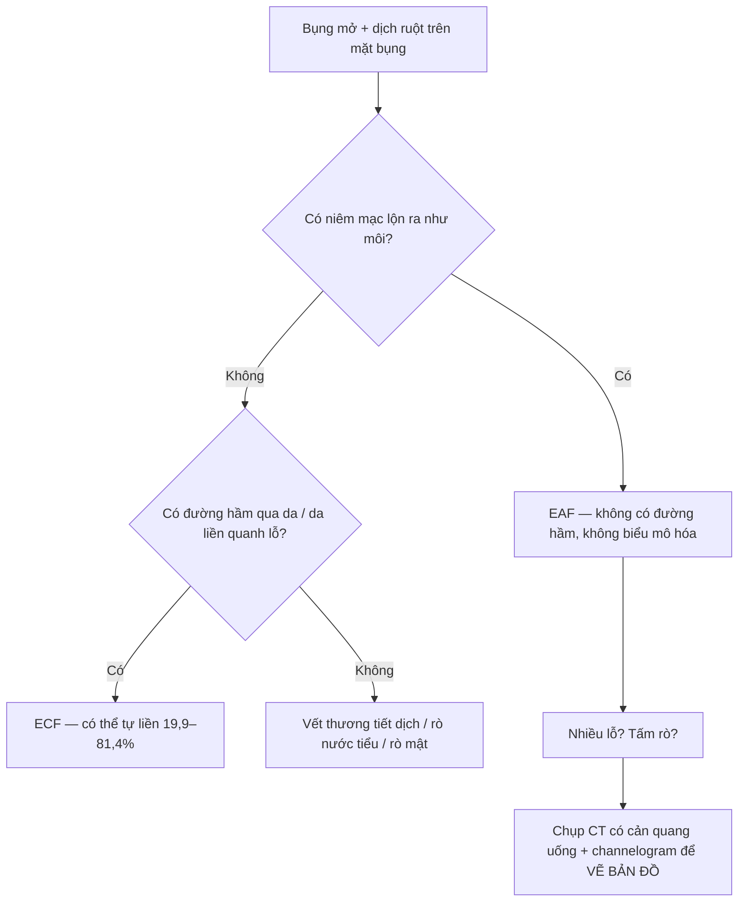
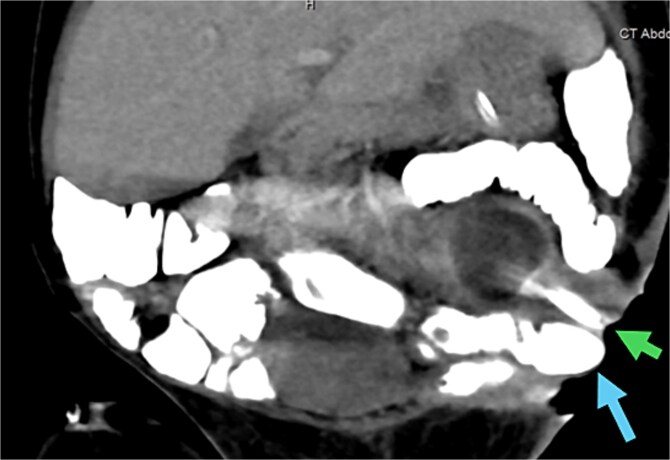
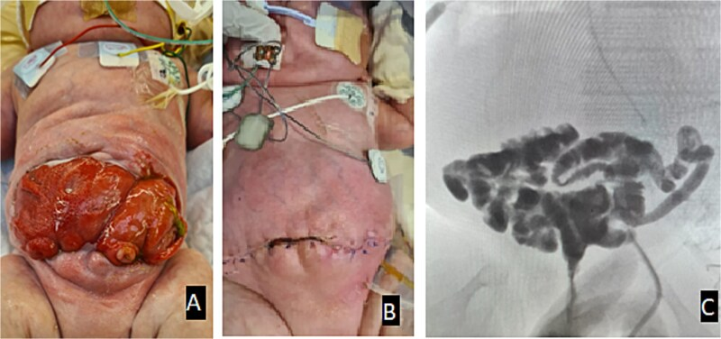
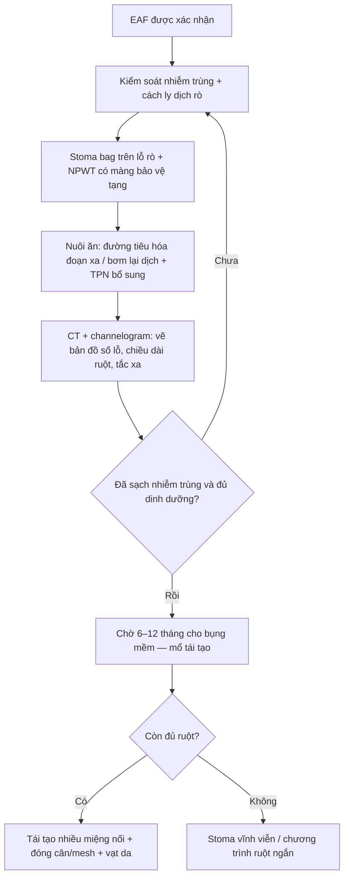
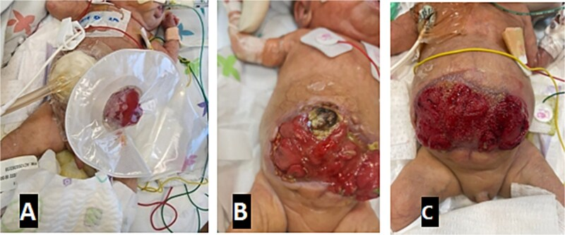
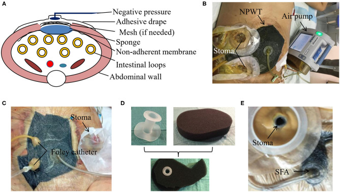

# 1625 — Rò ruột–khí quyển ở trẻ / Enteroatmospheric fistula (EAF) after open abdomen

**Tags:** `pattern:ro` `pattern:bung-mo` `vung:thanh-bung` `vung:ruot-non` `score:Bjorck` `protocol:CT-bung-can-quang` `protocol:NPWT`
**Mức chắc chắn (certainty):** tổng hợp y văn (literature synthesis) — số liệu dịch tễ/ngưỡng lấy từ 1 nghiên cứu thuần tập lớn có đối chứng theo điểm xu hướng (Schaaf S et al., *Br J Surg* 2023, PMC10638526), 1 tổng quan về xử lý rò bằng NPWT (Pepe G et al., *J Clin Med* 2024, PMC10932196), 1 tổng quan kỹ thuật cách ly rò (Huang J et al., *Front Surg* 2020, PMC7855170); phần đặc thù nhi khoa dựa trên **1 ca nguyên văn** sơ sinh cực non (Alhalabi R et al., *J Surg Case Rep* 2025, PMC12319319) — ca này **không điển hình về mức độ nặng** (bụng mở 6 tháng), đã ghi chú phản biện. Số nào nguồn không nêu thì ghi **"chưa rõ"**, không bịa.

## 1. Tổng quan bệnh học – cơ chế hình ảnh

- **Định nghĩa tạo ra mọi thứ còn lại của bài:** rò ruột–khí quyển (enteroatmospheric fistula — EAF) là thông thương giữa **lòng ruột và môi trường không khí** qua một **bụng còn mở** (laparostomy), **KHÔNG có đường hầm qua da và KHÔNG có biểu mô hóa** — niêm mạc lộn ra như "môi" dính trực tiếp lên mặt bụng. Vì vậy EAF **không thể tự liền** theo cơ chế của rò ruột–da (enterocutaneous fistula — ECF); đây là lý do về mặt **giải phẫu**, không phải về mặt điều trị.
- **Ngưỡng định lượng phân biệt EAF với ECF (cửa 1 của Argon):** ECF đóng kín tự phát **19,9–81,4%**; trong số đó **90% đóng trong tháng đầu** sau khi kiểm soát nhiễm trùng, thêm **10% trong tháng thứ hai**, và **KHÔNG ca nào đóng sau 2 tháng** (Pepe G et al. 2024). EAF nằm ngoài quy luật này → **chờ tự liền ở EAF là mất thời gian và mất ruột**.
- **Dịch tễ định lượng:** trong sổ bộ **EHS Open Abdomen Registry (1009 bệnh nhân, 2015–2022)** có **71 EAF = 7,0%**; y văn khác ghi **3–19%** (Schaaf S et al. 2023). Thời gian từ lúc **bắt đầu bụng mở đến khi hình thành EAF: 23,2 ± 20,3 ngày** — nghĩa là EAF là biến cố của **tuần thứ 2–6**, không phải của ngày hậu phẫu đầu.
- **TẠI SAO phòng được (và vì sao nó là lỗi kỹ thuật, không phải "xui"):** màng bảo vệ tạng (visceral protective layer — VPL, film đục lỗ trơ) đặt giữa ruột và băng/mesh làm **giảm EAF một nửa**: **4,1% vs 10,7%** (chưa ghép cặp) và **6,1% vs 16,3%** (sau ghép cặp), **OR 0,36 (95% CI 0,21–0,60)**; sau ghép cặp **OR 0,34 (0,17–0,68)**. Kỹ thuật đóng **động (dynamic fascial traction)** cho **4,3%** so với **11,9%** ở đóng tĩnh (số gộp dẫn trong Schaaf S et al. 2023). Ruột tiếp xúc trực tiếp với bọt biển/mesh ẩm + áp lực âm là **nguyên nhân cơ học** của lỗ rò.
- **TẠI SAO vẫn còn rò dù đã che chắn:** **55% EAF (39/71) xảy ra ở nhóm đóng cân THẤT BẠI** — bụng mở càng lâu, ruột càng phù, càng dễ dính vào vật liệu. Tỉ lệ đóng cân chung chỉ **55,6%** (nhóm VPL **76,0%** vs **54,5%**, P = 0,001). Bài học thực hành: **EAF là dấu hiệu của một bụng mở bị kéo dài**.
- **TẠI SAO nguy hiểm không nằm ở "mất dịch" mà ở nhiễm trùng:** **77% tử vong của rò ruột do nhiễm trùng huyết** (Pepe G et al. 2024); tử vong chung của rò ruột còn **15–30%** dù đã có nuôi ăn tĩnh mạch và hồi sức. Dịch ruột đổ lên mặt bụng **tự tiêu hóa da**, duy trì nhiễm trùng tại chỗ và là nguồn nhiễm khuẩn huyết liên tục.
- **TẠI SAO trẻ em khác người lớn — 3 điểm cơ học:**
  1. **Dự trữ ruột:** trẻ sơ sinh chỉ có ~**200–250 cm** ruột non; mất **1 cm** ở trẻ non tháng tương đương mất nhiều hơn ở người lớn → nguy cơ **hội chứng ruột ngắn**. Ca nguyên văn kết thúc với **50 cm ruột non** còn lại nhưng **giữ nguyên van hồi–manh tràng và toàn bộ đại tràng** — đây chính là phần "đệm" giúp trẻ đạt **tự chủ đường tiêu hóa**.
  2. **Thành bụng mỏng, áp lực thấp:** mức NPWT phải hạ theo cân nặng (**−20 mmHg** ở sơ sinh < 2 kg, **−50** nhũ nhi, **−75** trẻ lớn — theo bài [688](../688-dong-bung-tam-thoi-va-NPWT-o-tre/lesson.md)); dùng mức người lớn **−125 mmHg** sẽ làm hoại tử thành bụng.
  3. **Nhu cầu năng lượng cao:** vết mở lớn + nhiễm trùng làm tăng nhu cầu, trong khi đường vào tĩnh mạch dần cạn → **bệnh gan do nuôi ăn tĩnh mạch (PNALD/IFALD)** là biến chứng thường gặp (ca nguyên văn có PNALD nhẹ sau **~7 tháng TPN**).
- **Vai trò của hình ảnh (vì sao bài này nằm trong thư viện CĐHA):** hình ảnh trả lời **5 câu hỏi mà lâm sàng không trả lời được**: (1) **bao nhiêu lỗ rò** (nhiều lỗ "dính thành một tấm" là bẫy — ca nguyên văn có **≥ 2 ECF + 1 rò ruột–ruột** sau đó), (2) **lỗ rò cách góc hỗng–tá tràng bao nhiêu cm** (quyết định còn đủ ruột hấp thu hay không), (3) **chiều dài ruột liên tục còn lại**, (4) **có tắc nghẽn/túi mủ đoạn xa** (rò không bao giờ đóng nếu còn tắc xa), (5) **có thông thương tự do vào ổ phúc mạc** (dẫn lưu chưa đủ). Đây là **bản đồ mổ**, không phải "chụp cho đủ".

## 2. Mẫu hình + chẩn đoán phân biệt theo vị trí và lưu lượng (Gamut)

**Trục A — theo lưu lượng dịch rò** (dùng để quyết định nuôi ăn và bù dịch; ngưỡng của Pepe G et al. 2024):

| Mức | Lưu lượng | Hệ quả thực hành |
|---|---|---|
| Thấp | **< 200 mL/ngày** | Có thể nuôi ăn đường tiêu hóa gần như đầy đủ; rò dễ "khô" |
| Trung bình | **200–500 mL/ngày** | Cần bù dịch–điện giải, cân nhắc tái hấp thu dịch rò |
| Cao | **> 500 mL/ngày** | Rò **hỗng tràng gần**; mất Na⁺/K⁺/HCO₃⁻, suy thận trước thận, loét da; gần như bắt buộc TPN ± bơm lại dịch (chyme reinfusion) |

**Trục B — theo vị trí trên ống tiêu hóa** (vì vị trí quyết định "còn bao nhiêu ruột để hấp thu"):

1. **Hỗng tràng gần (cách góc hỗng–tá tràng < 30 cm):** lưu lượng cao nhất, dịch tiêu hóa enzyme hoạt tính mạnh nhất, nguy cơ suy dinh dưỡng nặng nhất — đây là nhóm phải **bơm lại dịch rò (fistuloclysis/reinfusion)** để tận dụng niêm mạc đoạn xa đang "ngủ".
2. **Hồi tràng:** lưu lượng trung bình; nguy cơ **thiếu B12** và **sỏi mật** về sau.
3. **Đại tràng:** lưu lượng thấp hơn, cảm giác "dễ chịu" hơn — **nhưng nhiễm trùng ổ bụng nặng nhất** vì đậm độ vi khuẩn cao; đừng đánh giá độ nặng theo lượng dịch.

**Trục C — theo hình thái:** **một lỗ** / **nhiều lỗ rời** / **"tấm rò" khổng lồ** (giant fistula: nhiều quai ruột cùng lộ và cùng rò — ca nguyên văn) / **rò nông** (chỉ ở lớp cân) vs **rò sâu** (ăn vào quai ruột nằm sâu trong ổ bụng).

**Bảng gamut chẩn đoán phân biệt tại giường bụng mở:**

**Mnemonic "SNAP"** (thứ tự xử lý, Pepe G et al. 2024): **S**kin & **S**epsis (da + nhiễm trùng) → **N**utrition (dinh dưỡng) → **A**natomy (giải phẫu — chính là phần hình ảnh) → **P**rocedure (thủ thuật/mổ). Sai thứ tự này là lý do phổ biến nhất khiến mổ tái tạo thất bại: **mổ trên bụng còn nhiễm trùng = mở lại lỗ rò**.

## 3. Bảng so sánh phân biệt (ma trận đối chiếu)

| Thực thể (entity) | Hình ảnh / lâm sàng điển hình | Chốt vào (rule-in) | Chốt loại (rule-out) | Gợi ý xác nhận |
|---|---|---|---|---|
| **EAF (rò ruột–khí quyển)** | Niêm mạc lộn ra dính mặt bụng, **không có đường hầm**; CT có cản quang uống: thuốc đi từ lòng ruột **thẳng ra ngoài** qua khuyết thành bụng | **Thấy niêm mạc ruột trên mặt bụng + thuốc cản quang ra tự do** | Có **đường hầm qua da** hoặc da liền kín quanh lỗ → là ECF | CT bụng có cản quang uống; channelogram qua lỗ rò |
| **ECF (rò ruột–da)** | Lỗ trên da có đường hầm, da liền xung quanh; có thể đóng tự phát | **Đường hầm ≥ 2 cm + khuyết ruột < 1 cm** (yếu tố thuận lợi đóng tự phát) | Niêm mạc lộn trực tiếp, không hầm → EAF | Chụp đường hầm bằng thuốc tan trong nước |
| **Bục miệng nối + áp-xe tồn dư** | Sốt, đau, tăng bạch cầu; CT: **tụ dịch–khí quanh miệng nối**, thuốc thoát vào ổ dịch chứ không ra da | **Túi dịch quanh miệng nối + khí trong ổ** | Chỉ có quai ruột lộ, không có ổ dịch → chưa phải rò | CT có cản quang tĩnh mạch + uống; siêu âm đầu dò |
| **Rò ruột–ruột (enteroenteric)** | Không có dịch ra ngoài; CT: **quai ruột dính, thuốc sang quai bên cạnh**, thành dày | **Thuốc cản quang đi tắt sang quai khác không qua đoạn ruột bình thường** | Có lỗ ra da → EAF/ECF | CT có cản quang uống thì muộn |
| **Quai ruột lộ nhưng CHƯA rò** | Ruột lộ, mặt thanh mạc bóng ẩm, **không có lỗ**, không có dịch ruột | **Không thấy lỗ + không có dịch tiêu hóa** | Có lỗ + dịch ruột → EAF | Theo dõi 24–48 giờ; CT chỉ khi nghi tắc/rò |
| **Tắc ruột đoạn xa** (làm rò không lành) | CT: quai giãn trên chỗ hẹp, **"điểm chuyển tiếp"**, không có thuốc qua đoạn xa | **Điểm chuyển tiếp + quai giãn trước đó** | Thuốc xuống tới trực tràng → không tắc | CT 3 thì; loopogram đường xuống |

*Trẻ 23 tuần/560 g sau hoại tử ruột non: CT có cản quang uống thấy **hai đường rò ruột–da** — mũi tên xanh lá: rò thông với **ruột non**; mũi tên xanh dương: rò thông với **đại tràng sigma đoạn gần**. Nguồn: Alhalabi R et al., *J Surg Case Rep* 2025 (PMC12319319), Fig. 6, CC BY-NC 4.0.*

### Đọc chuẩn ba câu hỏi khi nhìn phim có rò

1. **Thuốc đi tới đâu?** Ra da = rò; vào ổ dịch = bục miệng nối kín; sang quai khác = rò ruột–ruột; **không tới trực tràng** = tắc đoạn xa (rò sẽ không lành).
2. **Còn bao nhiêu ruột liên tục?** Đo từ **góc hỗng–tá tràng** đến lỗ rò đầu tiên (cm) và tổng chiều dài ruột non còn lại — đây là con số quyết định tiên lượng tự chủ tiêu hóa.
3. **Có mấy lỗ?** Đếm trên cả CT và channelogram; bỏ sót lỗ thứ hai là nguyên nhân phổ biến của "mổ tái tạo mà vẫn rò".

## 4. Protocol chụp + phân độ + flowchart

**A. CT bụng–chậu có cản quang (khảo sát chuẩn, không dùng baryt):**

- **Cản quang uống:** dung dịch **iod tan trong nước** (không dùng baryt — nếu thoát ra ổ phúc mạc gây viêm phúc mạc hóa học và **không hút được**); cho uống/bơm qua sonde dạ dày **trước chụp 45–60 phút** để thuốc xuống đủ đoạn xa.
- **Cản quang tĩnh mạch:** thì cửa chủ (60–70 giây) để thấy **thành ruột ngấm thuốc, ổ tụ dịch, áp-xe, thiếu máu ruột**; **lát cắt ≤ 1–2 mm** + tái tạo coronal/sagittal (rò thường chạy **chéo** nên chỉ xem axial rất dễ bỏ).
- **Ghi bắt buộc trong báo cáo:** số lỗ rò, khoảng cách tới góc hỗng–tá tràng (cm), chiều dài ruột liên tục còn lại (cm), **bề rộng khuyết cân** (cm), có/không tắc xa, có/không ổ dịch.
- **Channelogram / loopogram (huỳnh quang):** bơm thuốc tan trong nước **qua sonde nhỏ đặt vào lỗ rò hoặc qua quai ruột ra stoma**; bơm **tay, áp lực thấp** — bơm mạnh tạo đường rò giả. Ca nguyên văn dùng **loopogram đoạn xa sau mổ 3 tuần** để chứng minh **không còn rò/hẹp và thuốc tới trực tràng** trước khi cho ăn.

*(A) Bụng trước mổ tái tạo — tấm rò lớn. (B) Sau mổ tái tạo + vá cân bằng mesh tiêu được + vạt da. (C) **Loopogram đoạn xa**: thuốc cản quang đi qua các quai ruột non, **không thấy thoát ra ngoài, không hẹp**, tới trực tràng — đủ điều kiện nuôi ăn đường tiêu hóa. Nguồn: Alhalabi R et al. 2025 (PMC12319319), Fig. 4, CC BY-NC 4.0.*

**B. Phân độ Björck cho bụng mở** (EAF luôn nằm ở **độ 3**, sát độ 4 = bụng đông đặc/không mổ được):

| Độ | Mô tả | Ý nghĩa |
|---|---|---|
| 1 | Bụng mở sạch, không dính | Đóng sớm được |
| 2 | Bụng mở "bẩn" nhưng **không dính** | Đóng thì muộn |
| 3 | **Có EAF** hoặc bụng bắt đầu dính | Cần cách ly rò + nuôi ăn + chờ |
| 4 | **Bụng đông đặc (frozen abdomen)** — không thể mổ vào | Chỉ còn cách ly + chờ; nguy cơ mất ruột |

**C. Xử trí theo bậc — mỗi bậc đều cần hình ảnh học xác nhận trước khi lên bậc:**

- **Cách ly rò (bậc then chốt):** đặt **túi stoma lên đúng lỗ rò** + **NPWT trên phần bụng mở còn lại**, có **màng không dính bảo vệ ruột**; biến thể đã mô tả gồm *Fistula VAC*, *Tube VAC*, *Nipple VAC*, *Silo VAC* (Pepe G et al. 2024; Huang J et al. 2020). Áp lực NPWT ở người lớn dùng **−75 đến −125 mmHg** trong các kỹ thuật đã báo cáo (ví dụ *Xeroform + 75 mmHg* thành công ở 5 ca; *Tube VAC 100 mmHg* ở 5 lỗ rò/3 bệnh nhân); ở trẻ **hạ theo cân nặng** như bài 688.
- **Nuôi ăn:** ưu tiên **nuôi ăn đường tiêu hóa đoạn xa** (qua sonde đặt vào quai ra hoặc bơm lại dịch rò) vì giữ niêm mạc và giảm PNALD; TPN là **bổ sung**, không phải "đường duy nhất". Ca nguyên văn: TPN gần **7 tháng**, bắt đầu ăn lại lúc **2,5 tháng tuổi**, đạt **12 mL × 3 giờ/lần** lúc 6 tháng với **64 mL dịch stoma/ngày**.
- **Thời điểm mổ:** chỉ mổ khi **hết nhiễm trùng + dinh dưỡng ổn + bụng mềm**; ca nguyên văn mổ tái tạo lúc **7 tháng tuổi (2,5 kg)** sau **~6 tháng** có rò — tương ứng khuyến cáo "chờ nhiều tháng" trong y văn, không phải mốc cứng.

## 5. Biến thể bình thường và cạm bẫy

- **Cạm bẫy 1 — gọi "stoma" cho EAF:** niêm mạc lộn ra ở EAF **trông giống stoma** nhưng **không có đường hầm qua da**. Đặt túi stoma thường quy lên EAF mà không che phần bụng mở còn lại → dịch tràn ra **tiêu hóa da xung quanh** và làm lỗ rò **to thêm**. Ca nguyên văn phải **ghép túi stoma lên lỗ rò gần nhất + NPWT cho phần còn lại** mới kiểm soát được.
- **Cạm bẫy 2 — "bụng không có hơi" ở trẻ sơ sinh:** X-quang bụng **mất hơi (gasless)** không phải "hết chướng" mà là **ruột hoại tử**; ca nguyên văn ngày 25 có hình ảnh này và phải mổ ngày 29. Đừng đọc là "bụng yên".
- **Cạm bẫy 3 — chụp cản quang quá sớm/quá mạnh tay:** bơm thuốc trong 5–7 ngày đầu có thể **bung "nắp" fibrin** đang bịt lỗ rò và biến một lỗ nhỏ thành rò lớn; bơm tay mạnh tạo **đường rò giả** trên phim, dẫn tới mổ oan.
- **Cạm bẫy 4 — CT không cản quang uống:** sẽ chỉ thấy "quai ruột lộ" và **âm tính giả** cho rò; ngược lại, **quá ít thuốc** cũng âm tính giả vì thuốc chưa xuống tới lỗ rò.
- **Cạm bẫy 5 — bỏ sót lỗ thứ hai (satisfaction of search):** thấy một lỗ rò là dừng tìm. Ca nguyên văn có **tấm rò khổng lồ**, sau đó còn **2 ECF mới + 1 rò ruột–ruột**; mổ tái tạo thất bại một lần vì miệng nối bung.
- **Biến thể "bình thường" cần nhớ:** **quai ruột lộ nhưng chưa rò** (thanh mạc bóng, không lỗ) là tình trạng **tốt hơn** EAF — đừng can thiệp mạnh, chỉ cần **màng bảo vệ + áp lực âm đúng** và chờ.
- **Phản biện nguồn (cửa 3):** ca nguyên văn là **sơ sinh 23 tuần/560 g** — cực đoan so với EAF điển hình (người lớn sau viêm phúc mạc/chấn thương). Các tỉ lệ 7,0% / OR 0,36 lấy từ **registry người lớn**, **không** được trích dẫn như tỉ lệ của trẻ sơ sinh; tỉ lệ EAF ở bụng mở nhi khoa **chưa rõ** trong các nguồn đã đọc.

## 6. Tự lượng giá — Blind Quiz

**Ca 1 — Sơ sinh 560 g, bụng mở, dịch ruột đổ ra mặt bụng. Nhìn CT trước, mô tả trước.**

- Gợi ý lâm sàng: 23 tuần, hoại tử ruột non, đã mổ 2 lần, bụng còn mở; nay có **2 điểm dịch ruột chảy ra** cách nhau vài cm.
- Câu hỏi: Thuốc cản quang đi tới đâu? Có mấy đường rò, thông với đoạn ruột nào? Cần đo thêm 3 con số gì trên phim?

<b>Bấm để hiện đáp án (findings + chẩn đoán)</b>

- **Findings:** thuốc cản quang trong lòng ruột đi **thẳng ra thành bụng** qua **2 đường**: một đường từ **ruột non** (mũi tên xanh lá) và một đường từ **sigma đoạn gần** (mũi tên xanh dương).
- **Chẩn đoán:** **EAF (rò ruột–khí quyển) + ECF** trên bụng mở — không có đường hầm qua da nên **không thể tự liền**.
- **3 con số phải đo:** khoảng cách lỗ rò tới **góc hỗng–tá tràng (cm)**; **chiều dài ruột non liên tục còn lại (cm)**; **bề rộng khuyết cân (cm)**. Cộng thêm: có/không tắc đoạn xa, có/không ổ dịch.
- **Nguồn ảnh:** Alhalabi R et al., *J Surg Case Rep* 2025 (PMC12319319), Fig. 6, CC BY-NC 4.0.

**Ca 2 — Cùng bệnh nhân: ảnh lâm sàng diễn tiến bụng mở và cách ly rò.**

- Câu hỏi: (A) đang làm gì? (B) vì sao thành bụng hoại tử? (C) mục tiêu của cách xử trí này là gì?

<b>Bấm để hiện đáp án</b>

- (A) **Túi stoma đặt lên lỗ rò gần nhất** + **NPWT trên phần bụng mở còn lại** (có lớp không dính bảo vệ ruột).
- (B) Thành bụng **hoại tử do chèn ép/thiếu máu** khi bụng căng (hội chứng khoang bụng) — phải mở cân, để bụng mở.
- (C) Mục tiêu: **cách ly dịch ruột khỏi mặt bụng** (ngăn tự tiêu hóa da + nhiễm trùng), **giữ ruột ẩm và giảm phù**, tạo điều kiện chờ mổ tái tạo — **không phải để làm lành lỗ rò**.
- **Nguồn ảnh:** Alhalabi R et al. 2025 (PMC12319319), Fig. 3, CC BY-NC 4.0.

**Ca 3 — Kỹ thuật: bố trí NPWT khi có EAF.**

- Câu hỏi: Lớp nào **bắt buộc** phải có giữa ruột và bọt biển? Nếu thiếu lớp đó thì biến chứng định lượng là gì?

<b>Bấm để hiện đáp án</b>

- **Màng không dính / film bảo vệ tạng (visceral protective layer)** — (A) lớp "Non-adherent membrane" nằm giữa quai ruột và bọt biển.
- Thiếu lớp này: **EAF tăng từ 4,1% lên 10,7%** (chưa ghép cặp) và **6,1% lên 16,3%** (sau ghép cặp); **OR 0,36** khi có màng bảo vệ (Schaaf S et al., *Br J Surg* 2023, PMC10638526).
- (B–E) Biến thể thực hành: bọt biển + túi stoma; **Foley catheter** giữ lòng lỗ rò; **"fistula patch"** (miếng vá hình nấm) để bịt lỗ rò mà vẫn dẫn lưu.
- **Nguồn ảnh:** Huang J et al., *Front Surg* 2020 (PMC7855170), Fig. 1, CC BY 4.0.

## Bài liên quan chéo
- [600 – Tổng quan Nhi khoa](../600-tong-quan-nhi-khoa/lesson.md)
- [688 – Đóng bụng tạm thời & NPWT ở trẻ: chọn vật liệu, mức áp lực, thời điểm đóng](../688-dong-bung-tam-thoi-va-NPWT-o-tre/lesson.md) (bước TRƯỚC của bài này)
- [646 – Hội chứng khoang bụng ở trẻ: đo áp lực bàng quang, phân độ I–IV](../646-hoi-chung-khoang-bung-o-tre/lesson.md)
- [622 – Tắc ruột sơ sinh](../622-tac-ruot-so-sinh/lesson.md)
- [083 – Nuôi ăn qua sonde & mở thông dạ dày ở trẻ: biến chứng mạn](../083-nuoi-an-qua-sonde/lesson.md) (dinh dưỡng qua ống)
- [620 – Cấp cứu tiêu hóa sơ sinh/nhũ nhi](../620-cap-cuu-tieu-hoa-so-sinh-nhu-nhi/lesson.md)

## Ảnh
- 4 ảnh tải từ Europe PMC (open access) ngày 2026-10-27; giấy phép từng file ghi trong `images/CREDITS.md`.
- **Không có composite**: 3 ảnh của ca nguyên văn là **CC BY-NC 4.0** (cho phép phái sinh phi thương mại nhưng bài giữ nguyên bản để tôn trọng ý nghĩa lâm sàng của ảnh), 1 ảnh CC BY 4.0.
- AuntMinnie / Elsevier: **chỉ dẫn link, không tải**.

> Không dùng để chẩn đoán độc lập khi chưa có người hướng dẫn.
