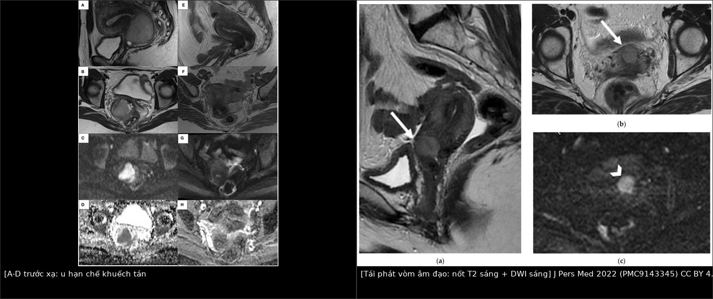
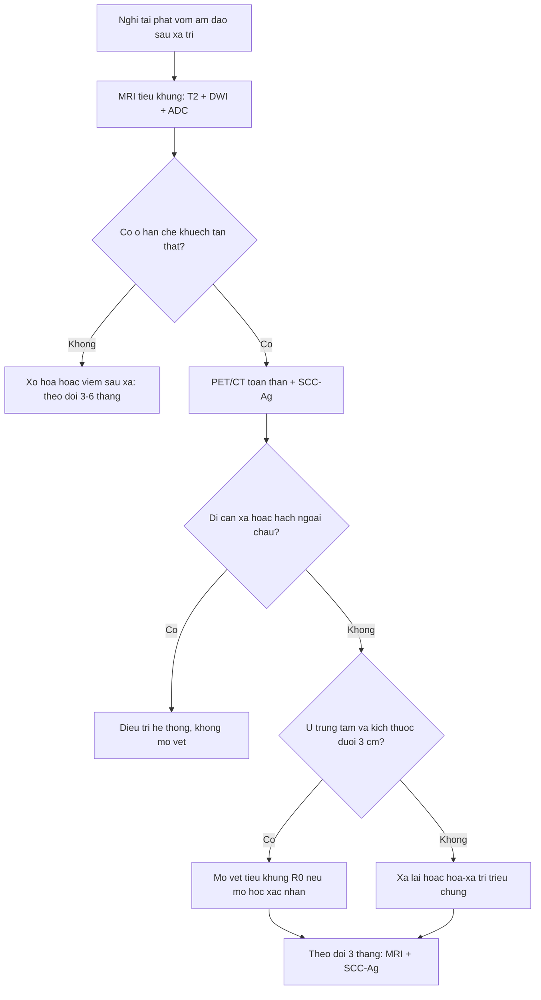
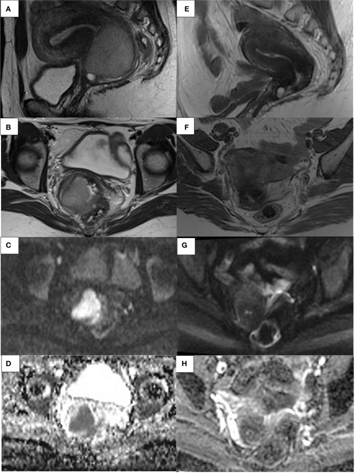
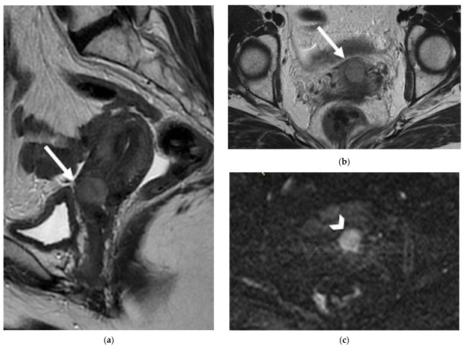
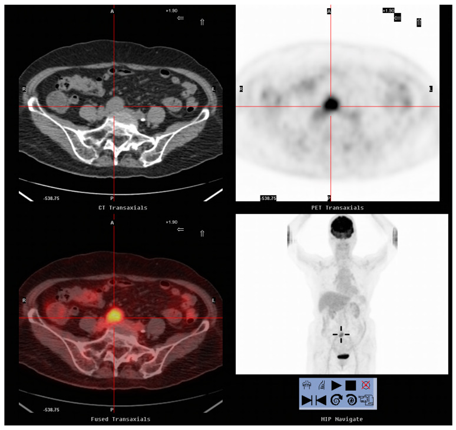

# 1626 — Tái phát tại vòm âm đạo sau xạ trị ung thư cổ tử cung / Vaginal vault recurrence after radiotherapy for cervical cancer

**Tags:** `pattern:tai-phat` `pattern:hang-khuech-tan` `pattern:xo-hoa-sau-xa` `vung:am-dao` `vung:tieu-khung` `vung:bang-quang` `score:SCC-Ag` `score:FIGO-2018` `protocol:MRI-tieu-khung-DWI` `protocol:PET-CT` `incidentaloma:xo-hoa-vom-am-dao`
**Mức chắc chắn (certainty):** tổng hợp y văn (literature synthesis) — gồm 2 tổng quan hình ảnh có số liệu gộp (Miccò M et al., *J Pers Med* 2022, PMC9143345; Ciulla S et al., *Front Oncol* 2022, PMC9710522), 3 nghiên cứu chẩn đoán có cỡ mẫu rõ (Kitajima K et al., *PLoS One* 2015, PMC4309401; Lucas R et al., *Diagn Interv Radiol* 2015, PMC4557318; Peng NJ et al., *Diagnostics* 2020, PMC7555056), 1 tổng quan phẫu thuật (Ubinha ACF et al., *Cancers* 2024, PMC10886894) và 1 đoàn hệ tiền cứu xạ lại (Wang K et al., *J Gynecol Oncol* 2025, PMC11964967). **Không có ca nguyên văn của nhóm**; 3 ca trong mục (6) là ca của các bài gốc, ghi rõ nguồn từng ca. Chỗ hai nguồn lệch nhau (giá trị ADC, tỷ lệ tái phát) được ghi là **mâu thuẫn nguồn**, không chọn bừa.

## 1. Tổng quan bệnh học – cơ chế hình ảnh

- **Định nghĩa tách đôi quyết định điều trị:** *tái phát (recurrence)* = u mọc lại **≥ 6 tháng** sau khi đã đạt đáp ứng hoàn toàn (complete response); u còn lại **< 6 tháng** sau kết thúc xạ trị gọi là **bệnh tồn dư/bệnh dai dẳng (residual/persistent disease)** (Miccò M et al. 2022). Hai nhóm này khác nhau về sinh học và về lựa chọn cứu vãn: tồn dư sớm thường được mổ cứu vãn sau khi xác nhận mô học; tái phát muộn mới có chỗ cho xạ lại, mổ vét tiểu khung (pelvic exenteration) hoặc điều trị hệ thống.
- **Dịch tễ (các con số không đồng nhất — ghi nguyên vẹn):** khoảng **30–50%** bệnh nhân ung thư cổ tử cung (cervical cancer — CC) giai đoạn tiến xa tái phát trong **5 năm đầu** (Ciulla S et al. 2022); tái phát sau **mổ triệt căn ~27%**, sau **hóa–xạ đồng thời (concurrent chemoradiotherapy — CCRT) ~32%**; **30–45%** các tái phát là **trung tâm – tiểu khung** (central-pelvic), tức có thể nằm đúng ở **vòm âm đạo** (Miccò M et al. 2022). Trong một loạt 327 phụ nữ tái phát, vị trí hay gặp nhất là **vòm âm đạo và vùng tiểu khung** (dẫn trong Miccò M et al. 2022).
- **TẠI SAO vòm âm đạo là "điểm mù" sau xạ trị:** mô đã xạ **giảm mật độ tế bào, tăng collagen/xơ, giảm nước tự do trong khoảng gian bào** → trên T2W mô xơ **tối**, trên DWI b cao **tối**, trên bản đồ ADC **sáng**. U tái phát thì ngược lại: **tế bào đặc, tỷ lệ nhân/nhân tương cao** làm nước bị chặn → **DWI b cao sáng + ADC tối**. Vì vậy **ADC mới là thứ tách "xơ" khỏi "u"**, còn T2 một mình không đủ: sau xạ, T2W đơn thuần có **tỷ lệ dương tính giả tới 50%**, độ nhạy/độ đặc hiệu **80%/55%** cho tồn dư (Vincens et al., dẫn trong Ciulla S et al. 2022).
- **Con số định lượng của DWI/ADC:** nghiên cứu dọc cho thấy ADC **giữa đợt xạ** ở người sống còn cao hơn người tử vong: **1,55 vs 1,36 × 10⁻³ mm²/s**, chênh **14%** (Somoye et al., dẫn trong Ciulla S et al. 2022). **Quan trọng — không có ngưỡng ADC tuyệt đối dùng chung:** Lucas R et al. (2015) nêu rõ ADC phụ thuộc tham số chuỗi xung và từng hãng máy, nên trong nghiên cứu của họ DWI chỉ được đọc **định tính** (sáng/không sáng so với cơ tử cung). Muốn dùng ADC định lượng thì phải chuẩn hóa theo máy và lấy **tỷ số ADC u/ADC cơ** cùng một lần chụp — chưa có ngưỡng được xác nhận đa trung tâm, ghi là **"chưa rõ — cần tra"**.
- **TẠI SAO T2 + DWI mạnh hơn T2 + DCE:** thuốc cản quang ngấm cả vào **viêm, hoại tử, xơ đang viêm** sau xạ, nên DCE mất đặc hiệu trong 5 tháng đầu sau xạ (Kinkel et al.: trong **5 tháng đầu**, viêm do xạ ngấm sớm giống tái phát). Dù vậy, khi phân tích đường cong tín hiệu–thời gian, DCE vẫn nâng đặc hiệu từ **22% lên 67%** và độ chính xác từ **68% lên 83%** sau xạ (Kinkel et al., dẫn trong Kitajima K et al. 2015). Đỉnh ngấm của u **45–90 giây** sau tiêm.
- **Hiệu năng thực nghiệm (đọc kèm cỡ mẫu, đừng biến thành quy luật):**
  - Kitajima K et al. (2015), **62 bệnh nhân** nghi tái phát trong tiểu khung: T2W đơn thuần **Se 55,0% / Sp 81,8% / Acc 64,5% / AUC 0,753**; T2W + DWI **80,0% / 77,3% / 79,0% / 0,838**; T2W + DWI + DCE **80,0% / 90,9% / 83,9% / 0,862**. DWI làm tăng độ nhạy và AUC có ý nghĩa so với T2W đơn thuần (p < 0,01), nhưng **không khác biệt có ý nghĩa** so với thêm DCE.
  - Lucas R et al. (2015), **38 phụ nữ** (36 ca có tái phát được chứng minh mô học): T2W/DWI **PPV 100%**, **độ chính xác 92,1%**, chỉ **3 âm tính giả**; T2W/DCE **80%**; T2W đơn thuần **73,6%** (độ nhạy 77,8%). Độ nhạy của T2W/DWI **91,7%** so với T2W/DCE **84,8%**. Tác giả cũng nêu **T2W/DWI không thua kém** bộ đầy đủ T2W+DWI+DCE.
  - Một loạt 30 bệnh nhân ung thư phụ khoa (dẫn trong Kitajima K et al. 2015): MRI gồm DWI nhạy hơn FDG-PET/CT cho **tái phát tại chỗ (88% vs 63%)**, kém hơn cho **hạch (63% vs 88%)** và **gieo rắc phúc mạc (60% vs 80%)**.
- **PET/CT và SCC-Ag — hai công cụ khác nhau, đừng thay thế nhau:** trong 88 bệnh nhân ung thư biểu mô vảy (squamous cell carcinoma — SqCC) nghi tái phát, **FDG-PET/CT: Se 98,2% / Sp 90,9% / Acc 95,5%**, còn **SCC-Ag ngưỡng 1,5 ng/mL: Se 87,3% / Sp 57,6% / Acc 76,1%** (Peng NJ et al. 2020). Tỷ lệ tái phát thực sự **77,4%** khi SCC-Ag ≥ 1,5 so với **26,9%** khi SCC-Ag không tăng (p < 0,001). Ngưỡng SCC-Ag theo Oh et al. (dẫn trong cùng bài): **1,0 ng/mL → Se 92,5%/Sp 50,3%; 1,5 → 86,3%/85,0%; 2,0 → 80,2%/94,6%; 2,5 → 73,1%/97,7%; 3,0 → 67,8%/98,9%** — càng cao càng đặc hiệu, không có ngưỡng "vàng".
- **Giá trị tiên lượng của PET:** trong 54 ca tái phát có PET dương, **MTV (metabolic tumor volume)** và **TLG (total lesion glycolysis)** phân tầng sống còn có ý nghĩa (OS: 16/27 vs 1/27, p < 0,001 cho TLG), còn **SUVmax** chỉ có ý nghĩa đơn biến (p = 0,018) (Peng NJ et al. 2020). Vì vậy **đừng dùng một ngưỡng SUVmax để chẩn đoán tái phát**.

## 2. Mẫu hình + chẩn đoán phân biệt theo vị trí (gamut)

**Trục A — theo vị trí, vì vị trí quyết định khả năng mổ cứu vãn:**

1. **Vòm âm đạo đơn thuần (central, vault-only):** mất đường **tối – mỏng – thẳng** của thành âm đạo trên T2W, thay bằng **nốt/mảng trung gian–tăng tín hiệu** hạn chế khuếch tán. Đây là nhóm **có khả năng mổ vét tiểu khung R0 cao nhất** nếu u **≤ 3 cm** và không xâm lấn bàng quang/trực tràng.
2. **Cạnh âm đạo – dây chằng ngang cổ tử cung (parametrial):** mô mềm thay mỡ cạnh cổ tử cung/vòm; mất mặt phẳng mỡ với cơ nâng hậu môn. Lan ra **thành chậu** khi u **cách cơ bịt trong/cơ hình lê < 3 mm** (tiêu chuẩn MRI, PPV tới **88%**, NPV tới **97%** — Miccò M et al. 2022).
3. **Phía trước (bàng quang – niệu đạo):** u thay lớp **tối của thành bàng quang**; rò âm đạo–bàng quang là đường dịch tăng tín hiệu T2 (xem 582). Xâm lấn **tam giác bàng quang** gây **ứ nước thận** — dấu hiệu gián tiếp hay bị bỏ.
4. **Phía sau (trực tràng – cơ thắt hậu môn):** mất mặt phẳng mỡ âm đạo–trực tràng; u **cách cơ nâng hậu môn/cơ mu–trực tràng < 3 mm** là tiêu chuẩn xâm lấn cơ (Miccò M et al. 2022). Tỷ lệ tái phát **âm đạo–trực tràng 17,3%** (dẫn trong Miccò M et al. 2022).
5. **Hạch:** hạch chậu **trục ngắn > 8 mm** là ngưỡng gợi ý mới (so với ngưỡng cũ 10 mm) (Miccò M et al. 2022); **38%** ca tái phát trung tâm có kèm hạch chậu (Walsh et al., dẫn trong cùng bài); hạch **cạnh động mạch chủ (para-aortic)** gặp **3–10,5%** sau xạ chậu triệt căn.
6. **Xa:** phổi hay gặp nhất; **gan 1/3** ca tái phát; **xương 15–29%** (Miccò M et al. 2022).

**Trục B — gamut "nốt/mảng ở vòm âm đạo sau xạ" (theo bệnh bắt chước):**

- **Xơ hóa sau xạ (post-radiation fibrosis):** dải tối, đều, không hạn chế khuếch tán — **không phải u**.
- **Viêm/hoại tử sau xạ:** ngấm thuốc mạnh, có thể sáng trên DWI b cao, nhưng **ADC không tối** (T2 shine-through) — ca minh họa của Lucas R et al. 2015 (Hình 2) đúng kiểu này: mô học chỉ là **viêm**.
- **Hẹp âm đạo – ứ máu âm đạo (hematocolpos):** dịch **T1 sáng, T2 sáng**, không ngấm thuốc, không hạn chế khuếch tán; có thể **che mất** nốt tái phát phía trên (xem 562).
- **Nốt viêm quanh chỉ / u hạt dị vật (suture granuloma):** nốt nhỏ ngay dưới niêm mạc, ngấm thuốc, **không hạn chế khuếch tán**; bối cảnh mổ < 6 tháng.
- **Rò âm đạo–bàng quang/trực tràng:** đường dịch–khí; nhưng **mô mềm đặc quanh đường rò** mới là dấu hiệu u (xem 582).
- **Ung thư niệu mạc thứ phát sau xạ:** đái máu muộn, tổn thương **trong lòng bàng quang**, không phải mô mềm vòm âm đạo (xem 1608).

## 3. Bảng so sánh phân biệt (ma trận đối chiếu)

| Thực thể (entity) | Hình ảnh điển hình | Chốt vào (rule-in) | Chốt loại (rule-out) | Gợi ý xác nhận |
|---|---|---|---|---|
| **Tái phát vòm âm đạo** | Mất đường tối mỏng của vòm; nốt/mảng **T2 trung gian–sáng**, **DWI b 1000 sáng**, **ADC tối**, ngấm thuốc sớm 45–90 giây | **Ổ hạn chế khuếch tán thật (ADC tối) + phá vỡ cấu trúc vòm + ≥ 6 tháng sau xạ** | Không hạn chế khuếch tán, bờ đều, không phá vỡ vòm → xơ/viêm | Sinh thiết **nhắm vào phần ADC tối**; PET/CT toàn thân trước khi mổ |
| **Xơ hóa sau xạ** | Dải/mảng **T2 tối**, co kéo, **DWI tối**, **ADC sáng**; đối xứng, không có khối | ADC sáng + ổn định theo thời gian | ADC tối + to ra khi chụp lại → nghĩ tái phát | So phim cũ; chụp lại 3–6 tháng nếu lâm sàng yên |
| **Viêm/hoại tử sau xạ** | Ngấm thuốc mạnh, phù, **DWI sáng nhưng ADC không tối** (T2 shine-through) | ADC không tối + bối cảnh < 5–6 tháng sau xạ | ADC tối khu trú trong khối đặc → tái phát | Theo dõi ngắn hạn; tránh sinh thiết mù vùng hoại tử |
| **U tồn dư (< 6 tháng)** | Như tái phát nhưng xuất hiện sớm; thường còn **u nguyên phát chưa tan hết** | Còn mô u liên tục với vị trí u cũ trong 6 tháng | Đã có đáp ứng hoàn toàn rồi mới mọc lại → tái phát | Mô học trước khi mổ cứu vãn (khuyến cáo: chỉ mổ khi **xác nhận mô học**) |
| **Hẹp âm đạo / ứ máu âm đạo** | Dịch **T1 sáng, T2 sáng**, vòm bị đẩy; thành âm đạo dày đều | Tín hiệu dịch/máu cũ, không ngấm thuốc | Mô đặc hạn chế khuếch tán trong lòng → u | Khám + siêu âm; nong/dẫn lưu nếu ứ (xem 562) |
| **Nốt viêm quanh chỉ** | Nốt nhỏ dưới niêm mạc, ngấm thuốc, **không hạn chế khuếch tán**, sát vết mổ | Bờ đều, không ADC tối, bối cảnh hậu phẫu gần | To dần + ADC tối → không phải viêm | Theo dõi 6–12 tuần; cắt chỉ nếu lộ |
| **Rò âm đạo–bàng quang/trực tràng** | Đường dịch–khí T2 sáng giữa 2 cơ quan; thành dày | Đường rò + khí trong ổ dịch | Mô mềm đặc đầu đường rò → nghi u xâm lấn | MRI T2 fat-sat + sau tiêm; nội soi (xem 582) |

*Trái: 41 tuổi, trước xạ (A–D) u cổ tử cung lan 1/3 trên âm đạo, DWI sáng + ADC tối; sau hóa–xạ (E–H) mô xơ T2 tối, DWI tối, ADC không tối = đáp ứng hoàn toàn. Phải: 42 tuổi sau hóa–xạ, nốt T2 sáng ở vòm âm đạo trước (a, b) có DWI sáng (c) = hạn chế khuếch tán, tái phát. Nguồn: Ciulla S et al., Front Oncol 2022 (PMC9710522) và Miccò M et al., J Pers Med 2022 (PMC9143345), CC BY 4.0; ảnh ghép letterbox bằng `tools/make_composite.py`, không crop/kéo giãn.*

### Đọc đúng "hạn chế khuếch tán" (restricted diffusion)

- Cần **cả hai**: sáng trên DWI b cao **và** tối trên ADC. Sáng DWI đơn thuần có thể do **T2 shine-through** (hoại tử, dịch đặc, máu cũ), do **artifact cảm ứng từ** ở ranh giới không khí–mô (trực tràng, bàng quang), hoặc do **dòng chảy**.
- Đo ADC nên đặt **ROI trong phần đặc nhất, tránh trung tâm hoại tử**, và ghi kèm **ADC cơ vùng chậu làm mẫu nội kiểm** — cùng một lần chụp, cùng máy.
- Ảnh **DWI b 0** không dùng để chẩn đoán; b **600–1000 s/mm²** là dải ESUR khuyến nghị cho cổ tử cung (Miccò M et al. 2022: b **0–1000**; Lucas R et al. 2015 dùng **0/600/1000**).

## 4. Protocol chụp + hệ phân độ/điểm chuẩn hóa

**Chỉ định:** (1) triệu chứng nghi tái phát (ra máu âm đạo, đau chậu, đau lan chân, phù chân, ho); (2) **SCC-Ag tăng** đơn độc; (3) tổn thương không rõ trên CT/khám; (4) **trước khi quyết định mổ vét tiểu khung** (bắt buộc loại di căn xa).

**MRI tiểu khung (ưu tiên số một cho tái phát tại chỗ):**

- **T2W độ phân giải cao, lát 3–4 mm, FOV 20–24 cm**; mặt phẳng **para-axial và para-coronal theo trục cổ tử cung** khi còn tử cung; sau mổ cắt tử cung thì dùng mặt phẳng thuần sagittal/axial/coronal (ESUR 2021, dẫn trong Ciulla S et al. 2022).
- **DWI + ADC bắt buộc**: ít nhất một mặt phẳng para-axial; b **0/600/1000 s/mm²** (Kitajima, Lucas); đọc DWI cùng ADC, không đọc riêng.
- **DCE không bắt buộc** (ESUR: chủ yếu nghiên cứu) nhưng hữu ích khi DWI nhiễu hoặc có chống chỉ định gadolinium; đọc **45–90 giây** sau tiêm.
- **Thời điểm:** chụp **≥ 6 tháng** sau kết thúc xạ khi cần phân biệt xơ/viêm với tái phát; NCCN đề nghị **PET/CT hoặc CT ngực–bụng–chậu 3–6 tháng** sau CCRT, và **MRI có cản quang 3–6 tháng** (dẫn trong Ciulla S et al. 2022).
- **Trước mổ vét tiểu khung:** MRI mô tả **quan hệ với thành chậu, niệu quản, thần kinh**; PET/CT loại di căn xa (tổng quan Ubinha ACF et al. 2024).

**PET/CT toàn thân:** chỉ định khi nghi tái phát ngoài tiểu khung, khi SCC-Ag tăng mà MRI âm, hoặc trước mổ cứu vãn. Hiệu năng cho tái phát: **Se 98,2% / Sp 90,9%** (Peng NJ et al. 2020); gộp 17 nghiên cứu/707 ca: **Se 97%, Sp 81%** (dẫn trong cùng bài). Lưu ý **dương tính giả** đã gặp: **ung thư nguyên phát thứ hai (niệu mạc, đa u tủy)** và **áp-xe ở đường rò âm đạo–trực tràng**.

**Theo dõi SCC-Ag (chỉ cho SqCC):** ngưỡng thực hành **1,5 ng/mL**; dùng **xu hướng tăng liên tiếp** thay vì một lần vượt ngưỡng. Bảng ngưỡng Oh et al. ở mục (1) cho thấy đánh đổi độ nhạy/đặc hiệu — chọn ngưỡng theo mục đích (sàng lọc hay xác nhận).

**Hệ phân độ liên quan:** **FIGO 2018** cho giai đoạn ban đầu (IB3–IVA = ung thư cổ tử cung tiến xa tại chỗ — LACC); **không có RADS riêng cho tái phát cổ tử cung** — dùng cấu trúc báo cáo **vị trí + kích thước 3 chiều + quan hệ cơ quan + hạch theo trục ngắn + PET**. Kích thước u **≤ 3 cm, trung tâm** là nhóm tiên lượng tốt nhất cho mổ vét; mỗi **1 cm** tăng kích thước làm tăng **11%** nguy cơ diện cắt dương tính (Smith et al., dẫn trong Ubinha ACF et al. 2024).

**Số liệu để tư vấn (không hứa hẹn):**

- **Mổ vét tiểu khung (pelvic exenteration):** sống còn toàn bộ **5 năm ~49%**, **10 năm 39%**; **R0 đạt 66%** trong loạt 282 ca (Schmidt et al., dẫn trong Ubinha ACF et al. 2024). Sống còn theo **diện cắt**: dương tính **21 tháng**, âm tính sát **< 3 mm 32 tháng**, **≥ 3 mm 111 tháng** (Martin et al., dẫn trong cùng bài). **Biến chứng 25–94%** (biến chứng nặng **23–~70%**); tử vong chu phẫu hiện đại **1,9–2%** (Matsuo et al., 2.647 ca).
- **Khoảng thời gian tái phát là yếu tố tiên lượng mạnh:** sống còn 5 năm **16,8%** nếu tái phát **< 2 năm**, **28%** nếu 2–5 năm, **83,2%** nếu **> 5 năm** (Marnitz et al., dẫn trong Ubinha ACF et al. 2024). Hạch **cạnh động mạch chủ dương**: sống còn 5 năm **17%** so với **45%** khi chỉ có hạch chậu dương.
- **Xạ lại áp sát (interstitial brachytherapy — ISBT) có hỗ trợ template 3D in):** 45 ca, **tỷ lệ đáp ứng 66,7%**; **LPFS 1/2/5 năm 41,1%/30,0%/25,7%**; **OS trung vị 23,2 tháng**, OS 1/2/5 năm **76,3%/49,5%/34,0%**; **độc tính độ 3–4: 20,0%** (cấp 8,9%, muộn 11,1%, gồm **3 ca rò**), không có độ 5 (Wang K et al. 2025). **Liều cao hơn tốt hơn:** HR-CTV **D90 ≥ 45 Gy** cho LPFS 1 năm **69,4% vs 19,6%** — đây là biến số kỹ thuật, không phải biến số hình ảnh.

## 5. Biến thể bình thường và cạm bẫy

- **"Vòm âm đạo bình thường sau xạ" không phải lúc nào cũng mỏng – tối – thẳng:** xơ hóa có thể làm vòm **dày, co kéo, dính trực tràng/bàng quang**; đây là **biến thể sau điều trị**, không phải u, miễn **không hạn chế khuếch tán** và **không to lên**.
- **Cửa sổ 5–6 tháng:** trong **5 tháng đầu**, viêm do xạ ngấm thuốc sớm và có thể sáng trên DWI; đọc MRI quá sớm dễ **overcall**. Ngược lại, u tồn dư **< 6 tháng** là bệnh dai dẳng, không phải "tái phát" — đừng dùng từ sai vì nó đổi cả chiến lược.
- **T2 shine-through:** ca của Lucas R et al. 2015 cho thấy một tổn thương **sáng trên DWI b 1000** nhưng **không tối trên ADC**, mô học chỉ là **viêm** — nếu chỉ nhìn DWI sẽ mổ oan.
- **Hẹp âm đạo che tổn thương:** hẹp/ứ máu âm đạo sau xạ (xem 562) làm vòm bị đẩy và niêm mạc không quan sát được; phải đọc **thành âm đạo và mô cạnh âm đạo**, không chỉ lòng âm đạo.
- **Satisfaction of search:** **38%** tái phát trung tâm có hạch chậu; hạch **cạnh động mạch chủ 3–10,5%**; **xương 15–29%**. Thấy nốt ở vòm rồi dừng lại là lỗi hay gặp.
- **Gãy xương cùng do thiếu xương sau xạ (insufficiency fracture)** giả di căn: đường gãy **T1 tối, T2/STIR sáng**, **không phá vỡ vỏ**, thường đối xứng cánh xương cùng — khác di căn **phá vỡ vỏ + khối mô mềm** (Miccò M et al. 2022).
- **Dương tính giả PET/CT:** **áp-xe ở đường rò âm đạo–trực tràng**, **ung thư nguyên phát thứ hai** (niệu mạc, đa u tủy), viêm sau xạ — luôn đối chiếu MRI và mô học trước khi đổi điều trị (Peng NJ et al. 2020).
- **Sinh thiết mù vùng xơ:** mô xơ nhiều có thể cho **âm tính giả** (tế bào u bị xơ vây); nếu hình ảnh và SCC-Ag thuyết phục, **sinh thiết nhắm vào phần ADC tối** hoặc lặp lại dưới hướng dẫn hình ảnh, đừng kết luận "không tái phát" chỉ vì một mẫu mô xơ.

## 6. Tự lượng giá — Blind Quiz

> Ba ca dưới đây lấy từ ba bài gốc khác nhau, khác máy chụp và khác bệnh nhân — **không so sánh trực tiếp giữa các ảnh**.

**Ca 1 — 41 tuổi, ung thư cổ tử cung xâm lấn, chụp MRI trước và sau hóa–xạ đồng thời. Nhìn 8 ô ảnh, mô tả trước khi mở đáp án.**

- Gợi ý lâm sàng: u lan 1/3 trên âm đạo và thành trước trực tràng; chụp lại sau CCRT để đánh giá đáp ứng.
- Câu hỏi: (1) Ô nào là DWI, ô nào là ADC? (2) Sau xạ còn ổ hạn chế khuếch tán không? (3) Kết luận đáp ứng?

<b>Bấm để hiện đáp án (findings + chẩn đoán)</b>

- A–D (trước xạ): u cổ tử cung lớn lan 1/3 trên âm đạo; **C = DWI b cao sáng**, **D = ADC tối** → hạn chế khuếch tán thật.
- E–H (sau CCRT): mô xơ **T2 tối**, **G = DWI tối**, **H = ADC sáng** — không còn ổ hạn chế khuếch tán tương ứng khối u.
- Chẩn đoán: **đáp ứng hoàn toàn (complete response)** về hình ảnh; không có bằng chứng tồn dư tại vòm.
- Cơ chế: xơ hóa giảm mật độ tế bào và tăng khoảng gian bào → nước khuếch tán tự do → ADC sáng; đây chính là lý do **phải có ADC**, vì T2 đơn thuần không phân biệt được xơ với u.
- Lưu ý: H có vùng sáng cạnh trực tràng/bàng quang do **artifact khí–mô**, không phải u.
- Nguồn ảnh: Ciulla S et al., *Front Oncol* 2022;12:1003930 (PMC9710522), Fig. 5, CC BY 4.0.

**Ca 2 — 42 tuổi, tiền sử ung thư cổ tử cung đã hóa–xạ, khám vì ra máu âm đạo. MRI 6 tháng sau điều trị.**

- Câu hỏi: Mô tả bất thường ở vòm âm đạo trước? Dấu hiệu nào tách u với xơ? Ba chẩn đoán phân biệt? Bước tiếp theo?

<b>Bấm để hiện đáp án (findings + chẩn đoán)</b>

- (a) Sagittal T2W: **mất đường tối mỏng** của thành âm đạo trước, thay bằng **nốt trung gian–tăng tín hiệu** ở vòm (mũi tên). (b) Axial T2W: nốt cùng vị trí, bờ không đều. (c) **DWI: nốt sáng rõ** (đầu mũi tên).
- Chốt: **nốt hạn chế khuếch tán** phá vỡ cấu trúc vòm, xuất hiện **sau 6 tháng** — phù hợp **tái phát tại vòm âm đạo**.
- Phân biệt: xơ hóa sau xạ (không hạn chế khuếch tán, bờ đều), viêm/hoại tử sau xạ (ADC không tối), nốt viêm quanh chỉ (nhỏ, sát vết mổ, không ADC tối).
- Bước tiếp theo: **PET/CT toàn thân** loại di căn xa/hạch, **sinh thiết nhắm phần DWI sáng** để xác nhận mô học trước khi mổ cứu vãn; đánh giá khả năng R0 (kích thước, bàng quang, trực tràng, thành chậu).
- Nguồn ảnh: Miccò M et al., *J Pers Med* 2022;12(5):755 (PMC9143345), Fig. 2, CC BY 4.0.

**Ca 3 — 78 tuổi, ung thư biểu mô vảy cổ tử cung 10 năm trước, SCC-Ag tăng 6,7 ng/mL, không triệu chứng.**

- Câu hỏi: Ổ tăng chuyển hóa nằm ở đâu? Có phải tái phát tại vòm không? Vì sao vẫn mổ được?

<b>Bấm để hiện đáp án (findings + chẩn đoán)</b>

- Ảnh hợp cho thấy **nốt tăng FDG 3,0 cm ở vùng trước xương cùng (presacral)**, **SUVmax 5,2**, không thấy ổ khác.
- Chẩn đoán: **hạch tái phát vùng trước xương cùng** (không phải tái phát tại vòm âm đạo) — ví dụ cho "tái phát vùng chậu" có thể nằm ngoài vòm.
- Vì sao mổ được: bệnh **khu trú, đơn ổ**, PET/CT loại di căn xa; sau cắt hạch bệnh nhân sống không bệnh > 10 năm. Trong loạt 88 ca, **mổ được u tái phát khu trú → 62,5% còn sống** so với **17,9%** ở nhóm không mổ (p = 0,001).
- Bài học: **SCC-Ag tăng đơn độc vẫn phải chụp toàn thân**, và "tái phát vùng chậu" không đồng nghĩa "tái phát tại vòm".
- Nguồn ảnh: Peng NJ et al., *Diagnostics* 2020;10(9):657 (PMC7555056), Fig. 1, CC BY 4.0.

## Bài liên quan chéo
- [577 – Theo dõi & phát hiện tái phát ung thư phụ khoa](../577-theo-doi-tai-phat-ung-thu-phu-khoa/lesson.md) (khung theo dõi, RECIST, CA-125)
- [562 – Hẹp âm đạo sau xạ trị ung thư cổ tử cung](../562-hep-am-dao-sau-xa-tri/lesson.md) (hẹp/ứ máu che tổn thương)
- [582 – Biến chứng tiêu hóa–niệu sau xạ trị phụ khoa](../582-bien-chung-tieu-hoa-nieu-sau-xa-tri-phu-khoa/lesson.md) (rò âm đạo, viêm trực tràng xạ)
- [1608 – Ung thư niệu mạc thứ phát sau xạ trị tiểu khung](../1608-ung-thu-nieu-mac-thu-phat-sau-xa-tri-tieu-khung/lesson.md)
- [1623 – Huyết khối tĩnh mạch buồng trứng sau sinh](../1623-huyet-khoi-tinh-mach-buong-trung-sau-sinh/lesson.md) (đọc CT/MRI tiểu khung có cản quang)

## Ảnh
- `1626_tai-phat-vom-am-dao_MRI_PMC9710522-Fig5-CCBY.jpg`, `1626_tai-phat-vom-am-dao_MRI_PMC9143345-Fig2-CCBY.jpg`, `1626_tai-phat-vom-am-dao_MRI_PMC9143345-Fig4-CCBY.jpg`, `1626_tai-phat-vom-am-dao_MRI_PMC9710522-Fig4-CCBY.jpg`, `1626_tai-phat-vom-am-dao_PETCT_PMC7555056-Fig1-CCBY.jpg`, `composite_xo-hoa-vs-tai-phat.jpg`.
- Nguồn + giấy phép từng ảnh: `images/CREDITS.md`. Cả 3 bài nguồn ảnh đều **CC BY 4.0** → được phép tạo ảnh ghép, giữ attribution.

> Không dùng để chẩn đoán độc lập khi chưa có người hướng dẫn.
