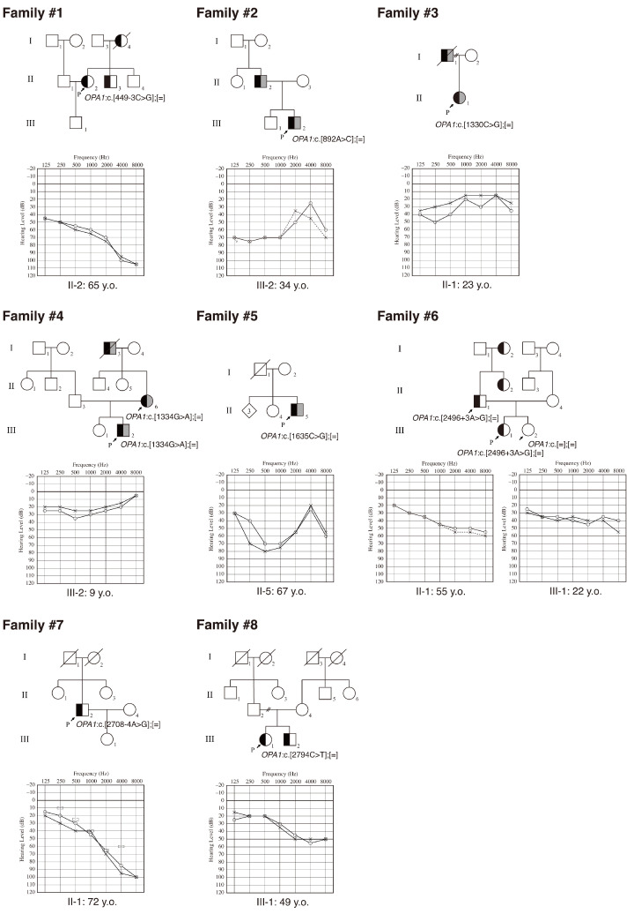
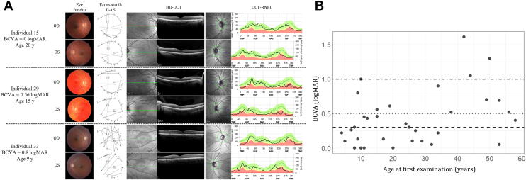
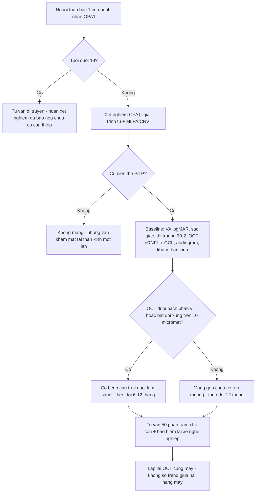
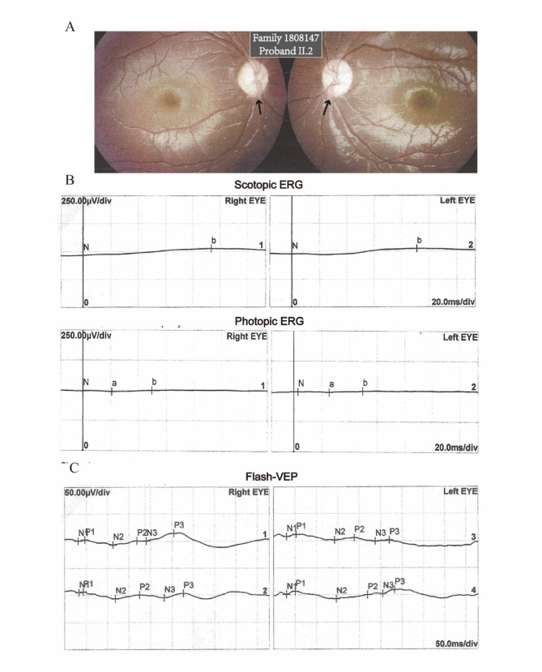

# 1627 — Người mang OPA1 không triệu chứng / Asymptomatic OPA1 carriers: theo dõi, tầm soát gia đình & tư vấn

**Tags:** `pattern:teo-thi` `pattern:di-truyen-troi` `vung:than-kinh-thi` `protocol:OCT-RNFL-GCL` `score:OCT-GCL` `protocol:thi-truong-Humphrey` `protocol:audiometry` `protocol:MLPA-OPA1` `score:logMAR`
**Mức chắc chắn (certainty):** tổng hợp y văn (literature synthesis) — nhóm tự biên từ: gia đình OPA1 lớn nhất đã báo cáo (34 người mang, Ophthalmology Science 2026, CC BY 4.0, PMC13382307); 108 bệnh nhân OPA1-ADOA (IOVS 2026, CC BY-NC-ND 4.0, PMC13069346); 8 gia đình OPA1 có điếc (Genes 2026, CC BY 4.0, PMC13025685); kiểu hình mắt–tai OPA1 (Orphanet J Rare Dis 2025, CC BY 4.0, PMC12534986); tổng quan bệnh thần kinh thị di truyền (IJMS 2025, CC BY 4.0, PMC12027957).

> **Vì sao bài này quan trọng:** bài **479** trả lời "biến thể này có bệnh không"; bài **437/439** dạy nhận diện DOA. Nhưng câu hỏi hay gặp nhất trong phòng khám lại khác: **"Mẹ/chị tôi bị teo thị do OPA1, tôi xét nghiệm cũng mang gen nhưng nhìn vẫn bình thường — tôi có bệnh không, con tôi có sao không?"** Câu trả lời "không sao" là **sai** ở **khoảng 30%** người mang (không hoàn toàn thấm), và **sai nguy hiểm** vì tổn thương **RNFL/GCL có thể đã có trước khi thị lực giảm**.

## 1. Tổng quan — vì sao "mang gen mà không triệu chứng" vẫn là bệnh đang tiến triển

- **OPA1 (3q28–q29)** mã hóa **GTPase màng trong ty thể** điều khiển **dung hợp ty thể (mitochondrial fusion)**. Tế bào hạch võng mạc (RGC) — nhất là **bó nhú–hoàng điểm (papillomacular bundle)** — có **axon không myelin trong võng mạc** và mật độ ty thể rất cao, nên **nhạy nhất** với suy giảm năng lượng: mất RGC **trước**, teo đĩa **sau**.
- **Hai cơ chế → hai mức nặng:**
  - **Haploinsufficiency** (biến thể cắt ngắn/mất đoạn): mất một bản sao → giảm lượng protein → thể **nhẹ hơn**.
  - **Dominant-negative** (missense vùng GTPase): protein hỏng **kéo theo** protein bình thường → thể **nặng hơn**. Trong 108 bệnh nhân: missense có BCVA **0,83 vs 0,49 logMAR** (p = 0,016), pRNFL **52,41 vs 66,41 µm** (p < 0,001), mGCL **20,12 vs 21,97 µm** (p = 0,044) so với haploinsufficiency (PMC13069346).
- **"Không hoàn toàn thấm" nghĩa là gì (định lượng):**
  - **DOA không hội chứng: độ thấm ~70%** → khoảng **30% người mang không có biểu hiện lâm sàng** ở thời điểm khám; **DOA-plus: độ thấm ~100%** (tổng quan PMC12027957). Con số này giải thích vì sao **cùng một gia đình** có người mù nhiều, người chỉ 20/25.
  - Trong gia đình **34 người mang** một mất đoạn 10-kb OPA1: BCVA từ **0 (20/20, không triệu chứng) đến 1,61 logMAR (20/815)**; **15/34 (44%) không suy giảm thị lực** (BCVA < 0,3 logMAR) ở lần khám đầu (PMC13382307).
  - **Nhưng cấu trúc đã hỏng:** OCT ở gia đình này cho thấy **RNFL và GCL mỏng** ngay cả ở người "nhìn tốt"; BCVA tương quan mạnh với RNFL (r = −0,50 đến −0,73) và GCL (r = −0,82 đến −0,86) (PMC13382307).
- **Tốc độ tiến triển (để tư vấn, không để hứa):**
  - **BCVA giảm 0,018 logMAR/năm (0,18 logMAR/thập kỷ)**; RNFL mất **1,13 µm/năm ở thái dương**, **0,70 µm/năm trên**, **0,50 µm/năm dưới**; **vùng mũi không đổi**; bệnh tiến triển **nhanh hơn trước 30 tuổi** và **nhanh hơn ở nữ** (PMC13382307).
  - 108 bệnh nhân: **mGCL mất 0,26 ± 0,10 µm/năm**; mỗi **3,2 µm mGCL** mất tương ứng **0,1 logMAR** xấu đi (PMC13069346).
  - Hệ quả thực hành: **theo dõi bằng cấu trúc (OCT)**, không chỉ bằng thị lực — mất 3,2 µm GCL có thể chỉ là **1 dòng logMAR**, trong khi bệnh nhân vẫn "thấy bình thường".
- **Dịch tễ:** ADOA do OPA1 chiếm **50–70%** teo thị trội; **ADOA 1/10.000–1/50.000** (PMC13410010; PMC12027957). OPA1 là gen **phổ biến nhất** trong teo thị di truyền nhân (**53,25%** cohort 826 gia đình, PMC12073998).

## 2. Mẫu hình + gamut: 4 kiểu "người mang" và các bệnh giả teo thị

- **Kiểu A — mang gen, hoàn toàn bình thường:** VA 20/20, OCT trong giới hạn tuổi. Vẫn **50% nguy cơ cho con**.
- **Kiểu B — mang gen, dưới lâm sàng (subclinical):** VA 20/20 nhưng **RNFL thái dương/GCL mỏng** so với chuẩn tuổi; có thể chỉ **giảm sắc giác nhẹ** hoặc **thị trường trung tâm nhẹ**.
- **Kiểu C — DOA nhẹ:** VA **20/25–20/40**, teo đĩa thái dương, ám điểm trung tâm.
- **Kiểu D — DOA-plus:** thêm **điếc tiếp âm, ataxia, myopathy, bệnh thần kinh ngoại biên, CPEO**; **20%** ADOA có biểu hiện ngoài mắt, gặp nhiều hơn ở **missense** và ở biến thể **di truyền từ mẹ** (PMC12027957).
- **Gamut của "người nhà bệnh nhân teo thị, không triệu chứng":** **OPA1** (hàng đầu) · **LHON carrier mẹ** (đáy mắt có thể telangiectasia/đĩa sung huyết) · **WFS1 trội** (điếc trước, OPL lamination) · **AFG3L2/SPG7** · **đĩa thị drusen** (giả teo thị) · **glaucoma góc mở sớm** (mỏng RNFL theo vùng, không thái dương) · **chèn ép thị thần kinh tiến triển chậm** (meningioma) · **độc–chuyển hóa** (ethambutol, B12, thuốc lá–rượu).
- **Nguyên tắc:** "**không triệu chứng**" là **trạng thái lâm sàng**, không phải **trạng thái phân tử** — người mang vẫn có thể có tổn thương cấu trúc và vẫn truyền bệnh.

## 3. Bảng so sánh phân biệt (ma trận đối chiếu)

| Thực thể (entity) | Hình ảnh / lâm sàng điển hình | Chốt vào (rule-in) | Chốt loại (rule-out) | Gợi ý xác nhận |
|---|---|---|---|---|
| **OPA1 — người mang dưới lâm sàng** | VA 20/20, **RNFL thái dương mỏng**, GCL mỏng; bố/mẹ/anh chị bị DOA | **Biến thể OPA1 P/LP + RNFL/GCL dưới bách phân vị 1 theo tuổi + phân ly gia đình** | **OCT hoàn toàn bình thường + không ai trong nhà bị** → chưa quy bệnh, nhưng **không loại trừ** (độ thấm 70%) | OPA1 giải trình tự + **MLPA/CNV**; OCT cùng máy; audiogram |
| **OPA1 — DOA rõ** | Teo đĩa thái dương, VA giảm, **ám điểm trung tâm**, sắc giác **xanh–vàng** | **RNFL thái dương + GCL thái dương mỏng + biến thể P/LP** | **OPL lamination + sắc giác đỏ–lục** → WFS1 | OCT RNFL/GCL; VF 30-2; ERG/VEP |
| **OPA1 — DOA-plus** | DOA + **điếc tiếp âm/ataxia/myopathy/CPEO** | **Biểu hiện ngoài mắt + missense GTPase** | **Điếc bẩm sinh + ĐTĐ sơ sinh** → WFS1 nặng (bài 499) | Audiogram/ABR; EMG; MRI não–tủy |
| **LHON carrier (mtDNA)** | Thường **nam trẻ**, mất thị lực **cấp tuần tự**; carrier có thể **đĩa sung huyết/telangiectasia** | **3 đột biến 11778/14484/3460 + di truyền mẹ** | **Teo thị từ từ hai bên nhiều năm + RNFL thái dương đối xứng** → OPA1 | mtDNA; OCT đĩa thị; FA |
| **AD WFS1-OA** | **Điếc 2 tuổi** trước teo thị **10 tuổi**; **OPL lamination**; RNFL mỏng **lan tỏa** | **OPL lamination + sắc giác đỏ–lục + điếc sớm** | **RNFL chỉ thái dương + OPL bình thường** → OPA1 | WFS1; OCT; audiogram |
| **Drusen đĩa thị (giả teo thị)** | Đĩa **gồ cao, bờ không rõ**, **siêu âm có tăng âm**, OCT **"lumpy bumpy"** dưới RPE | **OCT EDI thấy drusen + siêu âm B tăng âm** | **Teo đĩa phẳng, RNFL mỏng thật** → DOA/glaucoma | OCT EDI đĩa thị; siêu âm B |
| **Glaucoma góc mở sớm** | Mỏng RNFL **theo vùng** (thường trên/dưới), **IOP cao/đĩa lõm**, thị trường theo vùng | **IOP + lõm đĩa + RNFL mất theo vùng kinh điển** | **Mất RNFL thái dương đối xứng + không lõm** → OPA1 | IOP, gonioscopy, VF, OCT |
| **Chèn ép thị thần kinh tiến triển chậm** | Giảm thị lực **một bên**, **RAPD**, đau/không đau, teo đĩa muộn | **MRI thấy khối/hẹp ống thị giác** | **Hai bên đối xứng + gia đình trội** → OPA1 | MRI hốc mắt–não có cản quang |

*Phả hệ và audiogram 8 gia đình mang biến thể OPA1: **nửa trái đen = điếc**, **nửa phải xám = teo thị** — nhiều người chỉ có **một** trong hai biểu hiện, có người **không biểu hiện**, minh họa **biểu hiện biến thiên trong cùng gia đình**. Nguồn: Kawakita M et al., Genes 2026, Fig. 1 (PMC13025685), CC BY 4.0.*

*A: ba người mang **cùng mất đoạn OPA1** với BCVA **0,16 / 0,56 / 0,8 logMAR** — đáy mắt, sắc giác D-15, OCT hoàng điểm và **bản đồ RNFL** cho thấy mức mỏng khác nhau. B: BCVA theo tuổi ở 34 người mang, phân tán rất rộng (**0–1,61 logMAR**). Nguồn: Bouzidi A et al., Ophthalmol Sci 2026, Fig. 3 (PMC13382307), CC BY 4.0.*

## 4. Protocol — khám ai, đo gì, bao lâu một lần

**Bước 1 — chỉ định xét nghiệm (cascade):**
- **Người thân bậc 1 của người đã có biến thể OPA1 P/LP**: tư vấn + xét nghiệm **khi họ muốn biết** (không xét nghiệm thay họ). **Trẻ < 18 tuổi**: hoãn **xét nghiệm dự báo** nếu chưa có can thiệp — bệnh chưa có điều trị đặc hiệu, lợi ích chủ yếu là theo dõi; quyết định theo gia đình + tư vấn di truyền.
- **Không có biến thể trong nhà**: vẫn khám mắt–tai–thần kinh **trước khi kết luận "không mang"**; nếu âm tính, **không loại trừ** khả năng có biến thể khác (OPA3, AFG3L2, SPG7…).
- **Bắt buộc tìm CNV/mất đoạn:** gia đình lớn nhất được phát hiện nhờ **mất đoạn 10-kb exon 30–31** — giải trình tự thường **bỏ sót**; phải có **MLPA/CNV calling** (PMC13382307).

**Bước 2 — bộ đánh giá nền (baseline) cho người mang:**
- **Thị lực logMAR** + khúc xạ; **sắc giác Lanthony D-15**; **thị trường 30-2 (Humphrey SITA)** khi hợp tác.
- **OCT pRNFL + macular GCL/GCIPL cùng một máy** — không so trend giữa hai hãng máy khác nhau.
- **Đáy mắt giãn đồng tử**; **OCT EDI đĩa thị** nếu nghi drusen; **siêu âm B** nếu đĩa gồ.
- **ERG/VEP** khi VA và OCT **không khớp** (nghi bệnh võng mạc, ANSD, tổn thương thần kinh sau).
- **Audiogram/ABR** nền (DOA-plus 20%); **khám thần kinh–cơ** (yếu cơ, ataxia, hạn chế vận nhãn).
- **MRI hốc mắt–não có cản quang** nếu: một bên, RAPD, đau, tiến triển nhanh, hoặc OCT không điển hình.

**Bước 3 — ngưỡng gọi "dưới lâm sàng" (thực hành):**
- **RNFL/GCL < bách phân vị 1** của chuẩn tuổi/máy → **bất thường rõ**, coi như có bệnh cấu trúc dù VA 20/20.
- **1–5 bách phân vị** hoặc **bất đối xứng > 10 µm giữa hai mắt** → **nghi ngờ**, lặp lại **3–6 tháng** cùng máy.
- **> 5 bách phân vị và đối xứng** → trong giới hạn; vẫn **không loại trừ** nguy cơ (độ thấm 70%).
- Ghi rõ đây là **ngưỡng thực hành suy luận**, chưa có guideline quốc tế riêng cho "carrier".

**Bước 4 — lịch theo dõi:**
- **Năm đầu sau phát hiện:** khám **mỗi 6–12 tháng** (VA, OCT, VF nếu làm được).
- **Ổn định 2 lần liên tiếp:** **mỗi 1–2 năm**; **nhanh hơn (6 tháng)** nếu gần ngưỡng, có triệu chứng mới, hoặc **< 30 tuổi** (bệnh tiến triển nhanh hơn trước 30 — PMC13382307).
- **Tai–thần kinh:** audiogram **mỗi 2–3 năm**; khám thần kinh mỗi lần khám mắt.
- **Tư vấn sinh sản:** **50%** cho mỗi con **bất kể người mang có triệu chứng hay không**; không hứa "con sẽ nhẹ như bố/mẹ" vì biểu hiện **biến thiên trong cùng gia đình** (BCVA 0–1,61 logMAR).

## 5. Biến thể bình thường và cạm bẫy

- **Cạm bẫy 1 — "VA 20/20 là không bệnh".** **44%** người mang trong gia đình lớn có **BCVA < 0,3 logMAR** nhưng RNFL/GCL **đã mỏng**; mất **3,2 µm GCL** chỉ tương ứng **0,1 logMAR** — dưới ngưỡng bệnh nhân nhận ra.
- **Cạm bẫy 2 — "Không triệu chứng thì không cần theo dõi".** Độ thấm **~70%** nghĩa là **30%** người mang chưa biểu hiện **ở thời điểm khám**, không phải **sẽ không bao giờ** biểu hiện.
- **Cạm bẫy 3 — gọi mọi mỏng RNFL thái dương là DOA.** **Drusen đĩa thị** (OCT EDI "lumpy bumpy", siêu âm tăng âm) và **glaucoma** (mất theo vùng, lõm đĩa) là 2 bệnh giả teo thị hay gặp; **myopia** làm đĩa nghiêng, dễ đọc sai.
- **Cạm bẫy 4 — so OCT giữa hai máy/khác phần mềm.** Ngưỡng và cách segmentation khác nhau → "mỏng 8 µm" có thể chỉ là **đổi máy**. Luôn theo dõi **cùng máy** hoặc hiệu chuẩn.
- **Cạm bẫy 5 — xét nghiệm dự báo ở trẻ nhỏ mà không tư vấn.** Không có điều trị đặc hiệu; **không biến trẻ thành "bệnh nhân"** khi chưa có lợi ích rõ — quyết định của gia đình sau tư vấn.
- **Cạm bẫy 6 — bỏ qua DOA-plus.** Hỏi **điếc, yếu cơ, đi lại, nhìn đôi**; **audiogram nền** và khám thần kinh–cơ. **20%** ADOA có biểu hiện ngoài mắt; missense nặng hơn.
- **Cạm bẫy 7 — hứa con "chỉ bị nhẹ".** Cùng một biến thể trong một gia đình cho BCVA **0–1,61 logMAR**; tư vấn theo **khoảng**, không theo **ca tốt nhất**.
- **Cạm bẫy 8 — bỏ sót mất đoạn lớn.** Giải trình tự âm không loại trừ **deletion OPA1**; phải có **MLPA/CNV** (mất đoạn 10-kb exon 30–31 trong PMC13382307).

*A: đáy mắt **teo đĩa thái dương** hai bên (mũi tên). B: **ERG scotopic/photopic giảm biên độ**. C: **flash-VEP** giảm/trễ. Đây là bộ ba **cấu trúc – chức năng** dùng để phân biệt teo thị thật với giả teo thị. Nguồn: Wang H et al., Orphanet J Rare Dis 2025, Fig. 3 (PMC12534986), CC BY 4.0.*

## 6. Tự lượng giá — Blind Quiz

**Ca 1 — Nữ 28 tuổi, mẹ bị "teo thị di truyền" và đã mù một phần. Chị xét nghiệm OPA1: mang cùng biến thể. Thị lực 20/20 hai mắt, không than phiền gì. Chị hỏi: "Vậy tôi không bị bệnh đúng không?"**

- Hỏi: câu trả lời đúng? Cần đo gì ngay? Điều gì **không** được hứa?

<b>Bấm để hiện đáp án (findings + chẩn đoán)</b>

- **Không được nói "không bệnh".** Mang biến thể OPA1 = **nguy cơ bệnh**, độ thấm **~70%**; **44%** người mang trong một gia đình lớn có BCVA < 0,3 logMAR nhưng **RNFL/GCL đã mỏng**.
- Đo ngay: **OCT pRNFL + GCL cùng máy**, **sắc giác Lanthony D-15**, **thị trường 30-2**, **audiogram** (DOA-plus), khám thần kinh–cơ.
- Ngưỡng: **< bách phân vị 1** = bất thường rõ; **1–5** hoặc **bất đối xứng > 10 µm** = nghi ngờ, lặp lại **3–6 tháng**.
- Không hứa: "con sẽ nhẹ như mẹ/chị", "mắt sẽ không tiến triển" — cùng biến thể có thể cho **0–1,61 logMAR**; **50%** nguy cơ cho con.
- Nguồn: PMC13382307; PMC13069346; PMC12027957.

**Ca 2 — Nam 45 tuổi, mang OPA1, VA 20/25 hai mắt, OCT RNFL thái dương 62 µm (bách phân vị 3), GCL bình thường. Anh hỏi có cần khám lại không và bao lâu.**

- Hỏi: xếp loại gì? Lịch theo dõi? Dấu hiệu nào khiến phải khám nhanh hơn?

<b>Bấm để hiện đáp án (findings + chẩn đoán)</b>

- **Nghi ngờ dưới lâm sàng** (RNFL 3rd percentile, GCL bình thường): lặp OCT **3–6 tháng** cùng máy; nếu xác nhận mỏng tiến triển → **theo dõi 6–12 tháng**.
- Lịch nền: **12 tháng/lần** (VA, OCT, VF), **audiogram 2–3 năm**, khám thần kinh mỗi lần; **nhanh hơn nếu < 30 tuổi** vì bệnh tiến triển nhanh hơn trước 30 (PMC13382307).
- Khám nhanh hơn nếu: **thị lực giảm, sắc giác xấu đi, đau, một bên, RAPD, điếc/yếu cơ mới** — loại trừ chèn ép/DOA-plus.
- Tư vấn: **50%** cho con; không có điều trị đặc hiệu — theo dõi + phục hồi chức năng thị giác.

**Ca 3 — Bé gái 9 tuổi, bố bị DOA do OPA1. Mẹ muốn xét nghiệm gen cho con ngay "để biết". Khám mắt bình thường, OCT bình thường.**

- Hỏi: có nên xét nghiệm dự báo ngay? Lợi ích/nguy cơ? Nếu gia đình vẫn muốn, cần tư vấn gì?

<b>Bấm để hiện đáp án (findings + chẩn đoán)</b>

- **Không cấp thiết:** bệnh **không có điều trị đặc hiệu**, khởi phát ở tuổi học đường, kết quả dương **không đổi hành động ngay** nhưng có thể gây **dán nhãn tâm lý**; nhiều hướng dẫn di truyền **hoãn xét nghiệm dự báo ở trẻ vị thành niên** khi không có lợi ích y khoa rõ.
- Lợi ích: lập kế hoạch theo dõi sớm, chuẩn bị tâm lý; nguy cơ: lo lắng, ảnh hưởng học tập/bảo hiểm, **không phát hiện được người sẽ không bệnh** (độ thấm 70%).
- Nếu vẫn muốn: tư vấn **trước xét nghiệm** (mục đích, khả năng âm/dương, 50% nguy cơ, biểu hiện biến thiên), **không xét nghiệm sàng lọc anh chị em** ngoài ý muốn; theo dõi mắt **hằng năm** dù chưa xét nghiệm.

## Bài liên quan chéo
- [479 – Tư vấn di truyền & xử lý VUS OPA1/WFS1](../479-tu-van-di-truyen-vus-opa1-wfs1/lesson.md) (ACMG/AMP, phân ly, tiền sản)
- [437 – Teo thị kèm điếc: DOA+/OPA1 & WFS1 trội](../437-teo-thi-kem-diec/lesson.md)
- [439 – Teo thị di truyền: DOA/OPA1 & Wolfram](../439-teo-thi-di-truyen/lesson.md)
- [440 – Theo dõi & điều trị teo thị di truyền](../440-theo-doi-dieu-tri-teo-thi-di-truyen/lesson.md)
- [499 – Hattersley–Urano & phổ WFS1 trội](../499-hattersley-urano-wfs1-troi/lesson.md)
- [498 – Kearns–Sayre & CPEO](../498-kearns-sayre-cpeo/lesson.md) (bệnh ty thể, hạn chế vận nhãn)
- [400 – Tổng quan Mắt & thị giác](../400-tong-quan-mat-thi-giac/lesson.md)

## Ảnh
- `1627_opa1-carrier_PEDIGREE_PMC13025685-Fig1-CCBY.jpg` — Kawakita M et al., Genes 2026, Fig. 1 (PMC13025685), CC BY 4.0.
- `1627_opa1-carrier_OCT_PMC13382307-Fig3-CCBY.jpg` — Bouzidi A et al., Ophthalmol Sci 2026, Fig. 3 (PMC13382307), CC BY 4.0.
- `1627_opa1-carrier_FUNDUS-ERG_PMC12534986-Fig3-CCBY.jpg` — Wang H et al., Orphanet J Rare Dis 2025, Fig. 3 (PMC12534986), CC BY 4.0.
- Chi tiết giấy phép từng ảnh trong `images/CREDITS.md`. Không tải ảnh từ EyeWiki/AuntMinnie (chỉ dẫn link).

> Không dùng để chẩn đoán độc lập khi chưa có người hướng dẫn.
