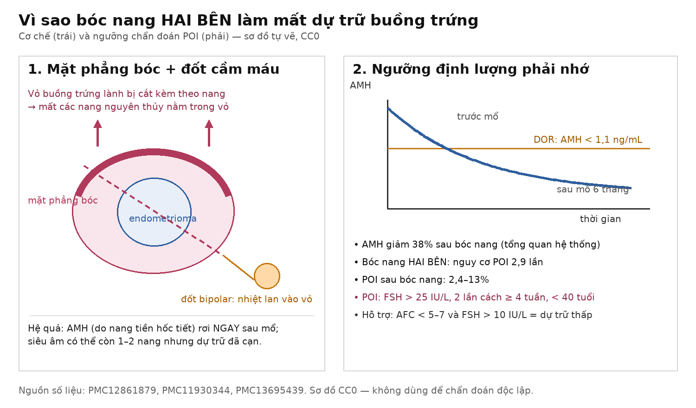
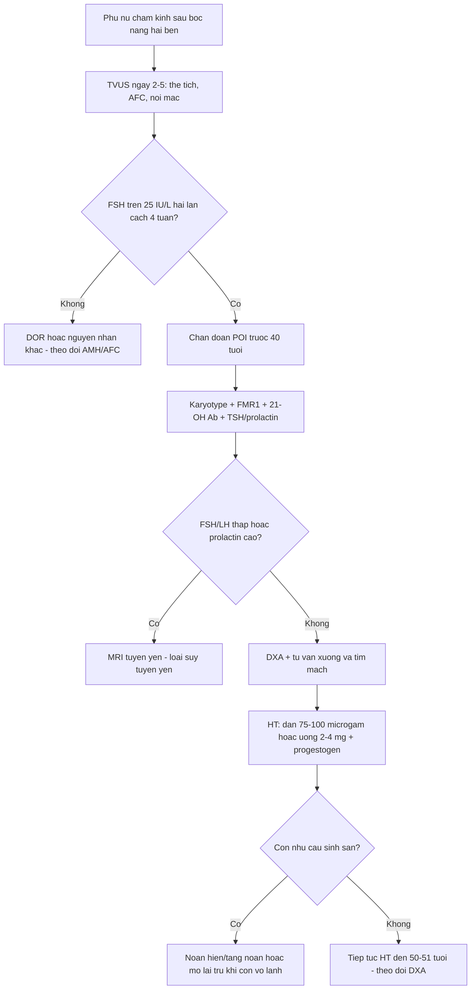

# 1628 — Suy buồng trứng sớm (POI) sau mổ bóc endometrioma HAI BÊN: ngưỡng chẩn đoán, hình ảnh buồng trứng cạn nang noãn và liệu pháp hormone

**Tags:** `pattern:buong-trung-nho` `pattern:suy-buong-trung` `vung:buong-trung` `vung:tieu-khung` `score:AMH-AFC` `protocol:TVUS` `protocol:DXA` `incidentaloma:khong`
**Mức chắc chắn (certainty):** tổng hợp y văn (literature synthesis) — định nghĩa và ngưỡng FSH theo ESHRE (qua tổng quan POI 2026, PMC13695439); mức giảm AMH sau bóc nang và nguy cơ POI hai bên từ tổng quan có hệ thống (PMC12861879) và tổng quan bảo tồn sinh sản trong lạc nội mạc (PMC11930344); phác đồ hormone theo đồng thuận FIGO–IMS 2026 (PMC13629580). **Không có RCT** riêng cho POI sau mổ endometrioma — các con số là tổng hợp quan sát, ghi rõ nguồn từng dòng.

## 1. Tổng quan bệnh học – cơ chế hình ảnh

- **Định nghĩa (ESHRE, qua PMC13695439):** POI (premature ovarian insufficiency) = **rối loạn kinh ≥ 4 tháng** (vô kinh nguyên phát hoặc thứ phát) + **FSH > 25 IU/L**, ở phụ nữ **< 40 tuổi**. **Mãn kinh sớm (early menopause)** = 40–45 tuổi. Hai mốc này khác nhau về tiên lượng và cường độ điều trị — đừng gộp.
- **Vì sao POI sau mổ lại hay bị bỏ sót:** chẩn đoán POI **không dựa vào siêu âm**, mà dựa vào **FSH lặp lại**, nên một buồng trứng "trông còn nang" trên siêu âm không loại trừ. Ngược lại, **hình ảnh là thứ chứng minh mức độ mất dự trữ và loại trừ nguyên nhân khác** — đây là vai trò thật của CĐHA.
- **Ba cơ chế mất dự trữ trong một lần bóc nang (giải thích TẠI SAO):**
  1. **Cắt bỏ vỏ buồng trứng lành:** mặt phẳng bóc đi qua **vỏ buồng trứng chứa ổ nguyên thủy**; mô lành bị lấy kèm thành nang — đó là lý do **AMH giảm ngay** dù "chỉ bóc nang".
  2. **Tổn thương nhiệt do đốt cầm máu (bipolar):** nhiệt lan vào vỏ còn lại, phá các nang **tiền hốc (preantral)** — nhóm nang **sản xuất AMH**.
  3. **Rối loạn tưới máu cục bộ + viêm/xơ hóa:** giảm mật độ nang sống trong vỏ còn lại; ở nang tái phát, mặt phẳng bóc bị xơ hóa nên phải cắt nhiều mô lành hơn (xem bài 1606).
- **Vì sao AMH rơi trước và mạnh hơn hình thái:** AMH do **tế bào hạt của nang tiền hốc và nang nhỏ (< 8 mm)** tiết ra; chỉ cần mất vỏ là mất nguồn tiết, trong khi **nang noãn thứ cấp/trưởng thành vẫn còn** vài chu kỳ → siêu âm có thể còn 1–2 nang nhưng AMH đã rất thấp. Vì vậy **AMH là chỉ số phát hiện sớm, AFC là chỉ số xác nhận muộn**.
- **Số liệu định lượng phải nhớ:**
  - **AMH giảm 38% sau bóc nang nội soi** (tổng quan hệ thống, dẫn trong PMC12861879); nang **hai bên** giảm nhiều hơn một bên và **bóc nang hai bên làm tăng nguy cơ POI 2,9 lần** (cùng nguồn).
  - **POI sau bóc nang buồng trứng: 2,4–13%** trong giai đoạn hậu phẫu (Busacca, dẫn trong PMC11930344) — dải rộng vì khác định nghĩa và thời điểm đo.
  - **Tần suất POI chung: 3,7%** phụ nữ (mãn kinh sớm **12%**) — nghĩa là POI **không hiếm** như con số "1%" cũ (PMC13695439).
  - **Ngưỡng dự trữ giảm (DOR): AMH < 1,1 ng/mL**; hỗ trợ: **AFC < 5–7**, **FSH > 10 IU/L** (PMC12861879).
- **Vì sao buồng trứng "nhỏ" trên hình ảnh:** mô vỏ bị lấy đi + nang noãn cạn → thể tích giảm. Thể tích buồng trứng tiền mãn kinh bình thường khoảng **4–8 mL** (y văn chuẩn); sau bóc nang hai bên, buồng trứng thường **< 2–3 mL**, bờ không đều, **không thấy nang ≥ 5 mm** ở pha sớm. Đây là hình thái của **buồng trứng cạn nang noãn**, nhưng **không đặc hiệu** — phải đối chiếu FSH/AMH.

## 2. Mẫu hình + chẩn đoán phân biệt theo vị trí (gamut)

- **Mẫu hình A — buồng trứng hai bên nhỏ, không nang, tiền sử bóc nang hai bên:** POI do phẫu thuật (iatrogenic POI) — nguyên nhân hay gặp nhất trong nhóm POI "mắc phải" ở nước có tỷ lệ mổ endometrioma cao.
- **Mẫu hình B — một bên nhỏ, bên đối diện bình thường:** suy giảm dự trữ một bên (DOR), **không** đủ tiêu chuẩn POI; tiên lượng sinh sản vẫn tốt hơn POI hai bên.
- **Mẫu hình C — buồng trứng nhỏ + FSH/LH THẤP:** không phải POI — nghĩ **suy tuyến yên (Sheehan, hypophysitis sau ICI)**, **vô kinh do chức năng (FHA)**, tăng prolactin; MRI tuyến yên là bước tiếp theo.
- **Mẫu hình D — buồng trứng to/nang nhiều, AMH cao:** **PCOS** — đối cực của POI; AFC **≥ 20** mỗi buồng trứng (tiêu chuẩn Rotterdam) loại POI.
- **Mẫu hình E — vệt mô tuyến sinh dục (streak gonad), tử cung nhỏ:** **hội chứng Turner (45,X)** — cần karyotype; trên MRI thấy dải mô xơ không nang.
- **Gamut theo bối cảnh lâm sàng (mnemonic "SURGICAL"):** **S**urgery (bóc nang, cắt buồng trứng), **U**ndiagnosed genetic (Turner, FMR1), **R**adiation/chemo, **G**onadotropin thấp (pituitary), **I**mmune (viêm buồng trứng tự miễn), **C**hronic anovulation (PCOS — loại trừ), **A**utoimmune adrenal, **L**ifestyle (FHA, ăn kiêng, tập quá mức).

## 3. Bảng so sánh phân biệt (ma trận đối chiếu)

| Thực thể (entity) | Hình ảnh điển hình | Chốt vào (rule-in) | Chốt loại (rule-out) | Gợi ý xác nhận |
|---|---|---|---|---|
| **POI sau bóc nang hai bên** | Hai buồng trứng **nhỏ (< 2–3 mL)**, bờ không đều, **0–2 nang ≤ 5 mm**; không có nang trội | **Tiền sử bóc nang HAI BÊN + FSH > 25 IU/L ×2 + AMH < 0,5 ng/mL** | **AFC ≥ 5–7 và AMH ≥ 1,1 ng/mL** → chưa POI, chỉ DOR | FSH lặp lại ≥ 4 tuần; AMH; TVUS ngày 2–5 |
| **Hội chứng Turner (45,X)** | **Streak gonad** hai bên (dải mô xơ không nang), tử cung nhỏ, chiều cao thấp | **Karyotype 45,X (hoặc khảm) + streak gonad + FSH rất cao** | **Buồng trứng có nang + karyotype bình thường** | Karyotype 30 tế bào; FSH; siêu âm tim (bệnh tim bẩm sinh) |
| **Tiền đột biến FMR1** | Buồng trứng nhỏ như POI khác; **không có dấu hiệu hình ảnh đặc trưng** | **FSH > 25 IU/L + tiền sử gia đình POI/chậm phát triển/run** | Không loại được bằng hình ảnh — **phải xét nghiệm gen** | FMR1 (CGG lặp); tư vấn di truyền |
| **Viêm buồng trứng tự miễn** | Buồng trứng có thể **TO và nhiều nang** ở giai đoạn đầu (bẫy) rồi teo dần | **Kháng thể 21-hydroxylase + suy thượng thận + FSH cao** | **Không có kháng thể, chức năng thượng thận bình thường** | 21-OH Ab, cortisol 8h, ACTH, điện giải |
| **Suy tuyến yên (Sheehan/hypophysitis)** | Tử cung và buồng trứng nhỏ, **nội mạc mỏng**; MRI thấy tuyến yên teo/khối | **FSH/LH THẤP + prolactin thấp + không tăng FSH dù estrogen thấp** | **FSH > 25 IU/L** → loại suy tuyến yên | MRI tuyến yên; TSH, FT4, cortisol, IGF-1 |
| **Vô kinh do chức năng (FHA)** | Buồng trứng nhỏ, **nang nhỏ 2–4 mm** rải rác, không nang trội | **LH thấp, E2 thấp, AMH bình thường**, bối cảnh giảm cân/tập nặng/căng thẳng | **AMH thấp + tiền sử mổ hai bên** → nghĩ POI | LH/FSH, E2, AMH; hỏi cân nặng, vận động, rối loạn ăn |
| **PCOS** | Buồng trứng **to (> 10 mL)**, **AFC ≥ 20**, nang 2–9 mm xếp ngoại vi | **AFC ≥ 20 + AMH cao + rối loạn phóng noãn** | **AFC ≤ 4–7 + AMH thấp** → loại PCOS | Testosterone, SHBG, siêu âm; loại trừ tăng sản thượng thận |

- **Ảnh minh họa cơ chế và ngưỡng (sơ đồ tự vẽ, CC0):**

*Trái: mặt phẳng bóc lấy kèm vỏ buồng trứng lành + đốt cầm máu gây tổn thương nhiệt. Phải: AMH rơi sớm (ngưỡng DOR 1,1 ng/mL), FSH vượt 25 IU/L là ngưỡng chẩn đoán POI (ESHRE). Sơ đồ tự vẽ, CC0.*

## 4. Protocol chụp + hệ phân độ/điểm chuẩn hóa

- **Bước 1 — Siêu âm đầu dò âm đạo (TVUS) là tuyến đầu, làm ở pha sớm ngày 2–5:** đo **thể tích buồng trứng 3 chiều** (công thức ellipsoid D1×D2×D3×0,523), **đếm AFC** (nang 2–10 mm), ghi **số nang mỗi bên**, mô tả bờ, nang tồn dư, và **tử cung/nội mạc** (nội mạc mỏng < 4 mm gợi ý thiếu estrogen). **Doppler không dùng để chẩn đoán POI** — chỉ số trở kháng thay đổi theo chu kỳ, không đủ độ lặp lại.
- **Bước 2 — Xét nghiệm khẳng định (bắt buộc trước khi gắn nhãn POI):** **FSH > 25 IU/L, lặp lại sau ≥ 4 tuần** (ESHRE); kèm **LH, E2, AMH, TSH, prolactin**; **AFC/AMH** để xếp mức dự trữ. Một lần FSH cao **không đủ** — POI có thể **phóng noãn ngắt quãng**.
- **Bước 3 — Tìm nguyên nhân (không bỏ qua vì đã có "lý do phẫu thuật"):** **karyotype** (Turner), **FMR1 premutation**, **kháng thể 21-hydroxylase + cortisol/ACTH** (suy thượng thận), và **MRI tuyến yên** nếu FSH/LH thấp hoặc prolactin bất thường. Ở người đã mổ hai bên, nguyên nhân do phẫu thuật là **hợp lý nhưng không loại trừ** nguyên nhân thứ hai.
- **Bước 4 — Đo mật độ xương (DXA):** POI gây **mất xương nhanh** và **tăng nguy cơ gãy xương** so với mãn kinh tự nhiên (PMC13629580). Chỉ định **DXA ngay khi chẩn đoán**, lặp lại theo dõi; đọc theo **T-score của WHO: ≤ −2,5 = loãng xương; −1,0 đến −2,5 = thiếu xương**. Bổ sung **canxi + vitamin D**, **tập chịu lực ≥ 150 phút/tuần**, bỏ thuốc lá (PMC13629580).
- **Bước 5 — Liệu pháp hormone (HT) — khác mãn kinh thường ở LIỀU:** liều estrogen cho POI **cao gấp đôi** mãn kinh thường: **estradiol dán 75–100 µg/ngày** hoặc **uống 2–4 mg/ngày**; nếu còn tử cung, thêm **progestogen 12–14 ngày/tháng** (micronized progesterone **200–300 mg/ngày**, dydrogesterone **20 mg/ngày**, norethisterone **5–10 mg/ngày**); **ưu tiên đường dán** khi có nguy cơ tim mạch/béo (PMC13629580). Tiếp tục **ít nhất đến tuổi mãn kinh trung bình (50–51 tuổi)**, sau đó cá thể hóa.
- **Bước 6 — Sinh sản:** HT **không phải** biện pháp sinh sản; phải tách hai mục tiêu. Với POI đã cạn nang noãn, lựa chọn là **noãn hiến/tặng noãn** hoặc **trữ noãn/phôi trước mổ** (xem bài 1607); **trữ mô buồng trứng** (bài 1632) chỉ đặt ra khi còn mô vỏ lành.

## 5. Biến thể bình thường và cạm bẫy

- **Biến thể bình thường:** buồng trứng **nhỏ, ít nang** ở phụ nữ **gần 40 tuổi** hoặc **dùng progestin liên tục/dienogest** — AFC thấp giả tạo do bị ức chế trục, **không phải POI**; đo lại sau khi ngừng thuốc 1–2 chu kỳ (nếu an toàn).
- **Cạm bẫy 1 — "AMH thấp = POI":** AMH **dao động giữa các phòng xét nghiệm** và giữa các lần đo; tổng quan khuyến cáo **lặp lại một kết quả thấp** trước khi kết luận (PMC13452471). Chẩn đoán POI **vẫn phải bằng FSH**.
- **Cạm bẫy 2 — một lần FSH cao:** stress, đau, mất ngủ có thể làm FSH tăng thoáng qua; **hai lần cách ≥ 4 tuần** là bắt buộc.
- **Cạm bẫy 3 — nhầm tái phát endometrioma với "buồng trứng còn tốt":** khối nang tái phát có thể **không phải mô buồng trứng lành**; đừng đếm nang trong khối để kết luận còn dự trữ. So sánh mô học/mặt phẳng bóc ở bài 1606.
- **Cạm bẫy 4 — progestin làm giảm mật độ xương:** dùng progestin liên tục (dienogest) để phòng tái phát **có thể giảm BMD nhẹ** — cần tư vấn và không dùng thay HT ở người đã POI (PMC13452471).
- **Cạm bẫy 5 — bỏ sót suy thượng thận:** POI tự miễn có thể đi kèm **suy thượng thận**; bỏ sót là **nguy cơ tử vong khi phẫu thuật/gây mê**. Luôn hỏi mệt, hạ huyết áp, tăng sắc tố, hạ Na⁺.
- **Cạm bẫy mặt cắt:** trên **MRI tiểu khung**, buồng trứng teo dính vào thành chậu có thể bị đọc thành **"không thấy buồng trứng"** — dùng T2 các mặt phẳng mỏng 3 mm, tìm cấu trúc nang nhỏ T2 sáng; đừng kết luận "đã cắt buồng trứng" khi chưa có bệnh án.

## 6. Tự lượng giá — Blind Quiz

**Ca 1 — 34 tuổi, vô kinh 7 tháng sau mổ**

- Bối cảnh: bóc endometrioma **hai bên** 8 tháng trước; nay không kinh 7 tháng, bốc hỏa, khô âm đạo.
- Câu hỏi: Cần xét nghiệm gì để **khẳng định** POI? Hai ngưỡng số nào quyết định? Vì sao không dựa vào siêu âm?

<b>Bấm để hiện đáp án</b>

- Dấu hiệu: buồng trứng hai bên nhỏ, **0–2 nang ≤ 5 mm**, nội mạc mỏng; **FSH 62 IU/L** và lặp lại **58 IU/L** sau 5 tuần; **AMH 0,06 ng/mL**.
- Chẩn đoán: **POI do phẫu thuật** — vì mất vỏ buồng trứng chứa nang nguyên thủy + tổn thương nhiệt khi đốt cầm máu khiến AMH rơi sớm, FSH vượt **25 IU/L** hai lần.
- Nguồn: tổng hợp từ PMC13695439 (định nghĩa), PMC12861879 (AMH giảm 38%, hai bên 2,9 lần), PMC11930344 (POI 2,4–13%).

**Ca 2 — 29 tuổi, FSH cao một lần**

- Bối cảnh: bóc nang **một bên** 1 năm trước, kinh thưa; FSH **31 IU/L** một lần, AMH **0,9 ng/mL**, AFC **6** ở bên mổ.
- Câu hỏi: Đã đủ chẩn đoán POI chưa? Xử trí tiếp theo?

<b>Bấm để hiện đáp án</b>

- Dấu hiệu: **một lần FSH cao**, AMH **0,9 ng/mL** (dưới 1,1 = DOR nhưng chưa phải POI), AFC **6**.
- Chẩn đoán: **suy giảm dự trữ buồng trứng (DOR)** sau mổ một bên, **chưa POI** — vì POI cần **FSH > 25 IU/L lặp lại ≥ 4 tuần** + rối loạn kinh ≥ 4 tháng; ở đây mới một lần.
- Xử trí: lặp FSH sau 4–6 tuần, đo lại AMH; **tư vấn trữ noãn/phôi nếu còn nhu cầu sinh sản**; không vội HT.
- Nguồn: PMC12861879 (ngưỡng AMH 1,1; AFC), PMC13695439 (tiêu chuẩn FSH).

**Ca 3 — 41 tuổi, POI "không giải thích"**

- Bối cảnh: **chưa từng mổ buồng trứng**, vô kinh 6 tháng, FSH **> 25 IU/L** hai lần, buồng trứng nhỏ; có mệt, huyết áp thấp, sạm da.
- Câu hỏi: Hai xét nghiệm nào **không được bỏ**? Vì sao nguy hiểm nếu bỏ?

<b>Bấm để hiện đáp án</b>

- Dấu hiệu: POI **không do phẫu thuật** + **hạ huyết áp, sạm da, mệt** → nghi **suy thượng thận nguyên phát**.
- Chẩn đoán: POI có thể do **viêm buồng trứng tự miễn**; phải làm **kháng thể 21-hydroxylase** và **cortisol 8h/ACTH**.
- Vì sao nguy hiểm: suy thượng thận không được điều trị có thể **tử vong khi gây mê/nhiễm trùng**; POI tự miễn là nguyên nhân **có thể điều trị được** của một phần ca.
- Nguồn: PMC13695439 (nguyên nhân tự miễn), PMC13629580 (theo dõi dài hạn).

## Bài liên quan chéo
- [1606 – Endometrioma tái phát ở người hiếm muộn: mổ lại hay đi thẳng IVF](../1606-tai-phat-endometrioma-mo-lai-hay-ivf/lesson.md)
- [1607 – Bảo tồn sinh sản trước hóa–xạ trị](../1607-bao-ton-sinh-san-truoc-hoa-xa-tri/lesson.md)
- [1609 – Suy buồng trứng và thiếu hụt hormone sau xạ trị phụ khoa](../1609-suy-buong-trung-thieu-hut-hormone-sau-xa-tri-phu-khoa/lesson.md)
- [1632 – Trữ mô buồng trứng trước dậy thì và ghép lại](../1632-tru-mo-buong-trung-truoc-day-thi/lesson.md)
- [1605 – Endometrioma và IVF: mổ trước hay đi thẳng](../1605-endometrioma-tu-van-tien-san/lesson.md)

## Ảnh
- `images/1628_poi-sau-mo_SoDo_CC0.png` — sơ đồ tự vẽ (CC0), không dùng ảnh bệnh nhân.
- Không tải ảnh Radiopaedia/AuntMinnie; dẫn link tham khảo trong `sources.md`.

> Không dùng để chẩn đoán độc lập khi chưa có người hướng dẫn.
