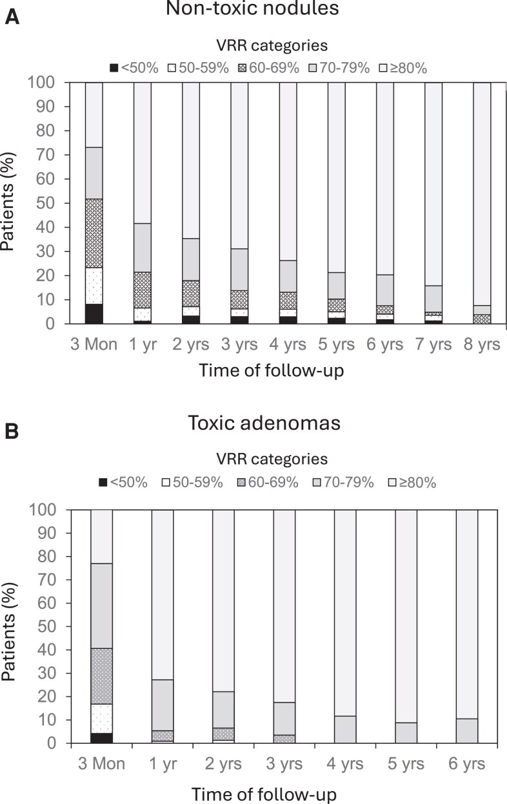
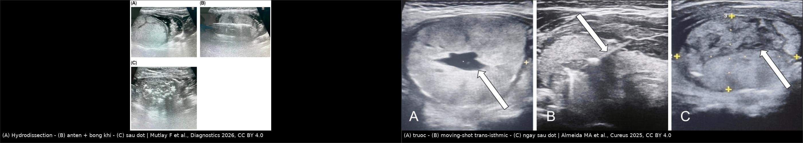
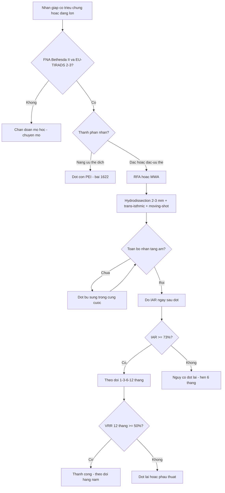
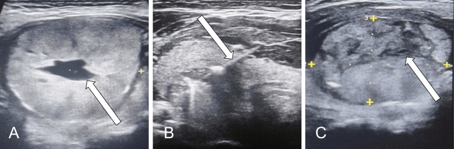

# 1629 — Đốt nhiệt nhân giáp lành tính ĐẶC: RFA & MWA / Thermal ablation of solid benign thyroid nodules

**Tags:** `pattern:not` `vung:tuyen-giap` `protocol:dot-nhiet-giap` `score:IAR` `incidentaloma:nhan-giap`
**Mức chắc chắn (certainty):** tổng hợp y văn (literature synthesis) — biên từ toàn văn các bài mở: đồng thuận Hội Tuyến giáp Mỹ Latinh (Dueñas JP et al., *Arch Endocrinol Metab* 2025, PMC12662451, CC BY), đoàn hệ **883 nhân** theo dõi tới 8 năm sau một lần RFA (Dobnig H & Amrein K, *J Clin Endocrinol Metab* 2026, PMC13099205, CC BY), nghiên cứu **tỷ lệ đốt ban đầu (IAR)** (Bernardi S et al., *Front Endocrinol* 2020, PMC7883676, CC BY), quy trình MWA thực hành (Chaidas K et al., *J Clin Med* 2026, PMC13607213, CC BY), loạt MWA ở người cao tuổi (Mutlay F et al., *Diagnostics* 2026, PMC13565520, CC BY) và loạt RFA (Almeida MA et al., *Cureus* 2025, PMC12702792, CC BY). Số liệu lấy từ toàn văn.

## 1. Tổng quan — vì sao "đốt nóng" chứ không "bơm cồn", và vì sao kết quả phải chờ 12 tháng

- **Bệnh học:** phần lớn nhân giáp lành tính là **nhân keo tăng sinh (colloid nodule)** hoặc **u tuyến nang (follicular adenoma)**, cấu trúc **đặc, giàu tế bào và mạch** — khác hoàn toàn nang giáp (bài 1622). Vì **không có khoang dịch**, cồn **không có môi trường để lan tỏa** khắp nhân → PEI thất bại ở nhân đặc; cần **năng lượng nhiệt**.
- **TẠI SAO nhiệt diệt được nhân:** dòng điện tần số cao (RFA) hoặc vi sóng (MWA) làm **đông vón protein và hoại tử đông (coagulative necrosis)** mô đích trong vài phút. Trên siêu âm, vùng đốt chuyển **tăng âm do bọt khí** — đây là **dấu hiệu "đã đốt tới"** dùng để dẫn đường (kỹ thuật **moving-shot**: rút kim dần từ đáy lên bờ và quét từng lớp).
- **TẠI SAO VRR 3 tháng chỉ ~56–69% mà 12 tháng ~80–86%:** mô hoại tử **không biến mất ngay** — nó còn nằm tại chỗ và được đại thực bào dọn dần trong **6–24 tháng**. Vì vậy **đánh giá "thành công" ở 12 tháng**, không phải ở 1 tháng.
- **TẠI SAO khối đặc lại khó hơn nang:** (1) **không có "chất dẫn"** để nhiệt lan đều; (2) **hiệu ứng tản nhiệt (heat sink)** của mạch máu lớn trong nhân; (3) **giới hạn an toàn 2–3 mm** với dây thần kinh quặt ngược (RLN), khí quản, thực quản, bao giáp → phải hy sinh một lớp mô sát bờ. Ba lý do này chính là nguồn gốc của **chỉ số IAR** và của **hydrodissection**.
- **Ngưỡng định lượng nằm lòng:**
  - **Giảm thể tích (VRP) nhân lành tính — gộp 6 nghiên cứu (956 nhân RFA/938 nhân MWA):** 3 tháng **−56% (RFA) vs −54% (MWA)**; 6 tháng **−81% vs −75%**; **12 tháng −86% vs −80%**; triệu chứng và thẩm mỹ cải thiện như nhau (PMC12662451, dẫn Guo và cs.).
  - **Một lần RFA, theo dõi tới 8 năm (883 nhân không độc, trung vị 10,1 mL):** VRR **69,1 ± 15,0%** ở 3 tháng → **79,7%** ở 1 năm → **82,8%** ở 3 năm → **86,2%** ở 5 năm; **tái phát tích lũy 4,4% ở 2 năm và 17,3% ở 5–8 năm**; **RFA lần 2 chỉ 1,2%** (PMC13099205).
  - **Nhân độc (toxic adenoma, 144 nhân):** VRR **70,1%** ở 3 tháng → **88,8%** ở 4 năm; **TSH giảm trở lại (≤ 0,4 mIU/L) tích lũy 21,6% ở 5 năm** (PMC13099205) — nghĩa là **đốt không "chữa khỏi" cường giáp vĩnh viễn**, phải theo dõi hormon.
  - **IAR (tỷ lệ thể tích đã đốt / thể tích nhân, đo trên siêu âm ngay sau đốt):** trung vị **83%**; **cut-off 49%** dự báo hiệu quả kỹ thuật (VRR ≥ 50% sau 1 năm) với AUC **0,87**, Se **0,71**, Sp **0,92**; **cut-off 73%** dự báo **không phải đốt lại** với AUC **0,84** (PMC7883676).
  - **Năng lượng:** đạt **> 2,1 kJ/mL** mô nhân dự báo khỏi bệnh ở nhân độc (**91% vs 44%**) (PMC12662451, dẫn Mauri và cs.).
  - **Biến chứng:** gộp 2.245 bệnh nhân/2.540 nhân lành tính — **biến chứng chung 2,38%**, **nặng 1,35%**, **nhẹ 1,03%**; **thay đổi giọng 0,5–4,7%**, **tụ máu 0,9–17%** (tùy định nghĩa, gộp nhiều loạt), **suy giáp vĩnh viễn và vỡ nhân rất hiếm**; nguy cơ biến chứng **vĩnh viễn < 1%** (PMC12662451).

*Tỷ lệ bệnh nhân theo nhóm giảm thể tích (VRR) sau **một lần** RFA: nhóm VRR ≥ 80% tăng dần và chiếm gần như toàn bộ sau 8 năm; nhóm VRR < 50% teo dần. Đây là lý do phải chờ **12 tháng** mới kết luận "hiệu quả kỹ thuật". Nguồn: Dobnig H & Amrein K, J Clin Endocrinol Metab 2026, Fig. 2, CC BY 4.0 (nguyên bản).*

## 2. Mẫu hình + chẩn đoán phân biệt theo loại nhân (gamut)

- **Mẫu hình đích:** nhân **đặc hoặc đặc-ưu thế**, **giảm âm/đồng âm**, bờ đều, **không vi vôi hóa, không bờ tua gai, không hướng không song song**, **EU-TIRADS 2–3 / ACR TI-RADS TR1–TR2**, **FNA Bethesda II**, có **triệu chứng chèn ép hoặc vấn đề thẩm mỹ**, hoặc **> 2 cm và đang lớn lên**.
- **Định nghĩa "đang lớn" (dùng để đặt chỉ định):** tăng **≥ 20% ở ít nhất 2 đường kính với mức tăng tối thiểu 2 mm**, **hoặc** thể tích tăng **> 50%**, **hoặc** xuất hiện triệu chứng chèn ép (PMC12662451).
- **Gamut theo thành phần — quyết định kỹ thuật:**
  - **Nhân đặc (> 90% đặc):** đích của RFA/MWA; VRR 12 tháng ~80–86%.
  - **Nhân đặc-ưu thế (50–90% đặc):** **hút dịch trước rồi đốt** phần đặc (PMC13607213); kết quả tốt nhưng cần đánh giá lại phần đặc còn mạch.
  - **Nang ưu thế dịch / nang thuần:** **đốt cồn (PEI)** là đầu tay — xem bài 1622; RFA dành cho ca tái phát/còn phần đặc có mạch.
  - **Nhân độc / AFTN:** RFA hiệu quả nhưng **TSH giảm lại 21,6% ở 5 năm** → phải theo dõi hormon, không hứa "khỏi vĩnh viễn".
  - **Bướu đa nhân:** chỉ đốt **2–5 nhân**, cần còn **≥ 50% nhu mô giáp bình thường** và đánh giá **từng nhân riêng** (PMC12662451).
  - **Nghi ác (Bethesda III–VI, TR4–TR5, vi vôi hóa, xâm lấn bao):** **không đốt** — chuyển phẫu thuật/chẩn đoán mô học (bài 230).
  - **Nhân sau xương ức / chạm bao / sát khí quản:** thận trọng — cần **hydrodissection đủ 2–3 mm** hoặc chuyển mổ.
- **Mnemonic 5 câu hỏi trước khi đốt:** **(1) Có 2 lần tế bào học lành tính chưa? (2) Nhân đặc hay nang? (3) Thể tích bao nhiêu mL? (4) Có triệu chứng/thẩm mỹ đáng điều trị? (5) Có dây thanh đối bên liệt không?**

## 3. Bảng so sánh phân biệt (ma trận đối chiếu)

### 3a. Chọn tổn thương — ai được đốt, ai không

| Thực thể (entity) | Hình ảnh điển hình | Chốt vào (rule-in) | Chốt loại (rule-out) | Gợi ý xác nhận |
|---|---|---|---|---|
| **Nhân đặc lành tính — đích của RFA/MWA** | Giảm âm/đồng âm đều, bờ nhẵn, **không vi vôi hóa**, có mạch trong nhân | **Bethesda II + EU-TIRADS 2–3 + có triệu chứng hoặc > 2 cm đang lớn** | Bờ tua gai, vi vôi hóa, hướng không song song, mất mạch đột ngột → nghi ác | FNA ± lần 2; theo dõi VRR 1–3–6–12 tháng |
| **Nhân đặc-ưu thế / nang ưu thế dịch** | Phần dịch + phần đặc; phần đặc **có mạch** | **Phần đặc không mạch + FNA lành tính** → hút dịch rồi đốt | Phần đặc **có mạch trong** → phải FNA phần đặc trước | Siêu âm Doppler; PEI trước (bài 1622) |
| **Nhân độc (toxic adenoma/AFTN)** | Nhân đặc, TSH thấp, xạ hình tập trung | **TSH < 0,4 mIU/L + xạ hình phù hợp + nhân đơn độc** | TSH bình thường → nhân không độc, không cần kiểm soát cường giáp | TSH/FT4; theo dõi TSH sau đốt 5 năm |
| **U tuyến thể nang (Bethesda IV)** | Nhân đặc đồng nhất, **vỏ rõ**, không dấu hiệu nhú | **Bethesda IV sau 2 lần FNA** | Có bất thường nhân/mật độ → **không được đốt** | Chẩn đoán mô học; đốt chỉ khi có chống chỉ định mổ |
| **Nhân giả trong viêm giáp Hashimoto** | Vùng giảm âm **bờ mờ, không có vỏ**, nhu mô xung quanh không đồng nhất | **Bối cảnh viêm giáp + không có khối thật trên 2 bình diện** | Khối có vỏ, đẩy lệch mô xung quanh → nhân thật | Anti-TPO, siêu âm lặp; **không đốt "giả nhân"** |
| **Tuyến cận giáp / hạch cổ** | Giảm âm, nằm **ngoài bao giáp** hoặc góc dưới giáp | **Vị trí ngoài tuyến giáp + PTH/Canxi** | Nằm trong tuyến, có mô giáp bao quanh → nhân giáp | PTH, siêu âm; **không đốt nhầm tuyến cận giáp** |

### 3b. Đọc hình sau đốt — "còn u sống" hay "mô hoại tử đang dọn"

| Hình ảnh sau đốt | Chốt vào (rule-in) | Chốt loại (rule-out) | Xử trí |
|---|---|---|---|
| **Vùng hoại tử mong đợi** | Vùng **giảm âm/không đồng nhất chiếm toàn bộ nhân**, không mạch, teo dần theo tháng | Có **nốt tăng sinh mạch** ở rìa → nghi còn sống | Theo dõi 1–3–6–12 tháng; **không chọc** vùng hoại tử |
| **Còn mô sống (residual viable)** | **Nốt ngấm mạch/ bắt contrast ở rìa**, IAR thấp (< 49%) | Hoại tử toàn bộ + VRR ≥ 50% ở 12 tháng | Đốt bổ sung khi có triệu chứng; IAR < 73% → nguy cơ đốt lại |
| **Tái phát (regrowth)** | Thể tích tăng **> 50%** so với lần nhỏ nhất trước đó | Thể tích ổn định/giảm dần | Đốt lại ± phẫu thuật; kiểm tra tế bào học nếu hình thái đổi |
| **Vỡ nhân sau đốt (nodule rupture)** | Đau, sưng cổ **2–4 tuần** sau đốt, dịch quanh tuyến | Đau ngay trong 24 giờ → đau thủ thuật thường | Đa số **điều trị bảo tồn** (biến chứng nhẹ); dẫn lưu nếu áp-xe |
| **Áp-xe / viêm mô tế bào vùng cổ** | Sốt, đỏ, đau tăng, khí trong mô | Chỉ đau + phù nhẹ không sốt | Kháng sinh ± dẫn lưu; **biến chứng nặng** |

*Trái: (A) hydrodissection tạo lớp dịch bảo vệ, (B) anten MWA trong nhân với bọt khí tăng âm, (C) toàn bộ nhân đã tăng âm sau đốt. Phải: (A) nhân trước đốt (có thành phần dịch trung tâm), (B) kỹ thuật **moving-shot trans-isthmic**, (C) ngay sau đốt — vùng tăng âm/giảm âm hỗn hợp là **mô hoại tử**, chưa phải "kết quả cuối". Nguồn: Mutlay F et al., Diagnostics 2026 (CC BY 4.0); Almeida MA et al., Cureus 2025 (CC BY 4.0); ảnh ghép letterbox.*

## 4. Protocol can thiệp + chỉ số kiểm soát chất lượng

### 4.1. Chỉ định (theo đồng thuận, PMC12662451)

- Nhân **lành tính không hoạt động** (non-functioning) **có triệu chứng chèn ép hoặc vấn đề thẩm mỹ**, bệnh nhân **từ chối mổ** hoặc **có chống chỉ định mổ**, **hoặc** nhân **> 2 cm đang lớn**.
- **Bắt buộc:** tế bào học lành tính (**Bethesda II**); với nhân lớn/nhiều lần FNA không chẩn đoán được → hội chẩn trước khi đốt.
- **Chống chỉ định:** nghi ác/không loại trừ được ác; nhân sau xương ức không đặt được kim an toàn; **liệt dây thanh đối bên**; thai kỳ/cho con bú (theo quy trình đơn vị); rối loạn đông máu nặng.

### 4.2. Kỹ thuật — 8 bước cố định

1. **Đo thể tích** siêu âm: **V = πabc/6 (0,524 × a × b × c)**, ghi 3 đường kính (mm) + thể tích (mL) — đây là mẫu số của mọi VRR về sau.
2. **Gây tê tại chỗ**; giữ bệnh nhân **tỉnh** để phát hiện **thay đổi giọng tức thì**; ca lo lắng dùng **diazepam liều thấp** dưới lưỡi (PMC13607213).
3. **Hydrodissection bằng dung dịch glucose 5% lạnh** giữa bao giáp và **RLN/khí quản/thực quản/cơ ức-giáp/bao cảnh**, duy trì **lớp đệm ≥ 2–3 mm** suốt cuộc đốt; lặp lại mỗi khi lớp mỏng đi hoặc bệnh nhân đau (PMC13607213).
4. **Đường vào trans-isthmic** (qua eo giáp) để kim ổn định, nhìn rõ trên siêu âm và tránh cấu trúc quan trọng; đường bên là phương án hai (PMC13607213).
5. **Đưa kim tới đáy nhân → đốt → rút dần (moving-shot)**: quét từng lớp, đổi góc sau mỗi mặt cắt; **luôn nhìn thấy đầu kim** trước khi bật năng lượng.
6. **Năng lượng:** MWA thực hành **30 W** cho phần lớn nhân, **20 W** gần bao giáp/RLN/khí quản, **40 W** cho phần trung tâm nhân lớn; RFA theo công suất của đơn vị — mục tiêu là **> 2,1 kJ/mL** mô nhân (PMC13607213, PMC12662451).
7. **Kết thúc** khi **toàn bộ nhân chuyển tăng âm** trên siêu âm; nhân đặc-ưu thế dịch thì **hút dịch trước** để tăng hiệu quả.
8. **Sau đốt:** chườm lạnh **20 phút**, paracetamol khi đau; **soi thanh quản trước và sau đốt ở mọi ca** (giọng bình thường **không** loại trừ liệt dây thanh) (PMC13607213).

### 4.3. Theo dõi và ngưỡng quyết định

| Thời điểm | Việc làm | Ngưỡng / quyết định |
|---|---|---|
| **Ngay sau đốt** | Siêu âm + soi thanh quản; đo **IAR** | **IAR ≥ 49%** = đủ hiệu quả kỹ thuật; **≥ 73%** = ít phải đốt lại |
| **1 tháng** | Siêu âm (kích thước, mạch), TSH/FT4 | Không đánh giá "thất bại" ở mốc này |
| **3 / 6 tháng** | Thể tích + VRR + triệu chứng (VAS), thẩm mỹ | Nhân độc: **VRR ≥ 50% ở 6 tháng** dự báo khỏi cường giáp |
| **12 tháng** | Thể tích + VRR | **VRR ≥ 50% = hiệu quả kỹ thuật**; **< 50% = cân nhắc đốt lại** |
| **Hằng năm (≥ 5 năm)** | Thể tích, TSH | **Tái phát = tăng > 50%** so với thể tích nhỏ nhất; nhân độc: **TSH giảm lại 21,6% ở 5 năm** |

## 5. Biến thể bình thường và cạm bẫy

- **"Siêu âm lành tính thì khỏi cần FNA":** u tuyến thể nang (Bethesda IV) và ung thư thể nang **không phân biệt được bằng siêu âm**; đốt một Bethesda IV = **điều trị ung thư mà không biết**.
- **Coi vùng tăng âm ngay sau đốt là "đã sạch":** tăng âm là **bọt khí**, có thể che phần mô chưa đốt → phải **quét lại sau khi khí tan** và **đo IAR**, không kết luận bằng cảm giác.
- **Đốt "vừa đủ" để tránh biến chứng:** IAR thấp là **nguyên nhân số 1 của đốt lại**; trong loạt 5 năm, lý do đốt lại là **không đạt hiệu quả kỹ thuật 40%**, tái phát 40%, triệu chứng dai dẳng 20% (PMC7883676).
- **Hydrodissection một lần rồi bỏ:** dịch bị hấp thu trong quá trình đốt → lớp đệm mất dần; **RLN tổn thương thường do mất lớp đệm ở phút cuối**, không phải phút đầu.
- **Bỏ soi thanh quản trước đốt:** **liệt dây thanh đối bên** là chống chỉ định tuyệt đối; không phát hiện trước = nguy cơ suy hô hấp sau đốt.
- **Đọc "nhân to lên" ở tuần 1–2 là thất bại:** phù/hoại tử làm nhân **tạm to**; đánh giá bằng VRR ở 3–12 tháng.
- **Vỡ nhân ở tuần 2–4:** đau, sưng, có khi đỏ — **đa số bảo tồn**, nhưng phải loại áp-xe (sốt, khí trong mô).
- **Quên theo dõi hormon ở nhân độc:** giảm thể tích không đồng nghĩa hết cường giáp; **21,6%** giảm TSH trở lại trong 5 năm.
- **Cạm bẫy "nhân giả" trong Hashimoto:** vùng giảm âm bờ mờ, không vỏ, đổi theo thời gian — **không phải khối để đốt**.

## 6. Tự lượng giá — Blind Quiz

**Ca 1 — Nữ 47 tuổi, nhân thùy phải 37 × 35 × 26 mm, EU-TIRADS 3, FNA Bethesda II, nuốt vướng. Nhìn 3 ảnh và mô tả từng bước.**

- Gợi ý: bệnh nhân tỉnh, gây tê tại chỗ; nhân có thành phần dịch trung tâm.
- Câu hỏi: (1) Ảnh B đang làm gì và vì sao chọn đường vào đó? (2) Ảnh C nói lên điều gì — đã thành công chưa? (3) Chỉ số nào cần ghi ngay lúc này?

<b>Bấm để hiện đáp án (findings + chẩn đoán)</b>

- Dấu hiệu: (A) nhân hỗn hợp có khoang dịch trung tâm; (B) điện cực vào nhân theo đường **trans-isthmic**, kỹ thuật **moving-shot**; (C) nhân chuyển **tăng âm/giảm âm hỗn hợp** ngay sau đốt.
- Chẩn đoán/thực hành: **chưa kết luận thành công** — cần đo **IAR** (thể tích đã đốt/thể tích nhân): **≥ 49%** mới đạt hiệu quả kỹ thuật, **≥ 73%** để ít phải đốt lại; và hẹn **VRR ở 3–12 tháng**. Trong loạt này VRR 6 tháng 47,1% (33,2–62,5%) — nhắc rằng nhân hỗn hợp đáp ứng chậm hơn nhân đặc thuần.
- Nguồn ảnh: Almeida MA et al., *Cureus* 2025, Fig. 1, CC BY 4.0.

**Ca 2 — Bác sĩ nội tiết hỏi: "Đốt xong 1 tháng, siêu âm vẫn còn khối 30 mm, có thất bại không?"**

- Gợi ý: nhân ban đầu 10,1 mL (trung vị của đoàn hệ 883 nhân); đốt 1 lần.
- Câu hỏi: Trả lời thế nào, dựa vào con số nào? Khi nào mới gọi là thất bại?

<b>Bấm để hiện đáp án</b>

- Dấu hiệu: ở 3 tháng, VRR trung bình chỉ **69,1 ± 15,0%**, và một tỷ lệ đáng kể còn ở nhóm VRR < 50%; tới **1 năm** mới đạt **79,7%**, **5 năm 86,2%**.
- Chẩn đoán/thực hành: **chưa thất bại** — mô hoại tử còn tại chỗ và được dọn dần 6–24 tháng. Chỉ gọi **hiệu quả kỹ thuật** khi **VRR ≥ 50% ở 12 tháng**; gọi **tái phát** khi thể tích tăng **> 50%** so với mốc nhỏ nhất. Đốt lại chỉ **1,2%** trong đoàn hệ này.
- Nguồn ảnh: Dobnig H & Amrein K, *J Clin Endocrinol Metab* 2026, Fig. 2, CC BY 4.0.

**Ca 3 — Nam 62 tuổi, nhân đặc 32 mL, đốt RFA 1 lần, IAR ước tính 41%. Sau 12 tháng nhân còn 24 mL, bệnh nhân vẫn nuốt vướng.**

- Gợi ý: IAR thấp; thể tích ban đầu lớn; không có biến chứng.
- Câu hỏi: (1) Vì sao IAR thấp? (2) Tính VRR và kết luận. (3) Bước tiếp theo?

<b>Bấm để hiện đáp án</b>

- Dấu hiệu: VRR = (32 − 24)/32 = **25%** → **< 50%** ở 12 tháng, tức **chưa đạt hiệu quả kỹ thuật**; IAR **41% < 49%** (ngưỡng hiệu quả) và **< 73%** (ngưỡng ít đốt lại).
- Chẩn đoán/thực hành: nhân **> 30 mL** thuộc nhóm đáp ứng kém (nhóm < 10 mL đạt 74% ngừng thuốc ở 12 tháng so với **19%** ở nhóm > 30 mL — PMC12662451); IAR thấp vì bỏ sót phần rìa/gần mạch (heat sink). Bước tiếp: **đốt lại có kế hoạch** (có thể nhiều lần) hoặc **phẫu thuật** nếu triệu chứng nặng; tư vấn trước rằng nhân lớn cần **nhiều lần đốt**.
- Nguồn ảnh: Mutlay F et al., *Diagnostics* 2026, Fig. 1 (CC BY 4.0) + Almeida MA et al., *Cureus* 2025, Fig. 1 (CC BY 4.0) — ảnh ghép.

## Bài liên quan chéo
- [1622 – Đốt cồn nang giáp lành tính (PEI/EA)](../1622-dot-con-nang-giap-pei/lesson.md) (nhân ưu thế dịch — chọn PEI thay vì đốt nhiệt)
- [230 – Tuyến giáp ACR TI-RADS & hạch cổ](../230-tuyen-giap-hach-co/lesson.md) (phân tầng trước can thiệp)
- [929 – Gây xơ hóa nang qua da](../929-xo-hoa-nang-qua-da/lesson.md) (nguyên lý nhiệt/xơ hóa, khác mô đích)
- [933 – Sốc phản vệ & PC-AKI do thuốc cản quang](../933-an-toan-thuoc-can-quang/lesson.md) (dùng contrast US/CT đánh giá sau đốt)
- [900 – Đại cương IR: kim, đông máu & cửa sổ chọc](../900-ir-fundamentals-biopsy/lesson.md)
- [901 – Tổng quan Điện quang Can thiệp](../901-ir-overview/lesson.md)
- [750 – Hạch cổ & NI-RADS](../750-cervical-lymph-nodes-nirads/lesson.md) (phân biệt hạch và nhân vùng cổ)

## Ảnh
- 3 ảnh gốc + 1 ảnh ghép, tất cả **CC BY 4.0**: `1629_truoc-trong-sau_…` (PMC12702792 Fig. 1), `1629_hydrodissection-bong-khi_…` (PMC13565520 Fig. 1), `1629_vrr-theo-thoi-gian_…` (PMC13099205 Fig. 2), `composite_1629_ky-thuat-va-ket-qua.jpg`. Nguồn + giấy phép từng file trong `images/CREDITS.md`.
- Ảnh ghép tạo bằng `tools/make_composite.py` (letterbox, giữ tỷ lệ, dải attribution); không crop, không kéo giãn.
- Không tải ảnh từ Radiopaedia/AuntMinnie; chỉ dẫn link trong `sources.md`.

> Không dùng để chẩn đoán độc lập khi chưa có người hướng dẫn.
