# 163 — Pylephlebitis (huyết khối tĩnh mạch cửa nhiễm khuẩn) & huyết khối tĩnh mạch mạc treo (MVT): cấp cứu bụng / Pylephlebitis & mesenteric venous thrombosis

**Tags:** `pattern:huyet-khoi-mach` `vung:gan` `vung:mach-cua` `vung:ruot` `protocol:CT-bung-da-thi`
**Mức chắc chắn (certainty):** tổng hợp y văn (literature synthesis) — nhóm tự biên từ y văn mở (Diagnostics 2023 PMC9914785; Life 2025 PMC12565192; J Clin Imaging Sci 2016 PMC5041373; Medicina 2024 PMC11677191; Int J Surg Case Rep 2024 PMC11420455; J Surg Case Rep 2025 PMC12701568; Interv Radiol 2025 PMC12078030; Front Surg 2026 PMC13226624), số liệu lấy nguyên từ bài gốc.

> **Câu hỏi gốc của bài:** bệnh nhân **sốt + đau bụng** không rõ nguyên nhân, CT thấy **khuyết thuốc trong lòng tĩnh mạch cửa** — đó là **huyết khối nhiễm khuẩn (pylephlebitis)**, **huyết khối lành (bland)**, **huyết khối u (neoplastic)** hay **huyết khối tĩnh mạch mạc treo (mesenteric venous thrombosis – MVT)**? Và vì sao câu trả lời quyết định **kháng sinh bao lâu, có chống đông hay không, và có mổ ngay không**.
> **Điểm tựa giải phẫu:** mọi ổ nhiễm trong vùng **dẫn lưu của hệ tĩnh mạch cửa** (dạ dày, tụy, tá tràng, ruột non, manh tràng – ruột thừa, đại tràng lên/ngang, đại tràng xuống – trực tràng qua tĩnh mạch mạc treo dưới) đều có thể đổ vi khuẩn vào tĩnh mạch cửa và gây huyết khối mủ.

## 1. Tổng quan bệnh học – cơ chế hình ảnh

**A. Pylephlebitis = viêm tắc tĩnh mạch cửa nhiễm khuẩn (septic thrombophlebitis of the portal vein):**
- **Cơ chế (tam giác Virchow + nhiễm khuẩn):** ổ nhiễm trong ổ bụng → vi khuẩn vào hệ cửa → **tổn thương nội mô tĩnh mạch** + **ứ trệ dòng chảy** + **tăng đông tại chỗ** → hình thành **huyết khối mủ** trong lòng tĩnh mạch cửa và các nhánh.
- **TẠI SAO hình ảnh lại như vậy:** huyết khối nhiễm khuẩn chứa **mủ, khí và tế bào viêm** → trên CT là **khuyết thuốc trung tâm**, **thành mạch ngấm thuốc mạnh** (viêm), có thể có **bọt khí trong lòng mạch/thành mạch**; vi khuẩn theo dòng cửa vào gan → **áp-xe gan nhỏ rải rác** (thường ở ngoại vi gan phải, nơi dòng cửa mạnh nhất).
- **Dịch tễ – số liệu:** **0,37–2,7 ca/100.000 người–năm**; tổng quan 220 ca (1971–2022): **70,5% nam**, tuổi trung vị **50**, **12,3% < 18 tuổi**, ca nhỏ nhất **20 ngày tuổi** (PMC9914785).
- **Triệu chứng:** **sốt 75,5%**, **đau bụng 66,4%**, có thể sốt cao kéo dài, rét run, buồn nôn, vàng da nếu tổn thương gan nặng (PMC9914785).
- **Ổ nhiễm nguồn (quan trọng để tìm nguyên nhân):** **viêm túi thừa 26,5%**, **viêm ruột thừa 22%**, không rõ 11,5%, áp-xe gan 8,5%, viêm dạ dày–ruột 6,5%, sau mổ 6%, **viêm tụy 5,5%**, bệnh ruột viêm 4%, dị vật 3,5%, viêm đường mật/túi mật 3,5% (PMC9914785).
- **Vi khuẩn:** **E. coli 25%**, **Bacteroides 17%**, **Streptococcus 15%**; **một loại 42,8%**, **đa loại 27,2%**, **không xác định được 30%** → **cấy máu âm không loại trừ bệnh** (PMC9914785).
- **Tiên lượng:** tử vong **~14%** trong tổng quan hệ thống; các chuỗi khác báo **11–32%** (PMC9914785, PMC12565192).

**B. Huyết khối tĩnh mạch mạc treo (mesenteric venous thrombosis – MVT):**
- **Cơ chế:** huyết khối trong **tĩnh mạch mạc treo trên (superior mesenteric vein – SMV)** hoặc nhánh → ứ máu tĩnh mạch → **phù thành ruột, xuất huyết thành ruột, thiếu máu ruột** → hoại tử, thủng, tử vong nếu muộn.
- **TẠI SAO hình ảnh lại như vậy:** tắc dòng ra tĩnh mạch làm **áp lực mao mạch – tĩnh mạch tăng** → **dày thành ruột**, **phù mạc treo dạng "lược" (comb sign)**, **dịch ổ bụng**, **khí trong thành ruột (pneumatosis)** và **khí trong tĩnh mạch cửa** khi đã hoại tử.
- **Số liệu:** MVT chiếm **5–20% các ca thiếu máu ruột cấp (acute mesenteric ischemia – AMI)**; trong AMI, **tắc động mạch mạc treo trên 65%**, **tắc tĩnh mạch mạc treo 28%**, **thiếu máu không tắc mạch 7%** (PMC11420455, PMC12078030).
- **Điều trị:** **chống đông bằng heparin không phân đoạn hoặc heparin trọng lượng phân tử thấp làm giảm tử vong**; **mổ chỉ khi có viêm phúc mạc/hoại tử ruột**, không mổ dự phòng chỉ vì có huyết khối (PMC11420455).

**Ngưỡng định lượng mấu chốt (Argon – cửa 1):**
- **Kháng sinh: 4–6 tuần** sau khi có triệu chứng, hiệu chỉnh theo cấy; **không có khuyến cáo chống đông cho mọi ca pylephlebitis** — chỉ khi **huyết khối tiến triển trên hình ảnh lại** hoặc **sốt dai dẳng dù kháng sinh đúng** (PMC9914785).
- **Pylephlebitis + áp-xe gan:** một chuỗi 15 ca cho thấy **áp-xe gan gặp 80%**, **14/15 được chống đông**, **2 tử vong**, **4 phải mổ** (PMC12565192).
- **MVT:** chống đông sớm làm giảm tử vong; **mổ khi có viêm phúc mạc/hoại tử ruột** (PMC11420455).
- **Cửa sổ CT:** huyết khối cấp có **đậm độ cao hơn máu lưu thông** do hồng cầu cô đặc; **thu hẹp cửa sổ (window width) giúp thấy huyết khối rõ hơn** trên CT không cản quang (PMC12078030).

## 2. Mẫu hình + chẩn đoán phân biệt theo vị trí (Gamut)

**Gamut theo VỊ TRÍ huyết khối trong hệ cửa – mạc treo:**
- **Thân tĩnh mạch cửa / nhánh trong gan:** pylephlebitis (nhiễm khuẩn), huyết khối lành (xơ gan, tăng đông), huyết khối u (HCC, di căn), khí tĩnh mạch cửa (không do huyết khối).
- **Tĩnh mạch mạc treo trên (SMV):** **MVT** (nguyên phát hoặc thứ phát sau mổ, viêm tụy, bệnh ruột viêm, tăng đông), pylephlebitis lan từ ruột thừa/viêm túi thừa, huyết khối u.
- **Tĩnh mạch mạc treo dưới / tĩnh mạch lách:** hiếm, thường kèm viêm tụy hoặc ung thư.
- **Nhu mô gan:** **áp-xe gan** (biến chứng của pylephlebitis), nang/khối u hoại tử.
- **Bối cảnh quyết định:** **sốt + ổ nhiễm trong bụng → pylephlebitis**; **đau bụng không sốt + yếu tố tăng đông → MVT**; **xơ gan/HCC + khuyết thuốc ngấm mạch → huyết khối u**.

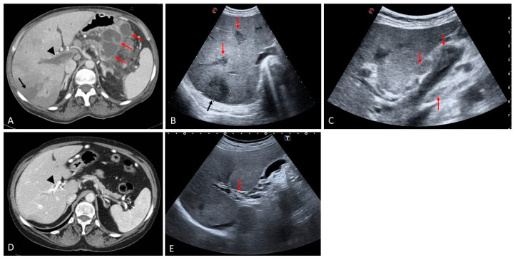
*CT cản quang: viêm tụy bán cấp biến chứng nang giả + **viêm tắc tĩnh mạch cửa nhiễm khuẩn (pylephlebitis)**; khuyết thuốc trong lòng tĩnh mạch và phù quanh mạch. Nguồn: Medicina 2024 (PMC11677191), CC BY 4.0.*

**Mnemonic "PORTAL" cho pylephlebitis:** **P**ain + Fever (đau bụng + sốt) · **O**bstruction (khuyết thuốc trong lòng mạch) · **R**igors (rét run) · **T**hrombus with gas (huyết khối có khí) · **A**bscess gan · **L**eukocytosis + blood cultures (bạch cầu tăng, cấy máu).

## 3. Bảng so sánh phân biệt (ma trận đối chiếu)

| Thực thể (entity) | Hình ảnh điển hình (CT/MRI/US) | Chốt vào (rule-in) | Chốt loại (rule-out) | Gợi ý xác nhận |
|---|---|---|---|---|
| **Pylephlebitis** | Khuyết thuốc trong tĩnh mạch cửa, **thành mạch ngấm mạnh**, có thể **khí trong lòng/thành mạch**, **áp-xe gan nhỏ**, phù mạc treo | **Sốt + đau bụng + khuyết thuốc cửa + ổ nhiễm trong bụng (ruột thừa/túi thừa/viêm tụy)** | **Không sốt, không ổ nhiễm, không khí trong mạch** → nghĩ huyết khối lành | CT bụng cản quang thì cửa + **cấy máu 2 bộ** trước kháng sinh; theo dõi CRP/procalcitonin |
| **Huyết khối cửa lành (bland PVT)** | Khuyết thuốc **không ngấm**, mạch **không phì đại**, có thể tái thông; bối cảnh xơ gan/tăng đông | **Khuyết thuốc không ngấm + không sốt + yếu tố tăng đông** | **Thành mạch ngấm mạnh + khí + sốt** → pylephlebitis | CT đa thì; D-dimer; xét nghiệm tăng đông |
| **Huyết khối u (neoplastic PVT)** | Mạch **phình lớn**, huyết khối **ngấm thì động mạch/cửa**, có **mạch nuôi trong huyết khối**, kèm khối HCC | **Ngấm mạch + phì đại mạch + có khối u gan** | **Không ngấm, không phì đại mạch** → lành/nhiễm khuẩn | MRI gadoxetate + DWI; mật độ iod (bài 124) |
| **MVT** | Khuyết thuốc trong **SMV**, SMV giãn, **phù mạc treo "lược"**, **dày thành ruột**, dịch ổ bụng | **Khuyết thuốc SMV + đau bụng + yếu tố tăng đông/sau mổ** | **SMV thông, chỉ tĩnh mạch cửa có huyết khối** → pylephlebitis/PVT | CT bụng–chậu cản quang thì cửa; đánh giá thành ruột |
| **Khí tĩnh mạch cửa (không do huyết khối)** | Khí **chạy ra ngoại vi tới dưới bao gan**, dạng nhánh; kèm khí thành ruột/mất ngấm thành ruột | **Khí trong tĩnh mạch cửa + bệnh cảnh ruột thiếu máu** | **Có huyết khối đặc trong lòng mạch** → huyết khối thật | CT cấp cứu; đánh giá ruột, không chỉ chống đông |
| **Áp-xe gan** | Ổ dịch **bờ ngấm thuốc**, có thể có khí; thường **nhiều ổ nhỏ ngoại vi** khi do pylephlebitis | **Ổ dịch trong gan + sốt + cấy máu dương** | **Nang đơn thuần không ngấm, không khí, không sốt** | CT/MRI; chọc hút/dẫn lưu khi > 3–5 cm hoặc không đáp ứng kháng sinh |

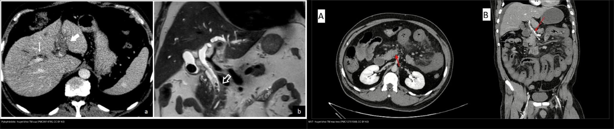
*Trái: **pylephlebitis** — khuyết thuốc trong tĩnh mạch cửa (huyết khối nhiễm khuẩn). Phải: **MVT** — huyết khối trong tĩnh mạch mạc treo trên, kèm phù mạc treo. Nguồn: Diagnostics 2023 (PMC9914785) + J Surg Case Rep 2025 (PMC12701568), CC BY 4.0. Ảnh ghép letterbox.*

### Ba dấu hiệu hay bị đọc nhầm
- **Khí trong tĩnh mạch cửa KHÔNG đồng nghĩa với nhiễm khuẩn:** gặp trong thiếu máu/hoại tử ruột, sau thủ thuật, chấn thương; nhưng ở bệnh nhân **sốt + ổ nhiễm**, khí trong lòng mạch là **dấu hiệu mủ** rất mạnh.
- **Huyết khối "cấp" có thể tăng đậm độ trên CT không cản quang** (do hồng cầu cô đặc) — không phải "máu đông bình thường"; **thu hẹp cửa sổ** giúp nhận ra (PMC12078030).
- **Pylephlebitis có thể chỉ là "đám mờ quanh mạch"** ở giai đoạn sớm, chưa có khuyết thuốc rõ; đừng chờ đến khi có khí mới chẩn đoán.

## 4. Protocol chụp + hệ phân độ/điểm chuẩn hóa

- **CT bụng–chậu có cản quang, thì tĩnh mạch cửa (60–70 giây), lát mỏng ≤ 1 mm:** phương thức đầu tay. Đánh giá **tĩnh mạch cửa, SMV, tĩnh mạch lách, tĩnh mạch mạc treo dưới**, thành mạch, khí trong mạch, nhu mô gan (áp-xe), **thành ruột, mạc treo, dịch ổ bụng**.
- **Nếu nghi thiếu máu ruột:** bổ sung thì động mạch; tìm **mất ngấm thành ruột, khí thành ruột, khí tĩnh mạch cửa, dịch ổ bụng** — đây là dấu hiệu **chỉ định mổ**, không phải "theo dõi".
- **MRI bụng (T1/T2 fat-sat + DWI + thì mạch):** khi CT không rõ hoặc cần phân biệt huyết khối u; **không thay thế CT trong cấp cứu**.
- **Siêu âm bụng:** hữu ích ở trẻ/giường bệnh, thấy huyết khối tăng echo trong lòng mạch, nhưng **phụ thuộc người làm** và dễ bỏ sót khí/áp-xe nhỏ.
- **Xét nghiệm:** **cấy máu 2 bộ (hiếu khí + kỵ khí) TRƯỚC kháng sinh**, lactate, CRP/procalcitonin, D-dimer, đông máu, chức năng gan/thận.
- **Điều trị (theo bậc):**
  - **Kháng sinh phổ rộng** (phủ Gram âm + kỵ khí) ngay khi nghi ngờ, sau đó **hiệu chỉnh theo cấy**, tổng **4–6 tuần** (PMC9914785).
  - **Chống đông:** không bắt buộc cho mọi ca pylephlebitis; **cân nhắc khi huyết khối lan vào SMV, tiến triển trên hình ảnh, hoặc sốt dai dẳng**; **MVT: chống đông sớm** (PMC9914785, PMC11420455).
  - **Can thiệp ổ nhiễm nguồn:** cắt ruột thừa, dẫn lưu áp-xe, xử trí viêm túi thừa/viêm tụy.
  - **Mổ:** chỉ khi **viêm phúc mạc/hoại tử ruột**, không mổ chỉ vì có huyết khối.

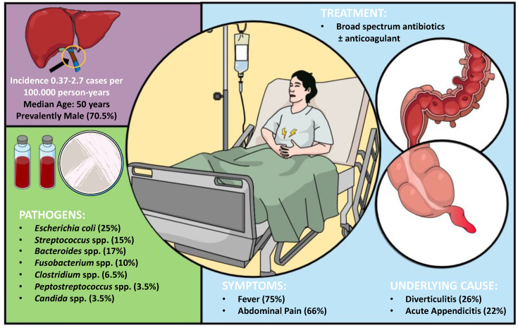
*Bảng tổng hợp từ tổng quan hệ thống 220 ca: dịch tễ, vi khuẩn thường gặp, triệu chứng, ổ nhiễm nguồn và nguyên tắc điều trị. Nguồn: Diagnostics 2023 (PMC9914785), CC BY 4.0.*

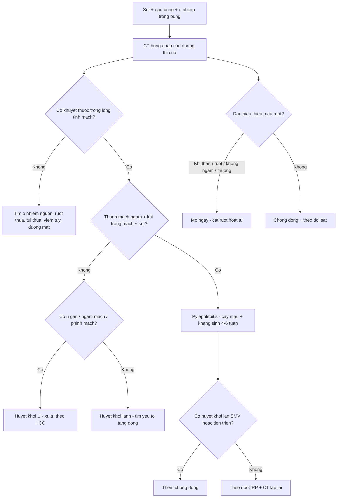

## 5. Biến thể bình thường và cạm bẫy

- **Huyết khối nhỏ ở nhánh tĩnh mạch cửa có thể bị bỏ sót trên CT không cản quang** — luôn chụp **có cản quang thì cửa** khi bệnh nhân sốt + đau bụng.
- **Cấy máu âm trong ~30% ca pylephlebitis** — **không loại trừ**; nên lấy cấy trước kháng sinh và lặp lại nếu cần (PMC9914785).
- **Khí trong tĩnh mạch cửa không đồng nghĩa tử vong/hoại tử** — có thể do thủ thuật hoặc thiếu máu thoáng qua; **bối cảnh lâm sàng + thành ruột** quyết định.
- **MVT dễ bị chẩn đoán nhầm thành viêm tụy/viêm dạ dày–ruột** vì đau bụng lan tỏa, men tụy có thể tăng nhẹ; ca minh họa PMC11420455 ban đầu được chẩn đoán "viêm tụy cấp" trước khi CT cản quang phát hiện huyết khối.
- **Pylephlebitis sau mổ hoặc sau đặt catheter:** huyết khối có thể **vô khuẩn**; đừng mặc định nhiễm khuẩn nếu không có sốt/ổ nhiễm.
- **Cạm bẫy "thỏa mãn tìm kiếm":** thấy huyết khối cửa là dừng — phải **tìm ổ nhiễm nguồn** (ruột thừa, túi thừa, viêm tụy, đường mật) và **đánh giá SMV/thành ruột** để không bỏ hoại tử ruột.
- **Cạm bẫy mặt cắt:** khuyết thuốc do **dòng chảy/tạo ảnh** trong tĩnh mạch cửa thay đổi giữa các thì; huyết khối thật **cố định ở mọi thì** và thường có **viền thành mạch ngấm**.

## 6. Tự lượng giá — Blind Quiz ngay trên trang tĩnh (không cần app)

**Ca 1 — Nam 35 tuổi, sốt + đau bụng dưới phải 3 ngày; siêu âm và CT bụng.**

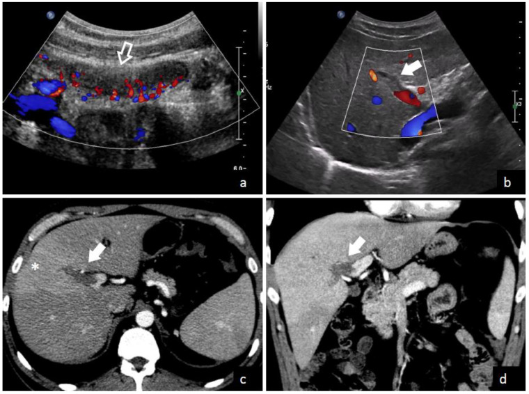

- Gợi ý lâm sàng (clinical context): sốt cao, đau hố chậu phải, bạch cầu tăng.
- Câu hỏi: Hai bất thường chính trên ảnh? Chẩn đoán liên kết giữa chúng? Cần làm gì ngay?

<b>Bấm để hiện đáp án (findings + chẩn đoán)</b>

- **Dấu hiệu (findings):** (a, b) siêu âm Doppler: **ruột thừa viêm** (mũi tên trắng), tăng sinh mạch; (c, d) CT cản quang: **khuyết thuốc trong tĩnh mạch cửa** (mũi tên trắng) + **áp-xe gan nhỏ** (dấu sao).
- **Chẩn đoán (diagnosis):** **pylephlebitis do viêm ruột thừa cấp** — vi khuẩn từ ruột thừa vào tĩnh mạch mạc treo rồi tĩnh mạch cửa, gây huyết khối mủ và áp-xe gan.
- **Xử trí:** **cấy máu trước kháng sinh** + **kháng sinh phổ rộng phủ Gram âm/kỵ khí 4–6 tuần** + **cắt ruột thừa**; cân nhắc chống đông nếu huyết khối lan hoặc sốt dai dẳng; dẫn lưu áp-xe nếu lớn.
- Nguồn ảnh: Fusaro L et al., *Diagnostics* 2023, PMC9914785 (Fig. 3), CC BY 4.0.

**Ca 2 — Nam 58 tuổi, sốt rét run + đau hạ sườn phải; CT bụng thì cửa.**

- Gợi ý: không có tiền sử xơ gan; CRP tăng mạnh.
- Câu hỏi: Mô tả tổn thương mạch? Vì sao đây là "huyết khối mủ" chứ không phải huyết khối lành?

<b>Bấm để hiện đáp án (findings + chẩn đoán)</b>

- **Dấu hiệu (findings):** **khuyết thuốc trung tâm trong tĩnh mạch cửa** (mũi tên đỏ), thành mạch **ngấm thuốc**, kèm **bọt khí nhỏ** trong lòng/thành mạch.
- **Chẩn đoán (diagnosis):** **pylephlebitis (huyết khối tĩnh mạch cửa nhiễm khuẩn)** — khí + thành mạch ngấm + sốt rét run là bộ ba gợi ý mủ.
- **Vì sao không phải huyết khối lành:** huyết khối lành **không có khí**, **không ngấm thành mạch mạnh**, và **không kèm hội chứng nhiễm trùng**; ở đây bệnh cảnh nhiễm khuẩn rõ.
- **Xử trí:** kháng sinh phổ rộng 4–6 tuần + cấy máu; tìm ổ nhiễm nguồn; chống đông nếu lan SMV/tiến triển.
- Nguồn ảnh: Benea SN et al., *Life* 2025, PMC12565192 (Fig. 2), CC BY 4.0.

**Ca 3 — Nam 47 tuổi, sốt 3 tháng, sụt cân; CT bụng 3 bình diện.**

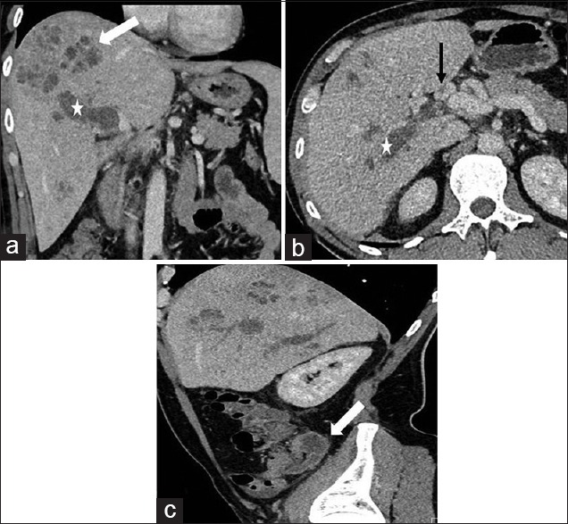

- Gợi ý: sốt kéo dài, rét run, không đau bụng dữ dội; tiền sử viêm ruột thừa mạn.
- Câu hỏi: Mô tả tổn thương gan và mạch? Vì sao sốt kéo dài 3 tháng?

<b>Bấm để hiện đáp án (findings + chẩn đoán)</b>

- **Dấu hiệu (findings):** (a) **áp-xe gan nhiều ổ** (mũi tên trắng) + **huyết khối tĩnh mạch cửa** (dấu sao); (b) mặt cắt ngang: huyết khối trong tĩnh mạch cửa (mũi tên đen); (c) mặt cắt dọc: huyết khối lan dọc mạch (mũi tên trắng).
- **Chẩn đoán (diagnosis):** **pylephlebitis + áp-xe gan do viêm ruột thừa mạn** — ổ nhiễm kín đáo nuôi dưỡng huyết khối mủ, gây sốt kéo dài và sụt cân.
- **Bài học:** sốt kéo dài không rõ nguyên nhân + áp-xe gan nhiều ổ phải **truy tĩnh mạch cửa**; nguồn có thể là **viêm ruột thừa mạn** không triệu chứng rầm rộ.
- Nguồn ảnh: Santosh D, Low G, *J Clin Imaging Sci* 2016, PMC5041373 (Fig. 3), CC BY-NC-SA 3.0 (giữ nguyên bản).

**Ca 4 — Hai bệnh nhân: một sốt + huyết khối cửa, một đau bụng + huyết khối mạc treo.**

- Câu hỏi: Phân biệt hai hình theo **vị trí** và **bối cảnh**; điều trị khác nhau ở điểm nào?

<b>Bấm để hiện đáp án (findings + chẩn đoán)</b>

- **Trái — pylephlebitis:** khuyết thuốc trong **tĩnh mạch cửa**, bệnh nhân **sốt + ổ nhiễm**; điều trị **kháng sinh 4–6 tuần** ± chống đông chọn lọc.
- **Phải — MVT:** khuyết thuốc trong **tĩnh mạch mạc treo trên**, bệnh nhân **đau bụng + yếu tố tăng đông/sau mổ**; điều trị **chống đông sớm**, mổ nếu hoại tử ruột.
- **Điểm chung:** cả hai đều là huyết khối trong hệ cửa–mạc treo; **khác nhau ở vị trí và bối cảnh nhiễm khuẩn** quyết định kháng sinh vs chống đông.
- Nguồn ảnh: Diagnostics 2023 (PMC9914785) + J Surg Case Rep 2025 (PMC12701568), CC BY 4.0. Ảnh ghép letterbox.

**Ca 5 — CT không cản quang ở bệnh nhân đau bụng: làm sao thấy huyết khối?**

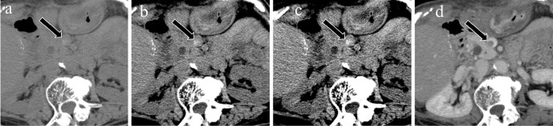

- Câu hỏi: Vì sao huyết khối có thể thấy trên CT không cản quang? Cửa sổ nào tối ưu?

<b>Bấm để hiện đáp án (findings + chẩn đoán)</b>

- **Dấu hiệu (findings):** huyết khối **tăng đậm độ** so với máu lưu thông (do hồng cầu cô đặc, nồng độ sắt cao), thấy rõ hơn khi **thu hẹp cửa sổ** (ảnh b, c) so với cửa sổ mặc định (ảnh a).
- **Chẩn đoán (diagnosis):** **huyết khối tĩnh mạch mạc treo** — dấu hiệu gián tiếp giúp định hướng trước khi chụp cản quang.
- **Lưu ý:** đây chỉ là dấu hiệu **gợi ý**; **CT cản quang thì cửa** vẫn là chuẩn để xác định vị trí, mức lan và đánh giá ruột.
- Nguồn ảnh: Inoue A et al., *Interv Radiol* 2025, PMC12078030 (Fig. 1), CC BY-NC 4.0 (giữ nguyên bản).

**Ca 6 — Bệnh nhân MVT tiến triển: khi nào phải mổ?**

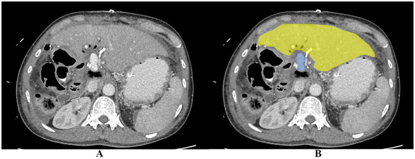

- Gợi ý: đau bụng tăng dần, lactate tăng, không đáp ứng chống đông.
- Câu hỏi: Dấu hiệu nào trên CT buộc phải mổ? Vì sao không tiếp tục theo dõi?

<b>Bấm để hiện đáp án (findings + chẩn đoán)</b>

- **Dấu hiệu (findings):** **thiếu máu ruột non từng đoạn** (mũi tên vàng): thành ruột **mất ngấm thuốc**, phù, có thể **khí thành ruột**, dịch ổ bụng; mạc treo phù.
- **Chẩn đoán (diagnosis):** **hoại tử/thiếu máu ruột do MVT** — biến chứng đe dọa tính mạng.
- **Chỉ định mổ:** **viêm phúc mạc, hoại tử ruột, thủng, hoặc suy tạng tiến triển**; mổ để **cắt đoạn ruột hoại tử** và đánh giá khả năng sống của ruột. Chống đông đơn thuần **không cứu được ruột đã hoại tử**.
- Nguồn ảnh: Tan ZS et al., *Front Surg* 2026, PMC13226624 (Fig. 3), CC BY 4.0.

**Ca 7 — Sơ đồ giải phẫu: vì sao viêm túi thừa/ruột thừa lại gây huyết khối cửa?**

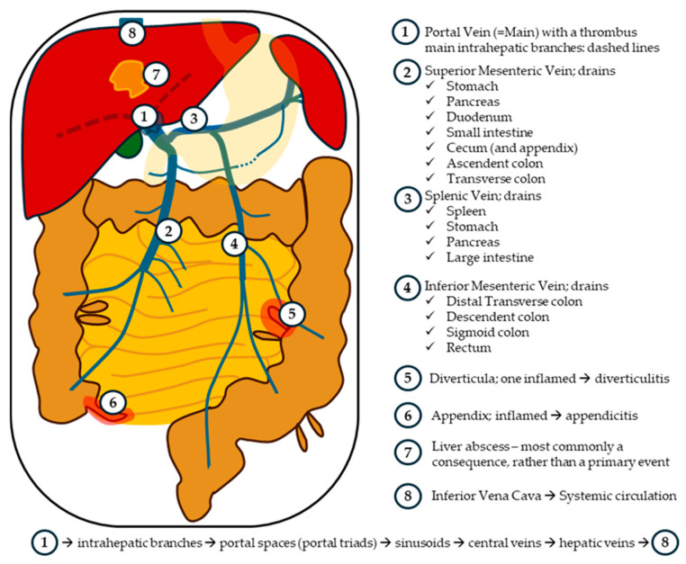

- Câu hỏi: Nhìn sơ đồ, kể 3 ổ nhiễm có thể dẫn đến pylephlebitis; vì sao áp-xe gan thường là **hậu quả** chứ không phải nguyên nhân?

<b>Bấm để hiện đáp án (findings + chẩn đoán)</b>

- **Ba ổ nhiễm:** **viêm túi thừa** (tĩnh mạch mạc treo dưới), **viêm ruột thừa** (tĩnh mạch hồi manh tràng), **viêm tụy/viêm đường mật** (tĩnh mạch lách/cửa).
- **Vì sao áp-xe gan là hậu quả:** vi khuẩn theo **dòng cửa** vào gan trước, gây viêm và huyết khối mủ; áp-xe gan xuất hiện **sau** khi huyết khối hình thành, không phải nguồn ban đầu.
- **Hệ quả thực hành:** khi thấy áp-xe gan "không rõ nguyên nhân", phải **truy ổ nhiễm trong ổ bụng** và **đánh giá tĩnh mạch cửa**.
- Nguồn ảnh: Benea SN et al., *Life* 2025, PMC12565192 (Fig. 1), CC BY 4.0.

**Ca 8 — MVT ở bệnh nhân được chẩn đoán ban đầu là "viêm tụy cấp": theo dõi sau 24 giờ.**

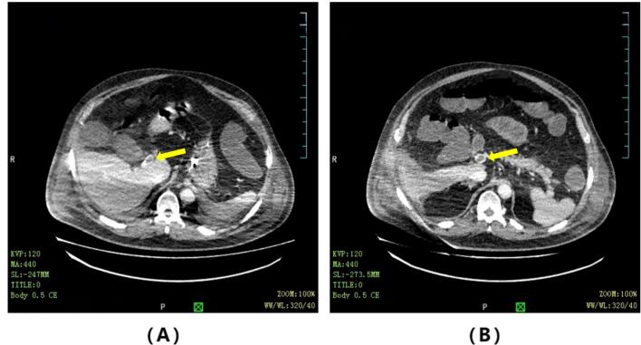

- Gợi ý: đau bụng lan tỏa, men tụy tăng nhẹ, dịch ổ bụng tăng nhanh.
- Câu hỏi: Vì sao chẩn đoán ban đầu dễ nhầm? Huyết khối nằm ở đâu và điều trị nào làm giảm tử vong?

<b>Bấm để hiện đáp án (findings + chẩn đoán)</b>

- **Dấu hiệu (findings):** hình A: **huyết khối tĩnh mạch cửa**; hình B: **huyết khối tĩnh mạch mạc treo trên**; kèm phù mạc treo và dịch ổ bụng.
- **Chẩn đoán (diagnosis):** **huyết khối tĩnh mạch mạc treo (MVT)** — khởi phát âm thầm, triệu chứng và xét nghiệm không đặc hiệu nên dễ nhầm với viêm tụy/viêm dạ dày–ruột.
- **Điều trị:** **chống đông sớm** bằng heparin không phân đoạn hoặc heparin trọng lượng phân tử thấp **làm giảm tử vong**; mổ chỉ khi có viêm phúc mạc/hoại tử ruột.
- Nguồn ảnh: Lin H et al., *Int J Surg Case Rep* 2024, PMC11420455 (Fig. 3), CC BY-NC-ND 4.0 (giữ nguyên bản).

**Ca 9 — Cùng bệnh nhân sau điều trị: huyết khối thay đổi thế nào?**

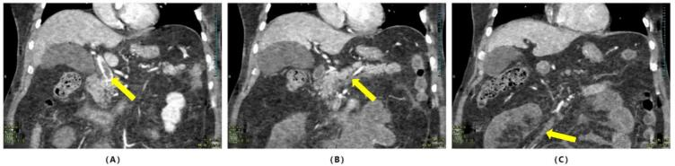

- Câu hỏi: Đánh giá đáp ứng điều trị dựa trên gì? Khi nào cần can thiệp thêm?

<b>Bấm để hiện đáp án (findings + chẩn đoán)</b>

- **Dấu hiệu (findings):** hình A: **huyết khối tĩnh mạch cửa còn tồn tại nhưng có dòng máu đi vòng quanh**; hình B, C: **huyết khối tĩnh mạch mạc treo** còn nhưng kích thước/thành mạch thay đổi.
- **Đánh giá:** theo dõi bằng **CT cản quang lặp lại** + lâm sàng (đau bụng, sốt, lactate) + D-dimer; mục tiêu là **tái thông hoặc co nhỏ huyết khối**, không nhất thiết mất hoàn toàn.
- **Can thiệp thêm:** nếu **đau tăng, lactate tăng, dấu hiệu hoại tử ruột** → mổ; nếu huyết khối lan rộng dù đã chống đông → cân nhắc can thiệp mạch/huyết khối học.
- Nguồn ảnh: Lin H et al., *Int J Surg Case Rep* 2024, PMC11420455 (Fig. 5), CC BY-NC-ND 4.0 (giữ nguyên bản).

## Bài liên quan chéo
- [100 – Tổng quan hệ Bụng](../100-tong-quan-he-bung/lesson.md)
- [110 – Giải phẫu bụng cắt lớp](../110-giai-phau-bung/lesson.md)
- [124 – Bệnh mạch máu gan: Budd-Chiari, SOS/VOD & huyết khối tĩnh mạch cửa](../124-benh-mach-mau-gan/lesson.md)
- [130 – Túi mật](../130-tui-mat/lesson.md)
- [131 – Tắc mật & sỏi ống mật chủ](../131-tac-mat/lesson.md)
- [134 – U nhầy ruột thừa chưa vỡ (LAMN/HAMN)](../134-u-nhay-ruot-thua-chua-vo/lesson.md)
- [135 – Viêm tụy cấp (Atlanta)](../135-viem-tuy-Atlanta/lesson.md)
- [140 – Lách & chấn thương tạng đặc](../140-lach-tang-dac/lesson.md)
- [162 – Tắc ruột](../162-tac-ruot/lesson.md)
- [165 – Dày thành ruột](../165-day-thanh-ruot/lesson.md)
- [175 – Chèn ép mạch & nút mạch](../175-chen-ep-mach/lesson.md)

## Ảnh
- Tên file: `163_slug_Modality_SourceID.jpg`. Nguồn + giấy phép (license) từng ảnh trong `images/CREDITS.md`.
- Ảnh **CC BY 4.0** được phép ghép letterbox (composite); ảnh **CC BY-NC-ND/CC BY-NC-SA** giữ **nguyên bản**, không crop/ghép.
- AuntMinnie (Case of the Day): **chỉ dẫn link, không tải**.

> Không dùng để chẩn đoán độc lập khi chưa có người hướng dẫn.
