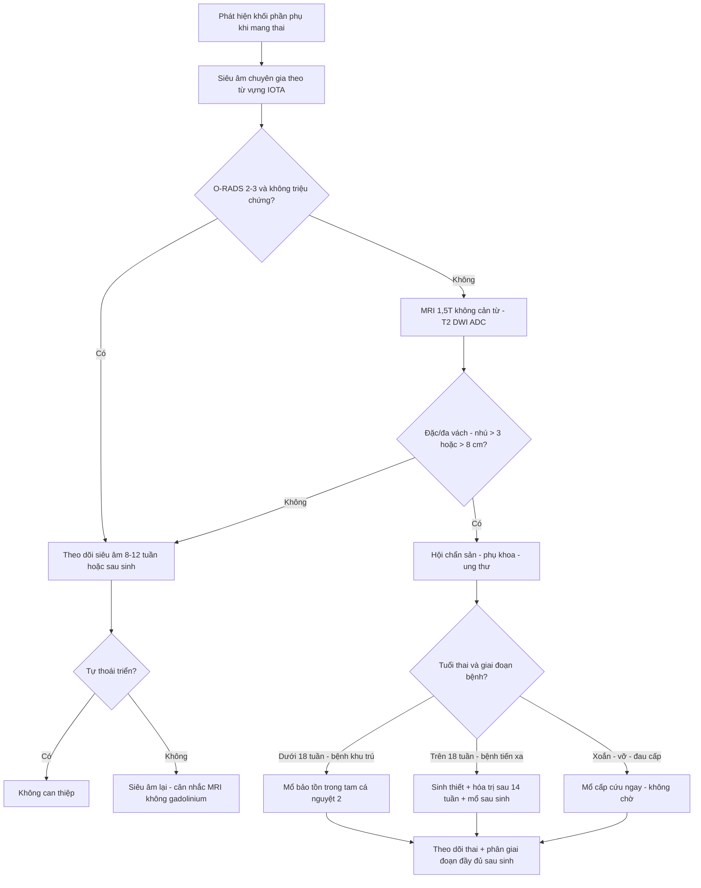
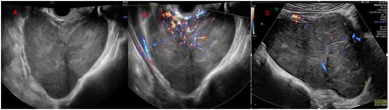
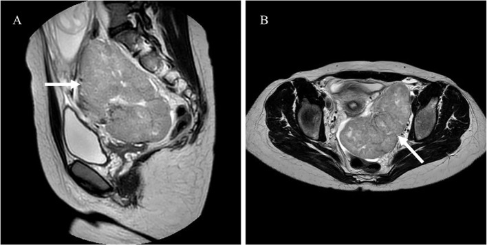

# 1630 — Khối phần phụ NGHI ÁC trong thai kỳ: O-RADS/IOTA, MRI không gadolinium và thời điểm mổ theo tuổi thai

**Tags:** `pattern:khong-phan-phu` `pattern:u-buong-trung` `vung:phan-phu` `score:O-RADS` `score:IOTA` `protocol:MRI-thai-khong-gadolinium` `incidentaloma:khong`
**Mức chắc chắn (certainty):** tổng hợp y văn (literature synthesis) — tổng quan có hệ thống về hình ảnh khối phần phụ trong thai (PMC13641726), 1 ca nguyên văn có ảnh siêu âm + MRI (PMC13462065) và 1 tổng quan điều trị ung thư trong thai (PMC13074105). Số nào chưa có nguồn đối chiếu ghi "chưa rõ".

## 1. Tổng quan bệnh học – cơ chế hình ảnh

- **Tần suất:** khối phần phụ gặp ở **0,2–8%** thai kỳ (đa số nghiên cứu **1–2%**, có loạt tới **~4%**); **ung thư buồng trứng chỉ 1/15.000–1/32.000 thai kỳ**. Con số "ác tính cao" hay gặp trong y văn thực chất là **thiên lệch tuyển chọn**: ở trung tâm tuyến cuối, **BOT + ác tính lên tới 31,9%** số thai phụ được chuyển đến. Trong tổng quan 16 nghiên cứu (**1.674 thai phụ, 1.660 tổn thương**): **93,1% lành (1.284/1.379)**, **3,4% u giáp biên (BOT)**, **3,5% ác tính**.
- **Vì sao mang thai làm hình ảnh khó hơn — ba cơ chế cụ thể:**
  1. **Decidual hóa nội mạc tử cung lạc chỗ:** nội tiết thai làm **u lạc nội mạc tử cung (endometrioma) thoái triển mô đệm thành nhú mạch máu** — gặp ở **11,8–39,5%** endometrioma trong thai. Trên siêu âm, nhú mạch máu này **bắt màu (color score 3)** và trông y như **BOT** → đây là cái bẫy số một, và tổng quan ghi nhận **1 ca BOT bị chẩn đoán nhầm là deciduoma**.
  2. **Tăng sinh mô đệm kiểu luteoma / hyperreactio luteinalis:** khối **đặc, hai bên, rất nhiều mạch**, do hCG cao (thai trứng, đa thai, IVF) — **tự thoái triển sau sinh**, cắt bỏ là sai lầm không hồi phục.
  3. **Tử cung to chèn ép + thai nhi động:** khó đánh giá vùng tiểu khung, đặc biệt **sau 18 tuần** (túi cùng Douglas bị tử cung chiếm chỗ).
- **Vì sao mô học vẫn "giữ nguyên hình thái":** BOT và ung thư biểu mô buồng trứng (EOC) trong thai **giữ đặc điểm hình ảnh như ngoài thai** — tổn thương **lớn hơn**, **đa vách – đặc**, **mạch máu nhiều**. Vì vậy nguyên tắc là **áp dụng đúng từ vựng IOTA + O-RADS**, chỉ **hạ ngưỡng can thiệp** ở nhóm nguy cơ.
- **Ngưỡng định lượng bắt buộc nhớ (từ tổng quan có hệ thống):**
  - **Phân biệt BOT với deciduoma:** BOT **lớn hơn nhiều** — trung vị **88,0 mm vs 48,1 mm**; BOT **đa vách–đặc 30,0% vs 22,4%**; **83,9% deciduoma có 1–3 nhú**, trong khi **66,7% BOT có > 3 nhú**; cả hai đều **color score 3** ở đa số → **số nhú và kích thước** là hai biến số tách biệt, không phải "có mạch = ác".
  - **IOTA Simple Rules trong thai (n = 61):** ngưỡng **1 đặc điểm ác** cho **Se 100% / Sp 51,0%**; **3 đặc điểm** → **91,7% / 53,1%**; **ngưỡng 30** → **91,7% / 73,5%**; **loại ca không kết luận** → **87,5% / 94,4%** (NPV 97,1%). Chiến lược **hai bước IOTA** và **ADNEX** cho **Sp 70,0–90,2%**, **NPV 90,0–98,3%**, nhưng **hay gọi nhầm deciduoma là ác**.
  - **Biến chứng cơ học:** **xoắn 1–28%**, **vỡ 0–9%**, **chèn cản trở sinh 2–17%**; nguy cơ cao nhất với khối **6–8 cm** và **thai 10–17 tuần**.
  - **Không có mô hình chẩn đoán nào được khuyến cáo riêng cho thai kỳ** — O-RADS/IOTA dùng được nhưng **chưa được thẩm định trên thai** (tổng quan nói rõ "no diagnostic models recommended").
- **Vì sao MRI không cản từ là lựa chọn bậc hai:** MRI không bức xạ, **T2W đặc** cho thấy **vách xơ (tín hiệu thấp)**, thành phần đặc, nhú; **DWI/ADC** giúp tách lành – ác (**ADC lành cao hơn**, b-value **0 và 800–1.000 s/mm²**). **Gadolinium không dùng thường quy** vì thuốc qua nhau thai, gắn với **bệnh lý viêm sơ sinh, thai lưu và tử vong sơ sinh** trong dữ liệu quan sát → chỉ dùng khi thật cần và sau tư vấn.

## 2. Mẫu hình + chẩn đoán phân biệt theo vị trí (gamut)

- **Mẫu hình A — nang đơn thuần, thành mỏng, < 5 cm, không vách/nhú:** nang chức năng/simple cyst (**39,0%** tổn thương lành) → theo dõi, phần lớn tự hết.
- **Mẫu hình B — nang "kính mờ" + 1–3 nhú mạch máu, 4–6 cm:** **endometrioma decidual hóa** (T1 sáng, T2 shading trên MRI) — **không mổ**; BOT là chẩn đoán phân biệt khi **> 8 cm, > 3 nhú**.
- **Mẫu hình C — đa vách – đặc, > 8 cm, nhú > 3, tưới máu mạnh:** **BOT** hoặc **EOC**; ung thư biểu mô và di căn là nhóm ác hay gặp nhất.
- **Mẫu hình D — khối đặc, phân thùy, tăng sinh mạch mạnh, thai phụ trẻ, LDH cao:** **u tế bào mầm (dysgerminoma hay gặp nhất)**; u tế bào mầm chỉ **1–2%** ung thư buồng trứng nói chung nhưng **chiếm tỷ lệ cao hơn trong ung thư buồng trứng liên quan thai**, dysgerminoma ước tính **0,2–1/100.000 thai kỳ**.
- **Mẫu hình E — khối đặc hai bên, nhiều mạch, vàng da/nam hóa, hCG rất cao:** **luteoma / hyperreactio luteinalis** — lành, thoái triển sau sinh.
- **Mẫu hình F — nang có mỡ/bóng vôi trong:** **u quái trưởng thành** (**24,2%** tổn thương lành) — nguy cơ **xoắn** là lý do mổ chính, không phải ác tính.
- **Gamut theo tuổi thai:** **< 12 tuần** → nang hoàng thể, thai ngoài tử cung, u quái, dysgerminoma; **12–18 tuần** → cửa sổ mổ thuận lợi (tử cung còn nhỏ, túi cùng Douglas tiếp cận được); **> 18 tuần** → khó tiếp cận, ưu tiên chẩn đoán – theo dõi, mổ sau sinh nếu không cấp cứu.

## 3. Bảng so sánh phân biệt (ma trận đối chiếu)

| Thực thể (entity) | Siêu âm / MRI điển hình | Chốt vào (rule-in) | Chốt loại (rule-out) | Gợi ý xác nhận |
|---|---|---|---|---|
| **U giáp biên (BOT)** | Nang **đa vách – đặc**, **trung vị 88 mm**, **> 3 nhú (66,7%)**, color score 3, vách T2 tối | **> 3 nhú + kích thước > 8 cm + đa vách – đặc + tăng sinh mạch** | **< 5 cm, 1–3 nhú, thành mỏng, không thành phần đặc** → không nghĩ BOT | Chuyên gia siêu âm (EFSUMB III) + MRI; mô bệnh sau mổ |
| **Ung thư biểu mô buồng trứng (EOC)** | Khối **đa vách – đặc hoặc đặc**, bè đặc dày, cổ trướng, hạch, mạc nối | **Thành phần đặc lớn + cổ trướng + hạch + CA-125 rất cao** | **Khối < 5 cm thuần nang, không cổ trướng** → không nghĩ EOC | CT/MRI bụng–tiểu khung (không cản từ), MDT |
| **Dysgerminoma / u tế bào mầm** | Khối **đặc, phân thùy, echo không đồng nhất**, mạch mạnh (color 3–4); T2 trung gian, vách xơ tối | **Thai phụ trẻ + LDH cao + khối đặc lớn + AFP/hCG (tùy loại)** | **Nang thuần, không thành phần đặc** → không nghĩ u tế bào mầm | **LDH**, AFP, hCG; MRI; mô bệnh (có thể bảo tồn tử cung) |
| **Endometrioma decidual hóa** | Nang "kính mờ", **1–3 nhú mạch (83,9%)**, **trung vị 48 mm**; T1 sáng, T2 shading | **Tiền sử endometrioma + kích thước nhỏ + 1–3 nhú + T1 sáng** | **> 8 cm, > 3 nhú, thành phần đặc lớn** → không quy kết deciduoma | Siêu âm lặp lại sau sinh; **tránh mổ khi không cấp cứu** |
| **Luteoma / hyperreactio luteinalis** | **Hai bên, đa nang–đặc, rất nhiều mạch**, tử cung to; hCG rất cao | **Hai bên + bối cảnh hCG cao (trứng trứng/đa thai/IVF) + nam hóa nhẹ** | **Một bên, khu trú, không bối cảnh hCG cao** → không nghĩ luteoma | Theo dõi sau sinh (thoái triển), testosterone nếu nam hóa |
| **U quái trưởng thành** | Nang có **mỡ, bóng vôi/răng**, có thể có mức dịch–mỡ | **Mỡ/bóng vôi trong nang** = chốt u quái | **Không có mỡ/vôi + thành phần đặc tăng sinh mạch** → không phải u quái | CT/MRI xác nhận mỡ; mổ nếu **> 6–8 cm** vì nguy cơ xoắn |
| **Nang đơn thuần / nang chức năng** | Nang **trong, thành mỏng < 3 mm**, không vách/nhú, < 5 cm | **Thuần nang + không nhú + không tăng sinh mạch** | **Có nhú/vách/đặc** → không phải nang đơn thuần | Siêu âm lặp lại 8–12 tuần hoặc sau sinh |

## 4. Protocol chụp + phân độ

- **Bước 1 — Siêu âm là tuyến đầu (không thay thế được):** đầu dò **transvaginal + transabdominal**, mô tả **theo từ vựng IOTA** (vách, thành phần đặc, nhú, color score 1–4, bóng lưng, dịch trong túi cùng). **Chuyên gia (EFSUMB level III) làm tăng độ chính xác** — trong ca nguyên văn, chính siêu âm chuyên gia đã **gọi đúng dysgerminoma** trước mổ.
- **Bước 2 — Phân độ O-RADS US (v2022) — nhớ 5 mức:** **0** không đánh giá được; **1** buồng trứng bình thường; **2** gần như chắc lành (**< 1%**); **3** nguy cơ thấp (**1% đến < 10%**); **4** trung gian (**10% đến < 50%**); **5** nguy cơ cao (**≥ 50%**). **Lưu ý:** O-RADS **chưa được thẩm định riêng cho thai**, nên dùng để **chuẩn hóa mô tả và mức khẩn**, không dùng như "kết luận".
- **Bước 3 — MRI khi siêu âm không kết luận hoặc nghi ác:** **1,5T**, **KHÔNG gadolinium**; các chuỗi tối thiểu: **T2W (3 mặt phẳng, ưu tiên HASTE/SSFSE nhanh)**, **T1W**, **T1W fat-sat**, **DWI b = 0 và 800–1.000 s/mm² + ADC**. Đánh giá: **vách/thành xơ T2 tối**, thành phần đặc, nhú, **ADC** (lành cao hơn ác), dịch – máu – mỡ. Thai phụ nằm **nghiêng trái nhẹ sau 20 tuần** để tránh hội chứng chèn ép tĩnh mạch chủ.
- **Bước 4 — Xét nghiệm:** **CA-125 tăng sinh lý trong thai** nên **không dùng đơn độc**; **LDH** cho u tế bào mầm (ca nguyên văn **847 U/L**, tham chiếu 135–214, trong khi **CA-125 34,3 U/mL — bình thường**); **AFP/hCG** cho u tế bào mầm không dysgerminoma; **HE4/ROMA chưa thẩm định trong thai** — chưa rõ.
- **Bước 5 — Quyết định theo tuổi thai (ESGO/INCIP, qua tổng quan):**
  - **Bệnh giai đoạn sớm:** có thể mổ **ở bất kỳ tuổi thai nào**; **thuận lợi nhất là tam cá nguyệt 2 (14–22 tuần)**.
  - **Sau 18 tuần:** **túi cùng Douglas thường không tiếp cận được** → nếu mổ thì phải **phân giai đoạn lại sau sinh**.
  - **Bệnh tiến xa sau 18 tuần:** **sinh thiết + điều trị nội khoa (hóa trị tân bổ trợ) + vét hạch/ổ bụng sau sinh**, thay vì mổ lớn khi đang mang thai.
  - **Hóa trị:** **chống chỉ định trong tam cá nguyệt 1**; có thể bắt đầu **sau 14 tuần** (hết thời kỳ tạo cơ quan). Ca nguyên văn: **hoãn hóa trị sau hội chẩn đa chuyên khoa**, sinh tự nhiên **40 + 3 tuần**, không tiến triển sau sinh.
- **Cấp cứu thì khác hẳn:** **xoắn/vỡ/đau bụng cấp** → **mổ ngay bất kể tuổi thai**, không chờ đánh giá hình ảnh đầy đủ; xoắn gặp **1–28%**, nguy cơ cao với khối **6–8 cm** ở **10–17 tuần**.

## 5. Biến thể bình thường và cạm bẫy

- **Cạm bẫy 1 — gọi deciduoma là BOT:** nang **"kính mờ"** với **1–3 nhú mạch** là hình ảnh **sinh lý của thai**; cắt bỏ là mất buồng trứng oan. Tổng quan ghi nhận **1 ca BOT thật bị chẩn đoán nhầm thành deciduoma** — nghĩa là **sai theo cả hai chiều**; cách an toàn: **kích thước + số nhú + theo dõi sau sinh**, không dựa vào "có mạch".
- **Cạm bẫy 2 — cắt luteoma/hyperreactio luteinalis:** khối **hai bên, đặc, mạch nhiều** trong bối cảnh **hCG rất cao**; đây là **tăng sinh lành, tự thoái triển**. Cắt bỏ → suy buồng trứng không hồi phục ở người trẻ.
- **Cạm bẫy 3 — CA-125 dùng như dấu ấn ung thư:** CA-125 **tăng sinh lý** trong thai; ca nguyên văn có **CA-125 34,3 U/mL (bình thường)** nhưng **LDH 847 U/L** mới là dấu hiệu gợi ý. Ở người trẻ có khối đặc, **LDH/AFP/hCG** quan trọng hơn CA-125.
- **Cạm bẫy 4 — dùng gadolinium "cho rõ":** không có chỉ định thường quy; dữ liệu quan sát gắn gadolinium với **bệnh lý viêm sơ sinh, thai lưu**. **T2 + DWI/ADC** đã đủ để phân độ nguy cơ trong hầu hết ca.
- **Cạm bẫy 5 — mổ vì "khối to" mà bỏ qua tuổi thai:** sau **18 tuần**, túi cùng Douglas không tiếp cận được → mổ nửa vời rồi phải **phân giai đoạn lại**; hoặc mổ khi không cấp cứu làm tăng **sinh non**. Bệnh tiến xa sau 18 tuần: **hóa trị tân bổ trợ + mổ sau sinh**.
- **Cạm bẫy 6 — bỏ sót xoắn vì "khối lành":** **1–28%** khối phần phụ trong thai xoắn; **u quái 6–8 cm** là điển hình. Đau bụng cấp + khối đã biết = **mổ**, không chờ siêu âm lặp lại.
- **Biến thể bình thường:** **nang hoàng thể** (corpus luteum cyst) đến **~16 tuần**, thành mỏng, có thể có mạch viền — **không được chọc/cắt**; và **dịch túi cùng lượng ít** sinh lý.
- **Lưu ý trung thực nguồn:** các tỷ lệ **1–28% xoắn** và **0,2–8% khối phần phụ** là **tổng hợp nhiều loạt khác nhau**, không phải một đoàn hệ; **không có RCT** cho thời điểm mổ trong thai.

## 6. Tự lượng giá — Blind Quiz

**Ca 1 — Thai phụ 21 tuổi, con so, thai 12 tuần 6 ngày, được chuyển khám vì phát hiện khối tiểu khung. Nhìn siêu âm, mô tả trước.**

- Gợi ý lâm sàng: khối **11,79 × 7,3 cm**, không đau, không ra máu; **LDH 847 U/L** (135–214), **CA-125 34,3 U/mL** (bình thường).
- Câu hỏi: Mô tả hình thái (thành phần, bờ, tưới máu)? Ba chẩn đoán phân biệt? Xét nghiệm nào đã "gợi ý đúng" trong ca này?

<b>Bấm để hiện đáp án (findings + chẩn đoán)</b>

- Dấu hiệu (findings): khối **đặc, echo không đồng nhất, bờ phân thùy, đường viền ngoài nhẵn**, tưới máu mạnh (**color score 3–4**) — hình thái **nghi ác**, hướng **u tế bào mầm**.
- Chẩn đoán (diagnosis): **dysgerminoma buồng trái giai đoạn IIB** (xâm lấn mạch – bao), mổ **15 + 6 tuần** (nội soi cắt phần phụ + mở bụng nhỏ lấy bệnh phẩm); **hóa trị được hoãn** sau hội chẩn; sinh tự nhiên **40 + 3 tuần**, không tiến triển sau sinh.
- Điểm mấu chốt: **LDH 847 U/L** là dấu hiệu sinh hóa gợi ý **dysgerminoma**, trong khi **CA-125 hoàn toàn bình thường** — đừng loại trừ ác tính vì CA-125 bình thường.
- Nguồn ảnh: Frontiers in Oncology 2026 (PMC13462065), Fig. 1, **CC BY 4.0** — nguyên bản (giữ nhãn A–B).

**Ca 2 — Cùng bệnh nhân: MRI tiểu khung trước mổ, không dùng gadolinium.**

- Gợi ý lâm sàng: thai **13–14 tuần**; siêu âm đã nghi u tế bào mầm.
- Câu hỏi: Trên T2W, dấu hiệu nào giúp khẳng định **khối đặc thật** (không phải nang xuất huyết)? Vì sao không dùng gadolinium? Chuỗi xung nào bắt buộc thêm?

<b>Bấm để hiện đáp án (findings + chẩn đoán)</b>

- Dấu hiệu (findings): (A) mặt phẳng **dọc**: khối **đặc, tín hiệu T2 trung gian không đồng nhất**, phân thùy, nằm sau–trên tử cung đang mang thai; (B) mặt phẳng **ngang**: khối **đặc lớn ở phần phụ trái**, vách/tổ chức xơ **tín hiệu thấp**, đẩy tử cung sang phải. **Tín hiệu đặc trung gian trên T2** (không phải dịch) = thành phần tế bào thật.
- Vì sao không gadolinium: thuốc **qua nhau thai**, gắn với **bệnh lý viêm sơ sinh/thai lưu** trong dữ liệu quan sát; **không cần** để phân biệt đặc–nang.
- Chuỗi bắt buộc thêm: **DWI b = 0/800–1.000 + ADC** (ADC thấp → nghi ác), **T1W fat-sat** (máu/mỡ), và **T2 ba mặt phẳng** để đo kích thước – liên quan tử cung.
- Nguồn ảnh: Frontiers in Oncology 2026 (PMC13462065), Fig. 2, **CC BY 4.0** — nguyên bản (giữ nhãn A–B).

**Ca 3 — Thai 30 tuần, khối phần phụ 6,5 cm đã biết từ tam cá nguyệt 1, nay đau bụng dưới cấp, nôn. Siêu âm không thấy dòng chảy trong khối.**

- Gợi ý lâm sàng: khối **6–8 cm**, thai **10–17 tuần** là cửa sổ nguy cơ cao nhất theo y văn; lần này thai đã 30 tuần.
- Câu hỏi: Chẩn đoán nghĩ đến? Có chờ MRI/đánh giá O-RADS đầy đủ không? Thái độ xử trí và điều gì quyết định đường mổ?

<b>Bấm để hiện đáp án (findings + chẩn đoán)</b>

- Chẩn đoán (diagnosis): **xoắn phần phụ** (adnexal torsion) — **không có dòng chảy** trong khối + đau cấp + nôn là bộ ba kinh điển; tỷ lệ xoắn chung **1–28%**, nguy cơ cao nhất ở khối **6–8 cm** và **10–17 tuần**.
- **Không chờ** MRI/O-RADS: đây là **cấp cứu ngoại khoa**, mổ **ngay** để cứu buồng trứng; thời gian thiếu máu cơ quan quyết định khả năng bảo tồn.
- Đường mổ: **nội soi được ưu tiên** ở mọi tam cá nguyệt khi điều kiện cho phép; **sau 18 tuần** cần tính đến tử cung to và **túi cùng Douglas khó tiếp cận** — chọn cổng vào cao hơn, cân nhắc mở bụng nhỏ nếu cần.
- Sau mổ: tiếp tục theo dõi thai, **không dùng thuốc giảm đau gây co tử cung**, và **phân giai đoạn đầy đủ sau sinh** nếu mô bệnh là BOT/ác tính.
- Không có ảnh riêng cho ca này (ca dựng từ số liệu tổng quan); ảnh minh họa xoắn xem bài 583/530.

## Bài liên quan chéo
- [583 – Nang lạc nội mạc tử cung trong thai kỳ](../583-nang-lac-noi-mac-trong-thai-ky/lesson.md) — nền tảng decidual hóa & cạm bẫy nhú mạch
- [530 – Buồng trứng: O-RADS trên siêu âm & MRI](../530-buong-trung-ORADS-sieu-am-MRI/lesson.md) — phân độ nang lành, từ vựng IOTA
- [537 – U buồng trứng giáp biên](../537-u-buong-trung-giap-bien/lesson.md) — hình thái nhú, kích thước và theo dõi
- [1606 – Tái phát endometrioma: mổ lại hay IVF](../1606-tai-phat-endometrioma-mo-lai-hay-ivf/lesson.md) — bối cảnh bảo tồn buồng trứng
- [552 – Chửa ngoài tử cung ở sẹo mổ lấy thai](../552-chua-ngoai-tu-cung-seo-mo-lay-thai-va-chua-goc/lesson.md) — phân biệt khối tiểu khung sớm
- [1610 – Tách màng ối sau can thiệp bào thai](../1610-tach-mang-oi-sau-can-thiep-bao-thai/lesson.md) — bối cảnh can thiệp trong thai

> Không dùng để chẩn đoán độc lập khi chưa có người hướng dẫn.
