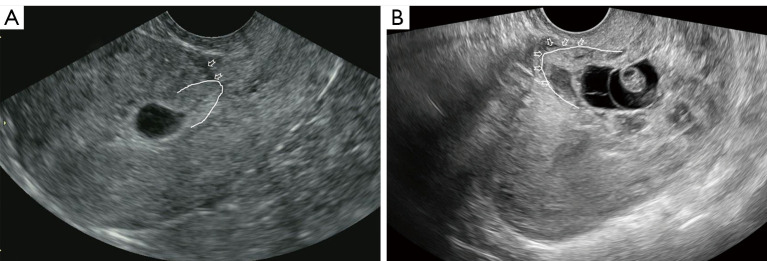
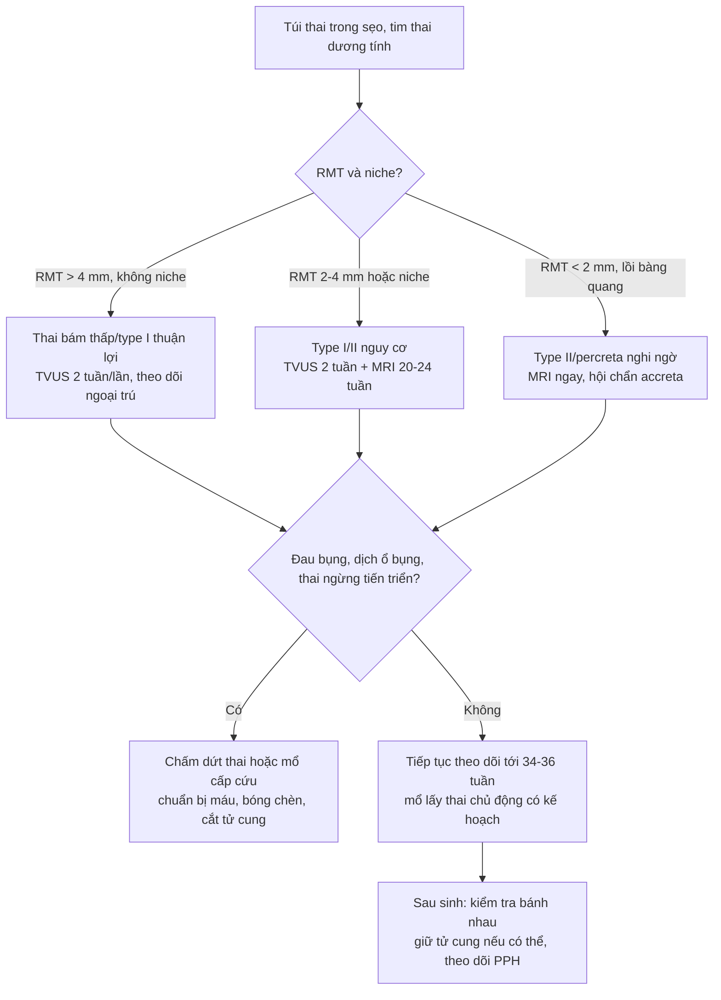
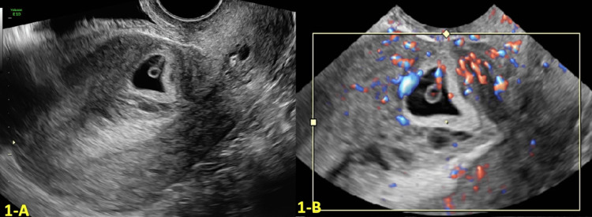
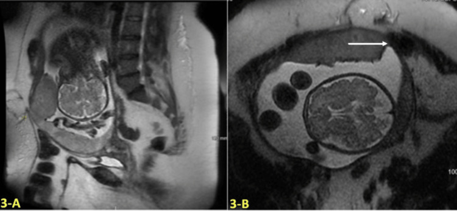
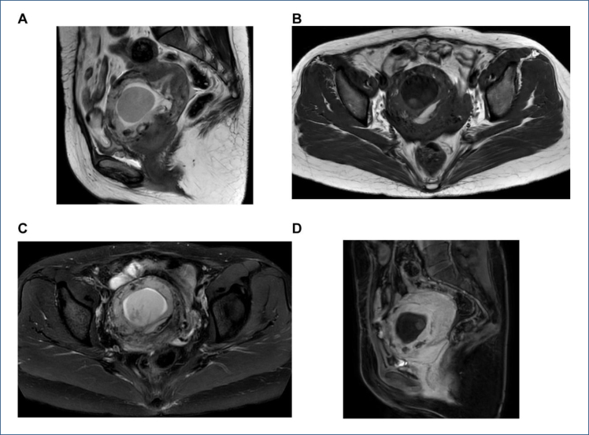

# 1631 — Thai tiếp tục sau chửa ở sẹo mổ lấy thai: ngưỡng RMT/khuyết sẹo, lịch TVUS–MRI và khi nào phải chấm dứt

**Tags:** `pattern:thai-bam-seo` `pattern:pas` `pattern:thai-ky` `pattern:chay-mau-au-bai` `vung:tu-cung-phan-phu` `vung:eo-tu-cung` `protocol:TVUS-thai` `protocol:MRI-chau` `score:RMT` `score:FIGO-PAS`
**Mức chắc chắn (certainty):** tổng hợp y văn (literature synthesis) — đoàn hệ hồi cứu **54 thai tiếp tục sau chửa sẹo có tim thai** (Quant Imaging Med Surg 2024, **PMC11400644**), loạt **10 ca theo dõi đến sinh** (2023, **PMC10725518**), **2 ca tiến triển thành nhau xuyên cơ – xâm lấn đại tràng/bàng quang** (Cureus 2023, **PMC10159630**), **102 ca so sánh TVUS – MRI** (Rev Assoc Med Bras 2026, **PMC12788853**) và **meta 13 nghiên cứu/948 ca** (Medicine 2021, **PMC9191567**). Không có thử nghiệm ngẫu nhiên → mọi con số là **kết cục quan sát**, không phải khuyến cáo mức mạnh.

> **Câu hỏi thực hành:** thai phụ **34 tuổi**, 1 lần mổ lấy thai, thai **7 tuần 2 ngày**, ra máu âm đạo nhẹ, **không đau bụng**. TVUS: túi thai **nằm trong sẹo mổ ở đoạn dưới**, buồng tử cung **rỗng**, **lớp cơ còn lại (RMT) 2 mm**, có **khuyết sẹo (niche) rõ**. Chị **từ chối chấm dứt thai** vì hiếm muộn nhiều năm.
> Câu hỏi: **có được theo dõi tiếp không, dựa vào những ngưỡng nào? cần chụp gì, bao lâu một lần? dấu hiệu nào buộc chấm dứt ngay? và vì sao "thai tiếp tục được" lại gần như đồng nghĩa với "nhau cài răng lược"?**
> Bài chốt **bốn việc**: **(1) chửa ở sẹo mổ lấy thai (cesarean scar pregnancy – CSP) tiến triển được đến thai sống ở một nhóm chọn lọc — 37/40 thai vượt 20 tuần sinh sống (92,5%), nhưng 25,9% mất thai trước 20 tuần; (2) yếu tố tiên lượng mạnh nhất KHÔNG phải RMT đơn thuần mà là **có khuyết sẹo nhìn thấy (visible niche)**: 23/23 ca có niche đều thành PAS, RMT trung vị 1,8 mm so với 5,3 mm; (3) **theo dõi bảo tồn = TVUS 2–4 tuần/lần + MRI khi nghi xâm lấn**, sinh tại trung tâm có "accreta service", mổ lấy thai chủ động **34–36 tuần**; (4) **chấm dứt không chờ** khi có đau bụng tăng + dịch ổ bụng (vỡ), RMT < 1–2 mm kèm phình ra bàng quang, hoặc thai ngừng tiến triển.** Nối [552 – Chửa ở sẹo mổ lấy thai & chửa góc](../552-chua-ngoai-tu-cung-seo-mo-lay-thai-va-chua-goc/lesson.md), [1604 – Thai kỳ sau điều trị chửa sẹo](../1604-thai-ky-sau-chua-seo-mo-lay-thai/lesson.md), [560 – Nhau cài răng lược cấp cứu sản](../560-nhau-cai-rang-luoc-PAS-cap-cuu-san/lesson.md).

## 1. Tổng quan bệnh học – cơ chế hình ảnh: vì sao CSP là "PAS của tam cá nguyệt I"

- **Định nghĩa:** CSP là thai làm tổ trong **mô sẹo mổ lấy thai ở đoạn dưới tử cung trước**, tại vị trí **khuyết sẹo (isthmocele/niche)**. Tần suất **1/1.800 – 1/2.656** thai ở người có mổ lấy thai cũ, quy đổi toàn bộ quần thể **~1/6.666** thai kỳ (PMC11400644 dẫn y văn). Từ 2022, **Niche Task Force** (Delphi) còn đi xa hơn: **chỉ gọi CSP khi có niche** — thai bám gần sẹo nhưng sẹo đã lành được xếp vào **thai bám thấp (low-implantation pregnancy)**, một thực thể có tiên lượng khác.
- **TẠI SAO thai có thể tiếp tục (và tại sao không phải ca nào cũng vỡ):** mô sẹo mất **màng rụng (decidua)**, nhưng gai nuôi chỉ xâm nhập sâu khi có **"cửa" vi thể giữa sẹo và nội mạc**; nếu túi thai phát triển **vào lòng tử cung (type I – endogenic)** và lớp cơ xung quanh còn đủ, thai có thể đi tới tam cá nguyệt III. Ngược lại **type II – exogenic** phát triển **ra phía bàng quang**, lớp cơ mỏng như giấy → vỡ sớm. Mô sẹo xơ **không co rút** khi tử cung lớn lên, nên chỗ bám **không giãn theo** — đây là lý do cơ chế "vỡ" chứ không phải "thai to".
- **TẠI SAO CSP tiến triển = PAS:** sẹo xơ tạo **môi trường thiếu oxy** kích thích gai nuôi xâm nhập sâu; mô sẹo có **rối loạn sợi cơ, viêm, phù, giảm mật độ cơ trơn** nên gai nuôi vượt **1/3 lớp cơ trong** và tới mạch thanh mạc. Vì vậy tác giả PMC11400644 kết luận **CSP và PAS không phải hai bệnh mà là một quá trình liên tục**. Số liệu: trong 40 thai vượt 20 tuần, **PAS 72,5% (29/40)**, **nhau tiền đạo 42,5%**.
- **TẠI SAO hình ảnh thấy được (vật lý):**
  - **TVUS:** túi thai **echo trống** (dịch ối) với **viền echo dày** (nguyên bào nuôi) nằm trong **mô sẹo giảm echo**; Doppler màu: **dòng vận tốc cao – trở kháng thấp** quanh túi thai (tân mạch). Cửa sổ chẩn đoán tốt nhất là **tuần 6–7**.
  - **MRI T2:** **dải T2 tối** trong bánh nhau/sẹo = **fibrin – collagen – xơ** (T2 ngắn vì ít nước tự do); **mất dải T2 tối sau bánh nhau bình thường** (retroplacental dark band) = không còn màng rụng; **bánh nhau phồng (placental bulge)** ra ngoài đường viền cơ; **mất mặt phẳng giữa cơ và bàng quang**. Trên **DWI**, bánh nhau **không hạn chế khuếch tán** — DWI **không** dùng để chẩn đoán PAS.
  - **Giá trị so sánh:** meta 13 nghiên cứu/948 ca: **MRI Se 93% / Sp 83%** (AUC 0,96) so với **US Se 84% / Sp 73%** (AUC 0,86) (PMC9191567). Nghiên cứu 102 ca: MRI **vượt TVUS** cả về độ nhạy, độ chính xác phân loại và phát hiện **xâm lấn cơ/bàng quang/cổ tử cung** (PMC12788853).
- **Ngưỡng định lượng phải thuộc (đoàn hệ 54 ca, PMC11400644):**
  - **RMT trung vị 2,5 mm (IQR 1,5–5,4)**; **niche 63,0% (34/54)**; khoảng cách từ lần mổ lấy thai trước **7 năm (4–10)**.
  - **RMT mỗi 1 mm tăng** làm giảm nguy cơ biến chứng nặng: **OR 0,176 (0,061–0,514)**.
  - **Có niche** là yếu tố độc lập mạnh nhất: **OR 155,1 (8,08–2.763)**; **23/23 ca có niche đều PAS** (percreta 8/23 = 34,8%, trong đó **2 ca xâm lấn bàng quang**), so với **6/17 = 35,3%** ở nhóm không niche.
  - **Toàn bộ 17 ca không có niche đều có RMT > 4 mm** — đây là con số thực dụng nhất khi tư vấn.
  - Kết cục khi tiếp tục: **14/54 (25,9%) không vượt 20 tuần** (13 sẩy, 1 đình chỉ vì chảy máu, giải phẫu = increta); trong 40 ca vượt 20 tuần: **37 sinh sống (92,5%), 3 thai lưu (7,5%)**; **sinh non < 37 tuần 42,5%, < 34 tuần 17,5%**; **vỡ tử cung 15,0%**; **cắt tử cung 12,5%**; **mổ lấy thai cấp cứu 37,5%**; **can thiệp cứu máu 55,0%**; **truyền máu 45,0%**; **máu mất trung vị 810 mL (400–1.875)**; **cân nặng sơ sinh 2.730 g**; chỉ **1/40 (2,5%) sinh đường âm đạo**.
  - Loạt **10 ca** theo dõi có chủ đích tại trung tâm PAS: **9/10 sinh tam cá nguyệt III (~34 tuần)**, **7 cắt tử cung sau sinh**, **3 tái tạo thành tử cung**, **4 truyền máu**, **không vỡ tử cung, không tử vong mẹ – con** (PMC10725518).
  - Tổng quan gộp trước đó: **102/192 (53,1%)** ca theo dõi bảo tồn cuối cùng phải cắt tử cung (PMC11400644 dẫn) — nói cho gia đình nghe **con số này**, không chỉ con số 12,5% của một trung tâm giỏi.

*(A) CSP **không** có niche nhìn thấy: mũi tên chỉ mô sẹo giảm echo, đường trắng viền ngoài nguyên bào nuôi; (B) CSP **có niche**: túi thai lọt vào chỗ khuyết, lớp cơ trước túi thai mỏng. Chính khác biệt này — không phải kích thước túi thai — quyết định tiên lượng: 23/23 ca có niche thành PAS. Nguồn: Quant Imaging Med Surg 2024 (PMC11400644), CC BY-NC-ND 4.0, nguyên bản.*

## 2. Mẫu hình + chẩn đoán phân biệt theo hình thái và thời điểm (gamut)

- **Gamut theo hình thái túi thai (phân loại hay dùng):**
  - **Type I – endogenic (nội sinh):** túi thai phát triển **vào buồng tử cung**, lớp cơ giữa túi và bàng quang **dày hơn** → khả năng đi tới tam cá nguyệt III cao nhất, nhưng nguy cơ **accreta/increta** vẫn có.
  - **Type II – exogenic (ngoại sinh):** túi thai phát triển **ra phía thanh mạc – bàng quang**, lớp cơ **< 3 mm** → **vỡ tử cung, chảy máu trong ổ bụng**, nguy cơ tử vong mẹ.
  - **Type III – hỗn hợp/hình túi dạng nang–đặc:** có **giả phình mạch (pseudoaneurysm)** quanh túi, mạch nuôi rất phong phú → chảy máu nặng khi can thiệp; trên MRI là tổn thương **dạng hỗn hợp, bờ không đều** (PMC12926364).
- **Gamut theo lớp cơ còn lại (RMT):** **> 4 mm** — nhóm thuận lợi (toàn bộ ca không niche trong đoàn hệ đều ở nhóm này); **2–4 mm** — vùng chồng lấp, theo dõi sát, chuẩn bị máu; **< 2 mm** — nguy cơ vỡ cao, phải mổ chủ động sớm và chuẩn bị **cắt tử cung + bóng chèn ĐMC/động mạch tử cung**.
- **Gamut theo thời điểm:** **< 10 tuần** — quyết định giữ/bỏ, đo RMT, tìm niche; **10–20 tuần** — 25,9% mất thai ở đây, theo dõi 2 tuần/lần; **20–28 tuần** — MRI đánh giá xâm lấn, tầm soát nhau tiền đạo; **28–34 tuần** — lên kế hoạch mổ, đặt stent/bóng động mạch tử cung; **34–36 tuần** — cửa sổ mổ chủ động ở ca nghi percreta.
- **Gợi nhớ "NICHE":** **N**o niche → tiên lượng tốt hơn · **I**nvasion depth (RMT mm) · **C**avity empty (buồng tử cung rỗng) · **H**igh vascularity (dòng tốc độ cao – trở kháng thấp) · **E**xtension to bladder (mất mặt phẳng cơ – bàng quang).

## 3. Bảng so sánh phân biệt (ma trận đối chiếu)

| Thực thể (entity) | Hình ảnh điển hình (TVUS/MRI) | Chốt vào (rule-in) | Chốt loại (rule-out) | Gợi ý xác nhận |
|---|---|---|---|---|
| **CSP type I (endogenic) — theo dõi được** | Túi thai trong sẹo nhưng **phát triển vào buồng tử cung**, RMT **> 4 mm**, **không niche** hoặc niche nông | **RMT > 4 mm + không niche + thai tiến triển đều + không đau** | **Mất mặt phẳng cơ–bàng quang, bánh nhau phồng ra thanh mạc** → đã chuyển type II/PAS | TVUS 2 tuần/lần; MRI ở 20–24 tuần |
| **CSP type II (exogenic) — nguy cơ vỡ** | Túi thai **lồi ra phía bàng quang**, lớp cơ **< 3 mm**, mặt phẳng cơ–bàng quang **mất**, Doppler dày đặc | **RMT < 3 mm + lồi ra thanh mạc + dòng vận tốc cao** | Lớp cơ đều **> 4 mm**, túi thai trong lòng → type I | MRI + hội chẩn accreta; mổ chủ động sớm |
| **PAS (accreta/increta/percreta)** | **Mất dải T2 tối sau bánh nhau**, **hồ máu bánh nhau**, **bánh nhau phồng**, **mạch bắc cầu**, **đường viền bàng quang không đều** | **Bánh nhau phồng + mất dải sáng + mạch bắc cầu/bàng quang không đều** | Bánh nhau **cách cơ ≥ 1 mm**, dải sáng liên tục → không PAS | MRI 20–28 tuần; mổ có chuẩn bị cắt tử cung |
| **Thai bám thấp (low-implantation)** | Túi thai **gần sẹo nhưng không trong niche**, cơ giữa túi và sẹo **còn rõ** | **Không có niche + cơ lành giữa túi thai và sẹo** | **Túi thai nằm trong mô sẹo, buồng tử cung rỗng** → CSP | TVUS + so phim; tiên lượng tốt hơn CSP |
| **Chửa cổ tử cung (cervical ectopic)** | Túi thai **trong ống cổ tử cung**, eo tử cung **phình hình đồng hồ cát**, buồng tử cung rỗng | **Túi thai dưới lỗ trong cổ tử cung + eo phình + Doppler quanh túi** | Túi thai **ở đoạn dưới trước, trên lỗ trong** → CSP | TVUS + MRI; **không nong nạo mù** |
| **Chửa góc (interstitial)** | Túi thai **lệch sang một bên sừng**, lớp cơ **< 5 mm**, **interstitial line sign** | **Túi thai ngoài buồng + lệch bên > 1 cm + lớp cơ mỏng** | Túi thai **giữa đường giữa, trong sẹo** → CSP | MRI; β-hCG; **MTX/mổ nội soi** |
| **Vỡ tử cung trên sẹo (cấp cứu)** | **Dịch ổ bụng**, túi thai **không còn trong tử cung**, thành tử cung **mất liên tục**, thai phụ **đau + choáng** | **Đau đột ngột + dịch ổ bụng + mất liên tục cơ trên siêu âm** | Túi thai còn nguyên, không dịch → chưa vỡ | **Mổ ngay**, không chờ MRI |
| **Bệnh nguyên bào nuôi (GTD) trên sẹo** | Khối **dạng nang–đặc**, **β-hCG rất cao**, không có thai sống | **β-hCG cao không tương xứng + cấu trúc nang "bão tuyết"** | Thai sống trong túi, β-hCG theo tuổi thai → CSP | β-hCG chuỗi + giải phẫu bệnh; **tránh nạo mù** |

- **Không tạo ảnh ghép:** 3 ảnh thuộc **3 bệnh nhân khác nhau** ở **3 thời điểm khác nhau** (7 tuần; 6 tuần 3 ngày → 33 tuần; 10 tuần 3 ngày) và **2 giấy phép khác nhau** (CC BY-NC-ND không được phép ghép/cắt) — ghép cạnh nhau vừa sai kỹ thuật vừa sai phép.

## 4. Protocol chụp + lịch theo dõi + khi nào chấm dứt

- **TVUS là tuyến đầu**, đo 3 thứ và **ghi bằng số**:
  1. **RMT** — từ **bờ ngoài vùng nguyên bào nuôi tăng echo** tới **thanh mạc tử cung/bàng quang**, đo ở mặt phẳng đứng dọc giữa, **3 lần rồi lấy nhỏ nhất**.
  2. **Có/không niche** — khuyết sẹo giảm echo, túi thai lọt vào; đây là biến số tiên lượng mạnh nhất.
  3. **Độ dày cơ so với cơ lành (RMT/AMT)** và **khoảng cách tới lỗ trong cổ tử cung**.
- **MRI sọ–khung chậu có gadolinium**: chỉ định khi **RMT < 3 mm**, nghi **type II/percreta**, hoặc **TVUS không kết luận**. Chuỗi bắt buộc: **T2 FSE đứng dọc + ngang**, **T2 FS**, **T1**, **T1 sau tiêm thì muộn**; đọc 6 dấu hiệu: mặt phẳng cơ–bàng quang, bánh nhau phồng, hồ máu, dải T2 tối, mạch bắc cầu, xâm lấn tạng lân cận.
- **Lịch theo dõi đề xuất (tổng hợp từ 2 loạt theo dõi):**
  - **< 20 tuần:** TVUS **mỗi 2 tuần**; β-hCG chỉ để theo dõi xu hướng, **không** để chẩn đoán.
  - **20–28 tuần:** TVUS **mỗi 2–4 tuần** + **MRI đánh giá PAS**; khám **bàng quang** (có/không xâm lấn), đặt **niệu quản stent** dự phòng nếu nghi percreta.
  - **28–34 tuần:** hội chẩn **accreta service** (sản – gây mê – can thiệp mạch – niệu – huyết học); **đặt bóng chèn động mạch chủ/động mạch tử cung** trước mổ ở ca percreta.
  - **34–36 tuần:** **mổ lấy thai chủ động** (nhau cài răng lược + CSP: không chờ chuyển dạ).
- **Sơ đồ quyết định:**

- **Tiêu chí buộc chấm dứt / mổ cấp cứu (không chờ đủ tuần):**
  1. **Đau bụng tăng dần + dịch ổ bụng** hoặc **choáng** → nghi **vỡ tử cung** (15,0% trong đoàn hệ) — mổ ngay.
  2. **RMT < 1–2 mm + túi thai lồi vào bàng quang + máu âm đạo nhiều** → nguy cơ vỡ trong vài ngày.
  3. **Thai ngừng tiến triển/không tim thai** → xử trí như thai lưu trên sẹo (nguy cơ chảy máu khi nong nạo: **không nạo mù**, dùng **MTX/embolization/nội soi**).
  4. **Nhau bong non/nhau tiền đạo chảy máu** hoặc **dọa vỡ** trên MRI (mất liên tục thanh mạc).
- **Chuẩn bị cho cuộc mổ (checklist thực dụng):** **2 đường truyền lớn**, **máu dự trù ≥ 4 đơn vị**, **bóng chèn động mạch tử cung/ĐMC** đặt trước, **đội niệu** sẵn sàng, **đội gây mê** chuẩn bị mổ nội khí quản, **kíp cắt tử cung** đã hội chẩn; mổ **theo đường dọc giữa** ở ca percreta để mở rộng được.

## 5. Biến thể bình thường và cạm bẫy

- **Cạm bẫy 1 — gọi "thai bám thấp" là CSP (và ngược lại):** từ định nghĩa **Niche Task Force 2022**, **không có niche thì không phải CSP**. Thai bám thấp có tiên lượng **tốt hơn hẳn** — gọi nhầm thành CSP dẫn tới **đình chỉ thai oan** hoặc **mổ quá sớm**; gọi CSP thành thai bám thấp dẫn tới **theo dõi ngoại trú không chuẩn bị máu**.
- **Cạm bẫy 2 — đo RMT sai vị trí:** đo từ **bờ trong nội mạc** thay vì **bờ ngoài nguyên bào nuôi** làm RMT **dày giả**; đo trên mặt phẳng **không đứng dọc giữa** làm **mỏng giả**. Luôn đo 3 lần, lấy **giá trị nhỏ nhất**, và ghi cả **AMT** để tính tỷ lệ.
- **Cạm bẫy 3 — tin "thai sống là yên tâm":** **25,9%** mất thai trước 20 tuần và **15,0%** vỡ tử cung dù thai sống lúc chẩn đoán. **Tim thai dương tính không phải tiêu chí theo dõi được.**
- **Cạm bẫy 4 — MRI quá sớm rồi kết luận "không PAS":** ở 10–14 tuần khó phân biệt **nguyên bào nuôi bình thường** với **xâm lấn cơ**; MRI có giá trị nhất **20–28 tuần**, khi bánh nhau đã hình thành rõ.
- **Cạm bẫy 5 — bỏ sót xâm lấn bàng quang:** **2/23 ca percreta có niche xâm lấn bàng quang** trong đoàn hệ; dấu hiệu **đường viền bàng quang không đều + mạch bắc cầu** dễ bị đọc thành "dày thành bàng quang do viêm". Soi bàng quang trước mổ khi nghi ngờ.
- **Cạm bẫy 6 — nong nạo ở CSP:** nạo buồng tử cung ở CSP gây **chảy máu ồ ạt** vì mô sẹo không co; nếu buộc phải lấy thai, chọn **nội soi buồng tử cung có kiểm soát / nút mạch trước / mổ nội soi**.
- **Biến thể bình thường:** **dịch lượng nhỏ quanh túi thai trong sẹo** hoặc **túi thai nhỏ hơn tuổi thai 1 tuần** ở tuần 5–6 có thể chỉ là **thai sớm bình thường bám thấp** — hẹn **TVUS lại sau 7–10 ngày** trước khi kết luận.

## 6. Tự lượng giá — Blind Quiz

**Ca 1 — Thai 6 tuần 3 ngày, tiền sử mổ lấy thai, ra máu nhẹ:**

- Gợi ý: thai phụ 32 tuổi, **2 lần mổ lấy thai**, β-hCG 12.400 mIU/mL.
- Câu hỏi: túi thai nằm ở đâu so với buồng tử cung và lỗ trong cổ tử cung? Đo gì để quyết định theo dõi hay chấm dứt? 3 chẩn đoán phân biệt?

<b>Bấm để hiện đáp án (findings + chẩn đoán)</b>

- Dấu hiệu: **(1-A)** túi thai **nằm thấp ở thành trước đoạn dưới**, buồng tử cung **rỗng**; **(1-B)** Doppler màu: **vòng mạch máu dày đặc quanh túi thai** (dòng vận tốc cao – trở kháng thấp), lớp cơ giữa túi và thanh mạc **rất mỏng**.
- Chẩn đoán: **CSP type II (exogenic)** — túi thai phát triển ra phía thanh mạc/bàng quang.
- Vì sao quan trọng: nhóm này có nguy cơ **vỡ tử cung**; nếu thai phụ muốn giữ, cần **MRI + hội chẩn accreta**, mổ chủ động **34 tuần**, dự trù máu. 3 phân biệt: **thai bám thấp** (không có niche), **chửa cổ tử cung** (dưới lỗ trong, eo phình), **chửa góc** (lệch bên, lớp cơ < 5 mm).
- Nguồn ảnh: Cureus 2023 (PMC10159630), CC BY 4.0.

**Ca 2 — Cùng bệnh nhân ở 33 tuần, đau bụng âm ỉ, thiếu máu:**

- Gợi ý: hemoglobin giảm 2 g/dL trong 1 tuần, không ra máu âm đạo.
- Câu hỏi: dấu hiệu nào trên MRI nói bánh nhau đã ra ngoài cơ tử cung? Vì sao **không** được chờ chuyển dạ? Kế hoạch mổ gồm những gì?

<b>Bấm để hiện đáp án (findings + chẩn đoán)</b>

- Dấu hiệu: **(3-A)** bánh nhau **phồng ra ngoài đường viền cơ** đoạn dưới, **mất dải T2 tối** giữa bánh nhau và cơ; **(3-B)** bánh nhau **xâm lấn tới đại tràng xích-ma** (mũi tên trắng) — mất mặt phẳng mỡ giữa tử cung và ruột.
- Chẩn đoán: **PAS thể percreta** (tiến triển từ CSP) — đúng như diễn tiến "CSP = PAS giai đoạn sớm".
- Xử trí: **mổ lấy thai chủ động + cắt tử cung trì hoãn** (staged) tại trung tâm có accreta service; trong ca này tử cung được giữ lại sau sinh nhờ **etoposide 100 mg/m² × 5 ngày** rồi cắt tử cung thì 2 ở 6 tuần sau sinh, khi xâm lấn đã thoái triển. **Không chờ chuyển dạ** vì nguy cơ vỡ + chảy máu không kiểm soát.
- Nguồn ảnh: Cureus 2023 (PMC10159630), CC BY 4.0.

**Ca 3 — Thai 10 tuần 3 ngày, nhau tiền đạo trung tâm, nghi CSP type III:**

- Gợi ý: tiền sử 1 mổ lấy thai; TVUS không phân biệt được **nhau tiền đạo** với **xâm lấn cơ**.
- Câu hỏi: (A)–(D) là chuỗi xung gì? Dấu hiệu nào trên (A)/(C) nói bánh nhau **bám vào sẹo**? Vì sao phải tiêm gadolinium?

<b>Bấm để hiện đáp án (findings + chẩn đoán)</b>

- Chuỗi xung: **(A)** T2 đứng dọc, **(B)** T2 ngang, **(C)** T2-SPAIR (fat-sat), **(D)** T1 sau tiêm.
- Dấu hiệu: túi thai trong buồng tử cung nhưng **bánh nhau bám đúng vị trí sẹo mổ** (mũi tên đỏ), **mất dải tối sau bánh nhau**, bánh nhau **che lỗ trong cổ tử cung**; trên T1 sau tiêm, vùng bám **ngấm thuốc không đều**.
- Vì sao: **T2-SPAIR** triệt mỡ để thấy rõ **mất mặt phẳng cơ–bàng quang**; **T1 sau tiêm** đánh giá **hoại tử/mạch nuôi** và phân biệt **máu tụ cũ** với **mô bánh nhau sống**. Trong nghiên cứu 102 ca, MRI **chính xác hơn TVUS** trong phân loại và phát hiện xâm lấn (PMC12788853).
- Nguồn ảnh: Rev Assoc Med Bras 2026 (PMC12788853), CC BY 4.0.

## Bài liên quan chéo
- [552 – Chửa ở sẹo mổ lấy thai & chửa góc: chẩn đoán sớm, nguy cơ vỡ](../552-chua-ngoai-tu-cung-seo-mo-lay-thai-va-chua-goc/lesson.md)
- [1604 – Thai kỳ sau điều trị chửa ở sẹo mổ lấy thai: tái phát, PAS & kết cục sinh sản](../1604-thai-ky-sau-chua-seo-mo-lay-thai/lesson.md)
- [560 – Nhau cài răng lược (PAS) cấp cứu sản](../560-nhau-cai-rang-luoc-PAS-cap-cuu-san/lesson.md)
- [500 – Tổng quan Vú & Sản phụ khoa](../500-tong-quan-vu-san-phu-khoa/lesson.md)

## Ảnh
- 4 ảnh: `PMC11400644-Fig2` (**CC BY-NC-ND 4.0**), `PMC10159630-Fig1/Fig3` và `PMC12788853-Fig2` (**CC BY 4.0**) — nguồn, giấy phép, phái sinh từng ảnh trong `images/CREDITS.md`.
- Ảnh CC BY-NC-ND dùng **nguyên bản, không crop/ghép/thêm chữ**.
- **Không tạo ảnh ghép**: khác bệnh nhân, khác thời điểm, khác giấy phép.

> Không dùng để chẩn đoán độc lập khi chưa có người hướng dẫn.
