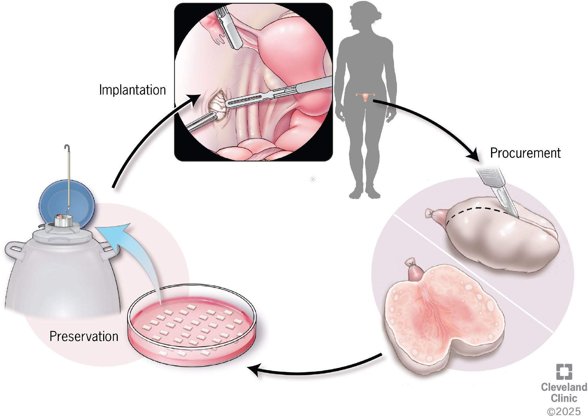
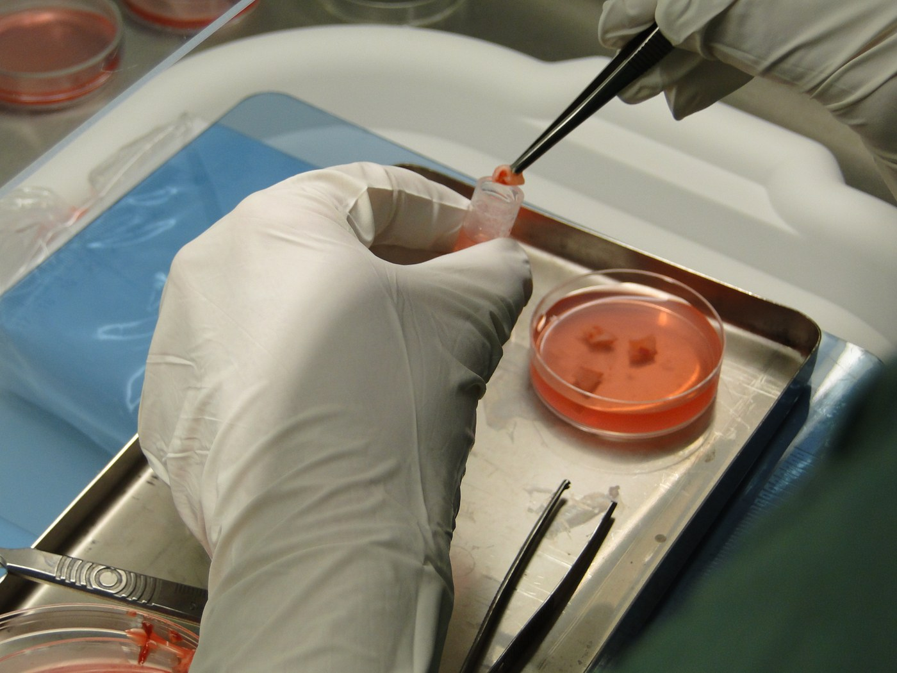
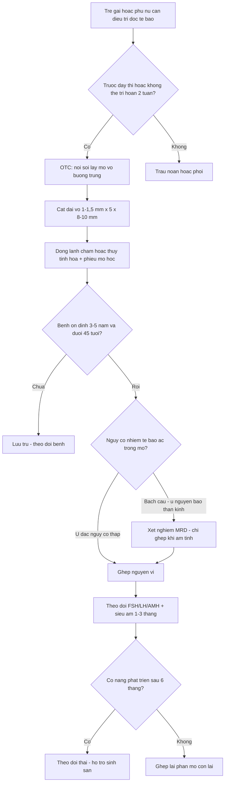

# 1632 — Trữ mô buồng trứng (OTC) trước dậy thì và ghép lại: kỹ thuật, nguy cơ tái nhập tế bào ác tính và kết cục sinh sản

**Tags:** `pattern:bao-ton-sinh-san` `pattern:tru-mo-buong-trung` `vung:buong-trung` `protocol:noi-soi-o-bung` `protocol:TVUS` `incidentaloma:khong`
**Mức chắc chắn (certainty):** tổng hợp y văn (literature synthesis) — hướng dẫn ngân hàng mô buồng trứng Royan 2026 (PMC13535264), tổng quan an toàn ghép mô và bệnh tồn dư tối thiểu (PMC13459637), khuyến nghị 2026 cho trẻ em/thanh thiếu niên trước ghép tế bào gốc (PMC13349870), tổng quan bảo tồn sinh sản trong bệnh máu ác tính (PMC13234456). **Chưa có RCT**; số liệu là tổng hợp đoàn hệ/đăng ký, ghi nguồn từng dòng.

## 1. Tổng quan bệnh học – cơ chế hình ảnh

- **Vì sao trẻ trước dậy thì chỉ có một lựa chọn:** trữ noãn cần **noãn trưởng thành sau kích thích buồng trứng** — trẻ trước dậy thì **không có nang noãn trưởng thành**, và kích thích buồng trứng **làm chậm điều trị ung thư 2 tuần**. Vì vậy **trữ mô buồng trứng (OTC)** là phương pháp **duy nhất** không cần kích thích và **không trì hoãn** hóa trị (PMC13535264, PMC13349870).
- **Vì sao mô buồng trứng "sống được" sau đông lạnh:** vỏ buồng trứng chứa **nang nguyên thủy (primordial follicles)** — tế bào nhỏ, **ít nước, chuyển hóa thấp**, chịu được lạnh sâu tốt hơn noãn trưởng thành. Đó là cơ sở để **đông lạnh chậm** (slow freezing) hoặc **thủy tinh hóa (vitrification)** rồi ghép lại; nang sẽ **phát triển trở lại** sau khi có mạch máu tái lập.
- **Vì sao mô ghép chỉ "sống" vài năm:** mảnh ghép **không có cuống mạch**, phụ thuộc **tân mạch hóa** từ giường ghép; phần lớn nang bị **thiếu máu trong 3–5 ngày đầu**, chỉ một phần sống sót. Hệ quả là **thời gian hoạt động có hạn** và nhiều người cần **ghép lại**.
- **Số liệu định lượng phải nhớ:**
  - **> 200 trẻ sinh sống khỏe mạnh** sau ghép **nguyên vị** mô đông lạnh–rã đông, tính đến **2022** (PMC13535264).
  - **~95% người được ghép phục hồi chức năng nội tiết trong 2–7 tháng**; chức năng kéo dài trung bình **2–3 năm**, tối đa **11–13 năm**; **25% có em bé**, có loạt tới **40%** (PMC13459637).
  - **Tuổi nhận mô: < 37 tuổi** khi lấy mô; có thể **mở rộng tới 40** nếu có đồng thuận bằng văn bản (Royan OTB, PMC13535264). **Tuổi ghép: < 45 tuổi**, và **khoảng không bệnh 3–5 năm** (cùng nguồn).
  - **Kích thước mảnh:** vỏ dày **1–1,5 mm**, mỗi mảnh **5 × 8–10 mm**; bỏ tủy, không bóc tách vỏ đơn thuần (PMC13535264). Hướng dẫn Edinburgh/Đan Mạch/FertiPROTEKT cho dải **1×2×3 mm đến 2×5×15 mm** — khác nhau giữa các trung tâm.
  - **Thời gian vận chuyển:** lý tưởng **< 2 giờ**; tối đa **18–24 giờ** nếu bảo quản đúng môi trường (PMC13535264).
  - **Đông lạnh chậm (Royan):** hạ từ **0 °C đến −8 °C với 2 °C/phút**, **seeding thủ công**, tiếp **−40 °C với 0,3 °C/phút**, rồi **−70 °C với 5 °C/phút** (PMC13535264).
  - **Trước ghép:** siêu âm theo dõi + **FSH, LH, AMH**; **rã ít nhất một nửa số mảnh** đã trữ để ghép, dựa trên **mật độ nang ghi trong phiếu mô học** (PMC13535264).
- **Vì sao hình ảnh học quan trọng dù đây là kỹ thuật mô học:** siêu âm là cách **đếm AFC/đo thể tích buồng trứng** để chọn người còn đủ dự trữ, **loại khối buồng trứng** trước lấy mô, và **theo dõi mảnh ghép** sau ghép (nang phát triển, nội mạc dày lên). Không có siêu âm thì không có "trước" và "sau" để so sánh.

## 2. Mẫu hình + chẩn đoán phân biệt theo vị trí (gamut)

- **Nhóm A — trẻ gái TRƯỚC dậy thì cần hóa trị nguy cơ cao (bạch cầu cấp, u nguyên bào thần kinh, sarcoma Ewing, ghép tế bào gốc có TBI):** OTC là lựa chọn **duy nhất**; lấy **một buồng trứng** hoặc **mảnh vỏ** qua nội soi.
- **Nhóm B — thanh thiếu niên/người trưởng thành có thể trì hoãn 2 tuần:** ưu tiên **trữ noãn hoặc phôi** (kết cục đã chuẩn hóa); OTC khi **không đủ thời gian**, **không đáp ứng kích thích**, hoặc cần **cắt buồng trứng hai bên**.
- **Nhóm C — bệnh lành tính phải cắt buồng trứng (xoắn tái phát, endometrioma hai bên tái phát nặng, u quái hai bên):** OTC **lấy mô lành trước/trong mổ** — đây là nhóm "iatrogenic" như bài 1628 nhưng **chủ động bảo tồn** thay vì chờ suy.
- **Nhóm D — hội chứng Turner thể khảm:** có thể còn nang; **OTC chỉ khi siêu âm thấy nang và AMH còn đo được**; nguy cơ **mô đã cạn nang** và **thai kỳ nguy cơ tim mạch** cao — cần hội chẩn tim mạch trước ghép.
- **Nhóm E — bệnh ác tính có nguy cơ nhiễm tế bào u vào buồng trứng (bạch cầu, u nguyên bào thần kinh):** OTC **vẫn làm được** nhưng phải đánh giá **bệnh tồn dư tối thiểu (MRD)** trước khi ghép — xem mục 3.
- **Gamut theo vị trí ghép:** **nguyên vị (orthotopic)** — cạnh buồng trứng còn lại, dây chằng rộng, mạc treo tử cung (ưu tiên, có thai tự nhiên); **dị vị (heterotopic)** — thành bụng, cánh tay (thuận tiện theo dõi, ít thai tự nhiên); **tại chỗ sau cắt tử cung** — hiếm.

## 3. Bảng so sánh phân biệt (ma trận đối chiếu)

| Thực thể (entity) | Đặc điểm / hình ảnh | Chốt vào (rule-in) | Chốt loại (rule-out) | Gợi ý xác nhận |
|---|---|---|---|---|
| **OTC (trữ mô buồng trứng)** | Buồng trứng có **AFC đủ** trên TVUS; không khối; mô vỏ hồng, dày 1–1,5 mm | **Trước dậy thì + cần điều trị ngay**; hoặc **không thể trì hoãn 2 tuần**; hoặc **cắt buồng trứng hai bên** | **Đã có di căn buồng trứng, bệnh toàn thân nặng, không có mô vỏ lành** | Nội soi lấy mô + phiếu mô học (mật độ nang); lưu vết mẫu |
| **Trữ noãn (oocyte cryopreservation)** | Cần **kích thích 10–14 ngày**, theo dõi nang trên siêu âm | **Sau dậy thì + có ≥ 2 tuần**; đáp ứng buồng trứng tốt | **Trẻ trước dậy thì**; **ung thư cần điều trị ngay**; **AMH rất thấp** | Số noãn chín; tỷ lệ sống sau rã **70–90%**, sinh sống **25–40%** (PMC13218867) |
| **Trữ phôi** | Như trữ noãn + cần **bạn tình/có tinh trùng** | **Đã có chồng/bạn tình**, sau dậy thì, đủ thời gian | **Chưa có bạn tình**; trẻ vị thành niên; vấn đề pháp lý | Số phôi; tư vấn pháp lý |
| **Chuyển vị buồng trứng (oophoropexy)** | Buồng trứng **di chuyển ra ngoài trường xạ**, có **clip** đánh dấu | **Xạ trị vùng chậu** là nguy cơ chính, không phải hóa trị | **Hóa trị toàn thân** (chuyển vị không bảo vệ) | Clip trên X-quang/CT; theo dõi tưới máu |
| **Đồng vận GnRH (GnRH agonist)** | Buồng trứng **nghỉ tạm**, không lấy mô | Bệnh máu ác tính, **không mổ được**, cần bảo vệ phần nào | **Không thay thế OTC** ở trẻ trước dậy thì; hiệu quả còn tranh luận | Theo dõi AMH sau điều trị |
| **IVM (nuôi noãn non trong ống nghiệm)** | Noãn lấy từ **nang nhỏ không kích thích** | **Có thể kết hợp OTC**: IVM mô/nang trong lúc chờ | **Chưa phải chuẩn điều trị**, tỷ lệ sinh sống thấp | Chỉ trong nghiên cứu/trung tâm chuyên biệt |

- **Ảnh minh họa 1 — quy trình OTC (nguồn CC BY 4.0):**

*Lấy mô (procurement) → xử lý mảnh vỏ → đông lạnh bảo quản (preservation) → ghép lại (implantation). Nguồn: Frontiers in Endocrinology 2026 (PMC12950600), Fig. 2 — CC BY 4.0; hình do Cleveland Clinic vẽ, ©2025.*

- **Ảnh minh họa 2 — thao tác thực tế (CC BY-SA 3.0):**

*Mảnh vỏ buồng trứng được gắp vào dung dịch đông lạnh trong đĩa Petri. Nguồn: Wikimedia Commons, tác giả Wzsuzsanna3 (Dr. Vereczkey Attila), CC BY-SA 3.0.*

## 4. Protocol chụp + hệ phân độ/điểm chuẩn hóa

- **Bước 1 — Đánh giá trước thủ thuật (hình ảnh + xét nghiệm):**
  - **Siêu âm đầu dò âm đạo** (người đã dậy thì) hoặc **đầu dò bụng** (trẻ nhỏ): **AFC**, **thể tích buồng trứng** (ellipsoid D1×D2×D3×0,523), mô tả **khối/nang bất thường**; nếu có khối → **MRI tiểu khung** để loại u ác trước khi lấy mô.
  - **AMH, FSH, LH, E2**; **HIV, HBsAg, anti-HCV** (bắt buộc theo Royan OTB) và **serology khác theo trung tâm**.
  - **Hội chẩn ung thư – gây mê – sinh sản**: xác nhận **thời điểm lấy mô không làm chậm hóa trị**.
- **Bước 2 — Lấy mô (nội soi là chuẩn):** nội soi ổ bụng, **cắt một buồng trứng** hoặc **mảnh vỏ** ở buồng trứng còn lại; **không bóc tách vỏ khỏi tủy** (dễ làm rách mô), lấy **cả vỏ + một phần tủy** rồi xử lý ngoài cơ thể (PMC13535264). Cầm máu **không dùng đốt nhiệt rộng** trên buồng trứng còn lại (nguy cơ như bài 1628).
- **Bước 3 — Xử lý và đông lạnh:** trong tủ an toàn sinh học, bỏ tủy, cắt **dải vỏ 1–1,5 mm × 5 × 8–10 mm**; **đông lạnh chậm** theo chương trình (0 → −8 °C 2 °C/phút, seeding, −40 °C 0,3 °C/phút, −70 °C 5 °C/phút) hoặc **thủy tinh hóa**; lưu **phiếu mô học** ghi **mật độ nang, độ nguyên vẹn mô** cho từng bệnh nhân.
- **Bước 4 — Ghép lại:** khi bệnh **ổn định ≥ 3–5 năm**, người bệnh **< 45 tuổi**, có nhu cầu sinh sản/muốn phục hồi nội tiết; **rã ít nhất một nửa số mảnh**, ghép **nguyên vị** vào **buồng trứng còn lại/dây chằng rộng**; theo dõi **FSH/LH/AMH + siêu âm** mỗi 1–3 tháng để phát hiện nang phát triển.
- **Bước 5 — Theo dõi sau ghép:** siêu âm thấy **nang ≥ 8–10 mm** và **nội mạc ≥ 6–8 mm** là dấu hiệu mảnh ghép hoạt động; **thất bại ghép** = không có nang sau **6 tháng**; có thể **ghép lại** bằng phần mô còn lại.
- **Bước 6 — An toàn (MRD):** với bệnh có nguy cơ nhiễm buồng trứng, **không ghép mô khi chưa loại trừ tế bào ác**.

## 5. Biến thể bình thường và cạm bẫy

- **Biến thể bình thường:** buồng trứng **nhiều nang nhỏ (AFC 15–30)** ở trẻ vị thành niên là **bình thường**, không phải PCOS; đừng vì "nang nhiều" mà loại trừ OTC.
- **Cạm bẫy 1 — tưởng OTC "an toàn tuyệt đối":** mô buồng trứng **có thể chứa tế bào bạch cầu**. Tử thiết **5.571 phụ nữ bạch cầu** cho thấy **di căn buồng trứng 8,4%**, tới **30% ở ALL**; lymphoma Hodgkin **4,3%**, non-Hodgkin **9,8%** (PMC13459637). **Không ghép** mô ở nhóm nguy cơ cao khi chưa có bằng chứng âm tính.
- **Cạm bẫy 2 — MRD "âm tính" không đồng nghĩa không có tế bào u:** kỹ thuật hiện tại (hóa mô miễn dịch, PCR, ghép chuột) có **độ nhạy giới hạn**; một số trường hợp vẫn tái phát dù xét nghiệm âm. Vì vậy phải **cân nhắc lợi ích – nguy cơ** với từng bệnh.
- **Cạm bẫy 3 — mô lấy sau nhiều đợt hóa trị:** mật độ nang **giảm mạnh**; nếu đã truyền hóa chất, **đừng hứa hẹn** kết cục như nhóm chưa điều trị — cần đếm nang trên phiếu mô học trước khi tư vấn.
- **Cạm bẫy 4 — u nguyên bào thần kinh:** đây là u nhi **di căn buồng trứng thường gặp nhất**, **> 60% đã có tế bào u lưu hành** lúc chẩn đoán (PMC13459637) — nhóm này cần **MRD đặc biệt thận trọng**, khác với sarcoma Ewing (di căn buồng trứng rất hiếm).
- **Cạm bẫy 5 — ung thư vú:** trong **96 ca** đã ghép mô, **7 ca (7%) tái phát**, tất cả **ở nơi khác**, không do mảnh ghép (PMC13459637) — nhưng đây là dữ liệu **quan sát**, không phải bảo đảm.
- **Cạm bẫy 6 — quên tư vấn về thời hạn:** mô ghép chỉ hoạt động **2–3 năm** (tối đa 11–13 năm); người bệnh cần biết có thể **phải ghép lại** hoặc **chuyển sang noãn hiến**.
- **Cạm bẫy 7 — trẻ vị thành niên:** cần **đồng thuận của trẻ + cha mẹ**, giải thích rõ **bằng chứng sinh sống ở trẻ trước dậy thì còn ít** (phần lớn dữ liệu là ca báo cáo/đoàn hệ nhỏ, không phải thử nghiệm) — không được ép, và phải nói rõ khả năng thất bại.

## 6. Tự lượng giá — Blind Quiz

**Ca 1 — bé gái 9 tuổi, bạch cầu cấp dòng lympho**

- Bối cảnh: cần hóa trị **trong 5 ngày**, chưa dậy thì, siêu âm thấy hai buồng trứng có nang nhỏ.
- Câu hỏi: Chọn phương pháp bảo tồn nào? Vì sao không trữ noãn? Nguy cơ dài hạn cần tư vấn là gì?

<b>Bấm để hiện đáp án</b>

- Lựa chọn: **OTC** — trẻ trước dậy thì **không có noãn trưởng thành**, và kích thích buồng trứng sẽ **làm chậm hóa trị**.
- Nguy cơ: mô buồng trứng ở ALL có thể chứa tế bào bạch cầu (**di căn buồng trứng 8,4% chung, tới 30% ở ALL**) → **phải đánh giá MRD trước khi ghép**.
- Tư vấn: mô ghép chỉ hoạt động **2–3 năm** (tối đa 11–13), **25–40% có thai**; có thể phải ghép lại.
- Nguồn: PMC13535264, PMC13459637.

**Ca 2 — nữ 28 tuổi, sarcoma Ewing, có 2 tuần trước hóa trị**

- Bối cảnh: đã dậy thì, AMH **2,4 ng/mL**, AFC **14**, chưa có bạn tình.
- Câu hỏi: Trữ noãn hay trữ mô? Vì sao không trữ phôi?

<b>Bấm để hiện đáp án</b>

- Lựa chọn: **trữ noãn** (hoặc **OTC song song** nếu trung tâm hỗ trợ) — có **2 tuần** và dự trữ tốt; tỷ lệ sống sau rã **70–90%**, sinh sống **25–40%**.
- Không trữ phôi vì **chưa có bạn tình** và vấn đề pháp lý.
- Lưu ý: sarcoma Ewing **di căn buồng trứng rất hiếm** — nguy cơ tái nhập tế bào u thấp hơn bạch cầu, nhưng vẫn cần MRD nếu ghép mô.
- Nguồn: PMC13218867, PMC13459637.

**Ca 3 — nữ 33 tuổi, ghép mô 8 tháng, không có kinh**

- Bối cảnh: ghép **nguyên vị** 8 tháng trước; FSH **48 IU/L**, AMH **0,05 ng/mL**, siêu âm **không thấy nang**.
- Câu hỏi: Chẩn đoán? Bước tiếp theo?

<b>Bấm để hiện đáp án</b>

- Chẩn đoán: **thất bại ghép/thoái triển mảnh ghép** — vì sau **6 tháng** không có nang phát triển và FSH vẫn cao; ~5% người ghép không phục hồi chức năng.
- Bước tiếp: **ghép lại phần mô còn trữ** (nếu còn) hoặc tư vấn **noãn hiến**; kiểm tra lại kỹ thuật rã/ghép và tình trạng mảnh ghép.
- Nguồn: PMC13535264 (tiêu chí theo dõi), PMC13459637 (95% phục hồi trong 2–7 tháng).

## Bài liên quan chéo
- [1628 – POI sau mổ bóc endometrioma hai bên](../1628-poi-sau-mo-endometrioma-hai-ben/lesson.md)
- [1607 – Bảo tồn sinh sản trước hóa–xạ trị](../1607-bao-ton-sinh-san-truoc-hoa-xa-tri/lesson.md)
- [1609 – Suy buồng trứng và thiếu hụt hormone sau xạ trị phụ khoa](../1609-suy-buong-trung-thieu-hut-hormone-sau-xa-tri-phu-khoa/lesson.md)
- [1606 – Endometrioma tái phát: mổ lại hay IVF](../1606-tai-phat-endometrioma-mo-lai-hay-ivf/lesson.md)

## Ảnh
- `images/1632_otc_SCHEMA_PMC12950600-F2.jpg` — CC BY 4.0, Frontiers in Endocrinology 2026 (PMC12950600), Fig. 2.
- `images/1632_otc_Anh_Commons-strips.jpg` — CC BY-SA 3.0, Wikimedia Commons (Wzsuzsanna3).
- Không tải ảnh Radiopaedia/AuntMinnie; dẫn link trong `sources.md`.

> Không dùng để chẩn đoán độc lập khi chưa có người hướng dẫn.
