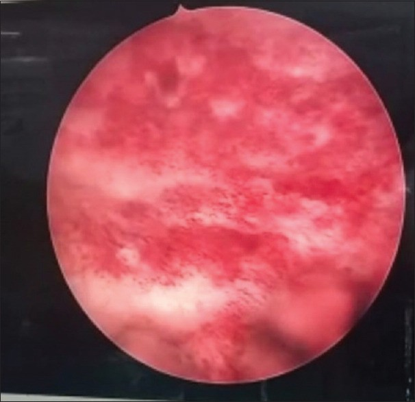
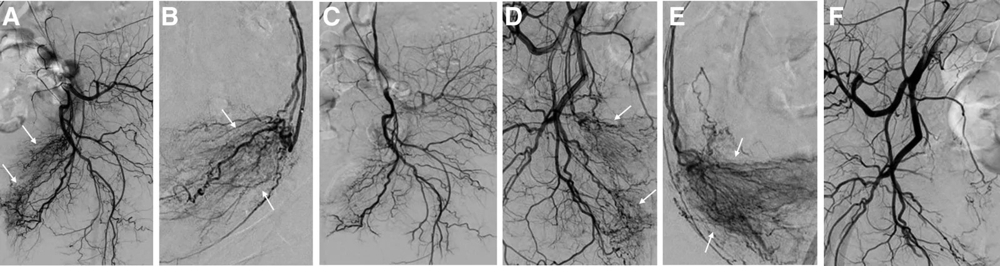
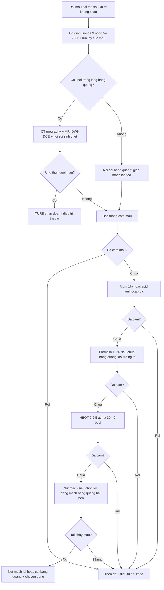

# 1633 — Viêm bàng quang xạ chảy máu nặng: bậc thang cầm máu, nút mạch động mạch bàng quang và khi nào cắt bàng quang / Severe radiation cystitis

**Tags:** `pattern:chay-mau-bang-quang` `pattern:thanh-bang-quang-day` `pattern:bang-quang-co-nho` `vung:bang-quang` `vung:tieu-khung` `score:Droller` `protocol:CT-urography` `protocol:MRI-tieu-khung-DWI` `protocol:chup-mach-nut-mach` `protocol:HBOT`
**Mức chắc chắn (certainty):** tổng hợp y văn (literature synthesis) — tổng quan điều trị bảo tồn có hệ thống (PMC11921955), tổng quan quản lý chảy máu bàng quang (PMC10317550), đoàn hệ 246 bệnh nhân xạ trị tuyến tiền liệt (PMC10273897), loạt nút mạch chọn lọc 20 ca (PMC13632971), ca viêm bàng quang xạ – bàng quang co nhỏ (PMC9254857). Không có RCT lớn cho bậc thang cầm máu; các con số phần lớn từ loạt ca.

## 1. Tổng quan bệnh học – cơ chế hình ảnh

- **Vì sao bàng quang chảy máu nhiều năm sau xạ:** tia xạ gây **viêm nội mạc mạch (endarteritis obliterans)** của mạng mạch dưới niêm mạc → **tắc dần các nhánh nhỏ**, thiếu máu, rồi **tái tưới máu gây tổn thương oxy hóa** và **xơ hóa** niêm mạc–dưới niêm mạc. Hậu quả là **giãn mao mạch (telangiectasia)** — những mạch thành mỏng, dễ vỡ, nằm sát bề mặt niêm mạc. Vì vậy trên **nội soi** thấy các đám mạch đỏ rực, rỉ máu khi chạm; còn trên **CT/MRI** chỉ thấy hệ quả gián tiếp: **thành dày, phù, co nhỏ**.
- **Hai hệ quả hình ảnh song song:** (1) **thành bàng quang dày lan tỏa, bờ ngoài đều**, không có khối đặc trong lòng; (2) **bàng quang co nhỏ, giảm tuân thủ (low compliance)** do xơ hóa — loạt 12 ca bàng quang nhỏ cho thấy **dung tích nội soi < 50 mL ở 33,3%** và **50–100 mL ở 66,7%**; một ca sau **50 Gy/25 phân liều vì ung thư tử cung** được điều trị bằng **botulinum nội bàng quang 200 IU** (PMC9254857).
- **Thời gian tiềm tàng:** viêm bàng quang xạ mạn tính xuất hiện **6 tháng – 20 năm** sau xạ trị; **trung vị 35 tháng** từ xạ trị khung chậu đến chảy máu bàng quang do xạ (PMC11921955, PMC10317550). Đây là lý do **không được loại trừ chẩn đoán vì "xạ đã lâu"**.
- **Tần suất:** sau xạ trị khung chậu liều chuẩn phân liều (tuyến tiền liệt/phụ khoa) **6,5–9%** có chảy máu bàng quang do xạ, **< 5%** ở mức nặng; **~50%** ca đến cấp cứu vì viêm bàng quang xạ sau xạ trị tuyến tiền liệt **phải làm thủ thuật xâm lấn** (PMC10317550). Đoàn hệ 246 ca xạ trị tuyến tiền liệt: **tích lũy 5 năm 16,2%** viêm bàng quang xạ và **3,0%** ở mức độ ≥ 3; **xạ trị bổ trợ/cứu vãn sau mổ** là yếu tố nguy cơ duy nhất (**HR 2,75**; p = 0,02) (PMC10273897). Bài 582 ghi **3–12%** sau xạ trị phụ khoa, với **60–70 Gy** là ngưỡng gây tổn thương nặng.
- **TẠI SAO máu cục "giả u" trên CT:** máu đông đặc có **50–70 HU**, **không ngấm cản quang**, **thay đổi hình dạng theo tư thế**; còn u niệu mạc ngấm thuốc và **dính vào thành**. Trên MRI, **methemoglobin** (máu bán cấp) **sáng trên T1** — dễ nhầm với u ngấm gadolinium nếu chỉ nhìn T1; phải so **ảnh trước/sau tiêm** và xem **DWI**.
- **TẠI SAO đếm mức độ chảy máu bằng số:** thang **Droller (I–V)** dùng được ngay tại giường: **I** không đái máu · **II** máu vi thể · **III** đái máu đại thể **không truyền máu** · **IV** đái máu đại thể **truyền máu ngắt quãng** · **V** đái máu đại thể **truyền máu hằng ngày** (PMC13632971). Mức IV–V là ngưỡng phải can thiệp, không chờ.

## 2. Mẫu hình + chẩn đoán phân biệt theo vị trí (gamut)

- **Nhóm A — đái máu đại thể SAU xạ trị khung chậu, bàng quang còn dung tích tốt:** nghĩ **viêm bàng quang xạ độ III**, **u niệu mạc thứ phát** (bài 1608), **sỏi bàng quang**, **nhiễm trùng**.
- **Nhóm B — bàng quang co nhỏ (< 150–200 mL), tiểu nhiều, đau:** **bàng quang co nhỏ do xạ** (xơ hóa), **viêm bàng quang kẽ**, **lao niệu dục**, **bàng quang thần kinh** — hình ảnh thành dày đều không phân biệt được, phải dựa tiền sử + niệu động học.
- **Nhóm C — máu cục đầy bàng quang, bí tiểu do cục máu:** **viêm bàng quang xạ**, **u bàng quang chảy máu**, **chảy máu từ đường niệu trên** đổ xuống.
- **Nhóm D — đái máu ồ ạt + sốc sau xạ trị nhiều năm (bẫy chết người):** **rò động mạch chậu – niệu quản (uretero-iliac fistula)** — bệnh nhân có stent niệu quản/thành niệu quản dính vào mạch chậu sau xạ; CT thấy **máu cục trong bàng quang tới 5,1 cm**, phải **chụp mạch + đặt stent phủ** mới cầm (PMC9270654). Không nghĩ tới là mất bệnh nhân.
- **Nhóm E — bối cảnh thuốc:** **viêm bàng quang xuất huyết do cyclophosphamide/ifosfamide** — chảy máu lan tỏa như viêm xạ nhưng **không có tiền sử xạ**, đáp ứng với mesna dự phòng; hình ảnh không khác biệt.
- **Gamut theo hình thái thành bàng quang:** **dày đều lan tỏa** = xạ/viêm; **dày khu trú + nhú trong lòng** = ung thư; **khối tự do trong lòng + không ngấm** = máu cục; **khí trong thành** = viêm bàng quang khí thũng (khác hoàn toàn).

## 3. Bảng so sánh phân biệt (ma trận đối chiếu)

| Thực thể (entity) | Hình ảnh điển hình (CT/MRI/nội soi) | Chốt vào (rule-in) | Chốt loại (rule-out) | Gợi ý xác nhận |
|---|---|---|---|---|
| **Viêm bàng quang xạ (radiation cystitis)** | Thành dày **đều, lan tỏa**, bàng quang **co nhỏ**, không khối; nội soi: **đám giãn mạch đỏ rực** rỉ máu | **Tiền sử xạ khung chậu + đái máu muộn + thành dày đều + giãn mạch trên nội soi** | **Khối khu trú ngấm thuốc** trong lòng → là u, không phải viêm xạ | Nội soi + sinh thiết vùng nghi; CT urography |
| **U niệu mạc thứ phát sau xạ (bài 1608)** | **Khối/nhú trong lòng**, ngấm cản quang, **DWI hạn chế khuếch tán**, có thể xâm lấn cơ | **Khối ngấm thuốc + hạn chế khuếch tán**; tiềm tàng nhiều năm sau xạ | Thành dày đều không khối → nghiêng viêm xạ | Cystoscopy + TURB sinh thiết |
| **Rò động mạch chậu – niệu quản** | Máu cục lớn trong bàng quang; **mất liên tục thành niệu quản cạnh mạch chậu**; chụp mạch thấy thoát mạch/giả phình | **Đái máu ồ ạt + sốc + tiền sử xạ/stent niệu quản** | Đái máu nhẹ, ổn định huyết động → không cần chụp mạch ngay | CTA bụng–chậu, chụp mạch chậu, stent phủ |
| **Viêm bàng quang xuất huyết do cyclophosphamide** | Thành dày lan tỏa, chảy máu niêm mạc; **không khối** | **Tiền sử thuốc oxazaphosphorine**, không xạ | **Tiền sử xạ rõ** → viêm xạ | Ngừng thuốc, mesna, nội soi |
| **Máu cục trong bàng quang (clot)** | Khối **50–70 HU**, **không ngấm**, đổi hình theo tư thế; T1 có thể sáng (methemoglobin) | **Không ngấm thuốc + di động + bệnh cảnh đái máu** | **Ngấm thuốc + cố định vào thành** → u | So ảnh trước/sau tiêm; rửa bàng quang rồi chụp lại |
| **Bàng quang co nhỏ do xạ** | Dung tích **< 100–150 mL**, thành dày, **không khối**; giãn đài–niệu quản hai bên | **Dung tích đo được giảm + tiền sử xạ + tiểu nhiều/đau** | Dung tích bình thường → không phải co nhỏ | Niệu động học + chụp bàng quang cản quang |

- **Ảnh 1 — nội soi bàng quang viêm xạ (CC BY-NC-SA 4.0):**

*Nội soi ở bệnh nhân bàng quang co nhỏ sau **50 Gy/25 phân liều** vì ung thư tử cung: các đám mạch máu giãn, sung huyết lan tỏa (mũi tên trắng trong bài gốc). Nguồn: J Family Med Prim Care 2022 (PMC9254857), Fig. 3 — CC BY-NC-SA 4.0.*

- **Ảnh 2 — chụp mạch trước/sau nút mạch bàng quang (CC BY-NC 4.0):**

*Bệnh nhân nữ 60 tuổi, đái máu không cầm do viêm bàng quang xạ sau xạ trị ung thư cổ tử cung. (A, D) động mạch chậu trong hai bên: tăng sinh mạch + ngấm thuốc vùng bàng quang (mũi tên trắng); (B, E) siêu chọn lọc động mạch bàng quang trên; (C, F) sau nút mạch: tắc hoàn toàn nhánh nuôi, các nhánh chậu trong khác được bảo tồn. Nguồn: Medicine (Baltimore) 2026 (PMC13632971), Fig. 1 — CC BY-NC 4.0.*

## 4. Protocol chụp + hệ phân độ/điểm chuẩn hóa

- **Bước 1 — Ổn định trước mọi chẩn đoán hình ảnh:** đường truyền lớn, nhóm máu, **tiểu cầu giữ > 50.000/µL**, cân nhắc ngừng kháng đông; đặt **sonde 3 nòng ≥ 22 Fr** và **rửa tay lấy máu cục ngay** — bí tiểu do cục máu có thể gây **vỡ bàng quang** (PMC10317550).
- **Bước 2 — Chẩn đoán hình ảnh (làm song song với cầm máu):**
  - **CT urography** (nếu chức năng thận cho phép): loại trừ **u niệu mạc**, **sỏi**, **nguồn chảy từ đường niệu trên**, đánh giá **thành bàng quang dày đều hay khu trú**, **dung tích**, giãn đài–niệu quản.
  - **MRI tiểu khung (T2 + DWI + DCE)** khi CT nghi khối hoặc cần phân biệt **máu cục vs u**: u **hạn chế khuếch tán + ngấm thuốc**, máu cục **không ngấm**.
  - **Nội soi bàng quang** là chuẩn chẩn đoán (thấy giãn mạch, loại trừ u, lấy máu cục, đốt cầm máu).
  - **CTA/chụp mạch chậu** khi đái máu ồ ạt + sốc, đặc biệt có **tiền sử stent niệu quản** (nghi rò động mạch chậu – niệu quản).
- **Bước 3 — Phân độ chảy máu (Droller I–V)** và ghi rõ **số đơn vị máu/ngày**, **Hb**, **thể tích nước tiểu**.
- **Bước 4 — Bậc thang điều trị (số liệu từng bậc):**

| Bậc | Can thiệp | Hiệu quả đã báo | Biến chứng / lưu ý |
|---|---|---|---|
| 1 | Rửa bàng quang liên tục NaCl 0,9%, hút máu cục, hydrat hóa | Cầm máu ở ca nhẹ | Quá tải dịch; bí sonde → vỡ bàng quang |
| 2 | **Nội soi + lấy máu cục ± đốt điện/laser** | **42% (14/33)** hết đái máu, không cần điều trị thêm | Laser sâu → **thủng bàng quang/tổn thương ruột** |
| 3 | **Alum 1%** (50 g/5 L) rửa **250–300 mL/giờ** | **66–100%**; loạt 40 ca: **60%** không cần điều trị thêm trước ra viện, **33%** ở trung vị **17 tháng**; ra viện **3 vs 13 ngày** | Co thắt bàng quang **35%**; **suy thận → độc nhôm** (nhôm máu 1,68 → 3,36 µmol/L; độc ở **7,4 µmol/L**) |
| 4 | **Acid aminocaproic** nội bàng quang **200 mg/L** hoặc uống **100–150 mg/kg/ngày** | **92–100%** (loạt nhỏ) | Huyết khối, tiêu cơ; **phải loại trừ chảy máu đường niệu trên** trước khi dùng đường uống |
| 5 | **Formalin 1–2%**, **10–15 phút**, áp lực < 15 cm H₂O, tăng tới **4%** (tối đa 10%) | **89%** đáp ứng hoàn toàn sau 1 lần; **23%** tái phát ở trung vị **7 tháng** | **31%** biến chứng nặng (hẹp niệu quản hai bên, rò âm đạo–bàng quang, bàng quang co nhỏ); **1 ca tử vong**; bắt buộc **chụp bàng quang loại trào ngược/thủng trước khi bơm** |
| 6 | **Oxy cao áp (HBOT)** 100% O₂, **2–2,5 atm**, **30–40 buổi × 80–90 phút** | **60–92%**; RCT 87 ca: EPIC cải thiện **10,1 vs 7,7**; **73% vs 34%** cải thiện có ý nghĩa | **17/41** ca có tác dụng phụ (chủ yếu độ 1–2: barotrauma, cận thị thoáng qua); tái phát **25–73%** ở 5 năm; đáp ứng tốt hơn nếu làm **trong 6 tháng** từ lúc chảy máu |
| 7 | **Nút mạch siêu chọn lọc động mạch bàng quang** (Gelfoam 350–710 µm hoặc coil/PVA) | Kỹ thuật **100% (20/20)**; lâm sàng **85%** chung, **90% (10/11)** ở nhóm viêm xạ; **Hb 7,8 → 12,2 g/dL**, Droller **4 → 1,6**; sống không tái phát **74,6% ở 12 tháng** | Hội chứng sau nút mạch **40%**; tái chảy máu sớm **5,9%**, muộn **18,7%**; **không có tử vong do thủ thuật**; nên nút **hai bên** vì tuần hoàn bàng quang bắt chéo |
| 8 | **Cắt bàng quang + chuyển dòng nước tiểu** | Cứu cánh cuối; trong loạt cắt bàng quang vì chảy máu khó cầm, **95% do xạ** | Xương chậu đã xạ → mổ khó, rò, chậm liền; chỉ khi các bậc trên thất bại |

## 5. Biến thể bình thường và cạm bẫy

- **Biến thể bình thường:** sau xạ trị, **thành bàng quang dày nhẹ lan tỏa + dung tích giảm vừa** ở người không triệu chứng là **di chứng xạ không hoạt động** — không đái máu thì không can thiệp; đừng sinh thiết "cho chắc".
- **Cạm bẫy 1 — máu cục giả u:** cục máu **50–70 HU, không ngấm, di động**; trên T1 có thể **sáng do methemoglobin** → luôn so **trước/sau tiêm** và **rửa bàng quang rồi chụp lại** trước khi kết luận u.
- **Cạm bẫy 2 — thành dày đều ≠ an toàn tuyệt đối:** u niệu mạc **thể lan tỏa/phẳng** có thể chỉ làm thành dày; nếu **DWI hạn chế khuếch tán khu trú** hoặc **ngấm thuốc không đều**, vẫn phải nội soi + sinh thiết (bài 1608).
- **Cạm bẫy 3 — bỏ sót rò động mạch chậu – niệu quản:** đái máu **ồ ạt, sốc, không đáp ứng rửa bàng quang** ở người đã xạ + có stent niệu quản; CT chỉ thấy **máu cục 5,1 cm trong bàng quang**; chẩn đoán cần **chụp mạch**, xử trí **stent phủ động mạch chậu** (PMC9270654). Nếu chỉ nút động mạch bàng quang sẽ thất bại.
- **Cạm bẫy 4 — "đái máu do xạ" che ung thư thứ phát:** ung thư bàng quang sau xạ có **tiềm tàng nhiều năm**; bất kỳ ca đái máu mới sau xạ đều cần **nội soi + tế bào học + CT urography**, không được gán ngay cho viêm xạ.
- **Cạm bẫy 5 — formalin dùng sai:** phải **chụp bàng quang loại trào ngược và thủng** trước khi bơm; nồng độ **4% + thời gian lưu 30 phút** đã có ca **tử vong do hấp thu toàn thân**, và **31%** biến chứng nặng ở liều 1–4%.
- **Cạm bẫy 6 — alum ở bệnh nhân suy thận:** nhôm thải qua thận; **suy thận → độc nhôm** (lú lẫn, nói khó, co giật, thiếu máu, nhuyễn xương) → phải theo dõi **nhôm máu** và ngừng khi nghi ngờ.
- **Cạm bẫy 7 — PET/CT ở bàng quang:** FDG **thải qua nước tiểu** nên hoạt độ trong lòng bàng quang rất cao, **che lấp** tổn thương thành bàng quang; không dùng PET để "loại trừ" u bàng quang — phải nội soi.
- **Cạm bẫy 8 — cắt bàng quang quá muộn/quá sớm:** chỉ định khi **đái máu đe dọa tính mạng tái diễn** và các bậc trên thất bại; ở người già nhiều bệnh nền, **nút mạch** thường là giải pháp dung hòa (tử vong chu phẫu 0% trong loạt 20 ca).

## 6. Tự lượng giá — Blind Quiz

**Ca 1 — nữ 68 tuổi, đái máu 3 tuần sau xạ trị ung thư cổ tử cung 2 năm trước**

- Bối cảnh: Hb **8,1 g/dL**, cần truyền máu ngắt quãng; siêu âm: thành bàng quang dày đều, **không khối**, dung tích ước 120 mL.
- Câu hỏi: Mô tả dấu hiệu chính trên nội soi? Ba chẩn đoán phân biệt? Dấu hiệu nào chốt chẩn đoán?

<b>Bấm để hiện đáp án (findings + chẩn đoán)</b>

- Dấu hiệu: niêm mạc **đỏ rực lan tỏa**, nhiều **đám giãn mạch thành mỏng** rỉ máu, không thấy khối nhú.
- Chẩn đoán: **viêm bàng quang xạ mạn tính (Droller IV)** — vì xạ gây **viêm nội mạc mạch → thiếu máu → xơ hóa + giãn mao mạch**; thành dày đều + dung tích giảm phù hợp hệ quả xơ hóa.
- Phân biệt: u niệu mạc thứ phát (bài 1608), viêm bàng quang xuất huyết do thuốc, máu cục đơn thuần — loại bằng **nội soi + sinh thiết vùng nghi + CT urography**.
- Nguồn ảnh: J Family Med Prim Care 2022 (PMC9254857), Fig. 3 — CC BY-NC-SA 4.0.

**Ca 2 — nam 74 tuổi, xạ trị tuyến tiền liệt 3 năm trước, đái máu ồ ạt, HA 85/50 mmHg**

- Bối cảnh: đã rửa bàng quang liên tục, truyền 4 đơn vị máu/ngày (Droller V); nội soi không thấy khối, chỉ giãn mạch lan tỏa.
- Câu hỏi: Bước tiếp theo hợp lý nhất? Vì sao phải nút **hai bên**? Kết quả mong đợi?

<b>Bấm để hiện đáp án (findings + chẩn đoán)</b>

- Bước tiếp: **nút mạch siêu chọn lọc động mạch bàng quang** (Gelfoam/coil) — đã thất bại bậc bảo tồn và HBOT không khả dụng cấp.
- Vì sao hai bên: cấp máu bàng quang **bắt chéo** từ hai động mạch chậu trong → nút một bên dễ tái chảy máu; trong loạt 20 ca, **80% nút hai bên**.
- Kết quả: kỹ thuật **100%**, lâm sàng **85%** (nhóm viêm xạ **90%**), **Hb 7,8 → 12,2 g/dL**, Droller **4 → 1,6**, không tái phát **74,6%/12 tháng**; cảnh báo **hội chứng sau nút mạch 40%**.
- Nguồn: Medicine (Baltimore) 2026 (PMC13632971) — CC BY-NC 4.0.

**Ca 3 — nữ 61 tuổi, đái máu tái diễn sau xạ trị, CT thấy khối 3 cm trong lòng bàng quang**

- Bối cảnh: khối **55 HU** trên CT không cản quang; sau tiêm **không tăng HU**; khối đổi vị trí khi bệnh nhân nằm sấp.
- Câu hỏi: Khối là gì? Có cần sinh thiết ngay không? Nguyên tắc xử lý?

<b>Bấm để hiện đáp án (findings + chẩn đoán)</b>

- Khối: **máu cục (clot)** — **50–70 HU, không ngấm thuốc, di động theo tư thế**; methemoglobin có thể làm T1 sáng nhưng **không ngấm gadolinium**.
- Không sinh thiết "khối" di động: **rửa bàng quang lấy máu cục + nội soi lại**; nếu sau khi sạch máu vẫn còn tổn thương **ngấm thuốc/hạn chế khuếch tán** thì mới sinh thiết (loại trừ u niệu mạc, bài 1608).
- Nguyên tắc: điều trị theo **bậc thang** (bài này mục 4), không nhảy sang cắt bàng quang khi chưa loại trừ u và chưa thử nút mạch.
- Nguồn số liệu: PMC10317550, PMC13632971.

## Bài liên quan chéo
- [582 – Biến chứng tiêu hóa–niệu sau xạ trị phụ khoa: viêm trực tràng xạ, rò âm đạo, hẹp niệu quản & viêm bàng quang xạ](../582-bien-chung-tieu-hoa-nieu-sau-xa-tri-phu-khoa/lesson.md)
- [1608 – Ung thư niệu mạc thứ phát sau xạ trị tiểu khung](../1608-ung-thu-nieu-mac-thu-phat-sau-xa-tri-tieu-khung/lesson.md)
- [1634 – Hẹp cổ tử cung & ứ máu buồng tử cung sau xạ trị phụ khoa](../1634-hep-co-tu-cung-u-mau-sau-xa/lesson.md)
- [910 – Dẫn lưu áp-xe & nephrostomy qua da](../910-abscess-biliary-nephrostomy/lesson.md)
- [093 – Hội chứng tĩnh mạch chủ trên: stent tĩnh mạch trước xạ/hóa](../093-hoi-chung-tinh-mach-chu-tren/lesson.md)

## Ảnh
- `images/1633_viem-bang-quang-xa_NoiSoi_PMC9254857-F3.jpg` — CC BY-NC-SA 4.0, J Family Med Prim Care 2022 (PMC9254857), Fig. 3.
- `images/1633_viem-bang-quang-xa_DSA-PMC13632971-F1.jpg` — CC BY-NC 4.0, Medicine (Baltimore) 2026 (PMC13632971), Fig. 1.
- Không tải ảnh Radiopaedia/AuntMinnie; dẫn link trong `sources.md`. Hai ảnh **khác giấy phép** nên **không ghép composite**, giữ nguyên bản.

> Không dùng để chẩn đoán độc lập khi chưa có người hướng dẫn.
