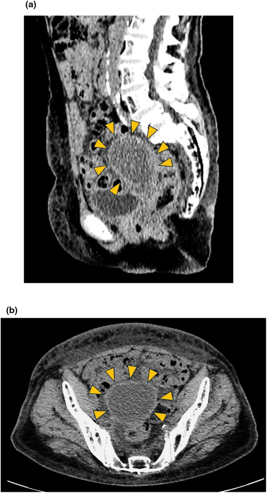
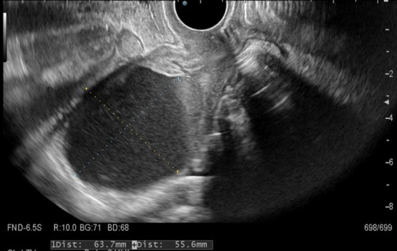
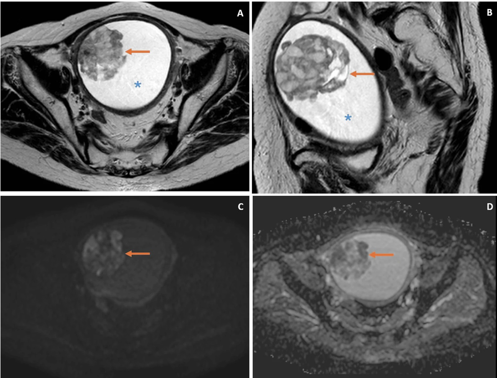
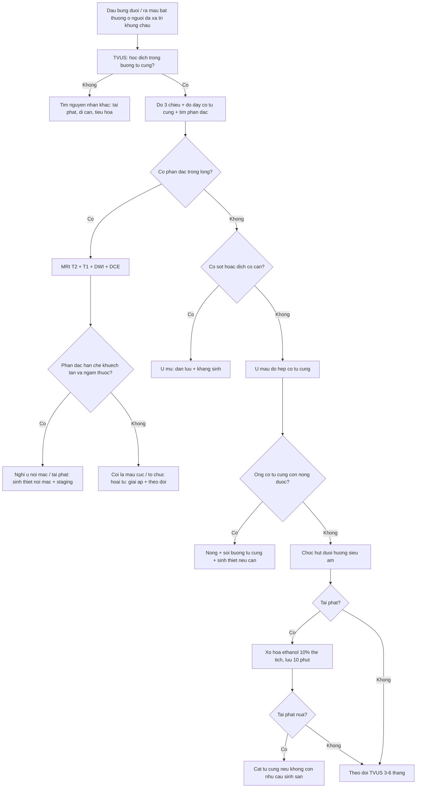

# 1634 — Hẹp cổ tử cung & ứ máu buồng tử cung sau xạ trị phụ khoa / Post-radiation cervical stenosis with hematometra

**Tags:** `pattern:u-mau-buong-tu-cung` `pattern:hep-co-tu-cung` `pattern:xo-hoa-sau-xa` `vung:co-tu-cung` `vung:tu-cung` `vung:tieu-khung` `score:FIGO-2018` `protocol:TVUS` `protocol:MRI-tieu-khung-DWI` `protocol:CT-chau`
**Mức chắc chắn (certainty):** tổng hợp y văn (literature synthesis) — ca nguyên văn có đủ hình ảnh và số đo (PMC13240027), ca ứ máu **840 mL** có u ác ẩn dưới (PMC13659860), tổng quan phân loại – xử trí hẹp cổ tử cung (PMC10866788), loạt 36 ca cắt tử cung vì hẹp cổ tử cung (PMC9302241), và tổng quan 66 ca vỡ ứ mủ tự phát (PMC13225007). Số liệu điều trị đều từ **loạt ca**, không có RCT.

## 1. Tổng quan bệnh học – cơ chế hình ảnh

- **Vì sao cổ tử cung hẹp sau xạ:** tia xạ gây **viêm nội mạc mạch → thiếu máu → xơ hóa** mô đệm cổ tử cung và **dính ống cổ tử cung**; kèm **teo do thiếu estrogen** ở người mãn kinh, ống cổ tử cung **mất dần khẩu kính** rồi **bít hoàn toàn**. Định nghĩa định lượng: ống cổ tử cung **không cho đầu nong Hegar 2,5 mm** đi qua; **hẹp lỗ ngoài (external os) khi đường kính < 4,5 mm** (PMC10866788).
- **Phân loại Bettocchi (2016) — hẹp theo vị trí:** **I** hẹp lỗ ngoài · **II** hẹp cả ống cổ tử cung + lỗ trong · **III** hẹp lỗ trong · **IV** hẹp cả lỗ ngoài + lỗ trong. Hệ quả thực hành: **lỗ trong (ICO) hẹp** gặp nhiều ở **hậu mãn kinh**, còn **lỗ ngoài** gặp nhiều ở **tiền mãn kinh** — đây là lý do **không thể suy từ "lỗ ngoài trông mở" ra "buồng tử cung dẫn lưu được"**.
- **Tần suất thực tế rất cao nhưng phần lớn im lặng:** trong **31.052 ca soi buồng tử cung tại phòng khám**, hẹp cổ tử cung gặp ở **32,7%**, trong đó **70,1% là hậu mãn kinh** (PMC10866788). Hẹp chỉ thành bệnh khi **ứ máu (hematometra)**, **ứ mủ (pyometra)** hoặc **ứ dịch (hydrometra)** gây đau, hoặc khi **cản trở tầm soát ung thư nội mạc**.
- **Vì sao ứ máu chứ không chỉ ứ dịch:** buồng tử cung tiếp tục **bong nội mạc và chảy máu** (người còn buồng trứng/đang dùng hormone) nhưng **không có đường ra** → máu tích lại, **tăng áp lực trong lòng tử cung** → đau bụng dưới, căng tức, và **nguy cơ vỡ tử cung** (đã có ca vỡ tử cung do ứ máu tái diễn, có thể tử vong — PMC13240027).
- **TẠI SAO hình ảnh chốt được dù không thấy cổ tử cung:** (1) **dịch trong buồng tử cung** — siêu âm thấy **hốc không hồi âm, vách mỏng**; (2) **cơ tử cung mỏng đi** do căng — ca điển hình: buồng tử cung **63 × 56 mm**, cơ tử cung **mỏng lan tỏa**, cổ tử cung **25 → 30 mm** (dày lên do xơ), **không thấy đường thông** (PMC13240027); (3) **tín hiệu của máu**: **methemoglobin → T1 sáng**; **T2 thay đổi theo giai đoạn** (máu cấp trong hồng cầu còn nguyên → T2 tối; muộn → T2 sáng), **mức dịch–dịch** khi đang chảy máu thêm; (4) **không ngấm thuốc** ở phần dịch (khác u hoại tử) — nhưng **phần đặc trong lòng mà ngấm thuốc + hạn chế khuếch tán thì là u, không phải máu**.
- **Con số phải nhớ:**
  - **840 mL** ứ máu trong ca có u carcinosarcoma nội mạc ẩn dưới, **7 năm** sau hóa–xạ trị ung thư cổ tử cung; khối u **3,1 × 2,7 × 3,0 cm**, xâm lấn **nửa ngoài cơ tử cung**, **CA-125 130 U/mL** (PMC13659860).
  - **47,2% (17/36)** phụ nữ cắt tử cung vì hẹp cổ tử cung sau mổ có **bệnh tiền ung thư hoặc ung thư ẩn** (1 ung thư biểu mô tuyến cổ tử cung pT1a, 6 tăng sản nội mạc); hẹp xuất hiện **10,2 ± 5,6 năm** sau mãn kinh (PMC9302241).
  - **Ngưỡng nội mạc ở hậu mãn kinh có dịch trong lòng:** nội mạc **> 3 mm** → **phải giải áp + soi buồng tử cung + sinh thiết**, không được coi là "dịch sinh lý do hẹp" (PMC10866788).
  - **Vỡ ứ mủ tự phát:** **66 ca**, **84%** bị chẩn đoán nhầm trước mổ (thường nhầm **thủng tiêu hóa**), **tử vong 25,4%**, sống 7/14/30/60 ngày **86,9/84,6/72,4/52,8%** (PMC13225007).

## 2. Mẫu hình + chẩn đoán phân biệt theo vị trí (gamut)

- **Theo tầng tắc nghẽn:**
  - **Lỗ ngoài (hẹp độ I/IV):** teo do mãn kinh, sẹo sau **khoét chóp/LEEP**, **màng trinh kín** (ứ máu âm đạo — hematocolpos, khác hoàn toàn), **bất sản cổ tử cung**.
  - **Ống cổ tử cung (độ II):** **xơ hóa sau xạ trị** (bài này), sau **đốt nội mạc tử cung** không chừa đoạn eo, sau đặt **vòng tránh thai** lâu năm.
  - **Lỗ trong (độ III):** **hậu mãn kinh**, sau xạ, **u nội mạc/cổ tử cung** bít lỗ trong.
- **Theo bản chất dịch trong lòng tử cung:** **ứ máu (hematometra)** — T1 sáng, đau chu kỳ/đau âm ỉ; **ứ mủ (pyometra)** — sốt, dịch có cặn, nguy cơ vỡ ổ mủ; **ứ dịch (hydrometra)** — dịch trong, thường im lặng, gặp ở hậu mãn kinh hoặc sau xạ; **ứ nhầy (mucometra)** — ít gặp.
- **Gamut "khối trung tâm tiểu khung + dịch trong lòng tử cung" ở người đã xạ trị:** hẹp cổ tử cung sau xạ · **tái phát ung thư cổ tử cung** · **ung thư nội mạc/carcinosarcoma thứ phát** · u cơ trơn thoái hóa · nang Naboth · ứ máu trong **khuyết sẹo mổ lấy thai**.
- **Gamut "đau bụng cấp + dịch–khí trong ổ bụng" ở người có ứ mủ:** **vỡ ứ mủ tự phát** (bắt buộc nghĩ tới, tỉ lệ chẩn nhầm 84%), thủng dạ dày–ruột, viêm phúc mạc, vỡ nang buồng trứng.

## 3. Bảng so sánh phân biệt (ma trận đối chiếu)

| Thực thể (entity) | Hình ảnh điển hình (TVUS/CT/MRI) | Chốt vào (rule-in) | Chốt loại (rule-out) | Gợi ý xác nhận |
|---|---|---|---|---|
| **Hẹp cổ tử cung sau xạ + ứ máu** | Buồng tử cung **căng dịch**, cơ tử cung **mỏng lan tỏa**; cổ tử cung **dày, không thấy ống**; dịch **T1 sáng**, **không ngấm thuốc** | **Tiền sử xạ khung chậu + buồng tử cung căng dịch + cổ tử cung xơ + không có phần đặc ngấm thuốc** | **Có khối đặc ngấm thuốc/hạn chế khuếch tán** trong lòng → là u | MRI tiểu khung (T1/T2/DWI/DCE) + soi buồng tử cung/CT-guided biopsy |
| **Tái phát ung thư cổ tử cung** (bài 1626) | Cổ tử cung **to, không đều**, ngấm thuốc, **DWI hạn chế khuếch tán**; có thể bít ống cổ tử cung gây ứ dịch phía trên | **Khối cổ tử cung ngấm thuốc + hạn chế khuếch tán**; SCC-Ag tăng | Cổ tử cung **nhỏ, xơ đều, không ngấm bất thường** → nghiêng di chứng xạ | MRI + sinh thiết cổ tử cung; PET/CT nếu nghi |
| **Ung thư nội mạc / carcinosarcoma thứ phát sau xạ** | **Khối nhú đặc trong lòng** (ca: **3,1 × 2,7 × 3,0 cm**), **T2 cao hơn cơ tử cung không đều**, **hạn chế khuếch tán**, **ngấm không đều**, xâm lấn cơ | **Khối đặc trong lòng + DWI hạn chế + xâm lấn cơ** — chốt hơn khối lượng dịch | Lòng tử cung **chỉ có dịch, thành trơn, không phần đặc** | MRI DWI/DCE + sinh thiết nội mạc |
| **Ứ mủ (pyometra)** | Dịch **có cặn/tăng tỷ trọng nhẹ**, thành dày; khí trong lòng (hiếm) | **Sốt + đau + dịch có cặn + cổ tử cung bít** | Dịch thuần máu, không sốt → ứ máu | Cấy dịch + dẫn lưu |
| **Ứ máu âm đạo (hematocolpos)** | Khối dịch **từ màng trinh trở lên**, **không có cổ tử cung bình thường**, tử cung nhỏ đẩy lên cao | **Bệnh nhân trẻ, vô kinh nguyên phát, đau chu kỳ, màng trinh phồng** | Có ống cổ tử cung dẫn lưu → không phải hematocolpos | Khám + MRI; rạch màng trinh |
| **Khuyết sẹo mổ lấy thai chứa máu** | Hốc dịch **trong khuyết cơ tử cung** ở eo trước, **không phải toàn buồng tử cung** | **Ổ dịch khu trú tại khuyết sẹo, nội mạc trên còn bình thường** | Cả buồng tử cung căng dịch → hẹp cổ tử cung | TVUS + MRI; soi buồng tử cung |
| **Nang Naboth / u cơ thoái hóa** | Nang **ở cổ tử cung**, tín hiệu dịch đơn thuần; u cơ **giảm tín hiệu T2** | **Tổn thương khu trú trong cổ tử cung/cơ tử cung**, không phải dịch tự do trong lòng | **Dịch lan tỏa trong buồng tử cung** → ứ máu/hẹp | MRI |

- **Ảnh 1 — CT tiểu khung: ứ máu buồng tử cung (CC BY 4.0):**

*(a) lát Sagittal và (b) lát Axial: khối dịch lớn chiếm toàn buồng tử cung, **cơ tử cung mỏng lan tỏa** (đầu mũi tên vàng = đường viền thân tử cung). Cổ tử cung cứng, bít hoàn toàn sau xạ trị. Nguồn: Clinical Case Reports 2026 (PMC13240027), Fig. 1 — CC BY 4.0.*

- **Ảnh 2 — siêu âm đầu dò âm đạo cùng ca (CC BY 4.0):**

*Đo trên màn hình: **63,7 × 55,6 mm**, dịch không hồi âm, cơ tử cung mỏng. Nguồn: Clinical Case Reports 2026 (PMC13240027), Fig. 2 — CC BY 4.0.*

- **Ảnh 3 — MRI: ứ máu 840 mL + u nội mạc ẩn dưới (CC BY 4.0):**

*(A, B) T2W axial/sagittal: khối nhú **tăng tín hiệu không đều** so với cơ tử cung, nằm trong khối dịch ứ (**xanh \***); (C) DWI b1000: **hạn chế khuếch tán**; (D) ADC: tín hiệu thấp tương ứng. Đây là **carcinosarcoma** nội mạc phát hiện **7 năm** sau hóa–xạ trị ung thư cổ tử cung. Nguồn: Cureus 2026 (PMC13659860), Fig. 2 — CC BY 4.0.*

## 4. Protocol chụp + hệ phân độ/điểm chuẩn hóa

- **Bước 1 — Siêu âm đầu dò âm đạo (TVUS) là đầu tay:** đo **3 chiều hốc dịch**, đo **độ dày cơ tử cung**, tìm **phần đặc trong lòng**, mô tả **cổ tử cung** (chiều dài, chiều dày, có/không thấy ống), đánh giá **buồng trứng** và **giãn đài–niệu quản** (ứ máu lớn chèn niệu quản). Ở người **đã cắt tử cung** hoặc không đánh giá được, dùng **siêu âm qua ngã âm đạo còn lại/qua thành bụng** hoặc **MRI**.
- **Bước 2 — MRI tiểu khung (chuỗi xung tối thiểu):** **T2 sagittal + axial** (cấu trúc 3 lớp, ranh giới cơ), **T1** (máu/mỡ: T1 sáng), **T1 fat-sat** (loại mỡ), **DWI b800–1000 + ADC**, **T1 sau tiêm động học (DCE)**. Câu hỏi bắt buộc: **(1) trong lòng có phần đặc không? (2) phần đặc có hạn chế khuếch tán/ngấm thuốc không? (3) u xâm lấn cơ tới đâu? (4) có hạch không?**
- **Bước 3 — CT chỉ khi cần:** nghi **vỡ ứ mủ** (khí tự do, dịch ổ bụng), **sỏi/canxi hóa**, đánh giá lan rộng; **không dùng CT để đánh giá ống cổ tử cung**.
- **Bước 4 — Chẩn đoán xác định hẹp cổ tử cung:** **không có kỹ thuật hình ảnh nào đo được độ thông ống cổ tử cung** (PMC10866788) → **soi buồng tử cung/đầu nong Hegar 2,5 mm** là chuẩn; hình ảnh chỉ cho biết **hệ quả** (ứ máu/mủ/dịch) và **loại trừ u**.
- **Bước 5 — Phân tầng xử trí (số liệu đi kèm):**

| Tình huống | Ưu tiên | Số liệu / lưu ý |
|---|---|---|
| Ứ máu **có triệu chứng**, ống cổ tử cung còn nong được | **Nong + dẫn lưu qua đường âm đạo**, soi buồng tử cung ± sinh thiết | Giải áp tức thì; **đau giảm ngay sau khi lấy 60 mL** (PMC13240027) |
| Hẹp **bít hoàn toàn** do xạ, nong/thì soi không vào được | **Chọc hút dưới hướng siêu âm** (đường âm đạo/qua thành bụng) | Ca: **60 mL** lần đầu, sau đó tái phát **~mỗi 2 tháng**, **5 lần chọc** trong vài tháng |
| Ứ máu **tái phát**, bệnh nhân không mổ được | **Xơ hóa bằng ethanol (sclerotherapy)** dưới siêu âm thời gian thực | **12 mL ethanol 100% = 10% thể tích hút ra (120 mL)**, lưu **10 phút**, hút lại ~10 mL; **không tái phát 1 năm**, xuất viện **ngày hôm sau** |
| Hậu mãn kinh, dịch trong lòng + **nội mạc > 3 mm** | **Giải áp + soi + sinh thiết nội mạc** | Ngưỡng **> 3 mm** (PMC10866788); hẹp có thể che ung thư (**47,2%** ca cắt tử cung có bệnh ẩn) |
| **Ứ mủ** (sốt, dịch cặn) | **Dẫn lưu + kháng sinh**, cắt tử cung nếu vỡ/không đáp ứng | Vỡ ứ mủ: chẩn nhầm **84%**, tử vong **25,4%** (PMC13225007) |
| Hẹp **tái phát nhiều lần**, đã mãn kinh, không còn nhu cầu sinh sản | **Cắt tử cung** (đường âm đạo/qua nội soi ổ bụng) | Cân nhắc khi nong thất bại ≥ 2 lần hoặc không theo dõi được nội mạc |

## 5. Biến thể bình thường và cạm bẫy

- **Biến thể bình thường:** một **vệt dịch mỏng trong lòng tử cung ở hậu mãn kinh** (đặc biệt người đang dùng thuốc/chờ chu kỳ) có thể là sinh lý — nhưng **chỉ khi nội mạc ≤ 3 mm và không có triệu chứng**; vượt ngưỡng đó phải giải áp + sinh thiết.
- **Cạm bẫy 1 — "ứ máu là chẩn đoán":** ứ máu **chỉ là dấu hiệu**, không phải bệnh. Ca **840 mL** có u carcinosarcoma nằm trong; bỏ qua **phần đặc ngấm thuốc/hạn chế khuếch tán** là bỏ ung thư. Luôn trả lời 4 câu hỏi ở mục 4 bước 2.
- **Cạm bẫy 2 — tưởng u là máu cục:** máu cục **không ngấm thuốc**, **không hạn chế khuếch tán** (hoặc hạn chế rất ít), đổi hình khi bệnh nhân đổi tư thế/rửa; u **ngấm thuốc không đều + ADC thấp**. Trên T1, **methemoglobin sáng** dễ nhầm u ngấm thuốc → **so trước/sau tiêm**.
- **Cạm bẫy 3 — đo nội mạc khi có dịch:** khi buồng tử cung căng dịch, **không đo được độ dày nội mạc chính xác**; phải đo **phần đặc** và mô tả **bề mặt nội mạc**, rồi sinh thiết — đừng ghi "nội mạc mỏng, an toàn".
- **Cạm bẫy 4 — tế bào học cổ tử cung âm tính không loại trừ:** hẹp cổ tử cung **cản trở lấy mẫu** và teo niêm mạc làm **âm tính giả**; ca carcinosarcoma có **cytology âm tính** nhưng MRI dương (PMC13659860).
- **Cạm bẫy 5 — ứ mủ vỡ bị chẩn nhầm thủng tiêu hóa:** **84%** ca vỡ ứ mủ được chẩn đoán nhầm trước mổ; trên CT thấy **khí tự do + dịch ổ bụng** nhưng **nguồn là tử cung** — phải nhìn **tử cung căng, thành mỏng, mất liên tục**, và hỏi tiền sử xạ/hẹp cổ tử cung.
- **Cạm bẫy 6 — bỏ sót vỡ tử cung do ứ máu:** cơ tử cung mỏng + tăng áp lực lâu ngày → **vỡ tử cung** đã được báo cáo, có ca tử vong; đau tăng đột ngột + dịch ổ bụng ở người có ứ máu là **cấp cứu**, không chờ MRI.
- **Cạm bẫy 7 — nhầm ứ máu âm đạo với ứ máu tử cung:** hematocolpos ở trẻ vị thành niên **không có bệnh lý cổ tử cung** mà do **màng trinh kín**; xử trí là **rạch màng trinh**, không nong cổ tử cung. Tuổi + vô kinh nguyên phát + màng trinh phồng là chốt.
- **Cạm bẫy 8 — can thiệp ethanol không đúng kỹ thuật:** ethanol vào **ống dẫn trứng → phúc mạc** gây **viêm phúc mạc**, hoặc vào tuần hoàn gây **ngộ độc toàn thân**; phải **hướng dẫn siêu âm thời gian thực**, **thể tích thấp (≈10% dịch)**, **lưu 10 phút**, và theo dõi đau/sốt 24 giờ.

## 6. Tự lượng giá — Blind Quiz

**Ca 1 — nữ 81 tuổi, đau bụng dưới âm ỉ, tiền sử xạ trị ung thư cổ tử cung giai đoạn IIB 3 năm trước**

- Bối cảnh: cổ tử cung cứng, ống cổ tử cung bít hoàn toàn; siêu âm: hốc dịch **63,7 × 55,6 mm**; CT: buồng tử cung căng, **cơ tử cung mỏng**.
- Câu hỏi: Chẩn đoán hình ảnh là gì? Vì sao phải soi/sinh thiết cổ tử cung? Bước tiếp theo nếu nong không vào được?

<b>Bấm để hiện đáp án (findings + chẩn đoán)</b>

- Chẩn đoán: **ứ máu buồng tử cung do hẹp cổ tử cung sau xạ** — dịch không hồi âm, cơ tử cung mỏng, cổ tử cung xơ không thấy ống; đau do **tăng áp lực trong lòng tử cung**.
- Vì sao sinh thiết: hẹp cổ tử cung **che tái phát ung thư** — trong ca gốc, sinh thiết cổ tử cung xác định **tái phát carcinoma vảy + di căn phổi** dù tế bào học dịch hút âm tính.
- Bước tiếp: **chọc hút dưới hướng siêu âm** (ca gốc lấy **60 mL**, đau giảm ngay); nếu tái phát nhiều lần → **xơ hóa ethanol 12 mL (10% thể tích), lưu 10 phút**.
- Nguồn: Clinical Case Reports 2026 (PMC13240027) — CC BY 4.0.

**Ca 2 — nữ 60 tuổi, 7 năm sau hóa–xạ trị ung thư cổ tử cung, đau tiểu khung 3 tháng + ra máu nhẹ**

- Bối cảnh: cổ tử cung hẹp rõ, tế bào học âm tính, **CA-125 130 U/mL**; MRI: buồng tử cung căng **~840 mL** dịch + khối nhú **3,1 × 2,7 × 3,0 cm**.
- Câu hỏi: Ba dấu hiệu MRI nào nói khối là **u** chứ không phải máu cục? Chẩn đoán và mức xâm lấn?

<b>Bấm để hiện đáp án (findings + chẩn đoán)</b>

- Ba dấu hiệu: **(1) hạn chế khuếch tán** trên DWI/ADC thấp; **(2) ngấm thuốc không đều** sau gadolinium; **(3) xâm lấn nửa ngoài cơ tử cung** — khối T1 đồng tín hiệu cơ, T2 cao hơn cơ không đều.
- Chẩn đoán: **carcinosarcoma nội mạc tử cung** (FIGO 2023 IIC sau mổ), xuất hiện **7 năm** sau xạ trị ung thư cổ tử cung; di căn màng phổi **6 tháng** sau chẩn đoán.
- Bài học: ứ máu lượng lớn ở người đã xạ **không được coi là "di chứng lành"** — luôn tìm phần đặc.
- Nguồn: Cureus 2026 (PMC13659860) — CC BY 4.0.

**Ca 3 — nữ 69 tuổi, 19 năm mãn kinh, sốt 39 °C, đau bụng cấp, CT có khí tự do**

- Bối cảnh: bụng cứng, dịch ổ bụng; bác sĩ ngoại chẩn đoán **thủng dạ dày–ruột**; tiền sử xạ trị khung chậu 8 năm trước vì ung thư cổ tử cung.
- Câu hỏi: Chẩn đoán thay thế? Dấu hiệu CT nào đổi chẩn đoán? Tiên lượng?

<b>Bấm để hiện đáp án (findings + chẩn đoán)</b>

- Chẩn đoán: **vỡ ứ mủ tự phát (spontaneous perforation of pyometra)** do hẹp cổ tử cung sau xạ — khí tự do + dịch ổ bụng **không đồng nghĩa nguồn tiêu hóa**.
- Dấu hiệu đổi chẩn đoán: **tử cung căng, thành mỏng, mất liên tục thành sau**, cổ tử cung bít; đối chiếu tiền sử xạ/hẹp cổ tử cung.
- Tiên lượng: trong **66 ca** đã báo cáo, **84%** chẩn nhầm trước mổ và **tử vong 25,4%** — cần **mổ nguồn + kháng sinh phủ Enterobacteriaceae/anaerobe** sớm.
- Nguồn: Int J Womens Health 2026 (PMC13225007) — CC BY-NC 4.0; ảnh minh họa từ PMC13240027 (CC BY 4.0).

## Bài liên quan chéo
- [1609 – Suy buồng trứng & thiếu hụt hormone sau xạ trị phụ khoa](../1609-suy-buong-trung-thieu-hut-hormone-sau-xa-tri-phu-khoa/lesson.md)
- [562 – Hẹp âm đạo sau xạ trị](../562-hep-am-dao-sau-xa-tri/lesson.md)
- [582 – Biến chứng tiêu hóa–niệu sau xạ trị phụ khoa](../582-bien-chung-tieu-hoa-nieu-sau-xa-tri-phu-khoa/lesson.md)
- [1626 – Tái phát tại vòm âm đạo sau xạ trị ung thư cổ tử cung](../1626-tai-phat-vom-am-dao-sau-xa-tri/lesson.md)
- [1633 – Viêm bàng quang xạ chảy máu nặng](../1633-viem-bang-quang-xa-chay-mau-nang/lesson.md)
- [1612 – Colpocleisis & biến chứng ứ mủ (pyocolpos/pyometra)](../1612-colpocleisis-va-bien-chung/lesson.md)

## Ảnh
- `images/1634_u-mau-buong-tu-cung_CT-PMC13240027-F1.jpg` — CC BY 4.0, Clinical Case Reports 2026 (PMC13240027), Fig. 1.
- `images/1634_u-mau-buong-tu-cung_TVUS-PMC13240027-F2.jpg` — CC BY 4.0, cùng bài, Fig. 2.
- `images/1634_u-mau-buong-tu-cung_MRI-PMC13659860-F2.jpg` — CC BY 4.0, Cureus 2026 (PMC13659860), Fig. 2.
- Không tải ảnh Radiopaedia/AuntMinnie; dẫn link trong `sources.md`.

> Không dùng để chẩn đoán độc lập khi chưa có người hướng dẫn.
