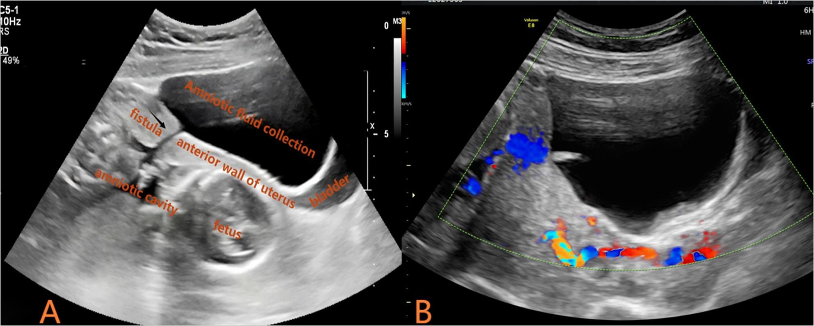
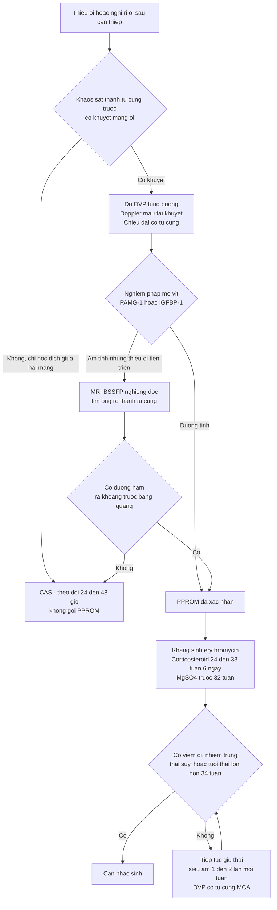
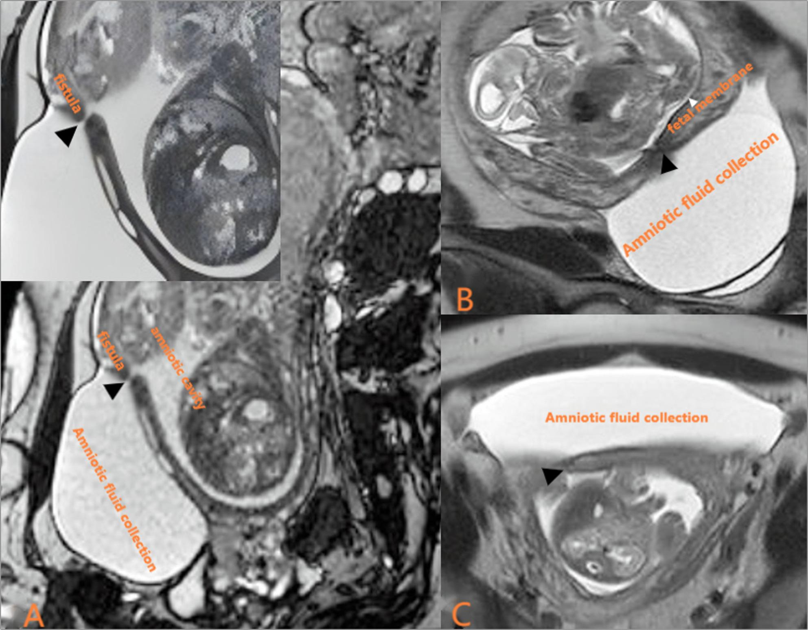

# 1635 — Vỡ ối non tháng sau can thiệp bào thai: lỗ trocar, ống rò thành tử cung & xử trí / Iatrogenic PPROM after fetal intervention

**Tags:** `pattern:ro-oi-trocar` `pattern:vo-oi-non-thang` `pattern:thieu-oi` `pattern:tach-mang-oi` `vung:thai-nhi` `vung:manh-oi` `vung:tu-cung` `anatomy:buong-oi` `protocol:SA-thai` `protocol:MRI-thai` `protocol:PAMG-1`
**Mức chắc chắn (certainty):** tổng hợp y văn (literature synthesis) — số liệu từ mô hình dự báo 414 thai sau laser (PMC12705759), ca nguyên văn có ống rò trocar–buồng ối (PMC13202899), phân tích gộp 10 nghiên cứu/1.159 thai về dự phòng sinh non sau laser (PMC12209700), đoàn hệ PPROM 22–28 tuần (PMC13188305), đoàn hệ thể tích ối (PMC13363472) và tổng quan chẩn đoán–xử trí PROM (PMC13134642).

## 1. Tổng quan bệnh học – cơ chế hình ảnh

### 1.1. Vì sao lỗ trocar 3–4 mm lại thủng màng ối vĩnh viễn

- Can thiệp bào thai (fetoscopy: laser TTTS, FETO, vá thoát vị rốn, đốt vasa previa) phải **xuyên qua thành tử cung và cả hai lá màng** bằng trocar **8–12 Fr (≈ 2,7–4 mm)**. Cơ tử cung lành lại, nhưng **màng ối không có mạch máu nuôi** — mô hoại tử ở mép lỗ không được thay thế, nên **lỗ màng không liền** (không có "sẹo màng ối").
- Hệ quả: một **đường rò (fistula)** từ buồng ối qua cơ tử cung ra ngoài. Trong ca nguyên văn PMC13202899, soi ổ bụng sau chấm dứt thai kỳ thấy **sẹo cơ tử cung đã lành nhưng KHÔNG có màng ối phủ lên** — đúng bằng chứng "cơ lành, màng không lành".
- Dịch ối thoát ra **khoang trước bàng quang (vesicouterine pouch)** rồi mới ra âm đạo, nên có thể **không thấy rỉ ối** mà chỉ thấy **thiểu ối tiến triển** — thể "PPROM kín" (occult).
- **Tần suất:** PPROM sau laser TTTS **11–50%** (PMC12705759); **13,8% trong 7 ngày đầu** sau laser (đoàn hệ TTTS sớm, PMC13040126); là **biến chứng hay gặp nhất** còn lại sau khi các biến chứng nặng khác đã giảm.
- **Cơ chế tầng tiếp theo:** tách màng ối–màng đệm (chorioamniotic separation, CAS) do trocar tạo khoang dịch giữa hai lá → màng ối mỏng, căng, dễ rách; CAS làm tăng nguy cơ PPROM **OR 3,98** và sinh < 32 tuần **OR 1,80** (bài 1610).
- **Hậu quả theo thời gian:** thiểu ối → **giảm thể tích phổi (pulmonary hypoplasia)** nếu kéo dài trước 22–24 tuần; dây rốn chèn ép; **nhiễm trùng ối**; sinh non; **dải ối giả (PABS)** do màng rách dính vào thai.

### 1.2. Vì sao phải định lượng chứ không "thấy ối ít"

- Thể tích ối đo bằng **khoang dịch sâu nhất (deepest vertical pocket, DVP)** cho từng buồng ối — **AFI không dùng được ở song thai** vì một túi lớn có thể bù cho túi kia.
- Trong đoàn hệ 263 thai PPROM < 34 tuần: **66,5% có DVP ≤ 20 mm** lúc chẩn đoán; nhóm DVP ≤ 20 mm có **biến cố thai 74,3% so với 52,3%** (p < 0,05), nhưng **thể tích ối KHÔNG dự báo thời gian giữ thai** (Spearman ρ = 0,03; p = 0,598) (PMC13363472). Nghĩa là: ối ít = tiên lượng xấu cho thai, **không** phải "sẽ sinh trong vài ngày".
- Thời gian giữ thai (latency) sau PPROM 22–28 tuần: **trung vị 6 ngày (IQR 2–23)**, không khác nhau theo tuổi thai lúc vỡ; sống tới xuất viện **67,0%**, sống không di chứng nặng **42,9%** (PMC13188305).
- **Mô hình dự báo PPROM sau laser** (414 thai, 151 ca PPROM): **AUC 0,802 (KTC 95% 0,700–0,904)** với 5 biến — **rỉ ối sau mổ, thời gian mổ, tỉ lệ giảm dịch ối trong mổ** làm tăng nguy cơ; **chiều dài cổ tử cung trước mổ** và **khoảng cách trocar tới lỗ trong cổ tử cung** làm giảm nguy cơ (PMC12705759).

## 2. Mẫu hình + chẩn đoán phân biệt theo vị trí (gamut)

### 2.1. Gamut "thiểu ối / có dịch bất thường quanh tử cung sau can thiệp"

1. **PPROM do lỗ trocar (có/không có ống rò):** thiểu ối một hoặc hai buồng, **khuyết màng ối ở thành tử cung trước đúng vị trí trocar**, có thể kèm **hốc dịch trước bàng quang**; đè đầu dò hoặc đổi tư thế thấy dịch di chuyển.
2. **Ống rò thành tử cung–buồng ối (uterine puncture site–amniotic cavity fistula):** khuyết cơ tử cung + đường hầm liên tục từ buồng ối ra khoang trước bàng quang, **không có màng ối phủ**; xác định bằng MRI (PMC13202899).
3. **Tách màng ối–màng đệm (CAS):** hốc dịch **giữa hai lá màng**, màng ối còn nguyên, thai vẫn trong túi ối; **không** phải vỡ ối nhưng là tiền đề của PPROM (bài 1610).
4. **Dải ối giả (pseudoamniotic band sequence, PABS):** sau PPROM, màng rách tạo dải dính vào chi/dây rốn; **1,3%** sau laser, chỉ **27,3%** phát hiện trước sinh (bài 1610).
5. **Thoát vị/sa túi ối qua khuyết cơ tử cung:** túi ối lồi ra ngoài thanh mạc, hình "giọt" ngoài đường viền tử cung; khác ống rò ở chỗ **có túi ối hoàn chỉnh** chứ không phải đường hầm.
6. **Dịch trước bàng quang KHÔNG do ối:** nước tiểu (vỡ bàng quang, rò niệu quản), **máu tụ**, dịch tiết sau mổ — đo **creatinine dịch** giúp phân biệt nước tiểu.
7. **PPROM tự phát không liên quan thủ thuật** hoặc **vỡ ối non tháng do nhiễm trùng**; và **đái rỉ/thai phụ khoa bình thường** gây nhầm "rỉ ối".

### 2.2. Mẫu hình "đọc đúng trên siêu âm"

- **Đúng PPROM:** **thiểu ối + khuyết màng ối ở thành tử cung + hốc dịch ngoài túi ối**, kèm nghiệm pháp dịch âm đạo dương tính.
- **Sai PPROM:** màng ối liên tục, chỉ có hốc dịch **giữa hai màng** (CAS), hoặc thiểu ối **một buồng** do thai cho trong TTTS (bài 1611).
- **Mẹo nhớ 4 nhóm:** **RÒ** (lỗ trocar/ống rò) — **TÁCH** (CAS) — **DẢI** (PABS) — **KHÁC** (nước tiểu/máu/tự phát).

*(A) Lát cắt dọc thành tử cung trước: mũi tên = **đường rò (fistula)** thông buồng ối với hốc dịch lớn trước bàng quang; (B) Doppler màu: **không có dòng chảy** trong khuyết — loại trừ mạch máu. Nguồn: Wang Y và cộng sự, *BMC Pregnancy Childbirth* 2026, PMC13202899, CC BY 4.0 — ảnh nguyên bản, không crop.*

## 3. Bảng so sánh phân biệt (ma trận đối chiếu)

| Thực thể (entity) | Hình ảnh điển hình (siêu âm/MRI) | Chốt vào (rule-in) | Chốt loại (rule-out) | Gợi ý xác nhận |
|---|---|---|---|---|
| PPROM do lỗ trocar | Thiểu ối + **khuyết màng ối đúng vị trí trocar**; dịch di chuyển khi đổi tư thế | **Thấy khuyết màng ối + DVP giảm tiến triển + nghiệm pháp dịch âm đạo dương tính** | Màng ối liên tục trên mọi lát cắt, DVP ổn định | Nghiệm pháp mỏ vịt (không thăm âm đạo bằng tay); PAMG-1/IGFBP-1 |
| Ống rò thành tử cung–buồng ối | Khuyết cơ tử cung + **đường hầm liên tục** ra khoang trước bàng quang; hốc dịch 10,4 × 6,6 × 11,0 cm trong ca nguyên văn | **MRI BSSFP nghiêng dọc thấy đường rò** + không có màng ối phủ (xác nhận sau sinh/mổ) | Có màng ối phủ kín khuyết; chỉ có dịch tự do không đường hầm | **MRI thai không cản quang** (BSSFP + T2) |
| CAS (tách màng ối–màng đệm) | **Hốc dịch giữa hai lá màng**, màng ối còn nguyên, thai trong túi ối | **Hai lá màng tách nhau, thai vẫn bọc trong màng ối** | Khuyết màng ối thật + rỉ ối ra ngoài | Siêu âm lặp 24–48 giờ; phân độ theo chiều rộng |
| PABS (dải ối giả) | Dải màng mảnh bắt chéo chi/dây rốn, có thể xoắn chi | **Dải màng + tiền sử PPROM sau can thiệp** | Dải ối bẩm sinh (amniotic band) khi không có tiền sử vỡ ối | Siêu âm chi tiết; MRI khi cần |
| Sa túi ối qua khuyết cơ | Túi ối lồi ra ngoài thanh mạc thành tử cung | **Túi ối nguyên vẹn nằm ngoài đường viền tử cung** | Đường hầm rò (không có túi ối) | MRI; theo dõi nguy cơ vỡ |
| Dịch trước bàng quang do nước tiểu/máu | Hốc dịch cùng vị trí nhưng không thông buồng ối | **Creatinine dịch cao ≈ huyết tương (nước tiểu)**; Hounsfield/tín hiệu máu | Có đường rò từ buồng ối | Chọc hút dịch: creatinine, tế bào, cấy |
| Thiểu ối do TTTS (thai cho) | Một buồng ối ≤ 2 cm + buồng kia ≥ 8 cm, bàng quang thai cho không thấy | **Cặp ngưỡng ối của TTTS, không có rỉ ối** | Màng ối nguyên, không khuyết | Đo DVP hai buồng + MCA-PSV (bài 1611) |

### 3.1. Ba câu hỏi chốt trong 30 giây

1. **Có khuyết màng ối thật không?** Có → PPROM; chỉ có hốc dịch giữa hai màng → CAS.
2. **Dịch ở đâu?** Trong túi ối → bình thường; **giữa hai màng** → CAS; **trước bàng quang + đường hầm** → ống rò.
3. **Có bằng chứng ối trong âm đạo không?** PAMG-1/IGFBP-1 dương → xác nhận vỡ ối; âm mà vẫn thiểu ối tiến triển → nghi PPROM kín/ống rò, chuyển MRI.

## 4. Protocol chụp + xử trí theo ngưỡng

### 4.1. Siêu âm (bắt buộc mỗi lần khám sau can thiệp)

- **Đầu dò bụng + đầu dò âm đạo** (nhẹ tay, **không thăm khám bằng tay** vì làm tăng nhiễm trùng và rút ngắn latency).
- Đo **DVP từng buồng ối**, **chiều dài cổ tử cung**, bàng quang thai, Doppler rốn/não giữa; **khảo sát thành tử cung trước theo lát cắt dọc** đúng đường trocar (thường thành trước).
- **Doppler màu** tại khuyết: **không có dòng** giúp loại trừ mạch máu/túi phình giả thành tử cung.
- Khi nghi ống rò: đo kích thước hốc dịch, so sánh 2 lần cách 24–72 giờ (**tiến triển nhanh = rò hoạt động**).

### 4.2. MRI thai (khi siêu âm không kết luận)

- **Không cản quang**: **BSSFP (FIESTA/TrueFISP) lát nghiêng dọc** + **T2W**; mục tiêu là **đường hầm liên tục** từ buồng ối qua cơ tử cung (PMC13202899).
- Chỉ định: thiểu ối tiến triển mà không thấy rỉ ối, hốc dịch trước bàng quang không rõ nguồn, cần phân biệt túi ối sa/ống rò trước khi quyết định can thiệp.
- Trong ca nguyên văn, MRI 20 tuần xác nhận **rò + hốc dịch + bất thường não thai** (giãn não thất phải; thai nhận có teo nhu mô khu trú) → đổi hoàn toàn tư vấn.

### 4.3. Xác nhận vỡ ối bằng xét nghiệm

| Test | Độ nhạy / độ đặc hiệu | Ghi chú |
|---|---|---|
| **PAMG-1 (AmniSure)** | **96,7% / 98,3%** | Tốt nhất trong so sánh trực tiếp; PPV 98,3%, NPV 96,7% |
| **IGFBP-1 (Actim PROM)** | **95,4% / 92,9%** | PPV 92,3%, NPV 95,8% |
| Nitrazine / ferning | Thấp hơn, phụ thuộc người đọc | Dùng khi không có test miễn dịch; **âm tính không loại trừ** |

*(Số liệu so sánh trực tiếp trong PMC13134642.)*

### 4.4. Xử trí theo ngưỡng (PPROM sau can thiệp)

- **Kháng sinh:** **erythromycin 250 mg × 4/ngày, tối đa 10 ngày** (NICE) hoặc **ampicillin 2 g mỗi 6 giờ + erythromycin 250 mg mỗi 6 giờ** (ACOG) — giảm viêm ối, nhiễm sơ sinh, kéo dài latency; **tránh co-amoxiclav đơn thuần** (liên quan viêm ruột hoại tử).
- **Corticosteroid:** **24+0 – 33+6 tuần** khi có nguy cơ sinh trong 7 ngày; nhắc lại 1 lần nếu > 7 ngày và còn < 34 tuần.
- **Magnesium sulfate** trước 32 tuần để bảo vệ não thai.
- **Không bán khâu/vòng nang thường quy sau laser:** phân tích gộp 10 nghiên cứu/1.159 thai **không** thấy tăng tuổi thai hay giảm sinh non (GRADE thấp) (PMC12209700).
- **Vá màng/amniopatch – truyền dịch ối:** chưa có bằng chứng từ RCT; tổng quan 14 nghiên cứu cho thấy **tăng thể tích ối + không viêm ối** là dấu hiệu kết cục tốt, nhưng vá không hoàn toàn vẫn có lợi (PMC10377155). Truyền dịch ối **ngắt quãng** không hiệu quả (dịch thoát ngay); **truyền liên tục qua port** đang được thử trong RCT (PMC9500795).
- **Thời điểm sinh:** cá thể hóa; **≥ 34 tuần** thường cân nhắc sinh vì nguy cơ nhiễm tăng dần; **< 32 tuần** ưu tiên giữ thai nếu không có viêm ối/nhiễm trùng/thai suy.
- **Tiên lượng để tư vấn:** latency trung vị **6 ngày (2–23)**, sống **67,0%**, sống không di chứng nặng **42,9%** (PMC13188305) — dùng cho cả nhóm tự phát lẫn iatrogenic, không hứa "giữ được lâu".

## 5. Biến thể bình thường và cạm bẫy

- **CAS không phải PPROM:** hốc dịch giữa hai lá màng với màng ối nguyên vẹn; gọi nhầm là "vỡ ối" dẫn tới sinh non iatrogenic. Ngược lại, **CAS là yếu tố nguy cơ** PPROM (OR 3,98) nên phải theo dõi sát, không được bỏ.
- **"PPROM kín" do ống rò:** dịch chảy vào khoang trước bàng quang nên **không rỉ ra âm đạo**, test PAMG-1 âm tính giả; chỉ có **thiểu ối tiến triển**. Ca PMC13202899 mất 20 ngày từ laser đến chẩn đoán.
- **Thiểu ối một buồng sau laser không đồng nghĩa vỡ ối:** ở TTTS, buồng của thai cho vốn ≤ 2 cm; so sánh với **DVP trước laser** và tìm khuyết màng ối.
- **Thăm khám bằng tay làm hại:** thăm âm đạo bằng tay tăng viêm ối, nhiễm sơ sinh và **rút ngắn latency** — chỉ dùng mỏ vịt vô khuẩn.
- **Đo AFI ở song thai:** AFI gộp hai túi che mất thiểu ối một bên; luôn đo **DVP từng buồng**.
- **Dịch trước bàng quang có thể là nước tiểu:** sau trocar/đặt catheter, nước tiểu và máu tụ cho hình ảnh giống hệt; **creatinine dịch** và Doppler giúp phân biệt.
- **"Ối tăng lại" không loại trừ rò:** thai vẫn tiết nước tiểu; DVP có thể dao động trong vài ngày — đánh giá **xu hướng** chứ không một lần đo.
- **PABS là biến chứng muộn sau PPROM:** thai có dải màng + tiền sử rỉ ối phải khảo sát chi và dây rốn kỹ.

## 6. Tự lượng giá — Blind Quiz

**Ca 1 — thiểu ối 20 ngày sau laser**

- Gợi ý lâm sàng: song thai một bánh nhau, laser SOLOMON 17 tuần 1 ngày; 19 tuần 6 ngày siêu âm thấy "túi ối lồi ra thành bụng", một buồng ối ít.
- Câu hỏi: (1) Mũi tên trỏ vào đâu, hốc dịch là gì? (2) Doppler màu nói gì? (3) Chẩn đoán và vì sao không thấy rỉ ối?

<b>Bấm để hiện đáp án (findings + chẩn đoán)</b>

- Dấu hiệu: (A) **khuyết dạng khe ở thành tử cung trước đúng vị trí trocar** (mũi tên = fistula) thông buồng ối với **hốc dịch lớn trong khoang trước bàng quang**; bàng quang bị đè; (B) **không có dòng chảy** trong khuyết → không phải mạch máu.
- Chẩn đoán: **PPROM sau can thiệp + ống rò vị trí trocar–buồng ối**, thể "kín" (dịch vào khoang trước bàng quang trước khi ra âm đạo).
- Vì sao: màng ối không có mạch máu → lỗ trocar không liền; cơ tử cung lành nhưng không có màng phủ (xác nhận bằng soi ổ bụng sau chấm dứt thai kỳ).
- Nguồn ảnh: Wang Y và cộng sự, *BMC Pregnancy Childbirth* 2026, PMC13202899, CC BY 4.0.

**Ca 2 — "đường hầm" trên MRI**

- Gợi ý lâm sàng: siêu âm không phân biệt được sa túi ối hay rò; thai 20 tuần, thiểu ối tăng dần.
- Câu hỏi: (1) Mô tả đường hầm và hốc dịch. (2) Vì sao MRI thay đổi tư vấn? (3) Có cần gadolinium không?

<b>Bấm để hiện đáp án (findings + chẩn đoán)</b>

- Dấu hiệu: (A) BSSFP nghiêng dọc — **đường rò (mũi tên đen)** xuyên thành tử cung trước, **hốc dịch ối** trong khoang trước bàng quang đè bàng quang; (B, C) mặt phẳng ngang/khác — **màng ối (fetal membrane)** và hốc dịch; buồng ối thật giảm thể tích.
- Vì sao quan trọng: MRI xác nhận **rò thật** (không chỉ sa túi ối) và phát hiện **bất thường não hai thai** (giãn não thất phải; teo nhu mô khu trú ở thai nhận) → tiên lượng xấu, thai phụ chọn chấm dứt thai kỳ.
- Gadolinium: **không cần** — BSSFP/T2 đủ thấy đường hầm dịch; tránh thuốc cản quang ở thai khi không cần thiết.
- Nguồn ảnh: Wang Y và cộng sự, *BMC Pregnancy Childbirth* 2026, PMC13202899, CC BY 4.0.

**Ca 3 — quyết định giữ thai**

- Gợi ý lâm sàng: laser TTTS 20 tuần; 22 tuần DVP 1,2 cm/3,1 cm, màng ối có khuyết nhỏ thành trước, **không sốt, không đau tử cung**, CRP bình thường, cổ tử cung 28 mm.
- Câu hỏi: (1) Chẩn đoán? (2) Bốn việc phải làm ngay? (3) Tư vấn thời gian giữ thai dựa trên số nào?

<b>Bấm để hiện đáp án (findings + chẩn đoán)</b>

- Chẩn đoán: **PPROM sau can thiệp, chưa có dấu hiệu nhiễm ối**; DVP 1,2 cm = thiểu ối mức trung bình.
- Bốn việc: (1) **không thăm âm đạo bằng tay**, khám mỏ vịt + PAMG-1/IGFBP-1; (2) **erythromycin 250 mg × 4/ngày** (hoặc ampicillin + erythromycin); (3) **corticosteroid** (22 tuần) + **MgSO4** bảo vệ não; (4) siêu âm **1–2 lần/tuần** (DVP, cổ tử cung, Doppler) + theo dõi nhiễm (sốt, CRP, dịch ối).
- Tư vấn: latency trung vị **6 ngày (IQR 2–23)** sau PPROM 22–28 tuần; sống tới xuất viện **67,0%**, sống không di chứng nặng **42,9%** (PMC13188305). Thể tích ối **không** dự báo latency (ρ = 0,03) — đừng hứa "còn nhiều ối thì còn lâu".
- Nguồn số liệu: PMC13188305, PMC13363472, PMC13134642, PMC12209700.

## Bài liên quan chéo
- [1610 – Tách màng ối sau can thiệp bào thai: phân độ, PPROM & dải ối giả](../1610-tach-mang-oi-sau-can-thiep-bao-thai/lesson.md)
- [1611 – TTTS tái phát sau laser: chẩn đoán lại, phân giai đoạn Delphi 2025 & laser lần 2](../1611-ttts-tai-phat-sau-laser/lesson.md)
- [587 – Dự phòng sinh non sau laser TTTS](../587-du-phong-sinh-non-sau-laser-TTTS/lesson.md)
- [566 – Song thai: xác định màng đệm–màng ối & TTTS/TAPS](../566-song-thai-chorionicity-TTTS-TAPS/lesson.md)
- [1645 – Theo dõi sau đốt laser vasa previa](../1645-theo-doi-sau-dot-laser-vasa-previa/lesson.md)

## Ảnh
- `images/1635_ipprom_US_PMC13202899-F1.jpg` — siêu âm khuyết thành tử cung + hốc dịch trước bàng quang (PMC13202899, CC BY 4.0).
- `images/1635_ipprom_MRI_PMC13202899-F2.jpg` — MRI BSSFP/T2 đường rò trocar–buồng ối (PMC13202899, CC BY 4.0).
- Nguồn và giấy phép chi tiết: `images/CREDITS.md`; nguồn học thuật: `sources.md`.

> Không dùng để chẩn đoán độc lập khi chưa có người hướng dẫn.
