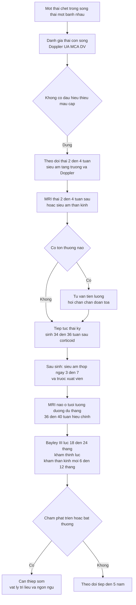
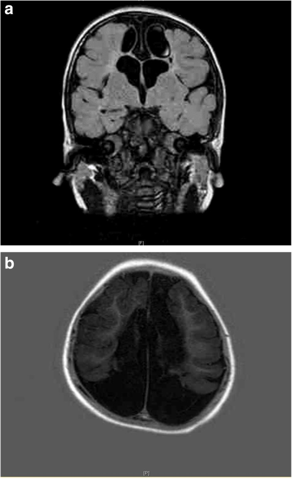
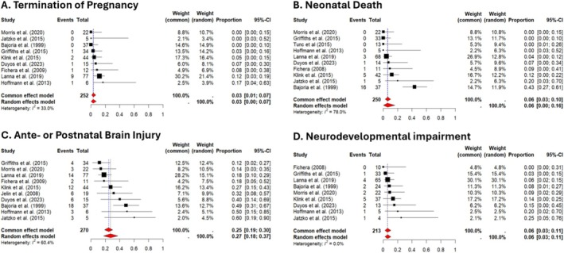

# 1636 — Theo dõi thần kinh dài hạn sau một thai chết trong song thai một bánh nhau / Long-term neurodevelopmental follow-up after single fetal demise in monochorionic twins

**Tags:** `pattern:mot-thai-chet` `pattern:ton-thuong-chat-trang` `vung:nao-thai` `vung:thai-nhi` `score:Bayley-III` `score:CP-2-nam` `protocol:MRI-thai` `protocol:MRI-term-equivalent`
**Mức chắc chắn (certainty):** tổng hợp y văn (literature synthesis) — phân tích gộp 13 nghiên cứu/311 trẻ sống sót (PMC12884211), đoàn hệ 68 thai một bánh nhau có một thai chết (PMC10378013) và hướng dẫn ISUOG 2025 (PMC11788470); ảnh minh họa từ ca báo cáo có bản quyền mở (PMC6712839) và biểu đồ gộp của PMC12884211, không phải ca của nhóm biên soạn.

## 1. Tổng quan bệnh học – cơ chế hình ảnh

### 1.1. "Cú đánh kép" giải thích mọi hình ảnh

- Trong song thai một bánh nhau (monochorionic — MC), hai thai chung một tuần hoàn qua các miệng nối bánh nhau. Khi một thai chết, huyết áp của thai chết tụt về 0; **máu từ thai còn sống bị hút sang thai chết** qua các miệng nối lớn (động mạch–động mạch, tĩnh mạch–tĩnh mạch) trong vài phút.
- Thai còn sống bị **giảm tưới máu não cấp (acute hypoperfusion)** → tổn thương thiếu máu–thiếu oxy. Đây là **cú đánh thứ nhất**, xảy ra ngay tại thời điểm thai chết, thường **trước khi** bất kỳ hình ảnh nào xuất hiện.
- **Cú đánh thứ hai:** thai còn sống thường được sinh sớm vì lo ngại (hoặc vì chuyển dạ), nên phơi nhiễm thêm tổn thương chất trắng non tháng (bệnh não sinh non) và biến chứng sơ sinh.
- Vì vậy tổn thương não gồm hai nhóm chồng lấp: **nhồi máu/hoại tử vỏ–dưới vỏ do huyết động** và **bệnh lý chất trắng quanh não thất do non tháng**. Điều này giải thích vì sao trẻ có tổn thương não thường sinh rất non: tuổi thai sinh trung vị **29 tuần** ở nhóm có tổn thương não so với **36 tuần** ở toàn bộ nhóm sống sót (PMC12884211).

### 1.2. Vì sao MRI — vật lý và thời điểm

- **Siêu âm thóp (cranial ultrasound):** phát hiện tốt nhồi máu lớn, xuất huyết não thất, giãn não thất; nhưng **bỏ sót tổn thương chất trắng nhỏ và vỏ não**.
- **MRI:** nhạy hơn nhờ phân biệt mô theo thời gian T1/T2 và **khuếch tán (DWI/ADC)**:
  - **DWI sáng + ADC giảm** = phù độc tế bào (cytotoxic edema) — tổn thương **cấp**, xuất hiện trong vài giờ đến vài ngày.
  - Sau **1–2 tuần**, DWI có thể **bình thường hóa giả (pseudonormalization)** trong khi mô đã chết → **MRI quá sớm hoặc quá muộn đều dễ đọc âm**.
  - **T2/FLAIR sáng, T1 tối** ở vùng chất trắng quanh não thất = **nhuyễn hóa chất trắng quanh não thất (cystic periventricular leukomalacia, cPVL)**; nhiều nang lớn thông nhau vỏ–dưới vỏ = **nhuyễn não đa nang (multicystic encephalomalacia)**.
- **Thời điểm chụp có căn cứ:** MRI thai **2–4 tuần sau khi một thai chết** (hoặc sớm hơn nếu siêu âm bất thường) — đây là khung được 92% (12/13) nghiên cứu trong phân tích gộp sử dụng (PMC12884211); ISUOG khuyến cáo hình ảnh não thai còn lại **4–6 tuần sau khi thai kia chết** (PMC11788470). Sau sinh, **MRI ở tuổi tương đương đủ tháng (term-equivalent age, khoảng 40 tuần tuổi sau sinh hiệu chỉnh)** là mốc chuẩn để tiên lượng.

### 1.3. Ngưỡng định lượng phải nhớ

- **Trẻ sống sót sau một thai chết (gộp):** **311** trẻ, 13 nghiên cứu (PMC12884211).
- **Tổn thương não (trước hoặc sau sinh):** **27%** (KTC 95% **18–37%**); trong đó **trước sinh 13%** (34/270) và **sau sinh 6%** (16/270) (PMC12884211).
- **Chấm dứt thai kỳ (TOP):** **3%** (KTC 95% **0–7%**); **chết sơ sinh (NND):** **6%** (KTC 95% **0–16%**) (PMC12884211).
- **Khiếm khuyết phát triển thần kinh (NDI):** **6%** (KTC 95% **3–11%**); ở trẻ **có** tổn thương não, khoảng **2/3** có di chứng (31% bại não, 31% NDI không đặc hiệu, 38% không di chứng) (PMC12884211).
- **Tuổi thai sinh khi có tổn thương não:** trung vị **29 tuần** (IQR 27,7–34,1) so với **36 tuần** (IQR 32,3–37,0) ở toàn bộ nhóm sống sót (PMC12884211).
- **Đoàn hệ đơn trung tâm:** tổn thương não **20,6%** (14/68); nguy cơ tăng **OR 1,21** mỗi tuần tuổi thai lúc thai chết (KTC 95% 1,04–1,41); tăng **OR 9,27** khi trẻ sống sót bị thiếu máu (KTC 95% 1,50–57,12); sinh non < 37 tuần **61,7%** (37/60) (PMC10378013).

- **Lưu ý phiên bản:** đây là số liệu **sau khi loại trừ** các thai đã laser, TRAP, TAPS, dị tật và đa thai bậc cao (PMC12884211) — không áp dụng nguyên vẹn cho thai TTTS đã laser; với nhóm đó, dùng thêm số liệu của bài 1611.

## 2. Mẫu hình + chẩn đoán phân biệt theo vị trí (gamut)

### 2.1. Gamut tổn thương não theo **vị trí** trên MRI

- **Quanh não thất (periventricular):** cPVL — ổ tăng tín hiệu T2/FLAIR, giảm T1, dạng nang ở góc não thất; hay gặp ở trẻ non tháng, tổn thương do thiếu máu tưới máu vùng phân thủy.
- **Chất trắng sâu/bán bầu dục (deep white matter):** nhuyễn hóa chất trắng không đặc hiệu, mất thể tích, giãn não thất **ex vacuo**.
- **Vỏ–dưới vỏ (cortical/subcortical):** **nhuyễn não đa nang** — nhiều nang thông nhau, mất vỏ não, thường sau nhồi máu lan rộng; tiên lượng nặng, bại não.
- **Nhân xám trung ương (basal ganglia/thalamus):** tổn thương do thiếu máu cấp tính nặng (kiểu "HIE") — T1 sáng/T2 tối ở giai đoạn bán cấp.
- **Não thất:** xuất huyết não thất (IVH) ở trẻ non tháng, giãn não thất do tắc nghẽn hoặc do mất mô.
- **Vỏ não bất thường phát triển (cortical malformation):** hiếm, do tổn thương sớm trong thai — phân biệt với dị tật bẩm sinh thật.

### 2.2. Gamut theo **thời điểm** so với lúc thai chết

1. **0–7 ngày:** siêu âm có thể bình thường; MRI thấy **hạn chế khuếch tán** ở vùng tưới máu bị tổn thương.
2. **1–4 tuần:** tổn thương rõ dần, có thể thấy phù, mất phân biệt vỏ–chất trắng; đây là **cửa sổ tốt để MRI thai**.
3. **Sau sinh, tuổi tương đương đủ tháng:** nang hóa, mất thể tích, giãn não thất ex vacuo — **hình thái cuối** dùng để tiên lượng.
4. **18–24 tháng:** đánh giá phát triển bằng công cụ chuẩn (Bayley-III), chẩn đoán bại não khi ≥ 2 tuổi.

## 3. Bảng so sánh phân biệt (ma trận đối chiếu)

| Thực thể (entity) | Hình ảnh điển hình (MRI/US) | Chốt vào (rule-in) | Chốt loại (rule-out) | Gợi ý xác nhận |
|---|---|---|---|---|
| Tổn thương sau một thai chết (sFD) | Nhồi máu vỏ–dưới vỏ, cPVL, nhuyễn não đa nang; **tiền sử một thai chết** | **Có một thai chết trong song thai MC + tổn thương não thai còn lại** | Không có tiền sử thai chết, không có bất thường bánh nhau → nghĩ nguyên nhân khác | Siêu âm thóp + MRI 2–4 tuần sau sFD; đối chiếu bánh nhau |
| Bệnh não thiếu máu–thiếu oxy (HIE) ở trẻ đủ tháng | Nhân xám trung ương, vỏ não theo vùng mạch, phù lan tỏa | **Tiền sử ngạt chu sinh, pH máu rốn thấp, tổn thương nhân xám** | Có một thai chết + tổn thương đa nang vỏ → nghĩ sFD | MRI sớm (DWI), bệnh sử sinh |
| cPVL do non tháng | Nang quanh não thất, giảm thể tích chất trắng, giãn não thất | **Sinh < 32 tuần + nang quanh não thất** | Tổn thương vỏ lan rộng + tiền sử sFD → nghĩ sFD | Siêu âm thóp sàng lọc, MRI ở tuổi đủ tháng |
| Nhiễm trùng bào thai (CMV, toxo) | Vôi hóa quanh não thất (CMV), vôi hóa rải rác (toxo), giãn não thất, mỏng vỏ | **Vôi hóa + bất thường gan lách/thính lực, huyết thanh dương** | Không vôi hóa, có tiền sử một thai chết → ít nghĩ | PCR dịch ối/huyết thanh, siêu âm thai |
| Bất thường phát triển vỏ não | Rãnh/gyrus bất thường, vỏ dày, đảo ngược chất xám | **Bất thường đối xứng, không theo vùng mạch** | Tổn thương không đối xứng theo mạch máu → nghĩ mắc phải | MRI thai chuyên sâu, tư vấn di truyền |
| Giãn não thất do tắc nghẽn | Giãn não thất **không tương xứng mất mô**, bờ não thất căng | **Giãn tiến triển + đầu to + bờ căng** | Giãn ex vacuo (mất mô xung quanh) → không đặt shunt | Siêu âm chuỗi, MRI, đo vòng đầu |

### 3.1. Ba câu hỏi chốt

1. **Có tiền sử một thai chết trong song thai MC không?** Có → mọi tổn thương não của trẻ còn sống phải quy về cú đánh huyết động trước hết.
2. **Tổn thương có theo vùng mạch và bất đối xứng không?** Có → mắc phải (nhồi máu); đối xứng → nghĩ bất thường phát triển hoặc chuyển hóa.
3. **Trẻ sinh ở tuổi thai nào?** < 32 tuần → phần lớn tổn thương chất trắng có thể do non tháng, không quy hết cho sFD.

## 4. Protocol chụp + hệ phân độ/điểm chuẩn hóa

### 4.1. Lịch theo dõi sau khi một thai chết

- **Ngay khi chẩn đoán:** siêu âm đánh giá thai còn sống (Doppler UA, MCA-PSV, DV), loại trừ thiếu máu cấp; **không sinh ngay** chỉ vì có một thai chết — tổn thương thường đã xảy ra trước khi chẩn đoán, sinh sớm chỉ thêm tổn thương non tháng (PMC12884211, PMC11788470).
- **2–4 tuần sau:** **MRI thai** (hoặc siêu âm thần kinh thai nếu chưa có MRI) — tìm nhồi máu, cPVL, xuất huyết, giãn não thất.
- **Thời gian còn lại:** theo dõi tăng trưởng + Doppler UA/MCA **mỗi 2–4 tuần**; cân nhắc sinh **34–36 tuần** sau corticosteroid (PMC11788470).
- **Sau sinh:** siêu âm thóp **ngày 3–7** và **trước xuất viện**; **MRI não ở tuổi tương đương đủ tháng (khoảng 40 tuần hiệu chỉnh)** nếu có bất thường hoặc trẻ non tháng.
- **Theo dõi dài hạn:** **Bayley-III (hoặc Griffiths) lúc 24 tháng hiệu chỉnh (nhiều trung tâm dùng 18–24 tháng)**; khám thần kinh phát triển mỗi 6–12 tháng; **chẩn đoán bại não ở ≥ 2 tuổi**; **đo thính lực** sơ sinh và nhắc lại; theo dõi động kinh; can thiệp sớm (vật lý trị liệu, ngôn ngữ) ngay khi phát hiện chậm.

### 4.2. Phân độ tổn thương để tiên lượng

- **Nhẹ:** cPVL khu trú 1–2 ổ nhỏ, không giãn não thất, không tổn thương vỏ → nguy cơ NDI thấp; theo dõi phát triển.
- **Trung bình:** cPVL lan rộng, giãn não thất nhẹ–trung bình, mất thể tích chất trắng → nguy cơ chậm vận động/nhận thức; can thiệp sớm.
- **Nặng:** nhuyễn não đa nang, nhồi máu lan rộng, tổn thương nhân xám hai bên, giãn não thất nặng → nguy cơ bại não và động kinh cao; tư vấn tiên lượng thận trọng, lập kế hoạch chăm sóc.
- **Lưu ý:** không có hệ phân độ quốc tế riêng cho "tổn thương sau sFD"; dùng mô tả hình thái + mức lan tỏa, không gán điểm giả.

## 5. Biến thể bình thường và cạm bẫy

- **"Thai chết sớm" (vanishing twin) khác hoàn toàn:** một thai chết trong **tam cá nguyệt I** ở song thai hai bánh nhau thường không để lại tổn thương não; nguy cơ chủ yếu thuộc **song thai một bánh nhau chết sau 14 tuần** (PMC12884211, PMC10378013).
- **Siêu âm thóp sớm bình thường không loại trừ:** cPVL dạng nang chỉ thấy sau **3–4 tuần**; MRI sớm quá có thể bỏ sót vì DWI chưa dương hoặc đã pseudonormalization.
- **DWI "bình thường giả":** sau 1–2 tuần, ADC có thể trở về bình thường trong vùng đã hoại tử — luôn đọc kèm T2/FLAIR và so sánh hai bên.
- **Giãn não thất ex vacuo không phải não úng thủy:** không đặt shunt chỉ vì não thất giãn; đo áp lực/đầu to/bờ não thất căng mới quyết định.
- **Quy kết quá mức cho non tháng:** trẻ sinh 28 tuần có cPVL có thể do bệnh não sinh non, không phải do cái chết của thai kia — hỏi kỹ diễn biến sơ sinh (thở máy, nhiễm trùng, tụt huyết áp).
- **Tư vấn quá bi quan:** tổn thương não **không đồng nghĩa** bại não; 38% trẻ có tổn thương não trong phân tích gộp không có di chứng dài hạn được ghi nhận (PMC12884211). Ngược lại, **NDI có thể xảy ra khi hình ảnh bình thường** — phải theo dõi phát triển, không chỉ dựa MRI.
- **Cạm bẫy "một lần khám":** bại não chỉ chẩn đoán chắc ở **≥ 2 tuổi**; trước đó dùng "chậm phát triển vận động" và theo dõi.

## 6. Tự lượng giá — Blind Quiz

**Ca 1 — trẻ có tiền sử một thai chết, chậm phát triển**

- Gợi ý lâm sàng: trẻ sinh từ thai kỳ đa thai một bánh nhau có một thai chết sớm, sau đó xuất hiện truyền máu giữa các thai; hiện chậm phát triển, đầu nhỏ.
- Câu hỏi: (1) Mô tả bất thường trên T2-FLAIR và T1. (2) Chẩn đoán hình ảnh? (3) Ba yếu tố cần có để quy kết tổn thương cho "một thai chết"?

<b>Bấm để hiện đáp án (findings + chẩn đoán)</b>

- Dấu hiệu: (a) ảnh T2-FLAIR trục — mất lan rộng nhu mô trên lều, nhiều khoang nang thông nhau, giãn não thất; (b) ảnh T1 trục — vùng giảm tín hiệu tương ứng mô đã hoại tử, đầu nhỏ.
- Chẩn đoán: **nhuyễn não đa nang (multicystic encephalomalacia)** sau tổn thương thiếu máu–thiếu oxy chu sinh, phù hợp với tiền sử đa thai một bánh nhau có một thai chết và truyền máu giữa các thai.
- Ba yếu tố quy kết: (1) song thai **một bánh nhau** có một thai chết; (2) tổn thương não thai còn lại xuất hiện **sau** thời điểm đó; (3) loại trừ nguyên nhân khác (nhiễm trùng, dị tật, chuyển hóa, ngạt chu sinh độc lập).
- Phản biện: ca gốc là **song thai ba một bánh nhau**, một thai chết sớm + TTTS — không phải ca sFD điển hình; dùng để minh họa hình thái cuối, không dùng để suy ra tần suất.
- Nguồn ảnh: So PL, Li KW, Yeung TW, Sin WK. *BMC Pregnancy Childbirth* 2019, PMC6712839, CC BY 4.0.

**Ca 2 — tư vấn sau khi có kết quả gộp**

- Gợi ý lâm sàng: bố mẹ hỏi "nếu giữ thai, con có bị ảnh hưởng não không?".
- Câu hỏi: (1) Đọc bốn tỷ lệ gộp. (2) Vì sao tổn thương não cao hơn NDI nhiều lần? (3) Câu tư vấn nào đúng?

<b>Bấm để hiện đáp án (findings + chẩn đoán)</b>

- Bốn tỷ lệ gộp: **TOP 3%** (0–7%), **chết sơ sinh 6%** (0–16%), **tổn thương não 27%** (18–37%), **NDI 6%** (3–11%).
- Vì sao lệch: tổn thương não trên hình ảnh **không đồng nghĩa** di chứng chức năng; ~2/3 trẻ có tổn thương não có NDI, 1/3 không di chứng; ngược lại một số trẻ NDI không có tổn thương rõ.
- Tư vấn đúng: "Khoảng 1/4 trẻ có tổn thương não trên hình ảnh; khoảng 1/20 có di chứng phát triển dài hạn, và phần lớn trẻ có tổn thương não vẫn có thể theo học/hòa nhập ở mức nào đó — cần theo dõi phát triển đến 2 tuổi và can thiệp sớm."
- Nguồn số liệu: Rondagh M và cộng sự, *BJOG* 2026, PMC12884211, CC BY 4.0.

**Ca 3 — lịch theo dõi**

- Gợi ý lâm sàng: thai 26 tuần, song thai một bánh nhau, một thai chết tuần 25; thai còn lại Doppler bình thường, không thiếu máu.
- Câu hỏi: Kế hoạch hình ảnh và theo dõi sau sinh trong 2 năm?

<b>Bấm để hiện đáp án (findings + chẩn đoán)</b>

- Trong thai: theo dõi tăng trưởng + Doppler UA/MCA mỗi 2–4 tuần; **MRI thai 2–4 tuần sau** (tức khoảng 27–29 tuần) hoặc siêu âm thần kinh thai; cân nhắc sinh 34–36 tuần sau corticosteroid.
- Sau sinh: siêu âm thóp ngày 3–7 và trước xuất viện; **MRI ở tuổi tương đương đủ tháng**; đo thính lực; khám thần kinh mỗi 6–12 tháng; **Bayley-III ở 24 tháng hiệu chỉnh**; chẩn đoán bại não ở ≥ 2 tuổi; can thiệp sớm nếu chậm.
- Không sinh ngay chỉ vì một thai chết khi thai còn lại ổn định — sinh non là "cú đánh thứ hai" (PMC12884211).
- Nguồn: PMC12884211, PMC10378013, PMC11788470.

## Bài liên quan chéo
- [588 – Một thai chết trong song thai một ối (MCMA): tổn thương não–thận cấp](../588-song-thai-MCMA-mot-thai-chet/lesson.md)
- [566 – Song thai: xác định màng đệm–màng ối & TTTS/TAPS](../566-song-thai-chorionicity-TTTS-TAPS/lesson.md)
- [1611 – TTTS tái phát sau laser: chẩn đoán lại và laser lần 2](../1611-ttts-tai-phat-sau-laser/lesson.md)
- [655 – HIE sơ sinh và di chứng bẩm sinh thần kinh](../655-hie-so-sinh-va-di-dang-bam-sinh-than-kinh/lesson.md)

## Ảnh
- `images/1636_mot-thai-chet_MRI_PMC6712839-Fig3.jpg` — MRI nhuyễn não đa nang (PMC6712839, CC BY 4.0).
- `images/1636_mot-thai-chet_Forest_PMC12884211-Fig3.jpg` — biểu đồ gộp TOP/NND/tổn thương não/NDI (PMC12884211, CC BY 4.0).
- Nguồn và giấy phép chi tiết: `images/CREDITS.md`; nguồn học thuật: `sources.md`.

> Không dùng để chẩn đoán độc lập khi chưa có người hướng dẫn.
