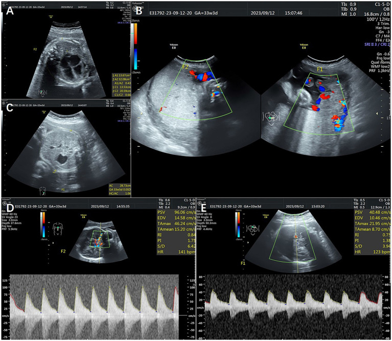
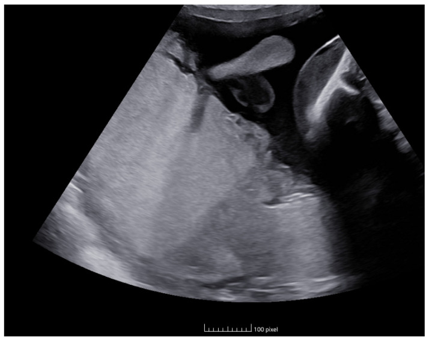
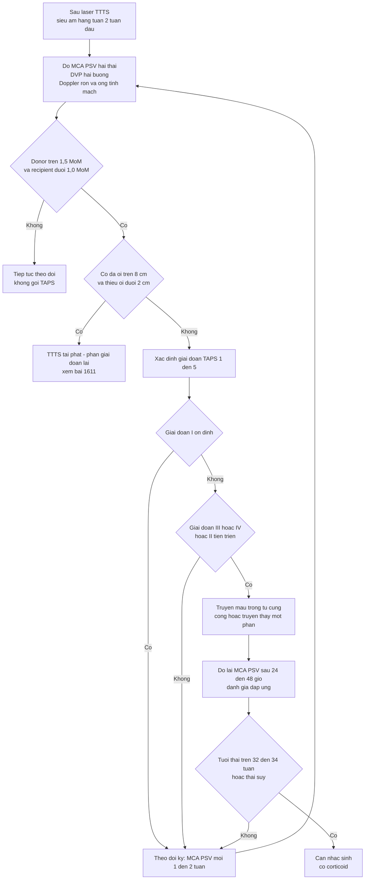
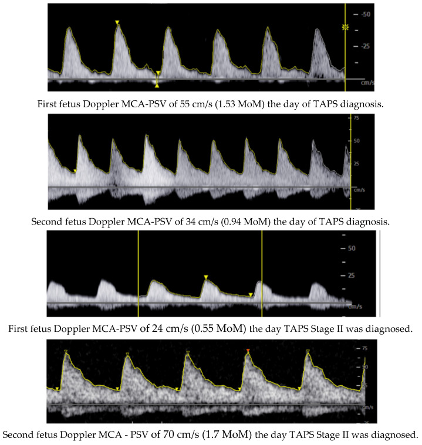

# 1637 — TAPS sau laser TTTS: MCA-PSV, phân độ 1–5 & khi nào truyền máu trong tử cung / Post-laser twin anemia–polycythemia sequence

**Tags:** `pattern:taps` `pattern:lech-mca-psv` `pattern:thai-thieu-mau` `pattern:thai-da-hong-cau` `vung:thai-nhi` `vung:banh-nhau` `score:TAPS` `protocol:SA-Doppler-MCA` `protocol:truyen-mau-trong-tu-cung`
**Mức chắc chắn (certainty):** tổng hợp y văn (literature synthesis) — số liệu từ sổ bộ TAPS quốc tế **164 ca sau laser** (PMC7355738) và **370 ca** (PMC7497010), đoàn hệ tổn thương não 256 trẻ (PMC13040136), nghiên cứu tiền cứu về tiêu chuẩn chẩn đoán (PMC7563169), nghiên cứu tiền cứu về dấu hiệu phụ (PMC7496878); ca nguyên văn dùng cho quiz: PMC11433027 (Fortún Agud M và cộng sự, 2024).

## 1. Tổng quan bệnh học – cơ chế hình ảnh

### 1.1. Vì sao "truyền máu chậm" không gây đa ối–thiểu ối

- Bánh nhau một bánh nhau (monochorionic) luôn có các **miệng nối mạch máu**. TTTS do **miệng nối lớn** (động mạch–tĩnh mạch, đường kính ~2–3 mm) truyền **thể tích** nhanh → thai nhận đa ối, thai cho thiểu ối (bài 566, 1611).
- **TAPS do miệng nối rất nhỏ (< 1 mm, chủ yếu 1 chiều)** truyền **hồng cầu** từ từ qua nhiều tuần: thai cho mất hồng cầu → **thiếu máu + tăng hồng cầu lưới (reticulocytosis)**; thai nhận **đa hồng cầu**. Vì **thể tích huyết tương thay đổi chậm**, **không có cặp đa ối–thiểu ối** — đây là điểm khác biệt cốt lõi trên siêu âm.
- **Sau laser:** đốt hết miệng nối lớn nhưng còn **miệng nối nhỏ tồn dư** hoặc **tái thông** → TAPS sau laser. Đốt theo **Solomon** (đốt cả đường xích đạo) giảm tái phát/TAPS còn **4,2%** so với **18,1%** khi đốt chọn lọc (bài 1611).
- **Tần suất:** "tới **13%**" theo ISUOG 2025 (PMC11788470); **6,4%** trong đoàn hệ TTTS sớm (PMC13040126); trong sổ bộ **164 ca sau laser**, **92% chẩn đoán trước sinh**, **8% chỉ phát hiện sau sinh** (PMC7355738).
- **Thời điểm xuất hiện:** trung vị **14 ngày sau laser (IQR 7–28; khoảng 1–119 ngày)** — nghĩa là **2 tuần đầu là cửa sổ bắt buộc** phải đo MCA-PSV hai thai (PMC7355738).

### 1.2. Vì sao MCA-PSV phản ánh huyết sắc tố

- Thiếu máu → **độ nhớt máu giảm** + **cung lượng tim tăng** để bù oxy → **vận tốc đỉnh tâm thu động mạch não giữa (MCA-PSV) tăng**. Đa hồng cầu → độ nhớt tăng → **MCA-PSV giảm**.
- Vì vậy MCA-PSV là **đại lượng thay thế cho hemoglobin**, biểu diễn dưới dạng **bội số trung vị (multiples of the median, MoM)** theo tuổi thai — không dùng cm/s thô để so sánh giữa hai thai khác tuổi.
- **Định lượng phải nhớ:**
  - Thai cho (donor): **MCA-PSV > 1,5 MoM**.
  - Thai nhận (recipient): **< 1,0 MoM** (giai đoạn I), **< 0,8 MoM** (giai đoạn II).
  - **Chênh lệch (delta) > 0,5 MoM** là tiêu chuẩn bổ sung; ngưỡng **Δ > 0,373 MoM** làm **tăng gấp ~3 lần số ca được gọi TAPS** (19,2% so với 6,3% theo tiêu chuẩn Delphi) (PMC7563169).
- **Chẩn đoán xác định sau sinh:** **chênh hemoglobin giữa hai thai > 8,0 g/dL** *kèm* **tỉ lệ hồng cầu lưới > 1,7** (PMC7355738) — thiếu một trong hai thì phải loại trừ nguyên nhân thiếu máu khác (miễn dịch, nhiễm parvovirus B19, truyền máu thai–mẹ).

## 2. Mẫu hình + chẩn đoán phân biệt theo vị trí (gamut)

### 2.1. Gamut "MCA-PSV lệch sau laser" — theo thứ tự phải loại trừ

1. **TAPS sau laser thật:** donor **> 1,5 MoM**, recipient **≤ 1,0 MoM** (hoặc **< 0,8** nếu giai đoạn II), **không** đa ối–thiểu ối; bánh nhau **hai màu/thickness khác nhau**, thai cho **tim to**, thai nhận **gan "trời sao"**.
2. **TTTS tái phát:** có **cặp DVP ≥ 8 cm / ≤ 2 cm**, bàng quang thai cho không thấy; MCA-PSV có thể lệch nhưng **không phải tiêu chuẩn chính** (bài 1611).
3. **sFGR / bất tương xứng tăng trưởng:** chênh cân nặng ≥ 25%, Doppler rốn bất thường, MCA-PSV thường bình thường hoặc tăng do thiếu oxy (không giảm ở thai kia).
4. **Thiếu máu miễn dịch (Rh/ABO) hoặc nhiễm parvovirus B19:** **cả hai thai** có thể thiếu máu, không có bánh nhau một bánh nhau/hai màu; tiền sử mẹ, kháng thể bất thường, IgM parvovirus.
5. **Đa hồng cầu thai nhận do truyền máu thai–thai cấp** (sau chết một thai, thủ thuật): bối cảnh cấp, thường kèm biến cố.
6. **Lỗi đo MCA-PSV:** góc > 15°, đo khi thai thở, nhịp tim bất thường, đặt cửa sổ sai vị trí → **lệch giả**.

### 2.2. Mẫu hình "đọc đúng ca TAPS"

- **Đúng bệnh:** MCA-PSV **một cao – một thấp** (chênh > 0,5 MoM), ối **bình thường hai bên**, bánh nhau **khác màu/độ dày**, thai cho **tim to** (chỉ số tim–ngực tăng), thai nhận **gan tăng âm lan tỏa**.
- **Sai bệnh:** chỉ có đa ối–thiểu ối (TTTS); chỉ có chênh cân nặng (sFGR); MCA-PSV lệch nhẹ < 0,5 MoM (biến thể, không gọi TAPS).
- **Mẹo nhớ 3 dấu hiệu phụ:** **BÁNH (dichotomy 44%) — TIM (cardiomegaly 70%) — GAN (starry-sky 66%)** (PMC7496878).

*Các dấu hiệu phụ trong TAPS: (A) **tim to** với chỉ số tim–ngực 0,66 ở thai cho; (C) **gan "trời sao"** (tăng âm lan tỏa) ở thai nhận; (D, E) **MCA-PSV** hai thai. Nguồn: Zhang Y và cộng sự, Front Med (Lausanne) 2024, PMC11810567, CC BY 4.0 — ảnh nguyên bản, không crop.*

*Bánh nhau "hai màu" (placental dichotomy) trong TAPS: vùng của thai thiếu máu và vùng của thai đa hồng cầu khác độ hồi âm/độ dày. Nguồn: Fortún Agud M và cộng sự, Life (Basel) 2024, PMC11433027, CC BY 4.0 — ảnh nguyên bản, không crop.*

## 3. Bảng so sánh phân biệt (ma trận đối chiếu)

| Thực thể (entity) | Hình ảnh điển hình (siêu âm/Doppler) | Chốt vào (rule-in) | Chốt loại (rule-out) | Gợi ý xác nhận |
|---|---|---|---|---|
| **TAPS sau laser** | MCA-PSV donor **> 1,5 MoM**, recipient **< 1,0 MoM**; ối bình thường; bánh nhau hai màu | **Chênh MCA-PSV > 0,5 MoM, hai thai, ối bình thường** | Có cặp DVP ≥ 8 cm/≤ 2 cm → TTTS tái phát, không phải TAPS đơn thuần | Đo lại 3–7 ngày; sau sinh ΔHb > 8 g/dL + reticulocyte ratio > 1,7 |
| TTTS tái phát | **Đa ối ≥ 8 cm + thiểu ối ≤ 2 cm**, bàng quang thai cho không thấy | **Cặp ngưỡng ối + bàng quang không thấy** | Ối bình thường hai bên | DVP hai buồng, Quintero/Delphi 2025 (bài 1611) |
| sFGR | Chênh EFW ≥ 25%, Doppler rốn bất thường, ối lệch nhẹ | **Chênh cân nặng + Doppler rốn, không đủ tiêu chuẩn ối** | MCA-PSV donor > 1,5 MoM + recipient < 1,0 MoM → TAPS | EFW, UA Doppler, theo dõi tăng trưởng |
| Thiếu máu miễn dịch / parvovirus | Cả hai thai MCA-PSV cao, có thể phù; bánh nhau bình thường | **Cả hai > 1,5 MoM + kháng thể mẹ/IgM parvovirus** | Chỉ một thai cao, thai kia < 1,0 MoM | Kháng thể bất thường, PCR parvovirus, siêu âm gan/lách |
| Đa hồng cầu do truyền máu cấp | Thai nhận MCA-PSV rất thấp, có thể suy tim; bối cảnh chết một thai | **Biến cố cấp + MCA-PSV thấp đột ngột** | Chênh mạn tính, ối bình thường | Bối cảnh lâm sàng, Hb sau sinh |
| Lỗi đo MCA-PSV | Góc Doppler > 15°, đo khi thai thở, nhịp tim bất thường | **Sửa góc/vị trí và đo lại → lệch biến mất** | Lệch tái lập được trên 3 lần đo chuẩn | Đo lại đúng kỹ thuật (mục 4.1) |

### 3.1. Ba câu hỏi chốt trong 30 giây

1. **Có đa ối–thiểu ối không?** Có → nghĩ TTTS tái phát trước, TAPS chỉ là hàng thứ hai.
2. **MCA-PSV hai thai lệch bao nhiêu MoM?** > 0,5 MoM + một thai > 1,5 MoM → TAPS.
3. **Có dấu hiệu nặng chưa?** Tim thai cho suy (giai đoạn III) hoặc phù (IV) → phải can thiệp, không chờ.

## 4. Protocol chụp + hệ phân độ

### 4.1. Kỹ thuật đo MCA-PSV (sai số quyết định chẩn đoán)

- Mặt cắt ngang đầu thai tại **đa giác Willis**, phóng to, **động mạch não giữa gần nguồn (trong 1 cm đầu)**; cửa sổ Doppler **1–2 mm**; **góc ≤ 15°** (lý tưởng 0°).
- Đo **3 lần liên tiếp khi thai không thở/không cử động**, lấy **giá trị cao nhất**; ghi **cm/s và MoM**; cùng một người đo khi có thể.
- **Lịch sau laser:** **hàng tuần trong 2 tuần đầu** (cửa sổ TAPS trung vị 14 ngày), sau đó **mỗi 2 tuần** đến khi sinh; mỗi lần đo **cả hai thai** + DVP hai buồng + bàng quang + Doppler rốn/ống tĩnh mạch.
- **Sau 24 tuần:** thêm tăng trưởng, cổ tử cung, dấu hiệu sinh non.

### 4.2. Phân độ TAPS (Slaghekke – Tollenaar)

| Giai đoạn | Tiêu chuẩn trước sinh | Ý nghĩa |
|---|---|---|
| **I** | Donor **> 1,5 MoM**, recipient **< 1,0 MoM**; không dấu hiệu khác | Thiếu máu mạn, chưa suy tim |
| **II** | Thêm recipient **< 0,8 MoM** | Đa hồng cầu rõ ở thai nhận |
| **III** | Thêm **suy tim thai cho**: mất/thu đảo dòng cuối tâm trương động mạch rốn, ống tĩnh mạch đập theo nhịp tim, đảo sóng a, hở van ba lá | Bắt đầu có tổn thương cơ tim |
| **IV** | **Phù thai (hydrops)** | Nguy cơ tử vong cao, chỉ định can thiệp |
| **V** | **Chết một/hai thai** | Kết cục xấu nhất |

- **Chẩn đoán sau sinh:** **ΔHb > 8,0 g/dL** + **tỉ lệ hồng cầu lưới > 1,7** (PMC7355738).
- **Lưu ý:** phân độ **có thể thoái lui** hoặc nhảy bậc; **không tuyến tính** (ca PMC11433027 từ giai đoạn I tiến II trong vài tuần).

### 4.3. Lựa chọn xử trí và kết cục (sổ bộ quốc tế)

- **164 ca sau laser (PMC7355738):** theo dõi **43%**, **truyền máu trong tử cung ± truyền thay một phần 29%**, **laser lần 2 15%**, **giảm thai chọn lọc 7%**, **sinh ngay 6%**, chấm dứt thai kỳ **1%**.
- **Kết cục:** tuổi thai sinh trung vị **31,7 tuần (IQR 28,6–33,7)**; **tử vong chu sinh 25% (83/327)** — **thai cho 37% (61/164)** so với **thai nhận 14% (22/163)**; **giai đoạn IV: OR 3,4 (1,4–26,0)**; **là thai cho: OR 4,2 (2,1–8,3)**; bệnh nặng sơ sinh gắn với tuổi thai sinh **OR 1,5 mỗi tuần**.
- **370 ca (PMC7497010):** tử vong chu sinh **17–18%** ở nhóm theo dõi/laser/truyền máu, **10%** khi sinh ngay; bệnh nặng sơ sinh **31–49%** tùy nhóm — **không có chiến lược nào vượt trội rõ**, nên chọn theo giai đoạn, tuổi thai và kinh nghiệm trung tâm.
- **Thần kinh:** tổn thương não **16,8% (43/256)**, **93% xuất hiện sau sinh**, nặng **7,4%**; không khác giữa TAPS tự phát **13,5%** và sau laser **21,3%** (p = 0,1); tuổi thai sinh là yếu tố nguy cơ độc lập **OR 1,31 mỗi tuần** (KTC 1,15–1,50) (PMC13040136). Báo cáo cũ: **NDI nặng 9%**.
- **Ngưỡng can thiệp thực hành:** truyền máu trong tử cung khi **giai đoạn III–IV** hoặc **II tiến triển nhanh**; một số trung tâm truyền máu sớm khi MCA-PSV donor rất cao kèm dấu hiệu suy tim. **Chưa có ngưỡng Hb tuyệt đối thống nhất** — ghi rõ "chưa rõ" thay vì bịa số.

## 5. Biến thể bình thường và cạm bẫy

- **ΔPSV làm tăng chẩn đoán quá mức:** dùng Δ > 0,373 MoM cho **19,2%** ca được gọi TAPS, so với **7,8%** (tiêu chuẩn kinh điển) và **6,3%** (Delphi) (PMC7563169). Gọi TAPS sai → truyền máu/sinh non không cần thiết.
- **8% TAPS chỉ phát hiện sau sinh:** MCA-PSV bình thường một lần **không loại trừ**; nếu sau sinh chênh Hb > 8 g/dL + hồng cầu lưới > 1,7 vẫn là TAPS.
- **Tự thoái lui có thật:** trong sổ bộ, **5 bánh nhau không còn miệng nối** ở ca TAPS tự khỏi — theo dõi giai đoạn I ổn định là hợp lý, không can thiệp ngay.
- **Tim to ở thai CHO không phải bệnh tim:** cardiomegaly **70%** là phản ứng tăng cung lượng do thiếu máu; đừng chẩn đoán bệnh cơ tim.
- **Gan "trời sao" ở thai NHẬN:** hình ảnh tăng âm lan tỏa do đa hồng cầu/ứ máu — ngược trực giác với "gan thai bệnh".
- **Nhãn thai:** sau laser vai trò cho/nhận có thể đảo; luôn giữ **nhãn cố định** theo tim/tĩnh mạch rốn, không đổi theo "nhận/cho".
- **Không có đa ối–thiểu ối không loại trừ TAPS:** thiếu máu mạn không làm thay đổi thể tích ối — đây là điểm khác TTTS.
- **Lỗi kỹ thuật Doppler:** góc > 15°, thai thở, cửa sổ đặt sai → **lệch giả**; luôn đo lại trước khi can thiệp.

## 6. Tự lượng giá — Blind Quiz

**Ca 1 — MCA-PSV đổi trong 2 tuần**

- Gợi ý lâm sàng: song thai một bánh nhau, theo dõi sau laser; ối hai bên bình thường.
- Câu hỏi: (1) Đọc 4 phổ Doppler. (2) Chẩn đoán và giai đoạn? (3) Vì sao không gọi TTTS tái phát?

<b>Bấm để hiện đáp án (findings + chẩn đoán)</b>

- Dấu hiệu: ban đầu thai 1 **55 cm/s (1,53 MoM)** và thai 2 **34 cm/s (0,94 MoM)**; sau đó thai 1 **24 cm/s (0,55 MoM)** và thai 2 **70 cm/s (1,7 MoM)** — **đảo chiều** mức tưới máu não.
- Chẩn đoán: **TAPS sau laser, giai đoạn II** (donor > 1,5 MoM, recipient < 0,8 MoM); thai 1 là **recipient** (đa hồng cầu), thai 2 là **donor** (thiếu máu).
- Vì sao không TTTS tái phát: **không có cặp đa ối ≥ 8 cm/thiểu ối ≤ 2 cm** — TAPS chỉ làm lệch MCA-PSV.
- Nguồn ảnh: Fortún Agud M và cộng sự, *Life (Basel)* 2024, PMC11433027, CC BY 4.0.

**Ca 2 — bánh nhau "hai màu"**

- Gợi ý lâm sàng: song thai một bánh nhau, một thai MCA-PSV cao.
- Câu hỏi: (1) Mô tả bất thường bánh nhau. (2) Ba dấu hiệu phụ của TAPS và tần suất? (3) Dấu hiệu nào ở thai nào?

<b>Bấm để hiện đáp án (findings + chẩn đoán)</b>

- Dấu hiệu: bánh nhau **hai vùng khác độ hồi âm/độ dày** (placental dichotomy) — vùng của thai thiếu máu và vùng của thai đa hồng cầu.
- Ba dấu hiệu phụ: **dichotomy 44% (40/91)**, **tim to ở thai cho 70% (64/91)**, **gan "trời sao" ở thai nhận 66% (53/80)** (PMC7496878).
- Vì sao quan trọng: khi MCA-PSV ở ngưỡng mờ, các dấu hiệu này nâng hoặc hạ xác suất TAPS; nhưng **không thay thế MCA-PSV**.
- Nguồn ảnh: Fortún Agud M và cộng sự, *Life (Basel)* 2024, PMC11433027, CC BY 4.0.

**Ca 3 — quyết định truyền máu**

- Gợi ý lâm sàng: 27 tuần, 3 tuần sau laser; thai A MCA-PSV **1,9 MoM**, tim to, ống tĩnh mạch đập theo nhịp tim; thai B **0,6 MoM**; DVP 4,5 cm và 4,0 cm.
- Câu hỏi: (1) Giai đoạn TAPS? (2) Có chỉ định truyền máu trong tử cung không? (3) Nếu mẹ từ chối can thiệp thì theo dõi gì?

<b>Bấm để hiện đáp án (findings + chẩn đoán)</b>

- Giai đoạn: **TAPS giai đoạn III** (donor > 1,5 MoM + recipient < 0,8 MoM + **suy tim thai cho**: ống tĩnh mạch đập theo nhịp tim).
- Chỉ định: **có** — truyền máu trong tử cung ± truyền thay một phần cho thai cho; mục tiêu nâng Hb, giảm suy tim, kéo dài thai kỳ. Trong sổ bộ, **29%** ca sau laser được truyền máu (PMC7355738); tử vong chu sinh nhóm truyền máu **18%** (PMC7497010).
- Nếu từ chối: theo dõi **MCA-PSV 24–48 giờ/lần**, Doppler ống tĩnh mạch, phù thai, DVP; **corticosteroid** nếu nguy cơ sinh < 34 tuần; chuẩn bị sinh tại trung tâm có hồi sức sơ sinh. Tư vấn: tử vong chu sinh **25%**, thai cho **37%** (PMC7355738); tổn thương não **16,8%**, NDI nặng cũ **9%** (PMC13040136).
- Nguồn số liệu: PMC7355738, PMC7497010, PMC13040136, PMC7563169.

## Bài liên quan chéo
- [1611 – TTTS tái phát sau laser: chẩn đoán lại, phân giai đoạn Delphi 2025 & laser lần 2](../1611-ttts-tai-phat-sau-laser/lesson.md)
- [566 – Song thai: xác định màng đệm–màng ối & TTTS/TAPS](../566-song-thai-chorionicity-TTTS-TAPS/lesson.md)
- [1635 – Vỡ ối non tháng sau can thiệp bào thai](../1635-ro-oi-non-thang-sau-can-thiep-bao-thai/lesson.md)
- [587 – Dự phòng sinh non sau laser TTTS](../587-du-phong-sinh-non-sau-laser-TTTS/lesson.md)
- [1636 – Theo dõi thần kinh dài hạn sau một thai chết trong song thai một bánh nhau](../1636-theo-doi-than-kinh-sau-mot-thai-chet/lesson.md)

## Ảnh
- `images/1637_taps-sau-laser_US_PMC11433027-F1.jpg` — bánh nhau hai màu (PMC11433027, CC BY 4.0).
- `images/1637_taps-sau-laser_US_PMC11433027-F3.jpg` — diễn tiến MCA-PSV hai thai (PMC11433027, CC BY 4.0).
- `images/1637_taps-sau-laser_US_PMC11810567-F1.jpg` — tim to, gan "trời sao", MCA-PSV (PMC11810567, CC BY 4.0).
- Nguồn và giấy phép chi tiết: `images/CREDITS.md`; nguồn học thuật: `sources.md`.

> Không dùng để chẩn đoán độc lập khi chưa có người hướng dẫn.
