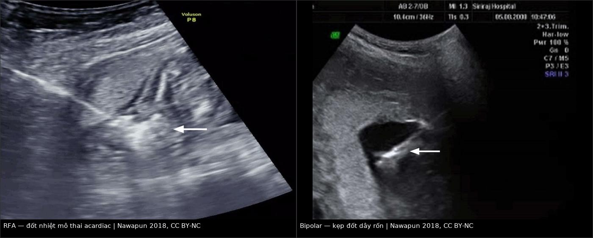
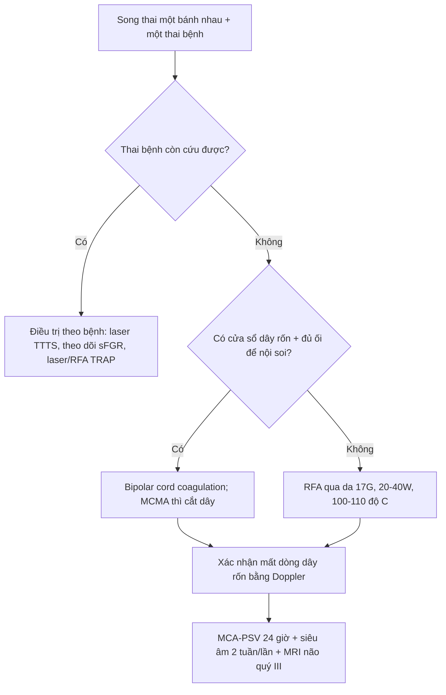
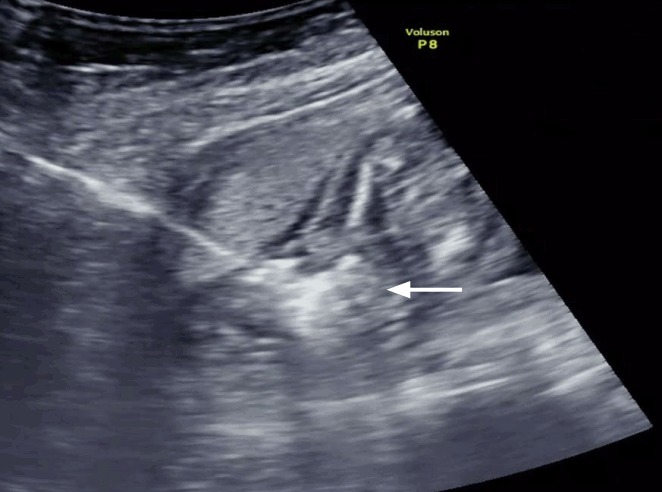
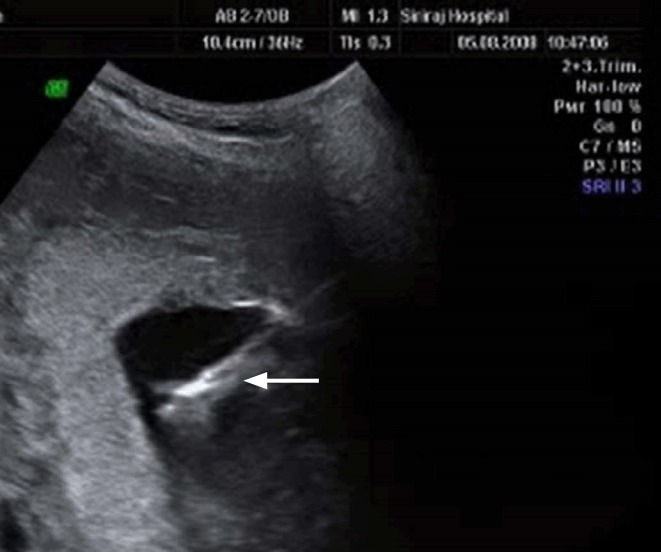

# 1638 — Giảm thai chọn lọc ở song thai một bánh nhau: RFA và bipolar cord coagulation / Selective fetal reduction in monochorionic twins: radiofrequency ablation and bipolar cord coagulation

**Tags:** `pattern:giam-thai-chon-loc` `pattern:ttts` `pattern:sfgr` `pattern:trap` `pattern:thai-luu` `vung:thai-nhi` `vung:banh-nhau` `score:Quintero` `score:Gratacos` `protocol:SA-Doppler` `protocol:RFA` `protocol:bipolar-cord-coagulation` `incidentaloma:khong`
**Mức chắc chắn (certainty):** tổng hợp y văn (literature synthesis) — đoàn hệ **306 ca RFA** (Li N et al., BMC Pregnancy Childbirth 2021, PMC8662893), **100 ca RFA** (Sharma KA et al., Obstet Gynecol Sci 2025, PMC12463477), **56 ca bipolar cord coagulation** (Weber EC et al., J Clin Med 2022, PMC8950483) và **hướng dẫn ISUOG 2025** (Khalil A et al., PMC11788470). Số liệu là của các nghiên cứu được trích, không phải ca nguyên văn của nhóm.

> **Câu chốt của bài:** trong song thai **một bánh nhau (monochorionic — MC)**, hai thai **chia chung tuần hoàn bánh nhau**, nên cái chết tự phát của một thai có thể **rút máu cấp** thai còn lại: **14% thai còn lại chết**, **21% có tổn thương thần kinh trên hình ảnh**, và **77% sinh non < 37 tuần**. Vì vậy khi một thai **không thể cứu** (TTTS nặng, TRAP, sFGR độ II–III, dị tật nặng không tương hợp), **chủ động cắt tuần hoàn của thai bệnh** — bằng **đốt nhiệt qua da (RFA)** hoặc **kẹp–đốt dây rốn qua nội soi (bipolar cord coagulation)** — bảo vệ thai còn lại, với **sống sót 79–88%** và **PPROM 12–18%**. Điều **tuyệt đối không làm**: dùng **KCl nội tim** cho thai trong MC, vì KCl qua tuần hoàn chung giết cả thai lành.

## 1. Tổng quan bệnh học – cơ chế hình ảnh

- **Vì sao MC khác hẳn song thai hai bánh nhau:** một bánh nhau duy nhất với **nối mạch (vascular anastomoses)** động–động, tĩnh–tĩnh và động–tĩnh. Khi một thai chết, huyết áp thai chết tụt về 0 → **thai còn lại bơm máu sang "xác" thai qua nối động–động** (exsanguination) → **tụt huyết áp cấp, thiếu máu–thiếu tưới máu não, chết hoặc tổn thương chất trắng**. Đây là lý do **can thiệp chủ động** thay vì "chờ thai chết tự nhiên".
- **Ngưỡng định lượng của cái chết tự phát (TẠI SAO phải can thiệp):** trong **81 ca MC có một thai chết sau 14 tuần** (UKOSS, Morris 2020): **thai còn lại chết 14% (10/70)**; **sinh non < 37 tuần 77%**; **21% (7/33) có bất thường trên MRI thai**, thêm **7 ca bất thường chỉ phát hiện sau sinh**; **6% mẹ vào ICU** (đều do nhiễm trùng).
- **Vì sao RFA và bipolar "cắt" được tuần hoàn:** cả hai tạo **hoại tử đông (coagulation necrosis)** mô đích.
  - **RFA (radiofrequency ablation — đốt bằng sóng cao tần):** kim **17 gauge, dài 15 cm, 8 tine bung** tạo **khối cầu đốt tối đa ~2 cm**; công suất **20–40 W** đưa nhiệt độ mô lên **100–110 °C**, giữ **2 phút/lần**, lặp **1–2 lần** cho tới khi **tim thai ngừng và Doppler mất dòng dây rốn**. Ưu điểm: **qua da, không cần nội soi**, làm được khi **thiểu ối, dây rốn khó tiếp cận, thai nhỏ**.
  - **Bipolar cord coagulation (kẹp–đốt dây rốn qua nội soi):** đưa **kẹp bipolar** qua **trocar 11 Fr**, kẹp **dây rốn** và đốt cho tới khi **mất dòng**, sau đó (thai monoamniotic) **cắt dây** để tránh quấn. Ưu điểm: **cắt đúng dây rốn**, kiểm soát trực tiếp; nhược điểm: **cần nội soi, cần cửa sổ dây rốn**, khó khi **thiểu ối nặng**.
- **Vì sao phải xác nhận bằng Doppler chứ không chỉ "tim ngừng":** mạch có thể **tái thông sau đốt non**; tiêu chuẩn kỹ thuật là **mất dòng dây rốn hoàn toàn** trên **color/pulsed Doppler**, không chỉ asystole thoáng qua.
- **Ngưỡng định lượng kết cục:**
  - **RFA:** **100 ca** — sinh sống **85%**, sống tới xuất viện **79%**, **PPROM 18%**, thai chết **15%** (chủ yếu TTTS), **tổn thương não trên MRI 2%** (Sharma 2025). **306 ca** — sống sót **78,76%**, mất thai còn lại **20,9% (< 20 tuần) vs 21,5% (> 20 tuần)** (p > 0,05), **PPROM < 24 giờ 1,5% vs 1,2%**, tuổi thai sinh **35,9 vs 36,0 tuần** (Li 2021). **54 ca** — sống **83,3%**; theo chỉ định **TTTS 66,7% · sFGR 93,3% · TRAP 80%** (Pan 2022).
  - **Bipolar cord coagulation:** **56 ca** — sống **87,5%**, **PPROM 12,5% trước 32 tuần** (+ 7,1% ở 34–36 tuần), **thai lưu 8,9%** (trung vị 2 tuần sau thủ thuật), **sinh non < 32 tuần 21,4%**, **tử vong sơ sinh 3,6%**, tuổi thai sinh trung bình **37,1 tuần** (Weber 2022).
  - **So sánh gộp:** phân tích gộp **17 nghiên cứu (481 BCC, 320 RFA)** — sống **76,8% (RFA) vs 79,1% (BCC)**; một phân tích khác — **86% (RFA) vs 82% (BCC) vs 72% (laser)**. Hai con số **không mâu thuẫn** mà phản ánh **khác biệt chỉ định và tuổi thai**; **không có RCT** chứng minh một phương pháp trội hơn.
  - **ISUOG 2025:** ở MC, giảm thai chọn lọc bằng **cord occlusion, intrafetal laser, microwave hoặc RFA**, **thực hiện từ 16 tuần**, **sống sót > 80%**; với **dị tật không tương hợp**, theo dõi chờ **88,5%** sống sót vs can thiệp **82,7%** (p = 0,87) — **không phải mọi ca đều phải can thiệp**.

## 2. Mẫu hình + chẩn đoán phân biệt theo bối cảnh (Gamut)

- **Khuôn 1 — TTTS (twin–twin transfusion syndrome):** **Quintero I–V** dựa trên **DVP ≤ 2 cm ở thai cho + ≥ 8 cm (< 20 tuần) hoặc ≥ 10 cm (≥ 20 tuần) ở thai nhận + bàng quang**. **Laser đốt nối mạch** là điều trị chuẩn; **giảm thai** chỉ khi **một thai không thể cứu** (hydrops nặng, phù, không có bàng quang kéo dài, tổn thương não) hoặc **laser thất bại/tái phát không còn khả năng cứu**.
- **Khuôn 2 — sFGR (selective fetal growth restriction):** **Gratacos I** (Doppler động mạch rốn bình thường, tiến triển **16%**), **II** (mất/đảo dòng cuối tâm trương, tiến triển **59%**), **III** (mất/đảo dòng **từng lúc**, tiến triển **10%**). **Loại II** là nhóm **tiên lượng xấu nhất**, nơi phải cân nhắc **giảm thai** khi thai nhỏ **sắp chết và đe dọa thai lành**.
- **Khuôn 3 — TRAP (twin reversed arterial perfusion):** **2,6%** các ca MC, tần suất **1/9.500–11.000**; thai **acardiac** được nuôi ngược dòng bởi **thai bơm (pump twin)**; **tử vong thai bơm 85% nếu không điều trị** do **suy tim cung lượng cao, phù, đa ối**. Điều trị: **RFA hoặc intrafetal laser** cắt tuần hoàn thai acardiac — **không dùng KCl**.
- **Khuôn 4 — dị tật nặng không tương hợp / đa thai bậc cao:** **giảm thai chọn lọc** để cứu thai lành; với **ba thai MC** có thể **giảm về song thai** (MFPR).
- **Khuôn 5 — thai monoamniotic (MCMA):** **quấn dây rốn 55–100%**; khi giảm thai phải **kẹp–đốt VÀ cắt dây rốn** để tránh dây của thai chết quấn thai sống.
- **Mnemonic "STOP":** **S**elect the unsalvageable twin (chọn đúng thai bệnh) — **T**echnique theo cửa vào dây rốn (RFA qua da vs bipolar nội soi) — **O**cclude until **no flow** (không chỉ asystole) — **P**rotect the co-twin (MCA-PSV 24 giờ, MRI não quý III, theo dõi sinh non).

## 3. Bảng so sánh phân biệt (ma trận đối chiếu)

| Phương thức (entity) | Kỹ thuật / hình ảnh điển hình | Chốt vào (rule-in) | Chốt loại (rule-out) | Gợi ý xác nhận |
|---|---|---|---|---|
| **RFA qua da (radiofrequency ablation)** | Kim 17 G, 8 tine, khối đốt **~2 cm**, **20–40 W**, **100–110 °C**, **2 phút/lần × 1–2 lần** | **Thai đích nhỏ/thiểu ối/dây rốn khó tiếp cận; cần qua da, không nội soi**; mất dòng dây rốn sau đốt | **Thai quá lớn (> 26–28 tuần) hoặc acardiac khổng lồ** → khó đủ khối đốt, cân nhắc BCC | Doppler màu + xung xác nhận **mất dòng**; MCA-PSV thai còn lại sau 24 giờ |
| **Bipolar cord coagulation** | Nội soi qua **trocar 11 Fr**, kẹp bipolar kẹp **dây rốn**, đốt tới mất dòng; MCMA thì **cắt dây** | **Có cửa sổ dây rốn, đủ ối để nội soi; cần cắt dây (monoamniotic)** | **Thiểu ối nặng, dây rốn sau nhau, thai < 16 tuần** → khó; chọn RFA | Nội soi thấy dây rốn + Doppler mất dòng; kiểm tra không còn mạch |
| **Intrafetal laser** | Kim 18 G + sợi laser **400 µm** đốt **động mạch rốn trong thai** (thường TRAP) | **TRAP/thai nhỏ, cần đốt gọn trong thai**; ít xâm lấn | **Thai lớn, cần cắt cả dây** → RFA/BCC | Doppler mất dòng động mạch rốn thai đích |
| **Microwave ablation (MWA)** | Đốt vi sóng qua kim, **100–200 W**, **3–6 phút** | **Cùng chỉ định RFA, khi có thiết bị** | **Dữ liệu còn nhỏ (21 ca), chưa có RCT** → không mặc định thay RFA | Doppler mất dòng; theo dõi như RFA |
| **KCl nội tim** | Tiêm KCl vào tim thai | **CHỈ dùng song thai HAI bánh nhau (dichorionic)** | **TUYỆT ĐỐI KHÔNG dùng trong MC** — KCl qua nối mạch gây chết thai lành | Không áp dụng cho MC |
| **Theo dõi chờ (expectant)** | Siêu âm/Doppler định kỳ | **Dị tật không tương hợp, thai còn ổn; sống sót 88,5%** (ISUOG) | **TTTS nặng/TRAP có suy tim thai bơm** → chờ làm tăng tử vong | MRI não, Doppler, đánh giá suy tim thai |

*Trái: **RFA** — đầu kim và vùng đốt tăng âm hình cầu (**mũi tên**) trong thai acardiac; nhiệt **100–110 °C** làm đông mô, Doppler sau đó mất dòng. Phải: **bipolar** — kẹp đốt dây rốn (**mũi tên**) qua nội soi; với thai monoamniotic phải **cắt dây** sau đốt. Nguồn: Nawapun K et al., Ultrasonography 2018 (PMC6044223), Fig. 15 và Fig. 13, CC BY-NC; ảnh ghép letterbox giữ tỷ lệ gốc.*

## 4. Protocol chụp + hệ phân độ/điểm chuẩn hóa

- **Trước thủ thuật (bắt buộc):**
  - **Xác định bản thể (chorionicity)**: dấu **lambda** = hai bánh nhau; **T sign** = một bánh nhau; **không vách** = monoamniotic. **Sai bản thể = sai phương pháp** (KCl vs RFA/BCC).
  - **Chẩn đoán và phân độ:** **Quintero** cho TTTS; **Gratacos** cho sFGR; đo **DVP, bàng quang, Doppler động mạch rốn/ductus venosus, MCA-PSV**, đánh giá **suy tim thai bơm** (cardiomegaly, TR, hydrops) trong TRAP.
  - **Siêu âm tim thai** hai thai; **MRI não thai** khi nghi tổn thương (không bắt buộc thường quy).
  - **Tư vấn:** nêu rõ **sống sót 79–88%**, **PPROM 12–18%**, **sinh non**, **nguy cơ tổn thương não thai còn lại**, và **phương án chờ** nếu phù hợp.
- **Kỹ thuật:**
  - **RFA:** gây tê tại chỗ + an thần; kim **17 G/15 cm, 8 tine** vào **thân thai đích dưới chỗ bám dây rốn**, bảo đảm **tất cả tine trong thân thai** (tránh đốt màng ối/thành tử cung); **20–40 W** tới **100–110 °C**, **2 phút/lần**, lặp tới **asystole + mất dòng dây rốn**; rút tine trước khi rút kim.
  - **BCC:** trocar **11 Fr**, kẹp bipolar kẹp dây rốn, đốt tới **mất dòng**; **MCMA: cắt dây** sau đốt. Bơm **NaCl ấm** nếu thiểu ối để có cửa sổ.
  - **Dự phòng:** kháng sinh 1 liều (cefazolin 1 g), tránh **septostomy** không cần thiết.
- **Sau thủ thuật:**
  - **MCA-PSV thai còn lại trong 24 giờ** (phát hiện thiếu máu cấp do rỉ máu lúc cắt); siêu âm **1 tuần**, sau đó **mỗi 2 tuần**: sinh trắc, Doppler rốn, **ductus venosus**, MCA-PSV.
  - **MRI não thai còn lại quý III** (không thường quy nhưng nên làm khi có bất thường Doppler/MCA); **theo dõi thần kinh sau sinh** (xem bài 1636).
  - **Theo dõi sinh non:** đo **cổ tử cung**, giáo dục dấu hiệu chuyển dạ, cân nhắc **corticoid** nếu < 34 tuần; **PPROM** xử trí như bài 1635.
- **Sơ đồ quyết định:**

## 5. Biến thể bình thường và cạm bẫy

- **Cạm bẫy 1 — dùng KCl cho MC:** KCl **qua tuần hoàn bánh nhau chung** có thể vào thai lành → **chết cả hai**. KCl chỉ dành cho **song thai hai bánh nhau**.
- **Cạm bẫy 2 — "tim ngừng" không đồng nghĩa "mất tuần hoàn":** phải xác nhận **mất dòng dây rốn** bằng **color + pulsed Doppler**; đốt non có thể **tái thông**.
- **Cạm bẫy 3 — nhầm "giảm thai chọn lọc" với "giảm số thai (MFPR)":** MFPR là giảm số lượng thai trong đa thai; **giảm thai chọn lọc** là **chọn đúng thai bệnh** dựa trên chẩn đoán — **đánh số thai sai = giết thai lành**; luôn **ghi nhãn thai (A/B)** và xác nhận lại trước khi đốt.
- **Cạm bẫy 4 — bỏ sót thiếu máu thai còn lại:** sau khi cắt tuần hoàn, thai lành có thể **mất máu cấp qua nối mạch tồn dư**; **MCA-PSV > 1,5 MoM** trong 24 giờ → cân nhắc **truyền máu trong tử cung**.
- **Cạm bẫy 5 — trích "sống sót 80–90%" chung cho mọi chỉ định:** **TTTS sống 66,7%**, **sFGR 93,3%**, **TRAP 80%** — tư vấn phải **theo chỉ định**, không theo con số gộp.
- **Cạm bẫy 6 — quên tổn thương não muộn:** MRI thai có thể **bình thường sớm** rồi bất thường muộn; **21%** thai còn lại sau một thai chết tự phát có bất thường trên hình ảnh — cần **MRI quý III + theo dõi phát triển**.
- **Cạm bẫy 7 — thai monoamniotic:** nếu chỉ đốt mà **không cắt dây**, dây thai chết có thể **quấn thai sống**; phải **kẹp–đốt + cắt**.
- **Cạm bẫy 8 — PPROM do thủ thuật bị quy cho "dọa sinh non":** PPROM sau RFA **12–18%**, thường **liên quan đường vào/màng ối**; phân biệt với **nhiễm trùng** và xử trí theo bài 1635.

## 6. Tự lượng giá — Blind Quiz

**Ca 1 — Thai 20 tuần, MC, một thai acardiac (TRAP), thai bơm có tim to + đa ối. Siêu âm trong lúc thủ thuật.**

- Gợi ý: thai bơm chưa phù, chức năng tim còn bù; siêu âm thấy **đầu kim và vùng tăng âm hình cầu** trong thai acardiac.
- Câu hỏi: (1) Đây là thủ thuật gì? (2) Cấu trúc mũi tên chỉ là gì? (3) Tiêu chuẩn nào xác nhận thành công? (4) Vì sao **không** dùng KCl?

<b>Bấm để hiện đáp án (findings + chẩn đoán)</b>

- **Thủ thuật:** **RFA (radiofrequency ablation)** qua da — kim 17 G, 8 tine, đốt mô thai acardiac ở **100–110 °C**, **2 phút/lần**.
- **Mũi tên:** **vùng mô đông (coagulation) tăng âm hình cầu** quanh đầu tine — hiệu ứng nhiệt đang diễn ra.
- **Xác nhận thành công:** **mất dòng dây rốn/thân thai trên color + pulsed Doppler** (không chỉ tim ngừng), sau đó theo dõi **thai bơm**.
- **Không dùng KCl:** trong MC, KCl qua **nối mạch bánh nhau** có thể gây chết **thai bơm**; với TRAP phải **cắt tuần hoàn thai acardiac** (RFA/intrafetal laser).
- **Nguồn ảnh:** Nawapun K et al., Ultrasonography 2018 (PMC6044223), Fig. 15, CC BY-NC.

**Ca 2 — Thai 20 tuần, MC, sFGR độ II (mất dòng cuối tâm trương động mạch rốn ở thai nhỏ), thai nhỏ ước 180 g, có đủ ối. Nội soi thấy dây rốn.**

- Câu hỏi: (1) Phương pháp nào phù hợp và vì sao? (2) Mũi tên chỉ gì? (3) Sau thủ thuật, xét nghiệm/hình ảnh nào phải làm trong 24 giờ?

<b>Bấm để hiện đáp án</b>

- **Phương pháp:** **bipolar cord coagulation qua nội soi** — có **cửa sổ dây rốn** và đủ ối; kẹp–đốt dây rốn tới **mất dòng**. Nếu **thiểu ối nặng/không vào được dây** → chuyển **RFA qua da**.
- **Mũi tên:** **kẹp bipolar** đang kẹp **dây rốn** trong buồng ối.
- **24 giờ sau:** **MCA-PSV của thai còn lại** (thiếu máu cấp), siêu âm tim thai; sau đó **siêu âm 2 tuần/lần**, **MRI não quý III**, theo dõi sinh non.
- **Vì sao không chờ:** sFGR **độ II tiến triển 59%**, nguy cơ thai nhỏ chết đột ngột → **rút máu thai lành**; nhưng nếu thai còn ổn định và không có dấu hiệu suy, **theo dõi chờ** vẫn là lựa chọn (ISUOG: 88,5% sống ở nhóm dị tật không tương hợp).
- **Nguồn ảnh:** Nawapun K et al., Ultrasonography 2018 (PMC6044223), Fig. 13, CC BY-NC.

## Bài liên quan chéo
- [1611 – TTTS tái phát sau laser: chẩn đoán lại, phân giai đoạn Delphi 2025 & laser lần 2](../1611-ttts-tai-phat-sau-laser/lesson.md)
- [1637 – TAPS sau laser TTTS: MCA-PSV, phân độ 1–5 & khi nào truyền máu trong tử cung](../1637-taps-sau-laser-ttts/lesson.md)
- [1636 – Theo dõi thần kinh dài hạn sau một thai chết trong song thai một bánh nhau](../1636-theo-doi-than-kinh-sau-mot-thai-chet/lesson.md)
- [1635 – Vỡ ối non tháng sau can thiệp bào thai: lỗ trocar, ống rò thành tử cung & xử trí](../1635-ro-oi-non-thang-sau-can-thiep-bao-thai/lesson.md)
- [587 – Dự phòng sinh non sau laser TTTS](../587-du-phong-sinh-non-sau-laser-TTTS/lesson.md)
- [566 – Song thai: chorionicity, TTTS & TAPS](../566-song-thai-chorionicity-TTTS-TAPS/lesson.md)
- [500 – Tổng quan Vú & Sản phụ khoa](../500-tong-quan-vu-san-phu-khoa/lesson.md)

## Ảnh
- `images/1638_giam-thai_RFA-Sieu-am_PMC6044223-F15.jpg` — RFA trong thai acardiac, Fig. 15, CC BY-NC.
- `images/1638_giam-thai_Bipolar-Sieu-am_PMC6044223-F13.jpg` — bipolar kẹp dây rốn, Fig. 13, CC BY-NC.
- `images/composite_rfa-vs-bipolar.jpg` — ảnh ghép letterbox từ hai ảnh trên, CC BY-NC (ghi nguồn).
- Nguồn + giấy phép từng ảnh: `images/CREDITS.md`.

> Không dùng để chẩn đoán độc lập khi chưa có người hướng dẫn.
