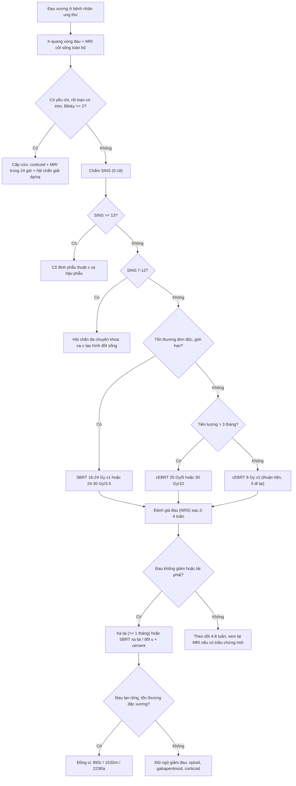
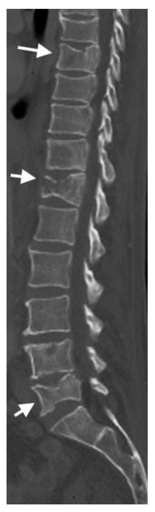
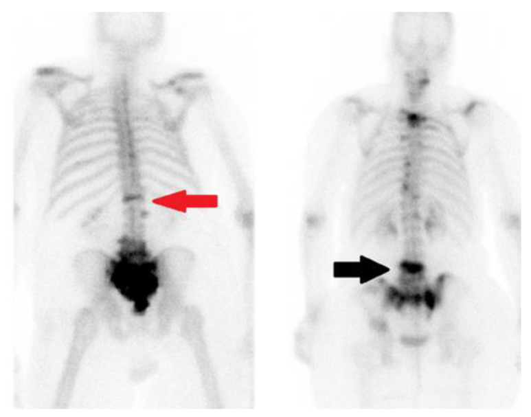
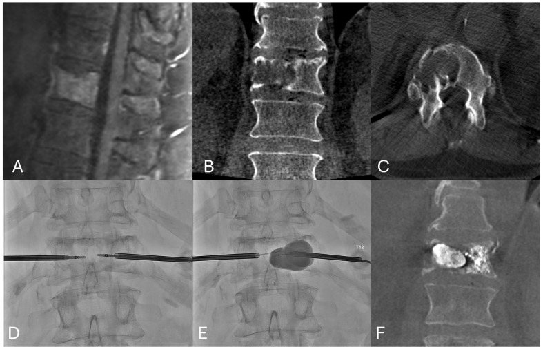
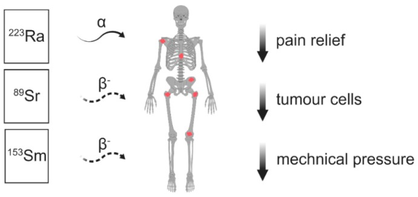

# 1639 — Đau xương do di căn: chọn xạ trị 8 Gy × 1 hay chia liều, SBRT, đồng vị phóng xạ hay tạo hình đốt sống / Painful bone metastases: choosing radiotherapy, SBRT, radiopharmaceuticals or vertebral augmentation

**Tags:** `pattern:di-can-xuong` `pattern:tieu-xuong` `pattern:dac-xuong` `pattern:gay-xep-behnh-ly` `vung:cot-song` `vung:xuong-dai` `vung:khung-chau` `score:SINS` `score:Mirels` `score:Bilsky` `protocol:MRI-cot-song` `protocol:CT-xuong` `protocol:PSMA-PET` `protocol:SBRT` `protocol:xetia-8Gy` `protocol:tao-hinh-dot-song` `incidentaloma:di-can-xuong`
**Mức chắc chắn (certainty):** tổng hợp y văn (literature synthesis) — đọc trực tiếp toàn văn 6 bài mở qua Europe PMC/PMC (*JAMA Network Open* 2024; *Radiation Oncology* 2022; *Cancers* 2019; *J Clin Med* 2025; *J Imaging* 2024; *Cells* 2021) + 2 bài về bảng điểm (*Cancers* 2025; *Current Oncology* 2025). Có **3 ca nguyên văn** dùng cho Blind Quiz (ảnh CC BY 4.0).

## 1. Tổng quan — vì sao di căn xương đau, và vì sao "chụp gì" quyết định "chọn gì"

- **Dịch tễ và vị trí (định lượng):** di căn xương gặp ở **> 80%** bệnh nhân có di căn xương là **xương trục**; trong đó **cột sống ngực 70%**, **thắt lưng–cùng 20%**, **cổ 10%**; **xương chậu 63%**, **xương sườn 77%**, **sọ 35%**; **xương dài đầu gần (xương cánh tay, xương đùi) 53%** so với **1%** ở đầu xa (*Cells* 2021). Sống trung bình sau khi có di căn xương ở nhóm thường gặp (đa u tủy, vú, tuyến tiền liệt) **không quá 2–3 năm** (*Cells* 2021) — nghĩa là **mục tiêu điều trị là giảm đau và giữ chức năng**, không phải "chữa khỏi".
- **Ba cơ chế đau — mỗi cơ chế đáp ứng một cách khác nhau (đây là chìa khóa của cả bài):**
  1. **Đau cơ học (mechanical pain)**: do **vi gãy xương/ mất vững**, tăng khi đứng, đi, xoay, giảm khi nằm. → Đáp ứng với **ổn định cơ học** (tạo hình đốt sống, phẫu thuật), không chỉ xạ trị.
  2. **Đau do khối u và vi môi trường (biological pain)**: hoạt hóa hủy cốt bào qua **RANKL**, toan hóa nội bào, chèn ép màng xương, giải phóng cytokine. → Đáp ứng với **xạ trị và thuốc hủy cốt bào**.
  3. **Đau thần kinh (radicular/neuropathic)**: chèn ép rễ/tủy. → Cần **MRI cấp + giải ép**, xạ trị đơn thuần có thể **không đủ và làm chậm giải ép**.
- **TẠI SAO hình ảnh trông như vậy (vật lý + mô bệnh):**
  - **Tủy xương bình thường = mỡ (80% ở người trưởng thành)** → **T1W sáng hơn cơ và đĩa đệm**. Tế bào u thay tủy → mất mỡ → **T1W tối**, **STIR/T2 fat-sat sáng** (phù + tăng nước), **ngấm gadolinium**. Đây là lý do **MRI là phương thức nhạy nhất** cho di căn tủy xương: một lần chụp toàn thân đánh giá được **80–90%** vùng tủy xương (*Cells* 2021).
  - **CT chỉ thấy khi đã có phá hủy/xương mới đáng kể** (*Cells* 2021) — vì CT đo **hệ số hấp thụ tia X (HU)**, không đo thành phần tủy. Tiêu xương = **HU thấp, mất vỏ xương, bờ không đều**; đặc xương = **HU cao, dày bè xương**.
  - **Xạ hình xương (bone scintigraphy, ⁹⁹ᵐTc-MDP) và CT đánh giá *phản ứng mô đệm* quanh u, không đánh giá chính tế bào u** (*Cells* 2021) → **dương tính giả** ở gãy xương lành, thoái hóa, nhiễm trùng; **âm tính giả** ở tổn thương **tiêu xương thuần** (không tạo xương mới). Đây là lý do **đồng vị điều trị chỉ dùng cho tổn thương đặc xương/hỗn hợp** (mục 4).
  - **PET/CT (¹⁸F-FDG hoặc ¹⁸F-NaF/PSMA)** phản ánh **chuyển hóa và tưới máu**, nên phát hiện sớm hơn và đánh giá đáp ứng tốt hơn xạ hình; **NaF PET/CT có độ đặc hiệu 97% so với 72% của NaF PET đơn thuần** vì CT ghép giúp loại trừ lành tính (*World J Nucl Med* 2022).
- **Vì sao xạ trị giảm đau:** tia xạ gây **đứt DNA** tế bào u và **ức chế hủy cốt bào vi mô** trong trường chiếu → giảm cytokine và giảm tiêu xương; hiệu quả **không phụ thuộc nhiều vào liều** trong dải thường quy (xem mục 4). Đau thường **giảm sau 1–4 tuần**, đỉnh **2–6 tuần**, và **có thể tăng thoáng qua (pain flare) 10–68%** (*Cancer Manag Res* 2019).
- **Vì sao "một liều 8 Gy" vẫn đủ:** với **tỷ lệ α/β của u và mô đệm xương cao**, hiệu quả sinh học của **8 Gy × 1** tương đương **20 Gy/5** và **30 Gy/10** trên đáp ứng đau — đã được chứng minh trong nhiều thử nghiệm pha III (*Radiat Oncol* 2022). Đổi lại, **liều một lần có tỷ lệ phải xạ lại cao hơn** và **liều mỗi phân liều cao làm tăng nguy cơ gãy xẹp đốt sống** (mục 4–5).

## 2. Mẫu hình + chẩn đoán phân biệt theo vị trí (gamut)

- **Khuôn 1 — Đau khu trú một đốt sống, không yếu liệt, không rối loạn cơ tròn.** Gamut: **di căn** vs **gãy xẹp lành tính do loãng xương** vs **gãy do corticoid** vs **lao/viêm đốt sống** vs **u máu (hemangioma)**. Chốt: **tủy xương T1 tối + phá hủy cuống/ mảnh sau + khối mô mềm** → di căn; **dải phù ngang đốt sống, không phá cuống, T1 không tối toàn bộ** → lành tính.
- **Khuôn 2 — Đau lan theo khoanh da (radicular) ± yếu chi.** Gamut: **chèn ép rễ do di căn** vs **hẹp ống sống thoái hóa** vs **zona** vs **đau cơ–cân**. Chốt: **tổn thương xâm lấn lỗ liên hợp/ mảnh sau trên MRI** + tiền sử ung thư → di căn.
- **Khuôn 3 — Đau kèm yếu hai chi, rối loạn cơ tròn (cấp cứu).** Gamut: **chèn ép tủy do di căn (metastatic spinal cord compression, MSCC)** vs **áp-xe ngoài màng cứng** vs **máu tụ** vs **thoát vị đĩa đệm**. Chốt: **Bilsky ≥ 2 + phù tủy + thời gian tiến triển < 48 giờ** → giải ép/xạ cấp; **không chờ đợi** (xạ trị đơn thuần khi đã liệt thường không hồi phục).
- **Khuôn 4 — Đau đầu xương dài, đi lại được nhưng đau tăng.** Gamut: **di căn thân xương** vs **gãy mỏi** vs **viêm mô tế bào–viêm xương** vs **u nguyên phát**. Chốt: **Mirels ≥ 9 + tổn thương tiêu xương > 2/3 chu vi** → cân nhắc **cố định dự phòng**; **Mirels thấp nhưng đau cơ học nặng** vẫn phải đánh giá lại bằng CT.
- **Khuôn 5 — Nhiều ổ đau lan rộng, không xác định một điểm.** Gamut: **di căn đa ổ** vs **đau do thuốc/ đau thần kinh trung ương** vs **loãng xương đa ổ**. Chốt: **xạ hình/ PET dương nhiều ổ + đặc xương** → cân nhắc **đồng vị phóng xạ toàn thân** (mục 4).
- **Gợi nhớ "ĐAU – VIÊM – CƠ – TỦY – TOÀN THÂN":** **Đ**au cơ học (ổn định) · **A**U khối u (xạ) · **V**iêm/ nhiễm (loại trừ) · **I**ếu/ rễ (MRI cấp) · **M**ất vững (SINS) · **T**ủy (Bilsky) · **O**xy hóa mô (đồng vị) · **À**n mòn xương (tiêu xương) · **N**hiều ổ (toàn thân) · **T**heo dõi đau bằng thang điểm (VAS/NRS).

## 3. Bảng so sánh phân biệt (ma trận đối chiếu)

| Thực thể (entity) | Hình ảnh điển hình | Chốt vào (rule-in) | Chốt loại (rule-out) | Gợi ý xác nhận |
|---|---|---|---|---|
| **Di căn tiêu xương (lytic)** | CT: **HU thấp, mất vỏ, bờ nham nhở**, có thể có khối mô mềm; MRI: **T1 tối, STIR sáng, ngấm thuốc** | **Thay tủy xương T1 tối + phá hủy vỏ/cuống + đa ổ** | **T1 không tối, không phá vỏ, có dải phù ngang** → lành tính | MRI cột sống + CT xương; sinh thiết nếu ổ đơn độc |
| **Di căn đặc xương (blastic)** | CT: **dày bè xương, HU cao**; xạ hình: **ổ tăng hấp thu đậm, lan tỏa cả thân đốt** | **Đặc xương + nhiều ổ + tiền sử tuyến tiền liệt/vú** | **Tăng hấp thu dạng đường ngang (gãy xẹp)** → lành tính | Xạ hình/ NaF-PET; PSA nếu nam |
| **Gãy xẹp lành tính do loãng xương** | **Mất chiều cao hình nêm, dải phù ngang**, không phá cuống; **hồi phục tín hiệu theo thời gian** | **Không có khối mô mềm, không phá mảnh sau, tín hiệu giảm dần** | **Phá hủy cuống + khối mô mềm + T1 tối toàn bộ** → di căn | So phim cũ; MRI 6–8 tuần |
| **MSCC (chèn ép tủy do di căn)** | MRI: **khối ngoài màng cứng chèn túy, phù tủy T2**, Bilsky 1c–3 | **Bilsky ≥ 2 + yếu chi/ rối loạn cơ tròn** | **Không chèn túy, chỉ đau cơ học** → xạ/ ổn định | MRI toàn trục **trong 24 giờ**, corticoid, hội chẩn cấp |
| **Gãy xương dài do di căn** | X-quang/CT: **tiêu xương > 2/3 chu vi**, đau cơ học; Mirels | **Mirels ≥ 9 + đau khi tì/ đi** | **Mirels ≤ 7 + tổn thương đặc xương nhỏ** → xạ trị đơn thuần | CT toàn thân xương dài, đo độ dày vỏ |
| **Đau do thần kinh sau xạ/ đau trung ương** | Hình ảnh ổn định, **không có tổn thương mới** | **Đau lan theo khoanh, dị cảm, đáp ứng gabapentin/ opioid** | **Tổn thương mới/ tiến triển trên MRI** → tái phát | Đánh giá lại MRI sau 6–12 tuần |

- Ảnh minh họa ca thật: xem mục 6 (CT đa ổ tiêu xương, xạ hình gãy xẹp vs di căn, tạo hình đốt sống).

## 4. Protocol chụp + hệ phân độ/điểm chuẩn hóa + thuật toán điều trị

**4.1. Chụp gì để ra quyết định (không chụp "cho đủ")**

| Bước | Phương thức | Ngưỡng/ thông số then chốt | Vì sao |
|---|---|---|---|
| 1 | **X-quang vùng đau** | Chỉ thấy khi **phá hủy đáng kể**; đánh giá gãy xẹp, trượt đốt sống | Rẻ, định hướng; **không loại trừ** di căn |
| 2 | **MRI cột sống toàn bộ** (Sag T1 + STIR + DWI + T1 sau tiêm) | **T1 tối < cơ/đĩa đệm, STIR sáng, ADC thấp**; đo **Bilsky** nếu có chèn túy | Nhạy nhất cho tủy xương (**80–90%** vùng tủy trong một lần chụp) |
| 3 | **CT xương lát mỏng** | Đo **vỏ xương, % thân đốt bị phá, mảnh sau**, lập kế hoạch **đốt/ bơm cement** | CT là "bản đồ can thiệp"; MRI không đo được mật độ xương |
| 4 | **Xạ hình ⁹⁹ᵐTc-MDP hoặc NaF/ PSMA PET-CT** | Đa ổ, theo dõi toàn thân; NaF PET/CT **Sp 97%** vs PET đơn thuần **72%** | Chọn bệnh nhân **đồng vị phóng xạ**; xạ hình phản ánh **phản ứng xương**, không phải u |
| 5 | **Sinh thiết** khi ổ **đơn độc, chưa rõ nguyên phát** | Mô bệnh + hóa mô miễn dịch | Tránh điều trị mù; phân biệt u nguyên phát/ lành tính |

**4.2. Ba thang điểm phải thuộc (định lượng)**

| Thang | Cấu trúc | Ngưỡng hành động | Bằng chứng/ lưu ý |
|---|---|---|---|
| **SINS** (Spinal Instability Neoplastic Score) | **6 thành phần, tổng 0–18**: vị trí (0–3), đau (0–3), kiểu tổn thương xương (0–2), trục (0–4), xẹp thân đốt (0–3), xâm lấn mảnh sau/ phức hợp dây chằng (0–3) | **0–6 = vững** → xạ trị/ giảm đau; **7–12 = chưa xác định** → hội chẩn đa chuyên khoa; **13–18 = mất vững** → **cố định phẫu thuật** | Fisher 2010; loạt SINS 7–12 cho thấy **18,8% (46/245)** chuyển sang mổ (*Cancers* 2025) |
| **Mirels** (xương dài) | **4 thành phần, 3–12**: vị trí, đau, kiểu tổn thương, kích thước | **≥ 9 → cố định dự phòng**; 8 = ranh giới | **PPV chỉ 21% (chi trên) và 10–32% (xương đùi)**, **NPV 90–96%** → **Mirels cao không đồng nghĩa "chắc chắn gãy"** (*Curr Oncol* 2025) |
| **Bilsky** (chèn ép tủy) | **0–3** theo mức chèn khoang dịch não tủy/ tủy | **≥ 2 → cấp cứu**, cần giải ép ± xạ | Dùng **cùng SINS** để chọn "mổ trước hay xạ trước" |

- **Bổ sung:** **CTRA** (CT-based structural rigidity analysis) có **PPV 18–54%, NPV 100%** — hứa hẹn hơn Mirels nhưng chưa phổ cập (*Curr Oncol* 2025).

**4.3. Chọn xạ trị: liều và kỹ thuật**

| Phương án | Liều thường dùng | Đáp ứng đau | Ưu/ nhược |
|---|---|---|---|
| **Xạ trị thường quy (cEBRT)** | **8 Gy × 1**; **20 Gy/5**; **30 Gy/10** | **Đáp ứng chung ~60%, đáp ứng hoàn toàn ~25%**; ba phác đồ **tương đương** | Rẻ, nhanh; **8 Gy × 1 có tỷ lệ xạ lại cao hơn**, phù hợp người tiên lượng ngắn, đi lại khó |
| **SBRT** | **16–24 Gy × 1** hoặc **24–30 Gy/3–5** | **Kiểm soát tại chỗ 1 năm 60–95%**, kiểm soát triệu chứng **43–90%**; **đáp ứng hoàn toàn cao hơn cEBRT** (26% vs 18% ở 1 tháng; 48% vs 18% ở 6 tháng) | Cần **lập kế hoạch CT/ MRI**, tổn thương **giới hạn**, tiên lượng **> 3–6 tháng**; nguy cơ **gãy xẹp** |
| **Xạ lại (re-irradiation)** | cEBRT lại **sau ≥ 1 tháng**; SBRT xạ lại an toàn hơn | cEBRT xạ lại: **đáp ứng 45–52%, hoàn toàn 11–14%** | **SBRT là lựa chọn tốt khi đã xạ** (liều tích lũy tủy sống) |
| **Chiếu nửa thân (HBI)** | **6–8 Gy × 1** | **Đáp ứng 70% trong 24–48 giờ** | Di căn lan rộng, không dung nạp đi lại nhiều lần; độc tính tủy |

- **Meta-analysis 8 RCT/ 1.090 bệnh nhân:** **đáp ứng đau chung không khác** giữa SBRT và cEBRT ở 1/ 3/ 6 tháng (**RR 1,14; 1,19; 1,22** — KTC đều vắt 1), nhưng **đáp ứng hoàn toàn cao hơn** với SBRT; **gãy xương bệnh lý 5,6% (24/427) vs 7,5% (26/345)**; **gãy xẹp đốt sống 6,6% (22/331) vs 10,0% (25/251)** (*JAMA Netw Open* 2024; *Radiat Oncol* 2022).
- **Quan hệ liều–đáp ứng:** với sarcoma xương, **BED > 48 Gy** cho kiểm soát tại chỗ tốt hơn; với di căn đốt sống hỗn hợp, **≥ 23,56 Gy EQD2 vào 95% GTV** thì **thất bại tại chỗ < 2%** (*Cancer Manag Res* 2019).
- **An toàn tủy:** **bệnh lý tủy do xạ < 1%**; nguy cơ gắn với **Dmax BED > 110 Gy** lên tủy/ đuôi ngựa, **không phụ thuộc liều mỗi phân liều** (*Cancer Manag Res* 2019).
- **Pain flare:** gặp **10–68%**, tới **34%** sau SBRT; **yếu tố nguy cơ: liều một lần, không dùng corticoid trước**; dự phòng **dexamethasone 4–8 mg** trước và 1–3 ngày sau xạ.

**4.4. Đồng vị phóng xạ (chỉ khi đau lan rộng, tổn thương đặc xương/ hỗn hợp)**

| Đồng vị | Liều | Đáp ứng đau | Thời gian/ nhắc lại |
|---|---|---|---|
| **⁸⁹Sr chloride** | **150 MBq** | **63–88%** | Khởi phát **≤ 6 tuần**, kéo dài **~6 tháng**, nhắc lại **≥ 12 tuần**; **không có quan hệ liều–đáp ứng** |
| **¹⁵³Sm-EDTMP** | **37 MBq/kg** | **70–78%** | **3,5–6 tháng**, nhắc lại **≥ 8 tuần** |
| **²²³Ra-dichloride** | **55 kBq/kg × 6, mỗi 4 tuần** | **ALSYMPCA (921 ca)**: sống **14,9 vs 11,3 tháng**; **biến cố xương có triệu chứng 15,6 vs 9,8 tháng**; **opioid 36% vs 50%** | Chỉ **CRPC di căn xương**; cần **xạ hình trong 8 tuần trước** |

- **Quy tắc cứng:** đồng vị **tích tụ ở ổ đặc xương/ tạo xương**, **không dùng cho tổn thương tiêu xương thuần**; nếu có **nguy cơ gãy/ chèn ép** phải **xử lý tại chỗ (xạ/ mổ) trước** (*Cancers* 2019).

**4.5. Can thiệp tại chỗ: đốt u + bơm cement (ablation + cement augmentation)**

- **Chỉ định:** đau **kháng xạ/ không xạ được**, **nguy cơ gãy xẹp**, **kiểm soát tại chỗ** ở bệnh **ít ổ**, hoặc **đau cơ học do mất vững nhẹ** (SINS < 7 theo một số tác giả, **không phải đồng thuận**).
- **Kết quả:** **RFA**: giảm **30–75%** đau trước mổ, kiểm soát tại chỗ **77–92% ở 3 tháng, 67% ở 2 năm**, biến chứng **16%**; **MWA**: kiểm soát **88–96% ở 6 tháng, 79% ở 2 năm**, giảm đau hoàn toàn **33–70%**, biến chứng **6,5–27,4%**; **cryoablation**: giảm **5 điểm VAS** ở 1 tháng, kiểm soát **58%**, biến chứng **8%** (*J Clin Med* 2025).
- **Khoảng cách an toàn:** cần **≥ 5 mm** từ bờ đốt tới mô thần kinh nếu mục tiêu **kiểm soát tại chỗ**; **< 5 mm** chỉ chấp nhận khi **giảm đau, tiên lượng < 6 tháng** và phối hợp xạ (*J Clin Med* 2025).
- **Bơm cement (vertebroplasty/ kyphoplasty):** trong di căn **có phá mảnh sau**, **rò cement không triệu chứng 11% (4/36)** với kyphoplasty qua da (*J Orthop Surg Res* 2023;18:135). **Không bơm khi mất vững (SINS ≥ 13) hoặc chèn ép tủy (Bilsky ≥ 2) mà chưa giải ép.**
- Hình ảnh sau can thiệp: cement lấp ổ tiêu xương hai tầng, **không có mảnh xương bật vào ống sống** — `images/1639_dau-xuong-di-can_CT_jimaging-f016.jpg`.

## 5. Biến thể bình thường và cạm bẫy

- **Biến thể bình thường/ lành tính dễ gọi nhầm di căn:**
  - **U máu đốt sống (vertebral hemangioma)**: **T1 và T2 đều sáng** (mỡ + mạch), **bè xương dày kiểu "polka-dot"** trên CT ngang — không phải di căn (di căn **T1 tối**).
  - **Tủy đỏ tái hoạt động** sau hóa trị/ thiếu máu: **T1 hơi tối, STIR hơi sáng, đối xứng**, không phá xương — so phim cũ.
  - **Mất tín hiệu do xơ hóa sau xạ**: **T1 và T2 đều tối, không ngấm**, ổn định nhiều tháng — **không phải tái phát** (xem bài 306).
  - **Hạt đệm Schmörl/ thoát vị đĩa đệm nội thân đốt**: bờ xơ, tín hiệu mỡ, không phá vỏ.
- **Cạm bẫy chết người và cách tránh:**
  1. **Xạ hình dương ở gãy xẹp lành tính** — hình **dải/ đường ngang, khu trú đúng đốt xẹp**, trong khi di căn thường **lan tỏa cả thân đốt** (ca 2 mục 6). **Không chẩn đoán di căn chỉ dựa vào xạ hình.**
  2. **"Flare" sau xạ/ sau đồng vị**: đau **tăng 1–5 ngày** rồi giảm, **không phải thất bại điều trị** — đừng đổi phác đồ ngay; dự phòng corticoid.
  3. **Xạ hình âm ở tổn thương tiêu xương thuần** — vì không có phản ứng tạo xương; **MRI/CT mới là chốt**.
  4. **Đồng vị ở bệnh nhân có nguy cơ chèn ép/ gãy**: đồng vị **không giải ép, không ổn định** — phải xử lý tại chỗ trước (*Cancers* 2019).
  5. **Bơm cement vào đốt mất vững hoặc có chèn ép mà chưa giải ép** → **đẩy cement/ mảnh xương vào ống sống**; kiểm tra SINS + Bilsky trước thủ thuật.
  6. **Bỏ sót gãy xương dài "sắp xảy ra"**: đau tăng khi tì/ đi, **Mirels ≥ 9**; **PPV thấp** nên **không được trấn an chỉ vì Mirels 8**, cần CT đo vỏ xương và hội chẩn.
  7. **Tưởng đau do di căn mà thực ra do thuốc/ thần kinh**: bệnh nhân dùng **bisphosphonate/ denosumab** có thể đau cơ–xương; **đau thần kinh** đáp ứng gabapentinoid, không đáp ứng xạ.
  8. **Bỏ qua "đau cơ học" khi chọn xạ đơn thuần**: xạ trị **không sửa mất vững**; bệnh nhân đau khi đứng nhưng hết đau khi nằm + SINS cao → **cần ổn định** (*J Clin Med* 2025).
- **Phản biện trung thực nguồn:** **SBRT không chứng minh ưu thế về đáp ứng đau chung** so với cEBRT trong meta-analysis lớn nhất (8 RCT) — ưu thế rõ nhất là **đáp ứng hoàn toàn** và **kiểm soát tại chỗ**; vì vậy **không được bán SBRT cho mọi bệnh nhân**, nhất là người tiên lượng ngắn, đau lan rộng. Ngược lại, **Mirels** — công cụ được dạy phổ biến — có **PPV thấp**, nên dùng như **yếu tố gợi ý**, không phải "án phạt" mổ dự phòng.

## 6. Tự lượng giá — Blind Quiz ngay trên trang tĩnh

**Ca 1 — Nam 62 tuổi, di căn hắc tố (melanoma), đau lưng âm ỉ 6 tuần, không yếu chi**

- Gợi ý lâm sàng: tiền sử **melanoma di căn**, đau tăng khi ngồi dậy; **không có yếu chi, không rối loạn cơ tròn**; xét nghiệm canxi bình thường.
- Câu hỏi: (a) Mô tả 3 dấu hiệu chính trên CT? (b) Hai chẩn đoán phân biệt? (c) Bước tiếp theo **bắt buộc** trước khi quyết định xạ trị?

<b>Bấm để hiện đáp án (findings + chẩn đoán)</b>

- Dấu hiệu: **nhiều ổ tiêu xương (HU thấp, mất vỏ) rải rác thân đốt**; **xẹp/ biến dạng nhiều đốt mạn tính** (mũi tên trắng); **không thấy khối mô mềm lớn chèn ống sống** trên các lát này.
- Chẩn đoán: **di căn xương đa ổ do melanoma** — tế bào u thay tủy xương nên **T1 tối/ STIR sáng**; trên CT chỉ thấy khi đã **phá hủy vỏ xương** đáng kể.
- Bước tiếp theo: **MRI cột sống toàn bộ (T1 + STIR + DWI)** để **chấm Bilsky** và tìm **chèn ép tủy/ rễ**; nếu **không chèn ép** → **chấm SINS** và chọn xạ (SBRT nếu ổ giới hạn) theo mục 4.
- Nguồn ảnh: *J Imaging* 2024;10:244, Figure 6 — PMC11508230, **CC BY 4.0** (Miao KH et al.).

**Ca 2 — Nữ 68 tuổi, đau lưng sau bê vật nặng; xạ hình xương có hai kiểu tăng hấp thu**

- Gợi ý lâm sàng: **ung thư tuyến tiền liệt** theo dõi; đau lưng khởi phát sau **bê vật nặng**, không đau về đêm, không sụt cân.
- Câu hỏi: (a) Hai kiểu tăng hấp thu khác nhau thế nào? (b) Kiểu nào gợi ý **di căn**, kiểu nào gợi ý **gãy xẹp lành tính**? (c) Nếu chỉ có xạ hình, có đủ để xạ trị?

<b>Bấm để hiện đáp án (findings + chẩn đoán)</b>

- Dấu hiệu: **mũi tên đỏ** — tăng hấp thu **dạng đường ngang, khu trú** ở một đốt (T12), tương ứng **gãy xẹp đốt sống**; **mũi tên đen** — tăng hấp thu **lan tỏa toàn thân đốt**, gợi ý **di căn** (ung thư vú trong ca gốc).
- Chẩn đoán: **gãy xẹp lành tính (trái) vs di căn đốt sống (phải)** — xạ hình phản ánh **phản ứng tạo xương**, không phải tế bào u; **dạng đường = vi gãy**, **lan tỏa = thay tủy**.
- Trả lời: **không đủ**. Cần **MRI (T1/STIR)** để phân biệt và **CT** để đánh giá vỏ xương/ mảnh sau trước khi bơm cement hoặc xạ.
- Nguồn ảnh: *J Imaging* 2024;10:244, Figure 12 — PMC11508230, **CC BY 4.0** (Miao KH et al.).

**Ca 3 — Nam 72 tuổi, di căn RCC 3 năm, đau lưng dưới mới tăng, đã xạ 1 lần**

- Gợi ý lâm sàng: **ung thư tế bào thận (RCC) di căn 3 năm**, đau lưng dưới **mới xuất hiện**, **đã xạ trị trước đó**; đau **tăng khi đứng, giảm khi nằm**; **không yếu chi**.
- Câu hỏi: (a) Vì sao đau vẫn tiếp diễn dù đã xạ? (b) Hình ảnh cho thấy tổn thương gì và đã làm thủ thuật gì? (c) Chỉ định của thủ thuật này khác xạ trị ở điểm nào?

<b>Bấm để hiện đáp án (findings + chẩn đoán)</b>

- Dấu hiệu: **(A)** T1 sau gadolinium: **ổ tiêu xương/ gãy xẹp bệnh lý** ngấm thuốc, mất chiều cao; **(B, C)** CT: **khuyết xương lớn, mất vỏ**; **(D, E)** fluoroscopy: **đưa kim/ bóng vào thân đốt và bơm cement**; **(F)** CT sau: **cement lấp đầy ổ tiêu xương**.
- Chẩn đoán: **di căn RCC tiêu xương có nguy cơ gãy → đốt u nhiệt + kyphoplasty**. Xạ trị **không sửa được mất vững cơ học**; đau kiểu **cơ học** (tăng khi đứng) là chỉ định của **ổn định**.
- Chỉ định/ khác biệt: **ổn định cơ học + giảm đau nhanh**, dùng khi **đau kháng xạ/ nguy cơ gãy xẹp**, cần **SINS < 13** và **không chèn ép tủy (Bilsky < 2)** nếu làm qua da; **rò cement không triệu chứng ~11%**.
- Nguồn ảnh: *J Clin Med* 2025;14:6358, Figure 1 — PMC12470457, **CC BY 4.0** (Pennington Z et al.).

**Ca 4 (tùy chọn) — Chọn đồng vị nào?**

- Gợi ý lâm sàng: nam **75 tuổi**, CRPC, **đau lan khắp khung chậu và xương sườn**, xạ hình cho **nhiều ổ đặc xương**, **không có chèn ép tủy**, đã xạ 2 ổ.
- Câu hỏi: Đồng vị nào phù hợp, liều bao nhiêu, và **chống chỉ định** nào phải kiểm tra trước?

<b>Bấm để hiện đáp án</b>

- Phù hợp: **²²³Ra-dichloride 55 kBq/kg × 6 (mỗi 4 tuần)** — ALSYMPCA 921 ca: **sống 14,9 vs 11,3 tháng**, **biến cố xương 15,6 vs 9,8 tháng**, **opioid 36% vs 50%**; hoặc **⁸⁹Sr 150 MBq** (**63–88%** giảm đau, nhắc lại **≥ 12 tuần**)/ **¹⁵³Sm-EDTMP 37 MBq/kg** (**70–78%**, nhắc lại **≥ 8 tuần**).
- Chống chỉ định/ kiểm tra: **tổn thương tiêu xương thuần** (đồng vị bám vào xương tạo mới), **chèn ép tủy/ nguy cơ gãy chưa xử lý**, **suy tủy**, **xạ hình trong 8 tuần trước**; **không dùng đồng vị thay cho giải ép**.
- Nguồn ảnh: *Cancers* 2019;11:390, Figure 4 — PMC6468391, **CC BY 4.0** (Sierko E et al.).

## Bài liên quan chéo
- [178 – Di căn xương RCC: biến chứng cơ học & chèn ép tủy](../178-di-can-xuong-RCC-bien-chung-co-hoc/lesson.md)
- [306 – Theo dõi sau SBRT di căn xương RCC: lành hóa vs tái phát](../306-theo-doi-sau-sbrt-di-can-xuong-rcc/lesson.md)
- [307 – Gãy xẹp đốt sống sau SBRT](../307-gay-xep-dot-song-sau-sbrt/lesson.md)
- [1615 – Di căn xương ung thư vú: đặc xương lành hóa hay tiến triển](../1615-di-can-xuong-ung-thu-vu-lanh-hoa-vs-tien-trien/lesson.md)
- [3017 – Gây nên đốt sống loãng xương: vertebroplasty/ kyphoplasty](../3017-gay-nen-dot-song-loang-xuong-vertebroplasty/lesson.md)
- [331 – U ác xương ở người lớn](../331-u-ac-nguoi-lon/lesson.md)
- [300 – Tổng quan hệ Cơ–Xương–Khớp](../300-tong-quan-he-co-xuong-khop/lesson.md)

## Ảnh
- `images/1639_dau-xuong-di-can_CT_jimaging-f006.jpg` — CT sagittal đa ổ tiêu xương (melanoma).
- `images/1639_dau-xuong-di-can_Xa-hinh_jimaging-f012.jpg` — xạ hình: gãy xẹp (dạng đường) vs di căn (lan tỏa).
- `images/1639_dau-xuong-di-can_CT-MRI-Fluoro_jcm-f001.jpg` — RCC: T1 sau gadolinium, CT, fluoroscopy, CT sau kyphoplasty.
- `images/1639_dau-xuong-di-can_CT_jimaging-f016.jpg` — CT sau kyphoplasty hai tầng.
- `images/1639_dau-xuong-di-can_So-do_cancers-f004.jpg` — sơ đồ đồng vị phóng xạ (²²³Ra, ⁸⁹Sr, ¹⁵³Sm).
- Nguồn + giấy phép từng ảnh: `images/CREDITS.md`; link gốc: `sources.md`.

> Không dùng để chẩn đoán độc lập khi chưa có người hướng dẫn.
