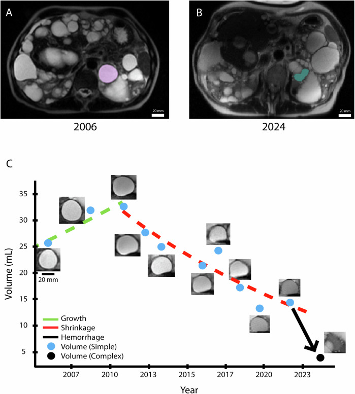
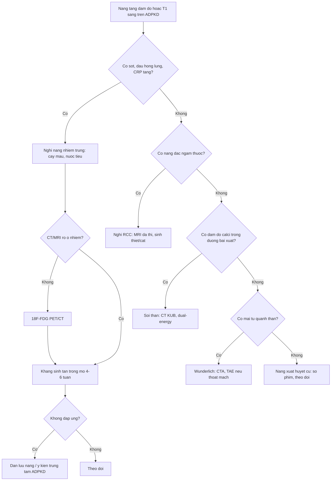
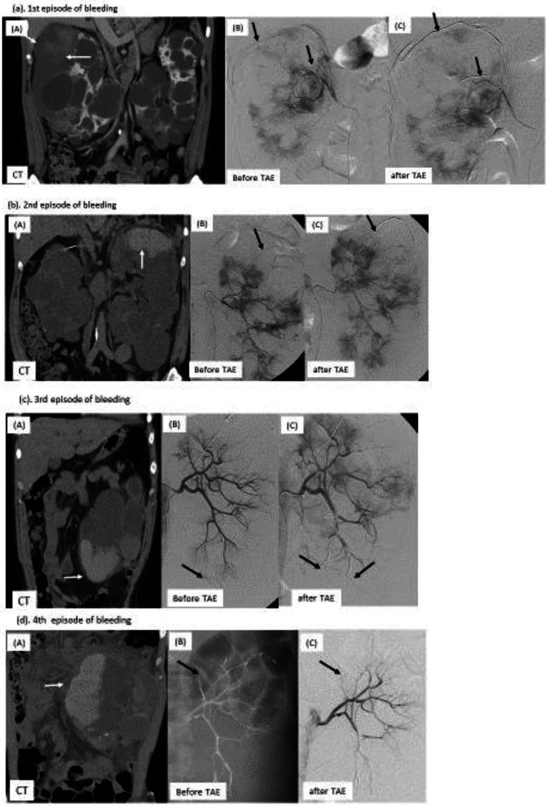
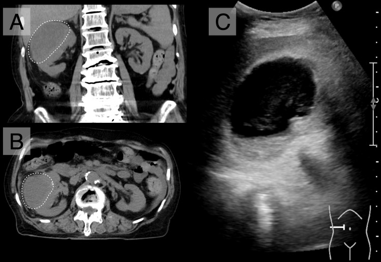
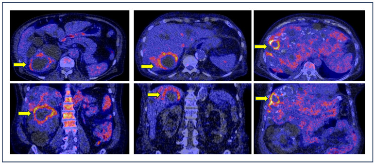

# 164 — Nang thận ADPKD có biến chứng: xuất huyết, nhiễm trùng, sỏi & chảy máu sau phúc mạc (Wunderlich)

**Tags:** `pattern:nang-phuc-tap` `vung:than` `score:Bosniak` `protocol:CT-MRI-nang-than` `incidentaloma:nang-than`
**Mức chắc chắn (certainty):** tổng hợp y văn (literature synthesis) — nhóm tự biên từ y văn mở (Commun Med 2025, Kidney Int Rep 2026, Cureus 2026, Diagnostics 2024, CEN Case Rep 2025) và đối chiếu KDIGO 2025 qua bản bình luận Canada 2026; không gắn một ca nguyên văn duy nhất.

## 1. Tổng quan bệnh học – cơ chế hình ảnh

- **Bệnh thận đa nang trội NST thường (autosomal dominant polycystic kidney disease — ADPKD)** có hai loại nang trên hình ảnh: **nang đơn giản (simple cyst)** chứa dịch trong và **nang phức tạp (complex cyst)** do **xuất huyết trong nang** hoặc **nhiễm trùng nang**. Nang phức tạp gần như gặp ở mọi bệnh nhân ADPKD khi theo dõi đủ lâu, nhưng **nhiễm trùng nang thì hiếm**, ước tính **0,01 đợt/bệnh nhân/năm**, thường sau nhiễm trùng tiểu (PMC12852659, PMC13639172).
- **Lịch sử tự nhiên của từng nang (MRI dọc 8–20 năm, 299 nang/37 bệnh nhân):** nang đơn giản tăng theo mô hình logistic với **tốc độ trung vị 11%/năm**; **94/222 nang (42%)** chuyển sang giai đoạn **teo nhỏ → nang thành phần đặc–dịch hoặc mức dịch–dịch → nang đồng nhất T1 sáng → biến mất**. Ngược lại, nang **T1 sáng đồng nhất không tăng thể tích** (trung vị **0%/năm**, p < 0,001) — đây là **máu cũ đã “cháy hết”**, không phải u đang hoạt động (PMC12852659).
- **Sỏi thận** gặp ở **8–36%** bệnh nhân ADPKD, nguy cơ tương đối **2–10 lần** dân số chung; tuổi khởi phát triệu chứng trung bình **39 ± 14 tuổi**, **25–50%** có triệu chứng; đa số là sỏi acid uric, sau đó calcium oxalate monohydrat (PMC12527218).
- **Chảy máu sau phúc mạc tự phát (Wunderlich syndrome)** là biến chứng **hiếm** nhưng nặng: máu tụ **dưới bao (subcapsular)** hoặc **quanh thận (perinephric)**, có thể gây **Page kidney** (chèn ép nhu mô → tăng huyết áp do renin) và sốc giảm thể tích; **nút mạch qua ống thông (transarterial embolization — TAE)** vừa cầm máu vừa bảo tồn thận (PMC12972201).
- **TẠI SAO đọc được trên CT/MRI (vật lý + mô bệnh):**
  - **Nang đơn giản:** dịch trong → **0–15 HU**, **T1 thấp, T2 rất cao**, thành mỏng không thấy được.
  - **Xuất huyết nang cấp:** hemoglobin thoái giáng thành **methemoglobin** (thuận từ) → **T1 sáng**, **không mất tín hiệu khi fat-sat** (khác mỡ); trên CT **30–100 HU**, có thể thấy **mức dịch–dịch**, **cục máu co rút**, **không ngấm thuốc** (PMC13639172).
  - **Nhiễm trùng nang:** dịch đặc hơn + viêm thành → **đậm độ CT tăng với ngưỡng 10 HU**, **tỷ số tín hiệu T1 > 1,0**, **DWI > 4,0**, kèm **thành dày, viêm mỡ quanh nang, bóng khí**; đây là các dấu hiệu *gợi ý*, không đặc hiệu tuyệt đối (PMC12869266).
  - **Sỏi:** đậm độ calci cao, đo trên cửa sổ xương; **CT hai năng lượng (dual-energy CT)** phân biệt sỏi acid uric với sỏi calci (PMC12527218).
  - **Máu tụ Wunderlich:** máu cấp **50–70 HU**, hình **liềm dưới bao** ép nhu mô; theo thời gian đậm độ giảm dần và có thể dịch hóa.

## 2. Mẫu hình + chẩn đoán phân biệt theo vị trí (gamut)

- **Mẫu hình 1 — nang “sáng” hoặc “đặc” trong thận đa nang:** nang xuất huyết, nang nhiễm trùng, ung thư biểu mô tế bào thận (renal cell carcinoma — RCC) thể nhú, nang đạm/mucin, mảng xơ–vôi.
- **Mẫu hình 2 — tổn thương quanh thận:** máu tụ Wunderlich, nang vỡ, áp-xe quanh thận, rò nước tiểu (urinoma), di căn/lymphoma.
- **Mẫu hình 3 — đậm độ calci trong xoang thận:** sỏi thận, vôi hóa thành nang, vôi hóa mạch máu, di vật.
- **Gamut theo bối cảnh:**
  - **Sốt + đau hông lưng + CRP cao** → nang nhiễm trùng; nếu CT/MRI không rõ → **¹⁸F-FDG PET/CT**.
  - **Đau hông lưng + tiểu máu + Hb giảm, không sốt** → nang xuất huyết hoặc Wunderlich.
  - **Tình cờ, không triệu chứng, T1 sáng đồng nhất** → nang xuất huyết cũ; **không sinh thiết, không mổ**.
  - **Nốt đặc ngấm thuốc trong nang** → nghi RCC, đặc biệt RCC thể nhú ở bệnh thận mạn.
- **Mnemonic “BLOOD–PUS–STONE–TUMOR”:** **B**leed (xuất huyết), **P**us (nhiễm trùng), **S**tone (sỏi), **T**umor (RCC); thêm **W**underlich khi có máu tụ quanh thận.

## 3. Bảng so sánh phân biệt (ma trận đối chiếu)

| Thực thể (entity) | Hình ảnh điển hình (US/CT/MRI) | Chốt vào (rule-in) | Chốt loại (rule-out) | Gợi ý xác nhận |
|---|---|---|---|---|
| **Nang xuất huyết (hemorrhagic cyst)** | CT **30–100 HU**, không ngấm; MRI **T1 sáng, không mất tín hiệu fat-sat**, có **mức dịch–dịch** hoặc cục máu co rút; kích thước **không tăng** theo thời gian | **T1 sáng + không ngấm + không tăng thể tích** (trung vị **0%/năm**) | Ngấm thuốc dạng nốt/thành dày tiến triển → nghĩ u; sốt + CRP cao → nghĩ nhiễm trùng | So phim cũ; MRI T1 ± fat-sat; theo dõi 6–12 tháng nếu chưa chắc |
| **Nang nhiễm trùng (infected cyst)** | Thành dày, **viêm mỡ quanh nang**, **bóng khí**, dịch đặc; **CT > 10 HU**, **T1 ratio > 1,0**, **DWI > 4,0**; PET/CT **ngấm FDG** | **Sốt > 38°C + CRP > 15 mg/dL + WBC > 10.000/µL** + ổ ngấm FDG tương ứng | Không sốt, CRP bình thường, T1 sáng đồng nhất → xuất huyết | Cấy máu/nước tiểu; **¹⁸F-FDG PET/CT** (Se **84,6%**, Sp **94,9%**); chọc hút/dẫn lưu khi kháng trị |
| **Wunderlich (máu tụ dưới bao/quanh thận)** | **Liềm máu tụ 50–70 HU** ép nhu mô; thận to, có thể **Page kidney**; CTA thấy **thoát mạch** hoặc giả phình | **Đau hông lưng đột ngột + Hb giảm + máu tụ quanh thận** trên CT, không chấn thương | Chỉ có nang đơn giản, không dịch quanh thận → loại | **CTA khẩn**; TAE nếu thoát mạch/không ổn định |
| **RCC trong ADPKD** | Nốt đặc **ngấm thuốc** trong nang/thận, **washout**; RCC thể nhú thường ít ngấm, ở bệnh thận mạn | **Thành phần đặc ngấm thuốc** sau tiêm, không phải máu tụ | T1 sáng đồng nhất, không ngấm, không tăng thể tích → xuất huyết | MRI đa thì; sinh thiết/ cắt bỏ khi nghi ngờ |
| **Sỏi thận** | Đậm độ calci trong xoang/đài thận; **CT không cản quang** là chuẩn; **dual-energy** phân biệt acid uric/calci | **Đậm độ calci + vị trí trong đường bài xuất** | Đậm độ thấp, nằm trong nang → không phải sỏi | CT KUB liều thấp; đối chiếu cửa sổ xương |
| **Page kidney** | Máu tụ dưới bao mạn tính ép nhu mô, thận thiếu máu; **tăng huyết áp** | **HA tăng mới + máu tụ dưới bao** | HA bình thường, không máu tụ → loại | Đo renin, siêu âm Doppler, CTA |

*MRI theo dõi 2006 → 2024: nang đơn giản (tím, 2006) teo dần rồi thành nang phức tạp T1 sáng đồng nhất (xanh, 2024); biểu đồ thể tích cho thấy nang T1 sáng không còn tăng thể tích. Nguồn: Hu Z et al., Commun Med 2025 (PMC12852659), CC BY-NC-ND 4.0 — giữ nguyên bản.*

## 4. Protocol chụp + hệ phân độ/điểm chuẩn hóa + hướng xử trí

- **CT bụng – thận:** không cản quang trước, sau đó **thì vỏ–tủy và thì thận** (lát **1–2 mm**); dùng **dual-energy** khi nghi sỏi. Không lặp cản quang không cần thiết ở bệnh thận mạn.
- **MRI thận:** **T1 in/out-phase + T1 fat-sat + T2 + DWI/ADC + sau tiêm**; T1 sáng **không mất tín hiệu fat-sat** = máu/đạm, không phải mỡ. So sánh với phim cũ là bước rẻ nhất để phân biệt xuất huyết cũ với u.
- **Siêu âm:** thành nang, vách, echo trong nang, Doppler; hạn chế khi thận quá to/nhiều nang.
- **¹⁸F-FDG PET/CT:** chỉ định khi **nghi nang nhiễm trùng mà CT/MRI không rõ**; gộp 10 nghiên cứu (282 lần chụp/249 bệnh nhân) cho **Se 84,6% (95% CI 75,4–90,7)**, **Sp 94,9% (95% CI 72,6–99,2)** và **thay đổi xử trí ở hơn một nửa** bệnh nhân (PMC11312050). Lưu ý hoạt động sinh lý đường tiết niệu và viêm quanh nang có thể dương tính giả.
- **Phân độ Bosniak 2019** dành cho **khối nang thận đơn lẻ**, không dùng máy móc cho ADPKD; trong ADPKD, **thành phần đặc ngấm thuốc** mới là dấu hiệu nghi ác, còn nang xuất huyết không ngấm thường lành tính.
- **Nhiễm trùng nang — KDIGO 2025 (qua bình luận Canada 2026):** cấy máu + nước tiểu, kháng sinh **tan trong mỡ** (fluoroquinolone hoặc trimethoprim–sulfamethoxazole), **4–6 tuần**; dẫn lưu nang khi kháng trị; không dùng kháng sinh ngắn ngày như nhiễm trùng tiểu thường (PMC13237251).
- **Sỏi:** CT KUB liều thấp; **ESWL** vẫn dùng được nhưng sạch sỏi thấp hơn thận bình thường do nang chèn ép; **RIRS/PCNL** cho sỏi lớn/đài phức tạp; đánh giá chuyển hóa và dự phòng tái phát (PMC12527218).
- **Wunderlich:** hồi sức + **CTA**; **TAE** là lựa chọn ưu tiên để cầm máu và giữ thận; phẫu thuật khi vỡ không kiểm soát. Sau TAE, **nhiễm trùng nang giảm từ 0,291 xuống 0,087 đợt/năm** (p < 0,001) nhưng **không nên TAE khi đang còn nhiễm trùng nang hoạt động** vì có thể tái hoạt ổ nhiễm (PMC13639172).

## 5. Biến thể bình thường và cạm bẫy

- **“T1 sáng = máu” chưa đủ:** dịch đạm cao, mucin, nang bẩm sinh cũng có thể T1 sáng; trong ADPKD máu là nguyên nhân hay nhất nhưng phải kiểm tra **không ngấm thuốc** và **không tăng thể tích**.
- **Xuất huyết vs nhiễm trùng:** hai bên đều tăng đậm độ/T1; **ngưỡng 10 HU** và **30–100 HU** chồng lấp. Dùng bối cảnh: **sốt > 38°C, WBC > 10.000/µL, CRP > 15 mg/dL** nghiêng nhiễm trùng; đau + Hb giảm nghiêng xuất huyết. Đừng chỉ dựa vào một ngưỡng.
- **PET/CT không phải “chân lý”:** viêm quanh nang, sau can thiệp, hoạt động sinh lý đường niệu có thể dương tính giả; nang nhỏ có thể âm tính giả. Luôn đối chiếu lâm sàng + cấy.
- **Sỏi vs vôi hóa thành nang:** vôi hóa thành nang thường **cong theo thành**, không nằm trong lòng đường bài xuất; sỏi **nằm trong đài/bể thận**, di chuyển theo tư thế trên CT.
- **Wunderlich có thể không đau:** bệnh nhân chỉ thấy mệt, Hb giảm, HA tăng (Page kidney); đừng chờ “đau hông lưng điển hình”.
- **Sau TAE:** đậm độ nang có thể tăng do vật liệu nút mạch/hoại tử, dễ đọc nhầm nhiễm trùng; so phim và dùng PET khi cần.
- **Bosniak trong ADPKD:** đừng gọi nang xuất huyết là Bosniak III chỉ vì “đậm độ cao”; Bosniak dựa trên **ngấm thuốc/thành phần đặc**, không dựa trên đậm độ máu cũ.

## 6. Tự lượng giá — Blind Quiz

**Ca 1 — Nữ 56 tuổi, ADPKD, theo dõi MRI 18 năm. Nang thận phải thay đổi tín hiệu. Nhìn 2 thời điểm, mô tả trước.**

- Gợi ý: không có triệu chứng nhiễm trùng; theo dõi định kỳ.
- Hỏi: nang thay đổi thế nào? Tín hiệu T1 nói lên điều gì? Có cần sinh thiết không?

<b>Bấm để hiện đáp án (findings + chẩn đoán)</b>

- **Dấu hiệu:** năm 2006 nang đơn giản T2 sáng/T1 tối; năm 2024 nang **T1 sáng đồng nhất**, thể tích **không tăng** (biểu đồ: nang phức tạp đi ngang **0%/năm**).
- **Chẩn đoán:** **nang xuất huyết cũ (hemorrhagic cyst)** — methemoglobin làm T1 sáng; xơ hóa/co rút làm nang ngừng tăng thể tích.
- **Không sinh thiết** khi không có thành phần đặc ngấm thuốc; theo dõi bằng MRI nếu cần.
- Nguồn ảnh: Hu Z et al., Commun Med 2025 (PMC12852659), CC BY-NC-ND 4.0.

**Ca 2 — Nam 45 tuổi, ADPKD, đau hông lưng phải đột ngột, tăng huyết áp, không chấn thương. CT bụng cấp.**

- Gợi ý: không chấn thương; thận hai bên nhiều nang.
- Hỏi: dịch quanh thận là gì? Vì sao HA tăng? Bước tiếp theo?

<b>Bấm để hiện đáp án (findings + chẩn đoán)</b>

- **Dấu hiệu:** **máu tụ dưới bao/quanh thận** (liềm tăng đậm độ), thận phải bị ép; DSA có **thoát mạch** từ nhánh động mạch bao thận, được **TAE bằng microcoil**.
- **Chẩn đoán:** **Wunderlich syndrome** do nang ADPKD vỡ; HA tăng do **Page kidney** (máu tụ ép nhu mô → renin).
- **Xử trí:** hồi sức, CTA, **TAE** để cầm máu và bảo tồn thận; theo dõi Hb, HA, chức năng thận.
- Nguồn ảnh: Mizuta M et al., CEN Case Rep 2025 (PMC12972201), CC BY 4.0.

**Ca 3 — Nữ 89 tuổi, nang thận phải đã biết, chỉ mệt, chán ăn, chóng mặt; CRP tăng và nước tiểu có E. coli. CT và siêu âm bụng.**

- Gợi ý: nước tiểu có E. coli; nang to hơn phim cũ.
- Hỏi: dấu hiệu nào nghi nhiễm trùng? Phân biệt với xuất huyết? Khi nào dùng PET/CT?

<b>Bấm để hiện đáp án (findings + chẩn đoán)</b>

- **Dấu hiệu:** nang **to ra, thành dày, viêm mỡ quanh nang**, dịch đặc/echo trong nang; không có cục máu co rút.
- **Chẩn đoán:** **nang nhiễm trùng (infected cyst)** — vi khuẩn từ đường tiểu; đậm độ **> 10 HU**, T1 ratio **> 1,0**, DWI **> 4,0** là các ngưỡng gợi ý.
- **Xử trí:** kháng sinh **tan trong mỡ 4–6 tuần**; dẫn lưu nếu kháng trị. Khi CT/MRI không rõ, **¹⁸F-FDG PET/CT** (Se **84,6%**, Sp **94,9%**):

- Nguồn ảnh: Ito Y, Sunada K., Cureus 2026 (PMC12869266), CC BY 4.0; Treglia G et al., Diagnostics 2024 (PMC11312050), CC BY 4.0.

## Bài liên quan chéo
- [157 – Bệnh thận đa nang ADPKD/ARPKD & gan đa nang](../157-benh-than-da-nang-adpkd-arpkd/lesson.md)
- [150 – Nang thận & phân độ Bosniak](../150-nang-than-Bosniak/lesson.md)
- [151 – U thận đặc: RCC vs oncocytoma vs AML](../151-u-than-dac/lesson.md)
- [153 – Bệnh thận nang mắc phải (ACKD) & RCC](../153-benh-than-nang-mac-phai-loc-mau/lesson.md)
- [178 – Di căn xương RCC & biến chứng cơ học](../178-di-can-xuong-RCC-bien-chung-co-hoc/lesson.md)

> Không dùng để chẩn đoán độc lập khi chưa có người hướng dẫn.
