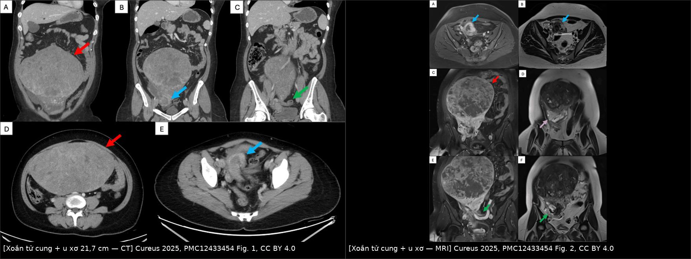
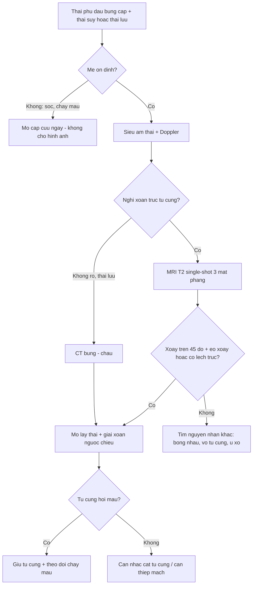
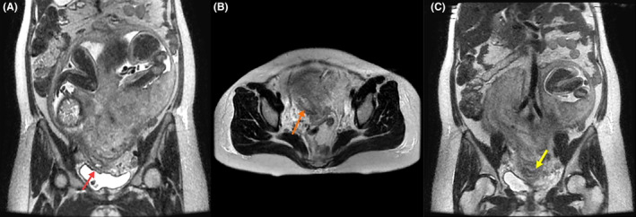
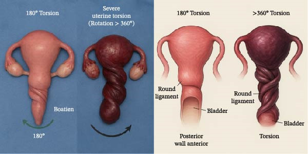

# 1640 — Xoắn tử cung trong thai kỳ / Gravid uterine torsion

**Tags:** `pattern:xoan-tu-cung` `pattern:daubung-cap` `vung:tu-cung` `vung:tieu-khung` `vung:thai` `protocol:MRI-thai` `protocol:sieu-am-doppler` `protocol:CT-bung`
**Mức chắc chắn (certainty):** tổng hợp y văn (literature synthesis) — gồm 1 đoàn hệ hồi cứu có đối chứng (Yoshida Y et al., *Reprod Sci* 2026, PMC12948917, 70 ca mổ lấy thai), 1 tổng quan 27 ca báo cáo (Boehm K et al., *Cureus* 2024, PMC11244724), 1 báo ca + tổng quan (Alazemi E, *Case Rep Obstet Gynecol* 2026, PMC13178284), 2 báo ca có mô tả hình ảnh chi tiết (Salam D et al., *Cureus* 2025, PMC12433454; Kim S et al., *Clin Case Rep* 2024, PMC10784863) và 4 báo ca bổ sung cho gamut nguyên nhân. **Chưa có RCT hay nghiên cứu tiến cứu** — mọi ngưỡng dưới đây là mô tả/đồng thuận, không phải khuyến cáo cấp A.

## 1. Tổng quan bệnh học – cơ chế hình ảnh

- **Định nghĩa (ngưỡng số 1):** xoắn tử cung (uterine torsion) = **xoay > 45° quanh trục dọc** của tử cung. Xoay **< 45° là hiện tượng sinh lý thường gặp ở tam cá nguyệt 3**, không phải bệnh (Boehm K et al. 2024; Kocher M & Hirsig L 2020; Yoshida Y et al. 2026 dùng đúng ngưỡng > 45° để định nghĩa trong đoàn hệ của họ). Y văn mô tả **biên độ 45–720°** (Singh S et al. 2024; Boehm K et al. 2024).
- **Hướng xoay:** **~2/3 ca là xoay phải (dextrorotation)**, phần còn lại xoay trái (Boehm K et al. 2024). Đây là con số của tổng quan, **không phải quy luật tuyệt đối** — ca bên trái vẫn tồn tại và không loại trừ chẩn đoán.
- **Thời điểm:** điển hình tam cá nguyệt 3, nhưng đã ghi nhận **từ tuần thai thứ 6** (Boehm K et al. 2024).
- **TẠI SAO tổn thương xảy ra theo thứ tự tĩnh mạch → động mạch (cơ chế quyết định hình ảnh):** tĩnh mạch tử cung **thành mỏng, áp lực thấp**, bị ép trước khi vòng xoắn đủ chặt để chẹn động mạch. Hệ quả theo bậc:
  1. **Ứ trệ tĩnh mạch** → tử cung cương, phù, màu tím; hồng cầu thoát vào cơ tử cung = **tử cung Couvelaire (uteroplacental apoplexy)**. Đây là lý do hình ảnh mổ thấy **tử cung tím, xoắn "vỏ ốc" ở đoạn dưới** (Alazemi E 2026, Fig. 1–2).
  2. **Tăng áp lực mao mạch – bong nhau** → chảy máu sau nhau, thai suy.
  3. **Chẹn động mạch xoắn ốc** → giảm tưới máu bánh nhau → **thai suy cấp (nhịp chậm kéo dài) rồi thai lưu**.
  Vì vậy **thai suy/thai lưu có thể xuất hiện trước khi mẹ tụt huyết áp**, và **giải xoắn xong tử cung hồi màu** là bằng chứng còn sống (Alazemi E 2026).
- **TẠI SAO siêu âm hay bỏ sót (vật lý sóng âm):** vòng xoắn nằm ở **eo tử cung, sâu trong tiểu khung**, sau bàng quang và bị tử cung to che; ở tam cá nguyệt 3 cửa sổ âm bị giới hạn, mô mỡ – hơi ruột làm suy giảm chùm tia; các dấu hiệu chỉ là **gián tiếp** (mạch buồng trứng quấn quanh tử cung, vị trí bánh nhau lệch, ngôi thai bất thường). Hệ quả thực tế: trong ca của Liu L et al. (*Medicine* 2025), **cả siêu âm trước mổ lẫn CT đều KHÔNG đưa ra được chẩn đoán xác định** — chẩn đoán chỉ có khi mổ.
- **TẠI SAO MRI là phương thức hợp lý nhất (không xạ, không cản quang):**
  - Cổ tử cung bị **neo ở đỉnh âm đạo**; khi thân tử cung xoay, **trục cổ – eo bị vặn** → trên T2 **không thể thấy cổ tử cung thẳng trên một lát cắt duy nhất**, góc cổ – âm đạo **gấp khúc**, âm đạo bị **kéo lệch một bên** (Kocher M & Hirsig L 2020; Kim S et al. 2024 gọi là "vaginal stretch" phải, thấy hồi cứu trên MRI trước sinh).
  - **Dấu "whirlpool" (xoáy nước):** eo tử cung đóng vai trò **cuống xoắn**, mô và mạch ở eo tạo hình xoáy trên các lát liên tiếp (Kocher M & Hirsig L 2020).
  - Chuỗi xung dùng: **single-shot T2 (HASTE/TrueFISP) 3 mặt phẳng, lát 4–6 mm**, không cần gadolinium; thời gian ngắn, không cần nín thở dài — phù hợp thai phụ đau, không hợp tác.
- **TẠI SAO CT ít vai trò:** CT bụng–chậu có cản quang cho thấy **khối u xơ khổng lồ và phần phụ bị đẩy sang bên đối diện** (ca Salam D et al.: u **21,7 × 12,9 × 17,3 cm**, phần phụ trái bị đẩy sang phải; xoắn **360°** xác nhận khi mổ), nhưng **liều xạ thai nhi** khiến CT chỉ dùng khi nghi nguyên nhân ngoài sản khoa hoặc sau khi thai đã lưu.
- **Tần suất thật chưa rõ:** các tổng quan thường dẫn một con số "1/5500 ca sinh" nhưng **ta chưa đối chiếu được bài gốc** → ghi **"chưa rõ — cần tra"**, không dùng để tư vấn nguy cơ. Con số **đo được** đáng tin hơn: trong **70 ca mổ lấy thai ở người có lạc nội mạc trong cơ**, xoắn **> 45° gặp 8,6% (6/70)**, **tất cả đều KHÔNG triệu chứng**, và chiếm **13,6% (6/44)** nhóm lạc nội mạc **thể khu trú** (Yoshida Y et al. 2026) — nghĩa là xoắn nhẹ–vừa **âm thầm** phổ biến hơn ta tưởng ở nhóm nguy cơ.
- **Hệ quả thai nhi (số liệu tổng quan):** trong **27 ca báo cáo** được rà soát, **3/27 (11,1%) thai lưu hoặc tử vong sơ sinh** (Boehm K et al. 2024). Nhóm **≥ 360°** gắn với **bong nhau, thai lưu và chảy máu nặng** nhiều hơn nhóm ≤ 180° (Alazemi E 2026, dẫn tổng quan hệ thống).

## 2. Mẫu hình + chẩn đoán phân biệt theo vị trí (gamut)

**Trục A — theo mức độ xoay (quyết định tiên lượng và đường mổ):**

| Mức xoay | Ý nghĩa | Hệ quả thường gặp |
|---|---|---|
| **< 45°** | Sinh lý tam cá nguyệt 3 | Không can thiệp; đừng chẩn đoán bệnh |
| **45–180°** | Xoắn bệnh lý nhẹ–vừa, hay gặp nhất trong y văn | Đau, ngôi bất thường; giải xoắn rồi mổ lấy thai thường an toàn |
| **180–360°** | Xoắn nặng | Thai suy, bong nhau; đường rạch tử cung có thể phải **mặt sau** |
| **> 360°** | Xoắn cực độ (hiếm) | Bong nhau + tử cung Couvelaire + thai lưu + nguy cơ cắt tử cung |

**Trục B — theo nguyên nhân (gamut "5 nhóm"):**
1. **U xơ tử cung** (đặc biệt u xơ **lớn hoặc ở đoạn dưới/eo**, dưới thanh mạc) — nhóm hay gặp nhất; ca điển hình u **21,7 cm / 2,168 kg** (Salam D et al. 2025).
2. **Dị dạng tử cung bẩm sinh** — ca **tử cung hai thân hoàn toàn + hai cổ + vách dọc âm đạo (U3b/C2/V1)** xoắn trong song thai (Gao Q et al. 2023).
3. **Dính tiểu khung** (hậu mổ, hậu viêm) — ca xoắn **~90° phải** do dính dày thành sau tử cung (Kim S et al. 2024).
4. **Khối phần phụ / nang buồng trứng** kéo – đẩy tử cung (Singh S et al. 2024).
5. **Ngôi thai bất thường và thủ thuật xoay thai ngoài (ECV)** — ca ngôi ngang tái diễn, ECV gây suy thai rồi phát hiện xoắn **180°** khi mổ (Boehm K et al. 2024).
   *Bổ sung mới:* **lạc nội mạc trong cơ thể khu trú** là yếu tố nguy cơ **âm thầm** (8,6% đoàn hệ mổ lấy thai; Yoshida Y et al. 2026) — nhóm này **không đau**, chỉ lộ ra khi mổ vì **phải rạch da trên rốn (50%)** và **rạch tử cung không điển hình (83,3%)**.

**Trục C — theo bệnh cảnh lâm sàng:**
- **Cấp:** đau bụng dữ dội + sốc/tụt huyết áp + thai suy hoặc thai lưu (Alazemi E 2026; Liu L et al. 2025).
- **Bán cấp:** đau + ngôi thai bất thường tái diễn + nhịp tim thai không ổn định (Boehm K et al. 2024).
- **Âm thầm:** không triệu chứng, phát hiện khi mổ lấy thai theo chỉ định khác (Yoshida Y et al. 2026).

## 3. Bảng so sánh phân biệt (ma trận đối chiếu)

| Thực thể (entity) | Hình ảnh điển hình (US/CT/MRI) | Chốt vào (rule-in) | Chốt loại (rule-out) | Gợi ý xác nhận |
|---|---|---|---|---|
| **Xoắn tử cung** | MRI T2: **eo xoáy "whirlpool"**, cổ tử cung **không thấy thẳng trên 1 lát**, góc cổ–âm đạo gấp khúc, **âm đạo kéo lệch bên**; CT: phần phụ bị đẩy sang bên đối diện khối u lớn | **Xoay > 45° + (eo xoáy HOẶC cổ tử cung lệch trục) + bánh nhau/ngôi thai ở vị trí "không thể"** | **Cổ tử cung thẳng, liên tục trên một lát giữa + không xoáy eo** → không phải xoắn | Mổ: nhận diện **dây chằng tròn** để xác định trước–sau, giải xoắn ngược chiều |
| **Nhau bong non** | Siêu âm: hồ máu sau nhau **T1 sáng/T2 tối**, dày bánh nhau; Doppler giảm tưới máu; có thể **bình thường tới 50%** | **Đau + tử cung cứng + ra máu âm đạo + suy thai**; hồ máu sau nhau | **Không có hồ máu sau nhau nhưng có xoáy eo + cổ lệch trục** → xoắn (và xoắn **gây** bong nhau) | Theo dõi sát; chẩn đoán cuối cùng vẫn là mổ |
| **Vỡ tử cung** | Mất liên tục cơ tử cung, **thai/ phần thai ngoài buồng tử cung**, dịch ổ bụng nhiều, thai tự do | **Mất liên tục thành tử cung + túi thai ngoài lòng** | **Thành tử cung còn liên tục, chỉ xoay trục** → xoắn | Mổ cấp cứu |
| **U xơ thoái triển đỏ / xoắn u có cuống** | U xơ **T2 tối đều**, viền **T1 tăng (47%)**, viền tối **SWI (100%)**; xoắn cuống: mất Doppler cuống | **Đau khu trú đúng u + viền T1 tăng/SWI tối + không có xoáy eo tử cung** | **Có xoáy eo + cổ lệch trục + đau lan toàn bụng** → xoắn tử cung, không chỉ u xơ | So với [532](../532-u-xo-trong-thai-ky-thoai-trien-do/lesson.md) |
| **Tử cung nghẹt (incarceration)** | MRI T2: **đáy tử cung ngả sau, kẹt dưới eo nhô xương cùng**, cổ tử cung **bị kéo dài** trước bàng quang; bàng quang bị đẩy lên trên | **Đáy tử cung sau eo nhô + bí tiểu + cổ tử cung không sờ được** | **Đáy tử cung ở đúng vị trí trước + không bí tiểu** → không nghẹt | Có thể **đồng thời** với xoắn (Kocher M & Hirsig L 2020) — đừng dừng ở chẩn đoán đầu tiên |
| **Xoay sinh lý < 45°** | Tử cung hơi nghiêng, **cấu trúc eo – cổ bình thường**, không xoáy | **Xoay nhẹ, không triệu chứng, không suy thai** | **Xoay > 45° + bất thường eo/cổ** → bệnh lý | Không can thiệp |

*Trái: CT bụng–chậu có cản quang (A–E) — khối u xơ dưới thanh mạc rất lớn choán tiểu khung, đẩy các cấu trúc sang bên. Phải: MRI (A–F) — khối u xơ tín hiệu trung tính, phần phụ trái bị đẩy chéo sang phải tiểu khung (mũi tên); mổ xác nhận xoắn 360°. Nguồn: Salam D et al., Cureus 2025, PMC12433454 Fig. 1–2, CC BY 4.0. Ảnh ghép letterbox, không crop.*

### Dấu hiệu "đọc được" trên từng chuỗi xung
- **T2 single-shot (HASTE/TrueFISP) — dấu chốt:** *đường viền cổ tử cung*. Bình thường cổ tử cung là **một ống thẳng, liên tục trên một lát cắt đứng dọc**. Khi xoắn, **không lát nào chứa trọn cổ tử cung thẳng**, và **góc cổ–âm đạo gấp khúc** (Kocher M & Hirsig L 2020). Đây là dấu **có/không**, dễ dạy lại hơn mọi phép đo.
- **Dấu "whirlpool":** trên 3 mặt phẳng, mô eo và mạch tử cung tạo **xoáy quanh trục** — eo là cuống xoắn (Kocher M & Hirsig L 2020). Đừng nhầm với xoắn phần phụ (cuống là **mạch buồng trứng**, không phải eo tử cung).
- **Vị trí phần phụ:** phần phụ **bị đẩy sang bên đối diện** khối u lớn (Salam D et al. 2025) — dấu phụ nhưng rất hữu ích khi có u xơ khổng lồ.
- **Âm đạo kéo lệch (vaginal stretch):** trục âm đạo bị kéo về một bên, thấy rõ trên lát cắt vành (Kim S et al. 2024).

## 4. Protocol chụp + phân độ + xử trí

**Bước hình ảnh (thai còn sống, mẹ ổn định):**

| Bước | Phương thức | Thông số / nội dung | Vì sao |
|---|---|---|---|
| 1 | **Siêu âm thai + Doppler** | Đánh giá thai, ngôi, bánh nhau, dịch ổ bụng; Doppler **mạch buồng trứng** xem có quấn quanh tử cung | Tại giường, không xạ; nhưng **âm tính không loại trừ** |
| 2 | **MRI thai – tử cung** | **T2 single-shot (HASTE/TrueFISP) 3 mặt phẳng, lát 4–6 mm**, không gadolinium; đọc 3 dấu: cổ tử cung trên 1 lát, góc cổ–âm đạo, xoáy eo | Không xạ, thấy trục tử cung – cổ – âm đạo; ca Kim S et al. là **ca đầu tiên chẩn đoán hồi cứu bằng MRI** |
| 3 | **CT bụng–chậu có cản quang** | Chỉ khi nghi nguyên nhân ngoài sản khoa, hoặc thai đã lưu, hoặc mẹ không ổn định cần loại trừ cấp cứu khác | Nhanh, thấy u xơ/phần phụ; **đánh đổi liều xạ thai** |

**Phân độ theo mức xoay** (dùng để mô tả, **không phải hệ điểm có giá trị tiên lượng đã kiểm chứng**): < 45° sinh lý; 45–180°; 180–360°; > 360°. Bằng chứng: nhóm **≥ 360°** gắn với bong nhau/thai lưu/chảy máu nặng hơn (Alazemi E 2026); nhóm **≤ 180°** thường vào tử cung an toàn sau giải xoắn tối thiểu.

**Nguyên tắc mổ (từ các ca đã báo cáo):**
- **Định hướng trước khi rạch:** nhận diện **dây chằng tròn, vòi trứng, buồng trứng** để biết mặt trước thật; nếu không chắc, **giải xoắn một phần** rồi mới rạch (Alazemi E 2026).
- **Đường rạch tử cung:** xoắn ≥ 180° có thể làm **mặt trước tử cung bị vặn ra sau** → ca 180° từng phải **rạch tử cung mặt sau (posterior hysterotomy)** để lấy thai (Boehm K et al. 2024); ca **> 360°** dùng **rạch dọc trên đoạn thân** sau khi giải xoắn một phần (Alazemi E 2026).
- **Giải xoắn ngược chiều** rồi đánh giá màu sắc; **kiểm tra phần phụ** (xoắn buồng trứng đồng thời) và **bánh nhau** (bong nhau sau giải xoắn).
- **Cầm máu có cấu trúc** khi có Couvelaire/bong nhau: oxytocin, **acid tranexamic**, fibrinogen concentrate, **bóng chèn trong tử cung** — ca của Alazemi E **giữ được tử cung** dù xoắn > 360°.
- **Sau mổ:** ca 180° có **thai kỳ sau sinh đủ tháng bằng mổ lấy thai lặp lại sau 5 năm** (Boehm K et al. 2024); ca xoắn do dính được **cắt dính + rút ngắn dây chằng tròn hai bên**, tử cung về hình thái bình thường **ngày 14 và ngày 42** (Liu L et al. 2025).

## 5. Biến thể bình thường và cạm bẫy

- **Cạm bẫy 1 — gọi sinh lý là bệnh:** xoay **< 45°** ở tam cá nguyệt 3 là bình thường. Đừng mô tả "xoắn tử cung" chỉ vì tử cung hơi nghiêng; phải có **> 45° + bất thường eo/cổ** hoặc bất thường lâm sàng.
- **Cạm bẫy 2 — tin vào "siêu âm bình thường":** trong ca thai lưu tam cá nguyệt 3, **cả siêu âm lẫn CT đều không chẩn đoán được** (Liu L et al. 2025). Bình thường hình ảnh **không loại trừ**; bối cảnh đau + sốc + suy thai vẫn là chỉ định mổ.
- **Cạm bẫy 3 — bỏ qua "cổ tử cung không thấy trên một lát":** người đọc dễ cho là **do tư thế thai/thiếu lát cắt**. Nếu cổ tử cung **không thể hiện trọn trên bất kỳ lát giữa nào** kèm góc cổ–âm đạo gấp khúc, phải nghĩ xoắn hoặc nghẹt tử cung (Kocher M & Hirsig L 2020).
- **Cạm bẫy 4 — nhầm với bong nhau đơn thuần:** xoắn **gây** bong nhau; thấy hồ máu sau nhau không có nghĩa đã đủ chẩn đoán. Ngược lại, **không thấy hồ máu** cũng không loại trừ bong nhau (siêu âm có thể bình thường).
- **Cạm bẫy 5 — dừng ở chẩn đoán "u xơ":** u xơ khổng lồ vừa là **nguyên nhân**, vừa **che mất** dấu xoắn. Khi u xơ **đoạn dưới/eo** hoặc **> 15 cm**, phải chủ động tìm dấu xoay trục.
- **Cạm bẫy 6 — tư thế và đường rạch:** xoắn làm **mất mốc trước–sau**; rạch theo "mặt trước tưởng tượng" có thể vào **mặt sau tử cung** hoặc vào **bánh nhau**. Luôn xác định dây chằng tròn trước.
- **Cạm bẫy 7 — nhóm nguy cơ âm thầm:** lạc nội mạc trong cơ **thể khu trú** có **8,6% xoắn không triệu chứng** trong đoàn hệ mổ lấy thai; hậu quả thực dụng là **phải rạch da trên rốn (50% vs 0%)** và **rạch tử cung không điển hình (83,3% vs 23,4%)** — hãy chuẩn bị trước, đừng phát hiện giữa cuộc mổ (Yoshida Y et al. 2026).
- **Biến thể bình thường cần nhớ:** **xoay nhẹ khi mang thai là do tử cung to đè lên trực tràng/IVC** và **do thai nằm lệch**; nó tự hồi phục sau sinh và không cần theo dõi riêng.

## 6. Tự lượng giá — Blind Quiz

**Ca 1 — Nữ 37 tuổi, chưa sinh, đau hông lưng phải cấp. Nhìn 2 ảnh dưới, mô tả trước khi mở đáp án.**

- Gợi ý lâm sàng: đau bụng cấp, không sốt, không ra máu âm đạo; khối lớn chiếm tiểu khung.
- Câu hỏi: (1) Khối lớn nhất nằm ở đâu, kích thước ước lượng? (2) Dấu nào cho biết tử cung **đã xoay trục** chứ không chỉ có u xơ? (3) Ba chẩn đoán phân biệt và dấu chốt?

<b>Bấm để hiện đáp án (findings + chẩn đoán)</b>

- **Dấu hiệu:** khối **dưới thanh mạc 21,7 × 12,9 × 17,3 cm** xuất phát từ đáy/thân tử cung, tín hiệu trung tính trên T2, ngấm thuốc không đồng nhất; **phần phụ trái bị đẩy chéo sang phải tiểu khung** — dấu gián tiếp của xoay trục. Mổ xác nhận **xoắn 360°**, u xơ **2,168 kg**.
- **Chẩn đoán:** **xoắn tử cung do u xơ khổng lồ** — vì khối u lớn làm trọng tâm tử cung lệch khỏi trục, mô men xoắn tăng khi tử cung co – di chuyển.
- **Phân biệt:** u xơ thoái triển đỏ (viền T1 tăng/SWI tối, không xoáy eo), xoắn u có cuống (mất Doppler cuống), nang buồng trứng xoắn (cuống là mạch buồng trứng).
- **Nguồn ảnh:** Salam D et al., *Cureus* 2025, PMC12433454 Fig. 1–2, CC BY 4.0.

**Ca 2 — Thai 34 tuần, tiền sản giật nặng, ngôi ngang. MRI được chỉ định vì nghi nhau cài răng lược.**

- Câu hỏi: (1) Cổ tử cung có gì bất thường? (2) Dấu này gợi ý gì khi mổ lấy thai? (3) Có cần cản quang không?

<b>Bấm để hiện đáp án</b>

- **Dấu hiệu:** cổ tử cung **bị kéo dài và lệch sang phải**, trục âm đạo – cổ **không thẳng** (mũi tên đỏ/vàng); âm đạo bị "kéo" (vaginal stretch).
- **Chẩn đoán:** **xoắn tử cung ~90° phải do dính thành sau tử cung** — chẩn đoán hồi cứu trên MRI trước sinh; khi mổ thấy tử cung xoay 90° phải.
- **Ý nghĩa thực hành:** dấu này cảnh báo **mốc giải phẫu bị lệch** → chuẩn bị tinh thần rạch tử cung ở vị trí không điển hình và kiểm tra phần phụ.
- **Không cần gadolinium**: T2 single-shot đủ thấy trục cổ – âm đạo; tránh thuốc cản quang khi không cần ở thai phụ.
- **Nguồn ảnh:** Kim S et al., *Clin Case Rep* 2024, PMC10784863 Fig. 3, CC BY-NC-ND 4.0 (nguyên bản, không chỉnh sửa).

**Ca 3 — Hình minh họa hai mức xoắn. Nhìn hình, trả lời trước khi mở.**

- Câu hỏi: (1) Hai hình khác nhau ở điểm nào về giải phẫu? (2) Mức xoắn nào nguy cơ bong nhau/thai lưu cao hơn? (3) Vì sao phải giải xoắn **từng bước** thay vì giật mạnh một lần?

<b>Bấm để hiện đáp án</b>

- **Dấu hiệu:** bên trái **xoắn 180°** — thân tử cung xoay nửa vòng, **dây chằng tròn** vẫn nhận ra được, đoạn dưới chỉ vặn nhẹ; bên phải **xoắn > 360°** — đoạn dưới – eo tạo **hình "vỏ ốc" nhiều vòng**, tử cung tím, bàng quang bị kéo lệch.
- **Chẩn đoán/ý nghĩa:** mức **> 360°** gắn với **bong nhau, tử cung Couvelaire, thai lưu và chảy máu nặng** nhiều hơn; mức **≤ 180°** thường vào tử cung an toàn sau giải xoắn tối thiểu.
- **Vì sao giải xoắn từng bước:** xoay nhiều vòng làm mô và mạch ở eo bị vặn; giải đột ngột có thể **làm bong nhau hoàn toàn/giải phóng cơn chảy máu**; giải từng bước cho phép **nhận diện dây chằng tròn – phần phụ** và đánh giá khả năng hồi phục của tử cung trước khi quyết định giữ hay cắt.
- **Nguồn ảnh:** Alazemi E, *Case Rep Obstet Gynecol* 2026, PMC13178284 Fig. 4, CC BY 4.0.

## Bài liên quan chéo
- [500 – Tổng quan Hệ Vú & Sản phụ khoa](../500-tong-quan-vu-san-phu-khoa/lesson.md)
- [532 – U xơ tử cung trong thai kỳ & thoái triển đỏ](../532-u-xo-trong-thai-ky-thoai-trien-do/lesson.md) (đau bụng cấp + u xơ; đây là hàng DDx gần nhất)
- [553 – Đảo ngược tử cung do sinh](../553-dao-nguoc-tu-cung-do-sinh/lesson.md) (băng huyết sau sinh + không sờ thấy đáy tử cung)
- [554 – Polyp nội mạc & u xơ có cuống sa qua cổ tử cung](../554-polyp-noi-mac-va-u-xo-sa-qua-co-tu-cung/lesson.md) (khối "sa" nhưng còn cổ tử cung)
- [560 – Nhau cài răng lược: cấp cứu sản khoa](../560-nhau-cai-rang-luoc-PAS-cap-cuu-san/lesson.md) (bối cảnh MRI trước sinh)
- [1624 – Polyp nhau & khối trong buồng tử cung sau sinh/sảy](../1624-polyp-nhau-khoi-buong-tu-cung-sau-sinh/lesson.md)

> Không dùng để chẩn đoán độc lập khi chưa có người hướng dẫn.
