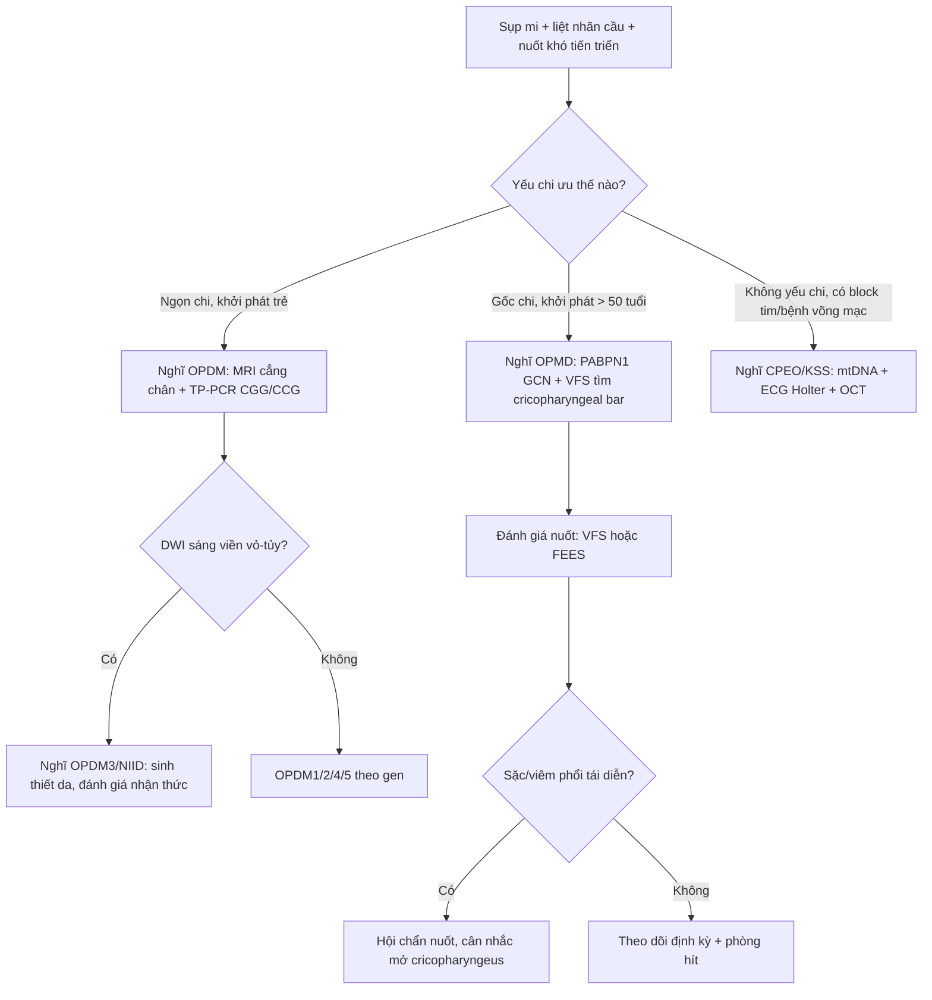
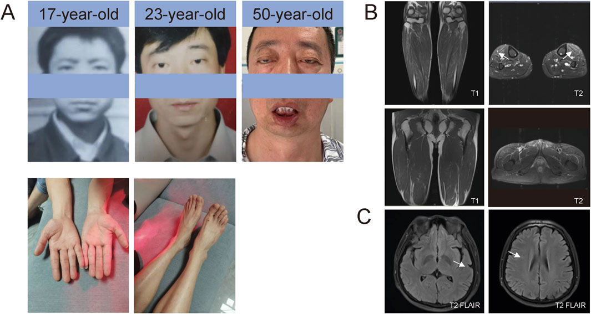
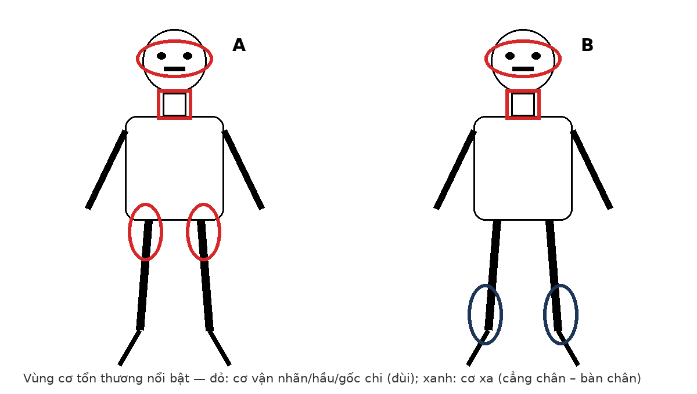

# 1641 — OPMD & OPDM so với CPEO: sụp mi – liệt nhãn cầu – nuốt khó, MRI cơ và DWI sọ / Oculopharyngeal muscular dystrophy (OPMD), oculopharyngodistal myopathy (OPDM) vs CPEO

**Tags:** `pattern:sup-mi` `pattern:liet-nhan-cau` `pattern:nuot-kho` `pattern:teo-co` `pattern:thay-mo-co` `pattern:phu-co` `pattern:ngoai-tuy` `vung:ho-nao` `vung:co-van-nhan` `vung:chi-duoi` `vung:nao` `score:GCN-repeat` `score:Mercuri` `score:FNOP-spectrum` `protocol:MRI-co-chi` `protocol:RT-MRI-nuot` `protocol:videofluoroscopy` `protocol:QMUS` `anatomy:co-van-nhan`

**Mức chắc chắn (certainty):** tổng hợp y văn (literature synthesis) — số liệu lấy từ tổng quan OPDM 2025 (PMC13142886), tổng quan OPMD 2026 (PMC13661686), đoàn hệ 102 người bệnh OPMD Israel (PMC13188457), ca OPDM4 mang **126 CGG** (PMC11903759), 2 ca OPDM3 có bất thường DWI tiểu não (PMC11543384) và nghiên cứu **13 bệnh nhân OPMD** chụp MRI thời gian thực + siêu âm cơ định lượng (PMC13140979). Chưa có ca nguyên văn do nhóm tự thu thập; mọi chỗ suy luận được ghi rõ.

> **Câu chốt:** ba bệnh cùng có **sụp mi + liệt nhãn cầu + nuốt khó**, nhưng **ổ yếu cơ khác nhau và hình ảnh khác nhau**: **(1) OPMD** — khởi phát **> 50 tuổi**, yếu **GỐC chi (80%)**, **thanh quản hẹp do vòng cricopharyngeus (cricopharyngeal bar)**; **(2) OPDM** — khởi phát **sớm hơn (~22 tuổi ở thể OPDM4)**, yếu **NGỌN chi (77% OPDM1)**, **MRI cẳng chân thay mỡ nhiều hơn đùi**, có thể kèm **DWI sáng viền vỏ–tủy và chất trắng**; **(3) CPEO/KSS** — **không yếu chi kiểu ngọn–gốc**, nhưng có **bệnh võng mạc sắc tố + block dẫn truyền tim**. Sai lầm chết người: gọi “sụp mi + nuốt khó tuổi già” là **tai biến mạch não** rồi bỏ qua **nguy cơ sặc – viêm phổi hít**, hoặc điều trị **viêm cơ** khi MRI chỉ có **thay mỡ không phù**.

## 1. Tổng quan bệnh học – cơ chế hình ảnh

### 1.1. OPMD — bệnh chuỗi polyalanine của PABPN1, khởi phát muộn, ưu thế GỐC chi

- **Gen – đột biến:** OPMD do **tăng số bộ ba GCN** (GCG/GCA mã hóa alanine) ở exon 1 của **PABPN1 (14q11.2)**. Alen bình thường **≤ 10** lần lặp; alen bệnh **11–18** lần. Kiểu **(GCN)11 dị hợp** có **độ xuyên thấu giảm**, còn **đồng hợp (GCN)11** gây bệnh kiểu **lặn** — đây là lý do có ca “lẻ tẻ” không có tiền sử gia đình (PMC13142886, PMC13661686).
- **Dịch tễ:** **~1/100.000** ở người da trắng, nhưng **1/600** ở người Do Thái Bukhara (Israel) và **1/1.000** ở người Canada gốc Pháp; đảo Canary **≥ 5,65/100.000** (PMC13661686). Tiền sử **gia đình + gốc dân tộc** có giá trị hơn con số chung.
- **Tuổi khởi phát (đoàn hệ 95 ca dị hợp 10/13, PMC13188457):** nuốt khó **53,0 ± 8,3** tuổi, sụp mi **53,9 ± 7,2**, yếu chi **57,9 ± 10,2**; nữ khởi phát sớm hơn nam **~4 năm** (48,9 ± 7,9 vs 52,6 ± 7,1; **p = 0,02**). Lúc khám (61,6 ± 10,7 tuổi): **nuốt khó 96,8%**, **sụp mi 89,5%**, **yếu chi 58,9%** (chủ yếu **gấp/dạng háng**).
- **Mô bệnh – vì sao hình ảnh “mỡ” chứ không “phù”:** thể vùi **sợi ống 8,5 nm** trong nhân cơ là dấu hiệu kinh điển; sợi cơ thoái hóa – tái sinh, **vacuole viền (rimmed vacuoles)**, rồi **thay bằng mô mỡ và xơ** (PMC13142886, PMC13661686). Mỡ nội cơ cho **T1W tăng tín hiệu** (giàu proton mỡ, T1 ngắn) và **T2W tăng nhẹ/trung gian**, **không ngấm thuốc, không tăng trên STIR**; ngược lại **phù cơ** (viêm) làm **T2/STIR sáng** với **T1 bình thường**.
- **Kiểu yếu cơ (chốt phân biệt với OPDM), 111 bệnh nhân trong nghiên cứu hình ảnh của Eura và cs. (43 OPDM1 + 6 OPDM2 + 5 OPDM3 + 57 OPMD):** yếu **ưu thế gốc chi ở 80% OPMD**, chỉ **3,6%** OPMD yếu ưu thế ngọn chi (PMC13142886).

### 1.2. OPDM — bệnh chuỗi CGG/CCG, khởi phát sớm hơn, ưu thế NGỌN chi

- **5 thể gen:** **LRP12** (OPDM1), **GIPC1** (OPDM2), **NOTCH2NLC** (OPDM3), **RILPL1** (OPDM4), **LOC642361/NUTM2B-AS1** (OPDM5); tất cả là **chuỗi lặp không mã hóa** (CGG hoặc CCG) — khác hẳn cơ chế polyalanine của OPMD (PMC13142886).
- **Dịch tễ – độ hiếm:** đến 2019 chỉ có **14 báo cáo ca độc lập trong 42 năm**; từ khi xác định gen, số ca tăng nhanh. OPDM3 mới có **4 ca chỉ điểm có tiền sử gia đình + 9 ca lẻ tẻ** được công bố (PMC11543384).
- **Tuổi khởi phát sớm hơn OPMD có ý nghĩa:** trong 16 ca OPDM4 đã báo cáo, tuổi khởi phát trung bình **22,2 ± 7,0**; ca chỉ điểm khởi phát **30 tuổi** với **20 năm** tiến triển (PMC11903759).
- **Kiểu yếu cơ:** **ngọn chi 77% (OPDM1)**, **50% (OPDM2)**, **60% (OPDM3)**; hiếm khi ưu thế gốc chi (**17% OPDM2**) (PMC13142886). Ca OPDM4: **yếu hầu 94% (15/16)**, **yếu cơ mặt 94%**, **yếu ngọn chi 75% (12/16)**, **mất khả năng đi lại 17% (1/6)** (PMC11903759).
- **MRI cơ — “cẳng chân nặng hơn đùi”:** mỡ thay thế **cẳng chân > đùi**; các cơ bị nhất là **tibialis anterior, extensor digitorum longus, đầu trong gastrocnemius, soleus**; **OPDM3 nặng nhất**. So với OPMD: **tibialis anterior + extensor digitorum longus bị nhiều hơn ở OPDM**, còn **adductor magnus bị nhiều hơn ở OPMD** (PMC13142886). Ca OPDM4 còn có **T2 tăng ở tibialis anterior** gợi ý **phù cơ** trên nền thay mỡ (PMC11903759) — tức **hai quá trình cùng tồn tại**, không loại trừ nhau.
- **CK thường bình thường:** ca OPDM4 có **CK 110 IU/L** (giới hạn 25–192) dù teo cơ 20 năm (PMC11903759). **CK bình thường không loại trừ bệnh cơ di truyền.**

### 1.3. TẠI SAO OPDM3/NIID lại “sáng” trên DWI — và sáng ở đâu

- **OPDM3 do NOTCH2NLC** nằm trong **phổ bệnh thể vùi trong nhân tế bào thần kinh (neuronal intranuclear inclusion disease — NIID)**; mô bệnh là **thể vùi ưa eosin trong nhân** ở hệ thần kinh trung ương, ngoại biên **và da** (PMC13142886, PMC11543384).
- **Vị trí ưa thích trên MRI:** **viền vỏ–tủy (corticomedullary junction)** là dấu hiệu **đặc trưng trên DWI**; ngoài ra **cuống tiểu não giữa (middle cerebellar peduncles)** và **vùng cạnh giun (paravermal)** tăng tín hiệu **T2/FLAIR** (PMC13142886). Hai ca OPDM3 mới báo cáo có **DWI sáng ở tiểu não** — trước đây chưa được mô tả (PMC11543384).
- **TẠI SAO sáng DWI:** tổn thương **xốp bào (spongiform change)** và phù nội bào làm **giảm chuyển động phân tử nước** trong mô → **DWI tăng tín hiệu**; khác nhồi máu ở chỗ **không theo lãnh thổ mạch**, **không có tắc mạch lớn tương ứng**, và **tiến triển nhiều năm**. Vì vậy **không được chẩn đoán “nhồi máu cấp” chỉ vì DWI sáng** — phải đối chiếu **ADC, phân bố, mạch máu và bối cảnh**.
- **Vì sao da là cửa sổ chẩn đoán:** thể vùi p62 dương tính có trong **tuyến mồ hôi, tế bào mỡ, nguyên bào sợi** ở OPDM1/2/3 (không có ở OPMD) → **sinh thiết da** là bước ít xâm lấn để xác nhận phổ NIID (PMC13142886).

### 1.4. TẠI SAO nuốt khó — “vòng” cricopharyngeus chứ không chỉ cơ hầu yếu

- Cơ hầu và **cơ cricopharyngeus** (phần dưới cơ khép hầu, chính là **cơ thắt thực quản trên — UES**) bị thoái hóa → **giảm lực đẩy hầu + giãn không đủ UES**; hậu quả là **ứ đọng ở xoang lê, trào ngược lên mũi, sặc im lặng** (PMC13140979, PMC13661686).
- **Đo bằng MRI thời gian thực (25 khung/giây, lát 8 mm):** thời gian vận chuyển **miệng (oral transit time)** ở OPMD dài hơn chứng **581,2 ms** (KTC 95% 225,9–936,4; **p = 0,002**); **cricopharyngeal bar gặp ở 53% OPMD** (so với **80%** ở viêm cơ thể vùi — IBM) (PMC13140979).
- **Hệ quả lâm sàng:** **viêm phổi hít là biến chứng chính**, bệnh hô hấp là **nguyên nhân tử vong hàng đầu** của OPMD (PMC13661686) — nên **nuốt khó là chỉ định chụp/tầm soát, không phải triệu chứng phụ**.

### 1.5. Bảng số liệu khoá (dùng để nhớ, không thay thế phần đọc ảnh)

| Đặc điểm | OPMD | OPDM | CPEO/KSS |
|---|---|---|---|
| Gen | **PABPN1**, GCN 11–18 | **LRP12/GIPC1/NOTCH2NLC/RILPL1/LOC642361** | mtDNA (đa số mất đoạn lớn) |
| Tuổi khởi phát | **~53 tuổi** (nuốt khó/sụp mi) | **~22 tuổi** (OPDM4), sớm hơn OPMD | Trẻ–người trẻ |
| Ưu thế yếu chi | **Gốc chi 80%** | **Ngọn chi 77% OPDM1** | Không kiểu ngọn–gốc; yếu **cơ vận nhãn** |
| Nuốt khó | **96,8%** lúc khám | **94%** (yếu hầu) | Ít gặp, thường muộn |
| MRI cơ | **Adductor magnus** nặng hơn | **Cẳng chân > đùi; tibialis anterior/EDL** nặng hơn | Teo cơ vận nhãn, ít mỡ chi |
| Não | Thường bình thường | **DWI viền vỏ–tủy, T2/FLAIR MCP** ở OPDM3; WMH nhẹ ở OPDM4 | **Sợi U, thể cầu nhạt**; không DWI viền vỏ–tủy |
| Tim | Không điển hình | Không điển hình | **Block dẫn truyền** (KSS) |

## 2. Mẫu hình + chẩn đoán phân biệt theo vị trí (gamut)

**Mẫu hình chung:** **sụp mi hai bên, đối xứng + liệt nhãn cầu ngoài + nuốt khó**, tiến triển **nhiều năm**, **không đau**, **không rung giật**, **không sốt**.

- **Nhóm A — yếu cơ kiểu “ngọn chi + liệt nhãn cầu”:**
  - **OPDM** (mọi thể): khởi phát trẻ hơn, **cẳng chân teo/mỡ**, CK bình thường; **OPDM3** có thể kèm **sa sút nhận thức, mất điều hòa, rối loạn thần kinh thực vật** (phổ NIID).
  - **Bệnh cơ thể vùi (IBM)**: không đối xứng, **cơ tứ đầu đùi + cơ gấp ngón**, **cricopharyngeal bar 80%**, CK bình thường/tăng nhẹ — dễ nhầm OPMD ở người già.
  - **Bệnh ty thể (CPEO/KSS)**: sụp mi + liệt nhãn cầu, nhưng **yếu cơ gốc chi mức độ nhẹ**, kèm **bệnh võng mạc sắc tố**, **block tim**, **điếc**, **đái tháo đường**.
- **Nhóm B — yếu cơ kiểu “gốc chi + nuốt khó ở người > 50 tuổi”:**
  - **OPMD** (kinh điển), **viêm đa cơ/viêm cơ thể vùi**, **bệnh cơ do thuốc (statin)**, **suy giáp**, **bệnh cơ do rượu**, **hội chứng Cushing**.
- **Nhóm C — “chỉ nuốt khó ± sụp mi nhẹ”:**
  - **Nhược cơ (myasthenia gravis)**: mỏi cơ **tăng cuối ngày**, **không teo/thay mỡ**, có **u tuyến ức**; **không được bỏ qua** vì điều trị hoàn toàn khác.
  - **Xơ cứng teo cơ một bên thể hành (bulbar ALS)**: **rung giật bó cơ, giật lưỡi**, **tăng phản xạ**, **liệt nhãn cầu hiếm** — nếu có liệt nhãn cầu rõ thì ít nghĩ ALS.
  - **Bệnh Kennedy (SBMA)**: thể hành + **teo cơ chi + gynecomastia**, di truyền **X-linked lặn**, chỉ nam.
- **Nhóm D — nguyên nhân cấu trúc tại hầu – thực quản:** **túi Zenker**, **hẹp thực quản**, **u vùng hầu**, **di chứng xạ trị** — nuốt khó **không kèm sụp mi**, cần **nội soi/đo nuốt**.

**Ba câu hỏi định vị (dùng trước khi kê đơn chụp):** (1) **Yếu chi kiểu gốc hay ngọn?** (2) **Có liệt nhãn cầu thật không?** (3) **Có dấu hiệu thần kinh trung ương (sa sút nhận thức, mất điều hòa) không?**

## 3. Bảng so sánh phân biệt (ma trận đối chiếu)

| Thực thể (entity) | Hình ảnh điển hình | Chốt vào (rule-in) | Chốt loại (rule-out) | Gợi ý xác nhận |
|---|---|---|---|---|
| **OPMD** | MRI đùi: **mỡ thay adductor magnus**, gốc chi; cẳng chân ít hơn; não thường bình thường | **Khởi phát > 50 tuổi + yếu gốc chi 80% + tiền sử gia đình + nuốt khó 96,8%** | **Yếu ngọn chi rõ + cẳng chân nặng hơn đùi** → nghĩ OPDM | **PABPN1 GCN** (PCR); videofluoroscopy tìm **cricopharyngeal bar**; PABPN1 hóa mô miễn dịch |
| **OPDM (OPDM1–5)** | MRI: **cẳng chân > đùi**, **tibialis anterior/EDL** nặng; T2 có thể tăng do phù; **OPDM3: DWI viền vỏ–tủy, T2/FLAIR MCP** | **Khởi phát trẻ (~22 tuổi OPDM4) + yếu ngọn chi + cẳng chân teo/mỡ + CK bình thường** | **Không có thay mỡ cơ chi + block tim + bệnh võng mạc sắc tố** → nghĩ CPEO/KSS | **TP-PCR CGG/CCG** (LRP12, GIPC1, NOTCH2NLC, RILPL1, LOC642361); sinh thiết da/mô cơ tìm thể vùi p62 |
| **CPEO / KSS** | **Teo cơ vận nhãn lan tỏa** trên MRI hốc mắt; não: **T2/FLAIR sợi U dưới vỏ, thể cầu nhạt**; có thể **DWI sáng do phù độc tế bào** | **Sụp mi + liệt nhãn cầu + bệnh võng mạc sắc tố + block dẫn truyền**; CK bình thường | **Yếu ngọn chi tiến triển + thay mỡ cẳng chân** → nghĩ OPDM | **mtDNA** (mất đoạn/lặp), **ECG + Holter**, OCT/ERG, lactate |
| **IBM (viêm cơ thể vùi)** | MRI: **thay mỡ KHÔNG đối xứng** cơ tứ đầu đùi, cơ gấp ngón; **phù STIR** ở giai đoạn hoạt động | **Yếu gấp ngón tay + tứ đầu đùi không đối xứng + cricopharyngeal bar 80% + CK bình thường/tăng nhẹ** | **Sụp mi + liệt nhãn cầu rõ** → hầu như không phải IBM | Sinh thiết cơ (vacuole viền, thể vùi), EMG |
| **Nhược cơ** | MRI cơ **bình thường** (không thay mỡ); CT ngực tìm **u tuyến ức** | **Mỏi cơ tăng cuối ngày, hồi phục sau nghỉ; kháng thể AChR/MuSK** | **Teo cơ + thay mỡ trên MRI** → bệnh cơ thực thể, không phải nhược cơ | Test edrophonium (thận trọng), EMG lặp kích thích, CT/MRI trung thất |
| **Kennedy (SBMA)** | Teo cơ thể hành + chi; **gynecomastia**; không thay mỡ kiểu OPDM | **Nam + thể hành + teo cơ chi + gynecomastia + CK tăng** | **Nữ bệnh nhân** → loại Kennedy | Số lặp **CAG androgen receptor**, testosteron, EMG |
| **Nhồi máu/bệnh mạch nhỏ** | **DWI sáng THEO lãnh thổ mạch**, có mạch máu lớn tắc/hẹp; tổn thương **đột ngột** | **Khởi phát cấp tính + khớp lâm sàng lãnh thổ + tắc mạch trên MRA** | **Tiến triển nhiều năm, đối xứng, không theo lãnh thổ, DWI viền vỏ–tủy** → không phải nhồi máu | MRA/CTA, siêu âm tim, theo dõi thời gian |

**Dấu hiệu “đọc ảnh” cần nhớ:**

- **Viền vỏ–tủy (corticomedullary junction):** dải tăng tín hiệu **DWI** uốn theo ranh giới vỏ–chất trắng, thường **hai bên**, không theo lãnh thổ mạch → **OPDM3/NIID**; đây là “chữ ký” hình ảnh của phổ bệnh thể vùi trong nhân (PMC13142886, PMC11543384).
- **Cẳng chân > đùi:** dấu hiệu phân biệt mạnh nhất giữa OPDM và OPMD trên MRI cơ; kèm **tibialis anterior** và **EDL** bị sớm (PMC13142886).
- **Cricopharyngeal bar:** hình **“gờ” lồi vào lòng hầu** ở mức UES khi nuốt; gặp **53% OPMD** nhưng **không đặc hiệu** (IBM 80%, trào ngược, tuổi già) (PMC13140979).
- **Thay mỡ không ngấm thuốc:** khẳng định **bệnh cơ mạn**, loại **viêm cơ hoạt động** — nhưng **không định lượng mức độ yếu** (thay mỡ chỉ tương quan trung bình với sức cơ).

## 4. Protocol chụp + hệ phân độ

### 4.1. MRI sọ – hốc mắt (khi có sụp mi/liệt nhãn cầu)

- **Chuỗi bắt buộc:** T1W, T2W, **FLAIR**, **DWI (b = 1.000) + ADC**; hốc mắt thêm **T1 fat-sat sau tiêm** để đánh giá cơ vận nhãn/thần kinh thị.
- **Lát mỏng hốc mắt ≤ 3 mm**, trục ngang + đứng; **không dùng gadolinium** nếu chỉ tìm thay mỡ/thể tích cơ.
- **Đọc có hệ thống:** (1) **cơ vận nhãn** — teo/giảm thể tích? (2) **chất trắng** — có tổn thương đối xứng quanh não thất/sợi U? (3) **DWI viền vỏ–tủy**? (4) **thân não/tiểu não** — MCP, paravermal? (5) **teo vỏ não** mức độ nào.

### 4.2. MRI cơ chi (khi nghi bệnh cơ di truyền)

- **Vị trí:** **đùi giữa** và **cẳng chân giữa**, lát **T1W trục 5–8 mm**, thêm **STIR/T2 fat-sat** để tách **mỡ (T1 sáng, STIR tối)** với **phù (T1 bình thường, STIR sáng)**.
- **Phân độ thay mỡ Mercuri 0–4:** **0** bình thường; **1** vài ổ rải rác; **2** < 50% diện tích cơ; **3** > 50%; **4** thay hoàn toàn. Ghi **từng cơ** (không ghi “teo lan tỏa”) để so sánh giữa các lần.
- **Bẫy kỹ thuật:** **tư thế** và **mức lát** khác nhau làm lệch phân độ; luôn so **cùng độ cao giải phẫu** khi theo dõi.

### 4.3. Đánh giá nuốt

- **Videofluoroscopy (VFS)** là chuẩn vàng chức năng: tìm **ứ đọng xoang lê, tràn vào mũi, sặc im lặng, cricopharyngeal bar**, đo **thời gian vận chuyển**.
- **FEES** (nội soi mềm) khi không chụp được; **MRI thời gian thực** (25 khung/giây, lát 8 mm, mặt phẳng đứng giữa) khi cần **định lượng** và **không nhiễm xạ**; **siêu âm cơ định lượng (QMUS)** đầu dò **8–14 MHz** đo **độ dày + độ xám** cơ lưỡi/hàm (PMC13140979).
- **Ngưỡng hành động:** **sặc/ứ đọng dai dẳng + sụt cân/viêm phổi tái diễn** → hội chẩn nuốt, xét **mở cơ cricopharyngeus**. Số liệu 39 ca mở cơ ngoài niêm mạc: **25 ca hết triệu chứng, 10 ca cải thiện rõ**, nhưng **12/35 ca đáp ứng bị tái phát sau trung bình 39 tháng** (PMC13661686) — tư vấn trước mổ.

### 4.4. Sơ đồ quyết định (Mermaid)

## 5. Biến thể bình thường và cạm bẫy

- **Thay mỡ theo tuổi:** người già có thể có **mỡ rải rác đối xứng** ở cơ cạnh cột sống/cẳng chân; khác OPDM ở chỗ **không ưu thế tibialis anterior/EDL**, không teo nhanh, không kèm yếu ngọn chi tiến triển.
- **“Sụp mi + nuốt khó = tai biến mạch não”:** bẫy hay gặp ở cấp cứu. Bệnh cơ di truyền **tiến triển nhiều năm**, **đối xứng**, **không có liệt nửa người/thất ngôn**; DWI **không theo lãnh thổ**.
- **DWI sáng ≠ nhồi máu cấp:** ở OPDM3/NIID, DWI sáng **viền vỏ–tủy** có thể tồn tại **nhiều năm**; nếu chỉ dựa DWI để cấp cứu/thuyên tắc sẽ **sai**. Luôn đọc **ADC + MRA + bối cảnh**.
- **CK bình thường:** **110 IU/L** trong ca OPDM4 tiến triển 20 năm; **đừng loại trừ bệnh cơ** vì CK bình thường.
- **Thay mỡ không phải viêm:** **không có phù/ngấm thuốc** thì **không dùng corticoid**; điều trị oan gây loãng xương, tăng đường huyết và không cải thiện.
- **Cricopharyngeal bar không đặc hiệu:** gặp ở IBM (80%), trào ngược, sau xạ; **không được coi là “chẩn đoán OPMD”** nếu thiếu bối cảnh.
- **Ảnh ca nặng không đại diện:** ca OPDM4 có **126 CGG** là thể **rất nặng** (mất khả năng đi lại 1/6); **không suy ra mức độ nặng trung bình** từ một ca.
- **Bẫy di truyền:** **bố không triệu chứng mang > 200 CGG** có thể sinh con bệnh nặng (hiện tượng “lẻ tẻ/giả lặn”) → **tư vấn di truyền** cần xét bố mẹ, không chỉ người bệnh (PMC11903759).

## 6. Tự lượng giá — Blind Quiz

**Ca 1 — Nam 50 tuổi, sụp mi + nuốt khó + yếu chi NGỌN tiến triển 20 năm.**

- Gợi ý lâm sàng: **CK 110 IU/L**; không đau cơ; em trai có triệu chứng tương tự; nuốt khó tăng dần, sặc khi uống nước.
- Câu hỏi: (1) Mô tả bất thường trên **MRI cẳng chân** và **FLAIR sọ**? (2) Ba chẩn đoán phân biệt? (3) Dấu hiệu nào **chốt** hướng OPDM thay vì OPMD?

<b>Bấm để hiện đáp án (findings + chẩn đoán)</b>

- **Findings:** (A) sụp mi hai bên tăng dần theo tuổi, teo cơ **bàn tay/cẳng chân**; (B) MRI **T1** cẳng chân: **thay mỡ ưu thế cẳng chân**, đặc biệt **tibialis anterior** và **extensor digitorum longus**; **T2** có **tăng tín hiệu ở tibialis anterior** gợi ý **phù cơ** trên nền thay mỡ; (C) **T2/FLAIR** sọ: **tăng tín hiệu chất trắng nhẹ**, không theo lãnh thổ mạch.
- **Chẩn đoán:** **OPDM4** — **126 CGG ở RILPL1**; khởi phát **30 tuổi**, tiến triển **20 năm** (PMC11903759).
- **Vì sao:** **yếu NGỌN chi + cẳng chân nặng hơn đùi + CK bình thường** tách khỏi OPMD (gốc chi, adductor magnus); **không block tim, không bệnh võng mạc sắc tố** tách khỏi CPEO/KSS; **không đau, không phù lan tỏa/ngấm thuốc** tách khỏi viêm cơ.
- **Phản biện:** ảnh là **một ca thể nặng** (126 CGG); thể nhẹ có thể **chỉ có sụp mi + nuốt khó**, MRI cơ gần bình thường — **không loại trừ** nếu ảnh âm tính.
- Nguồn ảnh: *Frontiers in Genetics* 2025, Fig. 1 — PMC11903759; **CC BY 4.0**; Wang W, Yin T, Zhang X, Wang Z, Wang T, Zhang S, Zhang Y, Fan D.

**Ca 2 — Hai bệnh nhân cùng sụp mi + nuốt khó, phân bố cơ khác nhau.**

- Gợi ý: **A** khởi phát 56 tuổi, yếu **đùi** khi đứng dậy; **B** khởi phát 24 tuổi, yếu **cổ chân/bàn chân**, đi lại khó.
- Câu hỏi: Mỗi hình gợi ý bệnh nào? Cần xét nghiệm gì để chốt?

<b>Bấm để hiện đáp án</b>

- **A = OPMD:** sụp mi + nuốt khó + **yếu gốc chi (đùi)**; tuổi khởi phát > 50. Xác nhận: **PABPN1 GCN** + **videofluoroscopy** (cricopharyngeal bar).
- **B = OPDM:** sụp mi + nuốt khó + **yếu ngọn chi (cẳng chân – bàn chân)**; khởi phát trẻ. Xác nhận: **MRI cẳng chân** (thay mỡ ưu thế TA/EDL) + **TP-PCR CGG/CCG**; nếu có sa sút nhận thức/mất điều hòa → tìm **DWI viền vỏ–tủy** (OPDM3/NIID).
- **Cơ chế:** cả hai đều là **bệnh cơ di truyền có thay mỡ**, nhưng **protein/chuỗi lặp và nhóm cơ đích khác nhau** quyết định kiểu phân bố.
- Nguồn ảnh: sơ đồ tự vẽ, **CC0** (không phải ảnh bệnh nhân).

## Bài liên quan chéo

- [498 – Kearns–Sayre & CPEO](../498-kearns-sayre-cpeo/lesson.md) — thể ty thể của cùng mẫu hình sụp mi/liệt nhãn cầu, có **block dẫn truyền tim**.
- [477 – Bệnh ty thể có biểu hiện thị giác & tai](../477-benh-ty-the-thi-giac-tai/lesson.md) — DWI/MRS và các thể MELAS/MIDD/POLG.
- [421 – Lồi mắt Graves](../421-loi-mat-Graves/lesson.md) — chẩn đoán phân biệt cơ vận nhãn **to nhưng chừa gân**, không phải bệnh cơ di truyền.
- [1704 – Viêm tai giữa mạn & cholesteatoma ở trẻ có cấy ốc tai](../1704-vtg-man-cholesteatoma-tre-cay-oc-tai/lesson.md) — bối cảnh **nuốt khó/sặc** và biến chứng hô hấp ở trẻ có bệnh tai mũi họng.
- [1642 – Sa tạng chậu tái phát sau colpocleisis](../1642-sa-tang-chau-tai-phat-sau-colpocleisis/lesson.md) — bài cùng đợt, minh họa **di chứng muộn của phẫu thuật bịt**.

## Ảnh

- `images/1641_opdm-ptosis-mri_MRI_PMC11903759-F1.jpg` — Fig. 1, *Frontiers in Genetics* 2025, **PMC11903759**, **CC BY 4.0**.
- `images/1641_so-do-phan-bo-co.png` — sơ đồ tự vẽ, **CC0**.
- Chi tiết nguồn/giấy phép từng ảnh: `images/CREDITS.md`.

> Không dùng để chẩn đoán độc lập khi chưa có người hướng dẫn.
