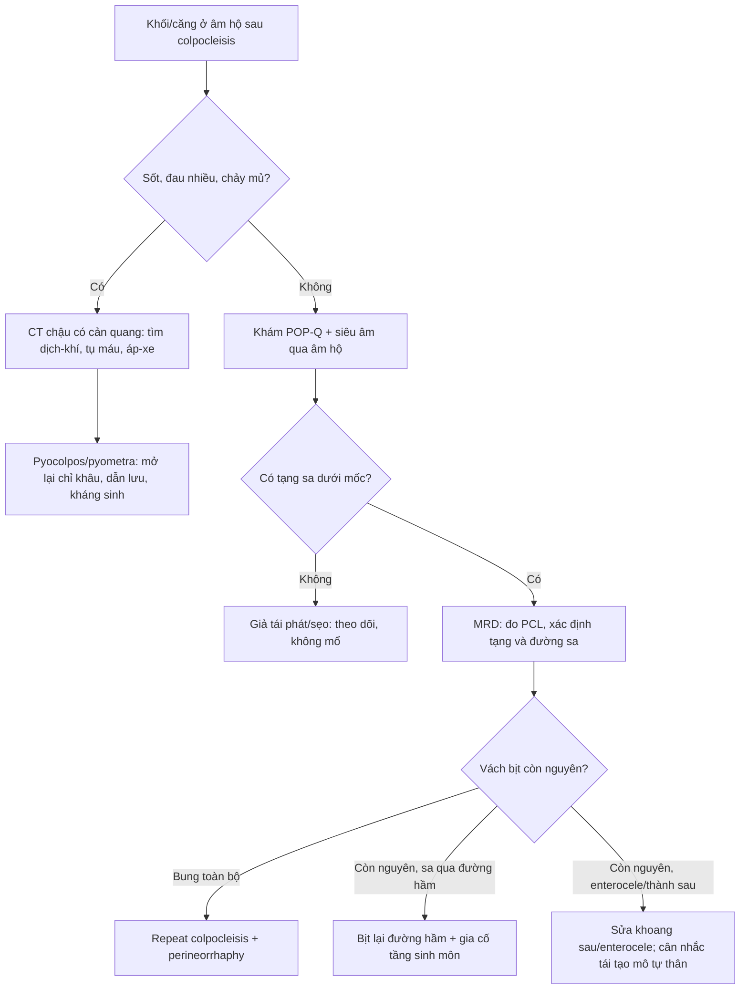
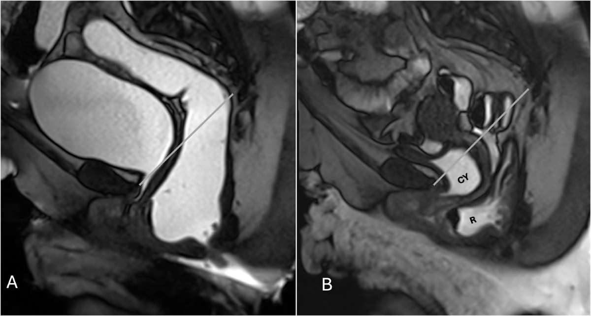
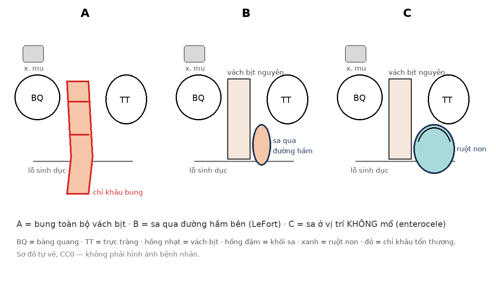

# 1642 — Sa tạng chậu tái phát sau colpocleisis: ba cơ chế, đọc MRI động học và chọn mổ lại / Recurrent prolapse after colpocleisis: three mechanisms, dynamic MRI and reoperation

**Tags:** `pattern:sa-tang-chau` `pattern:sa-tai-phat` `pattern:enterocele` `pattern:sa-qua-duong-ham` `pattern:o-dich-vung-chau` `vung:am-dao` `vung:chau` `vung:tieu-khung` `score:POP-Q` `score:PCL` `protocol:MRI-dong-hoc-san-chau` `protocol:SA-transperineal` `protocol:CT-chau-co-can-quang` `incidentaloma:pyocolpos`

**Mức chắc chắn (certainty):** tổng hợp y văn (literature synthesis) — số liệu từ đoàn hệ 58 ca colpocleisis một trung tâm (PMC12851770), so sánh 26 colpocleisis vs 23 treo dây chằng cùng–gai (PMC12728717), so sánh 46 bịt âm đạo vs 30 vòng nâng (PMC13450978), tổng quan 1.810 bệnh nhân LeFort với **33 ca tái phát có mô tả xử trí** (Int Urogynecol J 2017, PMID 28025678), tổng quan 24 ca mổ lại (Int Urogynecol J 2024, PMID 38942932), 2 ca lâm sàng mổ lại (Int Urogynecol J 2012, PMID 21853300; J Surg Case Rep 2025, PMC12257103) và khuyến cáo hình ảnh sàn chậu ESR 2026 (PMC13661720). Không có ca nguyên văn do nhóm tự thu thập.

> **Câu chốt:** khối “sa lại” sau colpocleisis **không phải một bệnh** mà là **một trong ba cơ chế**: **(A) bung toàn bộ vách bịt (57,6%)**, **(B) sa qua đường hầm bên của LeFort (15,2%)**, **(C) sa ở vị trí chưa từng mổ — thường là enterocele/ thành sau (27,3%)**. Tỉ lệ tái phát sau LeFort **4,2% (76/1.810)**, tối đa **~10%**, nhưng **thành công giải phẫu 94,8% không đồng nghĩa hài lòng 77,5%**. Trước khi mổ lại, phải loại **ứ mủ khoang bịt (pyocolpos)** và **tụ máu** — hai thứ trông giống “sa tái phát” nhưng xử trí ngược hoàn toàn.

## 1. Tổng quan bệnh học – cơ chế hình ảnh

### 1.1. Colpocleisis làm gì — và vì sao vẫn tái phát

- **Nguyên lý:** bóc biểu mô âm đạo trước và sau, khâu hai mặt cơ–niêm mạc vào nhau để **bịt lòng âm đạo**, kèm **tạo hình tầng sinh môn (perineorrhaphy)** thu nhỏ lỗ sinh dục. Đây là phẫu thuật **triệt tiêu (obliterative)**: chặn đường sa ra ngoài, **không treo lại đỉnh âm đạo** như sacrocolpopexy (PMC12851770, PMC12872722).
- **Vì sao hiệu quả:** thành công giải phẫu **91–100%**, mổ lại **< 2%**; ở người cao tuổi, ít xâm lấn, thời gian mổ và biến chứng thấp hơn phẫu thuật tái tạo (Int Urogynecol J 2024, PMID 38942932).
- **Vì sao vẫn tái phát:** (1) **vách bịt chịu lực** của cả khối tạng phía trên trong mô teo, mỏng, nhiều bệnh nền; (2) **LeFort bịt một phần** để lại **hai đường hầm bên** — vốn để dẫn lưu dịch tử cung và theo dõi chảy máu — trở thành **cửa thoát** cho tạng sa; (3) **tầng sinh môn yếu** làm mất “nắp chặn” cuối; (4) **tăng áp lực ổ bụng mạn** (táo bón, ho mạn, béo) và **mô liên kết lão hóa** tiếp tục tiến triển (PMC12872722; Int Urogynecol J 2017, PMID 28025678).
- **Ba cơ chế tái phát (33 ca có mô tả xử trí, 17 nghiên cứu):**
  1. **Bung toàn bộ vách bịt (total breakdown) — 57,6%**: toàn bộ âm đạo lộn ra ngoài như trước mổ.
  2. **Sa qua đường hầm bên (channel prolapse) — 15,2%**: vách bịt còn nguyên nhưng tạng sa **lách qua một đường hầm LeFort**, thường **sớm (6 tháng)**.
  3. **Sa ở vị trí không mổ (de novo site) — 27,3%**: thường **enterocele** hoặc **thành sau**, trong khi phần đã bịt vẫn kín.
- **Tần suất:** gộp **28 nghiên cứu, 1.810 bệnh nhân LeFort**: tái phát **4,2% (76/1.810)**, y văn ghi tới **10%** (Int Urogynecol J 2017, PMID 28025678). Loạt một trung tâm 58 ca: **thành công giải phẫu 94,8%** sau **2,88 ± 1,89 năm** → **thất bại giải phẫu ~5,2%**, nhưng **thành công chủ quan chỉ 77,5%**, **hối tiếc 6,8%** (PMC12851770).
- **So sánh với phẫu thuật tái tạo:** 26 colpocleisis vs 23 treo dây chằng cùng–gai (SSLF): mổ lại vì tái phát **3,8% vs 13,1%** (**p = 0,13**, chưa đủ mẫu), nằm viện **3,2 vs 1,6 ngày** (**p = 0,02**), tuổi **71,5 vs 59,9** (**p = 0,01**) (PMC12728717).
- **So sánh với điều trị không mổ:** 46 bịt âm đạo vs 30 vòng nâng dài hạn: hài lòng **97,8% vs 90%** (p = 0,15), nhưng **mức cải thiện triệu chứng (VAS) cao hơn: 8,9 ± 1,1 vs 7,7 ± 1,7** (p < 0,001); biến chứng **17,3% vs 26,6%**; **23,3%** nhóm vòng nâng phải bỏ vòng và **20%** sau đó phải mổ (PMC13450978).

### 1.2. TẠI SAO hình ảnh lại khó — “âm đạo” đã không còn là ống

- Sau khi bịt, **âm đạo là một vách xơ–cơ dẹt**, không có lòng chứa khí/dịch; trên **T2W** là **dải tín hiệu trung bình–thấp**, dính vào **bàng quang phía trước** và **trực tràng phía sau**.
- **Tái phát = tạng vượt qua giới hạn giải phẫu**, không phải “khối u”: **bàng quang (cystocele)**, **trực tràng (rectocele)**, **ruột non (enterocele)**, hoặc **toàn bộ vách** lộn ra ngoài lỗ sinh dục. Vì vậy câu hỏi của hình ảnh không phải “có khối không” mà là **(1) tạng nào? (2) qua đường nào? (3) dưới mốc nào?**
- **Mốc chuẩn:** đường **PCL (pubococcygeal line)** nối **bờ dưới xương mu** với **khớp cùng–cụt**. Sa có ý nghĩa khi: **khoang trước/giữa > 3 cm dưới PCL**, **khoang sau > 4 cm** khi rặn (quy tắc “3–4”); **rectocele > 2 cm** mới bất thường (độ I = 2 cm; II = 2–4; III > 4); **enterocele** độ I = 3 cm, II = 3–6, III > 6 (PMC13661720).
- **TẠI SAO MRI động học và không phải CT:** CT chỉ thấy **mô mềm đậm độ thấp** và **không phân biệt được ruột non với mỡ mạc treo** trong túi thoát vị; MRI **tương phản mô mềm cao**, thấy **quai ruột, thành âm đạo, cơ nâng hậu môn** và đo được **độ sa theo PCL**. CT chỉ dành cho **biến chứng** (ứ mủ, khí trong ổ, tụ máu) — không dùng để phân độ sa (PMC13661720).

### 1.3. Vì sao “mổ lại” là một quyết định khó — và các lựa chọn

- **Không có thử nghiệm ngẫu nhiên** so sánh các kỹ thuật mổ lại sau colpocleisis; bằng chứng là **loạt ca và tổng quan** (Int Urogynecol J 2024, PMID 38942932).
- **Bịt lại (repeat colpocleisis)** là lựa chọn phổ biến nhất: **18/24 bệnh nhân (75%)** trong tổng quan; theo dõi trung vị **12 tháng**, **1 ca tái phát** (rectocele sau **2 năm**, xử trí bằng **perineorrhaphy**) (Int Urogynecol J 2024, PMID 38942932). Ca minh họa: bệnh nhân **81 tuổi**, tiền sử **đặt lưới TVM 12 năm trước**, sa thành sau → **LeFort**, ra viện **ngày 8**, **18 tháng** không tái phát/nhiễm (PMC12257103).
- **Các lựa chọn khác:** **perineorrhaphy** đơn thuần (khi chỉ hở tầng sinh môn), **mở lại vách bịt + tái tạo mô tự thân** (khi bệnh nhân muốn/ cần giữ chức năng), **cắt tử cung + sửa sa** (khi còn tử cung và có chỉ định) (Int Urogynecol J 2024, PMID 38942932).
- **Ca “channel prolapse” kinh điển:** **77 tuổi**, sa qua **đường hầm bên phải** sau **6 tháng**; xử trí **repeat colpocleisis cải biên**; **6 tháng** sau không tái phát (Int Urogynecol J 2017, PMID 28025678). Ca khác: sa **độ III qua đường hầm bên**, mổ **repeat colpocleisis + repeat perineorrhaphy** (Int Urogynecol J 2012, PMID 21853300).
- **Tiên lượng:** tái phát **hiếm nhưng khó** vì mô đã mổ nhiều lần, sẹo xơ, và bệnh nhân thường **rất cao tuổi/nhiều bệnh nền**; quyết định phải cân giữa **nguy cơ gây mê** và **nguy cơ loét/hoại tử niêm mạc do sa tạng lộ ra ngoài**.

## 2. Mẫu hình + chẩn đoán phân biệt theo vị trí (gamut)

**Mẫu hình chung:** sau colpocleisis **≥ 3 tháng**, bệnh nhân thấy **khối/căng ở âm hộ**, **cảm giác “sa lại”**, đau tức, rỉ máu, hoặc **bí tiểu/tiểu khó**.

- **Khối ở lỗ sinh dục, niêm mạc hồng, mềm, giảm khi nằm:**
  - **Sa tái phát thành trước (cystocele)** — phồng, ấn thấy dịch bàng quang.
  - **Sa thành sau (rectocele)** — phồng, táo bón, phải ấn âm đạo để đi ngoài.
  - **Enterocele** — túi phúc mạc chứa **ruột non**; thường **mềm, thay đổi theo tư thế**, có thể **sôi/ục ục**; dễ bị bỏ sót vì trông giống rectocele.
- **Khối căng, đau, sốt, chảy mủ hoặc dịch hôi:**
  - **Pyocolpos** (ứ mủ khoang bịt) — khối căng, **khí/dịch trong ổ** trên CT; có thể **không sốt** ở người già.
  - **Pyometra** (nếu còn tử cung/LeFort) — ứ mủ buồng tử cung, đau bụng dưới, có thể **không có khí**.
  - **Áp-xe vùng mổ / nhiễm tầng sinh môn** — sưng nóng đỏ, đau nhiều, có thể **rò mủ ra da**.
- **Khối tím, đau cấp sau mổ hoặc sau ngã:**
  - **Tụ máu âm đạo/ tầng sinh môn** — căng, đau, **thiếu máu**; CT thấy **máu tăng đậm độ (35–70 HU)**.
- **Khối kèm tiền sử đặt lưới (TVM):**
  - **Lưới xói mòn/co rút** — đau, chảy dịch, sờ thấy **lưới cứng**; MRI/siêu âm qua âm hộ thấy **dải tín hiệu thấp**.
- **Khối loét, chảy máu, không giảm khi nằm:**
  - **U âm đạo/niệu đạo, sa niệu quản, u niệu đạo** — hiếm nhưng phải loại trừ ở người già có khối mới, **không liên quan tư thế**.
- **“Giả tái phát”:** **phì đại mô sẹo/tầng sinh môn** hoặc **phù nề sau mổ** — không có tạng nào sa dưới PCL; khám + MRI động học giúp loại.

**Ba câu hỏi định vị:** (1) **Khối có tăng khi rặn/đứng không?** (2) **Có dịch/mủ/khí trong khoang bịt không?** (3) **Tạng nào đang sa — bàng quang, trực tràng, ruột non hay cả vách?**

## 3. Bảng so sánh phân biệt (ma trận đối chiếu)

| Thực thể (entity) | Hình ảnh điển hình (MRI/CT/US) | Chốt vào (rule-in) | Chốt loại (rule-out) | Gợi ý xác nhận |
|---|---|---|---|---|
| **Sa tái phát thành trước (cystocele)** | MRI động học: **bàng quang xuống > 3 cm dưới PCL** khi rặn; thành trước phồng ra lỗ sinh dục | **Phồng thành trước + bàng quang xuống dưới PCL khi rặn** | **Có dịch mủ/khí trong khoang bịt** → không phải sa đơn thuần | Khám POP-Q + MRD; siêu âm qua âm hộ |
| **Sa thành sau (rectocele)** | **Rectocele > 2 cm**; túi lồi ra sau, có thể **giữ cặn contrast** | **Táo bón phải ấn âm đạo + túi lồi > 2 cm** | **Quai ruột non trong túi** → enterocele, không phải rectocele | MRD thì rặn; đối chiếu MRI với thăm khám |
| **Enterocele (vị trí không mổ)** | **Quai ruột non xuống dưới PCL**, tín hiệu ruột/mỡ mạc treo trong túi; **vách bịt còn nguyên** | **Túi chứa ruột non, thay đổi theo tư thế, vách bịt kín** | **Chỉ có trực tràng giãn** → rectocele | MRD (phân biệt enterocele/sigmoidocele); đôi khi cần fluoroscopic defecography |
| **Pyocolpos** | CT: **ổ dịch có khí, thành ngấm thuốc**, quanh khoang âm đạo bịt; MRI: **DWI sáng/ADC tối** nếu mủ đặc | **Sốt/đau + khối căng + khí/dịch trong khoang bịt** | **Không có ổ dịch, chỉ tạng sa** → loại pyocolpos | CT chậu có cản quang; cấy dịch; mở lại chỉ khâu dẫn lưu |
| **Tụ máu âm đạo** | CT: khối **35–70 HU**, không khí; MRI: tín hiệu máu theo thời gian | **Sau mổ/ngã + đau cấp + thiếu máu + khối căng** | **Khí trong ổ + sốt** → nhiễm, không chỉ tụ máu | CT chậu; theo dõi Hb |
| **Lưới xói mòn/áp-xe** | MRI/siêu âm: **dải lưới tín hiệu thấp** xuyên thành âm đạo, ổ dịch quanh | **Tiền sử TVM + đau/chảy dịch + sờ thấy lưới** | **Không tiền sử lưới** → loại | Khám dưới đèn, MRI chậu, nội soi |
| **“Giả tái phát” (sẹo/phù nề)** | Không có tạng nào **dưới PCL**; mô sẹo dày, không có túi | **Khối không tăng khi rặn, không có tạng sa** | **Có tạng sa dưới PCL** → tái phát thật | MRD + khám POP-Q lặp lại |

**Dấu hiệu đọc ảnh cần nhớ:**

- **Đo ở đúng thì:** phải đo **khi sa tối đa** (sau khi bệnh nhân rặn/đẩy hết contrast), không đo thì nghỉ — cùng một bệnh nhân có thể **không thấy sa ở lần rặn đầu** nhưng **sa rõ sau khi đẩy hết bóng trực tràng** (PMC13661720).
- **Vách bịt kín hay hở:** nếu vách còn nguyên mà có tạng sa → **channel/de novo**, không phải “bung toàn bộ”; hướng mổ khác nhau.
- **Tín hiệu dịch:** **khí trong ổ + thành ngấm thuốc** = nhiễm, không phải sa; **máu 35–70 HU** = tụ máu.

## 4. Protocol chụp + hệ phân độ

### 4.1. Khám + phân độ lâm sàng trước

- **POP-Q** (Pelvic Organ Prolapse Quantification): đo **Aa, Ba, C, D, Bp, Ap, gh (genital hiatus), pb (perineal body), tvl (total vaginal length)**. Sau colpocleisis, **C/D không còn ý nghĩa giải phẫu** — dùng **Ba/Bp** và **vị trí mép vách bịt so với màng trinh**.
- **Khám ở tư thế sản khoa, rặn tối đa**; đánh giá **cả hai đường hầm LeFort** và **tầng sinh môn**.

### 4.2. MRI động học sàn chậu (MR defecography — MRD)

- **Chuẩn bị:** làm rỗng trực tràng, bơm **gel siêu âm** vào trực tràng; bàng quang **không cần làm đầy** (hoặc làm đầy nhẹ nếu cần thấy cystocele).
- **Tư thế:** nằm ngửa, **gối kê dưới khoeo** để mô phỏng ngồi; **không** dùng thuốc giãn cơ.
- **Chuỗi xung:** **sagittal FSP/T2 nhanh** (single-shot, quay liên tục), **≥ 3 lần rặn/đẩy**; thêm **axial T2** đánh giá cơ nâng và **coronal** khi cần.
- **Các thì bắt buộc:** **nghỉ → co cơ sàn → rặn (Valsalva) → tống xuất**, và **thì sau tống xuất** (đo lại độ sa khi đã đẩy hết).
- **Đo:** vẽ **PCL**, đo **khoảng cách thấp nhất của bàng quang, cổ tử cung/vách bịt, trực tràng** xuống dưới PCL; **quy tắc 3–4**: **trước/giữa > 3 cm**, **sau > 4 cm**; **rectocele > 2 cm**; **enterocele** độ I 3, II 3–6, III > 6 cm (PMC13661720).
- **Khi không làm được MRD:** **siêu âm qua âm hộ 3D/4D** (translabial) — tương hợp tốt với POP-Q, thấy **cystocele, rectocele, sa thành âm đạo**, và **lưới** (dải tăng âm); **siêu âm qua trực tràng** khi cần đánh giá cơ thắt.

### 4.3. CT chậu có cản quang — chỉ khi nghi biến chứng

- **Chỉ định:** sốt, đau nhiều, khối căng, chảy mủ, **nghi pyocolpos/pyometra/tụ máu**.
- **Đọc:** ổ **dịch–khí** trong khoang bịt, **thành ngấm thuốc**, mức độ lan vào **khoang cạnh âm đạo/tiểu khung**, **thủng trực tràng/bàng quang** (khí ngoài lòng), **huyết khối tĩnh mạch** kèm theo.

### 4.4. Sơ đồ quyết định (Mermaid)

## 5. Biến thể bình thường và cạm bẫy

- **“Sa lại” không phải lúc nào cũng là sa:** **pyocolpos** có thể biểu hiện **khối căng ở âm hộ**, không sốt; **khí trong ổ** trên CT là chốt. Đặt vòng nâng hoặc mổ lại trước khi loại trừ nhiễm là **sai lầm nặng** (PMC12925871, PMC12872722).
- **Đo ở thì nghỉ:** MRI lúc nghỉ có thể **âm tính giả**; phải đo **sau khi rặn/đẩy hết** — ca minh họa trong PMC13661720 cho thấy **sa chỉ lộ rõ sau khi tống xuất một phần bóng trực tràng**.
- **Nhầm enterocele với rectocele:** cả hai đều là “túi” phía sau; **enterocele chứa ruột non/mỡ mạc treo**, **rectocele chứa trực tràng**. Mổ rectocele trong khi bỏ sót enterocele → **tái phát sớm**.
- **Thành công giải phẫu ≠ hài lòng:** **94,8%** thành công giải phẫu nhưng chỉ **77,5%** hài lòng chủ quan; **6,8%** hối tiếc (PMC12851770) — tư vấn trước mổ phải nói rõ **mất chức năng giao hợp** và **nguy cơ phải mổ lại**.
- **LeFort để lại đường hầm:** quên khám **hai đường hầm bên** là bỏ sót **channel prolapse**, thường xuất hiện **sớm (~6 tháng)**.
- **Tiền sử lưới:** khối sau TVM có thể do **lưới co rút/xói mòn**, không phải sa; **MRI/siêu âm** tìm dải lưới trước khi mổ lại.
- **Người rất cao tuổi:** **nguy cơ gây mê** có thể lớn hơn lợi ích mổ lại; với sa không biến chứng, **theo dõi + chăm sóc da/niêm mạc** là lựa chọn hợp lý (quyết định cá thể hóa; không có thử nghiệm).
- **Ảnh MRD trong bài là bệnh nhân sa tạng CHƯA bịt âm đạo:** dùng để minh họa **nguyên lý đo và chọn thì**, **không** đại diện hình ảnh sau colpocleisis.

## 6. Tự lượng giá — Blind Quiz

**Ca 1 — Nữ 72 tuổi, sau colpocleisis 2 năm, “sa lại” khi rặn; MRD 2 thì.**

- Gợi ý: khám thấy **phồng thành trước**; bệnh nhân rặn 3 lần, lần đầu chưa thấy sa rõ.
- Câu hỏi: (1) Vì sao **không đo ở thì đầu**? (2) Tạng nào sa và dưới mốc nào? (3) Cần bổ sung gì trước khi chọn mổ?

<b>Bấm để hiện đáp án (findings + chẩn đoán)</b>

- **Findings:** (A) thì rặn đầu: **chưa thấy bàng quang/tử cung xuống dưới PCL**; (B) **sau khi tống xuất một phần bóng trực tràng**: **bàng quang (CY) và trực tràng (R) sa rõ dưới PCL**, kèm **lồng trực tràng**.
- **Trả lời:** đo ở **thì sa tối đa** (sau tống xuất) vì **sa có thể chỉ lộ ra khi bóng trực tràng đã vơi**; đây là **cystocele + rectocele**, cần đo **cm dưới PCL** (quy tắc **> 3 cm** khoang trước, **> 2 cm** rectocele) để phân độ.
- **Trước khi mổ:** loại **pyocolpos/tụ máu** (không sốt, không khí → ít nghĩ), khám **hai đường hầm LeFort**, hỏi **tiền sử lưới**, đánh giá **nguy cơ gây mê**.
- **Phản biện:** ảnh từ bệnh nhân **chưa bịt âm đạo** — nguyên lý đo giống, nhưng sau colpocleisis **vách bịt làm mốc giải phẫu khác**; không suy ra trực tiếp cơ chế tái phát.
- Nguồn ảnh: *European Radiology* 2026, Fig. 4 — PMC13661720; **CC BY 4.0**; Abdelatty MA, Stankiewicz A, Maccioni F, Mirón Mombiela R, Amer B, Sousa S, Snape S, Carnelli C, Lucas R, Balk-Roos G, Babatürk A, El Sayed RF.

**Ca 2 — Ba bệnh nhân sau LeFort, ba kiểu “sa lại”.**

- Gợi ý: **A** lộn toàn bộ vách ra ngoài; **B** vách kín nhưng có khối lách qua bên; **C** vách kín, khối mềm phía sau, thay đổi theo tư thế.
- Câu hỏi: Gọi tên cơ chế A/B/C và nêu hướng mổ?

<b>Bấm để hiện đáp án</b>

- **A = bung toàn bộ vách bịt** (57,6%): **repeat colpocleisis + perineorrhaphy**.
- **B = sa qua đường hầm bên LeFort** (15,2%): **bịt lại đường hầm** (repeat colpocleisis cải biên) + **gia cố tầng sinh môn**.
- **C = sa ở vị trí không mổ — enterocele/thành sau** (27,3%): **sửa khoang sau/enterocele**, cân nhắc **tái tạo mô tự thân**; không chỉ “bịt lại” vì vách đã kín.
- **Tần suất:** tái phát sau LeFort **4,2% (76/1.810)**, tối đa **~10%**; **repeat colpocleisis 75% (18/24)** ca mổ lại, tái phát **1/24** sau 12 tháng (Int Urogynecol J 2017, PMID 28025678; Int Urogynecol J 2024, PMID 38942932).
- Nguồn ảnh: sơ đồ tự vẽ, **CC0**.

## Bài liên quan chéo

- [1612 – Colpocleisis: chọn ca, kỹ thuật & biến chứng ứ mủ](../1612-colpocleisis-va-bien-chung/lesson.md) — kỹ thuật mổ, pyocolpos/pyometra, nền tảng của bài này.
- [561 – Sa tạng chậu tái phát sau cắt lưới](../561-sa-tang-chau-tai-phat-sau-cat-luoi/lesson.md) — tái phát sau phẫu thuật tái tạo có lưới.
- [590 – Tạo hình âm đạo (MRKH): kỹ thuật & biến chứng](../590-tao-hinh-am-dao-mrkh-ky-thuat-bien-chung/lesson.md) — biến chứng của phẫu thuật tạo hình âm đạo.
- [1626 – Tái phát tại vòm âm đạo sau xạ trị ung thư cổ tử cung](../1626-tai-phat-vom-am-dao-sau-xa-tri/lesson.md) — phân biệt tái phát u với xơ hóa bằng DWI.
- [1641 – OPMD & OPDM so với CPEO](../1641-opmd-opdm-va-cpeo/lesson.md) — bài cùng đợt.

## Ảnh

- `images/1642_mrd-sa-tang_MRI_PMC13661720-F2.png` — Fig. 2, *European Radiology* 2026, **PMC13661720**, **CC BY 4.0**.
- `images/1642_mrd-thi-do_MRI_PMC13661720-F4.png` — Fig. 4, cùng bài, **CC BY 4.0**.
- `images/1642_so-do-tai-phat.png` — sơ đồ tự vẽ, **CC0**.
- Chi tiết nguồn/giấy phép từng ảnh: `images/CREDITS.md`.

> Không dùng để chẩn đoán độc lập khi chưa có người hướng dẫn.
