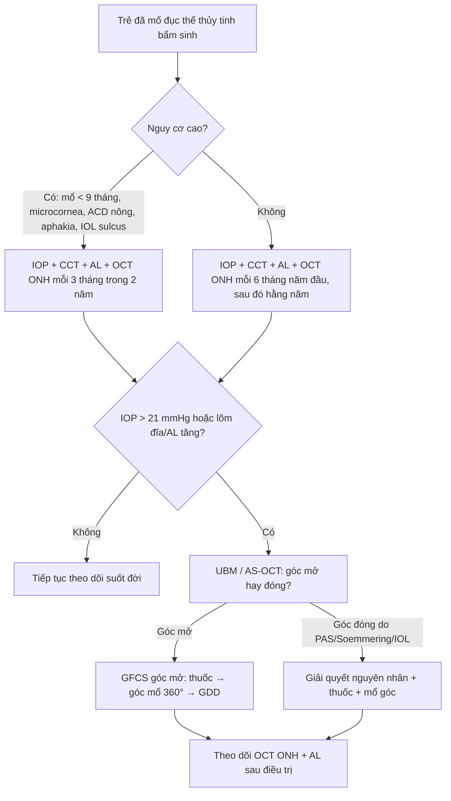
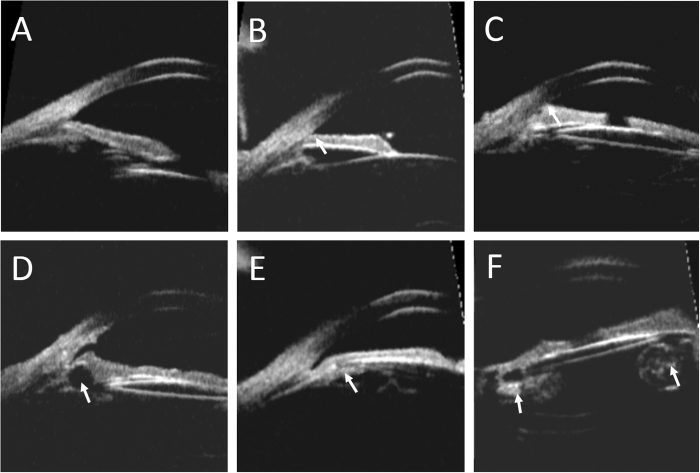
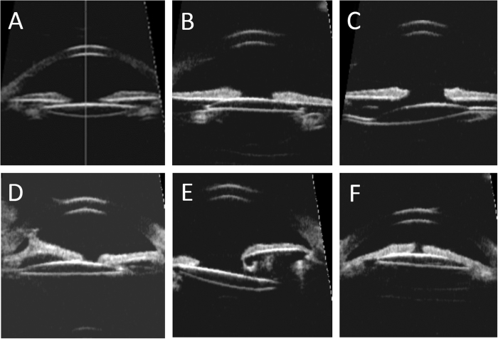

# 1643 — Glaucoma sau mổ đục thể thủy tinh bẩm sinh ở trẻ / Glaucoma following cataract surgery (GFCS) in children

**Tags:** `pattern:tang-nhan-ap` `pattern:goc-mo` `pattern:goc-dong` `pattern:di-lenh-IOL` `pattern:loi-dia-thi` `pattern:nhieu-dich-kinh` `vung:mat` `vung:tien-phong` `score:CRN` `score:IATS-risk` `protocol:do-nhan-ap` `protocol:UBM` `protocol:AS-OCT` `protocol:OCT-ONH` `protocol:sieu-am-B` `anatomy:tien-phong`

**Mức chắc chắn (certainty):** tổng hợp y văn (literature synthesis) — 1 tổng quan hệ thống 28–36 nghiên cứu (BMC Ophthalmol 2026, PMC13281633), 1 phân tích hậu kiểm RCT IATS 10,5 năm (Ophthalmol Glaucoma 2025, PMC13705203), 1 đoàn hệ 259 mắt (BMC Ophthalmol 2022, PMC8918280), 1 đoàn hệ UBM 40 mắt (Sci Rep 2017, PMC5318954), 1 tổng quan điều trị 39 nghiên cứu (J Clin Med 2022, PMC8879979) và 1 tổng quan phẫu thuật 2025 (Front Med 2025, PMC12511033). Lịch theo dõi cụ thể **không có đồng thuận** — phần gợi ý được ghi rõ là **suy luận thực hành**.

> **Câu chốt:** GFCS là **glaucoma thứ phát sau mổ đục thể thủy tinh**, phần lớn **góc MỞ (75–94%)**, đến **muộn nhiều năm**, và **nhãn áp một lần đo không đủ để chẩn đoán**. Ba con số phải thuộc: **(1)** tần suất **3,3–25,5%** (36 nghiên cứu), IATS tăng từ **17% ở 5 năm lên 22% ở 10 năm**, và tới **41% "glaucoma hoặc nghi glaucoma" ở 10,5 năm**; **(2)** mổ khi **< 9 tháng** làm tăng nguy cơ tới **7,2 lần** — **37% vs 6%**, **29,2% vs 3,4%**; **(3)** **tiền phòng nông trước mổ** (ACD **2,76 vs 3,08 mm**) là yếu tố dự báo mạnh (**OR 5,8**). Sai lầm chết người về thị lực: **đo nhãn áp một lần dưới mê thấy bình thường rồi thôi theo dõi**, hoặc **gọi tăng nhãn áp do corticoid là GFCS** rồi mổ không cần thiết.

## 1. Tổng quan bệnh học – cơ chế hình ảnh

### 1.1 Định nghĩa và vì sao "glaucoma" khác "tăng nhãn áp đơn thuần"

- **Định nghĩa CRN (Childhood Glaucoma Research Network):** **IOP > 21 mmHg** kèm **biến đổi giải phẫu đĩa thị** hoặc **cận thị tiến triển** (dẫn trong PMC8879979). Nghĩa là **một con số IOP không đủ** — phải có **bằng chứng cấu trúc**: lõm đĩa thị, giãn nhãn cầu, tăng chiều dài trục.
- **Vị trí trong phân loại:** GFCS chiếm **18%** glaucoma ở trẻ em (PMC8879979); là **thể thứ phát hay gặp nhất** sau mổ đục thể thủy tinh.
- **Hai cơ chế — hai hình thái:**
  1. **Góc mở (75–94%):** tổn thương **bè củng mạc** do viêm, mảnh thể thủy tinh còn lại, mất "giá đỡ cơ học" của thể thủy tinh sau cắt bao, **hẹp ống Schlemm**, góc chưa trưởng thành bị can thiệp quá sớm. Đây là loại **đến muộn, tiến triển âm thầm**.
  2. **Góc đóng (sớm, hiếm hơn):** **dính góc trước (PAS)**, **vòng Soemmering to**, **IOL lệch/sulcus**, **block đồng tử**, viêm – màng xuất tiết. Thường **trong vài tuần đầu** sau mổ.
- **Thời điểm — mô hình hai đỉnh:** đỉnh sớm **vài tuần đến vài tháng** (góc đóng/viêm) và đỉnh muộn **nhiều năm** (góc mở). Trong đoàn hệ UBM, khoảng cách từ mổ tới chẩn đoán **4,42 ± 2,65 năm** (0,42–8,67) (PMC5318954); y văn ghi **2,5 tháng đến > 5 năm** (PMC7930951).
- **TẠI SAO trẻ nhỏ nguy cơ cao:** góc tiền phòng **chưa hoàn thiện**, **đường kính giác mạc nhỏ**, **nhãn cầu ngắn**; cắt thể thủy tinh sớm làm **mất lực căng của dây chằng – bao sau**, khiến **bè củng mạc xẹp** và **góc hẹp lại**. Cộng thêm **viêm sau mổ** và **corticoid** — hai yếu tố vừa gây bít bè vừa gây tăng nhãn áp.
- **Số liệu tần suất (định lượng):**
  - Tổng quan 36 nghiên cứu: **3,3–25,5%**; tổng quan khác **6–32%** (PMC13281633).
  - IATS (114 trẻ mổ **1–6 tháng**, một bên): **17% ở 5 năm → 22% ở 10 năm** (PMC8879979; PMC13281633).
  - IATS 10,5 năm: **41%** đạt tiêu chuẩn **glaucoma hoặc nghi glaucoma** (PMC13705203).
  - Đoàn hệ 259 mắt (Wenzhou): biến cố liên quan glaucoma **8,1%**, tăng nhãn áp do corticoid **10,4%**; tích lũy **0% / 1,2% / 1,2% / 1,6% / 4,0% / 8,9%** ở **1 / 6 / 12 / 24 / 36 / 48 tháng** (PMC8918280).
- **Yếu tố nguy cơ — bằng số:**
  - **Tuổi mổ < 9 tháng:** nguy cơ tới **7,2 lần**; **37% vs 6%**; **29,2% vs 3,4%** (PMC13281633).
  - **Tiền phòng nông trước mổ:** ACD **2,76 ± 0,48 mm** (có glaucoma) vs **3,08 ± 0,38 mm** (không); **OR 5,8 (1,8–18,9), P = 0,004**. Ngược lại **chiều dài trục ngắn không dự báo** (OR 1,0; 0,7–1,4) (PMC13705203).
  - **Giác mạc nhỏ (microcornea, đường kính ≤ 10 mm)**, **đục thể thủy tinh nhân hoặc toàn bộ**, **bệnh sử gia đình**.
  - Đoàn hệ 259 mắt: **gia đình có đục thể thủy tinh bẩm sinh HR 50,46 (7,05–361,14)**; **CCT dày HR 1,021 mỗi µm (1,009–1,034)**; **đường kính giác mạc ngang HR 3,922 (1,558–9,804)**; **độ dày thể thủy tinh HR 3,745 (1,344–10,417)** (PMC8918280).
  - **IOL sulcus** và **dính góc** trên UBM: xem mục 1.2.

### 1.2 Hình ảnh cung cấp gì mà nhãn áp không cung cấp được

- **Nhãn áp ở trẻ là phép đo kém tin cậy:** trẻ **không hợp tác**, phải **đo dưới mê**, một lần đo chỉ là **một điểm**; **giác mạc dày** làm IOP **đọc cao giả** (và CCT dày cũng là **yếu tố nguy cơ** trong đoàn hệ trên).
- **UBM (siêu âm sinh học 50 MHz)** là **chìa khóa** vì nhìn được **góc, mống mắt, thể mi, bao sau, IOL** sau mổ:
  - **Iris cắm cao (high insertion of iris):** chân mống mắt **bám ra trước hơn bình thường** — gặp **13/40 mắt (32,5%)**, là **yếu tố nguy cơ độc lập** cho glaucoma (**OR 3,40; 1,03–11,17; p = 0,03**) (PMC5318954).
  - **IOL sulcus** là yếu tố nguy cơ độc lập (**OR 1,39; 1,07–4,85; p = 0,04**); IOL **trong bao** làm giảm nguy cơ **14 lần** so với sulcus (tổng quan, PMC13281633).
  - **AOD500** (khoảng mở góc ở 500 µm) **nhỏ hơn** ở mắt có glaucoma (**p = 0,01**); **PAS** nhiều hơn (**p = 0,015**); **CCT dày hơn** (**p = 0,04**); IOP lúc khám cuối **17,29 ± 5,42** vs **13,88 ± 3,52 mmHg** (**p = 0,011**) (PMC5318954).
  - **Nguyên nhân góc hẹp nhìn thấy trên UBM:** **vòng Soemmering to**, **nang thể mi/mống mắt** (6/40 mắt, 15%), **mảnh thể thủy tinh tồn lưu**, **IOL lệch/subluxation**.
- **AS-OCT** (khi giác mạc trong): đo **góc, độ sâu tiền phòng, vị trí IOL** không cần tiếp xúc; **B-scan** khi **đục giác mạc/dịch kính** không nhìn được đáy mắt.
- **OCT đĩa thị – lớp sợi (RNFL/GCL):** máy **cầm tay** cho trẻ nằm; so sánh **theo dõi dọc** quan trọng hơn một lần đo; **lõm đĩa thị tiến triển** là tiêu chuẩn CRN.
- **Chiều dài trục (AL):** tăng nhanh **hơn đường cong tăng trưởng** = **nhãn cầu giãn do áp lực** (buphthalmos), tương đương **"cận thị tiến triển"** trong tiêu chuẩn CRN.

## 2. Mẫu hình + chẩn đoán phân biệt theo cơ chế (gamut)

### 2.1 Gamut theo cơ chế và thời điểm

- **Góc mở, đến muộn (phần lớn):** GFCS góc mở; **tăng nhãn áp do corticoid** (xảy ra **sớm, trong khi còn nhỏ thuốc**, và **giảm khi ngừng** — 10,4% trong đoàn hệ 259 mắt); **mảnh thể thủy tinh tồn lưu** gây viêm/bít bè.
- **Góc đóng, đến sớm:** **PAS** sau viêm; **vòng Soemmering** to; **IOL lệch/sulcus**; **block đồng tử** (mống mắt dính bao sau); **xuất huyết tiền phòng**.
- **Không phải GFCS (đừng gộp):** **glaucoma bẩm sinh nguyên phát (PCG)** — có **giãn nhãn cầu, phù giác mạc, rách Descemet** từ trước mổ; **glaucoma thứ phát sau viêm nội nhãn/màng đồng tử**; **glaucoma sau mổ võng mạc** (dầu silicone, khí).

### 2.2 Mẫu hình trên UBM — 4 hình thái phải nhận ra

1. **Iris cắm cao:** chân mống mắt **ra trước**, góc **hẹp toàn bộ** — nguy cơ **OR 3,40**.
2. **PAS:** mống mắt **dính vào giác mạc ngoại vi**, góc **đóng khu trú**.
3. **Vòng Soemmering to / mảnh thể thủy tinh:** khối **hồi âm dày** sau mống mắt, **đẩy mống mắt ra trước**, góc hẹp.
4. **IOL lệch/sulcus:** IOL **không nằm trong bao**, một hàptic **ra sulcus**, **nghiêng/chuyển ra trước**, có thể **cọ vào thể mi**.

## 3. Bảng so sánh phân biệt (ma trận đối chiếu)

| Thực thể (entity) | Hình ảnh điển hình (UBM/AS-OCT/OCT/AL) | Chốt vào (rule-in) | Chốt loại (rule-out) | Gợi ý xác nhận |
|---|---|---|---|---|
| **GFCS góc mở** | Góc **mở nhưng AOD500 nhỏ**, **iris cắm cao**, **PAS ít**, đĩa thị lõm tiến triển, AL tăng nhanh; **không có mảnh thể thủy tinh lớn** | **Tiền sử mổ đục TTT + IOP > 21 + lõm đĩa/AL tăng**, góc mở | **Góc đóng hoàn toàn do PAS/Soemmering** → thể góc đóng | UBM + OCT ONH theo dõi dọc |
| **Tăng nhãn áp do corticoid** | Góc **mở**, **không PAS**, **không thay đổi đĩa thị** nếu mới; IOP tăng **trong vài tuần sau mổ** khi đang nhỏ corticoid | **IOP giảm sau ngừng/giảm corticoid**, không có tổn thương đĩa thị | **IOP vẫn cao sau ngừng corticoid 2–4 tuần** → không phải do corticoid | Ngừng thử corticoid có kiểm soát + đo lại |
| **Vòng Soemmering to** | Khối **hồi âm dày** sau mống mắt, **đẩy mống mắt ra trước**, góc **hẹp khu trú** | **Thấy khối sau mống mắt + góc hẹp tương ứng** | **Không có khối, góc đều** → không phải | UBM; có thể cần mổ lấy vòng |
| **PAS / góc đóng** | Mống mắt **dính vào nội mạc giác mạc ngoại vi**, góc **đóng**, có thể **IOP tăng cấp** | **PAS thấy rõ + góc đóng** | **Góc mở đều, không dính** → không phải | UBM/AS-OCT; gonioscopy khi hợp tác |
| **IOL lệch/sulcus** | IOL **ngoài bao**, **nghiêng**, một hàptic ở sulcus, **có thể cọ thể mi** | **IOL không nằm trong bao + lệch trục** | **IOL trong bao, trung tâm** → nguy cơ thấp hơn | UBM; AS-OCT |
| **PCG (glaucoma bẩm sinh nguyên phát)** | **Giãn nhãn cầu**, **phù giác mạc**, **rách Descemet**, góc **dị dạng** từ trước mổ | **Bệnh cảnh từ lúc sinh, chưa mổ đục TTT** | **Tiền sử mổ đục TTT + góc không dị dạng** → GFCS | Khám dưới mê + UBM; phân loại CRN |

### 3.1 Ba câu hỏi để không gọi nhầm

- **Có tiền sử mổ đục thể thủy tinh không?** Không → **không phải GFCS**, tìm PCG/dị dạng góc.
- **Góc mở hay đóng?** UBM/AS-OCT trả lời; **góc đóng do PAS/Soemmering** là **thể có thể mổ giải quyết nguyên nhân**.
- **Có bằng chứng cấu trúc tiến triển không?** So **ảnh đĩa thị/AL cũ** — nếu không có, **chẩn đoán "nghi glaucoma"** và **theo dõi**, đừng mổ ngay.

## 4. Protocol khám – theo dõi – phân độ

### 4.1 Khám hình ảnh tối thiểu (mỗi lần)

- **Nhãn áp:** cùng máy, **cùng thời điểm**, **cùng tư thế**; ghi rõ **có/không mê**, **thuốc mê**, **CCT**. **Không so sánh** IOP đo dưới mê với IOP đo lúc thức.
- **CCT (bản đồ giác mạc):** vì **CCT dày là yếu tố nguy cơ** (HR 1,021/µm) và làm **IOP đọc cao**; ghi kèm mọi lần đo.
- **Chiều dài trục (AL):** A-scan **immersion** hoặc IOLMaster; vẽ **đường cong theo tuổi**; **tăng vượt bậc** = dấu hiệu giãn nhãn cầu.
- **UBM 50 MHz:** đo **ACD, AOD500, TIA**, tìm **iris cắm cao, PAS, Soemmering, nang thể mi, mảnh thể thủy tinh, vị trí IOL**.
- **AS-OCT** khi giác mạc trong; **B-scan** khi đục môi trường.
- **OCT ONH/RNFL/GCL cầm tay** + **ảnh đĩa thị màu**: so **theo dõi dọc**; **lõm đĩa tăng** và **RNFL mỏng dần** là bằng chứng tổn thương.
- **Đo khúc xạ** dưới cycloplegia: **cận thị tăng nhanh** là tiêu chuẩn CRN.

### 4.2 Phân tầng nguy cơ và lịch theo dõi

- **Nguy cơ cao:** mổ **< 9 tháng**, **microcornea ≤ 10 mm**, **ACD nông < 2,8 mm**, **aphakia**, **IOL sulcus**, **iris cắm cao**, **viêm sau mổ**, **gia đình có đục TTT bẩm sinh**.
- **Nguy cơ thấp:** mổ **> 2 tuổi**, **IOL trong bao**, **ACD bình thường**, **không microcornea**, **không viêm**.
- **Không có lịch được chứng minh bằng RCT** — đây là **suy luận thực hành** dựa trên đường cong tích lũy (8,9% ở 48 tháng; tiếp tục tăng tới 10,5 năm): **nguy cơ cao: IOP + đĩa thị mỗi 3 tháng trong 2 năm đầu, sau đó mỗi 6 tháng; nguy cơ thấp: mỗi 6 tháng trong năm đầu, sau đó hằng năm; theo dõi suốt đời**.
- **Khi nào chụp lại UBM:** IOP tăng không giải thích, **góc hẹp mới**, **IOL nghi lệch**, hoặc **trước khi quyết định mổ góc**.

### 4.3 Điều trị — ngưỡng và kết quả (để tư vấn, không phải để tự làm)

- **Thuốc:** **17–73%** kiểm soát được bằng thuốc đơn thuần; **phẫu thuật cần ở 27–83%**; **30–40%** chỉ cần **một** lần mổ, **hơn nửa** cần **≥ 2** lần (PMC8879979).
- **Mổ góc:** **goniotomy 81,8%** thành công (tổng quan 2026); **trabeculotomy 360°** đạt tới **93%** sau trung bình **3,3 năm**; góc mổ **cũ 180° chỉ 16%** — vì vậy **360° là lựa chọn đầu tay** ở GFCS góc mở (PMC13281633; PMC8879979; PMC7930951).
- **Trabeculectomy:** tỉ lệ thành công **thấp hơn** ở trẻ, **không dùng được kính tiếp xúc** (quan trọng với mắt aphakia), nguy cơ **rò/dọa nhiễm**.
- **Van dẫn lưu (GDD):** hiệu quả cao hơn trabeculectomy nhưng **biến chứng** (xuất huyết trên hắc mạc khi nhãn áp thấp, tổn thương nội mô do ống).
- **Cyclodestruction:** để cuối, nguy cơ **viêm/teo nhãn cầu**.

## 5. Biến thể bình thường và cạm bẫy

- **"IOP bình thường dưới mê" không loại glaucoma:** thuốc mê **hạ nhãn áp**, và **một lần đo** không đại diện **đường cong 24 giờ**. Luôn ghi **điều kiện đo** và **so với các lần trước**.
- **Giác mạc dày → IOP cao giả:** ở trẻ **microcornea/CCT dày**, đừng chẩn đoán glaucoma chỉ vì **IOP 22–24 mmHg**; cần **bằng chứng đĩa thị/AL**. Nhưng **CCT dày cũng là yếu tố nguy cơ**, nên **không bỏ theo dõi**.
- **"IOL trong bao là an toàn":** IATS cho thấy **nguy cơ glaucoma tương đương** giữa **aphakia và pseudophakia** ở 5–10 năm; **đừng giảm tần suất theo dõi** chỉ vì đã đặt IOL trong bao (PMC8879979).
- **UBM bị ép:** đầu dò **ấn mạnh** làm **góc mở giả**; dùng **gel đệm**, đo **góc ở vị trí không bị ép**, so **hai bình diện**.
- **Vòng Soemmering đọc nhầm là "mảng xơ"** — nhìn **hồi âm và vị trí sau mống mắt**, không nằm trong thành mạch.
- **Nhầm tăng nhãn áp do corticoid với GFCS:** **10,4%** trẻ sau mổ có tăng IOP do corticoid; **thử ngừng/giảm corticoid** trước khi quyết định mổ. Ngược lại, **đừng ngừng corticoid quá sớm** ở trẻ còn viêm — viêm cũng gây bít bè.
- **Bỏ sót mắt còn lại:** GFCS thường **một bên** (nhất là đục TTT một bên), nhưng **mắt còn lại vẫn phải đo** vì **bệnh lý nền/dị dạng góc** có thể hai bên.
- **Theo dõi suốt đời:** nguy cơ **không dừng ở 5 năm** — 41% ở 10,5 năm; **chuyển tuyến người lớn** phải kèm **hồ sơ UBM/OCT/AL**, không chỉ "đã mổ đục TTT".

## 6. Tự lượng giá — Blind Quiz

**Ca 1 — Bé gái 8 tháng, mổ đục thể thủy tinh bẩm sinh hai bên lúc 2 tháng; nay IOP 24 mmHg mắt phải, giác mạc trong.**

- Gợi ý: so **A** (chứng bình thường) với **B–F**.
- Câu hỏi: (1) Những hình thái nào làm hẹp góc? (2) Hình nào là **yếu tố nguy cơ độc lập** cho glaucoma? (3) Bước tiếp theo?

<b>Bấm để hiện đáp án (findings + chẩn đoán)</b>

- **Findings:** (A) góc bình thường; (B) **iris cắm cao** — chân mống mắt ra trước; (C) **PAS** — mống mắt dính ngoại vi; (D) **nang thể mi** gây hẹp góc khu trú; (E) **vòng Soemmering to** đẩy mống mắt ra trước; (F) **mảnh thể thủy tinh tồn lưu** trong bao.
- **Yếu tố nguy cơ độc lập:** **iris cắm cao (OR 3,40)**; **IOL sulcus (OR 1,39)** — trong đoàn hệ 40 mắt, glaucoma **22,5%**, khoảng cách mổ–chẩn đoán **4,42 ± 2,65 năm**.
- **Bước tiếp theo:** đo **AL, CCT, OCT đĩa thị**, so ảnh cũ; **không mổ ngay** nếu chưa có bằng chứng cấu trúc tiến triển; kiểm tra **corticoid** đang dùng.
- **Nguồn ảnh:** Sci Rep 2017, Fig. 1 — PMC5318954, **CC BY 4.0** (nguyên bản).

**Ca 2 — Bé trai 3 tuổi, đã mổ đục thể thủy tinh lúc 4 tháng, đặt IOL; UBM kiểm tra vì IOP 26 mmHg.**

- Gợi ý: so **A–B** (vị trí tốt) với **C–F** (bất thường).
- Câu hỏi: (1) Mô tả vị trí IOL ở C–F; (2) Vị trí nào làm tăng nguy cơ glaucoma? (3) Có cần mổ lại không?

<b>Bấm để hiện đáp án</b>

- **Findings:** (A) IOL **trong bao**, trung tâm; (B) IOL **sulcus** nhưng cân; (C) **nghiêng** do một hàptic trong bao, một ở sulcus; (D) **lệch trung tâm + dính mống mắt**; (E) **subluxation** do bao không đủ; (F) **IOL chuyển ra trước, cắm vào thể mi**.
- **Nguy cơ:** **sulcus** là yếu tố nguy cơ độc lập (**OR 1,39**); **IOL trong bao** giảm nguy cơ **14 lần** so với sulcus (tổng quan).
- **Có mổ lại không:** chỉ khi **IOL lệch gây cọ thể mi, viêm, hoặc góc đóng**; **không mổ lại chỉ vì IOL sulcus** nếu IOP kiểm soát và không có tổn thương đĩa thị.
- **Nguồn ảnh:** Sci Rep 2017, Fig. 2 — PMC5318954, **CC BY 4.0** (nguyên bản).

**Ca 3 — Câu hỏi ngắn (không cần ảnh):** Bé 5 tuổi, mổ đục TTT lúc 3 tháng, IOP 23 mmHg, CCT 640 µm, đĩa thị **CDR 0,4** hai bên, AL **tăng 0,3 mm trong 6 tháng**. Xử trí?

<b>Bấm để hiện đáp án</b>

- **Không kết luận glaucoma chỉ vì IOP 23** — nhưng **AL tăng nhanh** là **tiêu chuẩn cấu trúc** (tương đương cận thị tiến triển), nên **coi là nghi glaucoma**.
- **Cần:** UBM/AS-OCT góc, OCT ONH/RNFL cầm tay, so **AL theo đường cong**, kiểm tra **corticoid**; nếu góc mở và không có nguyên nhân đóng → **theo dõi sát 3 tháng**, điều trị thuốc nếu IOP tăng kèm tổn thương.
- **Nếu góc đóng do PAS/Soemmering/IOL** → **giải quyết nguyên nhân**; nếu góc mở tiến triển → **góc mổ 360°** (thành công tới **93%**), không chờ mù.

## Bài liên quan chéo

- [400 – Tổng quan Mắt & thị giác](../400-tong-quan-mat-thi-giac/lesson.md)
- [413 – PFV/PHPV (tồn tại tuần hoàn bào thai)](../413-PFV-PHPV-day-xo-the-thuy-tinh/lesson.md) — microphthalmos và góc dị dạng, một hàng DDx của GFCS.
- [411 – Siêu âm nhãn cầu](../411-sieu-am-nhan-cau/lesson.md) — kỹ thuật B-scan/UBM nền tảng.
- [433 – Phù đĩa thị vs drusen](../433-phu-dia-thi-drusen/lesson.md) — đọc đĩa thị/OCT.
- [1641 – OPMD & OPDM](../1641-opmd-opdm-va-cpeo/lesson.md) — ví dụ bài mắt–thần kinh dùng cùng khung 6 mục.

## Ảnh

- `1643_glaucoma-sau-mo_UBM_PMC5318954-F1.jpg` — UBM 6 ô (góc bình thường + 5 bất thường), **CC BY 4.0**, nguyên bản.
- `1643_vi-tri-IOL_UBM_PMC5318954-F2.jpg` — UBM 6 ô vị trí IOL, **CC BY 4.0**, nguyên bản.
- Không tạo ảnh ghép (không cần; giữ nguyên bản để giữ chi tiết giải phẫu).

> Không dùng để chẩn đoán độc lập khi chưa có người hướng dẫn.
