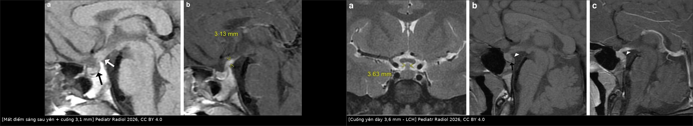
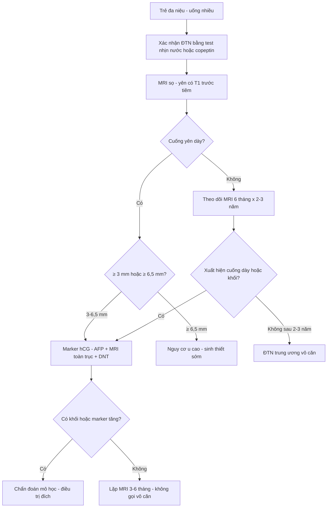
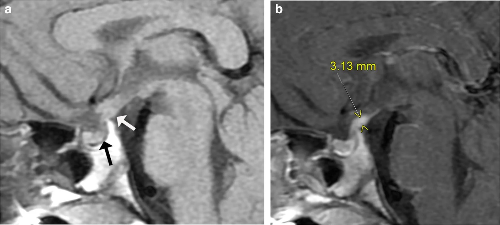
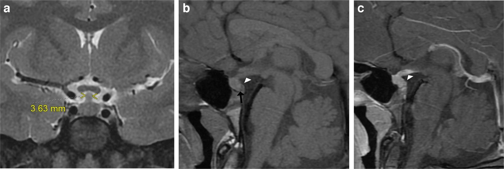
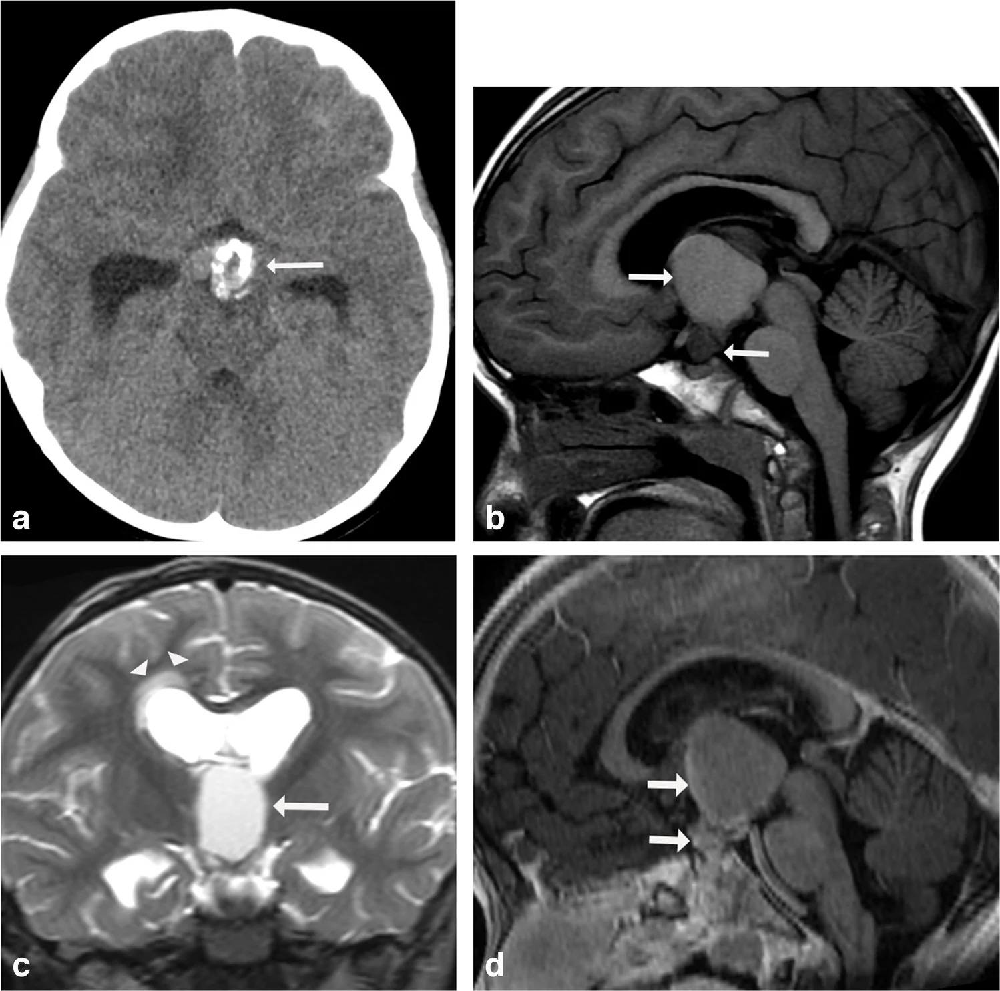

# 1644 — Đái tháo nhạt trung ương ở trẻ / Central diabetes insipidus in children

**Tags:** `pattern:da-nieu` `pattern:cuong-yen-day` `pattern:mat-diem-sang-T1` `vung:so-yen` `vung:duoi-doi` `score:PST-nhe-vua-nang` `protocol:MRI-so-yen` `protocol:test-nhin-nuoc` `incidentaloma:khong`

**Mức chắc chắn (certainty):** tổng hợp y văn (literature synthesis) — bài tổng quan hình ảnh nội tiết nhi (Pediatric Radiology 2026, PMC13268704), nghiên cứu 23 trẻ cuống yên dày (Front Endocrinol 2022, PMC9163297), đoàn hệ 28 trẻ cuống yên dày người Trung Quốc (Cancers 2023, PMC10417368), nghiên cứu tiến cứu 27 trẻ đa niệu–uống nhiều so sánh test nhịn nước với copeptin (2025, PMC12193309), đoàn hệ 202 trẻ mổ u sọ hầu (Brain Behav 2024, PMC10909694) và 26 trẻ u sọ hầu (Childs Nerv Syst 2025, PMC12033113). Các ngưỡng copeptin ở trẻ còn ít dữ liệu, chỗ suy luận được ghi rõ.

> **Câu chốt:** đái tháo nhạt trung ương (ĐTN trung ương) ở trẻ là **chẩn đoán lâm sàng – sinh hóa trước, hình ảnh sau**: đa niệu **> 2,5 L/m²/ngày hoặc > 3 mL/kg/giờ**, kèm **osmolality niệu thấp**; chẩn đoán xác định bằng **test nhịn nước** hoặc **copeptin sau truyền NaCl 3%**. MRI **không** để "tìm nguyên nhân ngay" mà để **phân tầng**: **mất điểm sáng sau yên** (sớm, không đặc hiệu), **cuống yên dày ≥ 3 mm** (nguy cơ u), và **≥ 6,5 mm + nam + thiếu ≥ 2 hormone** = **phải tầm soát u mầm/u sọ hầu**. Bẫy chết người: **hạ natri do điều trị desmopressin** và **gọi "vô căn" quá sớm** — chỉ được gọi vô căn sau **MRI lặp mỗi 6 tháng trong 2–3 năm** âm tính.

## 1. Tổng quan bệnh học – cơ chế hình ảnh

### 1.1 Định nghĩa và dịch tễ

- **Đa niệu ở trẻ:** nước tiểu **> 2,5 L/m²/ngày** hoặc **> 3 mL/kg/giờ**; **uống nhiều** khi lượng dịch vào **> 2 L/m²/ngày** (PMC12193309).
- ĐTN trung ương là **thiếu tổng hợp hoặc thiếu tiết AVP (arginine vasopressin)** tại **nhân trên thị và nhân cạnh não thất**; ĐTN thận là **thận không đáp ứng AVP**; **uống nhiều nguyên phát (primary polydipsia)** là **ức chế AVP do uống quá nhiều** — ba bệnh cảnh **đa niệu giống nhau**, xử trí **ngược nhau** (PMC12193309).
- Ở trẻ, **nguyên nhân thực thể chiếm tỷ lệ đáng kể**: trong 23 trẻ cuống yên dày, **ĐTN trung ương 91,3%**, **chậm tăng trưởng 56,5%**, thời gian từ triệu chứng đầu tới chẩn đoán **2,17 năm (IQR 1,12–3,54)** (PMC9163297).
- Trong 28 trẻ cuống yên dày: **50% có nguyên nhân ung thư** — **u mầm 46%**, **LCH 4%**, còn lại **vô căn**; **thời gian tới chẩn đoán u 1,3 năm (0,5–5,4)** (PMC10417368).

### 1.2 Sinh lý bệnh: vì sao "điểm sáng" biến mất

1. **AVP** được tổng hợp ở **thân neuron nhân trên thị/cạnh não thất**, vận chuyển **dọc cuống yên** và **tích trữ ở thùy sau tuyến yên**.
2. **Điểm sáng T1 của thùy sau** không phải mô mỡ: đó là **tín hiệu T1 cao của túi tiết thần kinh (neurosecretory vesicles)** chứa **phức hợp AVP–neurophysin** — tức **"kho dự trữ AVP" hiện hình**.
3. Khi **kho cạn** (thiếu AVP trung ương), **điểm sáng mất trước**, trong khi **tuyến yên trước vẫn đồng tín hiệu** → **mất điểm sáng là dấu hiệu sớm nhưng KHÔNG đặc hiệu**: có thể gặp ở **uống nhiều nguyên phát**, sau **phẫu thuật**, hoặc **bẩm sinh** (PMC13268704).
4. **Cuống yên dày** là phản ứng **viêm/thâm nhiễm/tăng sinh tế bào** dọc trục dưới đồi–yên: **LCH**, **u mầm**, **bệnh IgG4**, **viêm tuyến yên bạch lympho**, **lao/nấm**, **u sọ hầu** — nên **độ dày và hình thái** là biến số phân tầng, không phải chẩn đoán (PMC13268704; PMC9163297).
5. **Sau mổ vùng trên yên**, trục AVP–thần kinh bị cắt đứt theo **ba pha**: **đa niệu (thiếu AVP) → hạ natri (AVP thoát tự do từ đầu tận cùng bị tổn thương) → đa niệu vĩnh viễn (thoái hóa neuron)**.

### 1.3 TẠI SAO hình ảnh trông như vậy (vật lý + mô bệnh)

- **Chuỗi xung T1 không cản từ, lát mỏng 1–2 mm qua trục giữa:** điểm sáng thùy sau chỉ thấy rõ trên **T1 trước tiêm** — **sau tiêm, thuốc ngấm vào thùy trước làm mất tương phản**, nên **phải có T1 trước tiêm** (PMC13268704).
- **T2/3D heavily T2 (CISS/FIESTA):** cho **chi tiết giải phẫu cuống yên – thể vú – ngách trên yên**, hữu ích khi cuống **chỉ dày 2–3 mm** (PMC13268704).
- **Sau tiêm:** **dày + ngấm thuốc dọc cuống tới thể vú** gợi ý **LCH/viêm**; **khối đặc ngấm rõ + đái tháo nhạt + hCG/AFP tăng** gợi ý **u mầm**; **u nang T1 sáng + vôi hóa** gợi ý **u sọ hầu thể nhú** (PMC13268704).
- **Không hạn chế khuếch tán** giúp loại **áp-xe/nhồi máu**; **không có máu** loại **apoplexy** — nhưng đây là các tình huống hiếm ở trẻ có ĐTN.
- **Phì đại thùy sau (pituitary posterior hyperplasia)** có thể gặp sinh lý ở trẻ — **đừng nhầm với u** khi không có bất thường cuống/tuyến trước.

### 1.4 Ngưỡng định lượng trụ cột

| Đại lượng | Con số | Nguồn |
|---|---|---|
| Đa niệu / uống nhiều | **> 2,5 L/m²/ngày** hoặc **> 3 mL/kg/giờ**; dịch vào **> 2 L/m²/ngày** | PMC12193309 |
| Dừng test nhịn nước | giảm cân **≥ 3%**, osmolality huyết thanh **> 295–300 mOsm/kg**, hoặc triệu chứng | PMC12193309 |
| ĐTN trung ương trên test nhịn nước | **tăng osmolality niệu ≥ 50%** sau DDAVP | PMC12193309 |
| Uống nhiều nguyên phát | osmolality niệu cuối **> 800 mOsm/kg** | PMC12193309 |
| Ngưỡng tối ưu (trẻ) | **tăng ≥ 14%** osmolality niệu sau DDAVP: **Se 88,9% / Sp 100%**, AUC **0,97** | PMC12193309 |
| Copeptin sau NaCl 3% | **< 6,5 pmol/L**: Se **100%** / Sp **100%** (n = 27 trẻ); ngưỡng **< 4,9** chỉ Se 40% | PMC12193309 |
| Copeptin nền | **≥ 21,4 pmol/L** gợi ý **ĐTN thận** | PMC12193309 |
| Dừng truyền NaCl 3% | **Na ≥ 150 mmol/L** hoặc osmolality **≥ 300 mOsm/kg** | PMC12193309 |
| Đường kính cuống yên bình thường | **2,35–2,82 mm** (đầu trên), **1,79–2,45 mm** (giữa), **1,28–1,78 mm** (đầu dưới) | PMC9163297 |
| Ngưỡng "dày" | **> 2 mm** tại chỗ bám / **> 3 mm** ngang giao thoa thị giác | PMC10417368 |
| Phân độ cuống yên | **nhẹ < 4 mm · vừa 4–6,5 mm · nặng ≥ 6,5 mm** | PMC10417368 |
| Dự báo ung thư | **nam + ĐTN trung ương + ≥ 2 thiếu hormone + cuống ≥ 6,5 mm** | PMC10417368 |
| Nguyên nhân cuống yên dày (gộp) | **ung thư 45,5%** (LCH 16,1%, u mầm 13,1%, u sọ hầu 12,3%), **bẩm sinh 19,1%**, **vô căn 29,1%** | PMC10417368 |
| Sau mổ u sọ hầu | **ĐTN 96%**; **ĐTN dai dẳng đơn độc 30,7%**; thể ba pha **23–29%** (loạt này ~**50%**) | PMC12033113; PMC10909694 |
| Rối loạn natri sau mổ | tăng Na **66,3%** (nặng **37,1%**), giảm Na **72,8%** (nặng **40,6%**); hạ Na khởi phát **ngày 4**, kéo dài **~3 ngày** | PMC10909694 |
| Chẩn đoán "vô căn" | chỉ sau **MRI lặp mỗi 6 tháng trong 2–3 năm** không thấy nguyên nhân | PMC13268704 |

## 2. Mẫu hình + chẩn đoán phân biệt theo vị trí (Gamut)

### 2.1 Mẫu hình

1. **Mất điểm sáng thùy sau T1, tuyến yên trước bình thường, cuống yên bình thường** → ĐTN trung ương **không rõ nguyên nhân**; phải theo dõi dài.
2. **Mất điểm sáng + cuống yên dày đều, ngấm thuốc tới thể vú** → **LCH**, **viêm tuyến yên bạch lympho**, **IgG4**, **sarcoid**, **lao**.
3. **Cuống yên dày + khối trên yên + hCG/AFP tăng** → **u mầm (germinoma)**; cần **MRI toàn trục thần kinh + dịch não tủy**.
4. **Khối nang T1 sáng, vôi hóa, ngấm viền** → **u sọ hầu thể nhú (adamantinomatous)** — nguyên nhân hàng đầu gây ĐTN **sau mổ** ở trẻ.
5. **Điểm sáng lạc chỗ + cuống yên không thấy + tuyến yên trước giảm sản** → **hội chứng gián đoạn cuống yên (PSIS)** — bẩm sinh, kèm thiếu nhiều hormone.

### 2.2 Gamut theo vị trí

- **Thùy sau / sọ yên:** mất tín hiệu sớm (ĐTN), phì đại sinh lý, u tế bào hạt thần kinh, di căn hiếm.
- **Cuống yên:** LCH, u mầm, IgG4, lymphocytic hypophysitis, lao/nấm, di căn (ở trẻ rất hiếm).
- **Trên yên / vùng dưới đồi:** u sọ hầu, u mầm, glioma đường thị, hamartoma, u tế bào mầm tiết hCG.
- **Tuyến yên trước:** adenoma (trẻ vị thành niên), Rathke cleft cyst — thường **không gây ĐTN** trừ khi chèn ép nặng.

## 3. Bảng so sánh phân biệt (ma trận đối chiếu)

| Thực thể | Hình ảnh / xét nghiệm điển hình | Chốt vào (rule-in) | Chốt loại (rule-out) | Gợi ý xác nhận |
|---|---|---|---|---|
| **ĐTN trung ương vô căn/nguyên phát** | mất điểm sáng, cuống **< 3 mm**, không khối | **ĐTN xác định + MRI âm trong 2–3 năm** | **không** gọi vô căn khi **cuống ≥ 3 mm** hoặc mới theo dõi < 2 năm | MRI lặp **6 tháng/lần × 2–3 năm** |
| **LCH** | cuống dày **đều, ngấm thuốc tới thể vú**, mất điểm sáng | **dày cuống + tổn thương da/xương/răng + đáp ứng hóa trị** | không loại trừ được bằng MRI đơn thuần | sinh thiết da/xương; theo dõi 6 tháng |
| **U mầm (germinoma)** | khối trên yên/cuống, ngấm đồng nhất, **hCG/AFP tăng** | **marker tăng** hoặc **sinh thiết** | **marker âm không loại trừ** (u mầm không tiết) | MRI não + tủy, DNT, sinh thiết |
| **U sọ hầu** | nang T1 sáng + vôi hóa + ngấm viền, chèn ép | **vôi hóa + nang + chèn ép** | không phải ĐTN đơn thuần | CT + MRI, sau mổ theo dõi natri |
| **Uống nhiều nguyên phát** | MRI bình thường, không mất điểm sáng | **osmolality niệu cuối > 800**, copeptin **> 6,5** | không có bằng chứng thiếu AVP | test nhịn nước có kiểm soát |
| **ĐTN thận** | MRI bình thường, **copeptin nền ≥ 21,4** | **không đáp ứng DDAVP**, AVP cao | loại ĐTN trung ương | thử lợi tiểu/indomethacin, gen AVPR2/AQP2 |
| **Hội chứng gián đoạn cuống yên** | **điểm sáng lạc chỗ**, không thấy cuống, tuyến trước giảm sản | **tam chứng MRI** | không phải ĐTN mắc phải | đánh giá tuyến yên đầy đủ + gen |
| **ĐTN sau mổ vùng trên yên** | mất điểm sáng mới xuất hiện, cuống cắt | **mổ trong 2 tuần trước** | không quy cho u khi chưa có mốc thời gian | theo dõi Na **ngày 1–14** |

*Trái: mất điểm sáng thùy sau + cuống trên dày 3,1 mm (ĐTN trung ương, nguyên nhân được cho là viêm). Phải: cuống yên dày 3,6 mm tới thể vú ở trẻ LCH, hết sau hóa trị. Cùng một triệu chứng, hai mức nguy cơ khác nhau. Nguồn: Pediatr Radiol 2026 (PMC13268704), CC BY 4.0.*

## 4. Protocol chụp + hệ phân tầng

### 4.1 Protocol MRI sọ–yên ở trẻ

- **T1 sagittal lát mỏng 1–2 mm TRƯỚC TIÊM** qua trục giữa (bắt buộc — để thấy điểm sáng thùy sau), **T2 sagittal**, **T2 coronal**, **T1 sau tiêm coronal + sagittal**.
- **3D heavily T2 (CISS/FIESTA)** khi cần đánh giá cuống yên mảnh và thể vú.
- **Nghi u mầm:** thêm **MRI toàn trục thần kinh** (di căn ống sống), **xét nghiệm hCG/AFP huyết thanh + dịch não tủy**.
- **Ghi báo cáo bắt buộc:** (1) có/không **điểm sáng thùy sau**; (2) **đường kính cuống yên** tại 3 mức; (3) **có ngấm thuốc dọc cuống**; (4) **khối trên yên/sọ yên**; (5) **điểm sáng lạc chỗ**; (6) **tuyến yên trước** (chiều cao, tín hiệu).

### 4.2 Chẩn đoán sinh hóa (làm trước hoặc song song)

- **Bước 1:** xác nhận **đa niệu thật** (thể tích nước tiểu 24 giờ), loại **tăng đường huyết/tăng canxi/hạ kali**.
- **Bước 2:** **test nhịn nước** có giám sát — dừng khi **giảm cân ≥ 3%**, **osmolality > 295–300**, hoặc triệu chứng; sau đó **DDAVP** và đo lại.
- **Bước 3 (ưu tiên khi có điều kiện):** **copeptin sau truyền NaCl 3%** — dừng ở **Na ≥ 150** hoặc **osmolality ≥ 300**; **< 6,5 pmol/L = ĐTN trung ương** (Se/Sp **100%** trong loạt 27 trẻ), **≥ 21,4 pmol/L nền = ĐTN thận** (PMC12193309).

### 4.3 Phân tầng nguy cơ và lịch theo dõi

> **Nguyên tắc:** **không sinh thiết mù** cuống yên khi marker âm và tổn thương < 6,5 mm — vì sinh thiết có thể gây **ĐTN vĩnh viễn**; thay vào đó **theo dõi 3–6 tháng** và **sinh thiết khi tổn thương tiến triển** (PMC10417368; PMC13268704).

### 4.4 Điều trị và biến chứng cần nhớ

- **Desmopressin** thay thế AVP; **nguyên tắc: liều thấp nhất kiểm soát được đa niệu, cho uống nước theo khát** — vì **desmopressin + uống nhiều không kiểm soát = hạ natri** (đặc biệt ở trẻ nhỏ và **ĐTN kèm mất khát**).
- **Trẻ sơ sinh/nhũ nhi** dễ **hạ natri** và **tăng natri** hơn; cần theo dõi **Na, osmolality, cân nặng**.
- **Sau mổ u sọ hầu:** đo **Na mỗi 6–12 giờ trong 14 ngày đầu**; **hạ natri hay gặp ngày 4, kéo dài ~3 ngày**; thể ba pha **23–29%**, trong loạt 202 trẻ gần **50%** (PMC10909694).
- **ĐTN dai dẳng** sau mổ u sọ hầu **30,7%**; **ĐTN trước mổ chỉ 11%** → phần lớn ĐTN là **biến chứng phẫu thuật** (PMC12033113).

## 5. Biến thể bình thường và cạm bẫy

### 5.1 Biến thể bình thường

- **Điểm sáng thùy sau** hiện rõ ở **hầu hết trẻ khỏe mạnh**, có thể **giảm dần theo tuổi**; **mất điểm sáng đơn độc** không đồng nghĩa bệnh nếu không có đa niệu.
- **Cuống yên hơi to ở trẻ nhỏ** và **thay đổi theo tuổi dậy thì** — đo **3 mức** và so với ngưỡng tuổi thay vì một con số tuyệt đối.
- **Phì đại thùy sau** (điểm sáng to) có thể là **biến thể** hoặc phản ứng — đừng gọi u khi không có khối và không có bất thường cuống.

### 5.2 Cạm bẫy (pitfall)

1. **Kết luận "vô căn" sau một MRI âm** — sai. Phải **lặp mỗi 6 tháng trong 2–3 năm** mới được gọi vô căn; nhiều u mầm/LCH biểu hiện **chỉ bằng mất điểm sáng** giai đoạn đầu (PMC13268704).
2. **Bỏ qua T1 trước tiêm** — sau tiêm, thùy trước ngấm thuốc làm **mất tương phản**, dễ báo "không thấy điểm sáng" giả.
3. **Nhầm ĐTN trung ương với uống nhiều nguyên phát** — điều trị desmopressin cho trẻ uống nhiều nguyên phát gây **hạ natri nặng**; phải có **test nhịn nước/copeptin** trước.
4. **Sinh thiết cuống yên quá sớm** khi tổn thương nhỏ, marker âm → **gây ĐTN vĩnh viễn** cho một tổn thương có thể chỉ là viêm tự giới hạn.
5. **Bỏ sót hạ natri sau mổ** vì chỉ theo dõi nước tiểu — thể ba pha có **pha hạ natri** dù bệnh nhân "đang đỡ đa niệu"; phải **đo Na theo lịch**.
6. **Satisfaction of search:** thấy u sọ hầu mà **không đánh giá trục dưới đồi–yên còn lại** và **không kiểm tra di căn ống sống** ở u mầm.

## 6. Tự lượng giá — Blind Quiz

**Ca 1 — bé trai 10 tuổi, uống nhiều – tiểu nhiều 3 tháng**

- Bệnh cảnh: đa niệu, uống nhiều, không đau đầu; xét nghiệm marker u mầm và dịch não tủy âm.
- Câu hỏi: (a) Dấu hiệu trên T1 trước tiêm? (b) Đo cuống yên bao nhiêu? (c) Có cần sinh thiết ngay không?

<b>Bấm để hiện đáp án (findings + chẩn đoán)</b>

- Dấu hiệu: **mất điểm sáng thùy sau** (mũi tên đen); **cuống yên trên dày 3,1 mm** (thước đo ở ảnh sau tiêm); **không có điểm sáng lạc chỗ**.
- Chẩn đoán: **ĐTN trung ương, nguyên nhân được cho là viêm (viêm cuống yên)** — marker và DNT âm; theo dõi **MRI 2 năm** để loại u.
- Chốt: cuống **3,1 mm** chưa đủ chỉ định sinh thiết; **theo dõi 3–6 tháng** là lựa chọn đúng.
- Nguồn ảnh: *Pediatric Radiology* 2026 (PMC13268704), Fig. 21, CC BY 4.0.

**Ca 2 — bé gái 8 tuổi, ĐTN trung ương, tổn thương da và xương**

- Bệnh cảnh: đa niệu, chậm tăng trưởng; có tổn thương da đầu và tiêu xương sọ.
- Câu hỏi: (a) Cuống yên dày bao nhiêu? (b) Ba chẩn đoán phân biệt hàng đầu? (c) Điều gì chứng minh nguyên nhân?

<b>Bấm để hiện đáp án (findings + chẩn đoán)</b>

- Dấu hiệu: **cuống yên dày 3,6 mm**, **ngấm thuốc tới thể vú**, **mất điểm sáng thùy sau**.
- Chẩn đoán: **LCH (Langerhans cell histiocytosis)** — chẩn đoán xác định bằng **sinh thiết da/xương**, không cần sinh thiết cuống yên; hình ảnh **bình thường hóa sau hóa trị**.
- Phân biệt: **u mầm** (marker hCG/AFP), **viêm tuyến yên bạch lympho/IgG4**, **sarcoid/lao**.
- Nguồn ảnh: *Pediatric Radiology* 2026 (PMC13268704), Fig. 22, CC BY 4.0.

**Ca 3 — bé gái 3 tuổi, đa niệu + đau đầu + ngủ gà**

- Bệnh cảnh: đa niệu, uống nhiều, đau đầu tăng dần, lơ mơ.
- Câu hỏi: (a) Mô tả tổn thương? (b) Vì sao có giãn não thất? (c) Đái tháo nhạt ở đây là trước hay sau mổ?

<b>Bấm để hiện đáp án (findings + chẩn đoán)</b>

- Dấu hiệu: **khối trên yên vôi hóa một phần** trên CT; **khối nang T1 sáng** lan từ sọ yên lên trên yên; **T2 coronal: nang chèn lỗ Monro → giãn não thất cấp + phù quanh não thất**; sau tiêm **ngấm viền mờ**.
- Chẩn đoán: **u sọ hầu thể nhú (adamantinomatous craniopharyngioma)** — ĐTN **do u chèn ép trục dưới đồi–yên**, và **96%** trẻ mổ u sọ hầu có ĐTN (phần lớn **sau mổ**).
- Chốt: **giãn não thất do tắc lỗ Monro** là chỉ định can thiệp cấp, không chờ "đo lại".
- Nguồn ảnh: *Pediatric Radiology* 2026 (PMC13268704), Fig. 13, CC BY 4.0.

## Bài liên quan chéo

- [1680 – Viêm tụy cấp do tăng triglyceride](../1680-viem-tuy-tang-triglyceride-nguoi-lon/lesson.md)
- [155 – Thượng thận: tiếp cận khối và bệnh nội tiết](../155-thuong-than-tinh-co/lesson.md)

## Ảnh

- `images/1644_mat-diem-sang-sau-yen_MRI_PMC13268704-F21.jpg` — mất điểm sáng thùy sau + cuống 3,1 mm, CC BY 4.0.
- `images/1644_cuong-yen-day_MRI_PMC13268704-F22.jpg` — cuống yên dày 3,6 mm (LCH), CC BY 4.0.
- `images/1644_u-so-sau-yen_MRI_PMC13268704-F13.jpg` — u sọ hầu trên yên có giãn não thất, CC BY 4.0.
- `images/1644_cuong-yen-day-3-nguyen-nhan_MRI_PMC9163297-F1.jpg` — ba nguyên nhân cuống yên dày, CC BY 4.0.
- `images/composite_hai-mau-hinh-mri.jpg` — ảnh ghép đối chiếu, ghép từ 2 nguồn CC BY 4.0.

> Không dùng để chẩn đoán độc lập khi chưa có người hướng dẫn.
