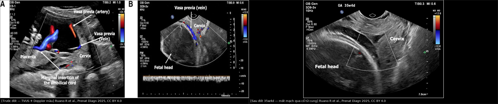
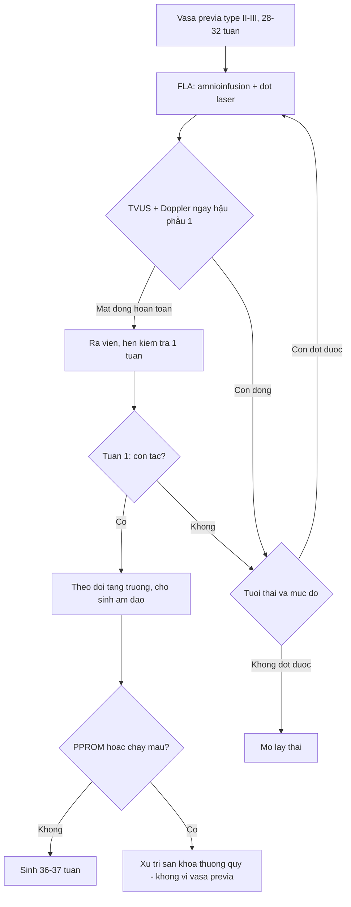
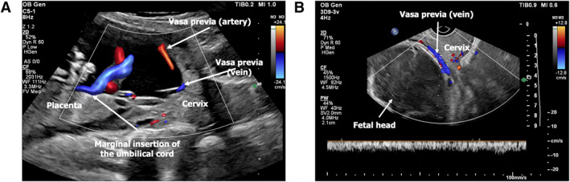
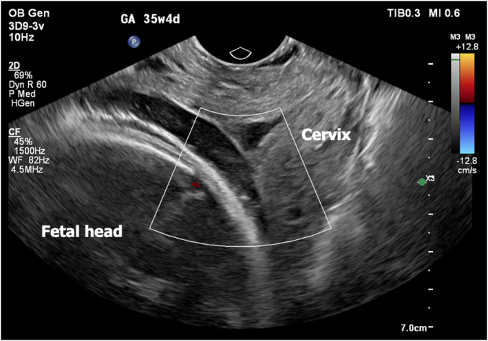

# 1645 — Sau đốt laser vasa previa (FLA): ối vỡ non, tách màng ối, tái thông mạch — đọc Doppler thế nào và theo dõi ra sao

**Tags:** `pattern:vasa-previa` `pattern:pprom` `pattern:tach-mang-oi` `vung:co-tu-cung` `vung:nhau-thai` `score:GA-31-32-tuan` `protocol:TVUS-Doppler` `protocol:fetoscopic-laser`
**Mức chắc chắn (certainty):** tổng hợp y văn (literature synthesis) — ghép 1 đoàn hệ so sánh trực tiếp **FLA (n = 35) với xử trí chuẩn (n = 32)** ở 2 trung tâm Hoa Kỳ (Backley 2026) + 1 tổng quan hệ thống **54 ca FLA** (Ruano 2025) + dữ liệu tách màng ối sau đốt laser ở TTTS để suy ra nguy cơ (RCT protocol 2025). Đây là bài **nối tiếp 1603** (chẩn đoán và chỉ định đốt): ở đây chỉ bàn **diễn biến sau thủ thuật**. Số liệu đối chiếu PMCID trong `sources.md`.

## 1. Tổng quan bệnh học – cơ chế hình ảnh: vì sao "sau đốt" là một bệnh cảnh riêng

- **Thủ thuật làm gì:** đưa fetoscope **3,3 mm (0°/30°)** qua thành bụng – tử cung vào buồng ối, **bơm dịch ối (amnioinfusion)** để tạo khoảng làm việc, rồi **đốt laser diode** các mạch tiền đạo (vasa previa) chạy trong màng ối; cuối thủ thuật **rút bớt dịch (amnioreduction)**.
- **Số liệu kỹ thuật của loạt 35 ca:** tuổi thai lúc đốt **88,6% ở 31–32 tuần** (5,7% ở 28–30 tuần, 5,7% ≥ 33 tuần); đường kính mạch trung vị **0,3 cm (0,1–0,5)**; **amnioinfusion 71,4%**; thời gian mổ trung vị **60 phút (34–125)**; **không ca nào tụt nhịp tim thai trong mổ**, **không ca nào tách màng ối** trên siêu âm hậu phẫu (Backley 2026, PMC12951256). Ca nguyên văn: bơm **1.050 mL** nước muối ấm, đốt **9,318 kJ trong 5 phút 12 giây (69 nhịp)** (Ruano 2025, PMC12611538).
- **Vì sao biến chứng chính là ối vỡ non (PPROM), không phải chảy máu:** màng ối **không tự lành** sau khi bị chọc 3,3 mm; lỗ thủng là đường rò dịch ối ra ngoài. Trong đốt laser điều trị TTTS, **tách màng ối (chorioamniotic separation, CAS) gặp 7,5–20,7%**, và CAS làm tăng rõ nguy cơ **PPROM < 34 tuần (OR 3,98; KTC 1,76–9,03)** và **sinh < 32 tuần (OR 1,80; KTC 1,16–2,80)** (PMC12639666). Biến chứng mẹ nặng sau thủ thuật bào thai **< 2%**.
- **Con số quyết định của FLA (35 ca):** **PPROM < 37 tuần 37,1%** và **PPROM < 34 tuần 14,3%** (nhóm xử trí chuẩn: **0%** cả hai); trung vị tuổi thai khi sinh **36,0 tuần (IQR 35,0–37,6)** so với **34,4 tuần (33,4–35,0)**; **sinh âm đạo 62,9%** so với **0%**; khoảng cách từ đốt tới sinh **33 ngày (0–57)**.
- **TẠI SAO đổi hoàn toàn cách xử trí sau khi mạch đã tắc:** nguyên văn protocol của nhóm nghiên cứu — sau khi xác nhận tắc mạch, bệnh nhân được ra viện theo dõi ngoại trú **vì "chảy máu hoặc ối vỡ sẽ không còn nguồn gốc từ thai và không còn nguy cơ thai mất máu"**. Trước đốt, vỡ ối = cắt đứt mạch thai = mất máu cấp; sau đốt, vỡ ối chỉ là **biến cố sản khoa thông thường**.
- **TẠI SAO Doppler là "máy đo" thành công (vật lý):** mạch bị đốt bị **huyết khối + co mạch** nên **không còn dòng** trên Doppler màu/xung. Trên **B-mode, dải mô – thành mạch đã xơ vẫn còn thấy** như một cấu trúc âm thanh mảnh băng qua cổ tử cung — đọc B-mode mà kết luận "còn mạch" là bẫy; ngược lại, thấy **chấm màu đỏ–xanh** trên Doppler màu dù rất nhỏ = **còn dòng = thất bại**.

## 2. Mẫu hình + chẩn đoán phân biệt trên siêu âm sau đốt (gamut)

- **A — Tắc hoàn toàn (thành công):** không còn tín hiệu màu ở bất kỳ điểm nào của mạch khi quét dọc cổ tử cung; chỉ còn dải B-mode không có dòng. Đây là đích của kiểm tra **ngày hậu phẫu 1** và **1 tuần sau**.
- **B — Còn dòng/tái thông (thất bại):** dòng màu quay lại tại chỗ đốt hoặc tại nhánh bên; trong loạt 35 ca có **1 ca (2,9%) phải đốt lại ngày hôm sau** và **1 ca (2,9%) phải bỏ thủ thuật → mổ lấy thai ngay**.
- **C — Tách màng ối (CAS):** amnion bong khỏi chorion, thấy **khoang dịch giữa hai lá màng**; nguy cơ PPROM tăng (OR 3,98 cho PPROM < 34 tuần). Loạt FLA vasa previa **chưa ghi nhận ca nào** (0/35) nhưng cỡ mẫu nhỏ, chưa đủ để loại trừ.
- **D — Ối vỡ non sau khi đã tắc mạch:** **37,1% < 37 tuần**, **14,3% < 34 tuần**; trung vị tuổi thai khi sinh của nhóm PPROM < 37 tuần là **35,1 tuần**. Đây **không** phải chỉ định mổ cấp vì vasa previa.
- **E — Bong rau/chảy máu âm đạo:** **3/35 (8,6%)** là lý do mổ lấy thai trong loạt — cần siêu âm loại trừ bong rau, không mặc định là "mạch tiền đạo chảy".
- **F — Thai chậm phát triển/giảm ối đơn thuần:** theo dõi tăng trưởng định kỳ; không quy kết cho thủ thuật nếu không có bằng chứng tách màng/PPROM.
- **G — Nhiễm ối (chorioamnionitis):** **không ca nào** trong 54 ca tổng quan và 35 ca đoàn hệ; số ca còn ít, **tỉ lệ thật chưa rõ** — phải cảnh giác khi có sốt + ối vỡ.
- **H — Cấu trúc mạch không phải vasa previa:** **giãn tĩnh mạch cổ tử cung của mẹ**, **dây rốn nằm trước ngôi** — phân biệt bằng dạng sóng (động mạch rốn nhấp nháy theo tim thai vs tĩnh mạch mẹ liên tục). Xem bài 1603.

## 3. Bảng so sánh phân biệt (ma trận đối chiếu)

| Thực thể (entity) | Hình ảnh điển hình (TVUS ± Doppler) | Chốt vào (rule-in) | Chốt loại (rule-out) | Gợi ý xác nhận |
|---|---|---|---|---|
| **Tắc hoàn toàn sau đốt** | Dải B-mode mảnh qua cổ tử cung, **không có tín hiệu màu**, không có phổ động mạch | **Mất dòng ở mọi điểm của mạch, cả ngày 1 và 1 tuần** | Còn chấm màu bất kỳ → chưa tắc | TVUS + Doppler màu/xung, quét dọc và ngang cổ tử cung |
| **Còn dòng / tái thông** | Chấm màu đỏ–xanh tại chỗ đốt hoặc nhánh bên; phổ động mạch rốn | **Có phổ động mạch ở vị trí mạch tiền đạo** | Mất dòng hoàn toàn → tắc | Doppler xung; đốt lại (2,9%) hoặc mổ lấy thai |
| **Tách màng ối (CAS)** | Khoang dịch giữa amnion và chorion, màng ối di động tự do trong buồng ối | **Thấy rõ hai lá màng tách nhau, đo được chiều dày khoang dịch** | Không có khoang dịch giữa màng → không tách | Đo phần trăm bề mặt bong (< 50% vs ≥ 50%) |
| **Ối vỡ non sau đốt** | Bể ối nhỏ lại, màng không còn liên tục, đầu thai sát thành tử cung | **Mất dịch ối + màng vỡ + không còn mạch tiền đạo** | Còn mạch tiền đạo có dòng → xử trí như vasa previa chưa đốt | TVUS; xét nghiệm IGFBP-1/ferning nếu cần |
| **Bong rau** | Khối tăng âm sau bánh nhau, máu tụ dưới màng đệm, bánh nhau dày lên | **Khối sau bánh + đau + ra máu** | Bánh nhau bình thường, không khối sau bánh → không bong | Siêu âm; theo dõi tim thai |
| **Nhiễm ối** | Dịch ối vẩn, dày màng, thai không phản ứng | **Sốt + ối vỡ + CRP/bạch cầu tăng** | Không sốt, ối trong → chưa nhiễm | Cấy, CRP; **tỉ lệ sau FLA chưa rõ** |
| **Giãn tĩnh mạch cổ tử cung (mẹ)** | Cấu trúc tĩnh mạch giãn, dòng liên tục, đổi theo Valsalva | **Phổ tĩnh mạch mẹ, không theo nhịp tim thai** | Phổ động mạch rốn → mạch thai | Doppler xung + Valsalva |

*Trái: trước đốt — Doppler màu thấy **một động mạch và một tĩnh mạch** băng qua cổ tử cung (type II), kèm dây rốn bám màng. Phải: **35 tuần 4 ngày, sau đốt** — không còn mạch qua cổ tử cung, chỉ còn cổ tử cung và đầu thai. Ảnh ghép letterbox, không crop/kéo giãn. Nguồn: Ruano R et al., Prenatal Diagnosis 2025, CC BY 4.0.*

## 4. Protocol: chọn ca – thủ thuật – theo dõi – sinh

- **Chọn ca (tiêu chuẩn của đoàn hệ 2 trung tâm):** vasa previa **type II hoặc III**, thai **một**, không chậm phát triển, **không PPROM trước thủ thuật**, không dị tật lớn; loại type I (vì mạch type I nuôi phần bánh lớn hơn, đốt dễ gây thiếu máu thai). Thời điểm: **28–32 tuần**, thực tế **88,6% đốt ở 31–32 tuần** — nhóm dời đốt **sau 31 tuần** báo cáo tuổi thai sinh trung bình tăng lên **38,1 ± 1,4 tuần** (so với **37,2 ± 1,8 tuần**, sinh âm đạo 70% ở loạt trước).
- **Trong và ngay sau thủ thuật:** corticosteroid trưởng thành phổi + **MgSO₄ bảo vệ thần kinh thai** (truyền **24 giờ** sau mổ), sau đó **nifedipine 10 mg mỗi 8 giờ** giảm co; theo dõi tại khoa sinh **qua đêm**.
- **Mốc kiểm tra bắt buộc (đây là phần "hình ảnh" của bài):**
  - **Ngày hậu phẫu 1:** TVUS + Doppler — xác nhận **không còn dòng** ở mạch tiền đạo; nếu tắc → cho ra viện.
  - **1 tuần sau:** kiểm tra lại lần cuối; nếu vẫn tắc → chuyển về bác sĩ sản theo dõi, **siêu âm tăng trưởng định kỳ**.
  - **Nếu còn dòng:** đốt lại (2,9% trong loạt) hoặc mổ lấy thai tùy tuổi thai và mức độ.
- **Sinh:** **sinh âm đạo được phép** sau khi đã xác nhận tắc (62,9% trong loạt); mổ lấy thai khi **chảy máu/bong rau (8,6%)**, ngôi bất thường, rau bám thấp, hoặc chỉ định sản khoa khác. Trung vị tuổi thai sinh **36,0 tuần**.
- **Tư vấn bằng số của nhóm FLA so với xử trí chuẩn:** vào khoa trước sinh **22,9% vs 87,5%**; thời gian nằm trước sinh **1 ngày (0–3) vs 16 ngày (7–23)**; **NICU 34,3% vs 96,9%**; **suy hô hấp 14,3% vs 50,0%**; **truyền máu sơ sinh 0% vs 18,8%**; cân nặng **2.667 ± 511 g vs 2.305 ± 519 g**; **không có tử vong chu sinh ở cả hai nhóm**.
- **Giới hạn phải nói rõ khi tư vấn:** tổng quan 54 ca cho **thành công kỹ thuật 98,1%**, **sinh âm đạo 50%**, **sống sơ sinh 100%**, **không biến chứng mẹ nặng** — nhưng **không có RCT**, cỡ mẫu nhỏ, **thiếu theo dõi thần kinh dài hạn**.

## 5. Biến thể bình thường và cạm bẫy

- **Bẫy số 1 — đọc B-mode:** sau đốt, **dải mô của mạch vẫn còn**; chỉ Doppler mới phân biệt "mạch chết" với "mạch sống". Luôn ghi rõ **"không có dòng"**, không ghi "không còn mạch".
- **Bẫy số 2 — chẩn đoán thất bại quá sớm:** ngày 1 có thể còn phản âm do phù nề/quầng đốt; nếu chỉ thấy **dòng rất yếu**, kiểm tra lại bằng Doppler xung và hẹn **1 tuần** trước khi kết luận.
- **Bẫy số 3 — PPROM sau đốt bị xử trí như vasa previa chưa đốt:** mổ cấp là đúng nếu **chưa xác nhận tắc**; nếu đã xác nhận tắc, ối vỡ **không còn nguy cơ thai mất máu** → xử trí theo phác đồ ối vỡ non thông thường.
- **Bẫy số 4 — tách màng ối nhỏ bị đọc thành "thất bại":** CAS không đồng nghĩa thủ thuật thất bại; nhưng CAS **≥ 50%** bề mặt làm tăng PPROM, cần theo dõi sát.
- **Bẫy số 5 — đốt quá sớm:** đốt < 31 tuần có liên quan tuổi thai sinh thấp hơn; nhóm dời sang **> 31 tuần** đạt **38,1 tuần** — cân nhắc lợi ích của việc chờ.
- **Bẫy số 6 — ngoại suy từ TTTS:** số liệu CAS 7,5–20,7% và OR 3,98 lấy từ **đốt laser điều trị TTTS**, không phải vasa previa; ở vasa previa diện đốt nhỏ hơn nhưng **cùng cơ chế chọc màng** — dùng để **ước lượng nguy cơ**, không phải để trích dẫn như số liệu của vasa previa.
- **Bẫy số 7 — "đã đốt là xong":** 2/35 ca (5,7%) vẫn cần can thiệp lại (1 đốt lại, 1 mổ ngay) — luôn có phương án dự phòng mổ cấp trong 24 giờ đầu.

## 6. Tự lượng giá — Blind Quiz

**Ca 1 — Thai 22 tuần 5 ngày, Doppler đường âm đạo thấy hai mạch băng qua lỗ trong cổ tử cung.**

- Câu hỏi: mô tả hai mạch và vị trí dây rốn? Đây là type nào? Hai nguy cơ phải tư vấn nếu **không** điều trị, và một nguy cơ nếu **đốt laser**?

<b>Bấm để hiện đáp án (findings + chẩn đoán)</b>

- Dấu hiệu: (A) mặt phẳng ngang — **một động mạch (đỏ) và một tĩnh mạch (xanh)** chạy trong màng, băng qua cổ tử cung; **dây rốn bám màng (marginal insertion)**; (B) đường âm đạo — mạch nằm ngay sát lỗ trong, phổ Doppler xung của **động mạch rốn**.
- Chẩn đoán: **vasa previa type II** (mạch nối bánh chính với thùy phụ, kèm dây rốn bám màng).
- Không điều trị: vỡ ối/cơn co → **rách mạch, thai mất máu cấp**; tỉ lệ tử vong chu sinh khi không chẩn đoán trước sinh rất cao (xem 1603).
- Đốt laser: nguy cơ chính là **ối vỡ non** — **37,1% < 37 tuần, 14,3% < 34 tuần**; tách màng ối; **5,7%** phải can thiệp lại.
- Nguồn ảnh: Ruano R et al., *Prenatal Diagnosis* 2025;45:1660–1666, CC BY 4.0.

**Ca 2 — Cùng thai phụ, sau đốt 4 tuần, thai 35 tuần 4 ngày, vào viện vì rỉ dịch âm đạo.**

- Câu hỏi: còn mạch tiền đạo không? Chẩn đoán là gì? Thái độ xử trí: mổ lấy thai cấp vì vasa previa hay xử trí ối vỡ non thông thường?

<b>Bấm để hiện đáp án (findings + quyết định)</b>

- Dấu hiệu: **không còn mạch nào băng qua cổ tử cung**; hình chỉ còn cổ tử cung và đầu thai; **không có tín hiệu Doppler** ở vùng màng trước cổ tử cung.
- Chẩn đoán: **đã tắc mạch hoàn toàn sau đốt** + **ối vỡ non** (rỉ dịch).
- Xử trí: **không mổ cấp vì vasa previa** — mạch đã tắc nên không còn nguy cơ thai mất máu; xử trí theo phác đồ ối vỡ non (kháng sinh, corticosteroid nếu chưa đủ, theo dõi nhiễm, sinh khi có chỉ định). Trong loạt, trung vị tuổi thai khi sinh của nhóm PPROM < 37 tuần là **35,1 tuần**.
- Nguồn ảnh: Ruano R et al., *Prenatal Diagnosis* 2025;45:1660–1666, CC BY 4.0.

**Ca 3 — Thai 31 tuần, đốt laser vasa previa type III. Ngày hậu phẫu 1, Doppler màu còn một chấm màu nhỏ tại chỗ đốt.**

<b>Bấm để hiện đáp án (quyết định)</b>

- Đây là **còn dòng = thất bại một phần** — không được cho ra viện với kết luận "đã đốt thành công".
- Xác nhận bằng **Doppler xung**: nếu có phổ **động mạch rốn** → còn mạch sống.
- Lựa chọn: **đốt lại** (đã dùng ở **2,9%** ca trong loạt) nếu tuổi thai và kỹ thuật cho phép; nếu không → **mổ lấy thai** (trong loạt, **2,9%** ca phải bỏ thủ thuật và mổ ngay).
- Theo dõi sau đó: lặp lại TVUS **1 tuần**; nếu tắc hoàn toàn mới cho theo dõi ngoại trú và dự kiến sinh âm đạo.

## Bài liên quan chéo
- [1603 – Vasa previa type II–III: Doppler đường âm đạo, ngưỡng 5 cm và đốt laser](../1603-vasa-previa-laser-noi-soi-thai/lesson.md) (chẩn đoán + chỉ định)
- [1610 – Tách màng ối sau can thiệp bào thai](../1610-tach-mang-oi-sau-can-thiep-bao-thai/lesson.md) (CAS: cùng cơ chế chọc màng)
- [587 – Dự phòng sinh non sau laser TTTS](../587-du-phong-sinh-non-sau-laser-TTTS/lesson.md)
- [566 – Song thai: chorionicity, TTTS, TAPS](../566-song-thai-chorionicity-TTTS-TAPS/lesson.md)
- [1611 – TTTS tái phát sau laser](../1611-ttts-tai-phat-sau-laser/lesson.md)

## Ảnh
- Tên file: `1645_slug_Modality_SourceID.jpg`; ảnh ghép `composite_vasa-previa_truoc-sau-dot.jpg` tạo bằng `tools/make_composite.py` (letterbox nền đen, không crop/kéo giãn).
- Nguồn + giấy phép từng ảnh trong `images/CREDITS.md`.

> Không dùng để chẩn đoán độc lập khi chưa có người hướng dẫn.
