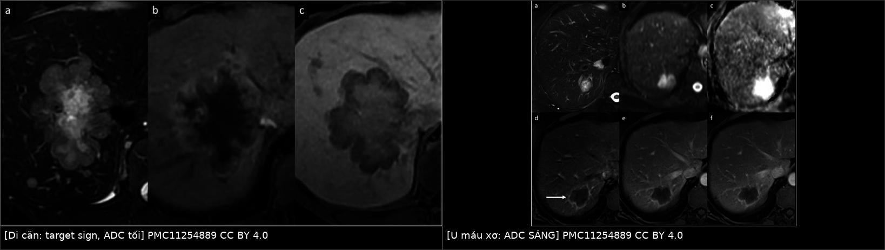
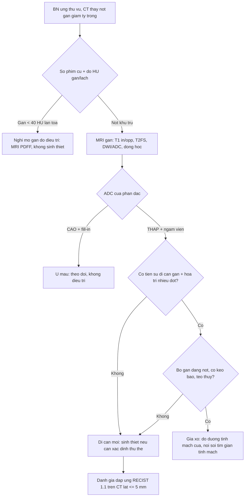
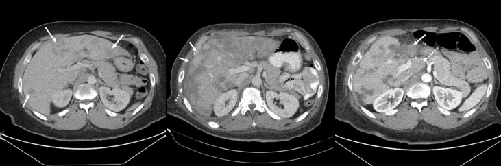
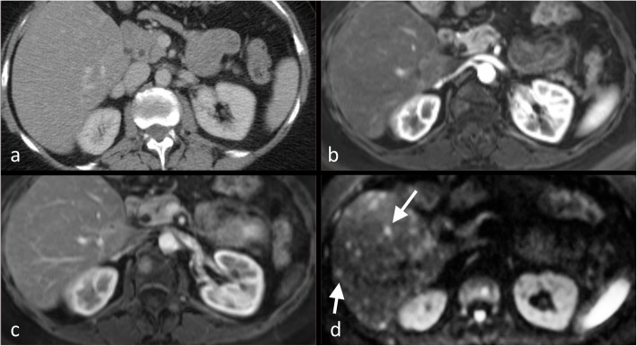
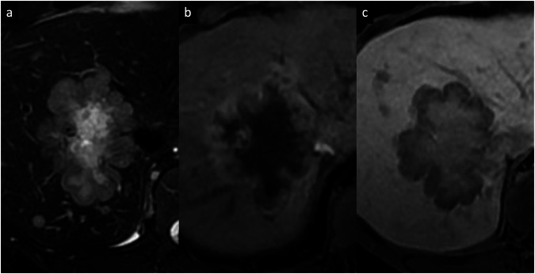

# 1648 — Di căn gan ở ung thư vú: phân biệt với u máu, gan nhiễm mỡ do điều trị và gan "giả xơ" / Liver metastases from breast cancer: separating them from haemangioma, treatment-induced steatosis and pseudocirrhosis

**Tags:** `pattern:not-gan` `pattern:nhieu-o` `pattern:ngam-vien` `pattern:di-can` `pattern:gan-nhieu-mo` `pattern:gia-xo-gan` `pattern:gia-lanh-hoa` `vung:gan` `protocol:CT-bung-co-can-quang` `protocol:MRI-gan-DWI` `protocol:PET-FDG` `score:RECIST-1.1` `incidentaloma:u-mau-gan`
**Mức chắc chắn (certainty):** tổng hợp y văn (literature synthesis) — số liệu đọc trực tiếp từ toàn văn: tổng quan hình ảnh di căn ung thư vú (*Insights Imaging* 2020, PMC7297923), tổng quan đánh giá đáp ứng (*Cancer Imaging* 2023, PMC10230813), đoàn hệ 86 ca giả xơ (*Front Oncol* 2021, PMC8283693), meta-analysis 389 ca giả xơ (*Sci Rep* 2022, PMC9674682), loạt hình ảnh tổn thương gan sau hóa trị (*J Clin Imaging Sci* 2025, PMC12361689), ngưỡng mỡ gan trên CT (*Radiol Bras* 2022, PMC9254702), ngấm viền động mạch của u gan (*Insights Imaging* 2024, PMC11254889); có **ca nguyên văn** trong quiz.

## 1. Tổng quan bệnh học – cơ chế hình ảnh

- **Tần suất:** gan là ổ di căn thường gặp của ung thư vú — **tới 60–70%** nữ tử vong vì ung thư vú có di căn gan trên tử thiết; trên hình ảnh, tỉ lệ này thấp hơn nhiều vì chỉ phản ánh bệnh đang tiến triển. **HER2 dương** có xu hướng di căn gan **nhiều hơn** nhóm ER/PR dương.
- **TẠI SAO di căn vú "giảm tỷ trọng" trên CT:** mô u **giàu tế bào, nghèo glycogen và nghèo mạch xoang kiểu gan** → hệ số hấp thụ tia X **thấp hơn nhu mô gan bình thường** → nhìn thấy **giảm tỷ trọng** ở thì tĩnh mạch cửa; u **ít mạch** nên **ngấm thuốc chậm, ngấm viền (perilesional)** ở thì động mạch. Ngược lại **10–26%** di căn vú lại **tăng mạch** — nhóm này ngấm mạnh ở thì động mạch và **liên quan tới bệnh tiến triển**; bỏ qua đặc điểm này là bỏ một dấu hiệu tiên lượng.
- **Vì sao DWI là chuỗi "cứu" bài này:** di căn đặc, **mật độ tế bào cao, màng tế bào nguyên vẹn** → nước **khuếch tán bị hạn chế** → **DWI sáng, ADC thấp**. Trên nền gan nhiều mỡ hoặc sau hóa trị, **CT có thể để lọt tổn thương đồng tỷ trọng**; khi đó **DWI phát hiện được** — và đáp ứng điều trị làm **ADC thay đổi sớm từ ngày 4–11**, trước khi kích thước đổi.
- **Độ chính xác theo phương thức (số liệu gộp):** **CT Se 73–75% / Sp 94–96%**; **siêu âm 61–65% / 96–98%**; **MRI 80–82% / 96–98%**; **FDG-PET/CT 94–96% / 98–99%**. Nghĩa là **CT là phương thức phổ thông nhưng không đủ nhạy** để loại trừ di căn gan.
- **Ba cái bẫy "không phải di căn" hay gặp nhất ở bệnh nhân ung thư vú:**
  1. **U máu (hemangioma):** khoang mạch giãn chứa máu ứ → **T2 rất sáng**, **ADC CAO (T2 shine-through)**, ngấm **nốt ngoại vi rồi lan vào trong (centripetal fill-in)**, không thải thuốc; **không bắt FDG**.
  2. **Gan nhiễm mỡ do điều trị:** **tamoxifen, 5-FU, methotrexate, irinotecan, taxane** gây **độc ti thể → giảm β-oxy hóa acid béo** → tích mỡ trong tế bào gan; CT **giảm HU toàn bộ nhu mô** (không có tổn thương khu trú), có thể **hồi phục trong vài tuần–vài tháng** sau ngừng thuốc.
  3. **Gan "giả xơ" (pseudocirrhosis) và tăng sinh nốt tái tạo:** sau hóa trị, các ổ di căn **co lại và xơ hóa** + nhu mô lành **tăng sinh bù** → bề mặt gan **dạng nốt, co kéo bao, teo thùy, phì đại đuôi** — **giống xơ gan trên ảnh nhưng không phải xơ gan mô học**.
- **Vì sao "giả xơ" nguy hiểm (định lượng):** gộp **389 ca/62 bài**: **77,8%** là ung thư vú; **tăng áp lực tĩnh mạch cửa 79,8%** — **cổ trướng 43,4%**, **giãn tĩnh mạch thực quản 24,2%**, **xuất huyết tiêu hóa 14,1%**, **huyết khối tĩnh mạch cửa 5%**, **lách to 15%**, **bệnh não gan 9,1%**. Thời gian từ phát hiện di căn gan đến giả xơ **trung vị 8 tháng** (IQR 2,5–16,5); từ giả xơ đến tử vong **2 tháng** (IQR 1–7) — đây là **biến chứng chết người do chính điều trị thành công**, không phải "tiến triển".
- **Một điểm phản trực giác quan trọng:** trong 86 ca, tại lúc chẩn đoán giả xơ có **53,5% đang tiến triển (PD)**, **15,1% đáp ứng một phần**, **2,3% đáp ứng hoàn toàn** — tức **giả xơ không đồng nghĩa "đang đáp ứng tốt"**; nó là **biến dạng nhu mô**, có thể xuất hiện cả khi bệnh tiến triển.

## 2. Mẫu hình + chẩn đoán phân biệt theo vị trí (Gamut)

- **Khuôn 1 — Nhiều nốt giảm tỷ trọng, rải rác hai thùy, bờ không đều, ngấm viền.** Gamut: **di căn vú** vs **di căn ống tiêu hóa/tụy** vs **áp-xe vi khuẩn/nấm** vs **di căn buồng trứng – phúc mạc** vs **u máu không điển hình**. Chốt: **bối cảnh + DWI + so phim cũ**; sinh thiết khi còn do dự.
- **Khuôn 2 — Một nốt T2 rất sáng, ngấm nốt ngoại vi, lấp đầy dần.** Gamut: **u máu điển hình** vs **di căn tăng mạch** vs **u máu xơ hóa (sclerosed hemangioma)** vs **EHE**. Chốt: **ADC cao** + **fill-in hoàn toàn** = u máu; **ADC thấp + không fill-in** = di căn.
- **Khuôn 3 — Gan giảm HU lan tỏa, không có tổn thương khu trú.** Gamut: **nhiễm mỡ do thuốc** vs **gan nhiễm mỡ chuyển hóa (MASLD)** vs **viêm gan do thuốc** vs **thâm nhiễm u lan tỏa (diffuse infiltration)**. Chốt: **đo HU** + **so với lách** + tìm **dấu hiệu thâm nhiễm** (mạch máu bị "xóa", bờ gan nốt).
- **Khuôn 4 — Bề mặt gan dạng nốt, co kéo bao, teo thùy trái, đuôi phì đại, cổ trướng.** Gamut: **giả xơ sau điều trị** vs **xơ gan thật (HBV/rượu/MASLD)** vs **hepar lobatum carcinomatosum (thâm nhiễm u lan tỏa)** vs **xơ gan do tắc mật**. Chốt: **tiền sử di căn gan + hóa trị nhiều đợt + không có dấu hiệu xơ gan mạn**; **sinh thiết** khi cần phân biệt thâm nhiễm u.
- **Khuôn 5 — Nốt mới xuất hiện trong lúc đang đáp ứng điều trị.** Gamut: **di căn mới** vs **nốt tái tạo lành tính (FNH-like)** vs **ổ xơ hóa/hoại tử sau điều trị** vs **áp-xe**. Chốt: **nốt tái tạo bắt thuốc mô gan ở thì gan mật (hepatobiliary)**; di căn thì **giảm tín hiệu** ở thì này.
- **Gợi nhớ "LIVER":** **L**obular (thể tiểu thùy hay di căn gan/phúc mạc) · **I**sodense on CT (bỏ sót) · **V**ascular rim (ngấm viền) · **E**xtrahepatic + **E**levated enzymes · **R**eview old scans (so sánh là bắt buộc).

## 3. Bảng so sánh phân biệt (ma trận đối chiếu)

| Thực thể (entity) | Hình ảnh điển hình (CT / MRI / PET) | Chốt vào (rule-in) | Chốt loại (rule-out) | Gợi ý xác nhận |
|---|---|---|---|---|
| **Di căn ung thư vú** | Nhiều nốt **giảm tỷ trọng**, bờ không đều, **ngấm viền** thì động mạch; T1 tối, T2 trung bình, **DWI sáng/ADC thấp**; 10–26% tăng mạch | **Nhiều ổ + bờ không đều + ngấm viền + ADC thấp + tiền sử ung thư vú** | **ADC cao, ngấm nốt ngoại vi lấp đầy, T2 rất sáng** → u máu | MRI có DWI/ADC; sinh thiết nếu CT đơn thuần; RECIST trên CT |
| U máu hang (cavernous hemangioma) | **T2 rất sáng**, **ADC cao**, ngấm **nốt ngoại vi** rồi **lấp đầy vào giữa**, không thải thuốc; FDG âm | **Fill-in hoàn toàn + ADC cao + không bắt FDG** | **ADC thấp + không fill-in + bắt FDG** → không phải u máu | MRI đa thì; theo dõi nhiều năm |
| U máu xơ hóa (sclerosed) | T2 sáng **ít hơn** u máu điển hình, **ADC vẫn cao**, **ngấm viền tồn tại ở thì muộn**, có thể co kéo bao | **ADC cao + ngấm viền dai dẳng + co kéo bao** | **ADC thấp** → nghi di căn | Sinh thiết khi không chắc |
| Gan nhiễm mỡ do thuốc | **Giảm HU lan tỏa**, mạch máu **nổi bật tương phản**, ± vùng chừa mỡ cạnh túi mật | **Gan < 40 HU, hoặc thấp hơn lách ≥ 10 HU; 48 HU đặc hiệu cao cho mỡ vừa–nặng** | **Có nốt khu trú ngấm viền** → không chỉ là mỡ | CT không cản quang; PDFF (ngưỡng 5%) nếu cần định lượng |
| Gan giả xơ (pseudocirrhosis) | **Bờ gan dạng nốt 97,7%**, **co kéo bao 82,6%**, phì đại đuôi 67,4%, teo thùy 61,6%, cổ trướng, giãn tĩnh mạch | **Tiền sử di căn gan + nhiều đợt hóa trị + bờ nốt/co kéo bao** | **Gan bờ nhẵn, không co kéo** → không phải giả xơ | CT có cản quang; nội soi khi có giãn tĩnh mạch; sinh thiết nếu nghi thâm nhiễm |
| Nốt tái tạo lành tính (FNH-like/NRH) | Nốt **bắt thuốc mô gan ở thì gan mật**, không thải thuốc; thường nhỏ, nhiều nốt | **Đồng tín hiệu với gan ở thì gan mật (HBP)** | **Giảm tín hiệu ở HBP** → nghi di căn | MRI với Gd-EOB-DTPA |
| Áp-xe / viêm gan do thuốc | Ổ **mức khí–dịch**, ngấm viền dày; hoặc **phù quanh cửa, dày thành túi mật, nhu mô không đều** | **Sốt + CRP/bạch cầu tăng + mức khí–dịch** | **Không sốt, không ổ dịch** | Cấy máu/dịch; CT lặp sau 3–5 ngày |
| HCC trên nền xơ gan | Nốt **ngấm mạnh thì động mạch + thải thuốc (washout)**, vỏ bao, tăng kích thước | **APHE + washout + vỏ bao + gan xơ** | **Không washout, không vỏ bao, gan không xơ** | LI-RADS trên MRI/CT đa thì |

*Trái: **di căn gan từ ung thư vú thể ống tuyến** — (a) T2 FS có **"target sign"** (trung tâm xơ sáng, viền u tối–trung bình), (b) **ngấm viền ở thì động mạch**, (c) thì gan mật **"targetoid"** với trung tâm tương đối sáng. Phải: **u máu xơ hóa** — (a) T2 sáng, (b) DWI sáng **nhưng (c) ADC SÁNG** (T2 shine-through, không hạn chế khuếch tán), (d–f) **ngấm viền tồn tại** ở các thì muộn. **Cùng "ngấm viền" nhưng ADC đảo ngược hoàn toàn.** Nguồn: Matteini F và cs., *Insights Imaging* 2024, Fig. 11 và Fig. 2 (CC BY 4.0).*

### Đọc đúng "ngấm viền" (rim arterial phase hyperenhancement, APHE)
- **Ngấm viền KHÔNG đồng nghĩa di căn.** Trong dân số không xơ gan, ngấm viền gặp ở **u máu xơ hóa, áp-xe, EHE, cholangiocarcinoma trong gan, HCC** và **di căn**.
- **Ba câu hỏi tách nhóm:** (1) **ADC cao hay thấp** — cao = u máu/T2 shine-through; (2) **viền có lấp đầy vào giữa không** — có = u máu; (3) **thì gan mật có "targetoid" không** — có = ác tính.
- **Di căn vú** thường có **trung tâm xơ hóa** (do đáp ứng điều trị) tạo **"target sign" trên T2** và **"targetoid" ở thì gan mật** — dấu hiệu này **giữ nguyên dù kích thước thu nhỏ**, nên **đừng gọi là "không đáp ứng" chỉ vì còn targetoid**.

## 4. Protocol chụp + hệ phân độ/điểm chuẩn hóa

**Bước 1 — CT bụng–chậu có cản quang là chuẩn thực hành (nhưng phải làm đúng):**
- **Thì tĩnh mạch cửa 60–70 giây**, lát **≤ 5 mm** (tốt nhất 1,25 mm) — vì **RECIST 1.1 yêu cầu tổn thương đo được ≥ 10 mm trên lát ≤ 5 mm**.
- **Đo gan không cản quang** trên cùng lần chụp: **< 40 HU** hoặc **thấp hơn lách ≥ 10 HU** = nhiễm mỡ; **48 HU** có độ đặc hiệu cao cho mỡ vừa–nặng.
- **Ghi 5 con số:** số tổn thương · đường kính tổn thương lớn nhất · HU gan · HU lách · có/không co kéo bao/dạng nốt.

**Bước 2 — Khi CT mơ hồ hoặc cần đếm chính xác: MRI gan:**
- Chuỗi tối thiểu: **T1 in-phase/opposed-phase** (mỡ), **T2 FS**, **DWI b = 50–100 và 800–1.000 + ADC**, **T1 FS động học** (động mạch–cửa–muộn); thêm **Gd-EOB-DTPA** khi cần tách nốt tái tạo khỏi di căn.
- **ADC đo bằng ROI trong phần đặc**, tránh hoại tử/xơ — vì **trung tâm xơ của di căn đã đáp ứng có ADC cao**, dễ đọc sai là "lành".

**Bước 3 — RECIST 1.1 (bản 2009) áp trên gan:**
- **Tổn thương đo được:** nốt **≥ 10 mm** trên CT lát ≤ 5 mm; **hạch ≥ 15 mm trục ngắn**.
- **Tối đa 5 tổn thương đích toàn bộ, tối đa 2 mỗi cơ quan**; cộng đường kính (sum of diameters).
- **Đáp ứng một phần (PR): giảm ≥ 30%** tổng; **tiến triển (PD): tăng ≥ 20% và tăng tuyệt đối ≥ 5 mm**; **bệnh ổn định** ở giữa.
- **Không dùng RECIST cho tổn thương xơ (sclerotic) hay nang thuần** — đây là lỗi hay gặp khi đánh giá di căn gan đã điều trị.

**Bước 4 — Khi nào PET/CT:** CT/MRI chưa chốt; **nghi di căn ngoài gan**; **thể tiểu thùy** (bắt FDG kém hơn thể ống tuyến, nên **PET âm không loại trừ**); theo dõi "bệnh chỉ có ở gan" khi cần phân biệt **mô xơ sau điều trị (FDG âm)** với **u sống (FDG dương)**.

**Bước 5 — Sinh thiết gan: khi nào?**
- **Có chỉ định** khi: tổn thương gan **là ổ di căn đầu tiên và chưa rõ nguồn**; cần **xác định lại thụ thể** (ER/PR/HER2) vì **thụ thể có thể đổi giữa u nguyên phát và di căn**; nghi **u nguyên phát thứ hai (HCC, cholangiocarcinoma)**; nghi **lymphoma**.
- **Cân nhắc trước** khi: tổn thương **dễ lấy** nhưng bệnh nhân **giảm tiểu cầu/rối loạn đông** hoặc **chỉ có một ổ duy nhất có thể mổ được**.

## 5. Biến thể bình thường và cạm bẫy

- **Cạm bẫy số 1 — di căn ĐỒNG TỶ TRỌNG trên CT:** di căn có thể **không thấy được** ở thì cửa và **bị đánh giá thiếu** hoặc bị bỏ hoàn toàn khi thâm nhiễm lan tỏa; **DWI phát hiện được** trong khi CT sạch. Ở bệnh nhân có **gan nhiễm mỡ**, tổn thương di căn lại có thể **giả TRÔNG như tăng tỷ trọng** — tương phản đảo chiều.
- **Cạm bẫy số 2 — "gan nhiễm mỡ = tiến triển":** mỡ gan do **tamoxifen/taxane/capecitabine** làm **tăng HU gan khi hồi phục**, có thể bị đọc là "nốt mới" hoặc "tổn thương tăng tỷ trọng"; ca minh họa trong y văn: **43,4 → 34,2 HU (4 tháng) → 14,0 HU (13 tháng)**, rồi **về 43,0 HU sau 15 tháng ngừng capecitabine** — **mỡ gan đảo ngược được**, không phải di căn.
- **Cạm bẫy số 3 — gọi giả xơ là xơ gan:** giả xơ **không có mô học xơ gan**, nhưng **gây tăng áp lực tĩnh mạch cửa thật** (giãn tĩnh mạch **24,2%**, xuất huyết tiêu hóa **14,1%** trong 389 ca). Điều trị **không phải** kháng virus/cai rượu mà là **kiểm soát biến chứng tăng áp** và **tiếp tục/đổi phác đồ ung thư**.
- **Cạm bẫy số 4 — coi giả xơ là dấu hiệu đáp ứng tốt:** **53,5%** ca giả xơ đang **tiến triển** tại thời điểm chẩn đoán; bờ nốt/co kéo bao là **biến dạng nhu mô**, không phải "u teo đi".
- **Cạm bẫy số 5 — u máu xơ hóa ngấm viền:** nếu chỉ nhìn "ngấm viền" sẽ gọi di căn; **ADC cao** và **ngấm viền dai dẳng không thải** mới là chốt u máu xơ. **Sinh thiết** khi vẫn không chắc — không mổ oan.
- **Cạm bẫy số 6 — đo RECIST sai thì:** đo tổn thương trên **thì động mạch** hoặc trên **lát dày > 5 mm** làm sai số đo; và **đo cả vùng xơ hóa** (đã hoại tử) khiến "tổn thương to ra" giả tạo.
- **Biến thể bình thường dễ nhầm:** **vùng chừa mỡ (focal fatty sparing)** cạnh túi mật/đường mòn liềm — hình **địa lý, không ngấm thuốc, không choán chỗ mạch**; **nốt tái tạo lành tính** bắt thuốc mô gan ở thì gan mật.

## 6. Tự lượng giá — Blind Quiz

**Ca 1 — Nữ 59 tuổi, ung thư vú thể ống tuyến ER+/HER2− tái phát, di căn gan nhiều ổ, sau 4 đợt hóa trị; CT bụng có cản quang.**

- Gợi ý lâm sàng: đang điều trị, xét nghiệm gan xấu dần, bụng to.
- Câu hỏi: mô tả thay đổi bờ gan và nhu mô qua 3 thời điểm? Chẩn đoán? Cần tìm biến chứng gì trên ảnh?

<b>Bấm để hiện đáp án (findings + chẩn đoán)</b>

- **Dấu hiệu:** (A) baseline — nhiều ổ di căn **giảm tỷ trọng** (mũi tên), bờ gan còn nhẵn; (B) 6 tháng — tổn thương **lớn hơn, hòa vào nhau**, bờ gan **bắt đầu dạng nốt** (mũi tên đặc), **cổ trướng lượng ít** (mũi tên rỗng); (C) 13 tháng — **teo thùy trái** (mũi tên đặc), **phì đại đuôi** (mũi tên rỗng).
- **Chẩn đoán:** **gan giả xơ (pseudocirrhosis)** sau hóa trị ở ung thư vú di căn gan.
- **Vì sao:** các ổ di căn co/xơ + nhu mô lành tăng sinh bù → **bờ nốt, co kéo bao, teo thùy, phì đại đuôi**; đây là **biến dạng mô học không phải xơ gan** nhưng **gây tăng áp lực tĩnh mạch cửa thật**.
- **Cần tìm:** **cổ trướng, lách to, giãn tĩnh mạch thực quản/dạ dày, huyết khối tĩnh mạch cửa** — trong 389 ca: cổ trướng **43,4%**, giãn tĩnh mạch **24,2%**, xuất huyết tiêu hóa **14,1%**.
- Nguồn ảnh: Gopalakrishnan D và cs., *Front Oncol* 2021, Fig. 2 (CC BY 4.0).

**Ca 2 — Nữ 52 tuổi, ung thư vú, CT bụng–chậu ở thì tĩnh mạch cửa "không thấy tổn thương gan"; MRI được chỉ định vì CA 15-3 tăng.**

- Câu hỏi: ảnh nào dương tính? Vì sao CT âm tính? Điều này đổi cách theo dõi bệnh nhân như thế nào?

<b>Bấm để hiện đáp án</b>

- **Dấu hiệu:** (a) CT không cản quang, (b) thì động mạch, (c) thì tĩnh mạch cửa — **nhu mô gan đồng nhất, không thấy ổ giảm tỷ trọng rõ**; (d) **DWI b = 750** — nhiều **ổ tăng tín hiệu** (mũi tên) ở thùy phải, tương ứng **di căn đồng tỷ trọng** trên CT.
- **Chẩn đoán:** **di căn gan đồng tỷ trọng trên CT, chỉ thấy trên DWI**.
- **Vì sao CT âm:** mô u có **hệ số hấp thụ gần bằng nhu mô gan**; CT chỉ đạt **Se 73–75%**. DWI nhạy hơn (**MRI 80–82%**) vì phản ánh **mật độ tế bào** chứ không phải tỷ trọng tia X.
- **Đổi cách theo dõi:** **(1)** không loại trừ di căn khi CT sạch mà **tumor marker tăng/không khớp**; **(2)** dùng **cùng một phương thức và cùng thì** cho mỗi lần đánh giá (RECIST yêu cầu); **(3)** thêm **MRI có DWI** khi cần đếm tổn thương hoặc trước quyết định mổ/đốt.
- Nguồn ảnh: Pesapane F và cs., *Insights Imaging* 2020, Fig. 2 (CC BY 4.0).

**Ca 3 — Nữ 47 tuổi, ung thư vú thể ống tuyến, tổn thương gan lớn đơn độc; MRI T2 FS, thì động mạch và thì gan mật.**

- Câu hỏi: mô tả "target sign" và "targetoid"? Có phải HCC không? Vì sao dấu hiệu này vẫn còn sau điều trị?

<b>Bấm để hiện đáp án</b>

- **Dấu hiệu:** (a) T2 FS — khối lớn với **trung tâm xơ tăng tín hiệu**, **viền u sống tăng tín hiệu vừa** = **"target sign"**; (b) thì động mạch với gadoxetate — **ngấm viền (rim APHE)** quanh trung tâm giảm tín hiệu; (c) thì gan mật — **"targetoid"**: trung tâm **tương đối tăng tín hiệu ("cloud-like")** so với viền giảm tín hiệu.
- **Chẩn đoán:** **di căn gan từ ung thư vú thể ống tuyến** (không phải HCC: **không có washout, gan không xơ**).
- **Vì sao:** trung tâm xơ hóa là **mô đệm xơ sau đáp ứng**, viền là **u còn sống**; vì vậy **targetoid tồn tại dù tổn thương nhỏ đi** — đừng gọi là "bệnh tiến triển" nếu chỉ dựa vào dấu hiệu này; phải đo **đường kính theo RECIST**.
- Nguồn ảnh: Matteini F và cs., *Insights Imaging* 2024, Fig. 11 (CC BY 4.0).

## Bài liên quan chéo
- [500 – Tổng quan Hệ Vú & Sản Phụ khoa](../500-tong-quan-vu-san-phu-khoa/lesson.md)
- [522 – Theo dõi sau điều trị ung thư vú](../522-theo-doi-sau-dieu-tri-ung-thu-vu/lesson.md)
- [515 – Đáp ứng vú sau hóa trị tân bổ trợ](../515-dap-ung-vu-sau-hoa-tri-tan-bo-tro/lesson.md)
- [1615 – Di căn xương ở ung thư vú: RECIST 1.1 / MDA / Mirels](../1615-di-can-xuong-ung-thu-vu-lanh-hoa-vs-tien-trien/lesson.md)
- [1649 – Di căn buồng trứng & phần phụ của ung thư vú](../1649-di-can-buong-trung-ung-thu-vu/lesson.md)
- [122 – U lành gan (u máu, FNH, adenoma)](../122-u-lanh-gan/lesson.md)
- [121 – Khối gan & LI-RADS](../121-khoi-gan-LIRADS/lesson.md)

> Không dùng để chẩn đoán độc lập khi chưa có người hướng dẫn.
