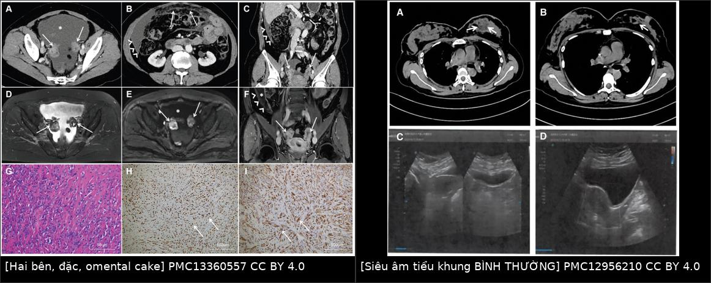
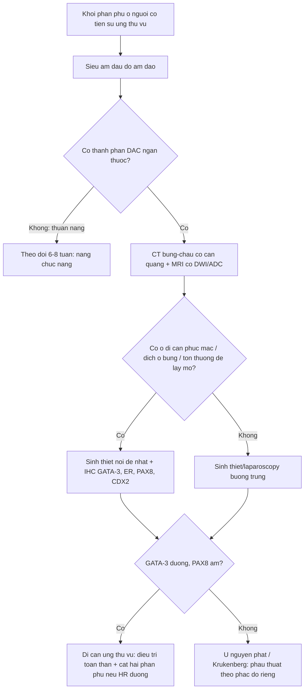
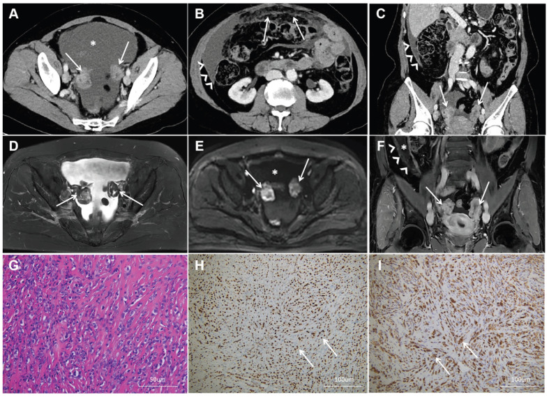
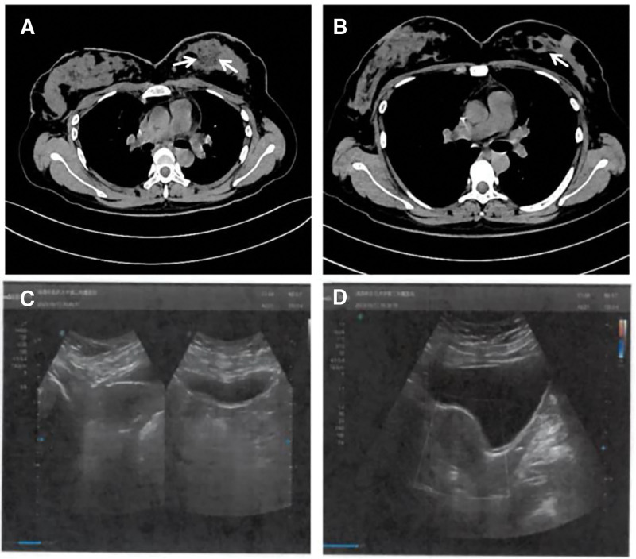
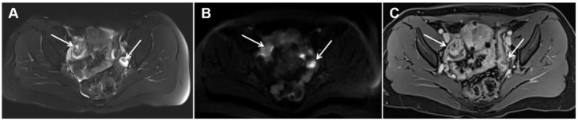

# 1649 — Di căn buồng trứng & phần phụ của ung thư vú / Breast-cancer ovarian and adnexal metastasis

**Tags:** `pattern:khoi-phan-phu` `pattern:khoi-dac-hai-ben` `pattern:di-can` `pattern:day-phuc-mac` `pattern:dich-o-bung` `vung:buong-trung` `vung:tieu-khung` `vung:phuc-mac` `protocol:sieu-am-dau-do` `protocol:CT-bung-chau` `protocol:MRI-tieu-khung-DWI` `protocol:PET-FDG` `score:RECIST-1.1` `score:O-RADS` `incidentaloma:khoi-phan-phu`
**Mức chắc chắn (certainty):** tổng hợp y văn (literature synthesis) — số liệu đọc trực tiếp từ toàn văn: đoàn hệ 41 ca có mô bệnh (*Front Oncol* 2025, PMC12500702), loạt 6 ca thể tiểu thùy có ảnh CT/MRI (*Diagnostics* 2026, PMC13360557), nghiên cứu độ chính xác CT toàn thân 60 ca (*Diagnostics* 2022, PMC8870859), ca di căn ẨN có ảnh (*Medicine* 2026, PMC12956210), đặc điểm MRI di căn buồng trứng (*Jpn J Radiol* 2025, PMC11953186); có **ca nguyên văn** cho quiz.

## 1. Tổng quan bệnh học – cơ chế hình ảnh

- **Tần suất và thứ hạng nguyên nhân:** u **di căn** chiếm **5,2–10%** toàn bộ u buồng trứng; trong số đó **57%** từ **đường tiêu hóa** và **30%** từ **ung thư vú** — nghĩa là vú chỉ đứng sau ống tiêu hóa, và là nguồn **phổ biến nhất ở nữ có tiền sử ung thư vú**. Ở nhóm đã di căn xa, di căn buồng trứng được báo cáo **13–47%** (dao động lớn vì khác nhau về cách phát hiện: tử thiết/cắt phần phụ dự phòng so với chỉ chụp khi có triệu chứng).
- **Vì sao ung thư vú "thích" buồng trứng:** buồng trứng có **mạng mạch và bạch mạch phong phú** + môi trường nội tiết tại chỗ (buồng trứng là nguồn estrogen chính ở nữ tiền mãn kinh) tạo **"đất" cho tế bào ERα dương** bám và phát triển. Đây là lý do **87,8% (36/41)** ca di căn buồng trứng trong đoàn hệ 41 ca là **ER và/hoặc PR dương**, **85,4%** thuộc **Luminal B** (không phải ngẫu nhiên mà là chọn lọc cơ chế).
- **Thể mô học quyết định đường lan:** **thể tiểu thùy (ILC)** mất **E-cadherin** → tế bào lan **một hàng (single-file)** theo mô đệm và **mặt thanh mạc** → hay vào **phúc mạc, ống tiêu hóa, buồng trứng**: **~19%** ca ILC đã di căn xa có tổn thương ở **buồng trứng/tử cung**, nguy cơ **gấp ~3 lần** so với ống tuyến; nhưng **thể ống tuyến (IDC) vẫn là đa số** vì IDC phổ biến hơn nhiều (**80,5% vs 19,5%** trong 41 ca) — **không được loại trừ di căn chỉ vì bệnh nguyên là IDC**.
- **TẠI SAO hình ảnh lại khó (vật lý + mô bệnh):**
  - **Siêu âm:** khối di căn là **mô đặc, giàu tế bào, ít mô đệm myxoid** → **giảm âm, bờ không đều, có mạch máu trong khối**; khác nang cơ năng (trống âm, thành mỏng). Nhưng **kích thước buồng trứng có thể BÌNH THƯỜNG ở gần một nửa số ca** vì tế bào u **lấp vào mô buồng trứng (nested in medulla/cortex)** chứ không tạo khối phình to → **siêu âm âm tính không loại trừ**.
  - **CT:** di căn vú thường **giảm tỷ trọng, ít mạch (hypovascular)** hơn nhu mô buồng trứng → dễ **đồng tỷ trọng với cơ/tử cung** và bị bỏ qua; ngược lại u buồng trứng **nguyên phát** hay **hỗn hợp đặc–nang** (dịch + vách) vì xuất phát từ **biểu mô bề mặt** và tạo nhú trong nang.
  - **MRI/DWI:** khối đặc giàu tế bào → **hạn chế khuếch tán: DWI sáng, ADC thấp**; mô xơ của **Krukenberg** (dạ dày–đại tràng) tạo **vòng xơ T2 tối dày > 5 mm** ("black scrunchie").
- **Tiên lượng (định lượng):** trong 41 ca, **trung vị sống toàn bộ 85,0 tháng** (KTC 95% 67,4–102,7) nhưng **sau khi cắt hai phần phụ chỉ còn 28 tháng** (KTC 16–36); **thể tiểu thùy sau di căn buồng trứng 11,5 tháng vs thể ống tuyến 30,0 tháng** (p = 0,01) — **cùng một "di căn buồng trứng" nhưng tiên lượng khác nhau gấp ~2,6 lần theo mô học**.
- **Vì sao "phát hiện lúc cắt dự phòng" lại tốt hơn:** **46,3% (19/41)** ca chỉ được chẩn đoán khi **cắt phần phụ dự phòng** (không triệu chứng, không bất thường hình ảnh); sống sau di căn **30 tháng** so với **16 tháng** ở nhóm phát hiện bằng triệu chứng/hình ảnh — **phát hiện sớm đổi được tiên lượng**, đây là lý do hình ảnh phải chủ động tìm chứ không chờ bệnh nhân đau.

## 2. Mẫu hình + chẩn đoán phân biệt theo vị trí (Gamut)

- **Khuôn 1 — Nữ có tiền sử ung thư vú, khối phần phụ ĐẶC hai bên ± dịch ổ bụng.** Gamut: **di căn vú** vs **ung thư buồng trứng nguyên phát (HGSOC)** vs **Krukenberg (dạ dày/đại tràng)** vs **u tế bào hạt–mô đệm (granulosa/fibrothecoma)** vs **lymphoma** vs **lao phúc mạc**. Chốt: **mô học + IHC**, không phải hình thái.
- **Khuôn 2 — Khối đặc MỘT bên, kích thước lớn, hỗn hợp đặc–nang, có nhú trong nang.** Gamut nghiêng **nguyên phát** (đặc biệt HGSOC: vách nhú, dịch ổ bụng, CA-125 rất cao) — nhưng **hai bên chỉ đạt AUC 0,59** trong phân biệt, nên **không dùng "một bên" để loại di căn**.
- **Khuôn 3 — Khối phần phụ + bánh mỡ phúc mạc (omental cake) + dịch ổ bụng nhiều.** Gamut: **di căn phúc mạc của ILC** vs **carcinomatosis phúc mạc nguyên phát** vs **pseudomyxoma peritonei** vs **lao phúc mạc**. Chốt: **tế bào học dịch + sinh thiết mô bụng** (đường ngắn nhất, tránh mổ).
- **Khuôn 4 — Buồng trứng "bình thường" trên siêu âm/CT ở người có HR+ đang dùng tamoxifen.** Gamut: **di căn ẩn** vs **nang chức năng do tamoxifen** vs **u giáp biên** vs **bình thường**. Chốt: **MRI có DWI** + **theo dõi bằng cùng một phương thức**; ca ẩn dưới đây có **siêu âm tiểu khung hoàn toàn bình thường**.
- **Khuôn 5 — Nữ mang BRCA1/2, khối phần phụ mới.** Gamut: **ung thư buồng trứng nguyên phát (nguy cơ nền rất cao)** vs **di căn vú**. Chốt: **sinh thiết/PHẫu thuật có kế hoạch**, không mặc định là di căn (bản thân BRCA làm tăng u nguyên phát; tỉ lệ di căn buồng trứng **không khác** giữa người mang và không mang đột biến).
- **Gợi nhớ "OVARY":** **O**ne side hay **bilateral** (không tin một mình) · **V**ú là bệnh nguyên phổ biến thứ 2 · **A**scites + omental cake → nghĩ phúc mạc · **R**eceptor (ER/PR dương) · **Y**ield of biopsy > surgery.

## 3. Bảng so sánh phân biệt (ma trận đối chiếu)

| Thực thể (entity) | Hình ảnh điển hình (SA / CT / MRI) | Chốt vào (rule-in) | Chốt loại (rule-out) | Gợi ý xác nhận |
|---|---|---|---|---|
| **Di căn ung thư vú** | Khối **ĐẶC** (hoặc đặc–nang), **hai bên 63,4–100%**, **kích thước có thể bình thường**, ± dịch ổ bụng, ± omental cake; T2 trung bình, **DWI sáng/ADC thấp**, ngấm mạnh | **Tiền sử ung thư vú + khối đặc + đa ổ/hai bên + ER/PR dương + GATA-3 dương, PAX8 âm** | **Hình thái thuần nang, không có bất kỳ thành phần đặc** → gần như loại di căn | Sinh thiết/laparoscopy; IHC GATA-3, ER, E-cadherin, PAX8 |
| Ung thư buồng trứng nguyên phát (HGSOC) | **Hỗn hợp đặc–nang**, nhú trong nang, vách dày, **hai bên nhưng hay rất lớn**, dịch ổ bụng, carcinomatosis | **Nhú + thành phần nang + CA-125 rất cao + PAX8/WT1 dương** | **Khối đặc thuần, nhỏ, hai bên đối xứng ở người có tiền sử vú** → nghi di căn | PAX8, WT1, p53; CA-125; mổ theo lý thuyết u nguyên phát |
| Krukenberg (dạ dày/đại tràng) | **Hai bên, đặc**, **vòng xơ T2 tối dày > 5 mm, > 180° ("black scrunchie")**, không hạn chế khuếch tán ở vòng xơ; tế bào nhẫn | **CDX2/SATB2 dương, CK20 dương, GATA-3 âm** + u nguyên phát ống tiêu hóa | **GATA-3 dương, CK7 dương/CK20 âm** → không phải Krukenberg | Nội soi tiêu hóa + IHC + sinh thiết |
| U tế bào hạt / u xơ–tế bào (sex cord–stromal) | Khối đặc, **T2 tối mạnh (fibroma)**, ngấm thuốc ít; granulosa có "swiss cheese" | **T2 rất tối + không hạn chế khuếch tán + Inhibin dương** | **DWI sáng/ADC thấp lan tỏa** → nghi ác/di căn | Inhibin, calretinin; MRI |
| Lymphoma buồng trứng | Khối đặc **đồng nhất, rất ít ngấm**, có thể hai bên, kèm hạch | **Hạch ổ bụng lớn + LDH cao + tế bào lympho bất thường** | **Không có hạch, LDH bình thường** | Sinh thiết + hóa mô miễn dịch |
| Lao phúc mạc – phần phụ | Dày phúc mạc đều, **dịch ổ bụng có vách mỏng**, buồng trứng có thể bình thường | **Dịch tiết dịch tiết (exudate) + ADA cao + hình ảnh phổi lao** | **Bánh mỡ phúc mạc dày đặc + nốt đặc** → nghi carcinomatosis | PCR lao trong dịch; sinh thiết phúc mạc |
| Nang chức năng / u giáp biên | **Thuần nang**, thành mỏng, không thành phần đặc; giáp biên có nhú nhỏ | **Thuần nang, không mạch, tự thoái triển sau 2–3 chu kỳ** | **Có thành phần đặc ngấm thuốc** → không phải nang chức năng | Siêu âm lặp sau 6–8 tuần |

*Trái: **CT có cản quang** — hai khối phần phụ **đặc, ngấm thuốc** (mũi tên) + **bánh mỡ phúc mạc (omental cake)** và nốt phúc mạc; phía dưới là MRI T2/DWI/CE và mô bệnh của cùng ca. Phải: ca **di căn ẩn** — CT ngực thấy tổn thương vú (A, B trước/sau hóa trị), còn **siêu âm tiểu khung (C, D) hoàn toàn bình thường** vì tế bào u lấp trong mô buồng trứng mà không làm buồng trứng to lên. Nguồn: Li A và cs., *Diagnostics* 2026, Fig. 1 (CC BY 4.0); Li P và cs., *Medicine* 2026, Fig. 1 (CC BY 4.0).*

### Vì sao "khối đặc" mạnh hơn "hai bên" (đọc đúng nghiên cứu độ chính xác)
- Trên **CT toàn thân** ở 60 bệnh nhân có bằng chứng mô bệnh buồng trứng: phân biệt **lành/ác** đạt **Se 100% / Sp 98,0% / AUC 0,99**; nhưng phân biệt **di căn vú vs u buồng trứng nguyên phát** chỉ đạt **Se 100% / Sp 85,7% / AUC 0,93**.
- **Đặc điểm "đặc" (solid) cho AUC 0,99**, trong khi **"hai bên" chỉ 0,59** (p < 0,0001) — tức **tính hai bên gần như không thêm thông tin** trong đoàn hệ này, dù y văn vẫn mô tả di căn vú "thường hai bên". Bài học: **dùng hình thái (đặc/ngấm thuốc) làm trục chính, không dùng laterality làm chốt**.
- **Kích thước không phân biệt:** u nguyên phát **8,4 cm (4,9–25,2)** vs di căn **8,6 cm (4,7–13,7)**, p = 1,000.
- **Khoảng cách chẩn đoán ngắn hơn ở nhóm di căn:** **8 tháng vs 29 tháng** (p = 0,044) — di căn xuất hiện "sớm" sau chẩn đoán vú, còn u nguyên phát mới là bệnh "muộn" thứ hai.

## 4. Protocol chụp + thuật toán xác nhận

**Bước 1 — Siêu âm đầu dò âm đạo (transvaginal US) là cửa vào, nhưng phải mô tả 4 thứ:**
- **Thành phần:** thuần nang / đặc–nang / **đặc** (yếu tố mạnh nhất hướng di căn).
- **Tính chất mô đệm:** vòng **giảm âm dày** quanh khối (gợi xơ của Krukenberg) vs **nhú trong nang** (gợi nguyên phát).
- **Mạch máu trong khối** (Doppler màu): mạch trung tâm/tăng sinh → nghi ác.
- **Dịch ổ bụng + bánh mỡ phúc mạc**: nếu có, chuyển thẳng sang **sinh thiết/paracentesis** thay vì mổ chẩn đoán.

**Bước 2 — CT bụng–chậu có cản quang (thì tĩnh mạch cửa 60–70 giây, lát 1,25 mm):**
- **Ghi 4 con số:** kích thước khối lớn nhất (mm) · số khối mỗi bên · có/không **omental cake** · có/không **dịch ổ bụng**.
- Tìm **ổ di căn đồng thời**: gan, xương, phổi, hạch sau phúc mạc — vì **di căn buồng trứng gần như luôn là bệnh hệ thống**, không phải bệnh khu trú.

**Bước 3 — MRI tiểu khung có DWI/ADC + T1 sau tiêm (khi CT/SA chưa chốt):**
- Chuỗi tối thiểu: **T2 FS axial–sagittal, DWI b = 0 và 800–1.000 s/mm², ADC, T1 FS sau tiêm thì động mạch–tĩnh mạch cửa**.
- **Đo ADC vùng đặc** (ROI đặt trong phần đặc, tránh vùng hoại tử): **ADC thấp + DWI sáng** hỗ trợ mô đặc giàu tế bào; **ADC cao** (T2 shine-through) hướng u máu/xơ lành.
- **Dấu hiệu mạch nuôi dẫn (guiding vessel sign)** — cấu trúc mạch dạng cây đi từ ngoại vi vào trung tâm khối — được mô tả là **dấu hiệu gợi ý di căn** hơn là u nguyên phát.

**Bước 4 — Chẩn đoán mô học TRƯỚC khi mổ lớn (điểm quyết định của bài này):**
- Trong loạt 6 ca ILC, **5/6 (83%)** bị **chẩn đoán nhầm là ung thư buồng trứng nguyên phát** và đã **cắt tử cung toàn bộ + hai phần phụ** — một phẫu thuật **không cải thiện sống** ở bệnh đã di căn.
- Ca thứ 6 được **sinh thiết qua da tổn thương màng bụng/da** → xác định di căn ILC → **không mổ phụ khoa**, điều trị toàn thân; sau **4 chu kỳ**, khối buồng trứng **4,5 → 3,8 cm** và **3,9 → 2,7 cm**, nốt phúc mạc thoái triển.
- **Ưu tiên lấy mô ở nơi dễ nhất** (nốt da, hạch, dịch ổ bụng, omental cake) → **IHC**: **GATA-3, ER, PR, E-cadherin, CK7, CK20, PAX8, WT1**. Trong 6 ca: **GATA-3 dương 6/6, PAX8 âm 6/6, E-cadherin âm 6/6**.

**Bước 5 — Điều trị theo bản chất bệnh:**
- Nếu **HR dương**: **cắt hai phần phụ** vừa là **giảm khối** vừa là **triệt estrogen (ovarian ablation)** — đây là lý do cắt phần phụ dự phòng có ý nghĩa điều trị, không chỉ chẩn đoán.
- Nếu bệnh **đa ổ (gan/xương/phổi)**: **điều trị toàn thân là chính**; mổ phụ khoa chỉ khi có biến chứng hoặc để giảm khối có chọn lọc.
- **PET/CT ¹⁸F-FDG**: hữu ích khi CT mơ hồ; trong loạt 6 ca, **2 ca có tăng FDG với SUVmax 3,2–4,9** — nhưng **buồng trứng sinh lý cũng bắt FDG**, nên **luôn đọc kèm hình thái trên CT**.

## 5. Biến thể bình thường và cạm bẫy

- **Cạm bẫy số 1 — "siêu âm bình thường = không di căn":** ca ẩn có **siêu âm tiểu khung bình thường** và **CT bụng bình thường**, chẩn đoán chỉ có sau mổ. Gần **một nửa** ca di căn vú có **buồng trứng không to**; tế bào u nằm trong **tủy/vỏ buồng trứng** mà không tạo khối. → Ở bệnh nhân HR+ tiền mãn kinh có chỉ định cắt phần phụ dự phòng, **âm tính trên hình ảnh không phải lý do bỏ mổ**.
- **Cạm bẫy số 2 — dùng "hai bên" để chốt:** AUC chỉ **0,59**; nhiều u nguyên phát cũng hai bên, nhiều di căn lại một bên (**36,6%** một bên trong 41 ca).
- **Cạm bẫy số 3 — tin CA-125:** CA-125 tăng ở **cả** u nguyên phát và di căn, không phân biệt được; chỉ **CEA và CA19-9 tăng** mới chỉ gặp ở nhóm di căn vú trong nghiên cứu 60 ca. **CA-125 bình thường không loại trừ**, CA-125 cao không chứng minh nguyên phát.
- **Cạm bẫy số 4 — mổ chẩn đoán:** **5/6** ca bị cắt tử cung + hai phần phụ "oan" vì tưởng nguyên phát. Ở bệnh đã di căn, phẫu thuật này **không kéo dài sống** mà làm mất cơ hội điều trị toàn thân sớm.
- **Cạm bẫy số 5 — bỏ theo dõi sau 5 năm:** ILC có thể di căn buồng trứng **muộn tới 13 năm** sau chẩn đoán ban đầu; khoảng cách trong đoàn hệ 41 ca là **6–192 tháng, trung vị 38 tháng**, với **41,5%** ca xuất hiện sau **61 tháng**.
- **Cạm bẫy số 6 — nhầm u buồng trứng nguyên phát ở người mang BRCA:** đột biến BRCA làm tăng **u nguyên phát**, không làm tăng **di căn**; **không được suy luận "có BRCA nên chắc là nguyên phát"** hay ngược lại.
- **Biến thể bình thường dễ nhầm:** **nang chức năng do tamoxifen** (thuần nang, nhiều nang nhỏ hai bên) — đặc điểm **thuần nang, không thành phần đặc, tự thoái triển** là chốt loại trừ; **buồng trứng sinh lý bắt FDG** trên PET.

## 6. Tự lượng giá — Blind Quiz

**Ca 1 — Nữ 44 tuổi, ILC vú phải 13 năm trước, đau bụng âm ỉ; CT bụng–chậu có cản quang.**

- Gợi ý lâm sàng: đã điều trị ung thư vú 13 năm, hiện đau bụng và chướng.
- Câu hỏi: mô tả tổn thương ở hai phần phụ và phúc mạc? Ba chẩn đoán phân biệt? Dấu hiệu nào trên ảnh **không** giúp phân biệt?

<b>Bấm để hiện đáp án (findings + chẩn đoán)</b>

- **Dấu hiệu:** (A) hai khối phần phụ **đặc, ngấm thuốc**, bờ không đều (mũi tên); (B–C) **omental cake** (mũi tên rỗng) + **nốt phúc mạc dạng kê (miliary)** + dịch ổ bụng lượng nhiều; (D–F) MRI T2/DWI/T1 sau tiêm xác nhận thành phần đặc; (G–I) mô bệnh: tế bào u xếp **một hàng** trong mô đệm xơ, **ER dương, CK7 dương**.
- **Chẩn đoán:** **di căn buồng trứng + phúc mạc của ILC vú**.
- **Vì sao:** tế bào ILC mất E-cadherin nên lan theo **mặt thanh mạc** → bánh mỡ phúc mạc là biểu hiện thường gặp (**4/6 ca, 67%** trong loạt này; **83%** có dịch ổ bụng). **"Hai bên" không phải chốt** (AUC 0,59) — chốt là **mô học + GATA-3 dương/PAX8 âm**.
- Nguồn ảnh: Li A và cs., *Diagnostics* 2026, Fig. 1 (CC BY 4.0).

**Ca 2 — Nữ 32 tuổi, ung thư vú trái HR+/HER2− đã hóa trị tân bổ trợ; siêu âm tiểu khung và CT bụng trước mổ đều bình thường, nhưng cắt hai phần phụ dự phòng lại có di căn.**

- Câu hỏi: vì sao hình ảnh âm tính? Có nên bỏ cắt phần phụ dự phòng khi hình ảnh bình thường? IHC nào chứng minh nguồn gốc vú?

<b>Bấm để hiện đáp án</b>

- **Dấu hiệu:** (A) trước hóa trị — tổn thương **giảm tỷ trọng hình tròn** ở vú; (B) sau hóa trị — tổn thương **giảm rõ, khó nhận ra**; (C, D) **siêu âm tử cung/phần phụ không thấy bất thường**.
- **Chẩn đoán:** **di căn ẩn của ung thư vú thể ống tuyến** vào buồng trứng, chỉ phát hiện trên **mô bệnh sau cắt hai phần phụ**.
- **Vì sao âm tính:** tế bào u **lấp trong tủy/vỏ buồng trứng** không tạo khối → **kích thước buồng trứng bình thường ở gần một nửa số ca**; đây là lý do **hình ảnh sạch không loại trừ** ở bệnh nhân HR+ tiền mãn kinh.
- **IHC chứng minh:** mô buồng trứng **GATA-3 dương, PAX8 âm, ER 3+/90%, E-cadherin dương** (thể ống tuyến) — **PAX8 âm** là điểm tách khỏi u Müllerian nguyên phát.
- **Vì sao vẫn cắt:** ở HR+ tiền mãn kinh, cắt phần phụ vừa **triệt nguồn estrogen** vừa **chẩn đoán giai đoạn**; ca này sau đó dùng **letrozole + abemaciclib**, ổn định khi theo dõi.
- Nguồn ảnh: Li P và cs., *Medicine* 2026, Fig. 1 (CC BY 4.0).

**Ca 3 — Nữ 40 tuổi, tiền sử ung thư vú 2 năm, không triệu chứng; MRI tiểu khung có DWI.**

- Câu hỏi: tín hiệu trên T2, DWI và sau tiêm nói gì? Có cần mổ ngay không?

<b>Bấm để hiện đáp án</b>

- **Dấu hiệu:** (A) T2 FS — hai khối **hỗn hợp đặc–nang**, phần đặc **T2 trung bình** (không tối như xơ, không sáng như nang); (B) DWI b = 800 — phần đặc **sáng** = hạn chế khuếch tán; (C) T1 FS sau tiêm — phần đặc **ngấm thuốc rõ**.
- **Chẩn đoán:** **di căn buồng trứng hai bên của ILC vú** (thành phần nang do hoại tử/bọc dịch trong khối).
- **Vì sao:** mô đặc giàu tế bào → **hạn chế khuếch tán** (DWI sáng, ADC thấp) và **ngấm thuốc**; khác **u xơ–tế bào** (T2 rất tối, ngấm ít) và **nang chức năng** (không có phần đặc).
- **Có cần mổ ngay không:** **không** — cần **mô học trước** (sinh thiết/laparoscopy); nếu xác nhận di căn vú thì điều trị **toàn thân** là chính, mổ phụ khoa chỉ khi HR dương/giảm khối có chọn lọc.
- Nguồn ảnh: Li A và cs., *Diagnostics* 2026, Fig. 2 (CC BY 4.0).

## Bài liên quan chéo
- [500 – Tổng quan Hệ Vú & Sản Phụ khoa](../500-tong-quan-vu-san-phu-khoa/lesson.md)
- [522 – Theo dõi sau điều trị ung thư vú](../522-theo-doi-sau-dieu-tri-ung-thu-vu/lesson.md)
- [535 – Ung thư buồng trứng – phúc mạc & Krukenberg](../535-ung-thu-buong-trung-phuc-mac-krukenberg/lesson.md)
- [530 – Buồng trứng: O-RADS trên siêu âm & MRI](../530-buong-trung-ORADS-sieu-am-MRI/lesson.md)
- [1618 – Di căn da & thành ngực của ung thư vú](../1618-di-can-da-thanh-nguc-ung-thu-vu/lesson.md)
- [1620 – Urinoma & khối tiểu khung lành tính](../1620-u-nuoc-than-urinoma-khoi-tieu-khung-lanh-tinh/lesson.md)
- [1648 – Di căn gan ở ung thư vú](../1648-di-can-gan-ung-thu-vu/lesson.md)

> Không dùng để chẩn đoán độc lập khi chưa có người hướng dẫn.
