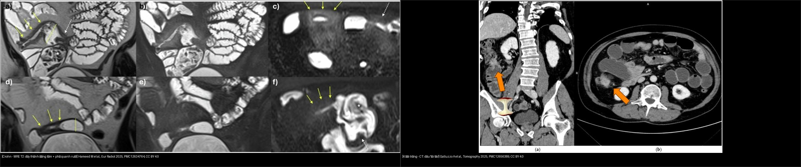
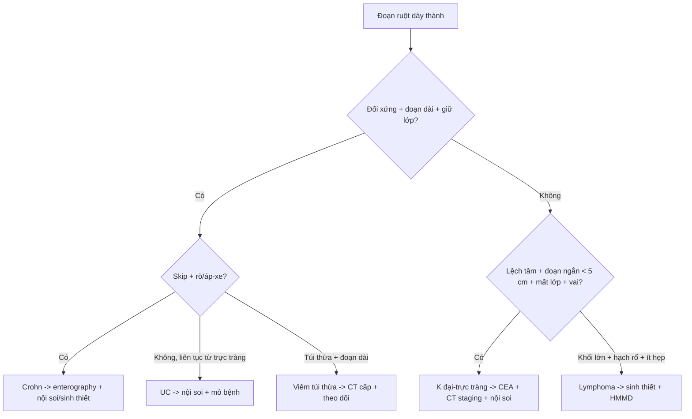
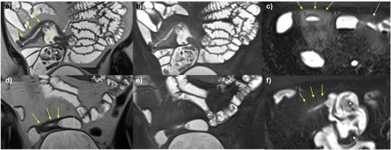
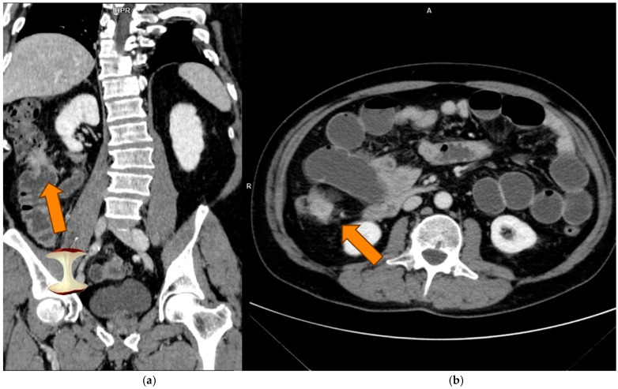
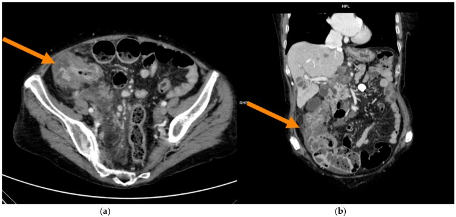
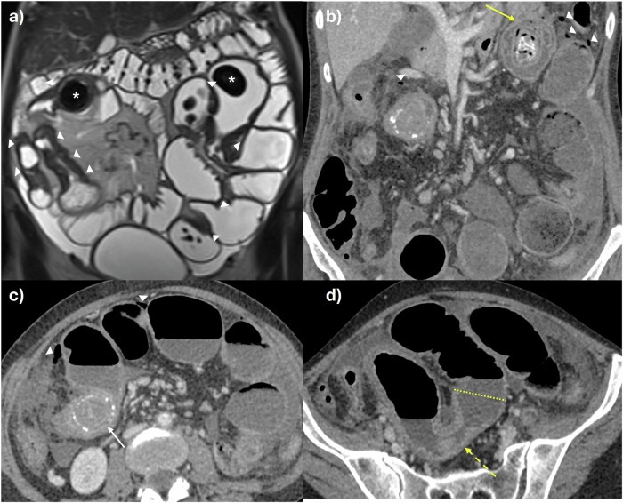

# 165 — Dày thành ống tiêu hóa: Crohn vs K đại-trực tràng / Wall thickening

**Tags:** `pattern:day-thanh-ruot` `vung:ruot` `protocol:CT-MR-enterography`
**Mức chắc chắn (certainty):** tổng hợp y văn (literature synthesis) — nhóm tự biên từ y văn mở; bổ sung ảnh minh họa từ 2 bài CC BY 4.0 (Eur Radiol 2025, Tomography 2025).

## 1. Tổng quan — 3 câu hỏi + ngưỡng định lượng

- **Dày thành (wall thickening)** là dấu hiệu chung, không phải chẩn đoán. Ba câu hỏi gỡ rối mọi đoạn dày: **(1) đối xứng hay lệch tâm? (2) đoạn dài hay ngắn (< 5 cm)? (3) còn cấu trúc lớp hay mất lớp?**
- **Ngưỡng định lượng:** thành ruột non bình thường **≤ 3 mm** khi xẹp; đại tràng **≤ 5 mm** khi căng; **hạch ≥ 10 mm** ngắn trục = nghi bệnh lý; đoạn dày **< 5 cm** gợi ung thư; **> 10 cm** gợi viêm.
- **TẠI SAO lớp quyết định:** viêm → **phù dưới niêm mạc** (nước) giữ các lớp → dấu "bia bắn" (target sign)/phân lớp thành; **tăng mạch** mạc treo → dấu "lược" (comb sign); **mỡ quanh ruột viêm** (creeping fat). Ung thư → tế bào **xâm lấn phá lớp** + tăng sinh xơ → mất phân lớp + bờ vai (shouldering) + lòng hẹp lệch tâm.
- **Crohn:** dày **đối xứng + đoạn dài + giữ lớp** + **tổn thương nhảy cóc (skip)** + biến chứng (rò, áp-xe, hẹp). **Viêm loét đại tràng (UC):** **trực tràng lên liên tục**, mất haustra (ống chì *lead pipe*), dày nhẹ.

## 2. Gamut dày thành ruột

- **Nhóm viêm:** Crohn (hồi tràng tận + skip + rò/áp-xe), UC (trực tràng–đại tràng liên tục), **viêm túi thừa** (đoạn dài, giữ lớp, túi thừa kèm), **thiếu máu/viêm ruột do tia** (đoạn dài, phù), nhiễm trùng (C. difficile — phù lan, dấu "phím đàn accordion").
- **Nhóm ung thư:** adenocarcinoma đại-trực tràng (**dấu "lõi táo" apple-core**), **lymphoma** (dày lan, khối lớn, hạch lớn), u carcinoid, di căn (mạc treo/ruột).
- **Nhóm khác:** máu tụ thành ruột (hematoma — chấn thương/kháng đông), phù mạch (angioedema), lồng ruột (intussusception).
- Quy tắc ngón tay: **đối xứng + dài + còn lớp = viêm**; **lệch tâm + ngắn + mất lớp + vai = ung thư**.

## 3. Bảng so sánh phân biệt (ma trận đối chiếu)

| Thực thể (entity) | Hình ảnh điển hình | Chốt vào (rule-in) | Chốt loại (rule-out) | Gợi ý xác nhận |
|---|---|---|---|---|
| Crohn | Hồi tràng tận, **đối xứng + đoạn dài + giữ lớp (target) + skip** + dấu lược + mỡ quanh ruột + rò/áp-xe | **Skip + rò/áp-xe + giữ lớp + đoạn dài** | Đoạn **ngắn < 5 cm + mất lớp + vai** → nghi K | MR/CT enterography + nội soi + sinh thiết |
| Viêm loét đại tràng (UC) | **Trực tràng lên liên tục**, mất haustra (ống chì), dày nhẹ, loét nông | **Liên tục từ trực tràng + mất haustra** | Dày lệch tâm khu trú + mất lớp → K | Nội soi (viêm liên tục) + mô bệnh |
| K đại-trực tràng | **Dày lệch tâm + đoạn ngắn < 5 cm + mất lớp + bờ vai (apple-core)** + hạch + di căn gan | **Apple-core + đoạn ngắn + hạch + di căn gan** | Đối xứng dài + giữ lớp + skip → Crohn | CEA + CT lồng ngực/bụng (staging) + nội soi |
| Viêm túi thừa | **Đoạn dài, giữ lớp**, túi thừa thành dày, thâm nhiễm mỡ quanh đại tràng | **Túi thừa + đoạn dài giữ lớp + sốt/đau hố chậu trái** | Khối khu trú mất lớp → loại trừ K trên nền túi thừa | CT bụng cấp + theo dõi sau đợt |
| Thiếu máu ruột | Đoạn dài, phù thành, tăng quang phúc mạc, mạch mạc treo tắc | **Bối cảnh rung nhĩ/hạ huyết áp + đoạn dài tổn thương tương ứng vùng cấp máu** | Không tắc mạch + không yếu tố nguy cơ → nghĩ viêm | CTA mạch mạc treo |
| Lymphoma ruột | **Dày lan rộng, khối mềm lớn, hạch lớn, ít hẹp lòng** | **Khối lớn + hạch rổ lớn + ít tắc** | Đoạn ngắn + vai → adenocarcinoma | Sinh thiết + hóa mô miễn dịch |

*Trái: Crohn trên MR enterography T2 — dày thành đồng tâm, giữ lớp, phù quanh ruột + giãn quai trên chỗ hẹp. Phải: K đại tràng trên CT — khối dày lệch tâm, lòng hẹp bờ vai ("lõi táo"). Nguồn: Hameed M et al., Eur Radiol 2025 (PMC12634764) và Galluzzo A et al., Tomography 2025 (PMC12656389) — CC BY 4.0. Ảnh ghép letterbox, giữ nguyên tỷ lệ.*

### Dấu hiệu chốt then chốt
- **Target sign (bia bắn):** lớp niêm mạc + dưới niêm mạc phù sáng + cơ tối → viêm hoạt động (Crohn).
- **Apple-core + bờ vai:** lòng hẹp lệch tâm, bờ nhô ra hai đầu ("vai") → adenocarcinoma.
- **Skip lesion:** tổn thương cách quãng đoạn lành → Crohn (UC luôn liên tục từ trực tràng).

## 4. Protocol chụp + quy trình

- **MR enterography (MRE):** uống **1,5–2 L dung dịch (PEG/mannitol) chia nhiều lần** để làm căng lòng ruột; chuỗi T2 (coronal/axial), T2 fat-sat (đánh giá phù), **DWI**, T1 sau tiêm động học. Đánh giá: thành (dày/mm, phân lớp), mạch mạc treo (comb), mỡ quanh ruột, hẹp (dài/mm), rò/áp-xe.
- **CT enterography (CTE):** cùng nguyên lý làm căng ruột, thì **tĩnh mạch cửa**, lát **1–2 mm** + MPR.
- **Nghi ung thư:** CT bụng–chậu có tiêm (thì cửa) + **CT lồng ngực** để phân giai đoạn; **CEA**; **nội soi + sinh thiết là tiêu chuẩn vàng** — hình ảnh không thay được mô bệnh.
- **Stricture Crohn (đồng thuận SAR 2025):** đo độ dài hẹp, thành (> 3 mm), mức phù/tăng tín hiệu, giãn quai trên, mỡ quanh ruột.

## 5. Biến thể bình thường và cạm bẫy

- **Ruột xẹp giả dày thành (pseudothickening):** luôn đo trên đoạn **căng**, so sánh đoạn kề; bơm căng lại nếu nghi.
- **Crohn xơ hẹp lâu năm giả u:** giữ lớp + tiền sử Crohn + tổn thương nhiều đoạn giúp phân biệt.
- **Viêm túi thừa giả Crohn:** dày đoạn dài giữ lớp — phân biệt bằng **túi thừa + tuổi già + đau khu trú hố chậu trái** (không skip kiểu Crohn).
- **Thiếu máu/angioedema dày lan** giả viêm — luôn hỏi bối cảnh (rung nhĩ, thuốc ức chế men chuyển).
- **Lymphoma giả Crohn:** khối lớn + hạch lớn + **ít gây hẹp lòng** (khác adenocarcinoma hay gây tắc).
- **Satisfaction of search:** một khối K ở đại tràng có thể che một tổn thương thứ hai — đọc hết khung, đối chiếu nội soi.

## 6. Tự lượng giá — Blind Quiz ngay trên trang tĩnh

**Ca 1 — Nam 34 tuổi, tiêu chảy mạn, đau hố chậu phải. Nhìn MRE T2, mô tả trước.**

- Gợi ý lâm sàng (clinical context): trẻ, tiêu chảy mạn, sụt cân.
- Câu hỏi: dày đối xứng hay lệch tâm? Còn lớp không? 3 chẩn đoán phân biệt và dấu chốt?

<b>Bấm để hiện đáp án (findings + chẩn đoán)</b>

- Dấu hiệu (findings): đoạn hồi tràng tận **dày thành đối xứng + giữ lớp (target)**, **phù quanh ruột** (mỡ sáng trên T2 fat-sat), **giãn quai ruột ngay trên chỗ hẹp** → bệnh hoạt động + hẹp.
- Chẩn đoán (diagnosis): **Crohn (bệnh hoạt động, hẹp)** — vì đối xứng + giữ lớp + phù quanh ruột + giãn quai trên. Xử trí: điều trị sinh học + dinh dưỡng; mổ chỉ khi biến chứng (hẹp tắc, rò).
- Nguồn ảnh: Hameed M et al., Eur Radiol 2025, PMC12634764, Fig. 3, CC BY 4.0.

**Ca 2 — Nữ 60 tuổi, thiếu máu, sụt cân, đại tiện ra máu. Nhìn CT dấu "lõi táo", chốt chẩn đoán và việc cần làm tiếp.**

- Gợi ý lâm sàng: lớn tuổi, thiếu máu, sụt cân.
- Câu hỏi: dấu hiệu phân biệt với Crohn? Cần khảo sát gì thêm?

<b>Bấm để hiện đáp án (findings + chẩn đoán)</b>

- Dấu hiệu (findings): khối **dày lệch tâm, lòng hẹp, bờ vai ("lõi táo")**, mất cấu trúc lớp, đoạn tổn thương **ngắn**.
- Chẩn đoán (diagnosis): **adenocarcinoma đại tràng (thể MSI, đại tràng lên)** — vì lệch tâm + ngắn + mất lớp + bờ vai. Việc cần làm: **CEA + CT lồng ngực/bụng (phân giai đoạn) + nội soi sinh thiết**. Khác Crohn: Crohn đối xứng + dài + giữ lớp.
- Nguồn ảnh: Galluzzo A et al., Tomography 2025, PMC12656389, Fig. 2, CC BY 4.0.

**Ca 3 — Cùng bối cảnh trên nhưng CT đã có tổn thương gan. Bệnh đang ở giai đoạn nào?**

- Gợi ý lâm sàng: đau bụng, sụt cân, men gan bất thường.
- Câu hỏi: nhìn thấy gì ở gan? Ý nghĩa?

<b>Bấm để hiện đáp án (findings + chẩn đoán)</b>

- Dấu hiệu (findings): khối đại tràng "lõi táo" + **nhiều nốt gan giảm tỷ trọng** (di căn).
- Chẩn đoán (diagnosis): **K đại tràng giai đoạn IV (di căn gan)** — vì có di căn xa. Đổi chiến lược: hóa trị toàn thân ± sinh thiết phân tử (MSI/RAS/BRAF), cân nhắc cắt gan nếu còn mổ được.
- Nguồn ảnh: Galluzzo A et al., Tomography 2025, PMC12656389, Fig. 3, CC BY 4.0.

**Ca 4 — Bệnh nhân Crohn hẹp nhiều đoạn, nhiều năm. Nhìn MRE, mô tả cơ chế và biến chứng.**

- Gợi ý lâm sàng: Crohn lâu năm, đau bụng tái diễn, ăn kém.
- Câu hỏi: hẹp dài hay ngắn? Vì sao có nhánh giãn trên chỗ hẹp?

<b>Bấm để hiện đáp án (findings + chẩn đoán)</b>

- Dấu hiệu (findings): **hẹp nhiều đoạn, phần lớn dài > 3 cm**, thành tín hiệu **T2 thấp** (xơ mạn), **giãn quai trên + sỏi ruột (enterolith)** — dấu tắc mạn.
- Chẩn đoán (diagnosis): **Crohn hẹp mạn (fibrostenotic)** — xơ thành làm hẹp cố định, giãn quai trên. Xử trí: nong bóng/mổ tạo hình hẹp khi tắc; khác **hẹp ngắn < 5 cm + mất lớp** của ung thư.
- Nguồn ảnh: Hameed M et al., Eur Radiol 2025, PMC12634764, Fig. 6, CC BY 4.0.

## Bài liên quan chéo
- [100 – Tổng quan hệ Bụng](../100-tong-quan-he-bung/lesson.md)
- [135 – Viêm tụy cấp (Atlanta)](../135-viem-tuy-Atlanta/lesson.md)
- [140 – Lách & chấn thương tạng đặc](../140-lach-tang-dac/lesson.md)
- [141 – Phúc mạc: carcinomatosis vs lao](../141-phuc-mac/lesson.md)
- [160 – Bụng cấp GI](../160-bung-cap-GI/lesson.md) (viêm túi thừa)
- [162 – Tắc ruột](../162-tac-ruot/lesson.md) (hẹp Crohn gây tắc)

## Ảnh
- 4 ảnh CC BY 4.0 (Eur Radiol 2025 ×2, Tomography 2025 ×2) + 1 ảnh ghép CC BY 4.0. Nguồn + giấy phép từng ảnh trong `images/CREDITS.md`.

> Không dùng để chẩn đoán độc lập khi chưa có người hướng dẫn.
