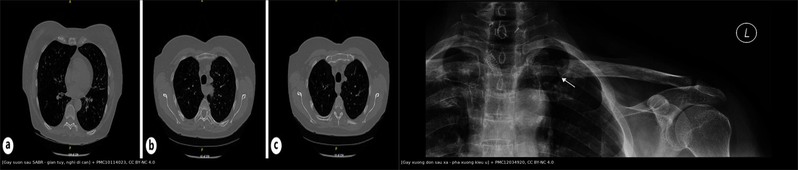
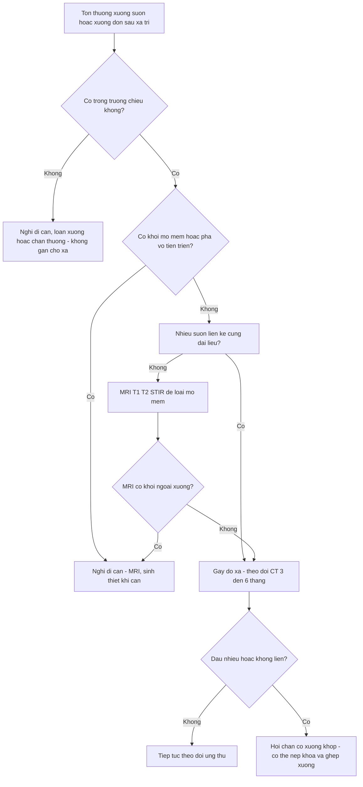
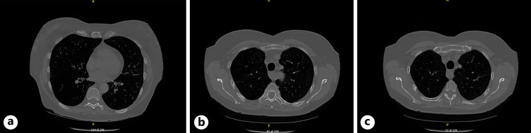
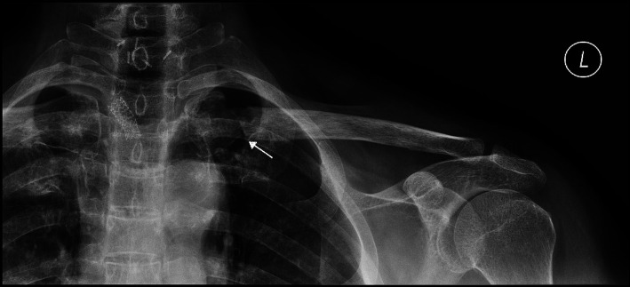
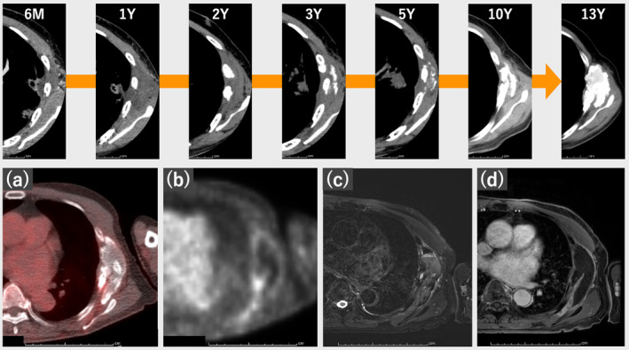

# 1650 — Gãy xương sườn và xương đòn sau xạ trị / Radiation-induced rib and clavicle fractures

**Tags:** `pattern:gay-xuong` `pattern:phu-tuy-xuong` `pattern:day-xuong` `pattern:gia-u` `pattern:tieu-xuong` `vung:thanh-nguc` `vung:suon` `vung:xuong-don` `score:CTCAE` `protocol:CT-nguc-xuong` `protocol:MRI-xuong` `protocol:PET-FDG` `incidentaloma:gay-suon-sau-xa`
**Mức chắc chắn (certainty):** tổng hợp y văn (literature synthesis) — biên từ toàn văn các đoàn hệ SBRT/SABR phổi (PMC3213137, PMC3573931, PMC4465155, PMC10100199, PMC3984241 — đều CC BY), ca gãy sườn **13 năm** sau SBRT (PMC11462948, CC BY), ca gãy xương đòn không liền sau xạ (PMC3541794, CC BY), ca xương đòn sau xạ **bắt chước di căn** (PMC12034920, CC BY-NC) và ca sườn sau SABR được **MRI cứu** khỏi chẩn đoán di căn (PMC10114023, CC BY-NC). Số liệu lấy từ bảng/kết quả toàn văn.

## 1. Tổng quan — xương là mô "chậm", và xạ trị biến nó thành xương giòn

### 1.1. Cơ chế: ba chữ H + mất tế bào xương

- **Hypoxia – hypocellularity – hypovascularity (3H):** xạ làm tổn thương tế bào nội mô mạch máu xương → giảm tưới máu; giảm **osteocyte** và **osteoblast** → không còn "đội sửa chữa" vi vết nứt; mô xơ thay tủy. Kết quả là xương **mất dần độ khoáng và độ đàn hồi**, nứt vỡ dưới lực sinh hoạt bình thường = **gãy thiếu vững (insufficiency fracture)**, không cần chấn thương.
- **Vì sao sườn:** thành ngực **luôn chuyển động theo nhịp thở**, vỏ sườn mỏng, và trong SBRT phổi khối u thường **sát thành ngực** — mô xương nhận liều cao nhất lại chính là nơi chịu lực nhiều nhất.
- **Vì sao xương đòn:** đầu trong xương đòn nằm trong trường **hạch thượng đòn** (ung thư vú, đầu–cổ); mô mềm quanh xương đòn ít, che chắn kém, và vùng này vốn **ít mạch nuôi** → dễ **không liền** sau gãy.

### 1.2. Vì sao hình ảnh trông giống di căn — và vì sao đừng vội sinh thiết

- **Bone remodeling sau xạ đi theo hai hướng trái ngược:** (a) **xơ hóa/canxi hóa** → đám đặc xương, dày vỏ; (b) **tiêu xương do thiếu máu** → khuyết xương, "giãn tủy" (medullary expansion), bờ không đều. Cả hai đều **không có khối mô mềm** — đây là điểm khác cốt lõi với di căn.
- **Canxi hóa/hoại tử mỡ tủy** có thể tạo **khối giả u** quanh xương sườn, đã được mô tả **13 năm** sau SBRT 48 Gy/4 lần, với mảnh xương sườn hoại tử và canxi hóa dạng sụn thoái hóa (PMC11462948).
- **Đặc điểm CT gợi ý gãy do xạ** (không phải di căn): ổ gãy **nằm trong trường chiếu**, **nhiều sườn liền kề** cùng mức liều, **vỏ xương còn liên tục một phần**, **canxi hóa/xơ hóa bờ ổ gãy**, **không có thành phần mô mềm**, và **không tiến triển phá hủy** qua nhiều tháng. Trong loạt 106 bệnh nhân SBRT, **77%** ổ gãy có hình thái đặc trưng: **"discontinuity between healing edges"** — hai đầu xương đã lành nhưng **không áp sát nhau** (PMC10100199).

### 1.3. Con số phải nhớ

| Chỉ số | Số liệu | Nguồn |
|---|---|---|
| Tần suất gãy sườn sau SRT/SBRT | **23,2%** (41/177) trên CT lát mỏng | PMC3213137 |
| Thời điểm | trung bình **21,2 tháng** (khoảng **4–58 tháng**) | PMC3213137 |
| Tần suất (loạt Mỹ, 106 bệnh nhân) | **32%** có ≥ 1 sườn gãy; **60** sườn; tối đa **5** sườn/người; **34%** trong số đó có đau | PMC10100199 |
| Vị trí nguy cơ | u **posterolateral** — **OR 4,92** (95% CI 1,51–16,03) | PMC10100199 |
| Liều – hiệu ứng | **Dmax sườn > 54 Gy**: gãy sau 4 năm **47,7%** vs **12,9%** (p = 0,0184); liều/lần **6, 7, 8 Gy** → **19,5 / 31,2 / 55,7%** (p = 0,0458) | PMC4465155 |
| Ngưỡng quy hoạch | thành ngực **V30 < 30 mL** → gãy sườn **6,9%**, đau thành ngực **8,3%** | PMC3984241 |
| Triệu chứng | đau thành ngực **10,2%** toàn nhóm; **34,1%** ở nhóm có gãy; **không có độ ≥ 3** | PMC3213137, PMC3573931 |
| Yếu tố nguy cơ khác | **khoảng cách u–thành ngực nhỏ**, **nữ**; BED phân biệt tốt nhất với **α/β = 8 Gy** | PMC3573931 |
| Muộn nhất đã báo cáo | **13 năm** sau SBRT (khối giống u xương + gãy bệnh lý sườn) | PMC11462948 |

- **Cần phản biện:** "gãy sườn sau xạ" phần lớn **không triệu chứng** và **không cần can thiệp**; nhưng tỷ lệ **32%** trong một loạt 106 bệnh nhân là con số **cao hơn nhiều** so với ấn tượng lâm sàng "xạ trị dung nạp tốt". Đừng dùng tỷ lệ thấp của các loạt cũ để trấn an, cũng đừng dùng tỷ lệ cao để hù bệnh nhân — phải nói **vị trí u và liều**.

*Trái: sườn sau SABR — giãn tủy, bờ xương không đều, ban đầu bị đọc là "nghi di căn" (PMC10114023). Phải: xương đòn sau xạ — mất liên tục vỏ, thay đổi dạng nang + xơ đặc ở hai đầu ổ gãy, **không có khối mô mềm** (PMC12034920). Cả hai ảnh **CC BY-NC 4.0**, ảnh ghép letterbox.*

## 2. Mẫu hình + chẩn đoán phân biệt theo vị trí (Gamut)

### 2.1. Gamut theo vị trí trong trường chiếu

- **Sườn posterolateral sát u** → gãy do xạ (thể thường gặp nhất; OR 4,92).
- **Sườn nhiều tầng liên tiếp** cùng một dải liều → hiệu ứng trường chiếu, không phải di căn đa ổ.
- **Đầu trong xương đòn** (sau xạ hạch thượng đòn/đầu–cổ) → gãy thiếu vững, **nguy cơ không liền cao**.
- **Xương ức, đốt sống, đầu trên xương cánh tay** trong trường → cùng cơ chế, ít gặp hơn.
- **Ngoài trường chiếu** → **không** gán cho xạ; nghĩ di căn/loãng xương/chấn thương.

### 2.2. Gamut theo hình thái

- **Gãy mới:** đường gãy mảnh, phù tủy, đau; CT có thể chỉ thấy "nứt vỏ".
- **Gãy đang lành:** canxi hóa/callus, xơ đặc, **dày vỏ**, giảm phù tủy theo thời gian.
- **Không liền/giả khớp (non-union/pseudoarthrosis):** hai đầu xương tròn nhẵn, **dịch trong ổ giả khớp**, đau kéo dài — gặp ở xương đòn sau xạ.
- **Hoại tử xương do xạ (pseudotumoral osteonecrosis):** khối xơ/canxi hóa + mảnh xương hoại tử, **không có mô mềm**, tiến triển rất chậm (13 năm).
- **Hoại tử xương do xạ (osteoradionecrosis):** mảnh xương chết (sequestrum), viêm mô mềm quanh, có thể rò — cần phân biệt với viêm xương tủy.

### 2.3. Gamut "tổn thương phá xương sườn ở bệnh nhân ung thư" — 6 thủ phạm

1. **Di căn xương** (phá hủy tiến triển, có mô mềm, ngoài/không giới hạn trường chiếu).
2. **Gãy do xạ** (trong trường, nhiều sườn, không mô mềm, ổn định theo thời gian).
3. **Gãy thiếu vững do loãng xương** (người lớn tuổi, nhiều tầng, không liên quan trường chiếu).
4. **Gãy do chấn thương bỏ sót** (ho, ngã, ép ngực khi thở máy).
5. **Viêm xương tủy/xương sườn** (sốt, phản ứng mô mềm, có thể sau dẫn lưu).
6. **U nguyên phát xương sườn** (sụn xương, hiếm; vôi hóa dạng "vỏ cam"/"vòng vành").

## 3. Bảng so sánh phân biệt (ma trận đối chiếu)

| Thực thể (entity) | Hình ảnh điển hình | Chốt vào (rule-in) | Chốt loại (rule-out) | Gợi ý xác nhận |
|---|---|---|---|---|
| **Gãy sườn do xạ** | Ổ gãy **trong trường chiếu**, sườn posterolateral sát u, nhiều sườn liền kề, **xơ/canxi hóa bờ**, **không mô mềm**, "discontinuity between healing edges" | **Nằm đúng dải liều + không có thành phần mô mềm + ổn định ≥ 3–6 tháng + nhiều sườn cùng mức liều** | **Có mô mềm quanh xương** hoặc **tiến triển phá hủy** → nghĩ di căn | Đối chiếu **kế hoạch xạ trị (isodose)**; CT lặp 3 tháng; MRI để loại mô mềm |
| **Di căn xương sườn** | Tiêu xương **bờ không rõ**, phá vỏ, **khối mô mềm**, có thể đa ổ ngoài trường | **Phá vỏ + mô mềm + tiến triển nhanh + ngoài trường chiếu** | Ổ gãy sạch, bờ xơ, không mô mềm, ổn định → không phải di căn | MRI (T1 thay tủy, mô mềm), PET, sinh thiết **chỉ khi có mô mềm/tiến triển** |
| **Gãy thiếu vững do loãng xương** | Nhiều sườn, **bờ ngang**, không liên quan trường chiếu; cột sống thoái hóa | **Nhiều tầng + loãng xương + không trùng dải liều** | Vị trí trùng **Dmax** của xạ trị → ưu tiên do xạ | DXA; so phim cũ trước xạ |
| **Gãy xương đòn sau xạ (không liền)** | Đầu trong xương đòn, **mất liên tục vỏ**, nang + xơ đặc hai đầu, **không mô mềm**, đau/không liền | **Tiền sử xạ thượng đòn + ổ gãy đầu trong + MRI không có mô mềm ngoài xương** | Có **khối mô mềm phá vỏ** → nghi di căn/u | MRI T1: **mất tín hiệu tủy nhưng không có khối ngoài xương** |
| **Giả khớp (pseudoarthrosis)** | Hai đầu xương tròn, **dịch trong ổ**, đau kéo dài, không canxi hóa bắc cầu | **Dịch + đầu xương xơ tròn + không liền sau ≥ 6 tháng** | Canxi hóa bắc cầu → đang lành, không phải giả khớp | MRI STIR/T2 + xạ hình (tăng ở **hai đầu**) |
| **Hoại tử xương do xạ (khối giả u)** | Khối xơ/canxi hóa, mảnh xương hoại tử, **không mô mềm**, cực chậm (năm) | **Canxi hóa dạng sụn thoái hóa + không mô mềm + tiền sử SBRT đúng vị trí** | Mô mềm/tăng sinh mạch → không phải hoại tử xương đơn thuần | Sinh thiết **chỉ khi không thể loại trừ**, vì nguy cơ không liền |

- **Ngưỡng "ổn định" thực dụng:** tổn thương **không to ra, không phá vỏ thêm, không xuất hiện mô mềm** sau **≥ 3–6 tháng** → nghiêng gãy do xạ. Đây là tiêu chuẩn theo dõi, **không phải** tiêu chuẩn chẩn đoán tuyệt đối.
- **Ngưỡng liều để tư vấn:** **Dmax sườn > 54 Gy** làm nguy cơ gãy sau 4 năm tăng từ **12,9% lên 47,7%**; **liều/lần ≥ 8 Gy** làm nguy cơ tăng rõ (PMC4465155).

## 4. Protocol chụp + theo dõi + ngưỡng can thiệp

### 4.1. Khi nào nghĩ tới gãy do xạ

- Bệnh nhân **đã SBRT/SABR phổi** hoặc **xạ thành ngực/hạch thượng đòn**, đến khám vì **đau thành ngực khu trú** hoặc tình cờ thấy tổn thương xương trên CT theo dõi.
- Thời điểm: **4–58 tháng** sau xạ là vùng phổ biến; nhưng đã có ca **13 năm** — không loại trừ vì "đã lâu".

### 4.2. Trình tự hình ảnh

1. **CT ngực cửa sổ xương, lát ≤ 1,25 mm** — đọc theo **3 trục** (axial + coronal + sagittal) và **so với CT mô phỏng xạ trị**: tổn thương có nằm trong **dải isodose cao** không? Có **nhiều sườn liền kề** cùng liều không?
2. **Đo và ghi:** vị trí sườn, khoảng cách tới u, **Dmax** ước tính nếu có kế hoạch, chiều dày vỏ, có/không mô mềm.
3. **MRI ngực có cản từ** khi CT chưa kết luận: T1 (thay tủy), T2/STIR (phù tủy), T1 sau tiêm (ngấm thuốc), **đặc biệt tìm khối mô mềm ngoài xương** — yếu tố loại trừ di căn mạnh nhất. Ca 62 tuổi sau SABR: CT thấy **giãn tủy sườn 4–5 phải** nghi xâm lấn, **MRI xác định gãy đang lành**, tránh sinh thiết (PMC10114023). Sau **xạ trị proton** cho ung thư vú, gãy sườn bệnh lý cũng được mô tả trên MRI là **T1 giảm tín hiệu + ngấm thuốc**, không có khối mô mềm (PMC7682907).
4. **PET-FDG:** **không dùng để phân biệt**. Gãy đang lành **ngấm FDG**, và tổn thương lành tính có thể có **SUVmax thấp nhưng vẫn "dương"**; đã có ca gãy xương đòn sau mổ cổ có **phá xương trên CT**, **SUVmax 3,7**, cuối cùng là **lành tính, không tiến triển 6 năm** (PMC8448687 — ca này **không có xạ trị**, nêu ra để cảnh báo về PET, không phải bằng chứng gãy do xạ).
5. **Sinh thiết:** **tránh** nếu hình ảnh điển hình và tổn thương ổn định — xương đã xạ **liền kém**, sinh thiết có thể tạo **không liền** hoặc rò. Chỉ sinh thiết khi **có mô mềm**, **phá vỏ tiến triển**, hoặc cần chẩn đoán trước khi mổ.

### 4.3. Theo dõi và điều trị

- **Không triệu chứng:** theo dõi CT **3–6 tháng** lần đầu, sau đó theo lịch ung thư; không cần điều trị đặc hiệu.
- **Đau:** giảm đau, tránh gắng sức; đa số giảm trong vài tuần đến vài tháng. **Không** bó chặt/không can thiệp xâm lấn.
- **Không liền/giả khớp có triệu chứng (đặc biệt xương đòn):** hội chẩn cơ xương khớp; ca báo cáo dùng **nẹp khóa 7 lỗ + ghép xương tự thân** → **liền xương sau 1 năm**, theo dõi **52 tháng** không biến chứng (PMC3541794).
- **Phòng ngừa khi lập kế hoạch xạ:** giữ **thành ngực V30 < 30 mL** nếu có thể; tránh **Dmax sườn > 54 Gy** và **liều/lần ≥ 8 Gy** ở bệnh nhân sống lâu, u sát thành ngực (PMC3984241, PMC4465155).

## 5. Biến thể bình thường và cạm bẫy

- **"Giãn tủy" (medullary expansion) không phải dấu hiệu ác tính.** Trong trường xạ, tủy xương phì đại/xơ hóa có thể làm **ống tủy rộng ra** và bờ vỏ mỏng — ca sườn 4–5 sau SABR bị đọc là "nghi thâm nhiễm", MRI cho thấy **gãy đang lành** (PMC10114023).
- **Phá xương mà không có mô mềm vẫn có thể lành tính.** Xương đòn sau xạ có **mất liên tục vỏ + nang + xơ đặc**, nhưng **không có khối ngoài xương** và **không tiến triển** — đó là gãy không liền, không phải di căn (PMC12034920).
- **PET dương không đồng nghĩa di căn:** gãy đang lành ngấm FDG; **SUVmax thấp (3,7)** ở một ca phá xương đòn lành tính (PMC8448687). Ngược lại, **PET âm** cũng không loại trừ di căn nhỏ. Đừng để PET quyết định một mình.
- **Đừng bỏ qua trục thời gian:** gãy do xạ có thể xuất hiện **4 tháng đến 13 năm** sau xạ. "Đã xạ 5 năm rồi" không loại trừ.
- **Satisfaction of search kinh điển:** bệnh nhân có tiền sử ung thư phổi + tổn thương xương mới → gán ngay "di căn" và bỏ qua việc **so kế hoạch xạ trị**. Việc so isodose rẻ hơn sinh thiết và quyết định đúng.
- **Nhiều sườn ≠ di căn đa ổ:** nhiều sườn **liền kề trong cùng dải liều** là dấu hiệu **hiệu ứng trường**, không phải gieo rắc.
- **Xương đòn không liền có thể bị chẩn đoán nhầm "u xương"** nếu chỉ đọc X-quang; MRI giúp thấy **không có khối mô mềm** và **dịch trong ổ giả khớp**.
- **Đừng sinh thiết "cho chắc":** xương đã xạ có nguy cơ **không liền/rò** sau sinh thiết; chỉ sinh thiết khi có mô mềm hoặc tiến triển.

## 6. Tự lượng giá — Blind Quiz

**Ca 1 — 62 tuổi, sau SABR ung thư phổi 2 năm, CT theo dõi thấy sườn "to ra".**

- Gợi ý lâm sàng: nữ 62 tuổi, hút thuốc 40 gói–năm, COPD nặng, ung thư phổi không tế bào nhỏ giai đoạn sớm **thùy trên phải**, đã SABR; 2 năm sau, CT theo dõi thấy **sườn 4–5 sau phải giãn tủy**, nghi xâm lấn ác tính.
- Câu hỏi: Hai chẩn đoán phân biệt? Dấu hiệu nào trên CT khiến người đọc lo di căn? Bước tiếp theo là gì?

<b>Bấm để hiện đáp án (findings + chẩn đoán)</b>

- **Findings:** sườn 4–5 sau phải **giãn khoang tủy**, bờ vỏ không đều, nằm **đúng vị trí trường chiếu** của u thùy trên phải.
- **Chẩn đoán: gãy sườn do xạ đang lành** (healing radiation-induced fracture). Phân biệt: **di căn sườn** (có mô mềm, phá vỏ tiến triển) và **gãy do loãng xương** (không trùng dải liều).
- **Vì sao lo di căn:** giãn tủy + bờ xương không đều trông như "tổn thương tăng sinh"; nhưng **không có khối mô mềm**.
- **Bước tiếp theo:** **MRI ngực** — T1/T2/STIR thấy phù tủy và **không có khối ngoài xương**, xác nhận gãy lành; **không sinh thiết**; theo dõi CT 3–6 tháng.
- Nguồn ảnh: Esmonde-White C et al., *Case Rep Oncol* 2023 (PMC10114023), CC BY-NC 4.0.

**Ca 2 — 70 tuổi, đau xương đòn 9 tháng sau va chạm nhẹ, tiền sử xạ vùng cổ > 20 năm.**

- Gợi ý lâm sàng: nữ ngoài 70 tuổi, ung thư giáp nhú đã mổ toàn bộ tuyến + **iod phóng xạ + xạ ngoài 60 Gy/30 lần** cách đây **> 20 năm**; va chạm nhẹ ở vai trái, đau kéo dài, đến khám sau **9 tháng**; X-quang thấy **mất liên tục vỏ + thay đổi dạng nang và xơ đặc** ở đầu trong xương đòn trái.
- Câu hỏi: Chẩn đoán? Cần thêm hình ảnh gì để loại di căn? Có nên sinh thiết?

<b>Bấm để hiện đáp án (findings + chẩn đoán)</b>

- **Findings:** đầu trong xương đòn trái **mất liên tục vỏ**, hai đầu ổ gãy **nang + xơ đặc**, không thấy khối mô mềm trên X-quang.
- **Chẩn đoán: gãy thiếu vững/không liền xương đòn sau xạ** — ổ gãy đầu trong xương đòn, khởi phát sau va chạm nhẹ, trên nền xương đã xạ **60 Gy/30 lần** cách **> 20 năm**.
- **Loại di căn:** **MRI** — T1 cho thấy **mất tín hiệu tủy** nhưng **không có khối mô mềm ngoài xương**; đây là dấu hiệu quan trọng nhất (PMC12034920).
- **Không sinh thiết** khi hình ảnh điển hình và không có mô mềm: nguy cơ **không liền/rò** ở xương đã xạ.
- **Điều trị:** giảm đau, theo dõi; nếu đau kéo dài/không liền → hội chẩn cơ xương khớp (nẹp khóa + ghép xương đã cho liền sau **1 năm** trong ca PMC3541794).
- Nguồn ảnh: Chow CL et al., *BMJ Case Rep* 2025 (PMC12034920), CC BY-NC 4.0.

**Ca 3 — 64 tuổi, 13 năm sau SBRT, khối thành ngực "giống u xương".**

- Gợi ý lâm sàng: nam 64 tuổi, nốt mờ **15 mm** thùy trên trái, đã SBRT **48 Gy/4 lần**; 13 năm sau xuất hiện **khối thành ngực giống u xương** kèm **gãy bệnh lý sườn**, không đau nhiều; ban đầu nghi **sarcoma do xạ**.
- Câu hỏi: Vì sao đây vẫn có thể là di chứng xạ? Dấu hiệu mô bệnh nào giúp chốt? Xử trí?

<b>Bấm để hiện đáp án (findings + chẩn đoán)</b>

- **Findings:** khối xơ/canxi hóa thành ngực tại đúng vị trí trường chiếu, kèm mảnh xương sườn hoại tử; theo dõi 13 năm cho thấy tổn thương **tăng dần rồi ổn định**, không có mô mềm ác tính.
- **Chẩn đoán: hoại tử xương do xạ (osteonecrosis) tạo khối giả u + gãy bệnh lý sườn**, ban đầu bị nghi **sarcoma do xạ**. Mô bệnh: **canxi hóa hạt trong chất nền giống sụn thoái hóa** + mảnh xương sườn hoại tử, **không có tế bào ác tính** (PMC11462948).
- **Vì sao vẫn nghĩ xạ:** vị trí **đúng trường chiếu**, tiến triển **rất chậm (năm)**, **không mô mềm**, mô bệnh lành tính.
- **Xử trí:** theo dõi, giảm đau; **không** mổ rộng vì tưởng sarcoma/di căn khi chưa có bằng chứng mô học.
- **Bài học:** khoảng thời gian **13 năm** buộc ta không được loại trừ di chứng xạ chỉ vì "đã quá lâu".
- Nguồn ảnh: Matsuda M et al., *Thorac Cancer* 2024 (PMC11462948), CC BY 4.0.

## Bài liên quan chéo
- [300 – Tổng quan hệ Cơ xương khớp](../300-tong-quan-he-co-xuong-khop/lesson.md)
- [331 – Di căn xương & đa u tủy](../331-u-ac-nguoi-lon/lesson.md) (đối chiếu chính: phá xương + mô mềm)
- [330 – Tiếp cận u xương theo Lodwick & vùng chuyển tiếp](../330-tiep-can-u-xuong-va-dont-touch/lesson.md) (vùng chuyển tiếp hẹp/rộng)
- [1617 – Xơ hóa mô mềm sau xạ thành ngực](../1617-benh-dam-roi-can-tay-do-xa/lesson.md) (cùng bối cảnh xạ thành ngực)
- [1618 – Di căn da thành ngực](../1618-di-can-da-thanh-nguc-ung-thu-vu/lesson.md) (phân biệt tổn thương thành ngực)
- [268 – Bệnh tủy do xạ trị](../268-benh-tuy-do-xa-tri/lesson.md) (cùng nguyên lý "biến đổi muộn sau xạ" trên MRI)

## Ảnh
- 6 ảnh gốc + 1 ảnh ghép; giấy phép từng file trong `images/CREDITS.md` (CC BY 4.0 và CC BY-NC 4.0).
- `composite_1650_suon-va-don.jpg` ghép **hai ảnh cùng giấy phép CC BY-NC 4.0** bằng `tools/make_composite.py` (letterbox, giữ tỷ lệ, dải attribution).
- Ảnh CC BY 4.0 dùng nguyên bản; ảnh CC BY-NC 4.0 **không cắt/không ghép vào composite khác giấy phép**.

> Không dùng để chẩn đoán độc lập khi chưa có người hướng dẫn.
