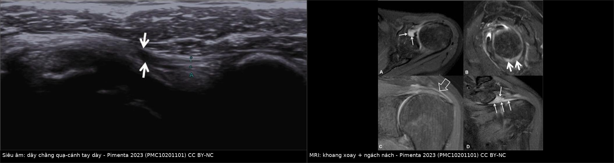
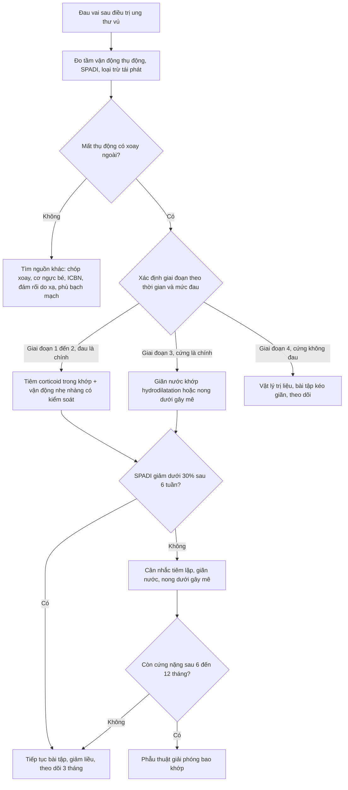
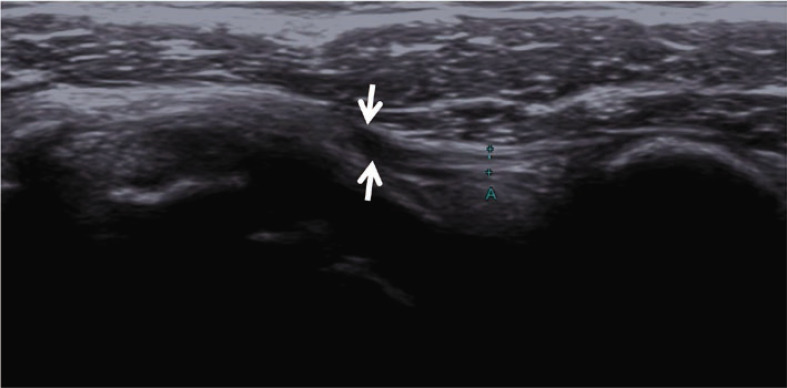
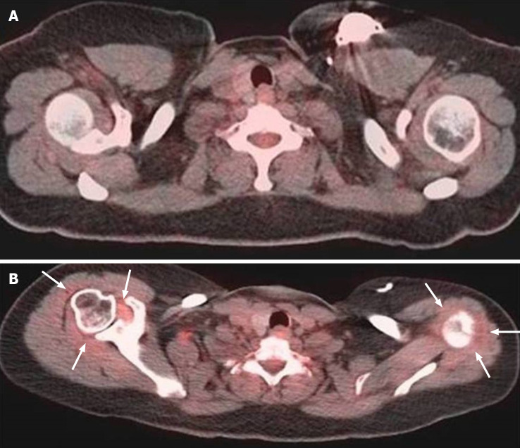
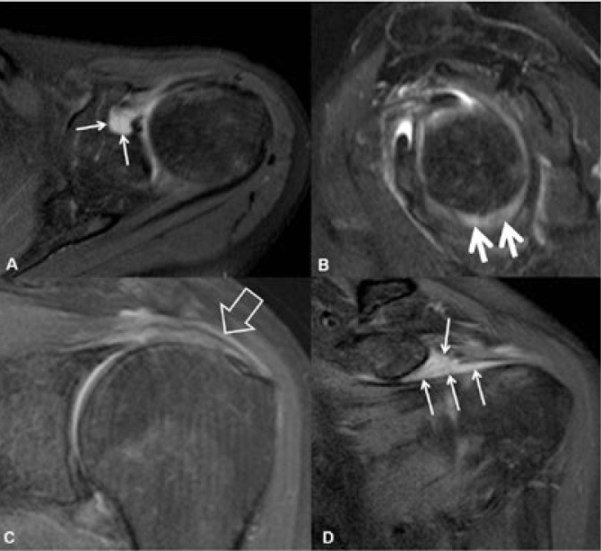

# 1651 — Cứng khớp vai dính sau điều trị ung thư vú / Adhesive capsulitis (frozen shoulder) after breast cancer treatment

**Tags:** `pattern:han-che-van-dong` `pattern:day-bao-khop` `vung:vai` `vung:vu` `score:SPADI` `protocol:MRI-vai` `protocol:tiem-trong-khop` `incidentaloma:PET-bao-khop`
**Mức chắc chắn (certainty):** tổng hợp y văn (literature synthesis) — biên từ 7 nguồn toàn văn mở: tổng quan hình ảnh–điều trị cứng khớp vai (PMC10201101, CC BY-NC 4.0), nghiên cứu bệnh–chứng yếu tố nguy cơ ở bệnh nhân ung thư vú (PMC10635792, CC BY 4.0), thử nghiệm tiêm triamcinolone trong khớp (PMC11276271, CC BY 4.0), tổng quan di chứng sau cắt vú (PMC10728246, CC BY 4.0), tổng quan phục hồi chức năng vai sau điều trị ung thư vú (PMC10881637, CC BY 4.0), nghiên cứu PET-CT bao khớp ở bệnh nhân ung thư (PMC8567438, CC BY-NC 4.0) và khảo sát loạn vận động xương bả vai (PMC12660340, CC BY 4.0). Các ca trong quiz là ca của nguồn, ghi rõ PMCID.

## 1. Tổng quan — vì sao vai "đông cứng" sau mổ vú, và vì sao hình ảnh lại khó

- **Bản chất bệnh học:** cứng khớp vai dính (adhesive capsulitis — AC, "frozen shoulder") là **xơ hóa–co rút bao khớp ổ chảo–cánh tay**, khởi đầu bằng viêm màng hoạt dịch rồi chuyển sang xơ hóa. Tổn thương khu trú ở **khoảng xoay (rotator cuff interval — RCI)** và **dây chằng quạ–cánh tay (coracohumeral ligament — CHL)** — hai cấu trúc then chốt giữ vững khớp; vì vậy hạn chế **xoay ngoài** là dấu hiệu sớm và nặng nhất (PMC10201101).
- **TẠI SAO xơ hóa lại gây mất vận động THỤ ĐỘNG:** bao khớp là mô collagen giàu sợi (type I và III). Khi nguyên bào sợi–nguyên bào cơ (myofibroblast) tăng sinh và ma trận bị tái cấu trúc (mất cân bằng MMP/TIMP), bao khớp **mất tính chun giãn**; mô xơ không dài ra được nên **dù bệnh nhân thả lỏng hoàn toàn, tay vẫn bị chặn** — đây chính là điểm phân biệt với đau cơ–gân (co cơ chủ động nhưng thụ động bình thường).
- **TẠI SAO hình ảnh phản ánh được mô xơ:** CHL và bao khớp bình thường là **dải collagen giảm tín hiệu trên mọi chuỗi xung**; khi viêm–xơ, nước tự do và tế bào tăng lên → **dày lên và tăng tín hiệu trên chuỗi nhạy nước (fat-suppressed PD/T2)**, tăng ngấm thuốc ở thì muộn. Trên siêu âm, collagen dày đặc **giảm hồi âm (hypoechoic)** và mất cấu trúc ống sợi; Doppler thấy tăng sinh mạch ở RCI. Vì tổn thương nằm ở **cấu trúc dày chằng–bao khớp chứ không phải ở xương**, X-quang **luôn bình thường** (có thể chỉ loãng xương do bất động) — X-quang chỉ dùng để loại trừ.
- **Vì sao ung thư vú là yếu tố nguy cơ riêng (4 cơ chế cộng dồn):**
  1. **Bất động** sau mổ (đeo đai, giữ tay sát thân mình vì đau/ống dẫn lưu) → bao khớp co rút.
  2. **Xơ hóa mô mềm** do phẫu thuật và xạ trị vùng ngực–nách, ăn lan tới bao khớp và cơ.
  3. **Tắc–ứ bạch mạch** gây phù mô mềm, viêm mạn và hạn chế vận động.
  4. **Đau do tổn thương thần kinh** (ICBN — bài 1619) khiến bệnh nhân "giữ vai", tạo vòng xoắn đau → bất động → cứng.
- **Số liệu nằm lòng:**
  - Quần thể chung: **2–5%**, tới **30%** ở người đái tháo đường phụ thuộc insulin, đỉnh **40–60 tuổi**, nữ nhiều hơn nam (PMC10201101).
  - Sau điều trị ung thư vú: **10,3%** tích lũy trong 13–18 tháng sau mổ (một trung tâm); **22,2%** trong khảo sát 135 phụ nữ châu Á (dẫn trong PMC11276271); bệnh–chứng 145 phụ nữ: **26,9%** (39/145) (PMC10635792).
  - Di chứng vai nói chung sau cắt vú: **1–68%** tùy định nghĩa; **20–50%** bệnh nhân AC còn triệu chứng **> 2 năm** (PMC10728246); một số chuỗi theo dõi tới **20–60% còn triệu chứng tới 7 năm** (PMC10201101).
  - **Yếu tố nguy cơ độc lập** (hồi quy đa biến, PMC10635792): bất động vai **OR 3,09** (KTC 1,33–7,18; p = 0,009); phù bạch mạch **OR 5,09** (1,81–14,35; p = 0,002); béo phì **OR 3,91** (1,27–12,01; p = 0,017). Đây là 3 biến **can thiệp được** — bất động là biến do thầy thuốc tạo ra.
  - **Bốn giai đoạn lâm sàng** (PMC10201101): (1) tiền dính, ≤ 3 tháng, đau cuối tầm vận động, ROM còn; (2) "đóng băng", 3–9 tháng, đau dữ dội + mất ROM; (3) "đông cứng", 4–12 tháng, đau giảm nhưng mất ROM nhiều; (4) "tan băng", 12–42 tháng, cứng không đau rồi hồi phục dần.

## 2. Mẫu hình + chẩn đoán phân biệt theo vị trí (Gamut)

- **Mẫu hình cốt lõi:** đau vai **âm ỉ, liên tục, nặng về đêm, không nằm được bên vai đau**, kèm **mất vận động cả chủ động và THỤ ĐỘNG** ở **≥ 2 hướng, bắt buộc có xoay ngoài**; không sốt, không khối, X-quang bình thường. Định nghĩa dùng trong nghiên cứu ung thư vú: **đau liên tục + giảm tầm vận động chủ động và thụ động khi giơ ra trước, xoay ngoài (0° và 90° dạng), xoay trong (90° dạng)** (PMC10635792).
- **Gamut theo vị trí đau — "4 ổ khóa" của vai sau mổ vú:**
  - **Ổ khóa bao khớp — đau lan tỏa quanh vai, đêm, mất mọi hướng thụ động:** cứng khớp vai dính (bài này).
  - **Ổ khóa cơ–gân — đau vai ngoài khi giơ ngang 60–120°, "cung đau":** chạm mỏm cùng vai/bệnh gân chóp xoay; **đau ngực trước–vai trước khi đẩy vai ra trước, tê ngón 4–5:** hội chứng cơ ngực bé (bài 1652).
  - **Ổ khóa thần kinh — đau bỏng/điện giật theo khoanh da, có Tinel:** tổn thương ICBN/neuroma (bài 1619); **yếu cơ khách quan + dị cảm lan nhiều năm sau xạ:** bệnh đám rối do xạ (bài 1617).
  - **Ổ khóa mạch–bạch mạch — phù tay, nặng tay, không đau theo dải:** phù bạch mạch (bài 593); dải xơ căng dưới nách (bài 599).
  - **Ngoài 4 ổ khóa nhưng phải loại trừ trước:** **đau xương khu trú + tiền sử xạ** → di căn xương/gãy bệnh lý; **sưng nóng đỏ + sốt + đau dữ dội** → viêm khớp nhiễm trùng (cấp cứu); **đau cơ–cân lan theo điểm kích hoạt** → đau cơ–cân (myofascial pain), gặp tới **45%** bệnh nhân ung thư vú (PMC10728246).
- **Mnemonic "STIFF" cho ca vai sau mổ vú:** **S**tiffness thụ động (AC), **T**endon (chóp xoay/impingement), **I**nterval + ICBN (thần kinh), **F**ibrosis do xạ (đám rối/xơ mô mềm), **F**luid/lymph (phù bạch mạch, nhiễm trùng).
- **Phân biệt bằng tay trước khi cần tới máy:** đau **thụ động** = bao khớp; đau **chủ động có lực cản** = gân/cơ; đau **theo khoanh da + dị cảm** = thần kinh; **phù** = bạch mạch. Chỉ khi mất thụ động mà không giải thích được, hoặc đau không khớp mẫu hình, mới cần MRI.

## 3. Bảng so sánh phân biệt (ma trận đối chiếu)

| Thực thể (entity) | Hình ảnh / lâm sàng điển hình | Chốt vào (rule-in) | Chốt loại (rule-out) | Gợi ý xác nhận |
|---|---|---|---|---|
| **Cứng khớp vai dính (AC)** | Đau đêm, mất **thụ động** mọi hướng, nặng nhất xoay ngoài; US: **CHL dày > 2,2 mm**, ngách nách > 4 mm, Doppler (+) ở RCI; MRI: bao khớp **> 4 mm ở ngách nách**, tăng tín hiệu RCI, không tràn dịch đáng kể | **Mất vận động THỤ ĐỘNG ≥ 2 hướng trong đó có xoay ngoài + X-quang bình thường** | Thụ động bình thường (chỉ đau khi gắng sức) → không phải AC; có khối/tiêu xương → tìm nguyên nhân khác | Đo góc bằng thước đo, so bên đối diện; US + MRI |
| **Chạm mỏm cùng vai / bệnh gân chóp xoay** | Đau **vai ngoài**, cung đau **60–120°**, đau khi giơ tay; US: gân dày, giảm hồi âm, có thể rách; MRI: tín hiệu gân tăng, dịch bao gân | **Cung đau + nghiệm pháp Neer/Hawkins dương + thụ động gần đủ** | Mất thụ động toàn bộ, không cung đau → nghiêng AC | US động gân chóp xoay; MRI không cản quang |
| **Hội chứng cơ ngực bé (bài 1652)** | Đau **ngực trước–vai trước**, tê ngón 4–5, đau tăng khi đẩy vai ra trước; Tinel cạnh mỏm quạ; US động: **lõm mặt sau cơ ngực bé khi dạng tay** | **Tái tạo triệu chứng bằng tư thế căng cơ ngực bé + giảm > 50% sau block cơ ngực bé** | Đau khu trú hố nách theo T2, không liên quan tư thế vai → loại | Block dưới siêu âm (4 mL lidocaine 1%) |
| **Đau thần kinh ICBN / neuroma (bài 1619)** | Đau **bỏng–điện giật** hố nách → mặt trong cánh tay, dị cảm, Tinel dọc nách | **Đúng khoanh da T2 + Tinel + giảm ≥ 4/10 VAS sau block ICBN** | Đau lan tỏa quanh vai, không theo khoanh da, không đổi sau block → loại | Block ICBN; US tần số cao |
| **Bệnh đám rối cánh tay do xạ (bài 1617)** | Nhiều năm sau xạ, **yếu cơ khách quan** + dị cảm lan, **myokymia**; MRI: đám rối dày, không khối | **Yếu cơ + myokymia (60% so với 4% do u)** | Cơ lực bình thường, chỉ đau/không vận động → không phải plexopathy | MRI đám rối STIR; EMG |
| **Phù bạch mạch / dây nách (bài 593, 599)** | Phù tay nặng khi gắng sức/nóng, **không đau theo dải**, không teo cơ; dải xơ căng dưới nách | **Chênh chu vi ≥ 2 cm so với tay đối diện + tiền sử ALND/xạ** | Không phù, đau theo khoanh da → loại | Đo chu vi, siêu âm mô mềm |
| **Di căn xương / gãy bệnh lý** | Đau **khu trú một điểm**, tăng dần, không liên quan vận động; X-quang có thể bỏ sót; MRI: thay thế tủy, phù xương; PET: ổ FDG tập trung | **Đau khu trú + tổn thương xương trên CT/MRI + FDG tập trung** | Đau lan tỏa, mất thụ động, hình xương bình thường → loại | CT xương, MRI, PET/CT; so phim cũ |
| **Viêm khớp nhiễm trùng** | Sưng nóng đỏ, sốt, đau dữ dội cả khi nghỉ; **tràn dịch khớp** trên US/MRI, CRP tăng mạnh | **Sốt + tràn dịch + CRP tăng + dịch đục khi chọc hút** | Không sốt, không tràn dịch, khởi phát từ từ → loại | Chọc hút dịch khớp cấp cứu (không chờ hình ảnh) |

*Trái: siêu âm xiên dọc dây chằng quạ–cánh tay (CHL) — dây dày, giảm hồi âm (mũi tên trắng), mất cấu trúc ống sợi bình thường. Phải: MRI fat-suppressed PD ở 4 mặt phẳng (A axial, B sagittal xiên, C coronal xiên, D sagittal xiên) — tăng tín hiệu bất thường ở khoảng xoay (mũi tên mảnh A, D), ở ngách nách dưới (mũi tên dày B, D) và gân trên gai thoái hóa (mũi tên rỗng C). Nguồn: Pimenta M et al., *Mediterr J Rheumatol* 2023;34(1):7–15 (PMC10201101), CC BY-NC 4.0. Ảnh ghép letterbox, giữ nguyên tỷ lệ, không crop.*

### Ba con số đo đúng (đừng đọc cảm tính)

- **Đo ở đâu:** CHL đo trên **mặt phẳng xiên song song với dây**, tại chỗ dày nhất, tính bằng mm; ngách nách (axillary recess) đo **độ dày bao khớp ở đáy ngách** trên mặt phẳng coronal xiên, **vuông góc với vỏ xương**, không đo chéo.
- **Ngưỡng:** CHL **> 2,2 mm** và ngách nách **> 4 mm** có tương quan tốt với AC; một số tác giả coi CHL **> 1,2 mm** đã bất thường — **ngưỡng chưa thống nhất, phải so bên đối diện** (PMC10201101).
- **Trên MRI:** bao khớp **> 4 mm ở ngách nách** là tiêu chí hữu ích; **lớp tăng tín hiệu ngoài bao khớp** trên T2 fat-sat có **độ đặc hiệu tới 97%** (PMC10201101). Tràn dịch khớp **không** phải đặc điểm của AC — thấy tràn dịch thì phải nghĩ nguyên nhân khác (nhiễm trùng, rách gân).

## 4. Protocol chụp – khám – điều trị + thang điểm

**Bước 1 — lâm sàng có cấu trúc (quyết định chẩn đoán, không thay bằng hình ảnh):**
1. Hỏi 3 câu: đau **đêm/nằm bên đau** không? mất vận động **khi người khác nâng tay** (thụ động) hay chỉ khi tự nâng? đau **ngực trước/tê tay** kèm theo (gợi ý cơ ngực bé/thần kinh)?
2. Đo **tầm vận động thụ động** bằng thước đo góc, **giữ cố định xương bả vai** (nếu không, bù trừ xương bả vai sẽ làm ROM "đẹp giả"): giơ ra trước, dạng, **xoay ngoài ở tư thế tay sát thân**, xoay trong.
3. Ghi **SPADI** (Shoulder Pain and Disability Index, 0–100, càng cao càng nặng) và **NRS đau khi nghỉ/khi vận động** ở mỗi lần khám — đây là bộ công cụ đã dùng trong thử nghiệm ở bệnh nhân ung thư vú (PMC11276271), giúp so sánh trước–sau điều trị.
4. Khám loại trừ: sờ hố nách (hạch tái phát), Tinel ICBN, nghiệm pháp căng cơ ngực bé, đo chu vi tay, khám cổ–rễ thần kinh.
5. **Nguyên tắc vàng:** đừng "bảo vệ" vai bằng bất động kéo dài — bất động là yếu tố nguy cơ **OR 3,09**; tập vận động sớm an toàn (thử nghiệm 200 bệnh nhân sau vét hạch: bắt đầu ROM **ngày thứ 3** và kháng lực tiến triển **tuần thứ 3** cho kết quả tốt hơn — PMC10881637).

**Bước 2 — siêu âm (đầu tay, rẻ, đối chiếu hai bên):**
- Đầu dò **tuyến tính 12–18 MHz**; khảo sát CHL ở mặt phẳng xiên, khoảng xoay, ngách nách; bật **Doppler** tìm tăng sinh mạch ở RCI.
- Dấu hiệu dương: CHL dày > 2,2 mm, mô giảm hồi âm ở RCI, giảm trượt gân dưới gai khi xoay ngoài thụ động (gân đổi từ dẹt sang lõm).
- Hạn chế: phụ thuộc người làm; **không có ngưỡng tuyệt đối được xã hội hình ảnh chấp nhận** — dùng để tăng độ tin cậy, không để chốt một mình.

**Bước 3 — MRI khi lâm sàng không rõ hoặc nghi tổn thương khác:**
- Protocol tối thiểu: **axial, sagittal xiên, coronal xiên**; T1 (giải phẫu, tủy xương) + **fat-suppressed PD hoặc T2** (nhạy nước); thêm **T1 fat-sat sau gadolinium** khi cần phân biệt mô viêm u/không u.
- Đọc theo thứ tự: (1) bao khớp ngách nách > 4 mm? (2) mô bất thường/tăng ngấm ở RCI? (3) lớp tăng tín hiệu ngoài bao? (4) có tràn dịch, rách gân, khối, thay thế tủy xương?
- **Không** dùng MRI để "chấm điểm" AC; MRI để (a) xác nhận khi lâm sàng lưỡng lự và (b) loại trừ tái phát/u xương.

**Bước 4 — PET/CT: cạm bẫy tổn thương tình cờ (incidentaloma):**
- Ở bệnh nhân ung thư, bao khớp có thể **ngấm FDG lan tỏa dạng vòng** do AC hoạt động; trong 200 bệnh nhân PET-CT (53 ung thư vú): **SUVmax 2,0 so với 1,6** (vai trái) và **2,2 so với 1,8** (vai phải) ở vai có triệu chứng so với không triệu chứng (p < 0,002) (PMC8567438).
- **Quy tắc an toàn:** ngấm **dạng bao khớp, đối xứng, SUV thấp (~2)** + đau vai → nghĩ AC; **ổ tập trung, không đối xứng, SUV cao** → tìm di căn. Không sinh thiết "ổ ngấm bao khớp" chỉ vì bệnh nhân có tiền sử ung thư.

**Bước 5 — điều trị theo giai đoạn (không phải theo hình ảnh):**

**Số liệu điều trị để tư vấn trung thực:**
- **Tiêm triamcinolone trong khớp** (37 người, 22 sau mổ vú so với 15 người AC vô căn): SPADI giảm **36,2 ± 16,4** so với **47,9 ± 15,2** điểm sau 6 tháng (p = 0,1495 — **không khác biệt có ý nghĩa**), nhưng nhóm sau mổ vú **cải thiện kém hơn** ở phân nhóm đau (3 tháng: −31,2 so với −48,8, p = 0,042; 6 tháng: −34,1 so với −50,7, p = 0,0006) và **dạng tay ở 3 tháng** (52,4 so với 70,3, p = 0,0072); **không có biến cố bất lợi** (PMC11276271).
- **Phản biện:** một thử nghiệm khác (giãn nước + corticoid + bài tập tại nhà) lại thấy nhóm AC sau ung thư vú cải thiện **tốt hơn** AC nguyên phát (PMC10881637 dẫn Lee CW 2022). Hai kết quả không mâu thuẫn về bản chất mà khác **can thiệp** (chỉ tiêm trong khớp so với giãn nước bao khớp) và **điểm cuối** — hiện **chưa có thử nghiệm so sánh trực tiếp**; đừng hứa "tiêm là đỡ như người thường".
- **Nong dưới gây mê (MUA)** và tiêm corticoid cho kết quả **tương đương** vật lý trị liệu chuẩn hóa ở AC thứ phát sau điều trị ung thư vú (PMC10881637 dẫn Leonidou 2014) — lựa chọn theo mức cứng và nguyện vọng, không theo "mức độ nặng trên phim".

## 5. Biến thể bình thường và cạm bẫy

- **Biến thể bình thường:** CHL **thấy rõ** ở người không triệu chứng, nhất là người trẻ–vận động nhiều; bao khớp ngách nách dày nhẹ ở người lớn tuổi. Vì vậy **luôn so bên đối diện cùng tư thế tay** và đọc theo ngưỡng mm, không theo "trông dày".
- **Cạm bẫy 1 — "đau vai ở người ung thư vú = di căn":** ngược lại cũng sai. Trong cùng một vai có thể có **cả AC và di căn**; đừng dừng lại khi thấy AC (thỏa mãn tìm kiếm). Nếu đau **khu trú một điểm, tăng dần, về đêm kiểu xương** → phải xem xương trên CT/MRI, không quy cho bao khớp.
- **Cạm bẫy 2 — "ngấm FDG bao khớp = di căn":** ngấm dạng vòng bao khớp với **SUVmax ~2** là AC; di căn thường **ổ tập trung, SUV cao, phá xương**. Đối chiếu CT cùng lát: AC **không** phá xương.
- **Cạm bẫy 3 — xơ hóa do xạ giả AC:** cả hai đều sau xạ, đều cứng. Phân biệt: xơ do xạ cho **dày da, đám xơ giảm tín hiệu T2 lan trong vùng chiếu**, không có tăng tín hiệu/tăng ngấm khu trú ở RCI; AC có **mô viêm ở RCI** và hạn chế xoay ngoài nổi bật.
- **Cạm bẫy 4 — tràn dịch khớp:** AC **không** gây tràn dịch đáng kể. Thấy tràn dịch + đau dữ dội + sốt → **chọc hút cấp cứu** để loại viêm khớp nhiễm trùng, không chờ MRI.
- **Cạm bẫy 5 — đo ROM sai:** không cố định xương bả vai → bệnh nhân bù trừ bằng thân mình/xương bả vai, ROM "bình thường giả" và bỏ sót AC. Đo xoay ngoài **ở tư thế tay sát thân** (nhạy nhất), ghi cả hai bên.
- **Cạm bẫy 6 — bất động "để bảo vệ":** đeo đai lâu, tránh vận động vì sợ rách vết mổ → chính là con đường tới AC (OR 3,09). Tập vận động sớm trong giới hạn an toàn là dự phòng.
- **Cạm bẫy 7 — đái tháo đường:** AC ở người đái tháo đường **kéo dài và khó điều trị hơn**; cần kiểm soát đường huyết song song, tư vấn thời gian dài hơn.

## 6. Tự lượng giá — Blind Quiz

**Ca 1 — Nữ 52 tuổi, 8 tháng sau cắt toàn bộ tuyến vú phải + xạ thành ngực, đau vai phải về đêm, không nằm được bên phải. Khám: không sờ thấy hạch, không phù tay.**

- Gợi ý: người khác nâng tay giúp cũng không lên được; xoay ngoài hạn chế rõ nhất; X-quang vai bình thường.
- Câu hỏi: (1) Mũi tên chỉ cấu trúc nào, và nó bất thường ở điểm gì? (2) Ba chẩn đoán phân biệt cần loại trừ? (3) Ngưỡng đo nào giúp chốt?

<b>Bấm để hiện đáp án (findings + chẩn đoán)</b>

- **Findings:** siêu âm xiên dọc **dây chằng quạ–cánh tay (CHL)** — dây **dày, giảm hồi âm**, mất cấu trúc ống sợi; đây là tổn thương đặc trưng của AC ở khoảng xoay.
- **Chẩn đoán:** **cứng khớp vai dính thứ phát sau điều trị ung thư vú** — mô xơ co rút bao khớp + CHL nên mất vận động **thụ động**, nặng nhất ở xoay ngoài.
- **Loại trừ:** (1) **di căn xương/tái phát** — đau khu trú, X-quang/CT xương, siêu âm hố nách; (2) **bệnh đám rối do xạ** — yếu cơ + myokymia; (3) **hội chứng cơ ngực bé** — đau ngực trước, tê ngón 4–5, nghiệm pháp căng cơ dương.
- **Ngưỡng chốt:** CHL **> 2,2 mm**, ngách nách **> 4 mm**; so bên đối diện. Không có tràn dịch khớp đáng kể.
- Nguồn: Pimenta M et al., *Mediterr J Rheumatol* 2023 (PMC10201101), CC BY-NC 4.0 — ảnh nguyên bản.

**Ca 2 — Nam 52 tuổi, ung thư phổi đang hóa trị, chụp PET-CT theo dõi. Hỏi thêm: đau và cứng vai phải 3 tháng nay.**

- Gợi ý: bệnh nhân lo "di căn vai"; không có khối, không phá xương trên CT cùng lát.
- Câu hỏi: Ổ ngấm FDG ở B có phải di căn? Dấu hiệu nào trên ảnh và con số nào ủng hộ cách đọc lành tính?

<b>Bấm để hiện đáp án (findings + chẩn đoán)</b>

- **Findings:** A (trước điều trị) bao khớp hai vai **không ngấm đáng kể**. B (sau hóa trị) có **ngấm FDG lan tỏa dạng vòng theo bao khớp hai bên** (mũi tên) — không phải ổ tập trung, **không phá xương** trên cửa sổ CT.
- **Chẩn đoán:** **cứng khớp vai dính hoạt động** (hai bên), không phải di căn. Cơ chế: viêm màng hoạt dịch–tăng sinh mạch ở bao khớp làm tăng tiêu thụ glucose, nhưng mức tăng thấp.
- **Con số:** ở 200 bệnh nhân ung thư, vai có triệu chứng có **SUVmax 2,0 so với 1,6** (trái) và **2,2 so với 1,8** (phải) so với vai không triệu chứng (p < 0,002) — **SUV thấp, dạng bao khớp** là chìa khóa.
- **Cạm bẫy:** bỏ qua vì "ung thư thì phải nghĩ di căn" → làm thêm sinh thiết/xạ vô ích; hoặc ngược lại, quy mọi đau vai cho AC mà bỏ sót ổ di căn thật.
- Nguồn: Hayashi D et al., *World J Radiol* 2021;13(10):344–353 (PMC8567438), CC BY-NC 4.0 — ảnh nguyên bản.

**Ca 3 — Nữ 62 tuổi, đau vai trái 2 tháng, khởi phát từ từ, tăng về đêm. Không tiền sử ung thư.**

- Gợi ý: xoay ngoài thụ động còn khoảng 10° so với 70° bên phải; không sốt; X-quang bình thường.
- Câu hỏi: (1) Mô tả tín hiệu bất thường ở A và B. (2) Giai đoạn lâm sàng nào? (3) Bước điều trị đầu tay?

<b>Bấm để hiện đáp án (findings + chẩn đoán)</b>

- **Findings:** **A** — tăng tín hiệu ở **khoảng xoay (RCI)** quanh dây chằng quạ–cánh tay; **B** — tăng tín hiệu và dày bao khớp ở **ngách nách dưới**; **C** — gân trên gai thoái hóa (mũi tên rỗng); **D** — mô bất thường lan theo RCI và ngách nách. **Không tràn dịch khớp.**
- **Chẩn đoán:** **cứng khớp vai dính nguyên phát giai đoạn 2 ("đóng băng")** — 2 tháng, đau nhiều, mất thụ động; mô bệnh: viêm mạn + xơ hóa bao khớp.
- **Điều trị đầu tay:** **tiêm corticoid trong khớp + vận động nhẹ nhàng có kiểm soát**, đánh giá lại SPADI sau 6 tuần; nếu cứng chiếm ưu thế → giãn nước/nong.
- **Cạm bẫy:** đừng đọc "thoái hóa gân trên gai" rồi quy toàn bộ hạn chế vận động cho gân — **mất thụ động** là dấu hiệu của bao khớp.
- Nguồn: Pimenta M et al., *Mediterr J Rheumatol* 2023 (PMC10201101), CC BY-NC 4.0 — ảnh nguyên bản.

## Bài liên quan chéo
- [1619 – Đau thần kinh sau điều trị ung thư vú (ICBN & PMPS)](../1619-dau-than-kinh-sau-dieu-tri-ung-thu-vu/lesson.md) (nguồn đau khiến bệnh nhân "giữ vai" → dẫn tới AC; phân biệt bằng Tinel)
- [1652 – Hội chứng cơ ngực bé & lối thoát ngực thần kinh sau mổ vú](../1652-co-nguc-be-loi-thoat-nguc/lesson.md) (đau vai trước + tê ngón 4–5, điều trị ngược với AC)
- [1617 – Bệnh đám rối cánh tay do xạ](../1617-benh-dam-roi-can-tay-do-xa/lesson.md) (yếu cơ + myokymia, phân biệt với hạn chế vận động do bao khớp)
- [1615 – Di căn xương ung thư vú lan hóa vs tiến triển](../1615-di-can-xuong-ung-thu-vu-lanh-hoa-vs-tien-trien/lesson.md) (cạm bẫy "đau vai = di căn")
- [593 – Phù bạch mạch chi trên sau điều trị ung thư vú](../593-phu-bach-mach-chi-tren-sau-dieu-tri-ung-thu-vu/lesson.md) (yếu tố nguy cơ OR 5,09 cho AC)
- [599 – Hội chứng dây nách & phù bạch mạch](../599-day-nach-axillary-web-syndrome/lesson.md) (dải xơ cơ học, không mất thụ động)
- [522 – Theo dõi sau điều trị ung thư vú & tái phát muộn](../522-theo-doi-sau-dieu-tri-ung-thu-vu/lesson.md) (bối cảnh "triệu chứng vai mới" trong theo dõi)

## Ảnh
- 3 ảnh gốc + 1 ảnh ghép; giấy phép từng ảnh trong `images/CREDITS.md` (1 ảnh CC BY-NC 4.0 của PMC8567438; 2 ảnh CC BY-NC 4.0 của PMC10201101).
- Ảnh ghép `composite_1651_sieu-am-vs-MRI.jpg` tạo bằng `tools/make_composite.py` (letterbox, giữ tỷ lệ, dải attribution).
- Europe PMC ghi PMC10201101 là "cc by" nhưng **khối giấy phép trong bài gốc là CC BY-NC 4.0** → ghi theo bài gốc, không theo metadata.

> Không dùng để chẩn đoán độc lập khi chưa có người hướng dẫn.
