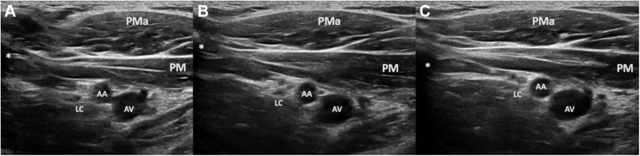
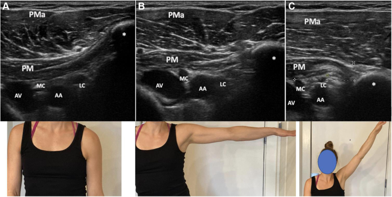
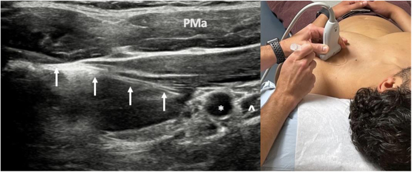
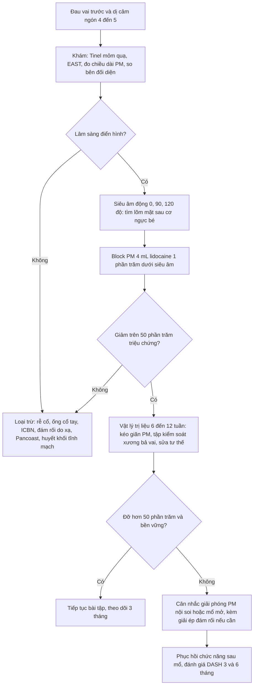
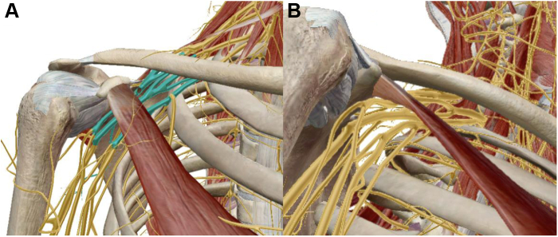

# 1652 — Hội chứng cơ ngực bé & lối thoát ngực thần kinh sau mổ vú / Pectoralis minor syndrome (PMS) & neurogenic thoracic outlet syndrome

**Tags:** `pattern:chen-ep-dam-roi` `pattern:dau-vai-truoc` `pattern:di-cam-ngon-4-5` `vung:vai` `vung:ho-nach` `vung:vu` `score:EAST` `protocol:block-co-nguc-be` `protocol:sieu-am-dong`
**Mức chắc chắn (certainty):** tổng hợp y văn (literature synthesis) — biên từ 5 nguồn toàn văn mở: tổng quan giải phẫu–chẩn đoán–điều trị hội chứng cơ ngực bé (PMC10426640, CC BY 4.0), tổng quan chẩn đoán lối thoát ngực thần kinh + block cơ (PMC5617946, CC BY 4.0), loạt ca hội chứng cơ ngực bé thần kinh (PMC12440548, CC BY 4.0), đồng thuận Delphi tiêu chuẩn chẩn đoán lối thoát ngực thần kinh (PMC13187369, CC BY-NC-ND — chỉ trích số liệu, không dùng ảnh), và khảo sát loạn vận động xương bả vai sau tái tạo vú (PMC12660340, CC BY 4.0). Phần liên hệ với phẫu thuật vú dựa trên PMC8534110 (CC BY 4.0). Các ca trong quiz là ca của nguồn, ghi rõ PMCID.

## 1. Tổng quan — vì sao một cơ nhỏ dưới mỏm quạ lại chèn được đám rối cánh tay

- **Giải phẫu quyết định tất cả:** cơ ngực bé (pectoralis minor — PM) bám từ **xương sườn 3–5** tới **mỏm quạ (coracoid)**, nằm ngay trước một "ngõ hẹp" gọi là **khoang sau cơ ngực bé (retropectoralis minor space)**. Trong khoang này có **động mạch–tĩnh mạch nách** và **các bó (cords) của đám rối cánh tay**. PM co–ngắn → **thể tích khoang giảm** → đám rối bị ép giữa cơ và thành ngực (PMC10426640).
- **Lối thoát ngực (thoracic outlet) có 3 cửa:** tam giác thang trước (scalene triangle), khoảng sườn–đòn (costoclavicular), và **khoảng sau cơ ngực bé**. Hội chứng lối thoát ngực thần kinh (neurogenic thoracic outlet syndrome — NTOS) chiếm **90–95%** tổng số ca lối thoát ngực; và hiểu biết gần đây coi **PM là nguyên nhân chính của NTOS** (thể dưới đòn), chứ không chỉ là tam giác thang trước (PMC10426640).
- **TẠI SAO PM ngắn lại gây đau kiểu thần kinh (cơ chế):** dây thần kinh ngoại biên chịu được lực kéo nhẹ nhưng **mất dẫn truyền khi bị ép > 30 mmHg** kéo dài; ép mạn gây **phù nội dây, phá myelin từng đoạn, rồi xơ hóa**. Vì các sợi cảm giác của **bó trong (medial cord)** — tức C8–T1 — nằm sát PM nhất, triệu chứng **ưu thế ngón 4–5** dù tổn thương ở vai, không ở cổ tay. Đây là lý do ca PMS hay bị chẩn đoán nhầm thành hội chứng ống cụt/ống cổ tay.
- **Vì sao sau mổ vú lại dễ PMS (4 cơ chế, phần này là SUY LUẬN từ sinh lý – bằng chứng trực tiếp còn mỏng):**
  1. **Sẹo và xơ hóa cơ ngực lớn** sau cắt tuyến vú/tái tạo → mất cân bằng lực giữa PM và cơ đối kháng, kéo xương bả vai ra trước.
  2. **Xạ trị thành ngực** gây xơ hóa mô mềm, giảm trượt các lớp cơ.
  3. **Bất động/tư thế bảo vệ** (giữ vai khép, gù, đầu đưa ra trước) → PM ở tư thế ngắn lâu dài.
  4. **Loạn vận động xương bả vai** rất thường gặp sau mổ vú: **64,2% tĩnh và 73,1% động** ở 67 phụ nữ sau tái tạo vú (PMC12660340) — xương bả vai nhô ra trước làm hẹp khoang sau PM.
- **Số liệu nằm lòng:**
  - PMS chiếm **22,6%** ca được giới thiệu vì lối thoát ngực và là **nguyên nhân chèn ép duy nhất ở 6,1%** (PMC8534110).
  - **Dị cảm (paresthesia) > 90%** bệnh nhân NTOS và PMS, thường **cả 5 ngón nhưng nặng nhất ngón 4–5** (PMC5617946).
  - Bảng triệu chứng (52 bệnh nhân PMS đơn thuần so với 52 PMS + NTOS, PMC5617946): **đau ngực trước 69% so với 92%**, **hố nách 52% so với 78%**, **vai 69% so với 90%**, **cánh tay 71% so với 88%**, **đau đầu vùng chẩm 31% so với 81%**, **yếu cơ 58% so với 88%** — nghĩa là **PMS đơn thuần đau khu trú hơn**, còn khi lan lên cổ–chẩm thì đã có thành phần trên đòn.
  - **Bốn giai đoạn PMS** (PMC10426640): (1) đau nhẹ vai trước–ngực trên–cơ thang, loạn vận động kín đáo; (2) đau vừa–nặng lan vai/cánh tay, **đau điểm Tinel vùng mỏm quạ**, phải nghỉ thể thao; (3) đau lan tỏa + lan ra sau (do thần kinh trên vai), **yếu cơ trên gai/dưới gai**, loạn vận động rõ; (4) thêm đau và Tinel **hố trên đòn/cổ** — tức đã lan lên tầng trên.

## 2. Mẫu hình + chẩn đoán phân biệt theo vị trí (Gamut)

- **Mẫu hình cốt lõi:** đau **vai trước – ngực trên – hố nách**, có **dị cảm ngón 4–5**, tăng khi **giơ tay lên cao/đẩy vai ra trước**, kèm **đau điểm (tenderness) và Tinel ngay dưới–trong mỏm quạ**; không có khối, không sốt, không teo cơ (trừ giai đoạn muộn).
- **Gamut theo vị trí — đọc từ "cổ → vai → cánh tay → bàn tay":**
  - **Cổ + vai, đau lan theo rễ, giảm phản xạ:** rễ cổ (cervical radiculopathy) — thường có dấu hiệu rễ và hẹp lỗ liên hợp trên MRI.
  - **Vai trước + ngực trên + ngón 4–5, Tinel mỏm quạ:** **hội chứng cơ ngực bé (bài này)**.
  - **Hố nách + mặt trong cánh tay, đau bỏng theo khoanh da:** tổn thương ICBN/neuroma sau mổ vú (bài 1619).
  - **Vai ngoài + cung đau 60–120°, thụ động gần đủ:** chạm mỏm cùng vai/bệnh gân chóp xoay; **mất thụ động toàn bộ:** cứng khớp vai dính (bài 1651).
  - **Yếu cơ khách quan + dị cảm lan + myokymia, nhiều năm sau xạ:** bệnh đám rối do xạ (bài 1617).
  - **Ngón 1–3, đau đêm, nghiệm pháp Tinel ống cổ tay:** hội chứng ống cổ tay (phân bố khác C8–T1).
  - **Tay sưng, đổi màu, đau khi giơ tay:** lối thoát ngực **tĩnh mạch** (huyết khối tĩnh mạch dưới đòn — Paget–Schroetter) — cấp cứu, cần siêu âm Doppler ngay.
  - **Đau vai + Horner + teo cơ bàn tay, hút thuốc:** u đỉnh phổi (Pancoast) — phải chụp ngực, không được bỏ.
- **Mnemonic "PM-C8":** **P**osture (tư thế đầu ra trước, vai khép), **M**ỏm quạ (Tinel/tenderness), **C**hest (đau ngực trước), **8** (ngón 4–5 = C8–T1).
- **Nguyên tắc loại trừ:** PMS **không phải chẩn đoán loại trừ đơn thuần** — nó có dấu hiệu dương tính (Tinel mỏm quạ + đáp ứng block). Nhưng vẫn phải loại trừ rễ cổ, ống cổ tay và bệnh đám rối do xạ trước khi đặt stent/kế hoạch mổ.

## 3. Bảng so sánh phân biệt (ma trận đối chiếu)

| Thực thể (entity) | Hình ảnh / lâm sàng điển hình | Chốt vào (rule-in) | Chốt loại (rule-out) | Gợi ý xác nhận |
|---|---|---|---|---|
| **Hội chứng cơ ngực bé (PMS)** | Đau vai trước–ngực trên–hố nách, dị cảm ngón 4–5; **Tinel/đau điểm dưới–trong mỏm quạ**; US động: **lõm mặt sau cơ ngực bé khi dạng tay** | **Tinel mỏm quạ + tái tạo triệu chứng khi đẩy vai ra trước + giảm > 50% sau block PM** | Đau không đổi sau block PM, không có Tinel, đau theo rễ → loại | Block PM dưới siêu âm (4 mL lidocaine 1%) |
| **Rễ cổ (cervical radiculopathy)** | Đau lan theo dải rễ, **giảm phản xạ gân xương**, nghiệm pháp Spurling; MRI: hẹp lỗ liên hợp, thoát vị đĩa đệm | **Dấu hiệu rễ + hẹp lỗ liên hợp trên MRI tương ứng mức** | Không có dấu hiệu rễ, block PM dương tính mạnh → nghiêng PMS | MRI cổ; EMG nếu cần |
| **Hội chứng ống cổ tay** | Dị cảm **ngón 1–3**, đau đêm, gõ cổ tay dương; EMG: chậm dẫn truyền thần kinh giữa | **Phân bố thần kinh giữa + chậm dẫn truyền giữa ở cổ tay** | Dị cảm ngón 4–5, Tinel mỏm quạ → không phải ống cổ tay đơn thuần | EMG; siêu âm dây thần kinh giữa |
| **Tổn thương ICBN/neuroma (bài 1619)** | Đau bỏng hố nách → mặt trong cánh tay, Tinel dọc nách, sau ALND | **Đúng khoanh da T2 + Tinel + giảm ≥ 4/10 VAS sau block ICBN** | Đau ngực trước + ngón 4–5, Tinel mỏm quạ → loại | Block ICBN |
| **Bệnh đám rối do xạ (bài 1617)** | Nhiều năm sau xạ, **yếu cơ khách quan**, myokymia; MRI đám rối dày, không khối | **Yếu cơ + myokymia (60% so với 4% do u)** | Không yếu cơ, đau do tư thế, block dương → loại | MRI đám rối STIR; EMG |
| **Chạm mỏm cùng vai / bệnh gân chóp xoay** | Đau vai ngoài, cung đau 60–120°, thụ động gần đủ; US/MRI: gân dày, rách | **Cung đau + Neer/Hawkins dương** | Đau ngực trước + dị cảm ngón 4–5 → loại | US/MRI vai |
| **Lối thoát ngực tĩnh mạch (Paget–Schroetter)** | Tay **sưng, tím, đau** sau gắng sức; siêu âm Doppler: huyết khối tĩnh mạch dưới đòn/nách | **Huyết khối trên Doppler + phù tay** | Không phù, không đổi màu, đau kiểu thần kinh → loại | Doppler tĩnh mạch; CT venography |
| **U đỉnh phổi (Pancoast)** | Đau vai + **Horner**, teo cơ bàn tay, hút thuốc; X-quang/CT: khối đỉnh phổi | **Khối đỉnh phổi + Horner/teo cơ bàn tay** | X-quang ngực bình thường, không Horner → ít nghĩ | CT ngực có cản quang |

**Siêu âm động — bình thường so với có triệu chứng (cùng tư thế dạng tay):**

*Bình thường: mặt cắt ngang khoang sau cơ ngực bé ở **A** (tay khép), **B** (dạng 90°), **C** (dạng 120°). Mặt sau cơ ngực bé (PM) **vẫn phẳng, không lõm**, khoảng cách tới động mạch nách (AA) và bó bên (LC) không đổi. PMa = cơ ngực lớn; AV = tĩnh mạch nách; ∗ = mỏm quạ. Nguồn: Ahmed AS et al., *JSES Rev Rep Tech* 2022;2(4):469–488 (PMC10426640), CC BY 4.0 — nguyên bản.*

*Có triệu chứng (NTOS do PM): khi dạng tay 90° (**B**) và 120° (**C**) xuất hiện **lõm (indentation) mặt sau cơ ngực bé**, cơ ép sát đám rối và mạch nách trong khoang đã hẹp; hàng dưới là ảnh tư thế tương ứng. Nguồn: Ahmed AS et al., *JSES Rev Rep Tech* 2022 (PMC10426640), CC BY 4.0 — nguyên bản.*

### Ba điểm đọc ảnh động cho đúng
- **So cùng một góc dạng tay:** PM thay đổi hình dạng theo góc, nên **luôn chụp 0° / 90° / 120°** và so bên đối diện; đo ở các góc khác nhau là nguồn sai số lớn nhất.
- **Dấu hiệu dương là "lõm mặt sau", không phải "cơ dày":** độ dày PM thay đổi theo thể trạng; cái quyết định là **mặt sau cơ bị lõm vào khoang** làm hẹp khoảng cách tới đám rối/mạch.
- **Chưa có ngưỡng chuẩn:** hiện **không có tiêu chuẩn định lượng** cho "bình thường so với bất thường" trên siêu âm động, và kỹ thuật phụ thuộc người làm (PMC10426640) — ghi "chưa rõ, cần tra" thay vì bịa ngưỡng mm.

## 4. Protocol khám – chẩn đoán – điều trị + tiêu chuẩn đồng thuận

**Bước 1 — năm tiêu chuẩn đồng thuận (Delphi 20 chuyên gia, 54 mục, Cronbach α = 0,936; PMC13187369):**
1. **Đáp ứng dương với block** (cơ ngực bé, thang trước, thang giữa).
2. Triệu chứng lan theo **thân trên hoặc thân dưới** đám rối, **nặng lên khi làm nghiệm pháp trên đòn** (ấn thang, Tinel thang).
3. Triệu chứng nặng lên khi làm nghiệm pháp **dưới đòn** — **Tinel ngay trong (medial) mỏm quạ** hoặc đau khi ấn mỏm quạ.
4. **Tái tạo đau khi dạng 90° + xoay ngoài (90° AER)** hoặc nghiệm pháp căng chi trên (ULTT).
5. **Nghề nghiệp/thể thao có gắng sức tay lặp lại trên đầu.**

> Nghiệm pháp cổ điển (Adson, Wright, Roos, Cyriax) **không đáng tin**: tỷ lệ dương tính giả và âm tính giả đều cao (PMC10426640). Đừng chẩn đoán chỉ vì Roos dương.

**Bước 2 — đo lường (so bên đối diện):**
- **Chiều dài PM:** từ **bờ trong mỏm quạ** tới **bờ dưới xương sườn 4 tại chỗ nối sườn–ức**, khi bệnh nhân đứng thẳng.
- **Chỉ số PM (PM index)** = chiều dài PM / chiều cao (cm) × 100 — dùng để so theo thể trạng; **giá trị chuẩn chưa thống nhất**, đừng chốt một mình (PMC10426640).
- **Khoảng cách xương bả vai trong (medial scapular distance)**, **góc xương bả vai trong**, **chiều cao nhô xương bả vai** — đánh giá tư thế nhô ra trước.
- **Nghiệm pháp giơ tay gắng sức (elevated arm stress test — EAST/Roos):** giữ hai tay dạng 90° + xoay ngoài, mở–nắm 3 phút; dương khi tái tạo dị cảm/đau — nhưng **không đặc hiệu**.

**Bước 3 — siêu âm động (đầu dò tuyến tính, 10–15 MHz):**
- Tư thế bệnh nhân ngồi hoặc nằm, tay dạng trong mặt phẳng thân; quét ngang khoang sau PM tại **mỏm quạ**, ghi ảnh ở **0°, 90°, 120°**.
- Tìm: **lõm mặt sau PM**, giảm khoảng cách PM–động mạch nách/đám rối, hẹp tĩnh mạch nách khi dạng tay (dấu hiệu động), tăng sinh mạch bất thường (Doppler).
- Không quên **khảo sát hố nách** ở bệnh nhân sau mổ vú: hạch, khối tái phát, dải xơ.

**Bước 4 — block chẩn đoán dưới siêu âm (tiêu chuẩn vàng):**
- Đích: **ngay dưới (deep to) chỗ bám của PM vào mỏm quạ**, kim in-plane, **góc 45°** để tránh màng phổi; có thể phối hợp block **thần kinh ngực trong (medial pectoral nerve)** và **dây thần kinh trên vai** nếu nghi tầng trên (PMC10426640).
- Thuốc: **4 mL lidocaine 1%** (PMC5617946); tác dụng **trong vòng 60 giây**, kéo dài **~30 phút**; đánh giá sau **30–40 phút** (PMC12440548).
- **Ngưỡng dương:** giảm **> 50%** đau/dị cảm (PMC10426640; đồng thuận PMC13187369). Đáp ứng **dù chỉ tạm thời** vẫn có giá trị tiên lượng cho mổ.

*Trái: kim (mũi tên trắng) đi tới **ngay dưới chỗ bám của cơ ngực bé vào mỏm quạ** (∗), thuốc lan dọc mặt sâu cơ; ˆ = chỗ bám gân PM; PMa = cơ ngực lớn. Phải: tư thế bệnh nhân và đầu dò. Nguồn: Ahmed AS et al., *JSES Rev Rep Tech* 2022 (PMC10426640), CC BY 4.0 — nguyên bản.*

**Bước 5 — hình ảnh loại trừ và điều trị:**

**Số liệu điều trị để tư vấn:**
- **Điều trị bảo tồn:** trong 46 bệnh nhân trẻ–vận động, **40 (87%)** đáp ứng với **kéo giãn + tập kiểm soát xương bả vai**, cải thiện tư thế, chức năng vai và đau (PMC10426640 dẫn Provencher). Đây là lý do **luôn thử bảo tồn trước**.
- **Phẫu thuật:** giải phóng PM (mổ mở hoặc nội soi) cho kết quả tốt khi **đã chọn đúng bệnh nhân bằng block dương**; tổng quan cho thấy **giải phóng trên đòn không cắt sườn 1 đạt ~85%** kết quả tốt, so với **76–77%** khi cắt sườn 1 kèm (PMC10426640 dẫn Peek) — cắt sườn 1 có **biến chứng tới 40%** (tràn khí màng phổi, máu tụ, tổn thương thần kinh, nhiễm trùng).
- **Kỹ thuật nội soi:** giải phóng gân PM khỏi mỏm quạ qua đường vào dưới vai, có thể kèm giải ép đám rối (PMC9206061).
- **Khoảng trống bằng chứng:** **chưa có nghiên cứu đo chiều dài/chỉ số PM riêng ở bệnh nhân sau mổ vú**, và chưa có thử nghiệm so sánh giải phóng PM với điều trị bảo tồn ở nhóm này — ghi "chưa rõ", không suy diễn thành khuyến cáo.

## 5. Biến thể bình thường và cạm bẫy

- **Biến thể bình thường 1 — PM "dày" theo thể trạng:** người tập thể hình/lao động nặng có PM dày, khoang sau PM hẹp trên hình nhưng **không triệu chứng**. Chẩn đoán là **lâm sàng + block**, hình ảnh chỉ hỗ trợ; đừng gọi "hẹp khoang" là bệnh.
- **Biến thể bình thường 2 — lõm nhẹ khi dạng tay:** ở người không triệu chứng vẫn có thể thấy biến dạng nhẹ mặt sau PM khi dạng 120°; vì **chưa có ngưỡng chuẩn**, phải so bên đối diện và đối chiếu triệu chứng.
- **Cạm bẫy 1 — "Roos dương là TOS":** Adson/Wright/Roos/Cyriax có **tỷ lệ dương tính giả cao ngay ở người bình thường**; dựa vào chúng dẫn tới mổ oan hoặc bỏ sót rễ cổ.
- **Cạm bẫy 2 — chẩn đoán nhầm ống cổ tay/ống cụt:** phân bố **ngón 4–5** (C8–T1) là chìa khóa; nếu EMG chẩn đoán ống cổ tay mà bệnh nhân không đỡ sau mổ giải phóng ống cổ tay → khám lại lối thoát ngực.
- **Cạm bẫy 3 — người đã mổ vú có tay sưng:** phải loại **tái phát hạch/tắc bạch mạch/huyết khối tĩnh mạch** trước khi quy cho PMS. Siêu âm hố nách + Doppler tĩnh mạch là bắt buộc khi có phù.
- **Cạm bẫy 4 — bỏ sót bệnh đám rối do xạ:** bệnh nhân sau xạ có thể **vừa** PMS **vừa** xơ hóa đám rối; PMS có Tinel mỏm quạ + block dương, plexopathy có **yếu cơ khách quan + myokymia**. Điều trị ngược nhau: PMS cần giải ép cơ, plexopathy không mổ.
- **Cạm bẫy 5 — đo PM sai tư thế:** đo khi bệnh nhân nằm hoặc vai nhô ra trước khác hoàn toàn so với đứng thẳng; luôn ghi tư thế và so bên đối diện.
- **Cạm bẫy 6 — "thỏa mãn tìm kiếm":** thấy hội chứng cơ ngực bé rồi dừng, bỏ sót **rễ cổ C5–C6** cùng tồn tại (loạt ca PMC12440548: nhiều bệnh nhân từng được chỉ định mổ cột sống cổ trước khi block PM xác định chẩn đoán).
- **Cạm bẫy 7 — block âm tính không có nghĩa "hết bệnh":** block có thể âm tính giả do đặt thuốc sai (quá nông, không tới mặt sâu cơ). Block âm tính **một lần** chưa đủ loại trừ; xem lại kỹ thuật trước khi kết luận.

## 6. Tự lượng giá — Blind Quiz

**Ca 1 — Nữ 47 tuổi, 14 tháng sau cắt tuyến vú trái + vét hạch + xạ, đau vai trước – ngực trên, tê ngón 4–5 khi giơ tay lên đầu.**

- Gợi ý: ấn ngay dưới–trong mỏm quạ tái tạo đúng cơn đau quen thuộc; không yếu cơ, không phù tay.
- Câu hỏi: (1) Dấu hiệu nào trên siêu âm khi dạng tay 90–120°? (2) Ba chẩn đoán phân biệt cần loại trừ? (3) Bước nào chốt chẩn đoán?

<b>Bấm để hiện đáp án (findings + chẩn đoán)</b>

- **Findings:** ở **B (90°)** và **C (120°)** xuất hiện **lõm mặt sau cơ ngực bé**, cơ ép vào khoang chứa động mạch nách (AA), tĩnh mạch nách (AV) và bó bên (LC). Ở **A (tay khép)** mặt sau cơ còn phẳng.
- **Chẩn đoán:** **hội chứng cơ ngực bé (PMS) sau điều trị ung thư vú** — PM ngắn/xơ + xương bả vai nhô ra trước làm hẹp khoang sau PM, chèn bó trong (C8–T1) → dị cảm ngón 4–5.
- **Loại trừ:** (1) **rễ cổ C8–T1** — MRI cổ, dấu hiệu rễ; (2) **tổn thương ICBN** — đau hố nách theo khoanh da T2, block ICBN; (3) **bệnh đám rối do xạ** — yếu cơ + myokymia.
- **Bước chốt:** **block PM dưới siêu âm 4 mL lidocaine 1%**, đánh giá sau 30–40 phút; **giảm > 50%** = dương.
- Nguồn: Ahmed AS et al., *JSES Rev Rep Tech* 2022 (PMC10426640), CC BY 4.0 — ảnh nguyên bản.

**Ca 2 — Cùng bệnh nhân trên, được làm block chẩn đoán. Ảnh dưới cho thấy đầu kim và tư thế bệnh nhân.**

- Gợi ý: kim đi từ trước ra sau, góc khoảng 45°; mỏm quạ là mốc xương.
- Câu hỏi: (1) Đầu kim nhắm tới đâu và vì sao không nhắm vào thân cơ? (2) Con số nào xác nhận block dương? (3) Nếu block dương, bước tiếp theo là gì; nếu âm thì sao?

<b>Bấm để hiện đáp án (findings + chẩn đoán)</b>

- **Findings:** kim (mũi tên trắng) tới **ngay dưới chỗ bám gân của PM vào mỏm quạ (∗)**; thuốc lan theo mặt sâu cơ, nơi đám rối và mạch nách nằm ngay bên dưới. Góc 45° để **tránh màng phổi**.
- **Vì sao không nhắm thân cơ:** đích chẩn đoán là **chặn đám rối ngay tại cửa hẹp** (dưới gân bám), không phải làm yếu cơ; nhắm thân cơ dễ bỏ sót nhánh thần kinh ngực trong và giảm giá trị tiên lượng.
- **Ngưỡng dương:** **giảm > 50% đau/dị cảm**, đánh giá sau **30–40 phút**; tác dụng khởi phát trong ~60 giây và kéo dài ~30 phút với lidocaine 1%.
- **Bước tiếp theo:** dương → **bảo tồn 6–12 tuần** (kéo giãn PM + tập kiểm soát xương bả vai + sửa tư thế); không đỡ → cân nhắc **giải phóng PM** (nội soi/mổ mở). Âm → **xem lại kỹ thuật block** rồi loại trừ rễ cổ/ống cổ tay/plexopathy, không mổ.
- Nguồn: Ahmed AS et al., *JSES Rev Rep Tech* 2022 (PMC10426640), CC BY 4.0 — ảnh nguyên bản.

**Ca 3 — Nam 35 tuổi, đau ngực trước–vai khi tập gym trên đầu, dị cảm ngón 4–5. Hình dưới là phẫu tích 3D khoang dưới đòn.**

- Gợi ý: xương đòn được nâng lên trong hình B; dây vàng là đám rối cánh tay.
- Câu hỏi: (1) Cấu trúc đỏ nằm giữa xương đòn và đám rối là gì? (2) Vì sao tư thế nhô vai ra trước làm hẹp khoang? (3) Một cơ chế khác ở tầng trên gây cùng triệu chứng?

<b>Bấm để hiện đáp án (findings + chẩn đoán)</b>

- **Findings:** cơ màu đỏ băng từ sườn tới mỏm quạ là **cơ ngực bé**; đám rối cánh tay (vàng) và mạch dưới đòn–nách chạy **ngay sau (sau trên) cơ** trong khoang sau PM. Hình B nâng xương đòn cho thấy rõ quan hệ "cơ ở trước – thần kinh ở sau".
- **Vì sao tư thế nhô vai ra trước làm hẹp:** xương bả vai nhô ra trước kéo **nguyên điểm bám mỏm quạ** ra trước và xuống, làm PM **ngắn tương đối**; đồng thời thành ngực sau bị đẩy vào → **thể tích khoang sau PM giảm**, đám rối bị kẹp. Đây là lý do điều trị đầu tay là **sửa tư thế + kéo giãn**, không phải tiêm corticoid.
- **Cơ chế tầng trên:** **tam giác thang trước** (giữa cơ thang trước và thang giữa) — co thắt/cơ thang bất thường hoặc sườn cổ làm hẹp, gây triệu chứng lan lên cổ–chẩm (đau đầu vùng chẩm 81% khi PMS + NTOS so với 31% khi PMS đơn thuần).
- **Cạm bẫy:** đừng kết luận chỉ vì hình ảnh hẹp — **block dương** mới là bằng chứng chức năng.
- Nguồn: Ahmed AS et al., *JSES Rev Rep Tech* 2022 (PMC10426640), CC BY 4.0 — ảnh nguyên bản.

## Bài liên quan chéo
- [1651 – Cứng khớp vai dính sau điều trị ung thư vú](../1651-cung-khop-vai-sau-dieu-tri-ung-thu-vu/lesson.md) (mất vận động THỤ ĐỘNG — điều trị ngược với PMS)
- [1619 – Đau thần kinh sau điều trị ung thư vú (ICBN & PMPS)](../1619-dau-than-kinh-sau-dieu-tri-ung-thu-vu/lesson.md) (hàng DDx chính; PMS là một trong 5N)
- [1617 – Bệnh đám rối cánh tay do xạ](../1617-benh-dam-roi-can-tay-do-xa/lesson.md) (yếu cơ + myokymia — không mổ)
- [593 – Phù bạch mạch chi trên sau điều trị ung thư vú](../593-phu-bach-mach-chi-tren-sau-dieu-tri-ung-thu-vu/lesson.md) (tay sưng sau mổ vú: loại tắc bạch mạch/huyết khối)
- [599 – Hội chứng dây nách & phù bạch mạch](../599-day-nach-axillary-web-syndrome/lesson.md) (dải xơ cơ học dưới nách)
- [522 – Theo dõi sau điều trị ung thư vú & tái phát muộn](../522-theo-doi-sau-dieu-tri-ung-thu-vu/lesson.md) (bối cảnh "đau vai mới" khi theo dõi)

## Ảnh
- 4 ảnh gốc (không ghép): 3 ảnh từ PMC10426640 (CC BY 4.0) — giải phẫu 3D, siêu âm động bình thường, siêu âm động có triệu chứng; 1 ảnh block dưới siêu âm cùng bài.
- Không tạo ảnh ghép cho bài này vì các hình nguồn đã là **chuỗi nhiều khung (A/B/C)** với tỷ lệ rất khác nhau; ghép letterbox sẽ làm mất chi tiết siêu âm. Giấy phép từng ảnh trong `images/CREDITS.md`.
- Không dùng ảnh từ PMC13187369 (CC BY-NC-ND) — chỉ trích số liệu đồng thuận.

> Không dùng để chẩn đoán độc lập khi chưa có người hướng dẫn.
