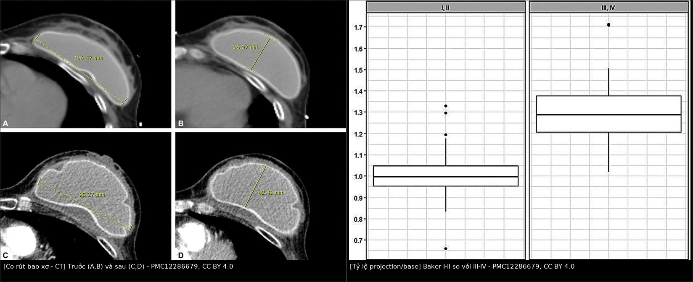
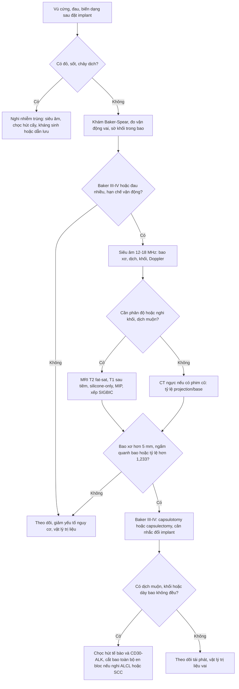
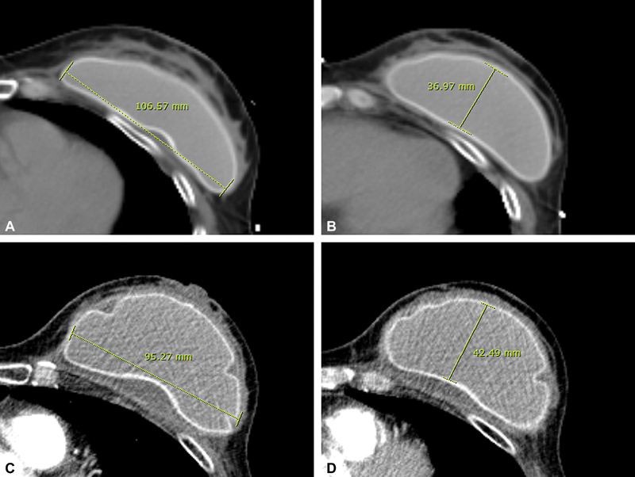
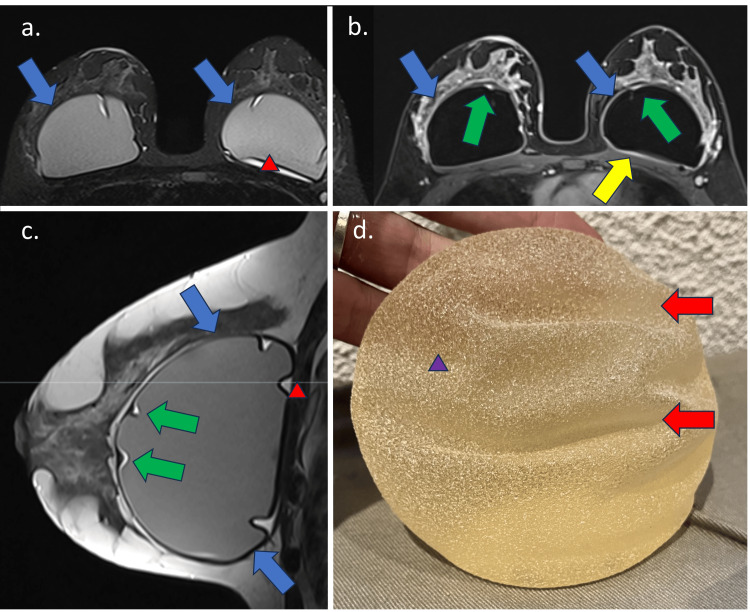

# 1653 — Co rút bao xơ implant ngực & xơ hóa cơ ngực lớn / Capsular contracture and pectoralis major fibrosis

**Tags:** `pattern:day-bao-xo` `pattern:co-rut` `vung:vu` `score:Baker-SIGBIC` `protocol:MRI-vu` `protocol:CT-nguc` `protocol:sieu-am-vu` `incidentaloma:implant-nguc`
**Mức chắc chắn (certainty):** tổng hợp y văn (literature synthesis) — biên từ 5 nguồn toàn văn mở: tổng quan cơ chế – yếu tố nguy cơ – xử trí co rút bao xơ (PMC13208701, CC BY 4.0), nghiên cứu CT định lượng 94 bệnh nhân (PMC12286679, CC BY 4.0), kỹ thuật phân độ MRI SIGBIC (PMC10999057, CC BY 4.0), tổng quan hình ảnh hậu xạ trị vú (PMC13117635, CC BY 4.0) và tổng quan biến chứng implant cho bác sĩ lâm sàng (PMC12067747, CC BY-NC 4.0). Ca trong quiz là ca nguyên văn của nguồn, ghi rõ PMCID.

## 1. Tổng quan — vì sao implant bị "bọc thắt", và vì sao hình ảnh dễ đánh lừa

- **Bản chất bệnh học:** mọi implant đều được cơ thể bao lại bằng **bao xơ (fibrous capsule)** — một phản ứng dị vật lành tính gồm nguyên bào sợi, nguyên bào cơ (myofibroblast) và collagen type I/III. Bình thường bao mỏng, mềm, không co. Khi có **màng sinh học (biofilm) dưới lâm sàng, máu tụ, ma sát, nhiễm trùng hoặc xạ trị**, viêm mạn tính làm nguyên bào cơ tăng sinh và co kéo → bao dày, xơ, **co rút** (capsular contracture — CC).
- **TẠI SAO co rút làm ngực cứng và biến dạng:** sợi collagen được cross-link và các nguyên bào cơ co lại như một "túi co"; implant bị ép từ hình cầu dẹt sang hình **giọt dài hơn, hẹp đáy hơn**. Vì vậy trên ảnh không chỉ có "bao dày" mà còn có **đáy implant giảm, độ lồi tăng** — đây là cơ sở hình học để đo trên CT (xem mục 4).
- **TẠI SAO xạ trị là yếu tố nguy cơ mạnh nhất:** tia xạ gây tổn thương nội mô, thiếu oxy mô và tăng TGF-β → xơ hóa cả **bao quanh implant** lẫn **cơ ngực lớn (pectoralis major)** và mô dưới da. Hệ quả là hai bệnh cảnh chồng lấp: **co rút bao xơ** và **xơ hóa cơ ngực lớn sau xạ** — cùng gây cứng, đau, hạn chế vận động vai nhưng vị trí tổn thương và cách xử trí khác nhau.
- **TẠI SAO tín hiệu MRI phản ánh mô xơ:** collagen đặc, ít nước → **giảm tín hiệu trên T1 và T2**; khi còn viêm/phù → **tăng tín hiệu T2/STIR và tăng ngấm thuốc**. Silicone trong lòng implant **thấp trên T1, cao trên T2**. Trên DWI, mô xơ **không hạn chế khuếch tán** (ADC không thấp), khác với khối u đặc; nhưng DWI không phải chuỗi chốt của CC. Bao xơ dày trên ảnh tương ứng với collagen; **độ dày không tuyến tính với triệu chứng** — đây là lý do không thể chỉ đo mm để chẩn đoán.
- **Số liệu nằm lòng:**
  - CC có ý nghĩa lâm sàng (Baker III–IV) khoảng **3–5% ở 5 năm** khi không xạ trị, tăng vọt **20–50%** sau xạ trị vú sau mổ (post-mastectomy radiotherapy — PMRT) (PMC13208701).
  - Trong 94 bệnh nhân tái tạo vú bằng implant theo dõi CT: nhóm Baker III–IV có **15/22 (68,2%)** được xạ trị, so với **4/72 (5,6%)** ở nhóm Baker I–II (**p < 0,001**) (PMC12286679).
  - Ở nhóm Baker III–IV, **đáy implant giảm trung bình 7,137 mm (6,77%)** và **độ lồi tăng 7 mm (21,54%)**; tỷ lệ projection/base tăng trung bình **1,3178 lần**, trong khi nhóm Baker I–II gần như không đổi (**1,0004**) (PMC12286679).
  - Baker là thang **chủ quan**: đồng thuận giữa hai phẫu thuật viên kinh nghiệm chỉ **48%**, κ có trọng số **0,55** (95% CI 0,37–0,72), lệch hơn 1 bậc ở **11%** ca (PMC13208701).

## 2. Mẫu hình + chẩn đoán phân biệt theo vị trí (Gamut)

- **Mẫu hình cốt lõi:** vú **cứng dần, đau âm ỉ, biến dạng/không đối xứng**, sờ thấy implant rõ, có thể hạn chế giơ tay; khởi phát **nhiều tháng đến nhiều năm** sau đặt implant, thường sau xạ trị. Không sốt, không đỏ nóng cấp tính, không chảy dịch.
- **Gamut theo "lớp" tổn thương (từ trong ra ngoài):**
  - **Trong bao quanh implant (pericapsular):** co rút bao xơ (bài này), **u lympho tế bào T liên quan implant (BIA-ALCL — bài 1654)**, **ung thư biểu mô vảy trong bao (BIA-SCC)**, nhiễm trùng bao, máu tụ/seroma muộn, **u hạt silicone (silicone granuloma)**.
  - **Vỏ implant:** rách vỏ trong bao (intracapsular rupture — dấu "linguine"/"salad oil"), rách ngoài bao (extracapsular — "snowstorm"), gel bleed, nếp gấp vỏ (radial fold).
  - **Cơ ngực lớn – thành ngực:** **xơ hóa cơ ngực lớn sau xạ**, biến dạng khi vận động (animation deformity), rách cơ, tái phát ung thư thành ngực, hoại tử xương sườn sau xạ.
  - **Da – mô dưới da:** viêm mô tế bào, hoại tử mỡ, viêm da do xạ, viêm tĩnh mạch nông (Mondor).
- **Mnemonic "FIRM" cho vú cứng sau implant:** **F**ibrosis (bao xơ + cơ ngực), **I**nfection, **R**upture, **M**ass (BIA-ALCL/BIA-SCC/tái phát). Nếu có **F** mà không có **I/R/M**, nghĩ CC; nếu có bất kỳ dấu nào của I/R/M, phải loại trừ trước khi quy cho "co rút đơn thuần".
- **Phân biệt bằng tay trước khi dùng máy:** độ cứng **lan tỏa quanh toàn implant** + không sốt = CC; cứng **khu trú một vùng, đau chói, đỏ nóng** = nhiễm trùng/viêm; **cứng kèm hạn chế giơ tay và đau cơ khi kháng lực** = xơ cơ ngực lớn; **sờ thấy khối rắn trong bao** = phải loại trừ BIA-ALCL/BIA-SCC/tái phát.

## 3. Bảng so sánh phân biệt (ma trận đối chiếu)

| Thực thể (entity) | Hình ảnh / lâm sàng điển hình | Chốt vào (rule-in) | Chốt loại (rule-out) | Gợi ý xác nhận |
|---|---|---|---|---|
| **Co rút bao xơ (CC)** | Cứng lan tỏa, biến dạng, đau; MRI bao dày > 5 mm hoặc ngấm thuốc; CT đáy giảm/độ lồi tăng | **Cứng tiến triển + bao dày không đều/ngấm thuốc + tỷ lệ projection/base tăng > 1,233 lần so với phim cũ** | Không có dịch/khối trong bao, bao mỏng đều, ngực mềm ổn định → không phải CC có ý nghĩa | Baker–Spear + MRI SIGBIC; CT nếu có baseline |
| **Xơ hóa cơ ngực lớn sau xạ** | Sau PMRT: đau cơ, hạn chế giơ tay, cơ ngực lớn teo/dày, mất cấu trúc bó cơ; không có bao quanh implant dày | **Tiền sử xạ + đau cơ khi kháng lực + MRI cơ giảm tín hiệu T1/T2, teo, không có tổn thương trong bao** | Cơ bình thường, đau chỉ ở bao/implant → loại | MRI T1/T2/STIR; so bên đối diện |
| **BIA-ALCL (bài 1654)** | Dịch quanh implant muộn > 1 năm hoặc khối trong bao; đau, sưng, bất đối xứng | **Dịch muộn + tế bào ác tính CD30 dương/ALK âm trong dịch hoặc bao** | Dịch trong < 1 năm, đơn giản, không có khối/tế bào lạ → ít nghĩ | Chọc hút dịch tươi: tế bào học, CD30/ALK, flow cytometry; sinh thiết khối |
| **Nhiễm trùng bao/implant** | Đỏ nóng, sốt, đau tăng nhanh; siêu âm dịch có vách, dày bao, tăng sinh mạch; CT/MRI viêm mô xung quanh | **Sốt + đỏ nóng + dịch đục/mủ, cấy dương** | Không sốt, không đỏ, dịch trong, cấy âm → loại | Chọc hút cấy + kháng sinh; dẫn lưu nếu tụ mủ |
| **Rách vỏ implant** | MRI: dấu "linguine"/"salad oil" (trong bao), "snowstorm" trên siêu âm (ngoài bao); CT có thể thấy vỏ gấp | **MRI chuỗi silicone-only thấy silicone ngoài vỏ + dấu linguine** | Vỏ liên tục, không silicone ngoài vỏ → loại | MRI có chuỗi silicone; siêu âm bổ sung |
| **Seroma/máu tụ muộn** | Dịch quanh implant, có thể đột ngột sau chấn thương; máu tụ T1 sáng/CT tăng tỷ trọng; seroma đơn giản, không khối | **Dịch đơn giản, không có thành phần đặc, tự giảm theo thời gian** | Dịch phức tạp, có mảnh vụn/khối, không giảm → phải loại trừ ALCL/SCC | Siêu âm lặp; chọc hút tế bào nếu > 1 năm |
| **Tái phát ung thư vú / di căn thành ngực** | Khối đặc, bờ không đều, ngấm thuốc, xâm lấn cơ/thành ngực; không khu trú trong bao | **Khối đặc ngoài bao + tế bào học/sinh thiết ác tính** | Tổn thương chỉ trong bao, không xâm lấn → loại | MRI tăng ngấm + sinh thiết |
| **U hạt silicone/hoại tử mỡ** | Nốt trong bao, T2/STIR tối ("black hole"), có thể vôi hóa; không ngấm mạnh thì là xơ | **Tín hiệu tối STIR + vôi hóa vỏ + không tăng ngấm thì muộn** | Tăng ngấm mạnh, xâm lấn, dịch muộn → loại | MRI + theo dõi; sinh thiết nếu không chắc |

*Trái: CT ngực axial cùng bệnh nhân — (A) đáy 106,57 mm và (B) độ lồi 36,97 mm trước co rút; (C) đáy 95,27 mm và (D) độ lồi 42,49 mm sau co rút. Tỷ lệ projection/base tăng từ 0,347 lên 0,446 (1,286 lần). Phải: biểu đồ tỷ lệ sau/chia trước — nhóm Baker I–II quanh 1,0; nhóm III–IV quanh 1,27. Nguồn: Oh WS et al., Arch Plast Surg 2025;52:217–224 (PMC12286679), CC BY 4.0. Ảnh ghép letterbox, giữ nguyên tỷ lệ, không crop.*

### Ba phép đo cần làm đúng

- **Đáy implant (base):** đo đường kính lớn nhất của implant trên **lát axial** ở mức rộng nhất, tính bằng mm.
- **Độ lồi (projection):** đo **vuông góc với mặt phẳng đáy**, từ mặt trước implant tới đường nối hai đầu đáy — không đo chéo theo trục giải phẫu.
- **Ngưỡng:** nếu tỷ lệ projection/base **tăng > 1,233 lần** so với phim trước đó → gợi ý **Baker III–IV** (PMC12286679). Đây là ngưỡng của **một nghiên cứu hồi cứu 94 bệnh nhân**, chưa phải tiêu chuẩn quốc tế; **bắt buộc có phim baseline cùng tư thế** mới dùng được.

## 4. Protocol chụp – khám – điều trị + thang điểm

**Bước 1 — lâm sàng theo Baker–Spear (không thay bằng hình ảnh):**

| Bậc (grade) | Khám lâm sàng | Ý nghĩa |
|---|---|---|
| IA | Mềm, tự nhiên, không sờ rõ implant | Bình thường |
| IB | Sờ rõ implant, không cứng, không biến dạng | Gần bình thường |
| II | Hơi cứng, sờ rõ, có thể nhìn thấy implant, không triệu chứng | Nhẹ |
| III | Cứng vừa, biến dạng rõ, có thể đau | Có ý nghĩa lâm sàng |
| IV | Cứng, đau, lạnh, biến dạng nặng | Có ý nghĩa lâm sàng |

- Ghi **Baker–Spear** mỗi lần khám; nhớ rằng đồng thuận chỉ **48%**, κ **0,55** — không dùng một mình để quyết định mổ (PMC13208701).
- Khám thêm: giơ tay/dạng tay (phân biệt xơ cơ ngực), sờ khối trong bao, hạch nách, da và sẹo.

**Bước 2 — siêu âm tuyến vú (đầu tay):**
- Đầu dò **tuyến tính 12–18 MHz**; khảo sát toàn bộ bao quanh implant, đo độ dày bao tại chỗ dày nhất, tìm **dịch, vách, mảnh vụn, khối trong bao**, nếp gấp vỏ và tăng sinh mạch bằng Doppler.
- Siêu âm phân biệt được **dịch đơn giản** với **dịch phức tạp/có khối**, nhưng **không đo được chính xác thể tích** và phụ thuộc người làm; không có ngưỡng mm được đồng thuận cho CC.

**Bước 3 — MRI khi cần phân độ/loại trừ:**
- Protocol tối thiểu: **axial T2 fat-sat hoặc STIR**, **T1 trước và sau gadolinium**, **chuỗi silicone-only**, thêm **MIP** để đánh giá ngấm thuốc quanh bao.
- Áp dụng thang **SIGBIC** (silicone-induced granuloma of silicone implant capsule) (PMC10999057):
  - **Grade 1:** bao gần như không đổi, dày nhẹ, ngấm nhẹ, MIP âm.
  - **Grade 2:** bao dày và ngấm rõ nhưng **< 5,0 mm**, có "black-drop", MIP âm.
  - **Grade 3:** dày **khu trú > 5,0 mm** hoặc mô không đồng nhất ngấm muộn trong bao, MIP âm.
  - **Grade 4:** bao dày/ngấm lan tỏa, **ngấm quanh bao**, có thể mất liên tục bao, MIP dương.
- Lưu ý: SIGBIC phân độ **bao xơ**, không phải thang triệu chứng; trong bài gốc nhiều ca **MRI grade 3–4 nhưng Baker chỉ 2** — hình ảnh có thể "nặng hơn" lâm sàng (PMC10999057). Đây là **phân độ đề xuất của một nhóm tác giả**, chưa được xác nhận đa trung tâm — dùng để mô tả và theo dõi, không dùng một mình để chỉ định mổ.

**Bước 4 — CT ngực khi đã có phim theo dõi:**
- Áp dụng cho bệnh nhân ung thư có CT ngực định kỳ: đo base/projection trên cùng cửa sổ, cùng tư thế, rồi tính tỷ lệ; **chỉ so với phim trước**.
- Ưu điểm: khách quan, tái lập; hạn chế: bức xạ, không đánh giá được mô bao/ngấm thuốc, và **không dùng cho người chưa có baseline**.

**Bước 5 — quyết định điều trị (theo lâm sàng + hình ảnh, không theo một con số):**

**Điều trị và dự phòng — số liệu để tư vấn trung thực:**
- **Baker I–II:** theo dõi, giảm cân nặng/yếu tố cơ học, kiểm soát đau; **montelukast** có dữ liệu gợi ý cho Baker II–III nhưng bằng chứng yếu, cần theo dõi men gan (PMC13208701).
- **Baker III–IV:** **capsulotomy** (mở bao) hoặc **capsulectomy** (cắt bao) ± thay implant; nếu nghi BIA-ALCL/BIA-SCC phải **cắt toàn bộ bao en bloc**, không cắt từng phần (bài 1654).
- **Yếu tố nguy cơ can thiệp được:** máu tụ làm tăng CC **18,2% so với 8,8%** (p = 0,047); nhiễm trùng vết mổ **OR 6,69** (1,74–25,8); béo phì **OR 1,12/kg/m²**; tuổi **OR 1,10/năm**; chẩn đoán ung thư **OR 7,71** (PMC13208701 dẫn NSQIP 6547 bệnh nhân).
- **Chọn implant:** trong **nâng ngực thẩm mỹ**, implant textured giảm CC so với smooth (**OR 0,19; 95% CI 0,07–0,52**), nhưng trong **tái tạo** ưu thế này không rõ và textured lại liên quan BIA-ALCL — **không chọn textured chỉ để phòng CC** (PMC13208701; bài 1654).
- **Thiết bị:** thiết bị giãn–implant kết hợp (permanent tissue expander) có nguy cơ CC nặng **HR 19,3** (3,9–95,4) so với implant cố định thể tích — tránh dùng khi có lựa chọn khác (PMC13208701).
- **Xạ trị:** không thể "phòng" CC hoàn toàn sau PMRT; cần tư vấn trước mổ rằng nguy cơ **20–50%**, theo dõi sát và chụp MRI khi có triệu chứng.

## 5. Biến thể bình thường và cạm bẫy

- **Biến thể bình thường:** bao xơ mỏng, đều, **không co rút**; nếp gấp vỏ (radial fold) là cấu trúc bình thường, không phải rách; "rippling" (gợn sóng) dưới da mỏng cũng lành tính.
- **Cạm bẫy 1 — Baker và hình ảnh không song hành:** nhiều ca **MRI grade 3–4 nhưng Baker 2** (PMC10999057); ngược lại, người Baker III có thể có bao mỏng. Đừng máy móc "phim nặng = mổ", cũng đừng "Baker nhẹ = không cần hình ảnh" khi có đau/khối/dịch.
- **Cạm bẫy 2 — đo độ dày bao trên MRI:** tương quan giữa độ dày bao và Baker **không nhất quán**, nhiều phân tích hồi quy không tìm thấy liên quan có ý nghĩa; các dấu hiệu **hình thái** (implant tròn hơn, đặc hơn, tỷ lệ dài) mới tương quan với Baker III–IV (PMC13208701). Vì vậy dùng **SIGBIC + hình thái**, không chỉ một số mm.
- **Cạm bẫy 3 — xơ hóa sau xạ bị đọc thành tái phát:** xạ trị gây dày da, co kéo mô, xơ cơ và dày bao; vùng xơ **giảm tín hiệu T2**, không có khối ngấm mạnh. Nếu thấy **khối đặc bờ không đều, ngấm mạnh thì muộn hoặc xâm lấn cơ** → sinh thiết, đừng quy cho "di chứng xạ" (PMC13117635).
- **Cạm bẫy 4 — animation deformity:** đặt dưới cơ (subpectoral) gây biến dạng khi gồng cơ ở **20–80%** bệnh nhân; đây là vấn đề cơ học, không phải CC, và không giải quyết bằng cắt bao (PMC13208701).
- **Cạm bẫy 5 — dùng CT khi không có baseline:** tỷ lệ projection/base chỉ có giá trị khi so **cùng bệnh nhân, cùng tư thế, cùng kỹ thuật**; nếu chỉ có một phim, không được áp ngưỡng 1,233.
- **Cạm bẫy 6 — u hạt silicone giả khối:** nốt xơ/silicone trong bao có thể **tối trên STIR** và ngấm muộn; nếu không tăng ngấm mạnh, không xâm lấn, có thể theo dõi — nhưng **dịch muộn hoặc khối mới vẫn phải loại trừ ALCL/SCC**.
- **Cạm bẫy 7 — "chỉ là seroma":** bất kỳ dịch quanh implant **mới, muộn hơn 1 năm** đều phải chọc hút và gửi tế bào học, **không theo dõi mù** (bài 1654).

## 6. Tự lượng giá — Blind Quiz

**Ca 1 — Nữ, tái tạo vú trái bằng implant; CT ngực 6 tháng sau mổ và 28 tháng sau mổ (cùng bệnh nhân). Ngực cứng dần, biến dạng nhẹ, không sốt.**

- Gợi ý: ảnh A/B là trước, C/D là sau; đơn vị mm đã ghi trên ảnh.
- Câu hỏi: (1) Tính tỷ lệ projection/base trước và sau. (2) Tỷ lệ tăng bao nhiêu lần, và ngưỡng nào gợi ý Baker III–IV? (3) Ba chẩn đoán phân biệt cần loại trừ trước khi kết luận CC?

<b>Bấm để hiện đáp án (findings + chẩn đoán)</b>

- **Findings:** trước: đáy **106,57 mm**, độ lồi **36,97 mm** → tỷ lệ **0,347**. Sau: đáy **95,27 mm**, độ lồi **42,49 mm** → tỷ lệ **0,446**. Đáy giảm **10,6%**, độ lồi tăng **14,9%**.
- **Tính:** 0,446 / 0,347 = **1,286 lần** — vượt ngưỡng **1,233**, phù hợp **Baker III–IV** theo nghiên cứu CT 94 bệnh nhân (PMC12286679). Đây là ca minh họa của bài gốc (6 tháng và 28 tháng sau tái tạo vú trái).
- **Chẩn đoán:** **co rút bao xơ có ý nghĩa lâm sàng**, trên nền tái tạo vú bằng implant.
- **Loại trừ:** (1) **nhiễm trùng bao** — sốt, đỏ nóng, dịch đục; (2) **BIA-ALCL/BIA-SCC** — dịch muộn, khối trong bao, dày bao không đều; (3) **rách vỏ implant** — dấu linguine/snowstorm; thêm **xơ hóa cơ ngực lớn** nếu đau cơ và hạn chế giơ tay.
- **Nguồn:** Oh WS, Lee SH, Lee JW, Seo JY, Kim CR, Nam SB. *Arch Plast Surg* 2025;52:217–224 (PMC12286679), CC BY 4.0.

**Ca 2 — Nữ 39 tuổi, đặt implant silicone 6 năm, ngực cứng nhẹ, Baker lâm sàng 2. MRI có STIR, T1 sau tiêm và chuỗi proton density.**

- Gợi ý: chú ý **(a)** bao dày bên trái, **(b)** ổ dịch trong bao và **mô dày khu trú ngấm muộn** (mũi tên xanh), **(d)** mặt vỏ implant bị thoái hóa và nếp gấp.
- Câu hỏi: (1) Bao dày bao nhiêu thì chuyển từ SIGBIC grade 2 sang grade 3? (2) Vì sao Baker 2 mà MRI có thể đã grade 3? (3) Điều này thay đổi thái độ điều trị thế nào?

<b>Bấm để hiện đáp án (findings + chẩn đoán)</b>

- **Findings:** bao xơ dày, **khu trú > 5,0 mm**, kèm **ổ dịch trong bao** và **mô dày ngấm thuốc muộn** — tương ứng **SIGBIC grade 3**. Ảnh (d) cho thấy vỏ implant thoái hóa, mất thể tích và tạo nếp gấp.
- **Ngưỡng:** grade 2 là dày **< 5,0 mm**; grade 3 khi **> 5,0 mm khu trú** hoặc có mô không đồng nhất ngấm muộn; grade 4 khi ngấm lan tỏa/quanh bao, MIP dương (PMC10999057).
- **Vì sao lệch Baker:** Baker đo **độ cứng bằng tay**, không đo mô bao; MRI phát hiện xơ hóa/viêm sớm hơn triệu chứng. Vì vậy **không dùng một mình Baker để quyết định**, và cũng **không mổ chỉ vì MRI grade 3** nếu không đau, không biến dạng.
- **Thái độ:** theo dõi + kiểm soát triệu chứng; nếu cứng tăng, đau hoặc biến dạng → cân nhắc capsulectomy ± đổi implant; nếu có dịch/khối mới → loại trừ ALCL trước.
- **Nguồn:** De Faria Castro Fleury E. *Cureus* 2024;16(3):e55776 (PMC10999057), CC BY 4.0.

## Bài liên quan chéo
- [500 – Tổng quan Hệ Vú & Sản Phụ khoa](../500-tong-quan-vu-san-phu-khoa/lesson.md)
- [510 – Vú: BI-RADS trên nhũ ảnh, siêu âm, MRI](../510-vu-BIRADS-nhu-anh-sieu-am-MRI/lesson.md)
- [512 – Vi vôi hóa & túi ngực biến dạng](../512-vi-voi-hoa-tui-nguc-bien-dang/lesson.md)
- [516 – Hình ảnh vú sau điều trị](../516-hinh-anh-vu-sau-dieu-tri/lesson.md)
- [522 – Theo dõi sau điều trị ung thư vú & tái phát muộn](../522-theo-doi-sau-dieu-tri-ung-thu-vu/lesson.md)
- [523 – Sarcoma mạch do xạ vú (AVL) vs tổn thương mạch lành](../523-sarcoma-mach-do-xa-vu/lesson.md)
- [1613 – Viêm tuyến vú, u hạt và áp-xe vú](../1613-viem-tuyen-vu-u-hat-va-ap-xe-vu/lesson.md)
- [1654 – Dịch quanh implant muộn & BIA-ALCL](../1654-dich-quanh-implant-nguc-va-bia-alcl/lesson.md)
- [1651 – Cứng khớp vai dính sau điều trị ung thư vú](../1651-cung-khop-vai-sau-dieu-tri-ung-thu-vu/lesson.md)
- [1652 – Hội chứng cơ ngực bé & lối thoát ngực thần kinh](../1652-co-nguc-be-loi-thoat-nguc/lesson.md)

> Không dùng để chẩn đoán độc lập khi chưa có người hướng dẫn.
